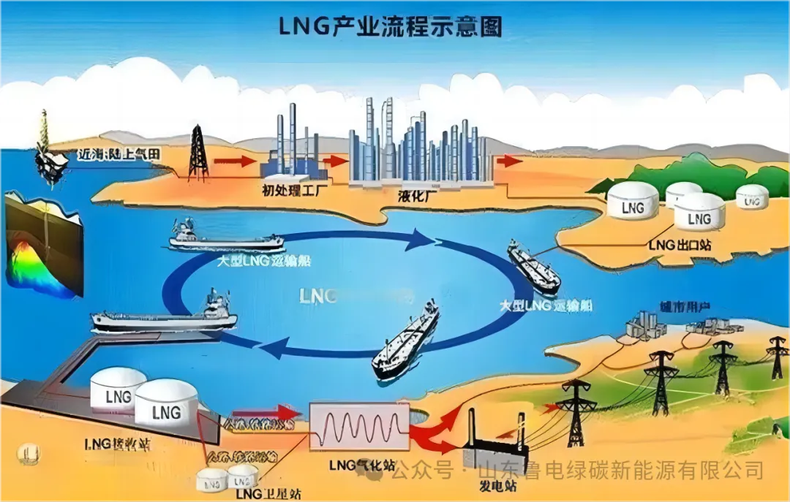
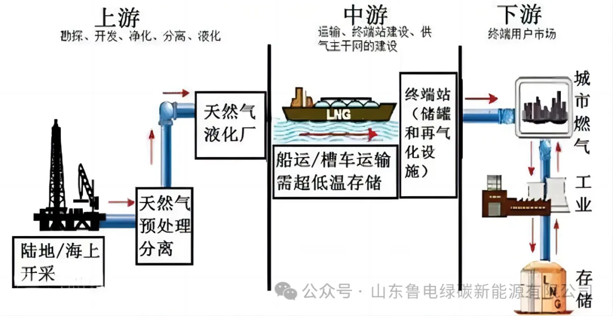

# LNG产业链

## LNG工业系统
LNG工业系统包括天然气的预处理、液化、运输、接收站、储存和再气化等过程，经过近百年的发展，已经形成了成熟的产业链。

## LNG产业链
LNG产业链整个LNG产业链大致可以分为上、中、下游三个阶段。

上游：LNG产业链上游主要包括勘探开发、预处理和液化三个环节。
中游：LNG产业链中游主要包括LNG的运输，LNG接收站（储罐和再气化设施）和供气主干管网的建设等环节。
下游：LNG产业链下游 环节即最终市场用户，包括联合循环电站，城市燃气公司，工业炉用户，工业园区和建筑物冷热电多联供的分布式能源站，加气站等。

## 交易员怎样理解产业链

产业链的上、中、下游划分会随研究目的而变化。本页沿用上文口径；做交易时，更重要的是逐环节确认“谁拥有货物、谁提供服务、谁承担风险、在哪里计量”。EIA 的 LNG 说明介绍了从液化、海运到再气化和管网配送的基本路径 [1]。

| 环节 | 需要掌握的知识 | 成交前要问的问题 |
| --- | --- | --- |
| 气源与液化 | 原料气、预处理、液化耗能、装置检修与爬坡 | 卖方承诺来自单项目还是组合供应？装置停产如何处理？ |
| 装港 | 储罐、泊位、装船窗口、气质与计量 | 能否按期装船，质量和数量如何确认？ |
| 海运 | 运力、航程、航道、天气、燃料和蒸发气 | 运费责任和损耗是否已在价格中体现？ |
| 接收站 | 卸货、罐容、气化、槽车装载和船岸兼容 | 有窗口是否同时有库存空间与外输能力？ |
| 管网与储气 | 输送能力、压力、气质、日度平衡和调峰 | 入口与出口是否都有合同保障？ |
| 终端客户 | 价格承受能力、用气规律、替代能源和信用 | 客户能否在指定时间接气并付款？ |

## 上游：供给能力不等于可售货量

气田产量、液化设计能力、实际产量、已售长协量和可供现货量要分开。原料气处理需要满足液化及产品要求；液化设施也会消耗能源。不能把原料气进厂量等同于 LNG 出口量，更不能假定新增设计产能立即全部转化为现货供应。

从交易角度，液化项目的稳定性、合同供货来源与可替代货安排，往往比“哪个项目规模最大”更重要。

## 中游：实物瓶颈决定可执行性

船到港但无罐容、站有罐容但外输受限、管网有能力但客户少提，都可能导致延误及额外成本。应把船期、储存和日度外输放在同一张时间表中，不能分别核准后就假定整体可行。

中国《能源法》第 43 条对符合条件主体的设施公平接入和使用作出原则性规定 [2]，但具体服务须申请、确认容量并履行合同，不能把公开设计能力直接视为自己的可用能力。

## 下游：从用户需求倒推进口量

先确认客户的交付地点、需求曲线、可承受价格和付款条件，再选择采购模式。电厂需求与电力调度、发电收益有关；工业需求受开工率和替代燃料影响；城市燃气还涉及居民需求、价格机制和保供安排。

国际 LNG 交易员需要理解中国市场，但无需把自己变成设备操作人员。安全、工艺和检验的专业判断，应由具有相应职责与能力的人员作出。

## 练习与参考资料

选一个中国沿海接收站，画出“海外装港 → 船舶 → 接收站 → 管网或槽车 → 客户”的交付链。每一段填入合同主体、计量点、容量、费用和异常责任；无法核实的项目标为待确认。

1. [EIA：Liquefied natural gas](https://www.eia.gov/energyexplained/natural-gas/liquefied-natural-gas.php)，产业链及液化耗能背景。
2. [国家能源局转载：《中华人民共和国能源法》](https://www.nea.gov.cn/2024-11/09/c_1310787187.htm)，设施接入和市场体系原则。

新增内容来源核对日期：2026-09-26。继续学习：[全球供需](./market-analysis.md)、[船货执行](./cargo-operations.md)。

