# IGU 2026 World LNG Report

```
International Gas Union (IGU) 44 Southampton Buildings WC2A 1AP London United Kingdom
Telephone: +44 203 889 0161 E-mail: info@igu.org
Published by the International Gas Union (IGU), Copyright © 2026. The entire content of this publication is protected by copyright, full details of which are available from the publisher. All rights reserved.
No part of this publication may be reproduced, stored in retrieval systems or transmitted in any form or by any means (electronic, mechanical, photocopying, recording or otherwise) without the prior permission of the copyright owner.
```


## Cover Illustration


**Find the Differences?**

Answer: No differences. Same infrastructure. Same everyday life. e-methane can help enable a seamless transition toward a sustainable world by fully using natural gas infrastructure

**Global Environmental Value**

The Japanese gas industry is working to establish international rules for importing e-methane and biogas from overseas. To successfully deploy carbon-neutral gases, Japan needs systems for transferring environmental attributes.
The Japan Gas Association is taking action to meet this need, including issuing Clean Gas Certificates to enable environmental attribute transfer.


## Message from the President, International Gas Union (IGU)

I am pleased to present the 17th annual edition of IGU’s World LNG Report, which provides an authoritative and comprehensive review of the industry at a moment of both growing maturity and unprecedented challenge.

The Report explores a landmark LNG performance in 2025, including record trade volumes and near-record investment in supply capacity. It also addresses how these achievements have shaped the market’s response to the conflict in the Middle East in 2026. Despite the ongoing uncertainty, the Report confirms the strong fundamentals which enable the LNG industry to strengthen its medium-term expansion path in the decade to 2035.

In 2025, global LNG trade grew by 6.3% to 437 million tonnes, the fastest rate since 2022, as Canada and Mauritania/ Senegal joined the ranks of exporters, while the United States provided the bulk of incremental exports. A total of 13 new regasification terminals were added, with one market opening its first ever LNG regasification terminal, while a further eight prospective markets are progressing regasification projects.

Sustained investor confidence was demonstrated by the 68.4 MTPA of liquefaction capacity sanctioned in 2025, only marginally below the record year of 2019. The result caps a remarkable investment cycle from 2021-2025 in which 206 MTPA was approved - double that of the previous five-year period.

Innovation also continued apace across diferent fields, from a rapid expansion of LNG marine bunkering to the integration of lower emissions technology in liquefaction projects. The maturity of floating LNG technology was further confirmed, with 9.5 MTPA of capacity sanctioned in 2025.

The standout feature in trade flows in 2025, was the surge in North American exports, which rose 25.3 Mt on the previous year, and a corresponding rise in European imports, as the latter region reprised its role as a core balancing market.

In 2026, the LNG trade has now entered uncharted waters. The conflict in the Gulf has damaged LNG infrastructure, clouded the outlook for the region’s expansion projects and exposed Asian buyers to flow uncertainty and higher prices. LNG’s vital role as an invaluable ‘shock absorber’ through previous energy crises is being tested.

Andrea Stegher President, International Gas Union

\* Defined as spot cargoes and contracts of under one year. Source: IGU 2026 Wholesale Gas Price Survey

Yet the market’s response demonstrates an industry which has come of age. The ability of a larger and more diversified supply chain to mobilise 40% of volumes on a spot basis\* has helped to contain the immediate impact of the Strait of Hormuz crisis. Rising liquidity on global Gas benchmarks has ofered participants the tools to manage risk.

Looking ahead, the fundamental drivers underpinning the longer-term outlook for LNG demand through 2035 remain intact. Population growth, urbanisation, digitalisation, rising electricity demand and the continued pursuit of cleaner energy systems will require reliable and flexible energy solutions which LNG is uniquely positioned to support.

The challenges of 2026 are significant, but they do not alter the industry's long-term trajectory. Rather, they reinforce the importance of continued investment, innovation and international cooperation to ensure that LNG can continue delivering secure, afordable and lower-emission energy to communities around the world.

In order to secure these benefits, it is imperative that policy makers act to shield energy infrastructure, secure freedom of navigation and avoid creating unnecessary impediments to trade.

Against that backdrop, this Report ofers a timely and practical reference for understanding where the LNG industry stands today and how it may evolve over the rest of the decade. It is intended to inform discussion, support decision-making and provide a structured view of an industry rising to the challenge.

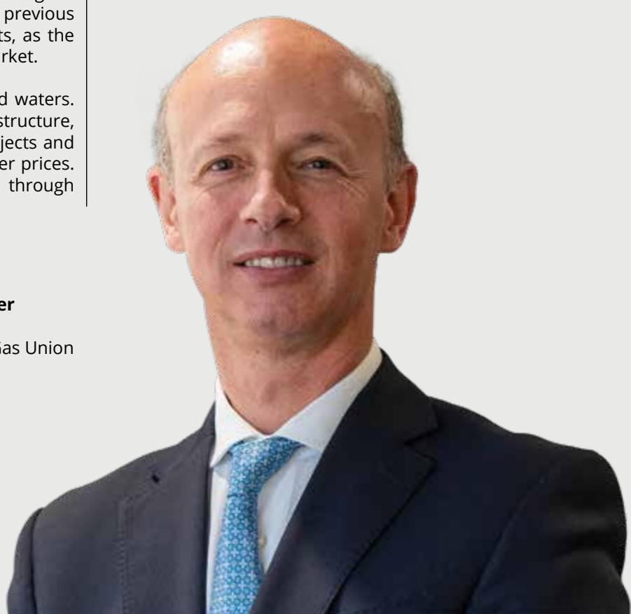

1. State of the LNG Industry – strong fundamentals into 2026

  
Courtesy LNG Canada

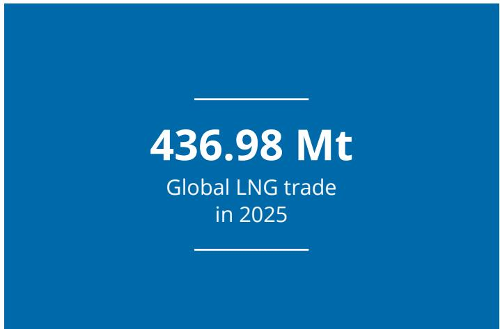

Global liquefied natural gas (LNG) trade reached a new record of 436.98 million tonnes (Mt) in 2025, up 25.74 Mt, or 6.3%, from 2024, connecting 24 exporting markets with 50 importing markets. Growth was driven primarily by higher output from the US, which added 22.3 Mt year-on-year, alongside increased exports from Qatar, Malaysia, Angola, and Nigeria. Canada and Mauritania/Senegal also recorded their first LNG exports, adding 2.14 Mt and 1.22 Mt, respectively, while re-export trade remained broadly stable at 4.91 Mt.

Asia Pacific1 remained the largest exporting region with 138.76 Mt in 2025, largely unchanged from 2024. North America recorded the strongest regional export growth, rising by 25.3 Mt to 113.91 Mt, driven overwhelmingly by the US. The Middle East remained a major supply region, with exports increasing by 3.8 Mt to 98.03 Mt, supported by an uptick in Qatari output. Africa added 1.8 Mt to reach 39.77 Mt, while exports from Russia declined by 3.0 Mt to 30.52 Mt. The US remained the world’s largest LNG exporter at 110.74 Mt, followed by Qatar at 81.51 Mt and Australia at 80.32 Mt.

On the import side, Asia Pacific remained the largest LNG-importing region, receiving 168.7 Mt in 2025, up 3.6 Mt from the previous year. The largest shift was Europe’s return as a major demand growth centre, with imports rising by 26.1 Mt to 126.2 Mt as the region replaced lower Russian pipeline gas flows and replenished storage inventories. Africa also emerged as a stronger importing region, with imports rising to 9.8 Mt from 2.7 Mt, almost entirely due to Egypt’s higher LNG requirements. In contrast, imports into Asia declined by 9.2 Mt to 108.7 Mt, driven mainly by lower intake in China and India.

China remained the world’s largest LNG importer in 2025 at 69.77 Mt, but volumes fell by 8.9 Mt year-on-year due to mild winter demand, higher domestic gas production and increased pipeline imports from Russia. Japan was the second-largest importer at 67.37 Mt, broadly unchanged from 2024, while South Korea increased imports by 1.7 Mt to 48.67 Mt. In Europe, import growth was broad-based, led by Italy (+4.4 Mt), France (+3.6 Mt), Spain (+3.6 Mt), Türkiye (+3.4 Mt), the Netherlands (+2.9 Mt), Belgium (+2.5 Mt), and Germany (+2.2 Mt). The stronger European pull, combined with softer Asian spot demand, redirected more Atlantic Basin supply towards Europe and contributed to a modest increase in regionalisation of LNG trade flows.

In the first quarter of 2026, Middle East disruptions and heightened risks around the Strait of Hormuz shifted near-term LNG trade dynamics. With Qatar accounting for 81.5 Mt of LNG shipments in 2025, or 18.7% of global exports, supply risks in the region quickly tightened market sentiment and increased competition for flexible cargoes. Asian buyers diverted Atlantic Basin cargoes away from Europe, highlighting how quickly trade flows can adjust when supply security concerns rise, reinforcing the importance of flexible Atlantic supply, portfolio optimisation and destination flexibility as the market entered 2026.

Price Trends  


LNG prices in 2025 reflected an increasingly regionalised global market, with Asia showing stronger seasonal volatility while the Atlantic basin remained well supplied. The Platts JKM benchmark averaged US\$12.16 per million British thermal units (MMBtu), up 2.1% from 2024, with a wider trading range of US\$9.39-US\$17.12/ MMBtu. Price movements were driven by seasonal demand patterns, weather-related procurement needs and competition for flexible cargoes. Two price rallies shaped the year: the first in early February, when colder weather forecasts and declining European gas storage lifted prices, and the second in mid-June, when escalating tensions between Israel and Hamas added a temporary geopolitical risk premium.

In the Atlantic basin, strong supply and limited eastward pull from Asian buyers reduced inter-basin competition for much of the year. The average arbitrage of North Asia via the Cape of Good Hope versus the Atlantic was assessed at minus US\$0.71/MMBtu in 2025, indicating that Atlantic-bound flows remained more economic than diversions to Asia. Along with subdued shipping rates, this kept the Atlantic basin structurally long and reinforced Europe’s role as the clearing market for surplus LNG supply. Subdued summer restocking in Europe further capped sustained price upside.

Market dynamics shifted in the first quarter of 2026. Geopolitical disruptions in the Middle East reduced available supply and led to a sharp widening of price spreads between basins. This triggered increased competition for flexible cargoes, higher price volatility and stronger physical and derivatives trading activity as market participants hedged supply risk. Platts JKM rose nearly 70% to US\$25.39/MMBtu on 3 March, its highest level since December 2022. The supply shock also lifted trading activity, with Asia physical Platts MOC transactions rising 77% YoY to 62 in Q1 2026, while derivatives volume surged 251% YoY to 1,744 contracts as participants hedged price volatility and supply risk.

Overall, LNG pricing continues to evolve towards a more liquid and globally interconnected system. Compared with the 2022 energy crisis, the 2026 price response has so far been more contained, reflecting a better-supplied market, deeper benchmark-linked liquidity, and more active hedging through physical and derivatives markets. However, arbitrage economics, regional supply-demand balances, and inter-basin spreads remain key drivers of trade flows, particularly during periods of supply disruption.

## Liquefaction Plants


Global liquefaction capacity grew by 30.1 million tonnes per annum (MTPA) in 2025, reaching approximately 524.5 MTPA by year-end. Capacity growth was driven primarily by the ramp-up and commissioning of Plaquemines LNG trains in the US (15.1 MTPA), Corpus Christi Stage 3 in the US (6.0 MTPA), LNG Canada (7.0 MTPA), Tortue/Ahmeyim Floating LNG (FLNG) in Mauritania/ Senegal (2.5 MTPA) and Arctic LNG 2 adding 6.6 MTPA of capacity. These additions were partly ofset by retirements at older facilities in Australia, Trinidad and Tobago and the US. The US, Australia and Qatar remained the three largest LNG-exporting markets by operational liquefaction capacity, collectively accounting for more than half of global capacity. Despite the increase in installed capacity, global utilisation declined slightly to 83.9% due to maintenance activity, mechanical outages, severe weather events, and commissioning-related challenges at newly started facilities.

Liquefaction final investment decision (FID) activity rebounded strongly in 2025, with 68.4 MTPA of capacity sanctioned, representing the highest annual level since 2019. Most FIDs were concentrated in the US following regulatory changes supporting LNG development. Major projects reaching FID during the year included Woodside Louisiana LNG (16.5 MTPA), Calcasieu Pass 2 LNG (14.4 MTPA), Port Arthur Phase 2 (13.0 MTPA), Rio Grande Phase 2 (12.0 MTPA), and Corpus Christi Midscale Trains 8-9 (3.0 MTPA). Outside North America, Coral North FLNG in Mozambique (3.6 MTPA) and Southern Energy FLNG in Argentina (6.0 MTPA) also reached FID, highlighting continued investment interest in flexible ofshore LNG developments. Decarbonisation and emissions reduction continued to shape liquefaction project development in 2025. Developers increasingly incorporated electric-drive liquefaction systems, renewable power integration and carbon capture and storage (CCS) solutions into new LNG projects. Several proposed developments in North America and the Middle East advanced lower-emission project designs aimed at reducing lifecycle emissions intensity, while operators also continued exploring bio-LNG and synthetic methane integration across the LNG value chain. Even so, cost inflation, permitting complexity, and infrastructure constraints continued to challenge the implementation of some decarbonisation initiatives.

Floating LNG (FLNG) continued to expand its role within the global liquefaction sector during the year. By end-2025, global operational FLNG capacity stood at 16.6 MTPA across eight units, supported by first LNG production from Tortue/Ahmeyim FLNG, which exported its first cargo in April and reached around 90% utilisation by year-end. Additional floating developments advanced in Mozambique and Argentina, with Coral North FLNG reaching FID and expected to double Mozambique’s FLNG capacity to around 7 MTPA, while Southern Energy FLNG was approved as Argentina’s first LNG export project. Overall, 172 MTPA of proposed liquefaction capacity was linked to FLNG developments by end-2025, reflecting growing interest in modular ofshore solutions that can monetise stranded natural gas resources, reduce onshore infrastructure requirements, and ofer shorter development timelines.

Technology innovation remained an important focus across the liquefaction industry. Modular and mid-scale liquefaction concepts gained further momentum, particularly in North America, where developers increasingly adopted scalable train configurations and prefabricated construction approaches to improve project flexibility and execution. Honeywell technologies continued to dominate global installed liquefaction capacity, while alternative liquefaction technologies expanded their presence across newer LNG developments. As LNG markets continue evolving, technology selection, emissions performance, and construction eficiency are expected to remain key diferentiators for future liquefaction projects.

In early 2026, liquefaction fundamentals became more exposed to geopolitical risk despite new supply start-ups. Golden Pass LNG achieved its first LNG in March and exported its first cargo on 22 April, adding new US supply to the market. This was, however, ofset by mounting concerns around Middle East supply following the closure of the Strait of Hormuz and disruption to Qatari and UAE liquefaction capacity. QatarEnergy declared force majeure on multiple LNG contracts, while missile damage to two Ras Lafan LNG trains is expected to keep 12.8 MTPA of nameplate capacity ofline for three to five years. These developments tightened the near-term supply outlook and underscored the importance of diversified liquefaction capacity as the market moved into 2026.

## Proposed New Liquefaction Plants

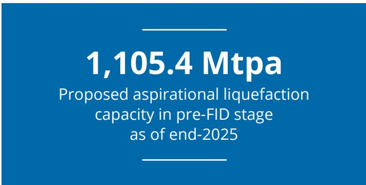

As of the end of 2025, 1,105.4 MTPA of potential liquefaction capacity remained in the pre-FID stage globally, broadly unchanged from 2024. North America accounted for the largest share with 650.3 MTPA, including 384.4 MTPA in the US, 227.3 MTPA in Canada, and 38.6 MTPA in Mexico. This was followed by Russia with 170.4 MTPA, Africa with 121.1 MTPA, Asia Pacific with 67.0 MTPA, and the Middle East with 65.7 MTPA, with about 31 MTPA located elsewhere.

The proposed pipeline remained concentrated in North America, supported by a favourable US investment environment and flexible commercial structures. In the US, proposed capacity included large-scale Gulf Coast developments and floating LNG concepts such as Delfin FLNG. In Canada, only a limited share of the 227.3 MTPA pipeline is considered viable, with Ksi Lisims LNG, LNG Canada Phase 2, and Cedar LNG among the more prominent projects. Mexico’s proposed capacity remained centred on additional FLNG concepts around Altamira. Outside North America, Russia retained a substantial pipeline through the remaining Arctic LNG 2 trains, Ob LNG, and Murmansk LNG, although sanctions, financing constraints, and limited access to Western technology continue to weigh on timelines.

Africa remained a major source of proposed LNG growth, led by Mozambique, with around 45 MTPA across Rovuma LNG, Mozambique LNG, and further ofshore LNG concepts. In Asia Pacific, Australia remained the largest source of proposed regional capacity, including Wheatstone Train 3-5, Gorgon Train 4, and Abbot Point LNG, while Indonesia’s pipeline was led by Abadi LNG. In the Middle East, proposed capacity was concentrated in Iran and Qatar, with additional projects in Iraq and Oman.

Geopolitical developments in early 2026 increased uncertainty around regional project timing, including the North Field expansion programme. Potential restrictions around the Strait of Hormuz and disruptions to Qatari and UAE liquefaction capacity could have mixed implications for future FIDs: reinforcing energy security concerns and supporting interest in supply diversification, while also raising geopolitical risk, cost pressures, contractor constraints and financing challenges. While energy security concerns may support interest in new supply, cost inflation, regulatory constraints, contractor availability, and tougher post-2025 project economics mean only a portion of the global pre-FID pipeline is expected to move forward.

## LNG shipping

## 804 Vessels


LNG fleet as of end-2025

The LNG shipping market in 2025 remained under significant pressure as limited LNG supply growth coincided with another large wave of vessel deliveries. A total of 6,870 LNG trade voyages were recorded during the year, down 2.8% from 2024, reflecting the use of larger vessels. By contrast, the active LNG carrier fleet expanded to 804 vessels by the end of 2025, including 49 FSRUs and 11 FSUs, representing an 8.4% year-on-year increase following the delivery of 79 vessels. The continued fleet expansion relative to LNG trade growth kept the market oversupplied and weighed on freight rates for most of the year.

Charter rates remained at historically weak levels throughout much of 2025. Modern two-stroke vessels frequently earned rates barely covering operating costs, while some steam turbine vessels traded at or below cash breakeven levels. A temporary tightening emerged during October and November, driven by winter stocking, cargo delays and the ramp-up of new US liquefaction capacity. During this period, rates for X-DF and ME-GI vessels recovered above US\$60,000/ day, with peaks exceeding US\$100,000/day, although the broader market remained weak overall. The oversupply of vessels was further exacerbated by Europe’s continued pull on Atlantic Basin cargoes, which reduced tonne-mile demand by keeping vessels regionally constrained.

Trade routes continued to be impacted by logistical and geopolitical disruptions. While Panama Canal conditions improved compared with the severe drought disruptions of 2023, congestion and weatherrelated risks remained a concern. Meanwhile, tensions around the Red Sea continued to discourage LNG carriers from transiting the Suez Canal, forcing many Atlantic-Pacific voyages to reroute via the Cape of Good Hope. Still, the availability of excess shipping capacity meant these disruptions had only a limited impact on charter rates compared with the tighter markets of 2022 and 2023.

On the technology front, X-DF propulsion systems further consolidated their position as the dominant choice for LNG newbuilds. Around 185 X-DF vessels were on order by the end of 2025, compared with 47 ME-GA and 23 ME-GI units. Momentum shifted further toward X-DF technology after Everllence B&W announced in late 2024 that it would discontinue production of the ME-GA engine due to tightening International Maritime Organisation (IMO) nitrogen oxide (NOx) regulations expected from 2027 onward. The trend toward larger and more eficient vessels also continued, with all conventional LNG carriers delivered in 2025 exceeding 170,000 cm in capacity.

Looking into 2026, the Hormuz crisis has added significant uncertainty to LNG shipping markets, reversing the weak-rate environment seen at the start of the year as East of Suez prompt rates surged from around US\$14,250/day in early February to a peak of US\$300,000/ day on 5 March, before easing but remaining near US\$100,000/day by late April. The disruption also clouds the timing and scale of Qatari vessel requirements, as any delays to North Field East expansion volumes could defer some near-term tonnage demand, even though the longer-term need for large-capacity LNG carriers is expected to remain once project timelines normalise.

## Regasification terminals

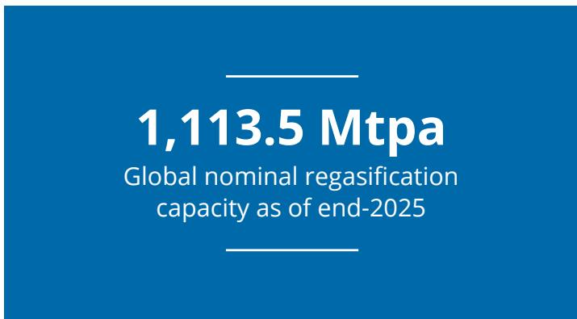

## 1,113.5 MTPA

Global nominal regasification capacity as of end-2025

Global LNG regasification infrastructure continued to expand in 2025, with total installed capacity reaching 1,113.5 MTPA across 50 markets. During the year, 20 regasification projects were commissioned across 13 markets, comprising 13 new terminals and seven expansions at existing facilities. These additions contributed 62.9 MTPA of new capacity globally. Among the largest projects brought online were the Ain Sokhna (Sonkar) FSRU and Ain Sokhna (Sumed) FSRU in Egypt, each with a capacity of 5.7 MTPA, alongside the 5.7 MTPA Aqaba FSRU in Jordan. China remained the largest contributor to global regasification growth, commissioning five projects with combined additions of 15.1 MTPA.

The composition of new infrastructure continued to evolve in 2025. Floating-based import terminals remained an important source of capacity growth, particularly in markets prioritising deployment speed, lower upfront costs, and supply flexibility. Asia accounted for the largest share of additions with 22.2 MTPA, followed by Africa with 17.2 MTPA, Europe with 11.0 MTPA, Asia Pacific with 6.6 MTPA, and the Middle East with 5.7 MTPA. Of the total additions, 42.6 MTPA came from newly commissioned terminals, while 20.3 MTPA was added through expansions at existing facilities.

Despite continued capacity additions, global regasification utilisation rose only marginally to 39.2% in 2025 from 38.5% in 2024. Regional utilisation trends remained uneven. In Europe, LNG imports increased following the cessation of Russian pipeline gas transit via Ukraine at the beginning of 2025, supporting a moderate recovery in terminal utilisation. Yet, utilisation levels remained well below those seen during the peak of the European gas supply crisis. In Asia, utilisation continued to be constrained by weaker LNG demand growth, strong domestic natural gas production, and competition from pipeline imports, coal, and renewable energy.

China remained the most active market for regasification development in 2025. New projects included Zhoushan ENN LNG 3, Shanghai LNG 1, Wenzhou Huagang LNG 1, Yangjiang LNG, and Wuhu LNG. India added 7.1 MTPA through the commissioning of Chhara LNG and the expansion of Dabhol LNG following completion of its long-delayed breakwater infrastructure. Across Asia, investment continued to focus primarily on large-scale onshore terminals integrated with domestic gas transmission systems.

Europe continued to expand LNG import infrastructure, although at a slower pace than during the rapid buildout that followed the 2022 energy crisis. Germany, Croatia, Poland, and Italy all progressed additional import capacity during the year. The region’s continued preference for FSRU-based infrastructure reflects the flexibility and shorter construction timelines associated with floating terminals.

Africa recorded some of the strongest regasification growth in 2025, driven by Egypt’s return to LNG imports through the commissioning of the Ain Sokhna terminals. Senegal also entered the LNG import market during the year, reflecting growing interest in flexible natural gas supply solutions across emerging markets. In the Middle East, Jordan strengthened its domestic natural gas supply security through the commissioning of the Aqaba FSRU.

By the end of 2025, 229.3 MTPA of regasification capacity was under construction globally, with Asia accounting for more than half of the total capacity under development. China remained the largest construction market, followed by Germany, Chinese Taipei, and India. Several emerging markets, including Nicaragua, Iraq, Cyprus, Australia, Ghana, Russia, the Bahamas, and Antigua and Barbuda, also continued developing their first LNG import terminals, highlighting the continued expansion of LNG infrastructure into new importing regions.

Although long-term demand fundamentals remain supportive in several markets, utilisation risks persist in the near term. Price volatility, uncertain gas demand growth, competition from alternative fuels, and evolving energy policies continue to afect project economics, particularly in newer LNG-importing markets. Still, the first quarter of 2026 underscored the strategic value of regasification infrastructure, as heightened LNG price volatility and supply uncertainty reinforced the need for flexible import capacity. Europe’s LNG import needs were already supported by the halt of Russian pipeline gas transit via Ukraine in early 2025, while new and emerging importing markets continued to develop first LNG import terminals to strengthen supply diversification. Against this backdrop, the 229.3 MTPA of regasification capacity under construction globally provides an important layer of energy-security flexibility, even though near-term utilisation will remain sensitive to LNG prices and cargo availability.

## Floating and ofshore regasification

## 216.1 MTPA


Global floating and ofshore regasification capacity as of end-2025

Global floating and ofshore regasification capacity reached 216.1 MTPA across 55 operational regasification projects at the end of 2025, accounting for around 19.4% of total global regasification capacity. Nine floating and ofshore regasification projects were commissioned during the year, adding 32.6 MTPA of new capacity. Africa led additions with 17.2 MTPA, driven primarily by new FSRU-based projects in Egypt and Senegal, followed by Europe with 9.4 MTPA and the Middle East with 5.7 MTPA. Among the largest projects commissioned were Ain Sokhna (Sonkar) FSRU and Ain Sokhna (Sumed) FSRU in Egypt, alongside Aqaba FSRU in Jordan, each with a regasification capacity of 5.7 MTPA. FSRUs continued to play an important role in supporting energy security and enabling flexible LNG import solutions across both mature and emerging markets.

Twelve floating and ofshore regasification projects had reached FID globally by the end of 2025, representing 41.8 MTPA of future capacity expected online by 2030. Europe accounted for the largest share of upcoming floating regasification capacity, followed by Africa and Latin America. Several new markets, including Nicaragua, Iraq, Cyprus, Ghana, Australia, and Russia, also continued developing LNG import infrastructure based on floating solutions. Floating and ofshore regasification infrastructure has continued to expand its role in global LNG trade, with 17 LNG-importing markets now relying exclusively on floating terminals, while another ten markets operate a combination of floating and onshore regasification facilities.

## LNG Bunkering Vessels and Terminals


Global operational LNG bunkering vessel fleet as of end-2025

LNG bunkering continued to expand in 2025, supported by competitive LNG pricing, tightening environmental regulations, and growing bunkering infrastructure. LNG prices remained relatively elevated during the first quarter before declining more rapidly than competing marine fuels over the remainder of the year, improving LNG’s competitiveness as a bunker fuel. The introduction of FuelEU Maritime on 1 January 2025 further supported demand for lower-carbon marine fuels, while bio-LNG gained momentum as a compliance solution for future emissions targets.

The global LNG bunkering fleet expanded to 60 operational vessels by the end of 2025, four more than in 2024, while the orderbook increased significantly to 43 vessels under construction with a combined capacity of 759,100 cubic metres (cm). Europe remained the largest LNG bunkering market by operational capacity, followed by Asia and North America. LNG bunkering volumes continued to increase at major ports, with Singapore recording 571,400 tonnes of LNG bunkering in 2025, up 23% year on year, Rotterdam exceeding 992,000 cm, and Shanghai reaching 712,000 cm. Bio-LNG bunkering activity also increased sharply, particularly in Europe, with Rotterdam’s bio-LNG volumes rising six-fold from 2,775 cm in 2024 to 17,644 cm in 2025. Wider adoption was also seen across North America, Europe and Asia, underscoring growing interest in low-emission drop-in fuel solutions compatible with existing LNG infrastructure and engines.

In Q1 2026, LNG bunkering faced high price volatility following Middle East supply disruptions, adding near-term uncertainty to fuel economics. Even so, the sector’s longer-term drivers remained intact, supported by FuelEU Maritime, tightening emissions requirements and growing availability of bio-LNG and RFNBO LNG as drop-in lowercarbon fuels. Early-2026 volatility therefore added cost pressure but did not change the broader role of LNG, bio-LNG and e-LNG in maritime decarbonisation.

2. The LNG industry’s path to 2035 – Staying the course through troubled waters

After a record-setting 2025 for trade volume, the global LNG market was hit with another shock in early 2026. After the COVID-19 pandemic and the Russia-Ukraine conflict, the escalating conflict in the Middle East culminated in the temporary loss of all supplies from Qatar and the UAE via the Strait of Hormuz and in direct strikes on LNG infrastructure. While most LNG flows should resume within a few months after reopening the Strait of Hormuz, infrastructure damage and delays to new plants will afect LNG supply and prices beyond 2026. The dramatic events of early 2026 and their damaging efects notwithstanding, the fundamental benefits of LNG as a flexible and less emission-intensive energy carrier than its fossil peers remain intact. While the advent of the next wave of LNG supply will be somewhat delayed, not cancelled, its flexibility will remain attractive for delivering energy security and emission reductions. As demand for energy continues to grow, post-crisis, more FIDs will have to be taken to avoid a long-term supply deficit, possibly benefiting markets aside from the incumbents in a push for diversification and resilience.

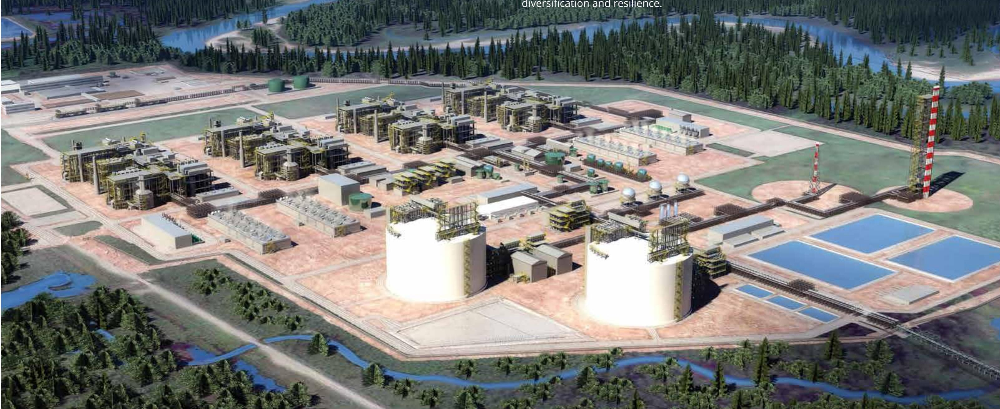  
Courtesy LNG Canada

## 2.1

# THE MIDDLE EAST CONFLICT’S IMPACT IN THE COMING YEARS

Prior to the conflict, LNG producers had expected 2026 to usher in an era of even stronger growth following the 25.7 Mt supply expansion registered in 2025. Instead, it looks increasingly likely to result in a year-on-year contraction in trade. While the ongoing conflict is by no means the first global crisis to aflict the LNG industry, there is no historical precedent for it. Some past crises – such as the Fukushima Daiichi nuclear accident following the 2011 earthquake and tsunami or the Russia-Ukraine conflict in 2022 – spurred short-term LNG demand and long-term capacity additions, as access to competing energy sources was structurally restricted. The COVID-19 pandemic disrupted LNG demand and sent prices plummeting to record lows in 2020, but it also triggered a post-pandemic recovery during which liquefaction could not keep up with demand growth, and spot prices surged to historic highs.

Unlike its predecessors, the current global crisis is reducing LNG supply with a knock-on efect that is causing some short-term demand destruction. For the duration of the Strait’s closure, Qatar and the UAE, which host a combined 15.8% of global operational liquefaction capacity, are severed from global markets, despite limited cargoes having more recently crossed the Strait. Even beyond a possible reopening of the Strait, operational capacity has been reduced by damage to liquefaction plants, possibly for three to five years. The supply disruption has led to elevated prices across Asia and Europe and has triggered short-term demand destruction of a corresponding magnitude.

At the time of writing, the pathway to and timeline of a resolution of the conflict remain uncertain. Still, once hostilities cease and trade flows resume reliably, LNG markets can be expected to normalise as new capacity and operational optimisation combine to compensate for damage to existing infrastructure. The result would be a return to the pre-crisis trajectory of falling prices and growing demand, barring a simmering conflict, more extensive infrastructure damage or longterm demand destruction. Thus, 2026 could ultimately be seen as a year that delayed rather than significantly altered the expansion of the LNG industry.

## 2.2

## POST-CRISIS PATHWAY – THE ROAD TO 2035

Despite ongoing geopolitical headwinds, global energy demand is expected to continue its long-term growth trajectory, particularly in electricity consumption, driven by population growth, lifting people out of poverty and the expansion of AI applications and data centre capacity. Temporary supply disruptions and price volatility do not diminish the system value of gas-fired generation in increasingly renewable-penetrated power systems, given its dispatchability and ability to balance variable generation. Likewise, LNG retains a lower emission intensity than coal and oil, a factor that remains relevant over the longer term, even though security-of-supply considerations tend to dominate during periods of market stress. These structural characteristics support LNG’s continued role as a key component of the global energy mix across both established and emerging markets. As additional and more diverse LNG supply enters the market, improved availability is expected to enhance its relative afordability and reinforce the outlook for this flexible energy carrier.

Assuming – and acknowledging significant uncertainty over the resolution of the ongoing Middle East conflict – that geopolitical tensions normalise in a timely and durable manner, operational liquefaction capacity and capacity under construction combined are projected to surpass 700 Mt by 2030, representing a 40% increase over 2025 levels. The associated increase in production is expected to outpace LNG import growth, resulting in a temporary period of market oversupply and downward pressure on spot prices towards the short-run marginal cost (SRMC) of US Gulf Coast liquefaction capacity. From around the mid-2030s, the global LNG market is anticipated to rebalance as demand growth absorbs incremental supply. As demand ultimately exceeds LNG supply, long-term price formation is expected to be influenced by the long-run marginal cost (LRMC) of the marginal supply required to balance the market.

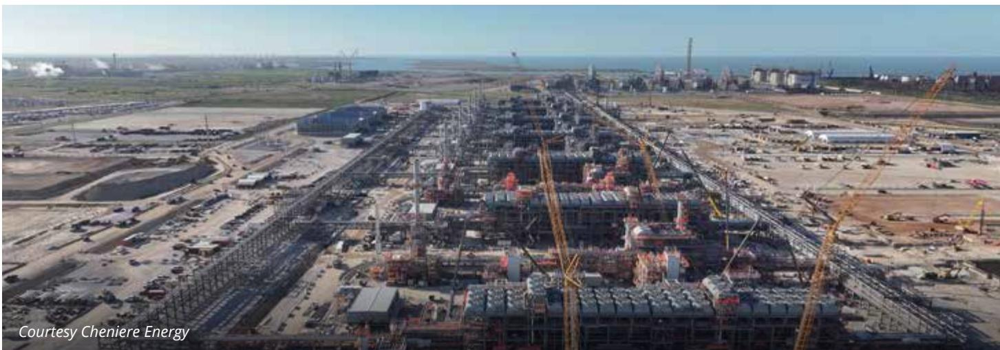

Figure 2.1: Global LNG supply development and demand outlook, 2010-2035  
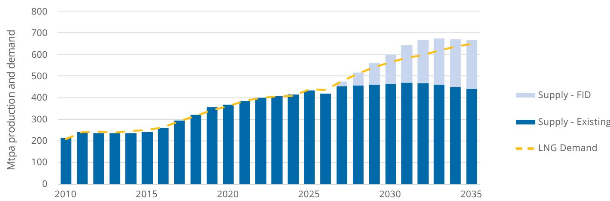  
Source: Rystad Energy Figure 2.1 has been updated as of June 2026 data to reflect recent FIDs

Approximately 47.8% of the 234.3 MTPA of liquefaction capacity under construction or approved for development is located in the US, with Qatar accounting for another 20%. While the US accounts for the largest share of proposed global liquefaction capacity at 34.8%, a greater focus on supply diversification amid heightened geopolitical uncertainty could provide additional momentum for proposed projects in Canada, Mozambique, or Argentina, among others. The number and composition of proposed projects ultimately reaching final investment decision (FID) will depend on the extent to which crisis-driven demand dynamics afect longer-term market growth expectations. Near-term demand destruction, whether through fuel switching or industrial curtailment, may be reversible should LNG pricing conditions become more favourable. By contrast, accelerated deployment of renewables or delayed retirement of coal-fired generation could result in more persistent reductions in future LNG demand growth. LNG demand growth in emerging economies, particularly in parts of South and Southeast Asia, may be most exposed in scenarios where elevated price conditions persist over an extended period.

Figure 2.2: Global liquefaction capacity development, 1990-2031<sup>1</sup>2.2  
  
Source: Rystad Energy

## 2.3

# OPPORTUNITIES AND UNCERTAINTIES ALONG THE ROAD

The LNG market outlook presented above is based on a set of underlying assumptions, most notably the lasting resolution of the conflict in the Middle East, although the timing and stability of such an outcome remains highly uncertain. Beyond geopolitical developments, several additional factors should also be considered, each of which could materially influence the long-term trajectory of the LNG industry, either positively or negatively.

## Opportunity – Frontier markets

Despite ongoing geopolitical headwinds, LNG continues to expand both geographically and across end-use segments. LNG is playing an increasing role in national energy balances, whether as a means of monetising domestic natural gas resources or as a means of supporting secure and competitively priced energy supply. At the same time, LNG bunkering continues to broaden the fuel’s application within the maritime sector.

In 2025, there were 2 new export markets, namely Canada and Mauritania/Senegal. On the import side, Senegal and Bahrain were the two additional LNG importing markets in 2025 as compared to 2024. There remains an additional 8 markets that are expected to commence LNG imports between 2026 and 2028.

Floating infrastructure solutions are expected to play an important role in enabling this expansion, reflecting their shorter deployment timelines, operational flexibility and comparatively lower upfront capital requirements. As of the end of 2025, approximately 75% of new import markets scheduled to start LNG imports by 2028 were planning to utilise floating import terminals, while around 170 MTPA of proposed liquefaction capacity was associated with FLNG developments.

## Opportunity – Electricity demand growth

Growing electricity demand remains a key driver of natural gas demand prospects. In many markets, the energy transition narrative is increasingly evolving into one of energy addition, with renewable capacity additions primarily meeting incremental electricity demand rather than significantly displacing existing thermal generation. In rapidly electrifying economies in particular, maintaining a diversified energy mix remains important, and gas-fired generation continues to benefit from its flexibility and ability to complement variable renewable generation through reliable load-matching capabilities.

Data centre demand is also emerging as an increasingly important source of electricity growth. The combination of deployment speed, reliability, cost competitiveness, and operational flexibility continues to support the attractiveness of gas-fired generation in this segment. In parallel, the integration of gas-fired generation with battery storage systems is gaining traction as a potential solution for supplying of-grid or dedicated power to data centre developments.

## Opportunity – Innovations

To thrive in a highly uncertain world with priorities oscillating between energy security, afordability and sustainability, continued innovation remains essential for the LNG industry. While LNG already contributes to emission reductions through the substitution of higher-emission fuels such as unabated coal in power generation and fuel oil in shipping, further improvements in the value chain’s emission intensity can help address sustainability concerns and reinforce LNG’s role in the global energy system. A range of emerging technologies is expected to support further emission reductions while also enhancing operational eficiency across the LNG value chain.

## Figure 2.3: Global FLNG capacity development, 2017-2031

  
Source: Rystad Energy

Table 2.1: Key emission reduction technologies in LNG projects

<table><tr><td>Technology</td><td>Emission mitigation</td><td>Status</td></tr><tr><td>LNG-linked CCS</td><td>Extracts CO2 either during upstream processes or post-combustion during liquefaction</td><td>Increasingly recognised as a key decarbonisation pathway, LNG-linked carbon capture and storage (CCS) was pioneered by Norway&#x27;s Hammerfest LNG and has been integrated at multiple sites including Australia&#x27;s Gorgon LNG and Qatar&#x27;s Ras Laffan.As especially post-combustion capture is costly, it is viable for new development when considered early in the design process. Upcoming CCS initiatives include Venture Global&#x27;s Plaquemines LNG and Calcasieu Pass LNG, as well as Indonesia&#x27;s Abadi LNG.</td></tr><tr><td>Electrification of LNG compression</td><td>Lowers the emission intensity of compression process</td><td>When fuelled by emission-free sources such as nuclear, hydro or firmed renewables, this technology can eliminate compression emissions entirely. From an operations perspective, electric drives have the added advantage of reducing feed gas intake and fugitive methane emissions, but at the cost of higher susceptibility to power outages.Established plants such as Freeport LNG in the US already implemented a fully electric configuration, and planned projects such as Texas LNG in the US, LNG Canada, Woodfibre and Ksi Lisims in Canada are planning to adopt the technology.</td></tr><tr><td>Bio-LNG and liquefied e-methane</td><td>Replaces natural gas with renewable or synthetic gas</td><td>Chemically identical to conventional LNG, bio-LNG and liquefied e-methane are entirely interoperable with existing infrastructure. While it currently commands a premium over fossil-origin LNG, it can help decarbonise hard-to-abate sectors such as bunkering where, especially, bio-LNG started to see wider adoption across North America, Europe, and Asia.The global ‘e-NG’ coalition, with global heavyweights including Shell, TotalEnergies and INPEX among its members, expects e-methane to reach a capacity of around 1.2 Mt by 2031. For both bio-LNG and e-methane, cost competitiveness and production at scale remain key challenges.</td></tr></table>

## Uncertainty – Geopolitics and global transit route

The Strait of Hormuz, situated between Iran and Oman, is widely recognised as the most critical global LNG maritime chokepoint. Potential disruptions are not limited to this corridor, as other strategic transit routes remain exposed to geopolitical tensions and, in some cases, climatic variability. Trafic through the Bab el-Mandeb Strait – the Suez Canal corridor, linking the Gulf of Aden and the Mediterranean via the Red Sea, has yet to fully normalise following continued security incidents involving threats from the Houthi rebels. The Panama Canal, an important route for US LNG cargoes bound for Asian markets, has also demonstrated vulnerability to non-geopolitical disruption, most notably during the 2023 drought conditions afecting Gatun Lake, which constrained vessel transits. Aside from these maritime chokepoints, incidents involving LNG shipping in open waters, including reported attacks on LNG carriers in recent years, underscore the broader exposure of global LNG trade flows to security-related risks.

## Uncertainty - Policy

Previous assessments of policy risk have focused primarily on emissions regulation and trade restrictions. While these remain central considerations, an additional dimension may become more prominent in the coming years. In LNG-exporting markets such as Australia, parts of Southeast Asia, and the US, tensions may arise between securing adequate domestic supply and limiting exposure to global LNG price volatility. If identified at an early stage, such challenges can be addressed through appropriate market design and regulatory frameworks. Even so, abrupt or reactive policy responses may increase uncertainty and discourage investment in LNG infrastructure and supply capacity, which are required to support system resilience in the face of future supply issues. In parallel, the current environment of supply tightness and elevated prices may prompt reassessments of energy policy in emerging Asian markets, potentially influencing the pace and trajectory of long-term LNG demand growth.

## Uncertainty – Alternative supply and project risk

A prolonged disruption to LNG supply may support increased interest not only in alternative energy sources, but also in complementary Gas supply options. In some markets, previously phased-out domestic production could be revisited, potentially ofsetting a portion of LNG import requirements. An additional uncertainty concerns the possible return of Russian pipeline gas flows to Europe, or the accelerated development of export infrastructure, such as Power of Siberia 2 to China. Such developments could moderate future LNG import growth and influence the commercial outlook for selected liquefaction projects.

LNG projects continue to operate amid evolving risks from geopolitical developments, trade policy dynamics, inflationary pressures, and labour and supply chain constraints. Even if the Middle East conflict is resolved in 2026, a period of normalisation would still be required for logistics and supply chains to fully adjust. At the same time, Russian LNG facilities including Arctic LNG 2, Portovaya LNG, and Vysotsk LNG continue to be afected by sanctions-related constraints.

## Summary

In summary, the LNG industry enters the coming decade supported by a broad set of structural growth drivers and expanding opportunities across both established and emerging markets. Continued geographical diversification, the scaling of floating infrastructure solutions, and the emergence of new importing markets underscore LNG’s growing role in global energy security and development. At the same time, rising electricity demand – particularly from electrification trends and data centre growth – reinforces LNG’s value as a flexible and reliable complement to renewable energy systems.

Ongoing innovation across the value chain is further enhancing LNG’s environmental performance and operational eficiency, supporting its position within evolving decarbonisation pathways. While geopolitical, policy and project-related uncertainties remain part of the operating environment, the industry’s adaptability and continued investment momentum point to a resilient and constructive long-term outlook. Overall, LNG is well positioned to remain a central pillar of the global energy system, supporting afordability, security and flexibility in a rapidly changing energy landscape.

  
<sub>roject</sub> <sub>list</sub> m<sup>ay</sup> <sup>not</sup> <sup>be</sup> <sup>exha</sup> <sub>rce:</sub> <sub>Rys</sub>t<sup>ad</sup> <sup>Ene</sup>  
Figure 2.4: Map of emissions reduction technology types in the LNG sector

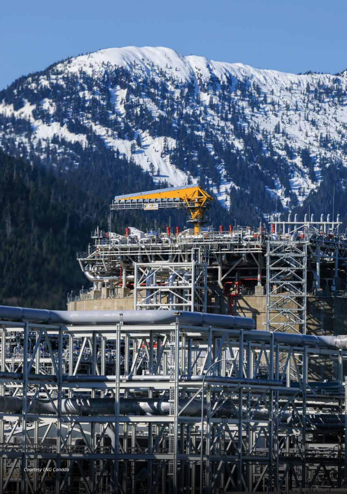

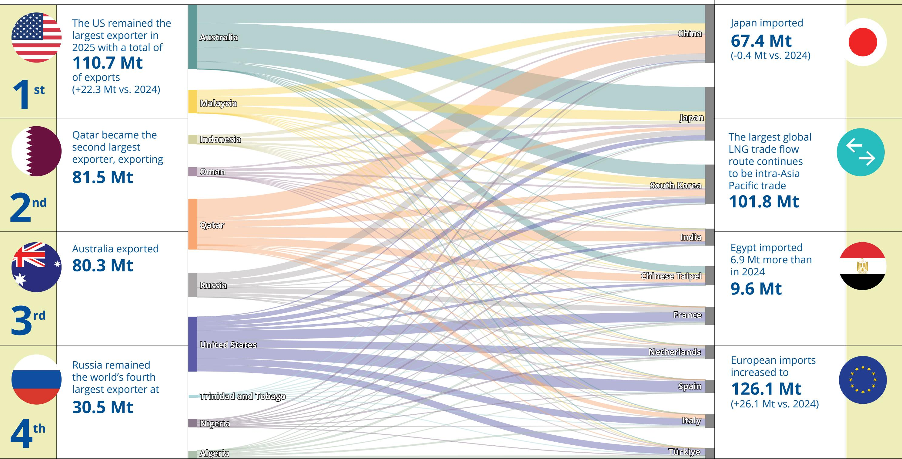

##

## LNG Trade

Global LNG trade rose to a record 437.0 Mt in 2025, an increase of 25.7 Mt.

The US remained the largest exporter in 2025 with a total of 110.7 Mt of exports (+22.3 Mt vs. 2024)

Qatar became the second largest exporter, exporting 81.5 Mt

Australia exported 80.3 Mt

Russia remained the world’s fourth largest exporter at 30.5 Mt


China retained its place as the largest importer with a total of

69.8 Mt of import (-8.9 Mt vs. 2024)

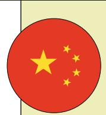

Japan imported 67.4 Mt (-0.4 Mt vs. 2024)

The largest global LNG trade flow route continues to be intra-Asia Pacific trade 101.8 Mt

The diagram only represents trade flows between the top 10 exporters and top 10 importers.

## 3. LNG Trade

Global LNG trade in 2025 grew to 436.98 million tonnes (Mt), originating from 24 exporting markets and finding its way to 50 importing markets. Re-export loading in 2025 remained broadly stable at 4.91 Mt, compared with 4.96 Mt in 2024. High-level changes in 2025 include a sharp rise in exports from North America (+25.3 Mt), higher exports from the Middle East (+3.8 Mt), and a marked shift in import demand back towards Europe (+26.1 Mt), while net imports into Asia declined (-9.2 Mt) and imports into Africa rose strongly (+7.2 Mt), largely on the back of Egypt’s higher requirements.

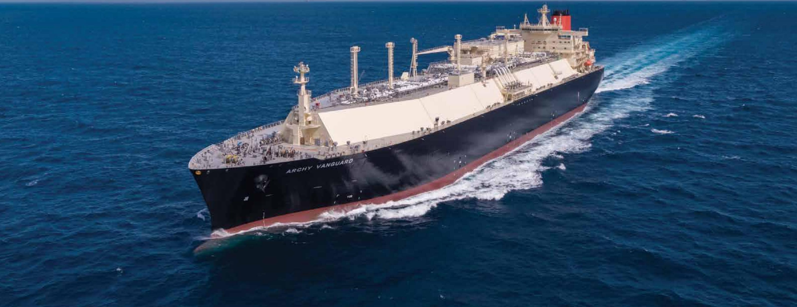  
Courtesy Mitsui OSK Lines

## 3.1 OVERVIEW

The 25.74 Mt increase in 2025 LNG trade was driven by rising output from the United States (+22.3 Mt), Qatar (+4.3 Mt), Malaysia (+1.1 Mt), Angola (+1.1 Mt), and Nigeria (+1.0 Mt), while Canada (+2.1 Mt) and Mauritania/Senegal (+1.2 Mt) recorded their first LNG exports. On the import side, volumes over the previous year shifted mainly to Europe and Africa, with Italy (+4.4 Mt), France (+3.6 Mt), Spain (+3.6 Mt), Türkiye (+3.4 Mt), the Netherlands (+2.9 Mt), Belgium (+2.5 Mt), Germany (+2.2 Mt), Chinese Taipei (+2.3 Mt), and Egypt (+6.9 Mt) recording the largest gains. The most notable declines came from China (-8.9 Mt) and India (-1.5 Mt), pointing to a softer Asian pull in 2025 after a strong rebound seen in 2024.

Asia Pacific1 remained the largest LNG export region in 2025 with 138.76 Mt, only marginally above 138.91 Mt in 2024. North America recorded by far the strongest annual growth, with volumes surging by 25.3 Mt to 113.91 Mt. The Middle East remained the third-largest export region in absolute terms but posted a sizeable increase of 3.8 Mt, bringing annual volumes to 98.03 Mt. African exports also rose by 1.8 Mt to 39.77 Mt, while the Former Soviet Union declined by 3.0 Mt to 30.52 Mt.

The US led global LNG exports in 2025 with 110.74 Mt, rising sharply from 88.42 Mt in 2024, followed by Qatar, which climbed to 81.51 Mt from 77.23 Mt. Australia remained the third-largest exporter, though its volumes slipped slightly to 80.32 Mt from 81.04 Mt. Russia fell by

## 3.0 Mt to 30.52 Mt in 2025, while Malaysian exports increased to 28.80 Mt.

Asia Pacific was again the largest LNG-importing region in 2025, rising by 3.6 Mt to 168.7 Mt. Still, the key regional shift in 2025 was Europe’s return as the second major growth centre for LNG demand. European imports rose by 26.1 Mt to 126.2 Mt, reversing much of the decline seen in 2024. By contrast, imports into Asia fell by 9.2 Mt to 108.7 Mt, largely driven by lower net imports into China and India and other emerging Asian markets such as Thailand and Pakistan. Africa also emerged as a more prominent LNG importing region in 2025, rising to 9.8 Mt from 2.7 Mt, almost entirely due to Egypt’s much stronger call on LNG cargoes.

China remained the world’s largest LNG importer in 2025, but volumes fell materially by 8.9 Mt to 69.77 Mt, driven by mild seasonal demand at the beginning of the year, rising domestic production and ramped-up pipeline supply from Russia via the Power of Siberia Pipeline. Japan was the second-largest importer at 67.37 Mt, broadly unchanged year-on-year, while South Korea increased its imports by 1.7 Mt to 48.67 Mt. Together, these three markets still accounted for 42.6% of global LNG imports in 2025. The stronger import pull from Europe was led by Italy, France, Spain, Türkiye, the Netherlands, Belgium and Germany, while Egypt’s higher imports reflected the combined efect of declining domestic production, lower pipeline gas import from Israel and stronger natural gas requirements.

<table><tr><td>Global and regional trends</td><td>LNG exporters</td><td>LNG importers</td><td>LNG re-exports</td></tr><tr><td>Global LNG trade reached a new record of 436.98 Mt in 2025, up 6.3% from 2024</td><td>The United States (+22.3 Mt) and Qatar (+4.3 Mt) drove export growth in 2025</td><td>China (-8.9 Mt) and India (-1.5 Mt) had the largest decline in imports in 2025</td><td>Total re-exports amounted to 4.91 Mt in 2025</td></tr><tr><td>Global LNG trade increased by 25.74 Mt in 2025</td><td>Canada (2.14 Mt) and Mauritania/ Senegal (1.22 Mt) recorded their first LNG exports</td><td>Egypt (+6.9 Mt), Italy (+4.4 Mt), and France and Spain (+3.6 Mt) had the largest import growth</td><td>Asia Pacific and Europe dominated re-export loading with 2.0 Mt each</td></tr><tr><td>Europe had the largest change in net imports (+26.10 Mt), while Asia declined (-9.24 Mt)</td><td>Russia recorded the largest export decline (-3.0 Mt)</td><td>Asia Pacific remained the largest import region with 168.7 Mt</td><td>Asia was the largest receiver of re-exports (1.61 Mt), followed by Asia Pacific (1.55 Mt) and Europe (1.46 Mt)</td></tr><tr><td>North America recorded the largest regional export growth (+25.3 Mt to 113.91 Mt)</td><td>The United States (110.74 Mt), Qatar (81.51 Mt) and Australia (80.32 Mt) were the largest LNG exporters in 2025</td><td>Europe recorded the strongest regional import growth (+26.1 Mt to 126.2 Mt)</td><td>Re-exports accounted for 1.1% of global LNG trade</td></tr></table>

Source: Rystad Energy

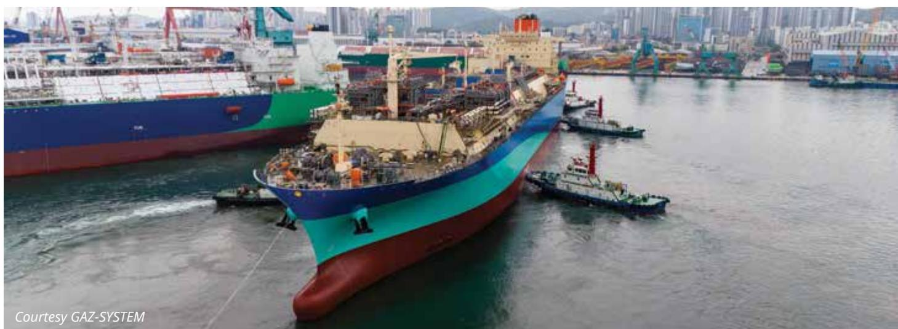  
1 Refer to Region and Basin definition in Chapter 9

## 3.2 LNG EXPORTS BY MARKET

Figure 3.1: 2025 LNG export (Mt) and market share (%) by export market  
  
Source: Rystad Energy

The US significantly widened its lead as the world’s largest LNG exporter in 2025, at a total of 110.74 Mt, equal to 25% of global LNG output and up 22.3 Mt from the previous year. The increase points to a major expansion in available export capacity and improved utilisation, with the US alone accounting for the vast majority of global growth in 2025. This also lifted North America’s share of global LNG trade materially and reshaped interregional flows, especially towards Europe.

Figure 3.2: Changes in 2025 LNG exports by market relative to 2024 (Mt)  
  
Source: Rystad Energy

Qatar moved into second place globally in 2025 with exports of 81.51 Mt, up 4.3 Mt from 2024 and equivalent to 19% of global exports. High utilisation in Qatar was enabled by central hub optimisation and integrated upstream and midstream control, as well as optimisation ahead of the North Field East (NFE) startup, which supported the market’s ability to operate near or above nameplate capacity prior to the destruction of two trains in early 2026. Australia ranked third with 80.32 Mt, down 0.7 Mt year-onyear, but still accounting for 18% of global supply. Together, the three largest exporters met 62% of global LNG supplies in 2025.

Russia recorded the largest nominal decline among major exporters, falling by 3.0 Mt to 30.52 Mt in 2025. Algeria also saw a sizeable decline, down 1.9 Mt to 9.70 Mt, while Indonesia slipped by 1.1 Mt to 16.55 Mt. By contrast, Malaysia increased exports by 1.1 Mt to 28.80 Mt, Nigeria rose by 1.0 Mt to 14.78 Mt, and Oman added 0.5 Mt to 11.85 Mt.

New supply from Canada and Mauritania/Senegal also stands out in 2025, with Canada reaching 2.14 Mt and Mauritania/Senegal 1.22 Mt in their first year of measurable exports in the dataset. Despite a year-on-year decline in overall Russian supply, Arctic LNG 2 recorded its first delivered trade in 2025 as well.

The balance between export regions shifted materially in 2025. Asia Pacific remained the largest export region at 138.76 Mt, but growth was almost flat year-on-year. North America recorded by far the largest expansion, rising to 113.91 Mt from 88.64 Mt in 2024, driven overwhelmingly by the US and supported by first exports from Canada as well as higher volumes from Mexico. The Middle East also posted firm growth, adding 3.8 Mt to 98.03 Mt, largely on the back of higher Qatari flows. African exports rose to 39.77 Mt, supported by higher supply from Nigeria, Angola, Mozambique, and Mauritania/ Senegal, despite lower exports from Algeria and Egypt.

Re-exports were broadly stable in 2025 at around 4.91 Mt, equivalent to roughly 1.1% of global LNG trade, driven by portfolio optimisation, arbitrage opportunities and destination flexibility. The number of markets performing re-export loading remained limited at 13, unchanged from 2024. Europe and Asia Pacific continued to dominate, with both regions accounting for 41%, while Asia contributed 14%. Indonesia remained the single largest re-export loading market with 0.85 Mt, followed by Spain (0.77 Mt), China (0.67 Mt), South Korea (0.65 Mt), Belgium (0.52 Mt) and Singapore (0.48 Mt). Malaysia and the Dominican Republic joined the list of re-export loaders in 2025.

Markets receiving re-exports remained concentrated in Asia, Asia Pacific and Europe. China was the largest re-export taker at 0.90 Mt, followed by Japan at 0.69 Mt and Bangladesh at 0.54 Mt. On a regional basis, Asia received 1.61 Mt of re-exports in 2025, slightly ahead of Asia Pacific at 1.55 Mt and Europe at 1.44 Mt. Compared with 2024, re-export receiving activity became somewhat more evenly distributed across the three main destination regions, with Europe maintaining a meaningful share alongside the Asian markets.

3.3<sub>Figure</sub> <sub>3.3:</sub> <sub>Re-exports</sub> <sub>loaded</sub> <sub>by</sub> <sub>re-loading</sub> <sub>market</sub> <sub>(Mt)</sub> <sub>and</sub> <sub>the</sub> <sub>market</sub> <sub>share</sub> <sub>(%)</sub> <sub>in</sub> <sub>2025</sub>  
  
Source: Rystad Energy

Figure 3.4: Re-exports received by receiving market (Mt) and market share (%) in 20253.4  
  
Source: Rystad Energy

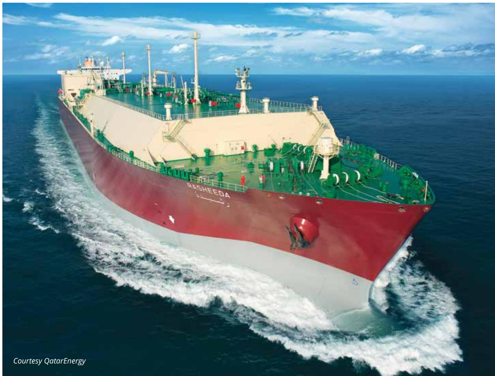

## 3.3

# NET LNG IMPORTS BY MARKET

LNG imports were received by 50 markets globally in 2025. China retained its position as the largest importer, though volumes fell sharply by 8.9 Mt to 69.77 Mt. This was the single largest year-on-year decline among importing markets and marks one of the key demandside developments of 2025. The weaker Chinese intake was a major factor behind the contraction in net imports into Asia and helped free up cargoes for Europe and other markets.

Japan was the second-largest importer with 67.37 Mt, efectively flat year-on-year, while South Korea increased imports by 1.7 Mt to 48.67 Mt. Chinese Taipei posted one of the stronger gains among Asian importers, rising by 2.3 Mt to 24.17 Mt, while India’s imports fell by 1.5 Mt to 24.60 Mt. Pakistan also recorded a decline, down 0.8 Mt to 6.46 Mt, indicating more constrained South Asian demand in 2025 compared with the previous year.

Europe saw a substantial rebound in 2025, driven by the need to replace Russian natural gas volume lost following the expiration of the Ukraine gas transit and large storage withdrawals during winter. France, the region’s largest LNG importer, saw a rise of 3.6 Mt to 21.64 Mt. Spain added 3.6 Mt to 16.92 Mt, Italy increased by 4.4 Mt to 15.08 Mt, Türkiye rose by 3.4 Mt to 12.43 Mt, the Netherlands added 2.9 Mt to 16.26 Mt, Belgium increased by 2.5 Mt to 9.28 Mt, and Germany climbed by 2.2 Mt to 7.07 Mt. The UK also posted a moderate increase of 1.2 Mt to 9.27 Mt, while imports into Poland grew 1.3 Mt to 6.22 Mt. Taken together, these shifts indicate a materially stronger European call on LNG in 2025 after the weaker import year seen in 2024, with the additional volumes met primarily by North American supply.

Egypt stands out as the most significant mover among import markets outside Europe. LNG inflow into the market surged by 6.9 Mt to 9.56 Mt in 2025, making it one of the most notable changes in the global LNG market this year. This reflects Egypt’s need to secure additional LNG cargoes to support the domestic market. In contrast, Brazil’s imports fell by 0.7 Mt to 2.19 Mt, while Latin American imports generally softened compared with 2024.

After their initial market entries in prior years, the Philippines and Vietnam continued to increase imports in 2025, rising to 1.85 Mt and 0.53 Mt, respectively. Bangladesh also recorded a strong gain of 1.9 Mt to 7.87 Mt, while Singapore added 0.4 Mt to 6.66 Mt. Kuwait remained broadly stable at 7.33 Mt, and imports into the Middle East overall were little changed year-on-year.

<sub>Figure</sub> <sub>3.5:</sub> <sub>LNG</sub> <sub>imports</sub> <sub>by</sub> <sub>receiving</sub> <sub>market</sub> <sub>(Mt)</sub> <sub>and</sub> <sub>market</sub> <sub>share</sub> <sub>(%)</sub> <sub>in</sub> <sub>2025</sub>3.5  
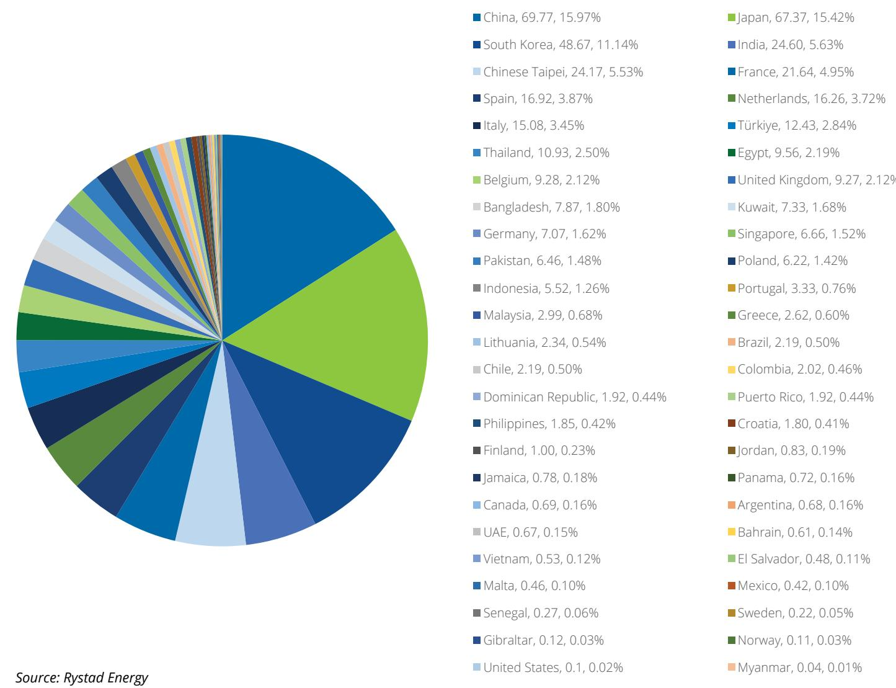  
Source: Rystad Energy

On a regional level, Asia Pacific remained the largest LNG-importing region in 2025, taking 168.7 Mt or 38.6% of the global total, up from 165.1 Mt in 2024. Europe became the second-largest region, with 126.2 Mt or 28.9%, sharply up from 100.1 Mt in 2024, while Asia slipped to 108.7 Mt or 24.9%. The combined import share of Asia and Asia Pacific still amounted to 63.5% of global LNG imports, though this was lower than in 2024 due to weaker Chinese and Indian demand and the renewed pull from Europe. Asia Pacific’s increase was supported by steady imports into Japan, higher intake in South Korea and Chinese Taipei, and continued growth in newer Southeast Asian markets.

Europe’s stronger imports in 2025 reflected a broad-based rise in LNG absorption across Italy, France, Spain, Türkiye, the Netherlands, Belgium, Germany and the UK, indicating a materially firmer regional call on seaborne gas than in 2024. By contrast, Asia’s decline was largely driven by lower net imports into China and India. Latin America’s LNG imports declined by 2.0 Mt to 11.0 Mt, while the Middle East eased by 0.4 Mt to 9.4 Mt. Africa, by contrast, rose strongly to 9.8 Mt, almost entirely driven by Egypt’s sharply higher import requirement.

Figure 3.6: Changes in 2025 LNG imports by market relative to 2024 (Mt)  
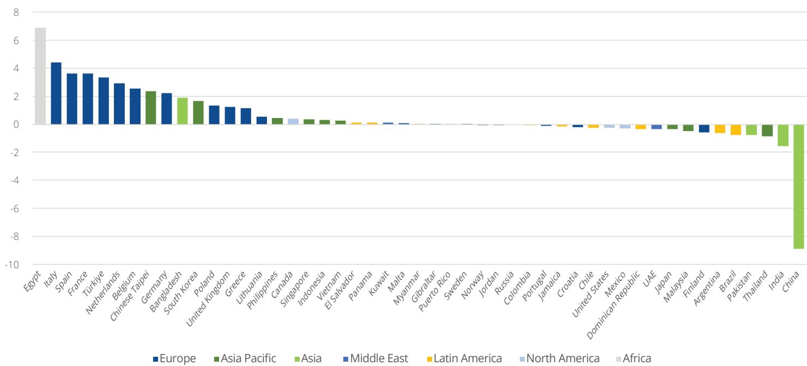  
Source: Rystad Energy

## 3.4

## LNG INTERREGIONAL TRADE

Regional concentration of global LNG trade remained high in 2025, though trade flows shifted materially by destination. Gross cargo absorption into Asia Pacific rose to 169.2 Mt from 165.0 Mt, while gross imports into Europe climbed sharply to 126.7 Mt from 101.1 Mt. By contrast, gross imports into Asia declined to 107.8 Mt from 117.6 Mt. Consequently, Asia Pacific retained the largest share of global imports, while Europe regained importance as a destination region after its weaker intake in 2024.

Overall, these shifts point to a modest increase in regionalisation of LNG trade in 2025, with Atlantic Basin supply, particularly from North America, increasingly directed towards Europe, while Asia Pacific demand was more heavily met by intra-regional and Middle Eastern exports.

Flows within Asia Pacific continued to dominate LNG trade in 2025 with a total of 101.8 Mt, up from 96.8 Mt the year before. Intra-regional trade remained underpinned by exports from Australia, Malaysia and Indonesia. The increase in intra-Asia Pacific trade was complemented by stable to slightly higher inflows from the Middle East and Africa, while imports from North America into the region fell to 15.9 Mt from 19.2 Mt. This indicates that Asia Pacific remained well supplied, but that a larger share of incremental North American output was diverted elsewhere, chiefly to Europe.

North American exports to Europe became the dominant interregional trade route in 2025, surging to 74.1 Mt from 46.3 Mt in 2024. This was by far the largest change across all interregional trade corridors and reflects both the strong increase in US export availability and Europe’s renewed LNG demand. The data indicate North America, and particularly the US, as the principal balancing supplier to Europe in 2025. European imports from Africa also rose to 22.4 Mt from 18.2 Mt, while imports from Russia declined to 14.0 Mt from 16.9 Mt and imports from the Middle East fell to 9.1 Mt from 10.6 Mt.

Trade between the Middle East and Asia remained one of the largest LNG routes globally in 2025, rising to 49.8 Mt from 46.0 Mt. This confirms the Middle East’s continued central role in supplying Asian markets, especially as Qatari exports increased. At the same time, imports into Asia from Asia Pacific fell to 36.8 Mt from 41.8 Mt, and imports from North America fell to 5.1 Mt from 10.3 Mt. African imports into Asia also declined to 7.7 Mt from 10.0 Mt. These changes are consistent with weaker net demand in China and India and a redistribution of flexible cargoes away from Asia.

Middle Eastern exports into Asia Pacific rose slightly to 32.5 Mt from 32.2 Mt, while Russian exports into Asia Pacific increased to 8.8 Mt from 7.9 Mt. Latin American exports into Asia Pacific also increased, from 2.3 Mt to 3.3 Mt, though from a much lower base. For Europe, imports from Asia Pacific remained minimal at 0.1 Mt, underscoring the persistence of long-haul arbitrage economics that continued to favour Atlantic Basin deliveries into Europe and Pacific Basin deliveries into Asian markets.

Africa’s role in interregional LNG trade expanded in 2025. Exports from Africa into Europe rose by 4.2 Mt to 22.4 Mt, while flows into Asia Pacific edged up to 7.0 Mt from 6.7 Mt. By contrast, African exports into Asia declined to 7.7 Mt from 10.0 Mt. North American exports into Africa increased sharply to 8.9 Mt from 2.0 Mt, almost entirely reflecting Egypt’s higher import needs. This was one of the more striking developments in the 2025 trade matrix and highlights how tightening domestic balances in individual importing markets can rapidly alter interregional LNG flows.

Table 3.1: LNG trade between regions, 2025 vs 2024 (Mt)

<table><tr><td colspan="2"></td><td>Asia Pacific Exports</td><td>Middle East Exports</td><td>North America Exports</td><td>Africa Exports</td><td>Russia Exports</td><td>Latin America Exports</td><td>Europe Exports</td><td>Grand Total</td></tr><tr><td rowspan="2">Asia Pacific Imports</td><td>2024</td><td>96.8</td><td>32.2</td><td>19.2</td><td>6.7</td><td>7.9</td><td>2.3</td><td>-</td><td>165.0</td></tr><tr><td>2025</td><td>101.8</td><td>32.5</td><td>15.9</td><td>7.0</td><td>8.8</td><td>3.3</td><td>-</td><td>169.2</td></tr><tr><td rowspan="2">Europe Imports</td><td>2024</td><td>-</td><td>10.6</td><td>46.3</td><td>18.2</td><td>16.9</td><td>4.3</td><td>4.8</td><td>101.1</td></tr><tr><td>2025</td><td>0.1</td><td>9.1</td><td>74.1</td><td>22.4</td><td>14.0</td><td>4.0</td><td>3.1</td><td>126.7</td></tr><tr><td rowspan="2">Asia Imports</td><td>2024</td><td>41.8</td><td>46.0</td><td>10.3</td><td>10.0</td><td>8.5</td><td>1.0</td><td>-</td><td>117.6</td></tr><tr><td>2025</td><td>36.8</td><td>49.8</td><td>5.1</td><td>7.7</td><td>7.7</td><td>0.7</td><td>-</td><td>107.8</td></tr><tr><td rowspan="2">Latin America Imports</td><td>2024</td><td>-</td><td>-</td><td>8.7</td><td>0.8</td><td>-</td><td>3.3</td><td>-</td><td>12.9</td></tr><tr><td>2025</td><td>-</td><td>0.1</td><td>7.2</td><td>0.7</td><td>-</td><td>3.1</td><td>0.02</td><td>11.1</td></tr><tr><td rowspan="2">Middle East Imports</td><td>2024</td><td>0.04</td><td>5.4</td><td>1.7</td><td>1.6</td><td>0.2</td><td>0.1</td><td>-</td><td>9.1</td></tr><tr><td>2025</td><td>-</td><td>6.6</td><td>1.4</td><td>1.5</td><td>-</td><td>-</td><td>0.03</td><td>9.4</td></tr><tr><td rowspan="2">North America Imports</td><td>2024</td><td>0.3</td><td>-</td><td>0.3</td><td>0.3</td><td>-</td><td>2.0</td><td>0.2</td><td>3.2</td></tr><tr><td>2025</td><td>0.1</td><td>-</td><td>1.3</td><td>0.2</td><td>-</td><td>1.4</td><td>-</td><td>3.1</td></tr><tr><td rowspan="2">Africa Imports</td><td>2024</td><td>-</td><td>-</td><td>2.0</td><td>0.3</td><td>-</td><td>0.1</td><td>-</td><td>2.4</td></tr><tr><td>2025</td><td>-</td><td>-</td><td>8.9</td><td>0.4</td><td>-</td><td>0.2</td><td>0.2</td><td>9.7</td></tr><tr><td rowspan="2">Russia Imports</td><td>2024</td><td>-</td><td>-</td><td>-</td><td>-</td><td>0.1</td><td>-</td><td>-</td><td>0.1</td></tr><tr><td>2025</td><td>-</td><td>-</td><td>-</td><td>-</td><td>-</td><td>-</td><td>-</td><td>-</td></tr><tr><td rowspan="2">Total</td><td>2024</td><td>138.9</td><td>94.2</td><td>88.6</td><td>38.0</td><td>33.5</td><td>12.9</td><td>5.0</td><td>411.2</td></tr><tr><td>2025</td><td>138.8</td><td>98.0</td><td>113.9</td><td>39.8</td><td>30.5</td><td>12.7</td><td>3.3</td><td>437.0</td></tr></table>

Source: Rystad Energy  
Note that interregional trade does not account for re-exports

Figure 3.7: LNG trade between regions, 2025  
  
Source: Rystad Energy

  
Courtesy SK Shipping

Table 3.2: LNG trade volumes between markets, 2025 (Mt)

<table><tr><td>Markets</td><td>Algeria</td><td>Angola</td><td>Australia</td><td>Brunei</td><td>Cameroon</td><td>Canada</td><td>Congo</td><td>Egypt</td><td>Equatorial Guinea</td><td>Indonesia</td><td>Malaysia</td><td>Mauritania/Senegal</td><td>Mexico</td><td>Mozambique</td></tr><tr><td>China</td><td>0.10</td><td>-</td><td>21.59</td><td>0.33</td><td>-</td><td>0.46</td><td>-</td><td>-</td><td>0.18</td><td>3.93</td><td>7.40</td><td>0.15</td><td>-</td><td>0.19</td></tr><tr><td>India</td><td>-</td><td>1.54</td><td>0.46</td><td>-</td><td>0.41</td><td>-</td><td>-</td><td>-</td><td>0.15</td><td>-</td><td>0.12</td><td>0.15</td><td>0.07</td><td>0.61</td></tr><tr><td>Pakistan</td><td>-</td><td>-</td><td>-</td><td>-</td><td>-</td><td>-</td><td>-</td><td>-</td><td>-</td><td>-</td><td>-</td><td>-</td><td>-</td><td>-</td></tr><tr><td>Bangladesh</td><td>-</td><td>0.07</td><td>0.29</td><td>-</td><td>-</td><td>-</td><td>-</td><td>-</td><td>0.12</td><td>0.08</td><td>0.13</td><td>-</td><td>-</td><td>0.30</td></tr><tr><td>Myanmar</td><td>-</td><td>-</td><td>-</td><td>-</td><td>-</td><td>-</td><td>-</td><td>-</td><td>-</td><td>-</td><td>0.04</td><td>-</td><td>-</td><td>-</td></tr></table>

<table><tr><td>Asia</td><td>0.10</td><td>1.62</td><td>22.34</td><td>0.33</td><td>0.41</td><td>0.46</td><td>-</td><td>-</td><td>0.46</td><td>4.00</td><td>7.69</td><td>0.31</td><td>0.07</td><td>1.10</td></tr><tr><td>Japan</td><td>-</td><td>-</td><td>26.56</td><td>2.33</td><td>-</td><td>0.61</td><td>-</td><td>-</td><td>0.22</td><td>3.81</td><td>9.97</td><td>-</td><td>-</td><td>0.23</td></tr><tr><td>South Korea</td><td>0.04</td><td>-</td><td>15.63</td><td>0.92</td><td>0.08</td><td>0.76</td><td>0.08</td><td>-</td><td>0.23</td><td>2.23</td><td>7.89</td><td>-</td><td>0.07</td><td>0.95</td></tr><tr><td>Chinese Taipei</td><td>-</td><td>-</td><td>7.80</td><td>0.67</td><td>-</td><td>0.31</td><td>-</td><td>0.08</td><td>-</td><td>0.39</td><td>0.26</td><td>-</td><td>-</td><td>-</td></tr><tr><td>Thailand</td><td>-</td><td>0.21</td><td>2.12</td><td>0.20</td><td>0.23</td><td>-</td><td>0.14</td><td>-</td><td>0.31</td><td>0.15</td><td>1.80</td><td>-</td><td>-</td><td>0.62</td></tr><tr><td>Singapore</td><td>-</td><td>-</td><td>2.40</td><td>-</td><td>-</td><td>-</td><td>-</td><td>-</td><td>0.08</td><td>0.08</td><td>0.40</td><td>-</td><td>-</td><td>0.58</td></tr><tr><td>Indonesia</td><td>-</td><td>-</td><td>0.42</td><td>-</td><td>0.19</td><td>-</td><td>-</td><td>-</td><td>-</td><td>5.68</td><td>-</td><td>-</td><td>-</td><td>-</td></tr><tr><td>Malaysia</td><td>-</td><td>-</td><td>2.34</td><td>-</td><td>-</td><td>-</td><td>-</td><td>-</td><td>-</td><td>-</td><td>0.38</td><td>-</td><td>-</td><td>-</td></tr><tr><td>Philippines</td><td>-</td><td>-</td><td>0.57</td><td>-</td><td>-</td><td>-</td><td>-</td><td>-</td><td>-</td><td>0.15</td><td>0.21</td><td>-</td><td>-</td><td>0.03</td></tr><tr><td>Vietnam</td><td>-</td><td>-</td><td>-</td><td>0.14</td><td>-</td><td>-</td><td>-</td><td>-</td><td>-</td><td>-</td><td>0.19</td><td>-</td><td>-</td><td>-</td></tr></table>

<table><tr><td>Asia Pacific</td><td>0.04</td><td>0.21</td><td>57.83</td><td>4.25</td><td>0.50</td><td>1.68</td><td>0.21</td><td>0.08</td><td>0.83</td><td>12.48</td><td>21.11</td><td>-</td><td>0.07</td><td>2.40</td></tr><tr><td>France</td><td>2.35</td><td>0.27</td><td>0.08</td><td>-</td><td>0.15</td><td>-</td><td>0.08</td><td>-</td><td>0.08</td><td>-</td><td>-</td><td>-</td><td>0.07</td><td>-</td></tr><tr><td>Spain</td><td>1.49</td><td>1.37</td><td>-</td><td>-</td><td>0.06</td><td>-</td><td>0.18</td><td>0.08</td><td>0.15</td><td>-</td><td>-</td><td>-</td><td>-</td><td>-</td></tr><tr><td>Netherlands</td><td>-</td><td>0.77</td><td>-</td><td>-</td><td>-</td><td>-</td><td>-</td><td>-</td><td>0.32</td><td>-</td><td>-</td><td>-</td><td>0.04</td><td>-</td></tr><tr><td>United Kingdom</td><td>0.58</td><td>0.21</td><td>-</td><td>-</td><td>-</td><td>-</td><td>-</td><td>-</td><td>0.08</td><td>-</td><td>-</td><td>-</td><td>0.07</td><td>-</td></tr><tr><td>Italy</td><td>1.77</td><td>-</td><td>-</td><td>-</td><td>-</td><td>-</td><td>0.06</td><td>-</td><td>0.23</td><td>-</td><td>-</td><td>0.15</td><td>-</td><td>-</td></tr><tr><td>Türkiye</td><td>3.09</td><td>0.14</td><td>-</td><td>-</td><td>0.28</td><td>-</td><td>-</td><td>0.17</td><td>0.38</td><td>-</td><td>-</td><td>0.22</td><td>-</td><td>0.08</td></tr><tr><td>Belgium</td><td>-</td><td>0.14</td><td>-</td><td>-</td><td>-</td><td>-</td><td>-</td><td>-</td><td>0.08</td><td>-</td><td>-</td><td>0.08</td><td>-</td><td>-</td></tr><tr><td>Germany</td><td>-</td><td>-</td><td>-</td><td>-</td><td>-</td><td>-</td><td>0.08</td><td>-</td><td>0.08</td><td>-</td><td>-</td><td>-</td><td>0.07</td><td>-</td></tr><tr><td>Poland</td><td>-</td><td>-</td><td>-</td><td>-</td><td>-</td><td>-</td><td>-</td><td>-</td><td>-</td><td>-</td><td>-</td><td>0.08</td><td>-</td><td>-</td></tr><tr><td>Portugal</td><td>-</td><td>-</td><td>-</td><td>-</td><td>-</td><td>-</td><td>-</td><td>-</td><td>-</td><td>-</td><td>-</td><td>-</td><td>-</td><td>-</td></tr><tr><td>Lithuania</td><td>-</td><td>-</td><td>-</td><td>-</td><td>-</td><td>-</td><td>-</td><td>-</td><td>-</td><td>-</td><td>-</td><td>0.08</td><td>-</td><td>-</td></tr><tr><td>Greece</td><td>0.09</td><td>-</td><td>-</td><td>-</td><td>-</td><td>-</td><td>-</td><td>0.08</td><td>-</td><td>-</td><td>-</td><td>-</td><td>-</td><td>-</td></tr><tr><td>Croatia</td><td>0.17</td><td>-</td><td>-</td><td>-</td><td>-</td><td>-</td><td>-</td><td>-</td><td>-</td><td>-</td><td>-</td><td>-</td><td>0.03</td><td>-</td></tr><tr><td>Finland</td><td>-</td><td>-</td><td>-</td><td>-</td><td>-</td><td>-</td><td>-</td><td>-</td><td>-</td><td>-</td><td>-</td><td>-</td><td>-</td><td>-</td></tr><tr><td>Sweden</td><td>-</td><td>-</td><td>-</td><td>-</td><td>-</td><td>-</td><td>-</td><td>-</td><td>-</td><td>-</td><td>-</td><td>-</td><td>-</td><td>-</td></tr><tr><td>Malta</td><td>-</td><td>-</td><td>-</td><td>-</td><td>-</td><td>-</td><td>-</td><td>-</td><td>-</td><td>-</td><td>-</td><td>-</td><td>-</td><td>-</td></tr><tr><td>Norway</td><td>-</td><td>-</td><td>-</td><td>-</td><td>-</td><td>-</td><td>-</td><td>-</td><td>-</td><td>-</td><td>-</td><td>-</td><td>-</td><td>-</td></tr><tr><td>Gibraltar</td><td>0.01</td><td>-</td><td>-</td><td>-</td><td>-</td><td>-</td><td>-</td><td>-</td><td>-</td><td>-</td><td>-</td><td>0.01</td><td>-</td><td>-</td></tr></table>

<table><tr><td>Europe</td><td>9.54</td><td>2.90</td><td>0.08</td><td>-</td><td>0.50</td><td>-</td><td>0.40</td><td>0.32</td><td>1.39</td><td>-</td><td>-</td><td>0.61</td><td>0.28</td><td>0.08</td></tr><tr><td>Chile</td><td>-</td><td>-</td><td>-</td><td>-</td><td>-</td><td>-</td><td>-</td><td>-</td><td>-</td><td>-</td><td>-</td><td>-</td><td>-</td><td>0.01</td></tr><tr><td>Argentina</td><td>-</td><td>-</td><td>-</td><td>-</td><td>-</td><td>-</td><td>-</td><td>-</td><td>-</td><td>-</td><td>-</td><td>-</td><td>-</td><td>0.01</td></tr><tr><td>Dominican Republic</td><td>-</td><td>-</td><td>-</td><td>-</td><td>-</td><td>-</td><td>-</td><td>-</td><td>-</td><td>-</td><td>-</td><td>-</td><td>-</td><td>-</td></tr><tr><td>Jamaica</td><td>-</td><td>-</td><td>-</td><td>-</td><td>-</td><td>-</td><td>-</td><td>-</td><td>-</td><td>-</td><td>-</td><td>-</td><td>0.09</td><td>-</td></tr><tr><td>Colombia</td><td>-</td><td>-</td><td>-</td><td>-</td><td>-</td><td>-</td><td>-</td><td>-</td><td>-</td><td>-</td><td>-</td><td>-</td><td>-</td><td>-</td></tr><tr><td>Brazil</td><td>-</td><td>-</td><td>-</td><td>-</td><td>0.06</td><td>-</td><td>-</td><td>-</td><td>-</td><td>-</td><td>-</td><td>-</td><td>-</td><td>-</td></tr><tr><td>El Salvador</td><td>-</td><td>-</td><td>-</td><td>-</td><td>-</td><td>-</td><td>-</td><td>-</td><td>-</td><td>-</td><td>-</td><td>-</td><td>-</td><td>-</td></tr><tr><td>Panama</td><td>-</td><td>-</td><td>-</td><td>-</td><td>-</td><td>-</td><td>-</td><td>-</td><td>-</td><td>-</td><td>-</td><td>-</td><td>-</td><td>-</td></tr><tr><td>Latin America</td><td>-</td><td>-</td><td>-</td><td>-</td><td>0.06</td><td>-</td><td>-</td><td>-</td><td>-</td><td>-</td><td>-</td><td>-</td><td>0.09</td><td>0.02</td></tr><tr><td>Puerto Rico</td><td>-</td><td>-</td><td>-</td><td>-</td><td>-</td><td>-</td><td>-</td><td>-</td><td>-</td><td>-</td><td>-</td><td>-</td><td>0.46</td><td>-</td></tr><tr><td>Mexico</td><td>-</td><td>-</td><td>-</td><td>-</td><td>-</td><td>-</td><td>-</td><td>-</td><td>-</td><td>0.07</td><td>-</td><td>-</td><td>0.06</td><td>-</td></tr><tr><td>United States</td><td>-</td><td>-</td><td>-</td><td>-</td><td>-</td><td>-</td><td>-</td><td>-</td><td>-</td><td>-</td><td>-</td><td>-</td><td>-</td><td>-</td></tr><tr><td>Canada</td><td>-</td><td>-</td><td>0.07</td><td>-</td><td>-</td><td>-</td><td>-</td><td>0.08</td><td>-</td><td>-</td><td>-</td><td>-</td><td>-</td><td>-</td></tr><tr><td>North America</td><td>-</td><td>-</td><td>0.07</td><td>-</td><td>-</td><td>-</td><td>-</td><td>0.08</td><td>-</td><td>0.07</td><td>-</td><td>-</td><td>0.52</td><td>-</td></tr><tr><td>Kuwait</td><td>-</td><td>0.07</td><td>-</td><td>-</td><td>-</td><td>-</td><td>-</td><td>-</td><td>-</td><td>-</td><td>-</td><td>-</td><td>-</td><td>0.08</td></tr><tr><td>UAE</td><td>-</td><td>0.07</td><td>-</td><td>-</td><td>-</td><td>-</td><td>-</td><td>-</td><td>0.08</td><td>-</td><td>-</td><td>-</td><td>-</td><td>-</td></tr><tr><td>Jordan</td><td>-</td><td>-</td><td>-</td><td>-</td><td>-</td><td>-</td><td>-</td><td>-</td><td>-</td><td>-</td><td>-</td><td>0.08</td><td>-</td><td>-</td></tr><tr><td>Bahrain</td><td>-</td><td>-</td><td>-</td><td>-</td><td>-</td><td>-</td><td>-</td><td>-</td><td>0.08</td><td>-</td><td>-</td><td>-</td><td>-</td><td>-</td></tr><tr><td>Middle East</td><td>-</td><td>0.14</td><td>-</td><td>-</td><td>-</td><td>-</td><td>-</td><td>-</td><td>0.15</td><td>-</td><td>-</td><td>0.08</td><td>-</td><td>0.08</td></tr><tr><td>Egypt</td><td>-</td><td>-</td><td>-</td><td>-</td><td>-</td><td>-</td><td>-</td><td>-</td><td>0.15</td><td>-</td><td>-</td><td>0.22</td><td>-</td><td>-</td></tr><tr><td>Senegal</td><td>-</td><td>-</td><td>-</td><td>-</td><td>-</td><td>-</td><td>-</td><td>-</td><td>-</td><td>-</td><td>-</td><td>-</td><td>-</td><td>-</td></tr><tr><td>Africa</td><td>-</td><td>-</td><td>-</td><td>-</td><td>-</td><td>-</td><td>-</td><td>-</td><td>0.15</td><td>-</td><td>-</td><td>0.22</td><td>-</td><td>-</td></tr><tr><td>Russia</td><td>-</td><td>-</td><td>-</td><td>-</td><td>-</td><td>-</td><td>-</td><td>-</td><td>-</td><td>-</td><td>-</td><td>-</td><td>-</td><td>-</td></tr><tr><td>Former Soviet Union</td><td>-</td><td>-</td><td>-</td><td>-</td><td>-</td><td>-</td><td>-</td><td>-</td><td>-</td><td>-</td><td>-</td><td>-</td><td>-</td><td>-</td></tr><tr><td>2025 Exports</td><td>9.68</td><td>4.87</td><td>80.32</td><td>4.59</td><td>1.48</td><td>2.14</td><td>0.61</td><td>0.47</td><td>2.99</td><td>16.55</td><td>28.80</td><td>1.22</td><td>1.03</td><td>3.68</td></tr><tr><td>2024 Exports</td><td>11.59</td><td>3.81</td><td>81.04</td><td>4.83</td><td>1.33</td><td>0.00</td><td>0.30</td><td>0.78</td><td>3.30</td><td>17.61</td><td>27.73</td><td>0.00</td><td>0.22</td><td>3.06</td></tr></table>

Source: Rystad Energy

<table><tr><td>Nigeria</td><td>Norway</td><td>Oman</td><td>Papua New Guinea</td><td>Peru</td><td>Qatar</td><td>Russia</td><td>Trinidad and Tobago</td><td>UAE</td><td>United States</td><td>Re-ex-ports Received</td><td>Re-ex-ports Loaded</td><td>2025 Net imports</td><td>2024 Net Imports</td></tr><tr><td>1.83</td><td>-</td><td>1.61</td><td>2.42</td><td>0.23</td><td>20.40</td><td>7.68</td><td>0.30</td><td>0.43</td><td>0.30</td><td>0.90</td><td>-0.67</td><td>69.77</td><td>78.64</td></tr><tr><td>1.65</td><td>-</td><td>2.18</td><td>-</td><td>-</td><td>11.27</td><td>-</td><td>0.08</td><td>2.89</td><td>2.84</td><td>0.17</td><td>-</td><td>24.60</td><td>26.15</td></tr><tr><td>0.08</td><td>-</td><td>-</td><td>-</td><td>-</td><td>6.38</td><td>-</td><td>-</td><td>-</td><td>-</td><td>-</td><td>-</td><td>6.46</td><td>7.22</td></tr><tr><td>0.14</td><td>-</td><td>-</td><td>-</td><td>-</td><td>4.65</td><td>0.03</td><td>0.08</td><td>-</td><td>1.42</td><td>0.54</td><td>-</td><td>7.87</td><td>5.96</td></tr><tr><td>-</td><td>-</td><td>-</td><td>-</td><td>-</td><td>-</td><td>-</td><td>-</td><td>-</td><td>-</td><td>-</td><td>-</td><td>0.04</td><td>0.00</td></tr></table>

<table><tr><td>3.70</td><td>-</td><td>3.79</td><td>2.42</td><td>0.23</td><td>42.70</td><td>7.71</td><td>0.46</td><td>3.33</td><td>4.57</td><td>1.61</td><td>-0.67</td><td>108.73</td><td>117.97</td></tr><tr><td>0.68</td><td>-</td><td>3.08</td><td>3.51</td><td>0.61</td><td>3.51</td><td>5.94</td><td>-</td><td>0.73</td><td>4.90</td><td>0.69</td><td>-</td><td>67.37</td><td>67.72</td></tr><tr><td>0.67</td><td>-</td><td>1.99</td><td>0.75</td><td>1.17</td><td>7.13</td><td>2.41</td><td>1.20</td><td>0.22</td><td>4.65</td><td>0.25</td><td>-0.65</td><td>48.67</td><td>47.01</td></tr><tr><td>0.20</td><td>-</td><td>0.97</td><td>1.81</td><td>0.15</td><td>8.12</td><td>0.37</td><td>-</td><td>0.15</td><td>2.69</td><td>0.22</td><td>-</td><td>24.17</td><td>21.83</td></tr><tr><td>0.59</td><td>-</td><td>0.80</td><td>0.01</td><td>-</td><td>2.23</td><td>-</td><td>-</td><td>0.07</td><td>1.38</td><td>0.09</td><td>-</td><td>10.93</td><td>11.80</td></tr><tr><td>-</td><td>-</td><td>-</td><td>-</td><td>-</td><td>3.21</td><td>-</td><td>-</td><td>-</td><td>0.40</td><td>-</td><td>-0.48</td><td>6.66</td><td>6.30</td></tr><tr><td>-</td><td>-</td><td>-</td><td>-</td><td>-</td><td>-</td><td>-</td><td>-</td><td>-</td><td>-</td><td>0.08</td><td>-0.85</td><td>5.52</td><td>5.24</td></tr><tr><td>-</td><td>-</td><td>-</td><td>-</td><td>-</td><td>-</td><td>-</td><td>0.15</td><td>-</td><td>-</td><td>0.16</td><td>-0.03</td><td>2.99</td><td>3.48</td></tr><tr><td>0.54</td><td>-</td><td>0.08</td><td>-</td><td>-</td><td>0.06</td><td>-</td><td>-</td><td>-</td><td>0.15</td><td>0.07</td><td>-</td><td>1.85</td><td>1.41</td></tr><tr><td>-</td><td>-</td><td>-</td><td>-</td><td>-</td><td>0.14</td><td>0.06</td><td>-</td><td>-</td><td>-</td><td>-</td><td>-</td><td>0.53</td><td>0.29</td></tr></table>

<table><tr><td>2.68</td><td>-</td><td>6.92</td><td>6.09</td><td>1.93</td><td>24.39</td><td>8.78</td><td>1.35</td><td>1.16</td><td>14.16</td><td>1.55</td><td>-2.01</td><td>168.69</td><td>165.09</td></tr><tr><td>1.20</td><td>0.64</td><td>-</td><td>-</td><td>0.54</td><td>-</td><td>5.64</td><td>0.03</td><td>-</td><td>10.45</td><td>0.17</td><td>-0.10</td><td>21.64</td><td>18.04</td></tr><tr><td>1.84</td><td>0.17</td><td>-</td><td>-</td><td>0.45</td><td>0.58</td><td>2.88</td><td>0.19</td><td>-</td><td>8.09</td><td>0.15</td><td>-0.76</td><td>16.92</td><td>13.32</td></tr><tr><td>0.30</td><td>0.83</td><td>-</td><td>-</td><td>0.23</td><td>-</td><td>1.46</td><td>0.41</td><td>-</td><td>12.13</td><td>0.16</td><td>-0.39</td><td>16.26</td><td>13.34</td></tr><tr><td>0.28</td><td>0.13</td><td>-</td><td>-</td><td>0.15</td><td>0.63</td><td>-</td><td>0.31</td><td>-</td><td>6.84</td><td>0.01</td><td>-</td><td>9.27</td><td>8.03</td></tr><tr><td>0.23</td><td>-</td><td>-</td><td>-</td><td>-</td><td>4.68</td><td>0.07</td><td>0.38</td><td>-</td><td>7.19</td><td>0.30</td><td>-</td><td>15.08</td><td>10.65</td></tr><tr><td>0.64</td><td>-</td><td>0.06</td><td>-</td><td>-</td><td>-</td><td>-</td><td>0.28</td><td>-</td><td>7.07</td><td>0.02</td><td>-</td><td>12.43</td><td>9.08</td></tr><tr><td>0.29</td><td>0.12</td><td>-</td><td>-</td><td>-</td><td>1.61</td><td>3.75</td><td>0.15</td><td>-</td><td>3.56</td><td>0.02</td><td>-0.52</td><td>9.28</td><td>6.75</td></tr><tr><td>-</td><td>0.29</td><td>-</td><td>-</td><td>-</td><td>-</td><td>-</td><td>0.08</td><td>-</td><td>6.31</td><td>0.17</td><td>-</td><td>7.07</td><td>4.85</td></tr><tr><td>-</td><td>-</td><td>-</td><td>-</td><td>-</td><td>1.54</td><td>-</td><td>0.08</td><td>-</td><td>4.53</td><td>-</td><td>-</td><td>6.22</td><td>4.88</td></tr><tr><td>1.66</td><td>-</td><td>-</td><td>-</td><td>-</td><td>-</td><td>0.23</td><td>-</td><td>-</td><td>1.44</td><td>-</td><td>-</td><td>3.33</td><td>3.43</td></tr><tr><td>-</td><td>0.60</td><td>-</td><td>-</td><td>-</td><td>-</td><td>-</td><td>0.08</td><td>-</td><td>1.75</td><td>-</td><td>-0.17</td><td>2.34</td><td>1.79</td></tr><tr><td>0.15</td><td>0.07</td><td>-</td><td>-</td><td>-</td><td>-</td><td>-</td><td>-</td><td>-</td><td>2.23</td><td>-</td><td>-</td><td>2.62</td><td>1.48</td></tr><tr><td>0.07</td><td>-</td><td>-</td><td>-</td><td>-</td><td>-</td><td>-</td><td>0.31</td><td>-</td><td>1.23</td><td>-</td><td>-</td><td>1.80</td><td>2.02</td></tr><tr><td>-</td><td>0.15</td><td>-</td><td>-</td><td>-</td><td>-</td><td>-</td><td>-</td><td>-</td><td>0.76</td><td>0.15</td><td>-0.062</td><td>1.00</td><td>1.57</td></tr><tr><td>-</td><td>0.05</td><td>-</td><td>-</td><td>-</td><td>-</td><td>-</td><td>-</td><td>-</td><td>-</td><td>0.18</td><td>-</td><td>0.22</td><td>0.22</td></tr><tr><td>-</td><td>-</td><td>-</td><td>-</td><td>-</td><td>-</td><td>-</td><td>0.30</td><td>-</td><td>0.15</td><td>-</td><td>-</td><td>0.46</td><td>0.40</td></tr><tr><td>-</td><td>0.01</td><td>-</td><td>-</td><td>-</td><td>-</td><td>-</td><td>-</td><td>-</td><td>-</td><td>0.10</td><td>-</td><td>0.11</td><td>0.14</td></tr><tr><td>-</td><td>-</td><td>-</td><td>-</td><td>0.01</td><td>-</td><td>-</td><td>-</td><td>-</td><td>0.08</td><td>0.02</td><td>-</td><td>0.12</td><td>0.09</td></tr></table>

<table><tr><td>6.64</td><td>3.06</td><td>0.06</td><td>-</td><td>1.37</td><td>9.04</td><td>14.03</td><td>2.61</td><td>-</td><td>73.81</td><td>1.44</td><td>-2.00</td><td>126.17</td><td>100.07</td></tr><tr><td>-</td><td>-</td><td>-</td><td>-</td><td>-</td><td>-</td><td>-</td><td>1.23</td><td>-</td><td>0.96</td><td>-</td><td>-</td><td>2.19</td><td>2.43</td></tr><tr><td>-</td><td>-</td><td>-</td><td>-</td><td>-</td><td>-</td><td>-</td><td>0.38</td><td>-</td><td>0.29</td><td>-</td><td>-</td><td>0.68</td><td>1.29</td></tr><tr><td>-</td><td>-</td><td>-</td><td>-</td><td>-</td><td>-</td><td>-</td><td>-</td><td>-</td><td>1.97</td><td>0.02</td><td>-0.07</td><td>1.92</td><td>2.25</td></tr><tr><td>0.54</td><td>-</td><td>-</td><td>-</td><td>-</td><td>0.06</td><td>-</td><td>0.15</td><td>-</td><td>0.10</td><td>-</td><td>-0.16</td><td>0.78</td><td>0.94</td></tr><tr><td>-</td><td>-</td><td>-</td><td>-</td><td>-</td><td>-</td><td>-</td><td>0.94</td><td>-</td><td>1.02</td><td>0.07</td><td>-</td><td>2.02</td><td>2.11</td></tr><tr><td>-</td><td>0.02</td><td>-</td><td>-</td><td>-</td><td>-</td><td>-</td><td>0.23</td><td>-</td><td>1.88</td><td>-</td><td>-</td><td>2.19</td><td>2.94</td></tr><tr><td>0.08</td><td>-</td><td>-</td><td>-</td><td>-</td><td>-</td><td>-</td><td>0.21</td><td>-</td><td>0.19</td><td>-</td><td>-</td><td>0.48</td><td>0.37</td></tr><tr><td>-</td><td>-</td><td>-</td><td>-</td><td>-</td><td>-</td><td>-</td><td>-</td><td>-</td><td>0.72</td><td>-</td><td>-</td><td>0.72</td><td>0.61</td></tr><tr><td>0.61</td><td>0.02</td><td>-</td><td>-</td><td>-</td><td>0.06</td><td>-</td><td>3.14</td><td>-</td><td>7.12</td><td>0.08</td><td>-0.23</td><td>10.98</td><td>12.95</td></tr><tr><td>0.10</td><td>-</td><td>-</td><td>-</td><td>-</td><td>-</td><td>-</td><td>0.61</td><td>-</td><td>0.67</td><td>0.08</td><td>-</td><td>1.92</td><td>1.91</td></tr><tr><td>-</td><td>-</td><td>-</td><td>-</td><td>0.15</td><td>-</td><td>-</td><td>-</td><td>-</td><td>0.14</td><td>-</td><td>-</td><td>0.42</td><td>0.74</td></tr><tr><td>-</td><td>-</td><td>-</td><td>-</td><td>-</td><td>-</td><td>-</td><td>0.10</td><td>-</td><td>-</td><td>-</td><td>-</td><td>0.10</td><td>0.34</td></tr><tr><td>-</td><td>-</td><td>-</td><td>-</td><td>0.16</td><td>-</td><td>-</td><td>0.38</td><td>-</td><td>-</td><td>-</td><td>-</td><td>0.69</td><td>0.31</td></tr><tr><td>0.10</td><td>-</td><td>-</td><td>-</td><td>0.32</td><td>-</td><td>-</td><td>1.09</td><td>-</td><td>0.81</td><td>0.08</td><td>-</td><td>3.13</td><td>3.30</td></tr><tr><td>0.93</td><td>-</td><td>1.01</td><td>-</td><td>-</td><td>5.02</td><td>-</td><td>-</td><td>0.06</td><td>0.16</td><td>-</td><td>-</td><td>7.33</td><td>7.23</td></tr><tr><td>0.08</td><td>-</td><td>0.08</td><td>-</td><td>-</td><td>0.14</td><td>-</td><td>-</td><td>0.12</td><td>0.11</td><td>-</td><td>-</td><td>0.67</td><td>1.02</td></tr><tr><td>-</td><td>0.03</td><td>-</td><td>-</td><td>-</td><td>-</td><td>-</td><td>-</td><td>-</td><td>0.72</td><td>-</td><td>-</td><td>0.83</td><td>0.88</td></tr><tr><td>-</td><td>-</td><td>-</td><td>-</td><td>-</td><td>0.15</td><td>-</td><td>-</td><td>-</td><td>0.38</td><td>-</td><td>-</td><td>0.61</td><td>0.00</td></tr><tr><td>1.01</td><td>0.03</td><td>1.09</td><td>-</td><td>-</td><td>5.31</td><td>-</td><td>-</td><td>0.18</td><td>1.38</td><td>-</td><td>-</td><td>9.44</td><td>9.13</td></tr><tr><td>-</td><td>0.15</td><td>-</td><td>-</td><td>-</td><td>-</td><td>-</td><td>0.23</td><td>-</td><td>8.66</td><td>0.15</td><td>-</td><td>9.56</td><td>2.66</td></tr><tr><td>0.04</td><td>-</td><td>-</td><td>-</td><td>-</td><td>-</td><td>-</td><td>-</td><td>-</td><td>0.24</td><td>-</td><td>-</td><td>0.27</td><td>0.00</td></tr><tr><td>0.04</td><td>0.15</td><td>-</td><td>-</td><td>-</td><td>-</td><td>-</td><td>0.23</td><td>-</td><td>8.89</td><td>0.15</td><td>-</td><td>9.83</td><td>2.66</td></tr><tr><td>-</td><td>-</td><td>-</td><td>-</td><td>-</td><td>-</td><td>-</td><td>-</td><td>-</td><td>-</td><td>-</td><td>-</td><td>0.00</td><td>0.08</td></tr><tr><td>-</td><td>-</td><td>-</td><td>-</td><td>-</td><td>-</td><td>-</td><td>-</td><td>-</td><td>-</td><td>-</td><td>-</td><td>0.00</td><td>0.08</td></tr><tr><td>14.78</td><td>3.26</td><td>11.85</td><td>8.51</td><td>3.85</td><td>81.51</td><td>30.52</td><td>8.87</td><td>4.67</td><td>110.74</td><td>4.91</td><td>-4.91</td><td>436.98</td><td></td></tr><tr><td>13.79</td><td>4.99</td><td>11.32</td><td>7.69</td><td>3.91</td><td>77.23</td><td>33.53</td><td>9.04</td><td>5.70</td><td>88.42</td><td>4.96</td><td>-4.96</td><td></td><td>411.24</td></tr></table>

## 4


## 4. Price Trends

LNG prices in 2025 reflected a growing divergence between Asia Pacific and Atlantic market structures. In the Asia Pacific basin, prices exhibited wider seasonal ranges and stronger inter-basin sensitivity as demand, flexible supply and financial participation deepened. The Atlantic basin remained structurally well supplied, with Europe acting as the primary clearing market for surplus LNG. Against this backdrop, LNG benchmark-linked pricing, liquidity and risk management activity continued to expand across both basins.

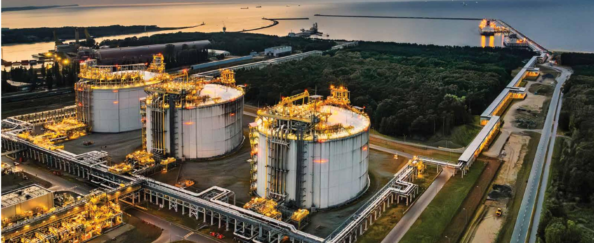  
Courtesy GAZ-SYSTEM

The first quarter of 2026 saw sharp LNG price increases as geopolitical tensions in the Middle East and military attacks on Qatari facilities disrupted global supply chains, with Qatar accounting for 81.5 Mt of shipments in 2025, 18.7% of global exports. Platts JKM rose nearly 70% to US\$25.393/MMBtu on March 3, reaching its highest level since December 30, 2022, as Asian LNG importers and sellers digested the ongoing impact.

The supply shock triggered a jump in trading activity, as Asian importers turned to spot markets to secure alternative cargoes and traders rushed to hedge price volatility. LNG trading volumes on the Asia physical Platts Market on Close assessment process rose 77% YoY to 62 transactions in Q1 2026, up from 35 transactions in Q1 2025. Derivatives trading volumes surged 251% YoY to 1,744 contracts (8.3 million tonnes), compared to 497 (2.3 Mt) in the year-earlier period.

Figure 4.1: Comparison of major LNG, pipeline gas and oil benchmarks, December 2024 to March 20264.1  
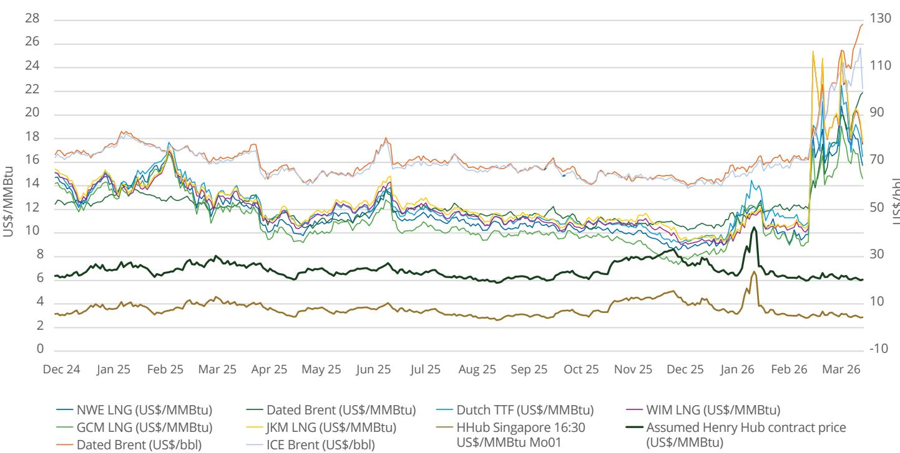  
Note: Assumed Henry Hub Term Contract Price = HH\*115% + US\$2.75/MMBtu Source: S&P Global Energy

## ASIA PACIFIC LNG PRICE TRENDS

## 4.1

The Platts JKM benchmark, which reflects LNG cargoes delivered into Northeast Asia, averaged US\$12.16/MMBtu in 2025, up 2.10% from 2024. Assessed through the Platts Market-on-Close (MOC) process, reported physical activity reached 15.5 Mt for 2025 deliveries. JKM prices were at a wider band of US\$9.39-US\$17.12/MMBtu in 2025, compared with US\$7.98-US\$15.59/MMBtu in 2024, reflecting a market that was more sensitive to seasonal demand swings and inter-basin competition for flexible supply. Prices in 2025 peaked on February 10 at US\$17.123/MMBtu, as Asian buyers bid to secure prompt cargoes amid stronger competition with Europe for LNG supply, while sellers opted to divert US cargoes to Europe, where profit margins were more favourable than in Asia.

Across Asia, power-sector dynamics directly shaped spot demand fundamental. Japan’s imports were broadly flat, slipping by 0.35 Mt, or 0.5% YoY, to 67.37 Mt on stronger nuclear output, weakening spot pull, while South Korea (+3.5%) and Chinese Taipei (+10.7%) saw tighter nuclear availability drive incremental spot buying. In Southeast Asia, declining domestic gas structurally increased reliance on LNG spot markets, led by Indonesia’s record imports and Singapore’s 5.7% YoY growth, partly ofset by weaker demand in Thailand.

Figure 4.2: Comparison of 30-day moving annualised volatility of price benchmarks, 2022 to Q1 2026  
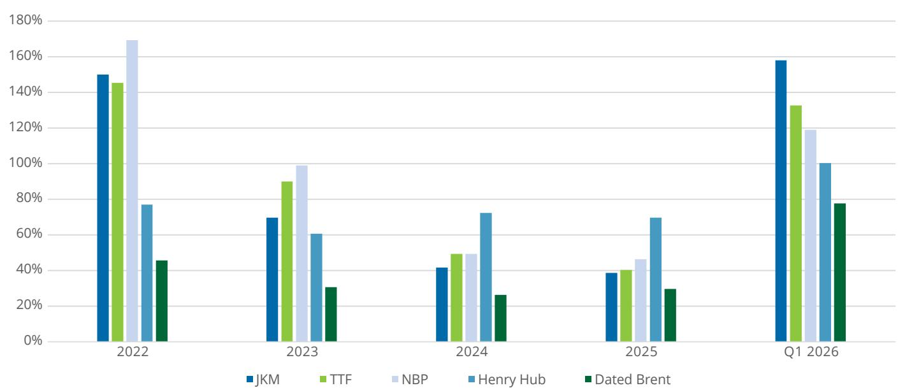  
Source: S&P Global Energy

third and fourth quarters, with eforts to hedge exposure ahead of winter demand. Bids and ofers into Thailand and India increased significantly, with 87 and 72 deliveries respectively, up 165% YoY, highlighting expanding liquidity and interest beyond the core JKT-China markets. In one case, a single mid-August-delivery cargo was heard to have traded 46 times in the spot market, a record that highlighted the depth of trading activity among market participants.

Asia Pacific LNG markets were shaped by weaker demand growth in parts of North Asia and shifting trade flows.

LNG derivatives trading activity on the MOC rose 156% YoY to a record 21.64 Mt equivalent – a step forward for Asian market financial activity, allowing buyers to hedge forward price exposure more eficiently amid ongoing market volatility. This shift mirrors stronger physical participation and reinforces the market’s shift toward more active, benchmark-linked hedging and risk transfer.

In South Asia, LNG imports declined in aggregate as India and Pakistan contracted, while Bangladesh expanded. India’s LNG pricing and procurement continued to evolve alongside the growing use of benchmarks and exchange-based transactions – 322,000 MMBtu (6,190 tonnes) of gas for May-July delivery at Hazira was transacted on the Indian Gas Exchange (IGX) April 2 at the Platts West India Marker (WIM) minus US\$0.70/MMBtu, illustrating increasing use of index-linked pricing for short-term procurement.

LNG price volatility rose further in Q1 2026 at the onset of the Middle East conflict but reduced in April. Asian LNG buyers have diverted at least 8 Atlantic Basin cargoes away from Europe since the Middle East war began 28 of February, as escalating supply risks following strikes on Qatar's Ras Lafan facility heightened near-term urgency in Asia and reshaped trade flows. The shift also underscored the market’s increasing flexibility in diverting resources, supported by a year of deepening spot market activity and liquidity in Asia.

China remained the world’s largest LNG importer in 2025, although imports fell by 8.87 Mt, or 11.3% YoY, to 69.77 Mt, from 78.64 Mt in 2024, as stronger domestic supply, higher pipeline inflows and mild weather reduced spot buying. Even so, Chinese re-exports increased by 45.8% to 0.67 Mt, from 0.46 Mt in the prior year, highlighting its growing role as a swing player in the global spot market. Reloads increased as global spot prices traded above domestic levels, with China arbitraging volumes back into the market and adding liquidity, supported by expanded storage and reload capacity.

Market activity in Asia strengthened materially as participants sought greater price transparency and more active spot trading. Spot LNG cargo activity in the Platts APAC cargo MOC rose 132.2% YoY to record levels for 2025 deliveries, with 5,739 bids, ofers and trades reported by 40 companies. Reported trade for 2025 spot deliveries reached 232, up 127% YoY, where participation was strongest in the

Throughout 2025, Asia’s LNG risk management framework continued to deepen, with greater reliance on benchmark-linked pricing and a more deliberate approach to hedging seasonal exposure.

LNG price volatility rose further in Q1 2026 at the onset of the Middle East conflict but reduced in April. Asian LNG buyers have diverted at least 8 Atlantic Basin cargoes away from Europe since the Middle East war began 28 of February, as escalating supply risks following strikes on Qatar's Ras Lafan facility heightened near-term urgency in Asia and reshaped trade flows. The shift also underscored the market’s increasing flexibility in diverting resources, supported by a year of deepening spot market activity and liquidity in Asia.

Market activity in Asia strengthened materially as participants sought greater price transparency and more active spot trading. Spot LNG cargo activity in the Platts APAC cargo MOC rose 132.2% YoY to record levels for 2025 deliveries, with 5,739 bids, ofers and trades reported by 40 companies. Reported trade for 2025 spot deliveries reached 232, up 127% YoY, where participation was strongest in the third and fourth quarters, with eforts to hedge exposure ahead of winter demand. Bids and ofers into Thailand and India increased significantly, with 87 and 72 deliveries respectively, up 165% YoY, highlighting expanding liquidity and interest beyond the core JKT-China markets. In one case, a single mid-August-delivery cargo was heard to have traded 46 times in the spot market, a record that highlighted the depth of trading activity among market participants.

LNG derivatives trading activity on the MOC rose 156% YoY to a record 21.64 Mt equivalent – a step forward for Asian market financial activity, allowing buyers to hedge forward price exposure more eficiently amid ongoing market volatility. This shift mirrors stronger physical participation and reinforces the market’s shift toward more active, benchmark-linked hedging and risk transfer.

Figure 4.3: Platts LNG cargo and derivatives MOC trades, 2021 to 2025  
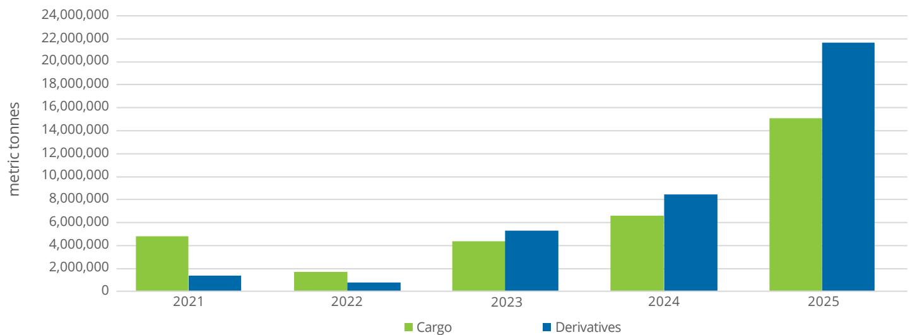  
Source: S&P Global Energy

## 4.2

During 2025, the Atlantic basin was saturated with exports from the US, leading to minimal inter-basin competition and limited arbitrage opportunities.

# ATLANTIC LNG PRICE TRENDS

This robust supply exerted downward pressure on prices and shipping rates throughout much of the year.

In 2025, Europe imported a record 126.2 Mt of LNG, up 26.1% YoY, as the region replaced lost Russian pipeline gas, following the expiration of the Ukraine gas transit agreement. The US remained the dominant supplier, accounting for 58.5% or 73.8 Mt of net imports, while Russia was the second-largest supplier, making up 11.1% or 14.03 Mt. US LNG was the dominant source of Europe’s Atlantic-basin supply in 2025, with the largest US-to-Europe flows delivered to the Netherlands (12.1 Mt), France (10.5 Mt) and Spain (8.1 Mt). Italy (7.2 Mt), Türkiye (7.1 Mt), the UK (6.8 Mt) and Germany (6.3 Mt) also received substantial US volumes, underlining Europe’s growing reliance on flexible US LNG as a marginal balancing supply.

Europe’s reliance on spot LNG appeared to intensify further. An estimated 65.5% of LNG imports were sourced through spot purchases, up 17.4 percentage points YoY. This increased exposure to short-term price signals, but in an oversupplied Atlantic market it also reinforced downward pressure on delivered LNG prices. Summer demand was particularly muted, as the European Council’s decision to relax gas storage targets disrupted typical restocking patterns and reduced incremental spot buying interest.

The intense inter-basin competition seen in 2024 did not materialise, with arbitrage economics consistently favouring Atlantic-bound flows. Asia-Europe spreads remained too weak to attract Atlantic cargoes eastward, with Platts assessing the average North Asia via Cape of Good Hope versus Atlantic arbitrage at minus US\$0.71/ MMBtu. Along with subdued shipping rates, this kept the Atlantic basin structurally long and reinforced Europe’s role as the clearing market for surplus LNG supply.

Europe faced some localised competition from Egypt, which shifted to net importer status and recorded 9.6 Mt of LNG demand, up 259.4% YoY, exceeding its previous peak of 7.3 Mt in 2016. Declining domestic gas production and concerns over Israeli gas supply disruptions drove increased procurement. Egypt also secured 4 floating storage and regasification units (FSRUs) during the year to stabilise power generation. Elsewhere, Latin American LNG demand weakened, with imports falling to 10.98 Mt from 12.95 Mt in 2024. Seasonal restocking and weather-related demand supported imports between April and August, with Argentina accounting for 36% of July’s regional intake amid colder-than-normal temperatures and pipeline disruptions.

LNG supply growth remained a key theme in 2025, with supply additions further weighing on market balances.

LNG Canada shipped its first cargoes, although ramp-up was slower than anticipated due to operational issues, with Train 1 only consistently exporting from October. By contrast, Plaquemines LNG added strong incremental volumes from the US Gulf Coast as it ramped rapidly, while Venture Global also took FID on the 14.4 MTPA CP2 LNG project in July.

Platts’ Northwest Europe (NWE) LNG price averaged US\$11.423/ MMBtu in 2025, compared with US\$10.743/MMBtu in 2024. The DES NWE marker averaged a discount of US 54 cents/MMBtu to the Dutch Title Transfer Facility (TTF), significantly wider than the 26-cent average discount seen in 2024. This reflected ample LNG availability in Europe and reduced competition for Atlantic-basin cargoes.

Although price changes were generally subdued, Atlantic LNG markets experienced 2 notable price rallies. The first occurred in early February, driven by colder weather forecasts and declining European gas storage levels, lifting prices to their highest since early February 2023. The second followed mid-June, when escalating tensions between Israel and Hamas injected temporary geopolitical risk premiums into the market, despite the absence of fundamental supply disruptions.

Figure 4.4: US to Asia LNG price diferences vs volume shift, January 2023 to December 2025  
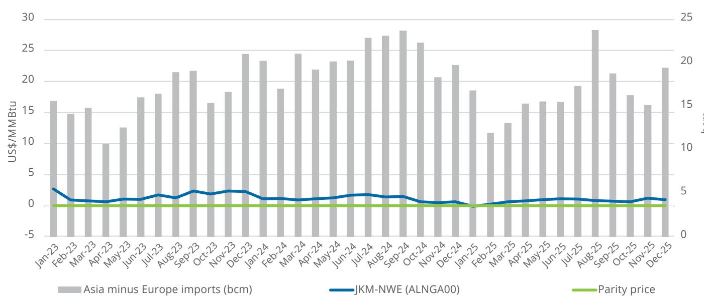  
Source: S&P Global Energy

During 2025, the Atlantic basin remained structurally long, reinforcing Europe’s role as the primary destination for surplus US supply amid constrained Asia-Europe arbitrage. Prices and shipping rates were largely capped by supply, while volatility was driven mainly by weather and geopolitical developments.

Into 2026, Europe’s LNG outlook hinges on the production status of Golden Pass LNG, Middle East stability and the pace of storage injections. The US-Iran conflict is likely to keep a risk premium embedded in prices, with Hormuz uncertainty tightening global LNG supply and forcing Europe to compete harder with Asia for flexible cargoes. While Europe has evaded the record price surges that beset the regional gas market during the 2022 energy crisis following Russia's invasion of Ukraine, the continent remains exposed to upside price risks as summer approaches and cooling demand swells, though the threat of demand destruction at elevated price levels could cap any rally.

## Conclusion

Overall, 2025 highlighted an LNG market increasingly defined by structural diferences across basins. Asia Pacific pricing reflected maturing liquidity, greater reliance on LNG benchmarks and heightened sensitivity to seasonal and inter-basin signals. Meanwhile, persistent supply in the Atlantic constrained price upside and reinforced Europe’s role as the marginal destination for global LNG. Looking into 2026, price dynamics are expected to remain closely linked to geopolitical developments centered around the Strait of Hormuz, new supply start-ups, weather-driven demand risk, with LNG and gas benchmarks playing a growing role in trade across all regions.

  
Courtesy LNG Canada

Global liquefaction capacity reached 524.5 MTPA in 2025.

Capacity Additions for 2025


30.1MTPA of liquefaction capacity brought online


6.1% year-on-year growth vs 2024


United States 116.9MTPA

Market with the highest liquefaction capacity


Australia 85.1MTPA


Qatar 77.1MTPA

## Pre-FID


1,105.4MTPA of liquefaction capacity currently in pre-FID stage

384.4MTPA from the US

227.3MTPA from Canada


170.4MTPA Russia 45.5MTPA from Australia

## FIDs and Under Construction


FID in 2025 68.4MTPA of liquefaction capacity under construction or approved for development as of Dec 2025


112MTPA across 6 LNG projects

# 5. Liquefaction Plants

A total of 30.1 MTPA of liquefaction capacity was added in 2025, pushing global capacity to 524.5 MTPA1 by year-end 2025. The average global utilisation rate in 2025 was 83.9%, a slight decline from 86.5% in 2024, mainly due to extreme weather patterns, maintenance and mechanical faults. As of the end of 2025, seven projects have reached final investment decision (FID), bringing total approved capacity of liquefaction projects to 234.3 MTPA.

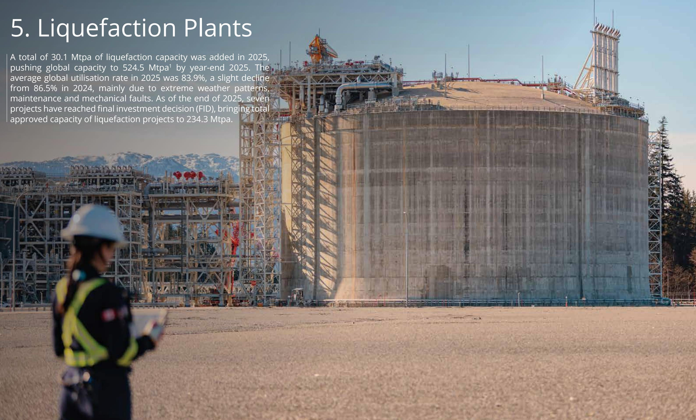  
Courtesy LNG Canada

## 5.1 OVERVIEW

Figure 5.1: Global liquefaction capacity growth by region, 1990-2031  
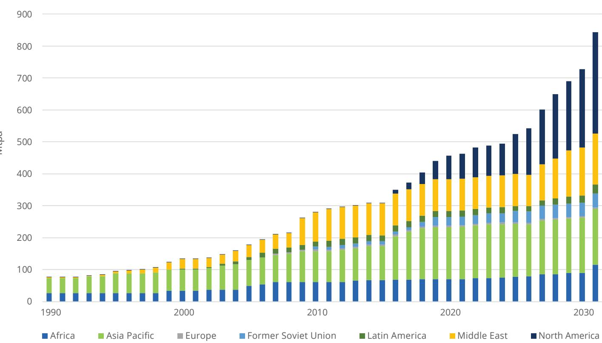  
Source: Rystad Energy

The liquefaction capacity brought online globally in 2025 includes the addition of Plaquemines LNG T9-T36 (15.1 MTPA, assuming startup of the eight trains in the first four blocks in 2024 for simplicity) and Corpus Christi Stage 3 (6.0 MTPA) in the United States (US), LNG Canada (7.0 MTPA) on the North American West Coast, Tortue/Ahmeyim FLNG phase 1 (2.5 MTPA) in Africa while Arctic LNG 2 also added 6.6 MTPA of capacity.

Figure 5.2: Global liquefaction capacity by region and status, end-2025  
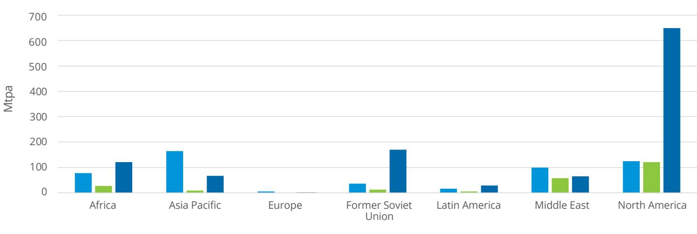  
Source: Rystad Energy

Retirements in Trinidad & Tobago, Australia and the US ofset some of these additions. The US, Australia and Qatar, still rank among the top three in terms of global operational liquefaction capacity. In the first half of 2026, Golden Pass, the joint venture between QatarEnergy and ExxonMobil, achieved first LNG in March and exported its first cargo on 22 April. Despite the introduction of Golden Pass supply, global LNG markets remain on edge due to the closure of the Strait of Hormuz in early March, which remains in place as of 26 May, has taken Qatar’s2 and the United Arab Emirates (UAE) liquefaction capacity of the market, forcing both markets to shut-in their LNG production. As a result, QatarEnergy has declared force majeure on numerous LNG contracts, sending the near-term market into a state of undersupply. Ongoing regional tensions will also have a prolonged impact on the market as Iranian missile strikes on 18 March caused severe damage to two LNG trains at the Ras Lafan LNG facility in Qatar. Both trains are estimated to be ofline for the next three to five years, representing a 17% (12.8 MTPA) loss of Qatar’s total nameplate capacity during this time.

During 2025, 68.4 MTPA of liquefaction capacity was approved, which is a significant rise compared to 14.8 MTPA in 2024, and is the highest yearly total since 2019. LNG approvals in 2025 were concentrated in the US, driven by political and regulatory support rather than supply and demand shocks, which was the case back in 2022 after the start of the Russia-Ukraine conflict. More specifically, FIDs were bolstered by the Trump Administration lifting the ban on non-Free Trade Agreement (FTA) approvals, which had impeded many LNG projects from reaching the finish line prior to 2025. Last year in the US, Woodside Louisiana LNG (16.5 MTPA), Calcasieu Pass 2 (CP2) LNG (14.4 MTPA), Port Arthur Phase 2 (13.0 MTPA), Rio Grande Phase 2 (12 MTPA) and Corpus Christi Midscale T8-9 (3.0 MTPA) took FID. CP2 LNG is set to be the first one to come online in late 2027 while the other four projects all come online in 2029 or 2030. The Australian company Woodside bought the Louisiana LNG project from Tellurian in 2024, bringing it back to life and taking FID on it in early April. Along with Louisiana LNG, CP2 was the only other greenfield project approved in the US in 2025. Venture Global took FID on the project in July, increasing its operational and approved liquefaction capacity to 43.8 MTPA, only second to Cheniere’s 58.4 MTPA.

The other three projects are brownfield expansions that are currently operational or under construction. Rio Grande Phase 2 includes Train 4 and Train 5 which are backed by long-term SPAs – with major buyers such as ADNOC, TotalEnergies, Aramco, Jera and ConocoPhillips. Port Arthur Phase 2 received its Department of Energy (DOE) export authorisation in 2025 and subsequently reached FID later in the year, which will double the current 13 MTPA Phase 1 project to a total capacity of 26 MTPA, making it one of the largest LNG facilities on the US Gulf Coast, once completed. Cheniere’s Corpus Christi expansion, Midscale Train 8 & 9, is the smallest of the projects at a capacity of 3 MTPA but comes with the least execution risks, using Cheniere’s standard “midscale” train design to reduce costs and execution risk.

These five projects on the US Gulf Coast, along with all other under construction LNG terminals, will have a notable price impact on both domestic and global LNG markets.

Outside of the US, Southern Energy FLNG (6.0 MTPA) in Argentina and Coral North FLNG (3.6 MTPA) in Mozambique were also approved. Coral North is a 3.6 MTPA FLNG terminal located around 55 km ofshore in the ultra-deepwater Area 4 of the Rovuma Basin and will be a replica of the operating Coral South FLNG system. Gas will be produced from subsea wells and tied back directly to the floating vessel, where it will be processed, liquefied, stored, and ofloaded to LNG carriers, entirely ofshore with no onshore liquefaction infrastructure. This floating model is particularly important in Mozambique as it bypasses onshore security and infrastructure constraints while enabling faster monetisation of ofshore resources. The project leverages identical design, Engineering, Procurement and Construction (EPC) execution, and operating experience from Coral South, allowing for standardisation, lower execution risk and improved operational uptime. Operated by Eni with partners including CNPC, ExxonMobil, KOGAS, ENH, and ADNOC’s XRG, Coral North will efectively double Mozambique’s FLNG output and reinforce a scalable ofshore LNG development model in the basin. Southern Energy FLNG is Argentina’s first LNG export project, based on two floating liquefaction vessels (Hilli Episeyo and MK II) with a combined capacity of 6.0 MTPA. Located ofshore in the Gulf of San Matías, the project uses a hybrid model, with natural gas sourced from the prolific Vaca Muerta shale play and transported via pipeline to the FLNG vessels for liquefaction and export. The first unit (Hilli, 2.5 MTPA) is expected online in 2027, followed by MK II (3.5 MTPA) in 2028, supported by additional pipeline infrastructure. Both vessels are converted LNG carriers using modular Black & Veatch PRICO technology, enabling faster deployment and lower capital intensity than onshore terminals. Co-locating the vessels creates shared logistics and operational synergies, while the project structure (YPF, PAE, Pampa, Harbour Energy, Golar) integrates upstream supply with LNG exports.

As of the end of 2025, 1,105.4 MTPA of aspirational liquefaction capacity was in the pre-FID stage. Most proposed capacity was in North America (650.3 MTPA), with 384.4 MTPA in the US, 227.3 MTPA in Canada and 38.6 MTPA in Mexico. This is followed by Russia (170.4 MTPA), Africa (121.1 MTPA), Asia Pacific (67.0 MTPA), and the Middle East (65.7 MTPA). About 31 MTPA of liquefaction capacity was proposed in the rest of the world. Overall, markets remain shaken by the Russia Ukraine conflict and more recently, they received a stark reminder from the closure of the Strait of Hormuz, that energy security needs to be at the forefront of governments' energy policies. The premium on energy security will continue to stimulate investment in additional liquefaction while, at the same time, balancing decarbonisation goals in this fast-changing landscape. Still, with the second most MTPA of LNG capacity approved yearly in 2025, the economic environment going forward will be dificult and will prevent many projects from reaching a positive FID.

## 5.2

## GLOBAL LIQUEFACTION CAPACITY AND UTILISATION

Global operational liquefaction capacity totalled 524.54 MTPA as of the end of 2025, with an increase of 30.1 MTPA compared to 2024 as three North American projects - Plaquemines (T9-T36), Corpus Christi stage 3 and LNG Canada - came online. The average utilisation rate in 2025 was 83.9%3, a slight decrease of 2.6 percentage points from 2024. There were more unplanned LNG outages in 2025, mainly due to mechanical faults and maintenance but also due to power outages and severe weather conditions. In 2025, 12 out of 25 LNG exporting markets achieved higher-than-average utilisation rates, including

Papua New Guinea, Oman, Mozambique, Qatar, the US, Congo, Australia, Angola, Malaysia, the UAE, Peru, Russia, Equatorial Guinea, Trinidad and Tobago and Mexico. Meanwhile, some export facilities have been running below average – for example, the utilisation rate of the three Arzew plants in Algeria dropped from 90% in the early 2000’s to 38% in 2025. This drop was jointly caused by the decrease in total feedgas availability and the increase in total liquefaction capacity. Furthermore, LNG Canada had an outage plagued ramp-up in 2025, which has caused a utilisation rate of 30.6%.

Source: Rystad Energy

Liquefaction plants in the US operated at an average utilisation rate of 94.7% in 2025, a slight increase from the 93.9% in 2024, demonstrating consistent performance the entire year. This was particularly due to the rebound in performance from the Freeport LNG facility, which experienced 23 outages in 2024, of which 91% were unplanned and led to a utilisation rate of 85%, significantly lower than the average of 93.9%. In 2025, Freeport operated at a 107%4 utilisation rate on average, one of the top performing LNG facilities in the US. Cheniere’s LNG plants of Corpus Christi and Sabine Pass remained steady performers in 2025, up slightly from an already high historical utilisation and contributed to the strong overall average. Elsewhere in North America, Canada and Mexico plants underperformed compared to their peers. LNG Canada’s outage afected the ramp-up of its Train 1, which started production in June, and only started consistently exporting cargoes three months later in October due to equipment failure and necessary flaring, leading to 30.6% utilisation. Similarly, the utilisation of Altamira LNG in Mexico also lagged, albeit not to the same extent. The rocky startup in 2024 from Altamira LNG Train 1 continued in early 2025, dragging the overall utilisation for the year to 73.7%.

In Africa, the nameplate utilisation rate at the Nigeria LNG (NLNG)5.3 plant averaged 66.6% in 2025, a slight increase compared to 2024 but it remains afected by regional security issues, causing the plant to declare force majeure in the past. Declining feedgas supply is also a main issue for the NLNG facility, as its traditional partners divest and transfer onshore assets that feed the LNG terminal. Egypt continued to be a net importer of LNG in 2025 as its domestic natural gas shortages continued. Its LNG exports dropped to 0.5 Mt, with very sparse cargo departures, while LNG imports grew to just under 10 Mt, with the majority coming from the US, increasing the competition for Atlantic cargoes. Other African markets to have performed well are Mozambique, Congo and Angola, with utilisation rates of 108.2%, 101.4% and 93.6% respectively.

Australia, the third-largest exporter of LNG globally, operated at a 94.4% utilisation rate throughout the year, unchanged from its performance in 2024. The market’s largest export hubs, North West Shelf, Gorgon, Wheatstone, and Ichthys, continued to anchor output, with Gorgon and Wheatstone benefiting from improved reliability after earlier operational issues, and Ichthys maintaining consistently high uptime. On the East Coast, Queensland’s coal seam gas-linked projects (QCLNG, APLNG, GLNG) also ran steadily, though with more variability tied to feedgas availability.

Figure 5.3: Global liquefaction capacity utilisation, 20255  
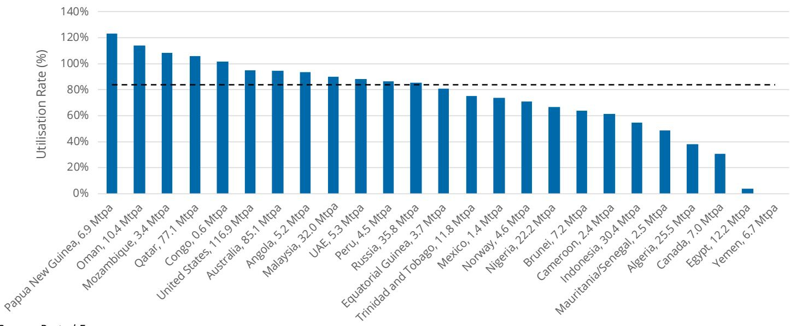

Figure 5.4: Global liquefaction capacity development, 1990-20316  


## Source: Rystad Energy

## 5.3 LIQUEFACTION CAPACITY BY MARKET

## Operational

As of the end of 2025, there were 25 markets operating LNG export facilities. The US remained the market with the largest operational liquefaction capacity at 116.9 MTPA in 2025. Australia and Qatar ranked second and third with 85.1 MTPA and 77.1 MTPA, respectively, with Qatar maintaining the same capacity as the previous year while Australia saw a slight decline from the retirement of Train 2 at the North West Shelf LNG terminal by the operator Woodside. The top three LNG export markets currently represent more than half of global capacity.

As Russian pipeline flows into Europe have dwindled to 17.7 bcm in 2025, relative to the 112.8 bcm prior to the Russia-Ukraine conflict in 2022, Russia continued to try to push its LNG exports up in 2025. While volumes remained relatively resilient throughout the year, its export and shipping fleet has been structurally constrained by sanctions. Russian LNG exports totalled 30.5 Mt in 2025, a 10.7% decline over 2024 levels, and were underpinned by the Yamal LNG terminal, which continued to ship LNG into Europe. Sanctions have had a greater impact on growth than on existing supply, with the flagship Arctic LNG 2 project facing major challenges around logistics, financing, technology access, and LNG carrier availability, leading to delayed ramp-up and inconsistent operations well below capacity. While some cargoes have been redirected to China using discounted pricing and alternative shipping solutions, overall performance remains volatile. Unexpectedly, the Arctic 2 LNG terminal still managed to export several LNG cargoes throughout the year, exclusively landing at the Beihai terminal in China at heavily discounted prices. Additionally, Portovaya and Vysotsk LNG have seen a combined YoY decline of 1.7 Mt, further hampering Russia’s LNG exports in 2025.

Figure 5.5: Global operational liquefaction capacity (MTPA) and market share (%) by market, end-20255  
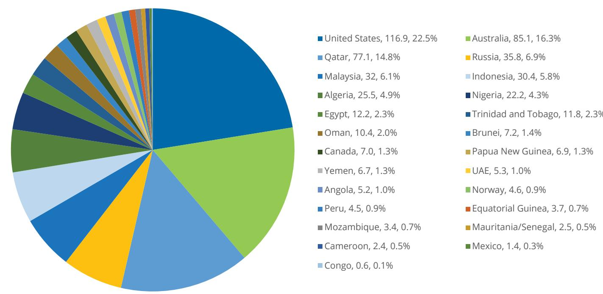

## Under-construction/FID

As of the end of 2025, 234.3 MTPA of liquefaction capacity was either under construction or approved for development, of which approximately 48% is in North America. In 2025, a total of 68.4 MTPA of liquefaction capacity was approved – with five US Gulf Coast projects moving ahead - including Woodside Louisiana LNG (16.5 MTPA), CP2 LNG (14.4 MTPA), Port Arthur Phase 2 (13 MTPA), Rio Grande Phase 2 (12 MTPA) and Corpus Christi Midscale T8-9 (3.0 MTPA) as well as two other projects in Southern Energy FLNG (6.0 MTPA) in Argentina and Coral North FLNG (3.6 MTPA) in Mozambique taking a positive FID.

Several liquefaction facilities are currently under construction and progressing towards completion. Corpus Christi Stage 3 Trains 5-7 (5.3 MTPA) will start up in 2026 and are expected to complete their full ramp-up by year-end, while Golden Pass (17.8 MTPA) achieved its first LNG on 30 March 2026 and exported its first LNG cargo on 22 April. Similarly, LNG Canada Train 2 (7 MTPA) will do the same, and is expected to hit full capacity by mid-year (2026). In the Middle East, Qatar’s NFE T8-11 (32 MTPA) will now be delayed by at least one year from its original start-date in Q3 2026 due to the conflict in the Middle East, the closure of the Strait of Hormuz and the damage caused to the Ras Lafan industrial city energy complex.

Figure 5.6: Global approved liquefaction capacity (MTPA) and market share (%) by market, end-20255.6

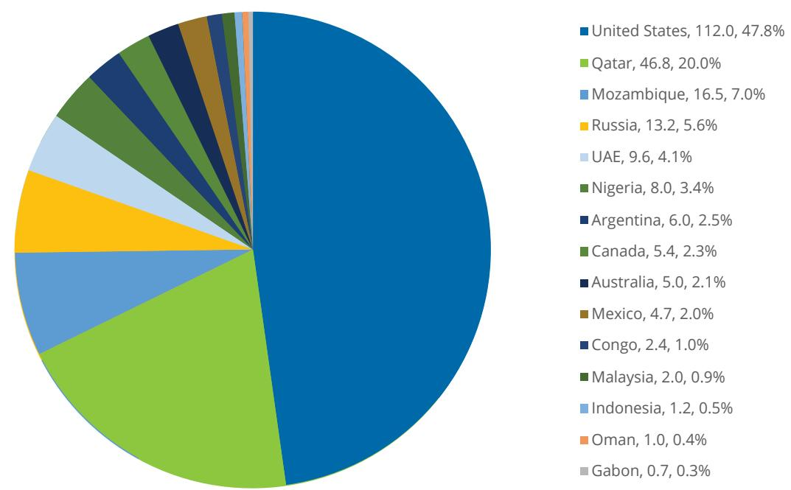

Source: Rystad Energy

As of the end of 2025, there was 1105.4 MTPA of potential liquefaction capacity in the pre-FID stage, remaining roughly flat compared to 2024. With the Strait of Hormuz tensions still ongoing and the impact to the damaged Ras Lafan QatarEnergy LNG facilities still being processed, the uncertainty is likely to spark renewed interest in many pre-FID projects to help meet demand that will look to more stable sources of LNG. However, every project FID makes the subsequent FID more dificult as the economics become more challenging, as these will dictate the number of LNG projects approved in the future.

## Proposed

  
Courtesy Cheniere Energy  
Figure 5.7: Global proposed liquefaction capacity (MTPA) and market share (%) by market, end-2025

United States, 384.4, 34.8% Russia, 170.4, 15.4% Mozambique, 45.0, 4.1% Iran, 36.8, 3.3% Argentina, 18.0, 1.6% Tanzania, 15.0, 1.4% Djibouti, 10.0, 0.9% Papua New Guinea, 9.2, 0.8% Israel, 5.0, 0.5% Iraq, 4.5, 0.4% Equatorial Guinea, 4.4, 0.4% Cyprus, 2.0, 0.2% Congo, 1.4, 0.1%

  
Source: Rystad Energy

The 384.4 MTPA of proposed US Liquefaction capacity continues to be supported by LNG developers and investors looking to take advantage of a friendly US investment environment and of the strong economics boasted by US LNG projects. The economics of US LNG projects difer significantly from other integrated projects globally as most US projects are tolling and/or merchant model facilities, a new method that was introduced to the global market during the wave of US capacity additions during 2016-20. In the tolling model, the LNG developer does not take possession of the natural gas and simply provides liquefaction services for a tolling fee, while merchant facilities provide the LNG to oftakers, with the flexibility of not lifting the cargo if the economics do not make sense (which we saw in 2020 when the TTF – Henry Hub spread collapsed to under US\$1/MMBtu). The surge in approved US Gulf Coast LNG capacity in 2025 was made possible by these strong economics but also was triggered by the US Department of Energy lifting the pause on new non-FTA approvals for proposed LNG projects, which is a mandatory authorisation to receive before taking a positive FID. However, going forward, the economics for proposed US Gulf Coast projects are expected to become more challenged as natural gas inventories in key regions that serve the US Gulf Coast, are rapidly depleting, increasing the prices required to incentivise natural gas drilling and production. Additionally, with the large buildout of data centres also expected in Texas, there is growing concern that Henry Hub prices will structurally increase in the medium- to long-term to around US\$5/MMBtu, which would require Asia spot LNG prices of above US\$10/MMBtu for LNG economics to make sense.

Out of the proposed 227.3 MTPA of liquefaction capacity in Canada, only a limited number of projects are considered viable. West Coast facilities benefit from lower shipping costs to Asia versus US Gulf Coast projects but face key challenges around pipeline development and environmental approvals. Many projects have been delayed or cancelled, while those advancing are adopting lower-emission solutions to meet regulatory and social requirements. LNG Canada Phase 2 T3-T4 (14.0 MTPA), for instance, plans to use high-eficiency aero-derivative gas turbines and incorporate renewable power to reduce emissions.

Russia’s LNG expansion timeline has been pushed back, efectively capping near-term capacity growth. Looking ahead, the most likely projects to reach FID are those with limited reliance on Western technology, including the remaining Arctic LNG 2 trains, Ob LNG, and Murmansk LNG, though all continue to face significant uncertainty under the current sanction environment.

Africa’s proposed liquefaction capacity has increased to 121.1 MTPA. Mozambique has the largest pipeline, with a combined capacity of 45 MTPA. Rovuma LNG in its new design may use a modular approach instead of a stick-built approach, with capacity expanded to 18 MTPA from 15.2 MTPA. In 2025, Mozambique’s Rovuma Basin (Area 4) saw meaningful progress on ofshore LNG, while onshore projects stalled. The key development was the FID and government approval of the Coral North FLNG project (3.6 MTPA), which builds on the success of Coral South and is expected online around 2028, efectively doubling Mozambique’s FLNG output to over 7 MTPA. This reinforces a strategic shift toward ofshore FLNG solutions, which are less exposed to the security risks that have disrupted onshore developments in Cabo Delgado. In contrast, the larger Rovuma LNG (18 MTPA) and Mozambique LNG (Area 1) (12 MTPA) projects remained delayed in 2025 due to ongoing security concerns, financing challenges, and cost inflation, despite their scale and long-term importance. Overall, 2025 highlighted a two-track development path: ofshore projects advancing and monetising natural gas, while major onshore LNG projects continue to face delays.

In Asia Pacific, Australia remained the market with the largest proposed capacity at 45.5 MTPA in 2025. Proposed projects such as Abbot Point LNG T1-T4 (1.9 MTPA), Gorgon LNG T4 (5.2 MTPA) and Wheatstone LNG T3-T5 (15.9 MTPA) have yet to progress, with most still in the feasibility stage. Regulation and federal policies remain a key barrier to Australia’s LNG sector, especially on the East Coast. Western Australia remains more supportive of further LNG development, backing projects like North West Shelf extensions and Pluto/Scarborough, but remain subject to mandatory domestic supply agreements when looking for export approvals. As a result, our forecast for LNG export capacity remains roughly flat into the long-term despite the numerous projects that are in the pipeline. In Papua New Guinea (PNG), ExxonMobil, together with TotalEnergies, are working towards a decision on the Papua LNG project (4 MTPA), even though FID was pushed out to 2026, due to a reopening of bidding to a broader group of contractors.

In Southeast Asia, Indonesia has proposed a total of 12.33 MTPA of new liquefaction capacity, largely driven by the Abadi LNG project (9.5 MTPA). This project will be supplied by the Abadi natural gas and condensate field located within the Masela Production Sharing Contract (PSC), making it one of the market’s most significant undeveloped natural gas resources. A revised Plan of Development, which notably incorporates a carbon capture and storage (CCS) component to address emissions, received government approval in December 2023, marking an important step forward after years of revisions and delays. The project is currently targeting FID in the latter half of the 2020s, with first LNG expected in the early 2030s, although timelines remain subject to execution, financing and regulatory approvals.

## Decommissioned and idle

There were three oficial retirements in 2025 from LNG trains. The Kenai LNG terminal (1.5 MTPA) in Alaska, the oldest standing export facility in the United States which hasn’t been producing LNG since

## 5.4

## LIQUEFACTION TECHNIQUES

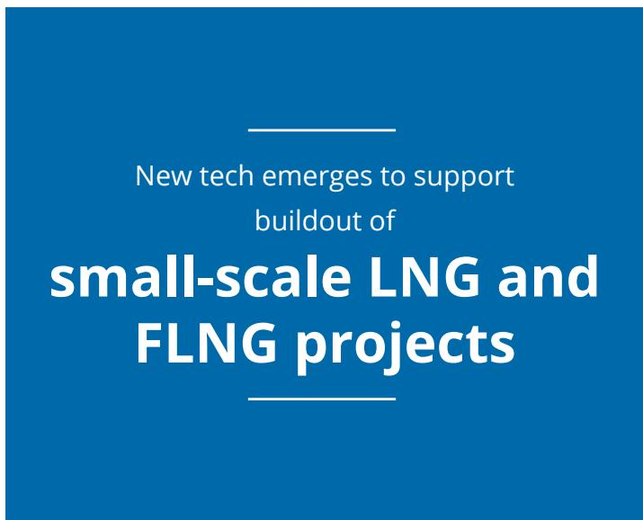

Among the liquefaction trains that became operational in 2025, the Tortue/Ahmeyim FLNG facility in Mauritania/Senegal adopted the Black & Veatch's PRICO technology as many FLNG’s have done in the past, including Congo’s Marine XII FLNG. In the US, Plaquemines LNG T1-T36 adopted Baker Hughes' SCMR technology, leveraging small modular trains for operational flexibility, decrease construction risk and faster ramp-up cycles. Corpus Christi Stage 3 T1-T7 in the US has adopted Chart Industries’ IPSMR technology. Meanwhile, Arctic LNG 2 T1 in Russia has chosen Linde's MFC technology. The situation for future Russian LNG development, however, remains uncertain due to dificulties in securing suppliers as many western companies are prevented from providing their services under the current sanctions’ environment. Shell, being the operator, is using its own DMR technology to build and operate LNG Canada.

2016, was purchased in 2025 by Harvest Midstream and is planned to be converted into an LNG import terminal. The 2025 retirement reflects the depletion of local natural gas resources, marking the end of continuous US LNG exports from Alaska and a broader shift toward lower-cost Gulf Coast supply. However, this narrative could be challenged if the Alaska LNG project makes progress towards an FID. Australia’s North West Shelf (NWS) LNG project, Train 2 (2.5 MTPA) was permanently retired in 2025 due to declining feedgas from aging ofshore fields. The closure reflects the maturity of the asset, reducing the total plant capacity to 14.2 MTPA while the remaining trains continue operating with backfill natural gas strategies. The Atlantic LNG terminal in Trinidad and Tobago formally retired its Train 1 (3 MTPA), and the shutdown was driven by declining upstream gas supply from mature fields and increasing competition for natural gas from domestic petrochemical and power sectors. Additionally, the Marsa El Brega LNG plant in Libya halted production in 2011 and as there are currently no plans of a restart, the project has been excluded from this report.

Currently, Honeywell liquefaction technologies still dominate the market, representing about 65% of total operational capacity in 2025, of which AP-C3MR holds about a 55% share. When looking at approved LNG projects, Honeywell Technologies is expected to maintain its grip on the market, retaining an approximately twothirds share through the rest of the decade. Some notable projects being built with Honeywell technology are Qatargas LNG, NLNG, Golden Pass LNG, Energía Costa Azul LNG, Mozambique LNG (Area 1), Rio Grande LNG, and Port Arthur LNG.

BHGE Technologies is estimated to grow its use to 31 MTPA now that the Plaquemines LNG projects have been completed. Linde Technologies is forecast to growth its fleet to 19 MTPA by the end of 2031 as Arctic 2 LNG has become operational, although this number is lower than previously expected as many Russian LNG projects have been stymied by sanctions. ConocoPhillips' Optimised Cascade technology is estimated to grow its use to 121.8 MTPA once Pluto LNG's expansion has been deployed and has great upside, being the main technology provider to Cheniere, one of the leading developers globally.

The roots of natural gas liquefaction technology date back to the 1960s, when early export facilities such as Arzew GL4Z T1–T3 adopted the Classic Cascade process developed by Pritchard, while Kenai LNG used an early version of the Optimised Cascade process. In the 1970s, Honeywell, formerly known as Air Products7, introduced its Single Mixed Refrigerant (AP-SMR) technology, first deployed at the Marsa El Brega LNG facility, marking a shift toward more eficient and scalable liquefaction designs. During this early phase, liquefaction trains were typically limited to 1.0 to 1.5 MTPA capacity, and these installations functioned as experimental platforms to refine processes capable of cooling natural gas to −162°C for transport. Since then, the LNG technology has evolved significantly, with the development of APCI’s C3MR process in the 1980s which became the industry standard for large-scale plants, followed by AP-X and AP-XP technologies enabling mega-trains exceeding 7-8 MTPA, as seen in Qatar. More recently, the industry has diversified into modular and mid-scale designs, including dual mixed refrigerant (DMR) and nitrogen-based processes, which are widely used in FLNG and smaller onshore projects. Today, advancements focus on improving eficiency, reducing emissions and integrating electrification and carbon capture, reflecting a shift from purely scaling capacity to optimising performance and environmental impact.

Figure 5.8: Installed and approved liquefaction capacity by technology and start-up year, 1966-2031  
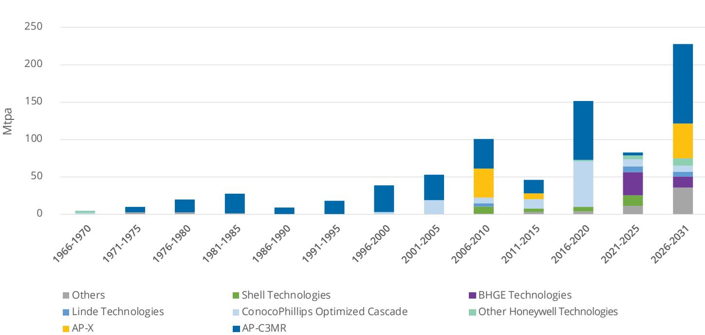  
Source: Rystad Energy

The AP-C3MR technology, first deployed at the Brunei LNG facility in 1972, has progressively become the dominant liquefaction process, accounting for roughly 55% of global operating capacity by 2025 (including its SplitMR variant). Its strong market position has been largely driven by Qatargas developments, adding approximately 30 MTPA of capacity since the startup of Qatargas 1 Train 1 in 1996. The Damietta LNG facility was the first to adopt the C3MR/SplitMR configuration, which improves upon the base process through a refined mechanical layout that enhances turbine eficiency.

Honeywell further advanced its technology portfolio with the introduction of AP-X, first implemented at Qatargas 2 in 2009, enabling 7.8 MTPA per train, the largest liquefaction train size ever achieved. This technology has also been selected for the QatarEnergy expansion projects approved in 2021 and 2023, which include six mega-trains of similar capacity. The increased output is achieved by adding a nitrogen refrigeration cycle to the traditional C3MR process, providing additional sub-cooling capacity and boosting overall eficiency. Variations of this approach have since been applied in both onshore and FLNG developments.

A more compact derivative, AP-N, based on the AP-X subcooling concept, has been deployed on Petronas’ PFLNG1 and PFLNG2 in Malaysia, while projects such as Coral South FLNG in Mozambique and Energía Costa Azul LNG in Mexico use AP-DMR technology. AP-N remains the only expander-based (EXP) process widely used in ofshore LNG applications, ofering a simpler configuration with reduced equipment requirements compared to mixed refrigerant systems. Other FLNG projects, including Cameroon FLNG, Congo Marine XII, and Tortue/Ahmeyim, rely on Black & Veatch’s PRICO technology, highlighting the diversity of liquefaction solutions in floating applications.

Despite its continued title of market leader, Honeywell's market share has declined from over 90% in the 1980s and 1990s to around 65% in 2025, reflecting increased competition. A key challenger has been ConocoPhillips’ Optimised Cascade process, which has gained traction across major projects such as Queensland Curtis LNG, Australia Pacific LNG, Sabine Pass LNG, Wheatstone LNG, and Corpus Christi LNG. Today, the Optimised Cascade technology accounts for approximately 121.8 MTPA of operating capacity, or 21.5% of the market, making it the second most widely used process.

Originally introduced at Kenai LNG in the late 1960s, the technology saw renewed adoption beginning with Atlantic LNG Train 1 in 1999, underpinning its modern resurgence. This will increase going forward, with the Pluto LNG 2 expansion (4.9 MTPA) slotted to use the Optimised Cascade technology when it comes online in 2026.

New liquefaction projects are expected to increasingly enter the market from 2025 to 2030, mainly due to the rising demand for small- and medium-sized LNG production trains. As the focus on exploiting small amounts of stranded natural gas grows, especially ofshore, coupled with intensifying competition among financiers and LNG project oftakers, small- and medium-sized LNG trains are emerging as a lower-risk alternative that doesn’t require the same amount of capital as the larger mega-train projects. These trains are characterised by their compact size, straightforward design, ease of standardisation, and modularisation, which translates into cost and time savings during construction and execution. In 2025, Plaquemines LNG, using BHGE SCMR technology, commenced operations and was able to ramp up to a full capacity of 20 MTPA within a 12-month period, a staggering ramp up for a facility of that size. Plaquemines has also been able to consistently push its small modular trains to beyond nameplate capacity, operating at near peak capacity of 27 MTPA.

While the large-scale LNG liquefaction technology market is dominated by a few companies, new technologies are emerging. One such technology is New Fortress Energy’s Fast LNG, which was deployed at the Altamira LNG T1 (1.4 MTPA) projects, and will also be used with Altamira T2 (1.4 MTPA). Operator-driven liquefaction technologies continue to attract attention. The dual mixed refrigerant (DMR) process, developed by Shell and APCI, has been successfully implemented in the Sakhalin 2 LNG and Prelude FLNG projects and has also been introduced at the LNG Canada project in 2025. This technology’s configuration process is similar to the AP-C3MR method, but instead of using pure propane in the exchanger, the DMR process is pre-cooled with a refrigerant blend that consists primarily of ethane and propane. The benefits of using the DMR process become more apparent in colder environments, as pre-cooling the mixed refrigerant can avoid the pressure limitations of propane at low temperatures. The Novatek Arctic Cascade process, specifically designed for the Arctic climate by Novatek, has been applied in Yamal LNG T4, with a capacity of 0.9 MTPA.

Due to safety considerations (reducing the use of highly flammable refrigerants) and limited space available on compact decks, small-scale FLNGs typically employ relatively simple liquefaction technologies. The first operational FLNG, PFLNG Satu, used the AP-N technology of Honeywell, which is based on a simple nitrogen cooling cycle. Black & Veatch’s PRICO process has been successfully applied to the Cameroon FLNG. Compared to larger trains, these smaller modules, with a capacity of around 0.6 MTPA, allow for more optimised configurations and more eficient use of the limited deck area. As FLNGs with greater capacities are developed, increasingly complex technologies are being implemented; for instance, Prelude FLNG adopted Shell’s DMR technology in 2019, with a capacity of 3.6 MTPA, and Coral South FLNG adopted the AP-DMR technology in 2022, with a capacity of 3.4 MTPA.

## Innovation drives emissions-reduction

A wide range of strategies have been introduced to lower carbon dioxide emissions across the liquefaction supply chain. The emissions profile of LNG facilities is mainly driven by three key sources: firstly, CO2 generated during upstream processing of sour gas; secondly, emissions from gas turbines that supply energy for liquefaction; and thirdly, CO2 associated with electricity production used to operate supporting plant systems.

Another approach to reducing emissions is the capture and storage of CO2 within the liquefaction process. For example, Hammerfest

LNG in Norway has implemented a fully electric configuration, a concept also applied at Freeport LNG, where electric motors drive the liquefaction compressors. The electric drive concept also improves liquefaction eficiency, reducing feedgas loss during the process. These plants are connected to regional power grids that incorporate renewable energy, enabling lower emissions depending on the electricity mix. Other proposed LNG projects to use electric drive concepts are Glenfarne’s Texas LNG and Ksi Lisims LNG in Canada. Additional mitigation options include the use of acid gas removal units (AGRUs), which extract CO2 along with sulphur compounds from the incoming natural gas stream.

Carbon Capture and Storage (CCS) is increasingly recognised as a key decarbonisation pathway for LNG. Its application generally focuses on two areas: removing CO2 directly from natural gas reservoirs (as seen at Hammerfest LNG) and capturing emissions that come from gas-fired turbines during the combustion process. Although postcombustion capture is more costly, it can be viable for new LNG developments where plant design and site conditions are optimised. Companies such as Venture Global are progressing CCS initiatives at facilities like Plaquemines LNG and Calcasieu Pass LNG, targeting the capture and storage of around 500,000 metric tonnes of CO2 per year. As global liquefaction capacity continues to expand, optimising process selection becomes increasingly important, with operators prioritising flexible, cost-efective technologies that align with tightening emissions standards.

Figure 5.9: Share of installed and future approved liquefaction capacity by technology and start-up year  
  
Source: Rystad Energy

## 5.5 FLOATING LIQUEFACTION (FLNG)


16.6 MTPA Operational Floating Liquefaction Capacity Worldwide as of end-2025

As of the end of 2025, there were eight operational FLNG units globally. The Petronas FLNG Satu, constructed by the South Korean Daewoo Shipbuilding & Marine Engineering (currently known as Hanwha Ocean), was the world’s first FLNG facility, with a design capacity of 1.2 MTPA. This facility, after having transited from the Kanowit natural gas field of Sarawak, East Malaysia in 2019, is now located at the Kebabangan field of Sabah, East Malaysia. The Petronas FLNG Rotan, the subsequent FLNG project for Petronas, was built by Samsung Heavy Industries of South Korea and features a Fan enhanced design capacity of 1.5 MTPA. Petronas’ third FLNG unit, FLNG Tiga, is currently under development and is expected to come online early in 2027.

The Cameroon FLNG Terminal is located of the coast of Kribi, in the Océan Department of Cameroon, with a capacity of 2.4 MTPA. In February 2023, New Fortress Energy agreed to sell its entire interest in the project to Golar LNG.

The Prelude FLNG, constructed by Samsung Heavy Industries, has a design capacity of 3.6 MTPA and is to date the largest FLNG unit globally. In 2022, the facility’s output significantly underperformed relative to its capacity, initially attributed to a four-month maintenance shutdown from December 2021 to early April 2022, which was prompted by a fire incident. This underperformance persisted throughout 2023. In May 2023, the Shell-managed facility temporarily halted production due to technical issues. However, in 2024 and 2025, the facility has performed much better, operating at near full utilisation during this time.

The Coral South FLNG Terminal, also known as the Coral Sul FLNG Terminal, is located in the Rovuma Basin, of the coast of Cabo Delgado Province, Mozambique, with a design capacity of 3.4 MTPA. In October 2022, the floating terminal commenced operations. This project is associated with the primary Coral reservoir in the ofshore Rovuma Basin and represents the first FLNG facility to become operational in the deepwater ofshore region of Africa. The Coral North FLNG terminal, an exact replica of Coral South, was approved in October 2025 and is expected to become operational in 2029, doubling the FLNG capacity of Mozambique to 7 MTPA.

The Congo FLNG Terminal, operated by Eni Congo, is located in the Marine XII block, 20 kilometres ofshore. In August 2022, Eni announced the purchase of the Tango FLNG vessel from Exmar, which has a liquefaction capacity of over 0.6 MTPA, and chartered the FSU Excalibur, owned and operated by Exmar. In December 2023, Eni initiated natural gas introduction into the Tango FLNG facility, achieving a record time for natural gas introduction following the FID. Later in 2023, Eni signed a contract with China’s Wison Heavy Industries to construct and install an FLNG plant with a capacity of 2.4 MTPA, increasing the market’s overall FLNG capacity to 3 MTPA. The second FLNG unit, named the Congo Marine XII FLNG 2, exported its first LNG cargo in February 2026.

The New Fortress Altamira FLNG Terminal, known as Altamira Fast LNG, is a FLNG located in Mexico. In July 2022, New Fortress Energy (NFE) formed a partnership with Mexico’s Comision Federal de Electricidad (CFE) to undertake various gas projects, which include the development of an FLNG hub of the coast of Altamira. This hub is to be co-located with the existing Altamira LNG import terminal. The feedgas for the facility will be supplied from CFE’s current pipeline network. NFE plans to deploy several FLNG units within this hub, each with a capacity of 1.4 MTPA. These units will use NFE’s “fast LNG” design, which incorporates modular, midsize liquefaction technology and ofshore infrastructure similar to jack-up rigs. Commercial operations started in August 2024.

Figure 5.10a: Global operational FLNG capacity (MTPA) and market share (%) by market, end-2025  


Figure 5.10b: Global approved FLNG capacity (MTPA) and market share (%) by market, end-2025  
  
Source: Rystad Energy

The Greater Tortue Ahmeyim FLNG Terminal, also known as GTA LNG, is a FLNG terminal situated at the maritime boundary between Senegal and Mauritania, with a design capacity of 2.5 MTPA. The FID for Phase 1 was made in December 2018. Initially, the first gas was expected in 2022, but due to the COVID-19 pandemic and other technical issues with the Floating Production, Storage and Ofloading (FPSO) vessel, it was delayed and achieved only in January 2025 followed by its first LNG cargo export in April 2025. A successful and smooth ramp-up by FLNG Gimi has enabled the facility to reach 90% utilisation by the end of 2025 and export 1.2 Mt of LNG. It is expected to run near full utilisation in the coming year barring unforeseen circumstances.

There are currently 172 MTPA of aspirational capacity proposed as FLNG developments as of the end of 2025, of which 124.6 MTPA are in North America.

In the US, the proposed Delfin FLNG project is set to consist of three floating liquefaction vessels, each with a capacity of 4.4 MTPA. Similar to many other LNG projects, Delfin FLNG made notable regulatory progress in 2025, receiving its deepwater construction and operation license from the US Maritime Administration (MARAD) and its Non-FTA export licenses from the DOE. The first floating unit is expected to make an FID in 2026, although this remains uncertain as commercial progress still needs to be made. In Canada, the Cedar FLNG project (3 MTPA) continues to progress towards a 2028 start date and is a good example of showing the advantages of FLNG projects over onshore facilities. In a region where environmental interventions are typically met with much scepticism, FLNG has emerged as a valuable solution, ofering a viable alternative to traditional onshore developments while minimising ecological impact.

Two out of the three approved FLNG projects in 2025 come from Argentina in the form of the Southern Energy FLNG project. The project consists of two FLNG vessels, Hilli Episeyo (2.5 MTPA) and MK II (3.5 MTPA) which will be deployed ofshore in the Gulf of San Matias, with feedgas coming from the prolific Vaca Muerta shale gas play. Both units are backed by 20-year charter agreements with Golar LNG, with the first FLNG unit Hilli expected online in early 2028 and the second unit MK II expected later in 2028.

In Africa, where FLNG projects are most prominent due to vast ofshore gas reserves and onshore security concerns, the pipeline of pre-FID FLNG projects equals 12.8 MTPA. This includes Congo’s Fast LNG (1.4 MTPA), Djibouti FLNG (3 MTPA), Fortuna FLNG (4.4 MTPA) in Equatorial Guinea, Tortue/Ahmeyim LNG expansion (2.5 MTPA) and UTM Ofshore FLNG (1.2 MTPA) in Nigeria. The Coral North FLNG project took a positive FID in 2025. In the Asia Pacific, Middle East, South America and Russia, some 34.6 MTPA of FLNG liquefaction capacity has been proposed.

Floating liquefaction technology has advanced significantly in recent years, particularly in the evolution of FLNG unit design. Earlygeneration projects developed by Shell, Petronas and Eni were highly customised and capital-intensive, but newer standardised FLNG solutions have substantially reduced costs and development timelines. A key breakthrough came from Keppel Shipyard and Black & Veatch, which converted the Moss-type LNG carrier Hilli into an FLNG vessel using Black & Veatch’s PRICO liquefaction technology, demonstrating the viability of modular conversion approaches.

Building on this trend, SBM Ofshore introduced its TwinHull FLNG concept, which combines two converted LNG carriers into a single integrated structure, increasing storage capacity while optimising deck space and eficiency. Although these next-generation units are less tailored to specific fields, they ofer greater flexibility, faster deployment and lower costs. FLNG solutions are particularly well suited for smaller or remote ofshore gas fields, and in some cases can provide advantages over onshore LNG developments that face land, permitting, or environmental constraints. They can also act as interim monetisation solutions, enabling early production while larger onshore liquefaction facilities are being developed.

Figure 5.11: Global proposed FLNG capacity (MTPA) and market share (%) by market, end-2025  


## 5.6

## RISKS TO PROJECT DEVELOPMENT

## Market balances

Market balances remain a key determinant of investment flows into the LNG industry, as new liquefaction developments depend on supportive demand expectations, favourable forward pricing and suficient market certainty to underpin project economics and positive investment returns. Historically, the supply side of the LNG market has been relatively predictable given the long lead times typically required for project development, with most taking between three and six years from FID to first production. Still, this narrative has been challenged in 2026 with the closure of the Strait of Hormuz in early March 2026 largely taking all LNG supply from Qatar and the UAE of the market. The overall shock – coming just four years after the start of the Russia-Ukraine conflict, which sent global LNG prices soaring – is a result of rising geopolitical instability due to sanctions, trade disputes and armed conflicts. Increased market volatility also raises the likelihood of further supply disruptions and other low-probability, high-impact events, complicating both supply and demand forecasting. Demand responses through fuel switching, demand curtailment and changes in industrial activity add further uncertainty when assessing longterm LNG market balances and project viability. LNG markets are expected to remain relatively tight over the coming years due to supply disruptions, expansion project delays and continued LNG demand growth across both Europe and Asia. In Europe, pricing continues to be shaped by the interaction between Russian pipeline gas flows, storage refill requirements and weather-driven consumption, underscoring the market’s complexity. In Asia, LNG demand is influenced by a combination of trade policy, climatic conditions and industrial activity – all factors that make it dificult to forecast reliably when assessing demand ahead of FID decisions.

## Supply and demand risks

Just over four years since Russia-Ukraine conflict, the LNG market is now dealing with another major energy shock as the Strait of Hormuz closure has impacted production from Qatar and the UAE. The 2022 energy crisis reshaped European gas markets as LNG imports increasingly replaced Russian pipeline supplies, reinforcing the strategic importance of LNG in global energy security. At the same time, sanctions and the withdrawal of Western companies from Russian ventures continue to constrain the outlook for future Russian LNG supply growth. The European Union’s objective to phase out Russian gas and LNG imports by the end of 2027 is expected to further support demand for alternative LNG supplies. The lasting impact of the Strait’s closure is yet to be seen but rolling blackouts and industrial shut-ins since the beginning of the blockade have foreshadowed a long-term impact on price-sensitive markets in Asia. Demand responses in these price-sensitive markets have so far moderated the increase in global LNG prices relative to the levels observed during the 2022 energy crisis. More mature importing markets such as Japan, South Korea and Chinese Taipei have partly mitigated supply disruptions through higher utilisation of coal and nuclear generation. While long-term LNG demand fundamentals in these energy security-focused markets remain relatively resilient, demand uncertainty is more pronounced in price-sensitive markets, particularly in large importers such as China and India.

## Contracting trends

Long-term LNG contracting remains a critical enabler of project financing, given the substantial capital requirements associated with liquefaction developments. Monitoring contracting activity therefore provides an important insight into the outlook for future project approvals. In 2025, approximately 85 MTPA of LNG contracts were concluded, compared with 63 MTPA in 2024 and 62.5 MTPA in 2023, marking the highest annual total since 2021. More than half of the contracts signed in 2025 have a duration of over 15 years, while another 10% have a duration of 15 years exactly, signaling a long-term commitment from buyers. Among the deals signed in 2025, the LNG aggregators - Japan, India, China, and Türkiye, account for the majority of oftake. On the supply side, US LNG developers represented nearly half of the contracted volume, supporting the ongoing expansion of US Gulf Coast liquefaction capacity. LNG aggregators account for the second largest share at 25%, reflecting their growing role in portfolio optimisation and market development through enhanced supply availability and flexibility. Other supplier markets, including Mexico, Canada, the UAE, Qatar and Australia, each accounted for under 7%, respectively.

Figure 5.12: Global SPA duration signed between 1 January 2025 and 31 December 2025 (MTPA)  
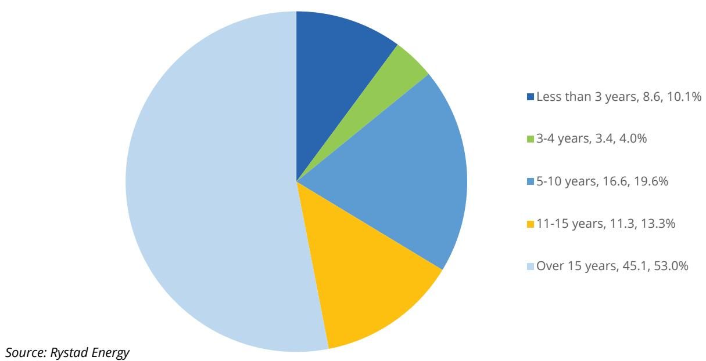

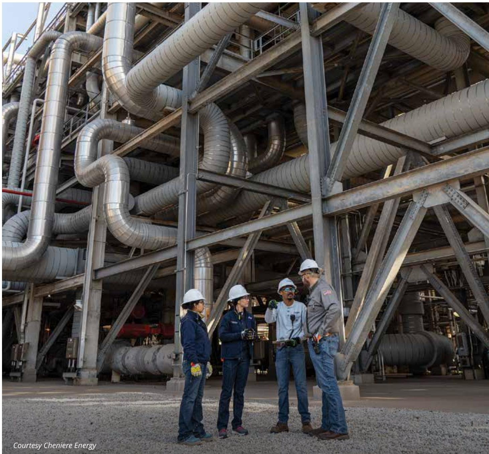  
Figure 5.13: Global operational liquefaction plants and FID liquefaction plants expected to commission by 2030, end-2025

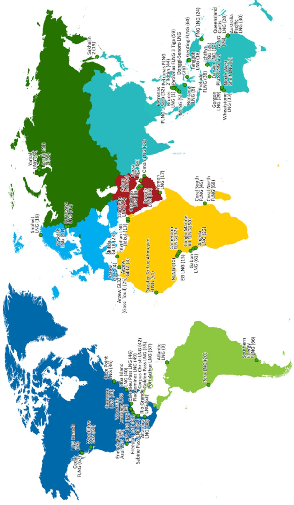

Source: Rystad Energy


## LNG Shipping

The global LNG fleet grew by 8.4% year-on-year in 2025.

6,870

trade voyages, a change of

<sub>-</sub>-2.8% year-on year

804

active vessels

79

new vessels1

Including 49 FSRUs

11 FSUs

Global LNG vessel orderbook2:

301 vessels

L N G

H


# 6. LNG Shipping

In 2025, the global LNG vessel fleet grew to 804 active vessels3, including 49 operational FSRUs and 11 FSUs, following the delivery of 79 vessels throughout the year. This represents an 8.4% increase in the operational fleet from 2024. However, the number of LNG voyages decreased by 2.8%. This rapid expansion of active LNG carriers relative to trade growth kept the market oversupplied. Newer vessels represent a step-increase in eficiency, emissions performance and project economics over the older fleet that will be retired in coming years due to commercial and regulatory pressures.

Courtesy SK Shipping

## 6.1 OVERVIEW

Figure 6.1: Global active LNG fleet and orderbook by delivery year and average capacity, 1991-2031  


Figure 6.2: Historical and future vessel deliveries by propulsion type, 2017-203  
  
Source: Rystad Energy  
Source: Rystad Energy

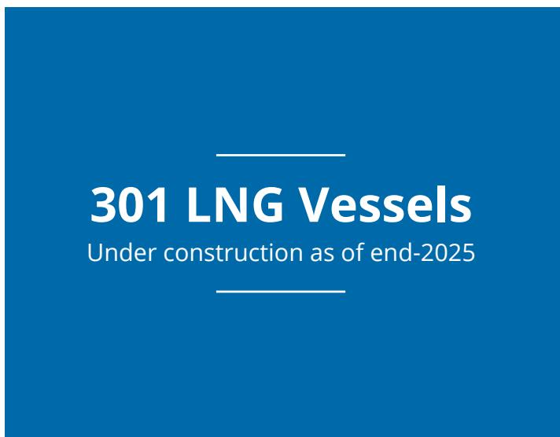

All the 79 newbuilds delivered in 2025 have a capacity of between 172,600 and 200,000 cm. Vessels of this size remain within the upper limit of the Panama Canal’s capacity following its expansion in 2016. They also benefit from economies of scale, particularly as additional LNG capacity is developed in the US Gulf Coast (USGC) for long-haul delivery to Asia. QatarEnergy LNG remains at the forefront of rising vessel capacity, ordering 24 new 271,000 cm (QC-max) vessels from Hudong-Zhonghua Shipbuilding for delivery between 2028 and 2031. These vessels are slightly larger than the 45 Qatari Q-Class newbuilds of over 200,000 cm, delivered between 2007 and 2010 by Korean yards.

Even so, vessels of 200,000 cm and above may be increasingly favoured for long-haul trades in the coming years, especially under multi-year charters, given their economies of scale. This remains conditional on operators retaining suficient flexibility around route and port constraints, including Panama Canal dimensional limits (usually around 200,000 cm), which vary by vessel design and terminal compatibility. The current orderbook comprises 38 vessels, each with a capacity of either 200,000 cm or 271,000 cm, scheduled for delivery between 2026 and 2031. The Strait of Hormuz crisis adds uncertainty to the timing and scale of Qatari vessel requirements, including the pace at which further capacity could be reflected in the orderbook of Qatar's LNG shipping company, Nakilat. If the North Field East expansion is pushed out, some near-term vessel demand could be delayed, although the longer-term requirement for largecapacity tonnage is likely to remain once project timelines normalise.

The global LNG orderbook had 301 newbuild vessels under construction at the end of 2025, equivalent to 37.4% of the current active fleet by number of units, with deliveries stretching into 2031. This illustrates shipowner expectations that LNG trade will continue to grow in line with scheduled increases in liquefaction capacity, particularly from the US and Qatar, and fleet renewal demand from upcoming retirements of older, more ineficient vessels. An expected 107 carriers are scheduled to be delivered in 2026. The orderbook includes 20 icebreaker-class vessels for the Arctic LNG 2 project in Russia. These are specialised and capital-intensive vessels designed for year-round Arctic navigation, but the fleet programme has been severely undermined by sanctions since the Russia-Ukraine conflict. Of the 21 Arc7 carriers originally envisaged for Arctic LNG 2, 15 were ordered at Zvezda and six at Hanwha Ocean, yet sanctions have disrupted shipyard cooperation, equipment supply, containment technology, payments and delivery.

By end-2025, only a very limited number of vessels were near completion, while several others remained unfinished, undeliverable or without key systems, leaving the project far short of the shipping capacity originally planned.

The first Arc7 LNG carrier built at Zvezda for Arctic LNG 2, Aleksey Kosygin, departed for sea trials on 25 December 2024 and remained the project’s most advanced domestic newbuild through end-2025. Together with Pyotr Stolypin, it was one of only two Zvezda vessels launched with GTT containment systems before the wider programme stalled, while other launched hulls were left without critical cargo technology after Western suppliers withdrew. Although Aleksey Kosygin was still not fully in commercial operation by yearend 2025, it was delivered in early 2026, underscoring both some progress at Zvezda and the scale of the delays facing Arctic LNG 2’s intended Arc7 fleet.

In 2020, more low-pressure, slow-speed, dual-fuel WinGD (X-DF) systems were delivered than any other type, while 2023 was the first year in which a vessel with the Everllence B&W (M-type electronically controlled Gas Admission) ME-GA engine was delivered. Capitalising on improved fuel eficiencies and lower emissions, X-DF systems will still be one of the main choices, with around 185 systems on order as of the end of 2025. The eficient new generation M-type, electronically controlled gas admission (ME-GA) system was expected to compete with the X-DF technology for newbuilds. Yet, Everllence B&W announced in October 2024 that it would no longer manufacture the ME-GA engine due to tightening IMO regulations regarding NOx emissions, expected to come into force in 2027. As a result, the orderbook has become heavily weighted towards the WinGD X-DF system, and future orders will rely mainly on new versions of X-DF. In addition, there are 23 M-type, electronically controlled (ME-GI) high-pressure injection system vessels under construction. The ME-GI, ME-GA, and X-DF systems represent a significant shift in favour of eficiency and environmental performance, compared to the popular propulsion systems of the previous generation – steam turbine, dual-fuel diesel-electric (DFDE), and tri-fuel diesel electric (TFDE).

Even so, new proposals are being launched based on other internal combustion engines or power technologies.

As more oil-based fuels, including biofuels, become an option for these systems, the industry increasingly brackets TFDE and DFDE into a single category – DFDE – now representing the ‘dual’ fuels of LNG and oil-based fuels. From this section onward, this report will refer to them as DFDE.

South Korean shipbuilders HD Hyundai Heavy Industries Shipbuilding Group, Samsung Heavy Industries and Hanwha Ocean remain the top three LNG carrier builders, although China’s Hudong-Zhonghua has gained prominence in recent years. Chinese yards Jiangnan, Dalian Shipbuilding, Yangzijiang and China Merchants Heavy Industry have also forayed into the lucrative market for conventional LNG carrier construction and others may enter the market soon. Their business case has been bolstered by high newbuild prices and capacity constraints at South Korean yards. The latter four have a combined orderbook of 28 vessels to be delivered before the end of 2028.

In 2025, the LNG shipping market remained under pressure as the oversupply from 2024 persisted. Continued vessel deliveries outpaced limited LNG supply growth, while shorter Atlantic Basin voyages reduced tonne-mile demand. Charter rates stayed at historically low levels for much of the year, with modern vessels barely covering operating costs and some steam vessels earning near or below breakeven. A brief recovery in October-November, driven by disruptions and new US liquefaction capacity, pushed two-stroke rates above US\$60,000 per day, with peaks over US\$100,000. Despite this, 2025 remained one of the weakest years in recent history for LNG shipping.

In total, 6,870 LNG trade voyages were undertaken in 2025, a 2.8% decrease from the 7,065 seen in 2024. LNG output saw significant growth, but the sheer size of newer vessels pushed down the number of cargoes. While Asia remains the dominant demand centre with 4,235 trade voyages, Europe increased by 6.4% to 2,053 in 2025 due to strong LNG demand through most of 2025, with Europe importing around 126 Mt.

## 6.2 LNG CARRIERS

## Vessel Age and Capacity

The current global LNG fleet is relatively young, considering the oldest operational LNG carrier was constructed in 1977. As of the end of 2025, some 84.8% of the fleet is under 20 years of age, consistent with the rapid growth of liquefaction capacity since the turn of the century. Additionally, newer vessels are larger and more eficient, with superior project economics over their operational lifetime.

Historically, shipowners operated vessels for 35 to 40 years before laying them up. Still, rising operating costs, particularly fuel costs, together with upcoming emissions reduction regulations – most notably the IMO’s EEXI and CII, the EU Emissions Trading System (ETS), stricter methane-slip treatment and FuelEU – could shorten the lifespan of some older vessels or incentivise retrofits and conversions. Economics is becoming an increasingly important driver in this process: older, less eficient vessels face a widening cost disadvantage even before regulatory penalties are considered, making early recycling more attractive in some cases. Due to the rapid advancement of technology, tightening emissions rules and higher operational costs, vessel lifespans have become shorter.

As of the end of 2025, 18 vessels were being scrapped after less than 25 years in service.

At the end of its operating life, a decision can be made on whether to scrap a carrier, convert it to a floating terminal (import or export), or return it to operation should market conditions improve materially. When commissioning a newbuild, a shipowner determines vessel capacity based on its specific operational needs, prevailing market trends, available technologies, and, increasingly, anticipated environmental regulations and future LNG demand. The flexibility of LNG carrier designs to implement new technologies or solutions is also key, with shipowners demanding future-proof concepts that can be easily retrofitted or upgraded when required.

Liquefaction and regasification plants also have berthing capacity limits, while certain trade-lanes may impose restrictions on vessel dimensions. These factors are important when considering ship dimensions and compatibility. The needs of individual shipowners are also largely afected by market demand, meaning newbuild vessel capacities have stayed primarily within a small range around period averages, as illustrated in Figure 6.3.

Figure 6.3: Fleet capacity by vessel age, end-2025  
  
Source: Rystad Energy

Due to the early dominance of steam turbine propulsion, vessels delivered before the mid-2000s were exclusively smaller than 150,000 cm as this was the range best suited for steam turbine propulsion systems, many of them equipped with Moss-type cargo tanks. The LNG carrier landscape changed dramatically when Qatar’s Nakilat introduced the Q-Flex (210,000 to 217,000 cm) and Q-Max (263,000 to 266,000 cm) vessels, specifically targeting large shipments of LNG to Asia and Europe. These vessels achieved greater economies of scale with their slow speed diesel with re-liquefaction plant (SSDR) propulsion systems, representing the 45 largest LNG carriers ever built. Still, they will be surpassed by QatarEnergy LNG’s next-generation 271,000 cm QC-Max orders for its North Field Expansion projects, which will be equipped with modern propulsion technologies.

Most newbuilds have settled at a size between 174,000 and 180,000 cm. This capacity range now makes up 40.3% of the current fleet. The adoption of this size has been driven by technological advancements, particularly two-stroke dual-fuel propulsion systems that maximise fuel eficiency within this range.

Another crucial factor is the Panama Canal size limit. New locks, introduced as part of the 2016 expansion, allowed for larger vessels, a key development for ships engaged in trade involving US LNG supply. In May 2019, the Q-Flex LNG carrier Al Safliya, which is larger than 200,000 cm, became the first Q-Flex type LNG vessel and the largest LNG carrier by cargo capacity to transit the Panama Canal.

While 174,000 cm remains the most common newbuild size, larger ships have once again gathered interest from shipowners. As of the end of 2025, 13 vessels with a 200,000 cm capacity are on order, all of which are capable of passing through the new Panama Canal locks. With further improved two-stroke propulsion solutions, such as the new-generation X-DF and ME-GI systems, 200,000 cm carriers could become a popular choice from an eficiency standpoint. However, other aspects, such as flexibility and terminal compatibility, must also be considered. As of the end of 2025, 24 carriers with a 271,000 cm capacity were also on order at Hudong-Zhonghua.

The technical annex, on page number 110, provides more details about containment systems and propulsion systems.

## Fleet propulsion system breakdown by vessel age

Among vessels older than 10 years, steam turbine systems make up the majority, with DFDE and SSDR representing 47.3% of the cohort. As almost all the SSDR vessels comprise Qatari Q-Class ships, the age range is in line with when they were delivered. With only one exception, the entirety of ME-GI, ME-GA, X-DF, and STaGE vessels are new due to the recent nature of these innovations. The orderbook shows that both generations of X-DF systems will make up a significant portion of delivered vessels until 2026, after which ME-GI and X-DF systems are expected to compete.6.4

Figure 6.4: Fleet propulsion type by vessel age, end-2025  
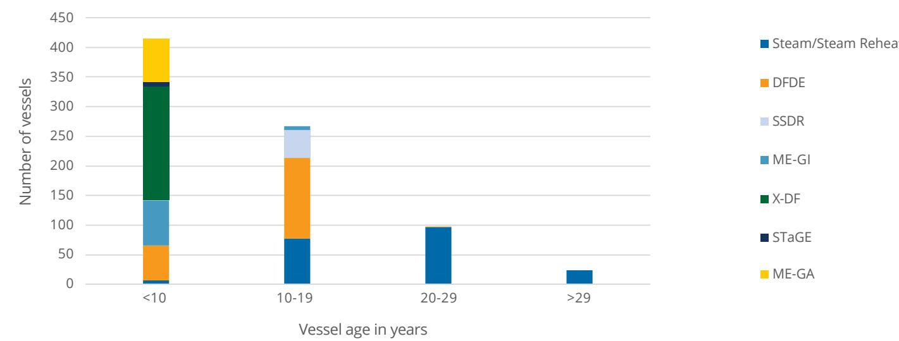  
Source: Rystad Energy

6.3  
FLOATING STORAGE AND REGASIFICATION UNIT (FSRU) OWNERSHIP  
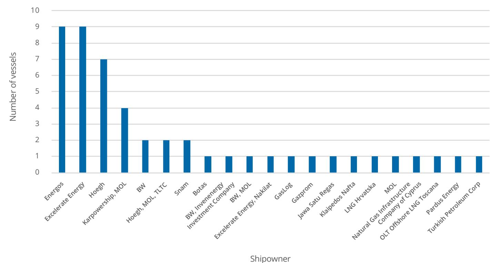  
Source: Rystad Energy

FSRUs are used for LNG storage and regasification in addition to being regular LNG carriers, except for a few examples of non-propelled units. Compared to traditional onshore regasification plants, FSRUs ofer better flexibility, lower capital outlay, and speed to market. A total of 49 FSRUs make up 6.1% of the active global LNG fleet. Shipowners Excelerate Energy, Energos (a joint venture of Apollo Funds and New Fortress Energy), Hoegh and Karmol (a partnership between Karpowership and MOL) continue to operate the largest fleets of active FSRUs, with Energos having taken over New Fortress Energy’s fleet.

With the ability to import LNG via a ‘plug-and-play’ solution, FSRUs ofer the flexibility of meeting demand as and where it is needed before being redeployed elsewhere. FSRUs are also deployed ofshore, ofering an advantage in land-scarce regions or remote areas.

The capital expenditure of an FSRU can be as little as half that of an onshore terminal. While installation in regions with existing infrastructure can happen in months, this is ofset by higher operating expenditure. FSRUs can be newbuilds or conversions from existing LNG carriers. Newbuild FSRUs ofer design flexibility and a wider range of outfitting options but are higher in cost and take longer to build.

Still, delivery delays, power cuts and rising costs have afected certain projects in the past, slightly dampening demand for this vessel type. In addition, spikes in LNG transportation charter rates can motivate shipowners to use the ships as LNG carriers, reducing the number of FSRUs operating as regasification or storage units. As of end‑2025, the orderbook comprised three FSRU newbuilds – one under construction for Excelerate due in 2026, and two on order for MOL slated for 2027 (Gdańsk) and 2028 (Singapore) – with multiple older LNG carriers also being considered for conversion to FSRUs. The two MOL FSRUs are being built by HD Hyundai Heavy Industries Shipbuilding Group and the other by Hanwha Ocean. There is limited capacity to order FSRU newbuilds as most shipyards are focused on constructing the fleet of standard LNG carriers required for a wave of project capacity additions from 2026 to 2028.

The flexibility of FSRUs has proven useful for markets with changing natural gas needs. FSRUs are expected to remain a popular storage and regasification solution for years to come. The Russia-Ukraine conflict has piqued FSRU interest across Europe, with their speedto-market advantage helping alleviate the supply crunch and reduce dependence on Russian piped gas. FSRU charter rates, which were languishing at sub-US\$100,000-per-day levels in 2021, quickly surged to around US\$200,000 per day for vessels deployed to Germany in 2022. Rates then eased through 2023 and remained below the 2022 crisis peak in 2024 and 2025 (around US\$120,000 - US\$140,000 per day), as Europe’s initial scramble for floating regasification capacity subsided, even though vessel availability stayed relatively tight and some units were redeployed or saw charter terms revisited.

  
Courtesy NYK Line  
Figure 6.6: Global fleet and orderbook by shipowner, end-20254  
Source: Rystad Energy

## 6.4 LNG ORDERBOOK

  
4 Shipowners or consortiums with four or more total vessels included.

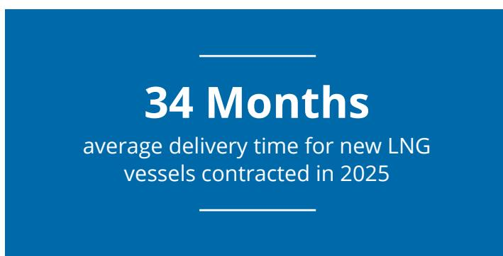  
Of the 301 vessels under construction at the end of 2025, 107 are scheduled for delivery in 2026, followed by 96 in 2027, 61 in 2028, 25 in 2029, and six each in 2030 and 2031. Newbuild demand is

107 LNG vessels scheduled for delivery in 2026 being driven by large projects under discussion, such as those with QatarEnergy LNG, and the ongoing wave of US LNG development, where shipping is critical to maximise flexibility. Still, the recent crisis adds uncertainty to the timing and scale of Qatari vessel requirements. If the North Field East expansion is pushed out, it points to a longer shipping market with less near-term LNG production, potentially delaying some vessel demand while preserving the longer-term need for capacity once project timelines normalise. Additionally, fleet renewal is becoming necessary as the IMO’s EEXI and CII rules have been in efect since 2023. In 2024, shipping was included in the EU ETS, and in 2025 the FuelEU regulation oficially entered into force. As of the end of 2025, the IMO Net-Zero Framework had been adjourned to 2026, with entry into force expected in 2028/2029. Still, a scenario where the regulation is modified remains plausible due to geopolitical tensions.

Figure 6.7: Newbuild orderbook by propulsion type and shipbuilder, end-2025  
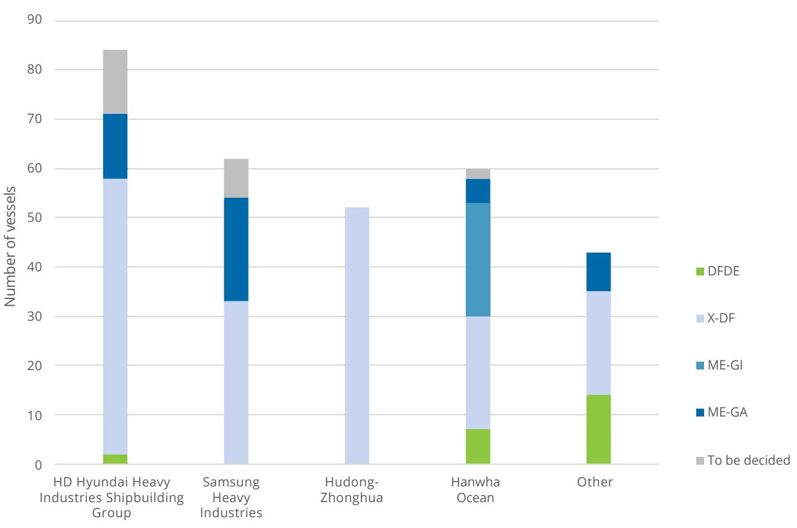

## VESSEL COSTS AND DELIVERY SCHEDULE

Figure 6.8: Vessel delivery schedule and newbuild cost, 2002-2025  
  
Source: Barry Rogliano Salles

## Source: Rystad Energy

Capitalising on better fuel eficiencies and lower emissions, X-DF systems, are as of the end of 2025, the main propulsion systems of choice, with 185 on order. The competing ME-GI system has 23 orders, while the new generation ME-GA system accounts for around 47, and DFDE systems – mainly used for FSRUs and icebreakers – account for 23 vessels. Save for a mid-scale vessel owned by Huaxiang Shipping, all vessels on order are above 170,000 cm in size, showing a clear trend toward larger vessels, which new locks on the Panama Canal can now accommodate. With the new generation of two-stroke propulsion systems, vessel size might progressively trend towards 200,000 cm moving forward, due to economies of scale for long-haul voyages and long-term charterers. There are currently 13 vessels of 200,000 cm capacity on order, six of which are for Dynagas, three for Venture Global and four for Ocean Yield, NYK. In 2022, two Dynagas-owned ships of 200,000 cubic metres were delivered to charterer Cheniere Energy, both equipped with X-DF propulsion. In 2023, one additional Dynagas-owned ship of 200,000 cubic metres was delivered to Cheniere Energy with ME-GA propulsion, followed by four more vessels in 2024 and 2025, all also equipped with ME-GA propulsion. There are also 24 QC-max vessels on order with a 271,000 cm capacity, all for QatarEnergy LNG. These will be the largest LNG carriers ever built and, in principle, be equipped with X-DF engines.

South Korean shipbuilders HD Hyundai Heavy Industries Shipbuilding Group, Samsung Heavy Industries and Hanwha Ocean are the top three builders of LNG vessels, with 84, 62, and 60 units on order, respectively. Additionally, Samsung previously assisted the Zvezda shipyard in Russia in building 15 icebreakers for Arctic LNG 2, though this programme has been stalled due to US sanctions. Hyundai and Samsung are working on a large proportion of newbuilds with both generations of X-DF systems and ME-GA, while Hanwha Ocean’s orders cover X-DF, ME-GI, ME-GA, and a small number of DFDE/TFDE vessels. Chinese builder Hudong-Zhonghua is currently working on 52 vessels, with an orderbook stretching into 2031, all equipped with X-DF propulsion systems.

34 Months average delivery time for new LNG vessels contracted in 2025

The cost of constructing an LNG carrier depends on characteristics such as propulsion systems, capacity and other specifications involving ship design. Historically, DFDE vessels started out pricier than steam turbine vessels, with the higher newbuild costs ofset by eficiency gains from operating more modern ships. DFDE newbuild costs have varied heavily over the years due to diferent specification standards – a prominent example being the 2018 peak of over US\$1,700 per cm for 15 icebreaker-class vessels ordered to service Yamal LNG. These vessels, contracted from 2017, were priced at about US\$320mn apiece, which drove up average prices.

While vessels equipped with X-DF systems were initially marginally more expensive per cubic metre than vessels with ME-GI propulsion systems, they are now cost-competitive. As shown in Figure 6.8, costs for X‑DF, ME‑GI, and ME‑GA vessels fell from US\$1,200 to US\$1,300 per cm to around US\$1,000 to US\$1,100 per cm for 2020 deliveries, then rebounded to US\$1,200 to US\$1,250 by 2025.

Despite changes in average vessel sizes over time, shipyards have been able to maintain a consistent delivery schedule, with variance within this band occurring during the introduction of new propulsion systems. This can be attributed to shipyards having to adjust to novel designs with new engines, an example reaching almost 50 months in the years following the introduction of DFDE/TFDE systems. However, the delivery time for vessels ordered in 2025 is now down to 34 months (under three years) due to more shipyard capacity in China and fewer oil tankers taking up capacity.

Prices for newbuild LNG carriers inched down slightly in 2025 as owners began to hold back orders given the high prices and current excess vessel availability. For a standard 174,000 cm two-stroke LNG carrier at South Korean yards, benchmark pricing was broadly flat to slightly lower through 2025, hovering around US\$250–255mn per vessel on average. Chinese yard pricing generally remained around US\$20mn lower than South Korean yard levels.

Source: Argus

## 6.6

## CHARTER MARKET


East of Suez charter day rates peak in 2025 at US\$20,000 for steam turbine, US\$56,500 for DFDE, and US\$90,400 for X-DF/ME-GI vessels

Shipping costs constitute an important proportion of netback calculations when delivering LNG. Therefore, charter rates are considered seriously when formulating market strategies. Historically, LNG was largely marketed through long-term contracts, encouraging shipowners to enter term charters with large players. As portfolio players have emerged, an increasing number of vessels have become available on the spot market, contributing to the market depth of charter fixtures and pricing. Still, a lack of liquidity can contribute to charter rate volatility due to a mismatch between supply and demand. Since the Russia-Ukraine conflict, charterers have increasingly preferred longer duration charters to ensure supply security.

The price diferentials between vessels with X-DF/ME-GI, DFDE, and steam turbine propulsion can be explained by eficiency gains from using newer propulsion systems. Steam turbine systems are significantly less eficient than DFDE systems, which in turn are less eficient than X-DF, ME-GA and ME-GI engines. Additionally, vessels using steam turbines tend to be smaller in size, limiting usability as spot cargoes tend to be at least 150,000 cm. Finally, charterers, conscious about carrier emissions, are demanding newer technologies, further widening the price diferential. As IMO regulations (EEXI and CII) and EU regulations enter into force, steam turbine and other less eficient propulsion types may be limited to certain trade lanes. Market participants must balance fuel eficiencies, boil-of gas savings and higher costs when choosing their carriers and associated propulsion systems.

Figure 6.9: Liquefaction capacity growth vs LNG global fleet count growth, 2012-2025  
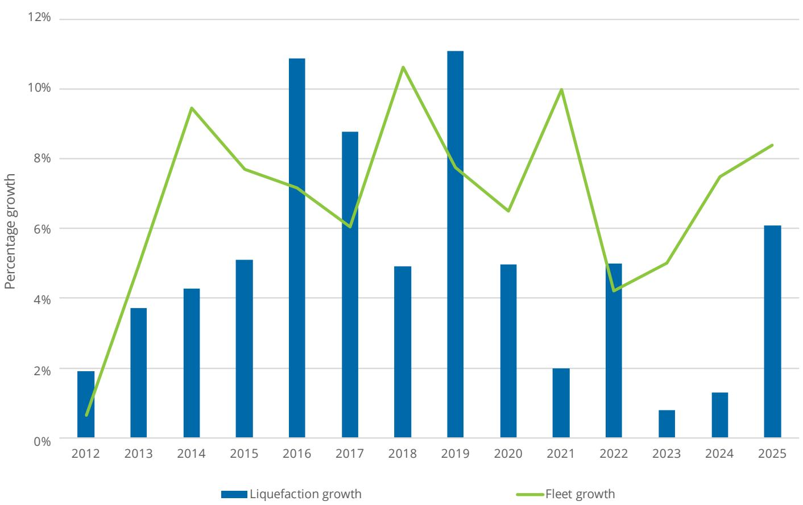  
Source: Rystad Energy  
From 2013 onwards, the rate of vessel deliveries far outweighed that of liquefaction capacity growth, resulting in a glut of LNG shipping capacity and a steady decline in charter rates. This continued until 2015, after which they remained between US\$15,000 and US\$50,000 per day (for steam turbine) until the fourth quarter of 2017, when a rapid increase in Asian LNG demand sparked an increase in charter rates, which remained volatile through 2018.

Figure 6.10: Spot charter rates East of Suez, 2016 to end-2025  
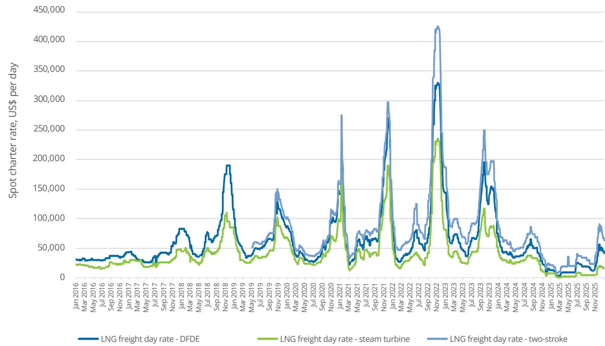  
Source: Argus

Figure 6.11: Spot charter rates West of Suez, 2016 to end-2025  
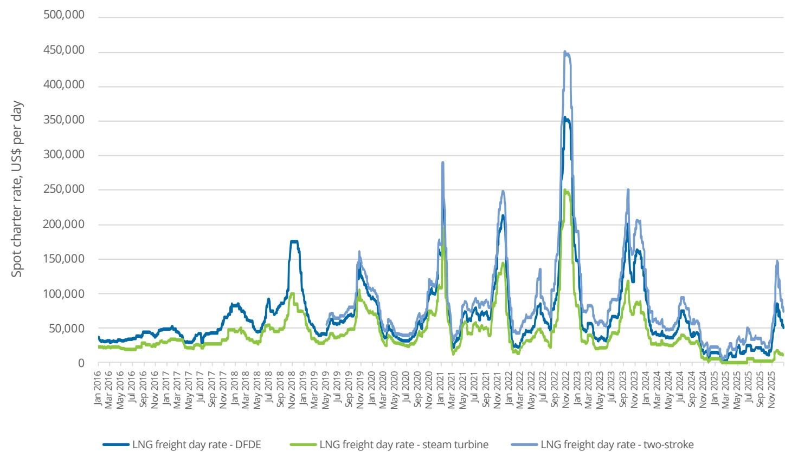

From 2021 to 2024, LNG shipping markets shifted from extreme volatility to oversupply. Rates rebounded sharply in 2021 after earlyyear lows, driven by the Ever Given blockage, Europe-Asia cargo competition, record natural gas prices and stronger Asian demand, reaching US\$250,000 per day for X-DF/ME-GI vessels by mid-December.

In 2022, the Ukraine crisis structurally lifted European LNG demand and pushed West of Suez X-DF/ME-GI rates to US\$450,000 per day by late October, before mild weather and high inventories drove rates lower into 2023. The market stabilised in 2023 as the US helped fill Europe’s supply gap, although the Panama Canal drought and later the Red Sea attacks increased routing disruptions. By 2024, limited LNG production growth and a wave of vessel deliveries had created an oversupplied market, with X-DF/ME-GI rates briefly reaching US\$94,000 per day in summer before falling below COVID-19-era lows by December.

In 2025, the LNG shipping market remained under significant pressure following the oversupply that emerged in 2024. The year began with historically low charter rates as continued vessel deliveries outpaced limited LNG supply growth, while shorter Atlantic Basin voyages reduced tonne-mile demand. Rates for modern vessels fell to levels barely covering operating costs, with steam turbine vessels in some cases earning near or below zero. Market conditions were further weakened by softer Asian demand and Europe’s continued pull on Atlantic cargoes, keeping vessels regionally constrained. A temporary tightening occurred in October and November, driven by winter stocking, delays in cargo movements and the ramp-up of new US liquefaction capacity. During this period, modern two-stroke vessels saw East of Suez charter rates recover above US\$60,000 per day by the end of the year, with peaks exceeding US\$90,000 per day. Despite this late-year rebound, 2025 overall remained one of the weakest years in recent history for LNG shipping.

In 2026, LNG shipping markets were sharply disrupted by the war and closure of the Strait of Hormuz, reversing the weak-rate environment seen at the start of the year. East of Suez prompt rates had fallen to around US\$14,250 per day in early February, before rising steadily in late February and then surging from US\$45,000 per day on 27 February to US\$105,000 per day on 2 March. Rates peaked at US\$300,000 per day on 5 March as LNG flows through the Strait were constrained, before easing through the second half of March and April. Still, the market did not return to the pre-crisis levels, with rates still around US\$100,000 per day by late April, reflecting continued uncertainty around transit, insurance and cargo availability.

  
Courtesy Pan Ocean

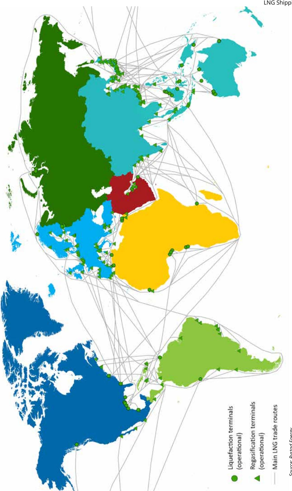  
Figure 6.12: Major LNG shipping routes, 2025  
Source: Rystad Energy

## 6.7

## FLEET VOYAGES AND VESSEL UTILISATION

6,870 LNG trade voyages in 2025

The year 2025 had just 6,870 voyages, a 2.8% decrease from 2024, as larger vessels reduced the number of voyages needed to move LNG volumes. With an 8.4% growth in the LNG fleet, the LNG shipping market stayed oversupplied for most of 2025.

The widening and deepening of the Panama Canal in 2016 reduced the voyage distance and time from the Sabine Pass terminal in the US to Japan’s Kawasaki LNG facility to 9,400 nautical miles (nm) and 29 days. This is compared to 14,500 nm and 45 days through the Suez Canal and nearly 16,000 nm and 49 days around the Cape of Good Hope. Yet, due to the route’s popularity, the Panama Canal has become a bottleneck. This was particularly acute in 2023, when drought conditions reduced the water levels in Gatun Lake and forced some re-routing via the Cape of Good Hope. While canal conditions later improved, the episode highlighted the route’s exposure to weather-related disruption and transit restrictions.

Figure 6.13: LNG imports and number of voyages to Asia and Europe, 2016-2025  
  
Source: Rystad Energy, LSEG

The number of LNG trade voyages from the US to Europe increased to 1,099 in 2025 from 693 in 2024, as US LNG capacity ramped up, while European demand surged.

The most common voyage globally in 2025 was from Australia to Japan, at 390. The most common voyage to Europe in 2025 was from the US to the Netherlands, with 188 shipments. Japan, China and South Korea took the highest number of cargoes globally, receiving 2,793 in total or 1,046, 1,044, and 703 cargoes, respectively. The average number of voyages completed per vessel was 9.0 in 2025, lower than in 2024 (9.5), due to the large number of newbuild deliveries versus production growth, and the size of newer vessels.

## 6.8

# RECENT AND NEAR-FUTURE DEVELOPMENTS IN LNG SHIPPING

## Main considerations

The LNG shipping industry remains highly creative and adaptable, but the current focus has shifted toward eficiency, Operating Expenditure (OPEX) reduction and operational flexibility. While decarbonisation remains important, weak freight markets, high fuel costs and geopolitical disruption mean that the latest technology developments are increasingly judged by their ability to reduce fuel consumption, lower operating costs and preserve trading flexibility.

Within the parameters controlled by shipowners, charterers, yards and equipment suppliers, innovation and operational excellence can help the industry move forward, although many of these solutions add Capital Expenditure (CAPEX) to new LNG carrier projects. The most relevant developments are, therefore, those that improve both the environmental profile and the commercial competitiveness of the vessel.

Cargo as fuel and boil-of management: LNG remains the most feasible fuel option for LNG carriers from both a technical and commercial perspective. However, the focus has moved from simply using boil-of gas as fuel toward maximising flexibility in how boil-of is handled. Newbuild LNG carriers are increasingly equipped with reliquefaction or subcooling systems, allowing owners and charterers to optimise between fuel use, cargo preservation and market conditions. This flexibility is becoming more important as fuel prices, emissions rules and charterer preferences evolve.

Alternative fuels: Alternative fuels remain under consideration, but most are not yet commercially attractive for large LNG carriers. Biofuels and biomethane can be used in existing dual-fuel engines with limited or no technical modification, but availability and cost remain major constraints. E-LNG and hydrogen may become relevant over time, but production is still limited and costs remain high. Hydrogen would also require significant changes to containment, fuel systems and engines, adding CAPEX. Ammonia and methanol are less realistic for LNG carriers due to price, availability, toxicity, infrastructure and technology adaptation challenges.

## Evolution of designs and technologies for LNG carriers

LNG carrier design: The standard 174,000 cm LNG carrier remains the industry workhorse due to terminal compatibility and commercial flexibility. However, larger designs of around 200,000 cm, and in some cases 271,000 cm, are being considered where project economics and terminal constraints allow. These larger vessels can reduce unit freight costs, particularly on long-haul trades, but their commercial value depends on retaining route and port flexibility. Design optimisation is also increasingly focused on real operating speeds, as LNG carriers often sail at around 15-16 knots rather than maximum service speed, although owners and charterers still want propulsion flexibility up to 19-19.5 knots.

New tank and layout concepts: Recent design developments include three-tank configurations instead of the traditional four-tank layout. This can increase cargo capacity, reduce construction costs and slightly lower boil-of rates due to improved tank volume-to-surface eficiency. BW’s 2025 order for two LNG carriers with this solution marks an important step from concept approval toward commercial adoption. Accommodationforward designs are also being discussed, mainly in connection with wind propulsion systems and visibility requirements, although no large LNG carrier has yet been built with this layout.

Eficiency technologies: New LNG carrier designs increasingly incorporate optimised hull forms, aerodynamic improvements, energysaving devices, boss cap fins, rudder bulbs and air lubrication systems. The focus is shifting from theoretical eficiency at maximum design speed toward performance across the actual operating profile of the vessel. This is important because lower average speeds can materially reduce fuel consumption, OPEX and emissions.

Cargo storage and handling: Modern membrane containment systems can now achieve boil-of rates as low as around 0.07% of cargo volume per day in laden condition for standard 174,000 cm vessels, with even lower rates possible for larger or three-tank designs. Intelligent cargo management systems, real-time monitoring and sloshing detection are also being introduced to improve safety, cargo control and operational eficiency.

Propulsion and power systems: Current large LNG carriers are generally equipped with dual-fuel internal combustion engines and mechanically driven twin-screw propulsion. Two-stroke dual-fuel engines remain the preferred solution due to their eficiency, lower specific fuel consumption and lower methane slip compared with older technologies. Shaft generators are increasingly included to improve eficiency by using main engines for onboard power generation at certain sailing speeds. Hybrid electric propulsion concepts, including combinations of modern fourstroke engines, electric propulsion and batteries, are being assessed, but no large LNG carrier projects have yet adopted these systems.

Methane slip reduction: Methane slip remains a central issue for LNGfuelled shipping, regardless of propulsion type. Engine manufacturers are developing technical improvements to reduce unburnt methane emissions, while catalytic methane-reduction systems are also being proposed. This will remain important as regulators and charterers place greater emphasis on full lifecycle greenhouse gas performance.

Wind propulsion systems: Wind propulsion is gaining attention as a practical eficiency measure. The first large LNG carriers under construction with this technology are two MOL vessels at Hanwha Ocean, equipped with MOL’s Wind Challenger retractable rigid sail. Experience from other vessel types suggests that wind propulsion can reduce fuel consumption by around 10%, depending on the number of systems installed, vessel speed, weather routing and operating profile.

Carbon capture, fuel cells and shore power: Onboard carbon capture and fuel cells are being proposed for future LNG carrier designs, but both remain at an early stage. Carbon capture faces challenges around onboard CO storage and terminal disposal infrastructure. Precombustion concepts that produce hydrogen and solid carbon from boilof gas are also being explored, although maturity remains limited. Solid oxide fuel cells using LNG or hydrogen could ofer high eficiency and low emissions, but commercial application is still developing. Shore power is also under investigation, but its use for LNG carriers may be limited by the high power required during cargo operations and the short time spent at terminals.

Operational excellence and digitalisation: Digital tools are becoming increasingly important for reducing OPEX and emissions. Weather routing, optimised arrival planning, real-time engine and cargo monitoring, predictive maintenance and remote diagnostics can all improve vessel performance and reduce fuel consumption. These technologies also support safer and more eficient operations, although increased digitalisation requires stronger cybersecurity protection.

## Conclusion

Due to an oversupply of LNG carriers relative to trade volumes, partly caused by delays in LNG export terminal commissioning in recent years, shipping companies have faced a very weak spot market in 2025. This has been particularly challenging for older vessels equipped with steam turbine and diesel-electric propulsion systems. Eficiency has become more important from the point of view of OPEX savings than decarbonisation pathways. In addition, geopolitical uncertainty is increasingly complicating industry planning, as disruptions to key shipping routes such as the Red Sea and the Strait of Hormuz remain dificult to predict. At the same time, the regulatory outlook is not fully settled, with the IMO Net-Zero Framework still subject to potential changes before final approval.

However, despite those challenges, the LNG shipping industry is moving forward proposing highly innovative solutions that will enhance eficiency without compromising safety.

## 62.9 MTPA of receiving capacity was added in 2025.

13

new terminals in 2025

expansion projects at existing terminals

China commissioned 4 new onshore terminals and expanded 1 existing LNG regasification plant

5 new floating terminals: Egypt (2), Jordan (1), Italy (1), Senegal (1)

new markets are building their first LNG import terminals

12

floating and ofshore projects had reached FID

of new regasification capacity under construction


# 7. LNG Receiving Terminals

As of the end of 2025, global regasification capacity stood at 1,113.5 MTPA across 50 markets. During the year, 62.9 MTPA of new capacity was added, driven by the startup of eight new onshore import terminals, five new floating terminals, and seven expansion projects at existing facilities. Among the largest projects commissioned in 2025 were three floating-based projects, including Ain Sokhna (Sonkar) FSRU (Energos Power) and Ain Sokhna (Sumed) FSRU (Energos Eskimo) in Egypt, and Aqaba FSRU (Energos Force) in Jordan, each with a regasification capacity of 5.7 MTPA.

  
Courtesy Tokyo Gas

## 7.1 OVERVIEW

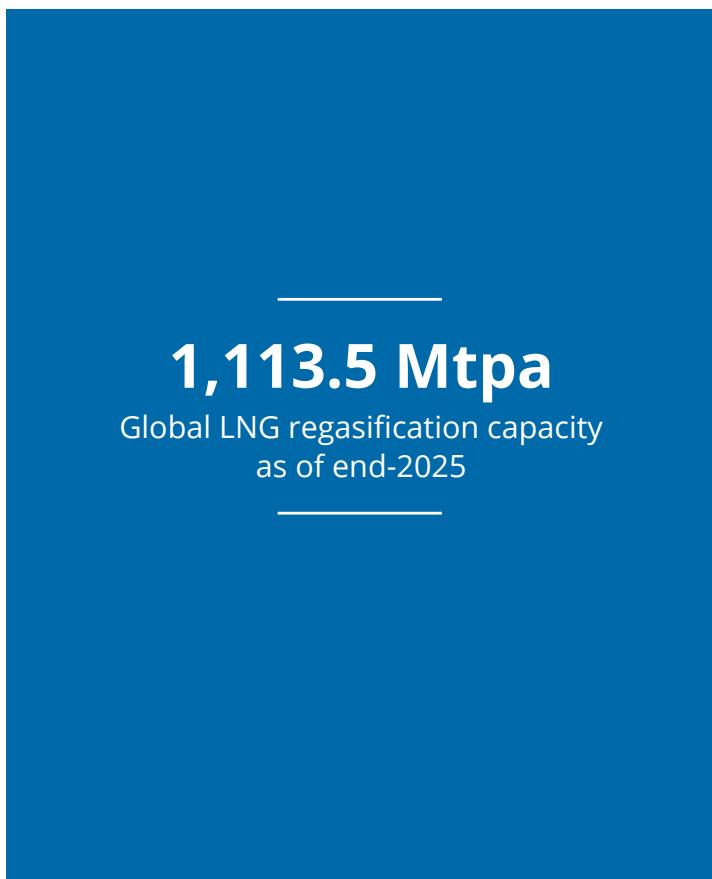

1,113.5 MTPA Global LNG regasification capacity as of end-2025

Strong growth momentum in global LNG regasification capacity continued in 2025, with 20 projects commissioned across 13 markets. This marks an increase from 18 projects brought online across seven markets in 2024. Asia led 2025 capacity additions with 22.2 MTPA, followed by Africa with 17.2 MTPA, Europe with 11.0 MTPA, Asia Pacific with 6.6 MTPA, the Middle East with 5.7 MTPA, and Latin America with 0.2 MTPA.

Of the total 62.9 MTPA added globally in 2025, 42.6 MTPA came from 13 new terminals, while 20.3 MTPA resulted from seven expansion projects at existing facilities. Among the largest projects commissioned in 2025, two are at Egypt’s Ain Sokhna port: Sonkar FSRU (Energos Power) and Sumed FSRU (Energos Eskimo), each with a regasification capacity of 5.7 MTPA. Egypt resumed importing LNG in 2024, with the arrival of the FSRU vessel Hoegh Galleon. This helped to address Egypt’s growing supply-demand gap and strengthen energy security, as natural gas supply had come under pressure amid regional turmoil and sluggish domestic production growth.

Asia, driven primarily by China, accounted for the largest share of capacity additions in 2025, with 22.2 MTPA brought online. China alone commissioned five projects, which collectively added 15.1 MTPA. These projects include Zhoushan ENN LNG 3 (5 MTPA), Shanghai LNG 1 (3 MTPA), Wenzhou Huagang LNG 1 (3 MTPA), Yangjiang LNG (2.1 MTPA), and the riverine terminal Wuhu LNG (2 MTPA). Meanwhile, India added 7.1 MTPA in 2025 through the commissioning of a new onshore regasification terminal, Chhara LNG (5 MTPA), and an expansion onshore project - Dabhol LNG Breakwater Completion (2.1 MTPA).

# RECEIVING TERMINAL CAPACITY AND GLOBAL UTILISATION

Global regasification capacity continued to grow in 2025, with 62.9 MTPA of additions across Asia, Africa, Europe, the Asia Pacific, the Middle East, and Latin America. The new capacity added last year was divided roughly equally between two terminal types: onshore and floating-based. Floating-based terminals continued to play a critical role, contributing a total capacity addition of 32.6 MTPA across nine projects, driven by their flexibility and lower capital investment. Of the nine projects, three are located in Egypt, with the remaining six in Jordan, Italy, Germany, Croatia, Senegal, and Colombia. These floating terminals added 1.1 million cubic metres (mcm) of LNG storage capacity.

Asia was the largest region for capacity additions, adding 22.2 MTPA through five new projects and two expansions at existing terminals. Of the five new projects, which have a total capacity of 15.1 MTPA, four are in China, and one is in India. Of the two expansion projects, with a total capacity of 7.1 MTPA, one is in China, with the other in India. Following Asia, Africa was the second largest region for capacity additions, adding 17.2 MTPA through the startup of two new FSRUbased terminals and the expansion of the Sumed terminal in Egypt, as well as another new FSRU-based terminal in Senegal. Europe added 11.0 MTPA in 2025 through three expansion projects at existing terminals in Germany, Croatia, and Poland, each with one startup, as well as one new floating terminal in Italy.

In 2025, 13 new regasification terminals began operations globally, adding a total of 42.6 MTPA of capacity. Of these, eight were onshore terminals, including four in China (Shanghai LNG, Wenzhou Huagang LNG, Yangjiang LNG, Wuhu LNG) and one each in Chinese Taipei, India, Vietnam, and Indonesia. Ofshore, five new FSRU-based terminals were brought online last year, with two in Egypt, one in Jordan, one in Italy, and one in Senegal. These floating terminals collectively added 20.9 MTPA of regasification capacity and 0.78 mcm of LNG storage capacity.

Seven expansion projects at existing terminals came online in 2025, adding 20.3 MTPA of regasification capacity. These include Zhoushan ENN LNG 3 (5 MTPA) in China, Ain Sokhna (Sumed) FSRU - Energos Eskimo (5.7 MTPA) in Egypt, Wilhelmshaven FSRU 2 (3.4 MTPA) in Germany, Krk LNG terminal 2 (2.4 MTPA) in Croatia, Dabhol LNG Breakwater Completion (2.1 MTPA) in India, Swinoujscie Expansion Stage 2 (1.5 MTPA) in Poland, and SPEC FSRU expansion 1 (0.2 MTPA) in Colombia.

As of the end of 2025, 229.3 MTPA of new regasification capacity was under construction globally, including 50 onshore projects with a total capacity of 193.0 MTPA, and 10 floating-based projects with a total capacity of 36.4 MTPA. Asia leads this development, accounting for 55.6% of global under-construction regasification capacity, followed by Europe (17.1%) and the Asia Pacific (15.0%). Market-wise, China will continue to lead newbuilds, followed by Germany, Chinese Taipei, and India. China has 116.2 MTPA of capacity under construction, all onshore, including 16 new terminals and 14 expansion projects at existing terminals. Germany has two onshore expansion projects and one new FSRU-based terminal, aiming to come online between 2026 and 2029. In Chinese Taipei, two new terminals and one expansion project are under construction, with completion targeted for 2030. This will bring the market’s total regasification capacity to 33.0 MTPA. India has four onshore projects – three are expansion projects of existing terminals, and one is a new project, totalling 11.3 MTPA.

Figure 7.1: LNG regasification capacity by status and region, as of end-2025  
  
Source: Rystad Energy

Figure 7.2: Global receiving terminal capacity, 2000-2030  
  
Source: Rystad Energy

Eight new markets, including Nicaragua, Iraq, Cyprus, Australia, Ghana, Russia, the Bahamas, and Antigua and Barbuda, are currently building their first LNG import terminals and planning to start LNG imports from 2026 to 2028. The eight new markets are expected to add 15.4 MTPA of regasification capacity through the construction of two onshore terminals and six floating-based terminals. This also shows that floating-based solutions are generally more popular in emerging markets, as they ofer greater deployment flexibility and lower fixed costs.

Construction is also underway in 15 existing markets, including China, Germany, Chinese Taipei, India, Thailand, South Korea, Egypt, Jordan, Poland, the United Kingdom, the Dominican Republic, the Netherlands, France, Belgium and Japan. Of the 30 projects under construction in China, six were approved in 2021, 10 in 2022, four in 2024, and one in 2025. Although terminal approvals have slowed in China, LNG import capacity is expected to continue increasing, supported by a wave of project completions in the coming years. China is expected to have eight new startups and six expansion projects coming online in 2026, with a total capacity of 63.2 MTPA. Sinopec Longkou LNG and Yantai West Port (Xigang) LNG, both with a capacity of 6.5 MTPA, will be China’s largest startups by regasification capacity in 2026. The two projects will add nine LNG storage tanks with a total capacity of 1.9 mcm.

Global regasification utilisation edged higher in 2025 to an average of 39.2%, up from 38.5% in 2024, with the increase primarily driven by robust demand in Europe. Russian pipeline gas transit via Ukraine halted in early 2025, prompting a rise in LNG flows to Europe to meet regional natural gas demand.

## 7.3

# RECEIVING TERMINAL CAPACITY AND UTILISATION2 BY MARKET

Figure 7.3: LNG regasification capacity by market (MTPA) and annual regasification utilisation, 2025  
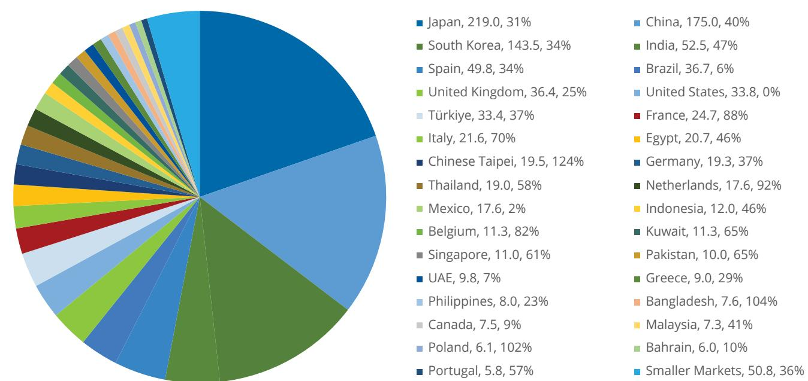  
Source: Rystad Energy

In 2025, five regasification projects were commissioned in China, including four newly built projects and one expansion project. All of these were onshore-based terminals, contributing a combined 15.1 MTPA of additional regasification capacity, including Zhoushan ENN LNG 3 (5 MTPA), Shanghai LNG 1 (3 MTPA), Wenzhou Huagang LNG 1 (3 MTPA), Yangjiang LNG (2.1 MTPA), and Wuhu LNG terminal (2 MTPA). By 2030, China’s LNG regasification capacity is projected to increase by an additional 137.1 MTPA, supported by 34 LNG terminal projects that are under construction or reached FID. China’s LNG regasification terminals have experienced a gradual decline in utilisation rates in recent years, reaching approximately 40% in 2025. This downward trend is primarily driven by the rapid expansion of regasification capacity, as a large number of new terminals have been commissioned, outpacing growth in LNG imports.

South Korea ranks as the third-largest LNG regasification market globally, characterised by a large and mature terminal network with a total capacity of approximately 143.5 MTPA distributed across eight LNG receiving terminals. Terminals with ultra-large capacity make up a significant part of South Korea’s LNG infrastructure, hosting several of the world’s highest-capacity LNG import facilities. This includes Incheon LNG (54.9 MTPA) and Pyeongtaek LNG (41 MTPA), the largest and second-largest LNG receiving terminals in the world. Other significant terminals include Tongyeong LNG (26.5 MTPA) and Samcheok LNG (11.6 MTPA). Capacity is set to expand further, with two projects currently under development and set to contribute 8.1

MTPA of regasification capacity by 2027. In 2025, South Korea’s LNG terminal utilisation was 34%, broadly in line with the previous year.

India surpassed Spain and became the fourth-largest market for regasification capacity in 2025, with 52.5 MTPA across eight terminals. Among operational LNG regasification terminals in India, Dahej LNG (17.5 MTPA) stands out as the only ultra-large facility and ranks as the sixth largest globally. The remaining seven terminals fall into the large-scale category, each with a regasification capacity of 5 MTPA. In 2025, India commissioned two LNG regasification projects, including one new onshore terminal, Chhara LNG, with a regasification capacity of 5 MTPA, and one expansion project at the Dabhol LNG terminal through the completion of its breakwater infrastructure. The project has efectively enhanced the terminal’s operational eficiency and has increased its capacity to 5 MTPA from 2.9 MTPA. Previously idle during the monsoon season, the Dabhol LNG terminal now enables uninterrupted, year-round operations after commissioning of the breakwater. India currently has four LNG projects under construction, including one new terminal and three expansion projects at existing facilities, including the expansion of India’s largest terminal, Dahej LNG. Once commissioned, these projects are expected to add a combined 11.3 MTPA of regasification capacity by 2028. India’s LNG regasification utilisation fell to approximately 47% in 2025, down from 58% in 2024. The decline reflects a combination of weaker LNG imports during the summer months and an increase in regasification capacity following recent infrastructure additions.

Figure 7.4: Monthly regasification utilisation by top five LNG importers, 2025  
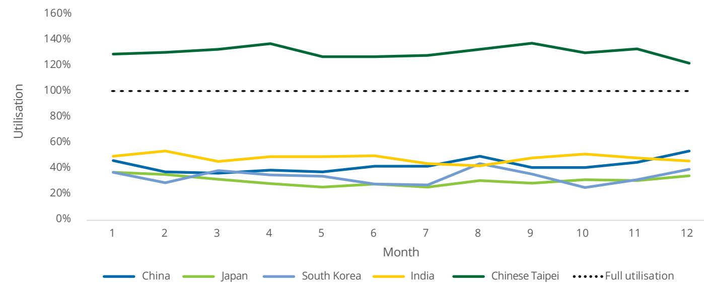  
Source: Rystad Energy

Japan continues to rank as the largest market globally in terms of LNG regasification capacity, with a total capacity reaching 219 MTPA as of the end of 2025, representing nearly 20% of the total global capacity. The market has one of the highest concentrations of large-scale LNG regasification terminals, with 42 LNG regasification terminals currently in operation. Of these, four rank among the world’s 10 largest: Sodegaura LNG (29.4 MTPA), Chita LNG (18.4 MTPA), Futtsu LNG (16 MTPA), and Senboku I & II LNG (15.3 MTPA). Although no additional capacity has been brought online in recent years, the market continues to benefit from a large and mature terminal network. Regasification utilisation rates have remained largely unchanged, at around 31% in 2025, suggesting stable operating conditions across the system.

China remains the world’s second-largest market for LNG regasification capacity and continues to actively expand its LNG infrastructure. As of the end of 2025, China had 36 LNG regasification terminals in operation, with a total regasification capacity of 175 MTPA, accounting for approximately 15.7% of global capacity. At the same time, China continues to lead globally in capacity expansion, recording the largest annual additions.

Spain is the world’s fifth-largest LNG regasification market and holds the largest LNG regasification capacity in Europe. The market was an early mover in LNG infrastructure development, with Europe’s first LNG receiving terminal, Barcelona LNG (12.6 MTPA), commissioned in 1969. Following the commissioning of Mugardos LNG in 2007, no new LNG terminals were brought online for many years. The only notable development since then has been the commissioning of the previously idle El Musel LNG terminal in 2023, in response to natural gas supply concerns triggered by the Russia–Ukraine conflict. LNG regasification utilisation in Spain increased from 27% in 2024 to 34% in 2025.

## Capacity Additions in 2025

In 2025, a total of 20 LNG regasification projects commenced operations, adding 62.9 MTPA of regasification capacity. These took place across 13 markets, spanning from Asia (22.2 MTPA), Africa (17.2 MTPA), Europe (11.0 MTPA), Asia Pacific (6.6 MTPA), the Middle East (5.7 MTPA), and Latin America (0.2 MTPA). Compared with LNG terminal additions in 2024, more LNG infrastructure development took place in emerging and frontier markets. Asia led the global LNG regasification capacity additions in 2025, with all new capacity coming from China and India, contributing 15.1 MTPA and 7.1 MTPA, representing 24% and 11.3% of global additions, respectively. Since 2023, the region has remained the primary driver of capacity growth from newly commissioned projects, supported by continued expansion in China and India.

Africa was the second-largest contributor to growth in LNG regasification capacity in 2025, led by Egypt and Senegal. Egypt added 14.9 MTPA through the commissioning of three FSRU-based projects while Senegal introduced its first LNG receiving terminal, an FSRUbased facility (2.3 MTPA), marking the market’s first LNG-to-power development. Latin America registered the lowest capacity additions in 2025, with one expansion project in Colombia brought online.

Figure 7.5: Receiving terminal import capacity and regasification utilisation by market, 2025  


The SPEC FSRU expansion 1 (0.2 MTPA) expanded Colombia’s sole operating LNG regasification terminal, raising its total capacity to 3.6 MTPA. Meanwhile, the FSRU vessel Energos Winter, which had been operating at the Terminal Gas Sul LNG in Brazil, was redeployed in 2025 to the Damietta LNG terminal in Egypt.

Egypt was the second-largest contributor to LNG regasification capacity additions in 2025, following China, with its total capacity nearly quadrupling to reach approximately 20.7 MTPA. Against a backdrop of declining domestic production and strong power and industrial demand, Egypt has transitioned from a net LNG exporter to a net importer. In 2024, Egypt brought the FSRU Hoegh Galleon online at the Ain Sokhna (Sumed) terminal. Following its commissioning, the terminal utilisation rapidly increased to nameplate capacity. Additional regasification capacity was added in 2025 with the commissioning of the FSRU Energos Eskimo at the Ain Sokhna (Sumed) terminal (5.7 MTPA), the FSRU Energos Power at the Ain Sokhna (Sonkar) terminal (5.7 MTPA), and the FSRU Energos Winter at the Damietta terminal (3.4 MTPA). Egypt has one project currently under construction, the FSRU Hoegh Gandria at Ain Sokhna (Sumed) terminal, which is expected to come online in the fourth quarter of 2026, adding 7.6 MTPA of capacity. These additions to Egypt’s regasification capacity are an efective bufer against domestic production shortfalls and interruptions in pipeline flows, aimed at ensuring energy security and a more diversified supply.

For the nearby market of Jordan, after the FSRU vessel Energos Eskimo departed Jordan for Egypt in the second quarter of 2025, the FSRU Energos Force was commissioned at the Aqaba terminal (5.7 MTPA) in August. The vessel is jointly shared by Jordan and Egypt, enabling Egypt to utilise up to 1.8 MTPA of LNG via the Arab Gas Pipeline, which is connected to the LNG terminal. Jordan also has one onshore LNG regasification terminal under construction, Aqaba LNG, expected to be commissioned in 2026, with a regasification capacity of 5.8 MTPA. Following this, the existing FSRU will be replaced by an FSU.

By the end of 2025, Europe’s total LNG regasification capacity stood at 248.4 MTPA, ranking second globally, behind the Asia Pacific. Spain, the United Kingdom and Türkiye account for the largest shares of capacity, at 49.8 MTPA, 36.4 MTPA and 33.4 MTPA, respectively. Europe has nine projects under construction, which are expected to add 39.1 MTPA of regasification capacity by 2029. Since the outbreak of the Russia-Ukraine conflict in 2022, Germany has recorded the fastest growth in regasification capacity in Europe, expanding from no LNG import infrastructure in 2021 to 19.3 MTPA of regasification capacity by the end of 2025 through the commissioning of multiple FSRU-based terminals. In Germany, utilisation at the Mukran LNG terminal remained low, due to its higher transportation and marginal regasification costs compared with the terminals on the northwest coast. Consequently, in 2025, the operator, Deutsche Regas, terminated the use of the FSRU vessel Energos Power, retaining only the FSRU vessel Neptune at the facility. Additionally, in 2025, Germany commissioned a floating expansion project, the FSRU Excelsior at the Wilhelmshaven terminal, which added 3.4 MTPA of regasification capacity, increasing the terminal’s total capacity to 8.9 MTPA. This made the terminal the largest LNG import facility in Germany, overtaking the Brunsbuttel LNG terminal. Europe also saw the commissioning of one new LNG import terminal and two expansion projects, Ravenna FSRU BW Singapore (3.7 MTPA) in Italy, Krk LNG FSRU terminal 2 (2.4 MTPA) in Croatia, and Swinoujscie Expansion Stage II (1.5 MTPA) in Poland. Meanwhile, Le Havre FSRU in France was decommissioned, having not imported LNG since July 2024. Despite this, France’s total regasification capacity stood at 24.7 MTPA as of the end of 2025, ranking fourth in Europe, with a relatively high terminal utilisation of 88%.

Asia Pacific accounts for the largest share of global LNG regasification capacity, with Japan and South Korea collectively representing 81.8% of the region’s total capacity. Chinese Taipei follows, with 19.5 MTPA of capacity, accounting for 4.4% of the regional total. In 2025, capacity additions in the Asia Pacific spanned three markets, driven by the commissioning of new onshore terminals: Taoyuan LNG (3 MTPA) in Chinese Taipei, Cai Mep LNG (3 MTPA) in Vietnam, and Batu Hijau LNG Terminal (0.6 MTPA) in Indonesia. Chinese Taipei has three LNG receiving terminals in operation and three projects under construction, which are expected to add 13.5 MTPA of capacity by 2030. Chinese Taipei’s terminal utilisation in 2025 remained relatively stable throughout the year at around 124%, the highest globally. Utilisation is calculated based on nameplate capacity, which typically leaves some room for the actual production to go beyond the capacity. This high utilisation was primarily driven by eforts to increase gas-fired power generation and reduce reliance on coal and nuclear energy, alongside near-total dependence on LNG imports for natural gas supply.

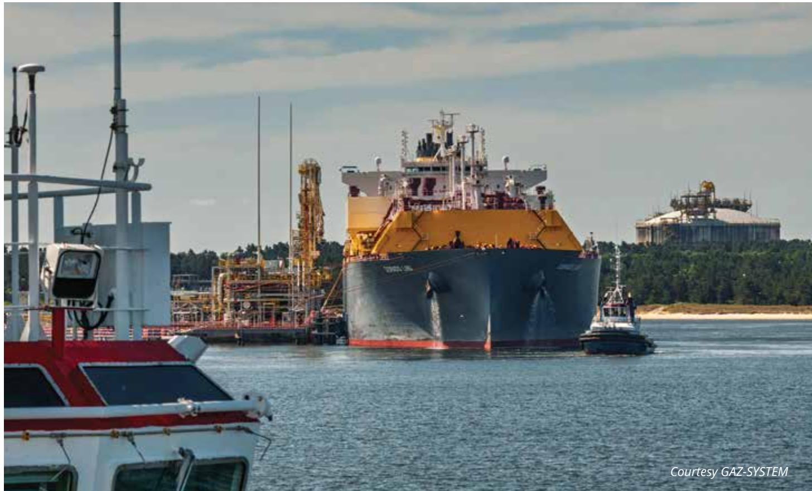

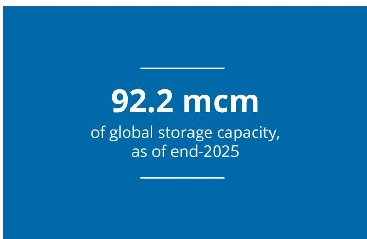

Table 7.1: LNG regasification terminals, January-December 2025

<table><tr><td>Receiving capacity</td><td>Number of markets</td><td>New import terminals</td><td>Expansions</td></tr><tr><td>46.0 MTPAnet growth of global receiving capacity in 2025, with 62.9 MTPA of additions and a decrease of 17.0 MTPA due to terminal closures.</td><td>1new market, Senegal, with regasification capacity emerged in 2025.</td><td>New terminals added 42.6 MTPA of additional capacity across China, Egypt, Jordan, India, Italy, Chinese Taipei, Vietnam, Senegal, and Indonesia.</td><td>20.3 MTPAof capacity was added from expansion projects across Egypt, China, Germany, Croatia, India, Poland, and Colombia.</td></tr><tr><td>Capacity decreased by 17.0 MTPA through four FSRU departures: Jordan LNG - Energos Eskimo (3.8 MTPA), Le Havre FSRU (3.7 MTPA), Mukran LNG - Energos Power (5.5 MTPA), and Terminal Gas Sul LNG - Energos Winter (4.0 MTPA).</td><td>The number of markets with regasification capacity increased to 50, as of end-2025.</td><td></td><td></td></tr><tr><td>Nameplate regasification capacity reached 1,113.5 MTPA by end-2025.</td><td></td><td></td><td></td></tr></table>

Figure 7.6: LNG storage tank capacity by market (mcm) and percentage of total, 2025  
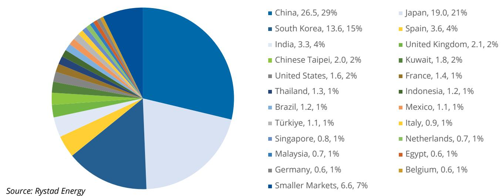

Source: Rystad Energy

## 7.4

# RECEIVING TERMINAL LNG STORAGE CAPACITY

92.2 mcm of global storage capacity, as of end-2025

Global LNG storage capacity continued its upward trajectory in 2025, reaching 92.2 mcm. This increase was supported by the startup of 13 newly built terminals and the completion of seven expansion projects, collectively contributing an additional 4.9 mcm. Regionally, Asia remained the primary driver of expansion, with China contributing 2.6 mcm of incremental capacity across five projects, accounting for 53.6% of the global growth. In contrast to 2024, Africa ranked as the second-largest contributor to storage growth in 2025, adding 0.60 mcm. Meanwhile, the Asia Pacific region recorded a capacity increase of 0.59 mcm, broadly in line with Africa. This was followed by Europe and the Middle East, which expanded their LNG storage capacity by 0.49 mcm and 0.17 mcm, respectively.

China, Japan and South Korea continued to dominate the global operational LNG storage capacity landscape in 2025, collectively accounting for 64% of the total. Of this, China represented 28.8%, followed by Japan at 20.6% and South Korea at 14.8%. On a regional basis, Asia Pacific, together with Asia, accounted for a combined

75.8% of global LNG storage capacity. As of 2025, the top three LNG regasification terminals with the largest storage capacity globally were all located in South Korea: Pyeongtaek LNG, Incheon LNG, and Tongyeong LNG, each with a capacity exceeding 2.5 mcm. In terms of newly added capacity in 2025, the largest increments were recorded at Shanghai LNG 1 and the Zhoushan ENN LNG 3 expansion in China, each adding 0.88 mcm of LNG storage capacity.

China maintained its position as the world’s largest LNG storage capacity market in 2025, with total capacity reaching 26.5 mcm. Since 2021, capacity growth has accelerated significantly, with average annual additions around 3.2 mcm. In 2025, China commissioned five LNG regasification projects, adding 2.6 mcm of storage capacity. Looking ahead, 30 projects that are under construction are expected to deliver an additional 22.9 mcm of storage capacity. Furthermore, China is demonstrating a clear trend toward the adoption of ultralarge LNG storage tanks, where two operational LNG regasification projects are already deploying the largest LNG storage tanks (0.27 mcm). This includes Jiangsu Yancheng Binhai LNG 1 expansion (six 0.27 mcm tanks) and Shandong Qingdao LNG 3 (one 0.27 mcm tank). This trend is continuing in projects under construction, with multiple terminals planning similar large-scale LNG storage configurations, such as Zhejiang Ningbo LNG 3, which includes six 0.27 mcm LNG storage tanks, and Zhuhai LNG 2 with five 0.27 mcm tanks.

Another region worth highlighting is Africa, ranking second globally in LNG storage capacity additions in 2025. Growth was primarily driven by Egypt, which commissioned three LNG regasification projects: the FSRU Energos Power at the Ain Sokhna (Sonkar) terminal, the FSRU Energos Eskimo at the Ain Sokhna (Sumed) terminal, and FSRU Energos Winter at the Damietta terminal, adding a combined 0.47 mcm of storage capacity. Meanwhile, Senegal entered the market with its first LNG regasification terminal coming online in 2025, the Senegal FSRU project, adding a further 0.13 mcm. LNG storage additions in the region are entirely driven by floating LNG infrastructure (FSRUs), rather than onshore storage tank developments.

## 7.5

# RECEIVING TERMINAL BERTHING CAPACITY

The ability of LNG regasification terminals to handle diferent types of LNG carriers is fundamentally constrained by their berthing capacities which, in turn, has important implications for both shipping eficiency and the range of operational options available. In general, LNG carriers are commonly grouped into four size classes: conventional vessels with capacities of 125,000 to 175,000 cm, the new 200,000 cm carriers capable of passing through the new Panama Canal locks, Q-Flex carriers at around 210,000 cm, and Q-Max carriers at approximately 260,000 cm, which are the largest LNG vessels currently in service.

By the end of 2025, there were 203 operational LNG regasification terminals globally, with the majority equipped with berthing capacity designed for conventional vessels, totalling 104 terminals. This represents more than half of the global total and reflects that conventional vessel berths remain a widely applicable solution across diverse market conditions. Terminals capable of accommodating larger Q-Class vessels (Q-Max and Q-Flex) are comparatively fewer, with 69 terminals able to berth Q-Max and 30 terminals that can accommodate Q-Flex carriers. An emerging trend can be observed in recently commissioned LNG regasification terminals, with a growing preference for larger-capacity berthing infrastructure capable of handling Q-Max carriers.

Among the newly built LNG regasification terminals commissioned in 2025, three can accommodate Q-Max carriers, while the remaining

10 projects are configured solely for conventional vessels. Notably, all such terminals with Q-Max berthing capacity are onshore facilities, reflecting the higher technical and spatial requirements associated with accommodating ultra-large LNG carriers. As a result, onshore terminals continue to dominate the development of large-capacity berthing infrastructure, in contrast to floating solutions such as FSRUs, which are more commonly designed for smaller vessel classes.

The global capacity of LNG regasification terminals to receive larger carriers continues to expand. As of year-end 2025, 69 terminals worldwide had the capacity to berth Q-Max vessels, with regional distribution: 28 in Asia, 18 in Europe, 15 in Asia Pacific, four in North America, three in Latin America, and one in the Middle East. For Q-Class LNG carriers, the related infrastructure is primarily concentrated in Asia and the Asia Pacific region which, together, host 65 terminals capable of accommodating such vessels, accounting for 66% of the global total. Among all LNG receiving terminals that can accommodate Q-Class carriers, Asia leads with a share of 36%, ranking first globally. In contrast, for conventional LNG carriers, the Asia Pacific region has the largest number of compatible terminals, with 40 facilities, accounting for 38% of the global total.

With growing LNG demand across regions and an ever-changing global LNG market, upgrading terminal infrastructure with expanded berthing capacity will continue to play a crucial role in enhancing supply adaptability and the ability to respond efectively to market dynamics.

Figure 7.7: Number of LNG receiving terminals by maximum berthing capacity and region, as of end-2025  
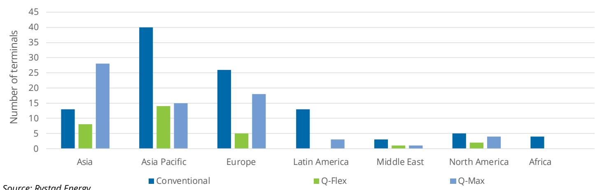

Onshore-only importers Both onshore & FSRU/Ofshore FSRU/Ofshore-only importers

# FLOATING AND OFFSHOREREGASIFICATION

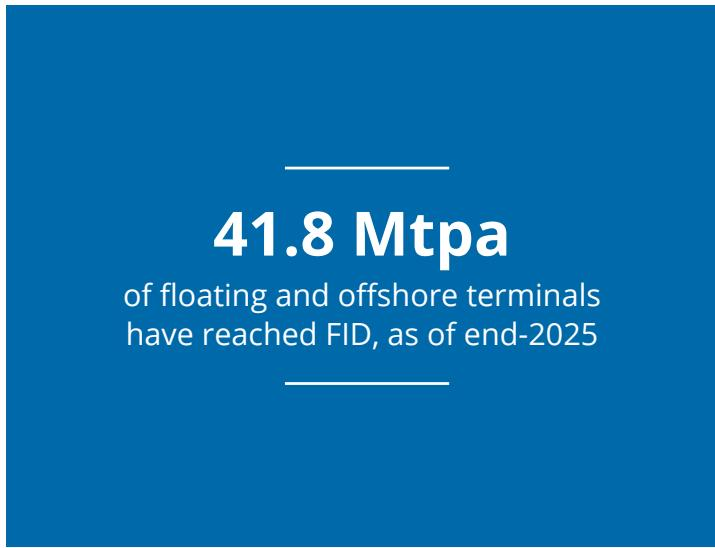

41.8 MTPA of floating and ofshore terminals have reached FID, as of end-2025

Floating and ofshore regasification solutions have emerged as a critical component of global LNG import capacity, particularly in regions seeking rapid market entry and flexible infrastructure. Floating and ofshore projects ofer several structural advantages, including significantly shorter development timelines and lower upfront capital expenditure. As of the end of 2025, a total of 55 floating and ofshore regasification projects were in operation globally, with a nameplate regasification capacity of 216.1 MTPA. These terminals account for around 19.4% of total global regasification capacity, which has shown a gradual upward trend over the years, demonstrating their rising significance in global gas supply dynamics. Despite the continued dominance of onshore LNG import terminals in terms of installed capacity, FSRUs are increasingly being adopted as the solution of choice in new and emerging markets.

A total of nine floating and ofshore regasification terminals were commissioned globally in 2025, adding 32.6 MTPA of new regasification capacity. Of these, five projects were greenfield developments, while the remaining four projects were expansions of existing infrastructure. From a regional perspective, Africa recorded the largest capacity additions, contributing 17.2 MTPA during the year. This growth was primarily driven by Egypt, which saw the highest number of new ofshore projects coming online, with three projects in total, delivering an incremental 14.9 MTPA of capacity. With the commissioning of the first FSRU-based LNG receiving terminal, Senegal established its first LNG import infrastructure. Europe ranked second, with 9.4 MTPA of newly added capacity, reflecting continued eforts to strengthen energy security and diversify gas supply sources. This was followed by the Middle East and Latin America, which added 5.7 MTPA and 0.2 MTPA, respectively.

Figure 7.8: Number of regasification markets by type, 2000-2030  


Figure 7.9: Floating and ofshore regasification capacity by status and number of projects, 2005-2030  
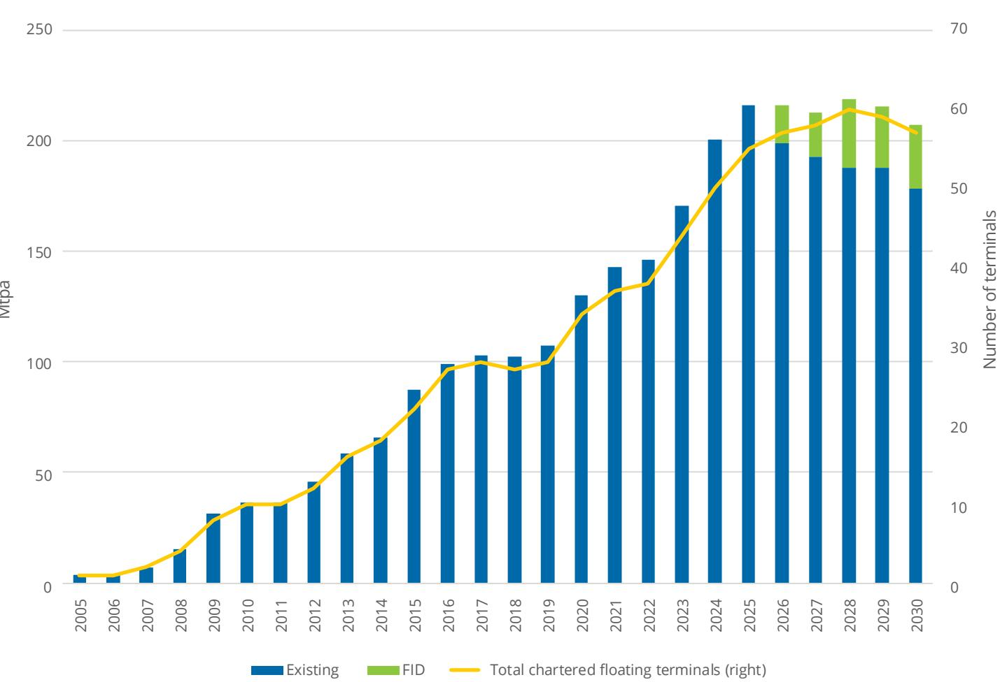  
Source: Rystad Energy

By the end of 2025, a total of 12 floating and ofshore projects had reached FID, representing 41.8 MTPA of new regasification capacity expected to come online by 2030. These projects span 12 markets, reflecting the continued expansion of LNG import infrastructure across diverse regions. Europe accounts for the largest share of upcoming capacity additions, with 12.3 MTPA, or around 29.4%, followed by Africa with 9.3 MTPA and Latin America with 9.0 MTPA. At the same time, several markets are expected to enter the LNG import market for the first time, driven by the deployment of floating regasification facilities, particularly FSRUs, which enable faster and more flexible project development.

In the early stages of LNG market development, regasification infrastructure was exclusively based on onshore terminals, primarily concentrated in mature import markets such as Japan and South Korea, reflecting the need for large-scale, stable, and long-term supply solutions. However, over the past decade, the deployment of floating and ofshore LNG receiving units has accelerated significantly, supported by advancements in LNG carrier and ofshore regasification technologies. At the same time, the expansion of LNG demand into emerging markets has made floating regasification terminals an attractive solution, supported by their operational flexibility, ability to be deployed quickly, and lower upfront capital investment compared to conventional onshore terminals. Beyond emerging markets, Europe has also seen a pronounced expansion in floating regasification capacity. Following the disruption of pipeline gas supplies after the Russia–Ukraine conflict, Europe accelerated the quick deployment of LNG import infrastructure to enhance energy security and diversify supply sources, leading to a surge in FSRU installations across multiple markets.

From a global perspective, by the end of 2025, 23 markets relied exclusively on onshore LNG terminals, while 10 markets had both onshore and floating regasification infrastructure, and 17 markets were served solely by floating LNG import facilities. Compared to 2015, the number of markets with both onshore and floating infrastructure increased from four to 10, and those relying exclusively on floating and ofshore import solutions rose from 10 to 17, highlighting the rapid expansion of floating and ofshore regasification over the past decade. Looking ahead to 2030, based on projects that have reached FID, are under construction, or have been commissioned, the number of markets served solely by floating LNG terminals is expected to increase further to 20, driven by the entry of new and emerging LNG importers.

# RECEIVING TERMINALS WITH RELOADING AND TRANS-SHIPMENT CAPABILITIES

Highest re-exports in 2025: Indonesia, 0.85 Mt

The rapid growth of the global LNG re-export market reflects a shift in the role of import terminals, which now ofer a broader range of services beyond conventional regasification. These facilities increasingly function as integrated LNG hubs, providing reloading, trans-shipment, small-scale bunkering, and truck-loading capabilities. Such developments allow importers to seize cross-market arbitrage opportunities and manage their LNG portfolios more flexibly through term contracts. As reloading and trans-shipment capabilities have been enhanced across markets, they play a crucial role in eficiently redistributing LNG to regions with stronger demand or more favourable pricing. This evolution underscores how import terminals are becoming central nodes in the modern LNG trading landscape.

Global LNG re-exports edged lower by 1% in 2025 to 4.92 Mt from the year-earlier level of 4.96 Mt. The number of markets involved in re‑exporting cargoes remained at 13, unchanged from 2023. Re‑exports from Europe fell by 0.28 Mt year‑on‑year to 2.01 Mt in 2025. Increases in other regions largely ofset this decline: Asia Pacific’s re‑exports rose by 0.11 Mt to 2.01 Mt, while Latin America’s increased by 0.11 Mt to 0.23 Mt. The drop in European re‑exports reflects stronger LNG demand in Europe, coupled with higher regional prices relative to Asia and Asia Pacific.

Indonesia rose to become the world’s largest re-export market in 2025, with a total volume of 0.85 Mt, almost flat from a year earlier. This was underpinned by a 2021 agreement between TotalEnergies and Pertamina to use the Arun LNG terminal as a trading hub. Under the deal, two storage tanks at the terminal are used to hold LNG from international sources as part of a broader global marketing strategy. Originally built as an export facility, Arun was converted into an import terminal in 2015.

Spain was the second-largest LNG re-export market in 2025, with volume largely unchanged at 0.77 Mt, compared with 0.78 Mt in 2024. As the market with the highest regasification capacity in Europe, Spain has established itself as a key regional LNG hub, allowing it to redistribute cargoes to other European markets such as Italy, the Netherlands, and France. The 5.9 MTPA El Musel terminal in Spain, which had been idle for nearly a decade due to insuficient demand, commissioned in 2023. Equipped with two 150,000-cm LNG storage tanks, the terminal is expected to be used primarily for storage and re-export. Its operations are intended to support Europe’s security of supply, with a focus on reloading LNG for nearby cities and re‑exporting to other European markets.

Meanwhile, re-exports from China increased in 2025 to 0.67 Mt from 0.46 Mt in the prior year, accounting for 13.6% of the global total. The increase in volume was mainly caused by tepid domestic demand in China. PipeChina’s Hainan Yangpu LNG terminal was the first in China to ofer re‑export services and continues to handle the majority of China’s re‑export volumes. As one of the few domestic facilities equipped with both reloading and trans‑shipment capabilities, it plays a pivotal role in supporting China’s LNG re‑export activity. An increasing number of regasification terminals in China have begun developing re‑export operations to diversify their business portfolios, with the construction of bonded storage tanks. When an LNG cargo is discharged into bonded storage, import tarifs and value-added tax (VAT) can be waived. The cargo may then either be re‑exported (with full tax exemption) or enter the domestic market (subject to import taxes upon clearance). As of the end of 2025, 16 bonded storage tanks had been commissioned across 13 terminals in China, with a total capacity of 3.3 mcm, forming a nationwide delivery network covering Northeast, North, East and South.

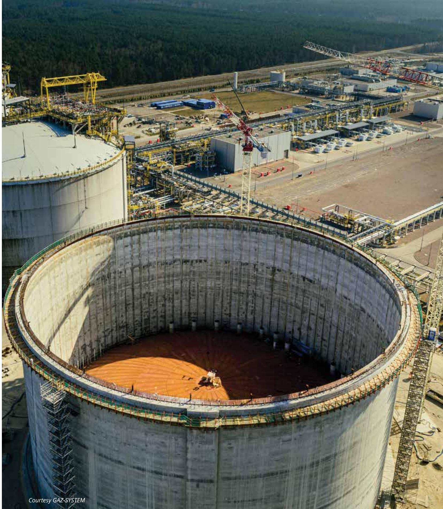

## LNG Bunkering Vessels and Terminals

60

active vessels

16 30 in Asia/Asia Pacific in Europe

11 in North America

2 in Latin America

1 in Russia

Active fleet average capacity 8,785 cm

o43o n rderbook


Orderbook fleet average capacity 17,653 cm

# 8. LNG Bunkering Vessels and Terminals

If 2024 was a significant year for LNG bunkering, 2025 has added another strong year for the sector’s performance. LNG prices were elevated in the first quarter of 2025 as the weather turned out to be slightly cooler than the previous year. However, that quickly changed as prices declined at a faster rate for the rest of the year compared to other bunker fuels such as MGO, which incentivised LNG bunkering.

Courtesy Osaka Gas


<table><tr><td colspan="4">60 unitsglobal operational LNG bunkeringvessel fleet, as of end-2025</td></tr><tr><td colspan="4">The Port of Singapore, which is the largest bunkering port in the world, bunkered 571,400 tonnes of LNG in 2025, about 23% higher than 463,900 tonnes in 2024. The Port of Rotterdam, the second-largest bunkering port in the world, saw 992,911 cubic metres (cm) of LNG bunkered in 2025, slightly higher than 941,366 cm in 2024. The surge in bunkered bio-LNG volumes was noteworthy, which increased sixfold from 2,775 cm in 2024 to 17,644 cm in 2025. The Port of Shanghai saw 712,000 cm of LNG bunkered in 2025, versus the 450,000 cm that was expected to be bunkered in 2024.On January 1, 2025, the FuelEU Maritime legislation came into effect, requiring shippers operating in EU waters to reduce greenhouse gas emissions from shipping activities by 2% in 2025 compared to the 2020 baseline. This equates to a Well-to-Wake (WtW) carbon intensity requirement of about 89.34 grammes of carbon dioxide equivalent per megajoule (gCO2eq/MJ) in 2026. This requirement will gradually become more stringent, tightening by a further 6% in 2030 (85.69 gCO2eq/MJ), 14.5% by 2035 (77.94 gCO2eq/MJ), 31% by 2040 (62.90 gCO2eq/MJ), 62% by 2045 (34.64 gCO2eq/MJ), and 80% by 2050 (18.23 gCO2eq/MJ). Greenhouse gas emissions may be lowered by using cleaner fuels like LNG with suitable engines or by using biofuels or renewable fuels of non-biological origin (RFNBOs), which have a lower WtW intensity.For example, the WtW intensity for vessels using ME-GI (Everilence) stands at about 76.13 gCO2eq/MJ, meaning that these vessels will not incur the FuelEU Maritime penalty at least until 2035.As a result of the need to reduce WtW intensity levels, 2025 was also the year of bio-LNG, which has lower combined WtW emissions compared to fossil-origin LNG, although it will come at a premium over fossil-origin LNG. In 2025, bio-LNG started to see wider adoption across all forms of bunkering activities across North America, Europe and Asia. Spain&#x27;s ENAGAS started providing bio-LNG for Ship-to-Ship (STS) and truck-to-ship bunkering in Huelva and Barcelona in March 2025. It also began bio-LNG bunkering in Cartagena in August 2025</td></tr><tr><td colspan="4">Figure 8.1: Timeline of notable policies</td></tr><tr><td rowspan="2"></td><td>2020IMO 2020 Global Sulphur Limit:• Maximum global sulphur content in marine fuel oil reduced from 3.5% to 0.5%• Within specific Sulphur ECA (sECAs), the limit will be stricter at 0.1%</td><td>2024Amendment to Annex VI of MARPOL Convention (MEPC.385(81))• Standardised calculations for fuel emissions under 2024 LCA Guidelines• Introduced key provisions for low flashpoint fuels and gaseous fuels among others• Enhanced granularity of IMO Ship Fuel Consumption Database (IMO DCS)Ban on HFO in Arctic shipping started on 1 July 2024</td><td>2026Implementation of Canadian Arctic ECA and Norwegian Sea ECA started on 1 March 2026:• Both ECAs cover SOx, NOx and particulate matter (PM)</td></tr><tr><td>2023IMO Revised Greenhouse Gas (GHG) Strategy:• Net-zero GHG emissions from ships of 5,000 gross tons or more by 2050• Intermediate GHG reduction targets for 2030 and 2040 compared to 2008 levels</td><td>2025Adoption of Global Fuel Standard (GFS) and Global economic measureImplementation of Mediterranean Sea sulphur oxides (SOx) ECA started on 1 May 2025</td><td>2027Adoption of upcoming North-east Atlantic Ocean ECA formalised in May 2026.• ECA to launch in September 2027, implementation begins in September 2028• ECA covers SOx, NOx, and PM</td></tr></table>

In 2025, the Seaspan Baker (7,600 cm) was delivered. Built by CIMC Sinopacific Ofshore & Engineering, it was the third vessel from a set of three 7,600-cm LNG bunkering vessels ordered by Seaspan Energy. Seaspan took delivery of the vessel in January 2025, after which it was deployed to the west coast of North America.

The Green Pearl (7,500 cm) was also delivered in 2025. It is chartered by Axpo and built by the San Giorgio del Porto shipyard in Italy, where it will perform bunkering services in the Mediterranean.

The Alisios LNG (12,500 cm) bunker vessel, which is owned by Scale Green Energy (previously known as Scale Gas) and chartered by Axpo, was built at the Nantong CIMC Sinopacific Ofshore and Engineering shipyard in China. The vessel is expected to operate around the southern coast of the Iberian Peninsula and was delivered in 2025.

United LNG I (8,000 cm) was delivered in 2025, christened in the Port of Antwerp and is due to enter service in 2026. The vessel is owned and operated by Somtrans and is expected to perform bunkering activities in Belgian and Dutch ports.

Seven new bunkering vessels are expected to be delivered in 2026. The Seto Azure (3,500 cm), which is owned by a joint venture between Osaka Gas, NS United Coastal Tanker and Kobe-Osaka International Port Corporation, will also be delivered in 2026. The vessel is expected to commence STS in April 2026 around the Seto Inland Sea and Osaka Bay.

The LNG bunkering fleet is concentrated in Europe with the highest capacity of operational bunkering vessels. This is followed by Asia and then North America, both of which are regions that have seen rapid expansions in the past five years. The fleet is quite young, with most of the active bunkering vessels delivered over the past five years, while the typical size of LNG bunkering vessels has increased over time.

The orderbook has almost doubled as of end-2025 compared to last year’s edition (2025) of the IGU’s World LNG Report. There are 43 vessels currently under construction, with a total bunkering capacity of 759,100 cm. Seven are expected to be delivered in 2026, with 24 in 2027 and another 12 in 2028.

As of end-2025, Europe has the highest bunkering capacity, with a total of 233,257 cm across 30 vessels that are currently operational within the region. Europe's LNG bunkering sector has experienced significant growth, marked by increased infrastructure development and a surge in LNG-fuelled vessel orders.

Asia has the second-highest bunkering capacity as of end-2025, with a total of 172,200 cm across 16 vessels in operation.

In terms of Asia Pacific, the KEYS Azalea (3,500 cm), which was built by Mitsubishi Heavy Industries under contract for KEYS Bunkering West Japan, was delivered and put into operation in 2024. The vessel provides LNG bunkering services to oceangoing vessels docked at ports in the Kyushu-Seto Inland Sea region and is engaged in LNG coastal transportation operations. The Ecobunker Tokyo Bay (2,500 cm), a multi-bunkering vessel capable of both STS LNG and VLSFO (very-low sulphur fuel oil) bunkering that is owned by Ecobunker

Shipping, will provide LNG bunkering services in Tokyo Bay from 2026. Osaka Gas is planning to launch an STS LNG bunkering service in April 2026 with the Seto Azure (3,500 cm) bunkering vessel in the Osaka Bay and Seto Inland Sea regions.

China currently has five operational LNG bunkering vessels after the first LNG STS bunkering conducted by the 8,500 cm Xin Ao Pu Tuo Hao in 2022 by CNPC. CNOOC's first STS transfer was carried out in January 2023 by the Hai Yang Shi You 301 vessel (30,000 cm) built by the Chinese shipyard Jiangnan Shipbuilding (Group). Another China-built LNG bunkering vessel, Hai Gang Wei Lai (20,000 cm), also performed its first STS bunkering in 2022. This is operated by Shanghai Shanggang Energy Service and was built by Nantong CIMC SinoPacific Ofshore & Engineering. The vessel has conducted LNG STS bunkering operations for vessels mainly in Shanghai Yangshan Port. CNOOC's second LNG bunkering vessel, Hai Yang Shi You 302, with a capacity of approximately 12,000 cm, was put into operation in Jiangsu Province in 2024. With the advantages of ‘river-to-sea direct transportation’ and ‘ice-class navigation’, this vessel can provide flexible refuelling services for LNG vessels in China’s rivers and seas. The handover of another Chinese-developed LNG bunkering vessel, Huaihe Nengyuan Qihang (14,000 cm), took place in 2024. It is owned by Huaihe Energy Holding Group and was built by Hudong-Zhonghua Shipbuilding Group. The CCS-classed bunkering vessel can navigate both oceans and the Yangtze River and conducts operations mainly at Shanghai's Yangshan Port and along the Yangtze River, as well as China’s coastal areas.

South Korea currently provides STS bunkering services with four bunkering vessels, namely the SM Jeju LNG1 (7,500 cm) which was under repairs, the SM Jeju LNG2 (7,500 cm), the K LNG Dream (500 cm) and the Blue Whale (7,500 cm). Blue Whale started operations in 2023 and was built by Hyundai Heavy Industries for delivery to Kogas, marking progress in the market’s STS bunkering capabilities. While no new LNG bunkering vessels will enter service in South Korea for 2026, the market is planning to enhance its LNG bunkering capacity at the proposed 13.7-MTPA Dangjin LNG import facility. The SM Jeju LNG 1 completed its repairs in October 2025, following a February 2024 collision.

Singapore currently has three bunkering vessels in operation. In addition to the FueLNG Bellina (7,500 cm) introduced in 2021, the FueLNG Venosa (18,000 cm) and LNG Brassavola (12,000 cm) were Singapore’s second and third bunkering vessels after both being introduced in 2023.

North America continues its growth as a significant provider of LNG bunkering in 2025, reaching a total capacity of 92,000 cm across 11 operational vessels by the end of the year. The Seaspan Baker (7,600 cm) was introduced in 2025, further enhancing the region’s LNG bunkering capabilities.

The Green Zeebrugge (5,000 cm) LNG bunkering vessel was moved at the end of 2024 to Dubai and performed the first-ever LNG bunkering in the Middle East. It has since been relocated from the Persian Gulf in July 2025 and is currently operating in Europe.

<sup>Figure</sup> <sup>8.2:</sup> <sup>Cumulative</sup> <sup>number</sup> <sup>of</sup> <sup>operational</sup> <sup>LNG</sup> <sup>bunkering</sup> <sup>vessels</sup> <sup>by</sup> <sup>region</sup> <sup>and</sup> <sup>average</sup> <sup>vessel</sup> <sup>capacity,</sup> <sup>based</sup> <sup>on</sup> <sup>LNG</sup> <sup>bunkering</sup>8.1 start-year\*, 2011 to end-2026  
  
Source: Rystad Energy \*Note that LNG bunkering start-year refers to the LNG bunkering begins, and not the delivery year of the LNG bunkering vessel

  
Courtesy Scale Green Energy

Table 8.1: Table of global LNG bunkering vessels

<table><tr><td>Market</td><td>Regional Market</td><td>Vessel Name</td><td>Delivery</td><td>LNG bunkering start year</td><td>Capacity (cm)</td><td>Concept</td><td>Infrastructure Life Cycle</td></tr><tr><td>North Europe</td><td>Europe</td><td>Pioneer Knutsen</td><td>2004</td><td>2011</td><td>1100</td><td>Bunkering vessel</td><td>Operational</td></tr><tr><td>North America</td><td>North America</td><td>Coral Favia</td><td>2010</td><td>2024</td><td>10000</td><td>Small-scale/ bunkerable</td><td>Operational</td></tr><tr><td>Sweden</td><td>Europe</td><td>Seagas</td><td>2013</td><td>2013</td><td>187</td><td>Bunkering vessel</td><td>Operational</td></tr><tr><td>Europe</td><td>Europe</td><td>Coral Energy</td><td>2013</td><td>2016</td><td>15600</td><td>Small-scale/ bunkerable</td><td>Operational</td></tr><tr><td>North Europe</td><td>Europe</td><td>Coralius</td><td>2017</td><td>2017</td><td>5800</td><td>Bunkering vessel</td><td>Operational</td></tr><tr><td>Europe</td><td>Europe</td><td>Green Zeebrugge</td><td>2017</td><td>2017</td><td>5000</td><td>Bunkering vessel</td><td>Operational</td></tr><tr><td>Europe</td><td>Europe</td><td>New Frontier 1 (ex-Cardissa)</td><td>2017</td><td>2018</td><td>6500</td><td>Bunkering vessel</td><td>Operational</td></tr><tr><td>Spain</td><td>Europe</td><td>Oizmendi</td><td>2017</td><td>2018</td><td>660</td><td>FO/DO/LNG Bunkering vessel</td><td>Operational</td></tr><tr><td>Europe</td><td>Europe</td><td>Coral Methane</td><td>2018</td><td>2018</td><td>7500</td><td>Small-scale/ bunkerable</td><td>Operational</td></tr><tr><td>North Europe</td><td>Europe</td><td>Coral Energice</td><td>2018</td><td>2018</td><td>18000</td><td>Small-scale/ bunkerable</td><td>Operational</td></tr><tr><td>North Europe</td><td>Europe</td><td>Kairos</td><td>2018</td><td>2019</td><td>7500</td><td>Bunkering vessel</td><td>Operational</td></tr><tr><td>East Coast, US</td><td>North America</td><td>Clean Jacksonville</td><td>2018</td><td>2018</td><td>2200</td><td>Non-propelled bunker barge (Jones Act)</td><td>Operational</td></tr><tr><td>Spain</td><td>Europe</td><td>Bunker Breeze</td><td>2018</td><td>2018</td><td>1200</td><td>FO/DO Bunkering vessel; LNG Bunker Designed</td><td>Operational</td></tr><tr><td>South Korea</td><td>Asia</td><td>SM Jeju LNG1</td><td>2019</td><td>2019</td><td>7500</td><td>Bunkering vessel</td><td>Operational (after repairs)</td></tr><tr><td>Netherlands</td><td>Europe</td><td>FlexFueler 001</td><td>2019</td><td>2019</td><td>1480</td><td>Non-propelled bunker barge (inland)</td><td>Operational</td></tr><tr><td>Carribean</td><td>North America</td><td>Coral Fraseri</td><td>2019</td><td>2019</td><td>10000</td><td>Small-scale/ bunkerable</td><td>Operational</td></tr><tr><td>North Europe</td><td>Europe</td><td>LNG London</td><td>2019</td><td>2019</td><td>3000</td><td>Bunkering vessel (inland)</td><td>Operational</td></tr><tr><td>South Korea</td><td>Asia</td><td>SM Jeju LNG2</td><td>2020</td><td>2020</td><td>7500</td><td>Bunkering vessel</td><td>Operational</td></tr><tr><td>Japan</td><td>Asia</td><td>Kaguya</td><td>2020</td><td>2020</td><td>3500</td><td>Bunkering vessel</td><td>Operational</td></tr><tr><td>Netherlands</td><td>Europe</td><td>Gas Agility</td><td>2020</td><td>2020</td><td>18600</td><td>Bunkering vessel</td><td>Operational</td></tr><tr><td>Europe</td><td>Europe</td><td>Avenir Advantage</td><td>2020</td><td>2020</td><td>7500</td><td>Bunkering vessel</td><td>Operational</td></tr><tr><td>Belgium</td><td>Europe</td><td>FlexFueler 002</td><td>2020</td><td>2021</td><td>1480</td><td>Non-propelled bunker barge (inland)</td><td>Operational</td></tr><tr><td>Singapore</td><td>Asia</td><td>FueLNG Bellina</td><td>2021</td><td>2021</td><td>7500</td><td>Bunkering vessel</td><td>Operational</td></tr><tr><td>China</td><td>Asia</td><td>Hai Gang Wei Lai (ex-Avenir Allegiance)</td><td>2021</td><td>2021</td><td>20000</td><td>Bunkering vessel</td><td>Operational</td></tr><tr><td>US</td><td>North America</td><td>Q-LNG ATB 4000</td><td>2021</td><td>2021</td><td>4000</td><td>Non-propelled bunker barge (Jones Act)</td><td>Operational</td></tr><tr><td>Carribean</td><td>South America</td><td>Avenir Accolade</td><td>2021</td><td>2021</td><td>7500</td><td>Small-scale/ bunkerable</td><td>Operational</td></tr><tr><td>Russia</td><td>Unknown/ Other</td><td>Dmitry Mendeleev</td><td>2021</td><td>2021</td><td>5800</td><td>Bunkering vessel</td><td>Operational</td></tr><tr><td>Norway</td><td>Europe</td><td>Bergen LNG</td><td>2021</td><td>2021</td><td>850</td><td>Bunkering vessel</td><td>Operational</td></tr></table>

<table><tr><td>Market</td><td>Regional Market</td><td>Vessel Name</td><td>Delivery</td><td>LNG bunkering start year</td><td>Capacity (cm)</td><td>Concept</td><td>Infrastructure Life Cycle</td></tr><tr><td>North Europe</td><td>Europe</td><td>Avenir Aspiration</td><td>2021</td><td>2021</td><td>7500</td><td>Bunkering vessel</td><td>Operational</td></tr><tr><td>France</td><td>Europe</td><td>Gas Vitality</td><td>2021</td><td>2021</td><td>18600</td><td>Bunkering vessel</td><td>Operational</td></tr><tr><td>East Coast, US</td><td>North America</td><td>Clean Canaveral</td><td>2021</td><td>2021</td><td>5500</td><td>Bunkering vessel</td><td>Operational</td></tr><tr><td>South Korea</td><td>Asia</td><td>K LNG Dream</td><td>2022</td><td>2022</td><td>500</td><td>Bunkering vessel</td><td>Operational</td></tr><tr><td>China</td><td>Asia</td><td>Xin Ao Pu Tuo Hao</td><td>2022</td><td>2022</td><td>8500</td><td>Bunkering vessel</td><td>Operational</td></tr><tr><td>China</td><td>Asia</td><td>Hai Yang Shi You 301</td><td>2022</td><td>2022</td><td>30000</td><td>Small-scale/ bunkerable</td><td>Operational</td></tr><tr><td>Netherlands</td><td>Europe</td><td>K. Lotus</td><td>2022</td><td>2022</td><td>18000</td><td>Bunkering vessel</td><td>Operational</td></tr><tr><td>North America</td><td>North America</td><td>Avenir Achievement</td><td>2022</td><td>2022</td><td>20000</td><td>Small-scale/ bunkerable</td><td>Operational</td></tr><tr><td>North Europe</td><td>Europe</td><td>Avenir Ascension</td><td>2022</td><td>2022</td><td>7500</td><td>Bunkering vessel</td><td>Operational</td></tr><tr><td>Spain</td><td>Europe</td><td>Haugesund Knutsen</td><td>2022</td><td>2022</td><td>5000</td><td>Bunkering vessel</td><td>Operational</td></tr><tr><td>Europe</td><td>Europe</td><td>Alice Cosulich</td><td>2023</td><td>2023</td><td>8200</td><td>Small-scale/ bunkerable</td><td>Operational</td></tr><tr><td>Asia</td><td>Asia</td><td>Titan Unikum</td><td>2023</td><td>2023</td><td>12000</td><td>Small-scale/ bunkerable</td><td>Operational</td></tr><tr><td>Europe</td><td>Europe</td><td>Titan Vision</td><td>2023</td><td>2023</td><td>12000</td><td>Small-scale/ bunkerable</td><td>Operational</td></tr><tr><td>Spain</td><td>Europe</td><td>Levante LNG</td><td>2023</td><td>2023</td><td>12500</td><td>Bunkering vessel</td><td>Operational</td></tr><tr><td>Singapore</td><td>Asia</td><td>FuelLNG Venosa</td><td>2023</td><td>2023</td><td>18000</td><td>Bunkering vessel</td><td>Operational</td></tr><tr><td>South Korea</td><td>Asia</td><td>Blue Whale</td><td>2023</td><td>2023</td><td>7500</td><td>Bunkering vessel</td><td>Operational</td></tr><tr><td>US</td><td>North America</td><td>Clean Everglades</td><td>2023</td><td>2023</td><td>5500</td><td>Non-propelled bunker barge (Jones Act)</td><td>Operational</td></tr><tr><td>Singapore</td><td>Asia</td><td>LNG Brassavola</td><td>2023</td><td>2023</td><td>12000</td><td>Bunkering vessel</td><td>Operational</td></tr><tr><td>South America</td><td>South America</td><td>New Frontier 2</td><td>2023</td><td>2023</td><td>18000</td><td>Bunkering vessel</td><td>Operational</td></tr><tr><td>Asia</td><td>Asia</td><td>Paolina Cosulich</td><td>2024</td><td>2024</td><td>8200</td><td>Small-scale/ bunkerable</td><td>Operational</td></tr><tr><td>Japan</td><td>Asia</td><td>KEYS Azalea</td><td>2024</td><td>2024</td><td>3500</td><td>Bunkering vessel</td><td>Operational</td></tr><tr><td>China</td><td>Asia</td><td>Hai Yang Shi You 302</td><td>2024</td><td>2024</td><td>12000</td><td>Bunkering vessel</td><td>Operational</td></tr><tr><td>China</td><td>Asia</td><td>Huaihe Nengyuan Qihang</td><td>2024</td><td>2024</td><td>14000</td><td>Bunkering vessel</td><td>Operational</td></tr><tr><td>West Coast, US</td><td>North America</td><td>Seaspan Garibaldi</td><td>2024</td><td>2024</td><td>7600</td><td>Bunkering vessel</td><td>Operational</td></tr><tr><td>Europe</td><td>Europe</td><td>Energy Stockholm</td><td>2024</td><td>2024</td><td>8000</td><td>Bunkering vessel (inland)</td><td>Operational</td></tr><tr><td>US</td><td>North America</td><td>Progress</td><td>2024</td><td>2024</td><td>12000</td><td>Non-propelled bunker barge (Jones Act)</td><td>Operational</td></tr><tr><td>West Coast, US</td><td>North America</td><td>Seaspan Lions</td><td>2024</td><td>2024</td><td>7600</td><td>Bunkering vessel</td><td>Operational</td></tr><tr><td>West Coast, US</td><td>North America</td><td>Seaspan Baker</td><td>2025</td><td>2025</td><td>7600</td><td>Bunkering vessel</td><td>Operational</td></tr><tr><td>Mediterranean Sea</td><td>Europe</td><td>Green Pearl</td><td>2025</td><td>2026</td><td>7500</td><td>Bunkering vessel</td><td>Operational</td></tr><tr><td>Spain</td><td>Europe</td><td>Alisios LNG</td><td>2025</td><td>2026</td><td>12500</td><td>Bunkering vessel</td><td>Operational</td></tr><tr><td>Europe</td><td>Europe</td><td>United LNG I</td><td>2025</td><td>2026</td><td>8000</td><td>Bunkering vessel (inland)</td><td>Operational</td></tr><tr><td>Japan</td><td>Asia</td><td>Seto Azure</td><td>2026</td><td>2026</td><td>3500</td><td>Bunkering vessel</td><td>Under Construction</td></tr><tr><td>Japan</td><td>Asia</td><td>Ecobunker Tokyo Bay</td><td>2026</td><td>2026</td><td>2500</td><td>Bunkering vessel</td><td>Under Construction</td></tr><tr><td></td><td></td><td>Harbin Industrial Investment Order No.1 S1070</td><td>2026</td><td>2026</td><td>19600</td><td>Bunkering vessel</td><td>Under Construction</td></tr><tr><td></td><td></td><td>Harbin Industrial Investment Order No.2 S1071</td><td>2026</td><td>2026</td><td>19600</td><td>Bunkering vessel</td><td>Under Construction</td></tr><tr><td>Europe</td><td>Europe</td><td>Avenir BV Order No.1 S1123</td><td>2026</td><td>2026</td><td>20000</td><td>Bunkering vessel</td><td>Under Construction</td></tr><tr><td></td><td></td><td>Vitol BV Order No.1 S1125</td><td>2026</td><td>2026</td><td>12500</td><td>Bunkering vessel</td><td>Under Construction</td></tr><tr><td></td><td></td><td>Grupo Ibaizabal Hudong Zhonghua BV Order No.1</td><td>2026</td><td>2026</td><td>18600</td><td>Bunkering vessel</td><td>Under Construction</td></tr><tr><td></td><td></td><td>Wuyang Tanker BV Order</td><td>2027</td><td>2027</td><td>12000</td><td>Bunkering vessel</td><td>Under Construction</td></tr><tr><td></td><td></td><td>Equatorial Marine BV Order S1128</td><td>2027</td><td>2027</td><td>20000</td><td>Bunkering vessel</td><td>Under Construction</td></tr><tr><td></td><td></td><td>CIMC Hull S1075</td><td>2027</td><td>2027</td><td>19600</td><td>Bunkering vessel</td><td>Under Construction</td></tr><tr><td></td><td></td><td>GSX Energy BV Order No.1</td><td>2027</td><td>2027</td><td>20000</td><td>Bunkering vessel</td><td>Under Construction</td></tr><tr><td></td><td></td><td>GSX Energy BV Order No.2</td><td>2027</td><td>2027</td><td>20000</td><td>Bunkering vessel</td><td>Under Construction</td></tr><tr><td></td><td></td><td>Gasum and Sirius BV Order No.1</td><td>2027</td><td>2027</td><td>7800</td><td>Bunkering vessel</td><td>Under Construction</td></tr><tr><td></td><td></td><td>Seacon Hull XL-238</td><td>2027</td><td>2027</td><td>20000</td><td>Bunkering vessel</td><td>Under Construction</td></tr><tr><td></td><td></td><td>Seacon Hull XL-239</td><td>2027</td><td>2027</td><td>20000</td><td>Bunkering vessel</td><td>Under Construction</td></tr><tr><td></td><td></td><td>CIMC Hull S1076</td><td>2027</td><td>2027</td><td>19600</td><td>Bunkering vessel</td><td>Under Construction</td></tr><tr><td></td><td></td><td>Avenir BV Order No.2 S1124</td><td>2027</td><td>2027</td><td>20000</td><td>Bunkering vessel</td><td>Under Construction</td></tr><tr><td></td><td></td><td>Somtrans BV Order No.1 S1129</td><td>2027</td><td>2027</td><td>20000</td><td>Bunkering vessel</td><td>Under Construction</td></tr><tr><td></td><td></td><td>SIPG BV Order No. 1</td><td>2027</td><td>2027</td><td>20000</td><td>Bunkering vessel</td><td>Under Construction</td></tr><tr><td></td><td></td><td>Posco International BV Order</td><td>2027</td><td>2027</td><td>12500</td><td>Bunkering vessel</td><td>Under Construction</td></tr><tr><td></td><td></td><td>Celsius Tankers and Caravel Group JV BV Order No.1</td><td>2027</td><td>2027</td><td>20000</td><td>Bunkering vessel</td><td>Under Construction</td></tr><tr><td></td><td></td><td>Singfar BV Order No.1</td><td>2027</td><td>2027</td><td>20000</td><td>Bunkering vessel</td><td>Under Construction</td></tr></table>

<table><tr><td>Market</td><td>Regional Market</td><td>Vessel Name</td><td>Delivery</td><td>LNG bunkering start year</td><td>Capacity (cm)</td><td>Concept</td><td>Infrastructure Life Cycle</td></tr><tr><td></td><td></td><td>Singfar BV Order No.2</td><td>2027</td><td>2027</td><td>20000</td><td>Bunkering vessel</td><td>Under Construction</td></tr><tr><td></td><td></td><td>Grupo Ibaizabal Hyundai MIPO BV Order No.1</td><td>2027</td><td>2027</td><td>18000</td><td>Bunkering vessel</td><td>Under Construction</td></tr><tr><td></td><td></td><td>Grupo Ibaizabal Hyundai MIPO BV Order No.2</td><td>2027</td><td>2027</td><td>18000</td><td>Bunkering vessel</td><td>Under Construction</td></tr><tr><td></td><td></td><td>Vitol BV Order No.2</td><td>2027</td><td>2027</td><td>20000</td><td>Bunkering vessel</td><td>Under Construction</td></tr><tr><td></td><td></td><td>Somtrans BV Order No.2 S1130</td><td>2027</td><td>2027</td><td>20000</td><td>Bunkering vessel</td><td>Under Construction</td></tr><tr><td></td><td></td><td>Celsius Tankers and Caravel Group JV BV Order No.2</td><td>2027</td><td>2027</td><td>20000</td><td>Bunkering vessel</td><td>Under Construction</td></tr><tr><td></td><td></td><td>Peninsula BV Order No.1</td><td>2027</td><td>2027</td><td>18000</td><td>Bunkering vessel</td><td>Under Construction</td></tr><tr><td></td><td></td><td>H-Line HJ Heavy Industries BV Order No.1</td><td>2027</td><td>2027</td><td>18000</td><td>Bunkering vessel</td><td>Under Construction</td></tr><tr><td></td><td></td><td>Grupo Ibaizabal Hudong Zhonghua BV Order No.2</td><td>2027</td><td>2027</td><td>18600</td><td>Bunkering vessel</td><td>Under Construction</td></tr><tr><td>Europe</td><td>Europe</td><td>Scale Green Energy BV Order No.1</td><td>2028</td><td>2028</td><td>18900</td><td>Bunkering vessel</td><td>Under Construction</td></tr><tr><td></td><td></td><td>Zhongneng Razhu BV Order No.1</td><td>2028</td><td>2028</td><td>20000</td><td>Bunkering vessel</td><td>Under Construction</td></tr><tr><td></td><td></td><td>EPS - Hyundai Mipo BV Order No.1</td><td>2028</td><td>2028</td><td>18000</td><td>Bunkering vessel</td><td>Under Construction</td></tr><tr><td></td><td></td><td>EPS - Hyundai Mipo BV Order No.2</td><td>2028</td><td>2028</td><td>18000</td><td>Bunkering vessel</td><td>Under Construction</td></tr><tr><td></td><td></td><td>EPS - Hyundai Mipo BV Order No.3</td><td>2028</td><td>2028</td><td>18000</td><td>Bunkering vessel</td><td>Under Construction</td></tr><tr><td></td><td></td><td>EPS - Hyundai Mipo BV Order No.4</td><td>2028</td><td>2028</td><td>18000</td><td>Bunkering vessel</td><td>Under Construction</td></tr><tr><td></td><td></td><td>Purus BV Order No.1</td><td>2028</td><td>2028</td><td>18900</td><td>Bunkering vessel</td><td>Under Construction</td></tr><tr><td></td><td></td><td>Purus BV Order No.2</td><td>2028</td><td>2028</td><td>18900</td><td>Bunkering vessel</td><td>Under Construction</td></tr><tr><td></td><td></td><td>Evalend Shipping - BV Order No. 1</td><td>2028</td><td>2028</td><td>18000</td><td>Bunkering vessel</td><td>Under Construction</td></tr><tr><td></td><td></td><td>Evalend Shipping - BV Order No. 2</td><td>2028</td><td>2028</td><td>18000</td><td>Bunkering vessel</td><td>Under Construction</td></tr><tr><td></td><td></td><td>Evalend Shipping - BV Order No. 3</td><td>2028</td><td>2028</td><td>18000</td><td>Bunkering vessel</td><td>Under Construction</td></tr><tr><td></td><td></td><td>Evalend Shipping - BV Order No. 4</td><td>2028</td><td>2028</td><td>18000</td><td>Bunkering vessel</td><td>Under Construction</td></tr></table>

Source: Rystad Energy

# 9. References and Acknowledgements

## 9.1 Data Collection

Data in Chapters 1, 2, 5, 6, 7, 8 and 9 of the 2026 IGU World LNG Report is sourced from a range of public and private domains, including Rystad Energy, the Energy Institute Statistical Review of World Energy, the International Energy Agency (IEA), the Oxford Institute for Energy Studies (OIES), the US Energy Information Administration (EIA), the US Department of Energy (DOE), Argus, LSEG Workspace, DNV GL, Barry Rogliano Salles (BRS), company reports and announcements. Any private data obtained from thirdparty organisations is cited as a source at the point of reference (i.e. charts and tables). No representations or warranties, express or implied, are made by the sponsors concerning the accuracy or completeness of the data and forecasts supplied under the report. The 2026 IGU World LNG Report uses data up until 31 December 2025 as a cut-of point, unless stated otherwise.

## 9.2 Data Collection for Chapter 3

2025 trade data in Chapter 3 of the 2026 IGU World LNG Report is sourced from Rystad Energy and based on loaded cargo volumes for shipments arriving between 1 January and 31 December 2025. No representations or warranties, express or implied, are made by the sponsors concerning the accuracy or completeness of the data and forecasts supplied under the report.

## 9.3 Data Collection for Chapter 4

Data in Chapter 4 of the 2026 IGU World LNG Report is sourced from S&P Global Energy. No representations or warranties, express or implied, are made by the sponsors concerning the accuracy or completeness of the data and forecasts supplied under the report.

## 9.4 Acknowledgements

The IGU wishes to thank the following organisations and Task Force members entrusted to oversee the preparation and publication of this report:

• Energy Institute Hrvoje Pozar, Croatia: Daniel Golja

• Osaka Gas Co., Ltd., Japan: Atsuo Kanno, Makoto Matusmoto

• FTI Consulting, France: Emmanuel Grand

• Bureau Veritas, France: Carlos Guerrero Pozuelo

• S&P Global Energy, Singapore: Kenneth Foo

• GAZ-SYSTEM, Poland: Łukasz Trzeszczkowsk

• CNOOC EEI, China: Kai Wang, Sixing Zhao

• International Gas Union, United Kingdom: Mark McCrory, Simon Ellis

• Rystad Energy, Norway: Xi Nan, Jan-Eric Fähnrich, Kaushal Ramesh, Christoph Halser, Mathieu Utting, Ole Dramdal, Wei Xiong, Jingya Zhang, Lu Ming Pang

## 9.5 Definitions

Brownfield Liquefaction Project: A land-based LNG project at a site with existing LNG infrastructure, such as: jetties, storage tanks, liquefaction facilities or regasification facilities.

Commercial Operations: For LNG liquefaction plants, commercial operations start when the plants deliver commercial cargoes under the supply contracts with their customers.

East and West of Suez: The terms East and West of Suez refer to the location in which an LNG tanker fixture begins. For these purposes, marine locations to the west of the Suez Canal, Cape of Good Hope, or Novaya Zemlya, but to the east of Tierra del Fuego, the Panama Canal, or Lancaster Sound, are considered to lie west of Suez. Other points are considered to lie east of Suez.

Forecast Data: Forecast liquefaction and regasification capacity data only considers existing and approved capacity (criteria being FID taken) and is based on company announced start dates.

Greenfield Liquefaction Project: A land-based LNG project at a site where no previous LNG infrastructure has been developed.

Home Market: The market in which a company is based.

Laid-Up Vessel: A vessel is considered laid-up when it is inactive and temporarily out of commercial operation. This can be due to low freight demand or when running costs exceed ongoing freight rates. Laid-up LNG vessels can return to commercial operation, undergo FSU/FSRU conversion or proceed to be sold for scrap.

Liquefaction and Regasification Capacity: Unless otherwise noted, liquefaction and regasification capacity throughout the document refers to nominal capacity. It must be noted that reloading and storage activity can significantly reduce the efective capacity available for regasification.

LNG Carriers: For the purposes of this report, only Q-Class and conventional LNG vessels with a capacity greater than 30,000 cm are considered part of the global fleet discussed in the ‘LNG Carriers’ chapter (Chapter 6). Vessels with a capacity of 30,000 cm or less are considered small-scale LNG carriers.

Scale of LNG Trains:

• Small-scale: 0-0.5 MTPA capacity per train

• Mid-scale: >0.5-1.5 MTPA capacity per train

• Large-scale: More than 1.5 MTPA capacity per train

Spot Charter Rates: Spot charter rates refer to fixtures beginning between five days after the date of assessment and the end of the following calendar month.

## 9.6 Regions and Basins

The IGU regions referred to throughout the report are defined as per the colour-coded areas in the map below. The report also refers to three basins: Atlantic, Pacific and Middle East. The Atlantic Basin encompasses all markets that border the Atlantic Ocean or Mediterranean Sea, while the Pacific Basin refers to all markets bordering the Pacific and Indian Oceans. However, these two categories do not include the following markets, which have been diferentiated to compose the Middle East Basin: Bahrain, Iran, Iraq, Israel, Jordan, Kuwait, Oman, Qatar, UAE and Yemen. IGU has also considered markets with liquefaction or regasification activities in multiple basins and has adjusted the data accordingly.


## 9.7 Acronyms

AP = Air Products AGRU = Acid Gas Removal Unit BHGE = Baker Hughes CAPEX = Capital Expenditure CCS = Carbon Capture and Storage CCUS = Carbon Capture, Utilisation and Storage CII = Carbon Intensity Indicator CO2 = Carbon Dioxide CNG = Compressed Natural Gas DOE = US Department of Energy DES = Delivered Ex-Ship DFDE = Dual-Fuel Diesel Electric DMR = Dual Mixed Refrigerant ECA = Emission Control Area EEXI = Energy Eficiency Existing Ship Index EPC = Engineering, Procurement and Construction ETS = Emissions Trading System EU = European Union EXP = Expander-Based FEED = Front-End Engineering and Design FERC = Federal Energy Regulatory Commission FID = Final Investment Decision FLNG = Floating Liquefied Natural Gas / Floating Liquefaction FOB = Free On-Board FPSO = Floating Production, Storage and Ofloading

## 9.8 Units

FRU = Floating Regasification Unit FSRU = Floating Storage and Regasification Unit FSU = Floating Storage Unit FTA = Free Trade Agreement GCU = Gas Combustion Unit GHG = Greenhouse Gas GTT = Gaztransport & Technigaz HFO = Heavy Fuel Oi IHI = Ishikawajima-Harima Heavy Industries IMO = International Maritime Organisation ISO = International Organisation for Standardisation JKM = Platts Japan-Korea Marker LNG = Liquefied Natural Gas LPG = Liquefied Petroleum Gas LRMC = Long Run Marginal Cost MARPOL = International Convention for the Prevention of Pollution from Ships MEGA = M-type, Electronically Controlled, Gas Admission MEGI = M-type, Electronically Controlled, Gas Injection MEPC = Marine Environment Protection Committee MFC = Mixed Fluid Cascade MMLS = Moveable Modular Liquefaction System MR = Mixed Refrigerant NFE = North Field Expansion

NOx = Nitrogen Oxide NWE = Platts Northwest Europe Marker OPEX = Operating Expenditure PM = Particulate Matte PSC = Production Sharing Contract PRICO = Poly Refrigerant Integrated Cycle Operations RFNBO = Renewable Fuels of Non-Biologica Origin SCMR = Single-Cycle Mixed Refrigerant sECA = Sulphur Emission Control Zone SOx = Sulphur Oxides SPA = Sales and Purchase Agreement SPB = Self-Supporting Prismatic type B SRMC = Short Run Marginal Cost STaGE = Steam Turbine and Gas Engine SSDR = Slow Speed Diesel with Re-liquefactio Plant STS = Ship-to-Ship TFDE = Tri-Fuel Diesel Electric TTF = Title Transfer Facility UAE = United Arab Emirates UK = United Kingdom US = United States USGC = United States Gulf Coast VLSFO = Very Low Sulphur Fuel Oil WtW = Well-to-Wake YoY = Year-on-Year

bbl = barrel boe = barrels of oil equivalent bcm = billion cubic metres Btu = British thermal unit mcm = million cubic metres

mcf = million cubic feet Mt = million tonnes MTPA = million tonnes per annum cm = cubic metres US\$ = US Dollar

MJ = megajoule therm = 100,000 Btu MMBtu = 1,000,000 Btu Mt CO2 = Mega tonnes of carbon dioxide gCO eq = grams of carbon dioxide equivalent tCO eq = tonnes of carbon dioxide equivalen

## 9.9

## Conversion Factors

Table 9.1: Overview of Conversion Factors

<table><tr><td></td><td>Tonnes LNG</td><td>cm LNG</td><td>mcm gas</td><td>mcf gas</td><td>MMBtu</td><td>boe</td></tr><tr><td>Tonnes LNG</td><td>-</td><td>2.222</td><td>0.00134</td><td>0.0474</td><td>52</td><td>8.97</td></tr><tr><td>cm LNG</td><td>0.45</td><td>-</td><td>0.000603</td><td>0.0213</td><td>23.4</td><td>4.034</td></tr><tr><td>mcm gas</td><td>745.6</td><td>1658</td><td>-</td><td>35.31</td><td>38665</td><td>6666</td></tr><tr><td>mcf gas</td><td>21.11</td><td>46.97</td><td>0.0283</td><td>-</td><td>1095</td><td>157.5</td></tr><tr><td>MMBtu</td><td>0.01923</td><td>0.0427</td><td>2.586E-05</td><td>0.0009132</td><td>-</td><td>0.172</td></tr><tr><td>boe</td><td>0.1115</td><td>0.248</td><td>0.00015</td><td>0.00635</td><td>5.8</td><td>-</td></tr></table>

## ANNEX 1 – LNG SHIPPING

## Containment systems

LNG containment systems store LNG at a cryogenic temperature of approximately -162°C (-260°F). They can be split into two main categories membrane systems and self-supporting systems, also called independent tanks. Membrane systems are mostly designed by Gaztransport & Technigaz (GTT), while self-supporting systems mainly comprise spherical ‘Moss’ type vessels and Ishikawajima-Harima Heavy Industries (IHI) Corporation’s Type B vessels. Due to the advantages highlighted below, modern newbuilds have entirely adopted the membrane type.

Table 1: Overview of containment systems

<table><tr><td></td><td>Membrane</td><td>Self-supporting</td></tr><tr><td>Current fleet count</td><td>691</td><td>113</td></tr><tr><td>Current fleet proportion (%)</td><td>85.9%</td><td>14.1%</td></tr><tr><td>Systems</td><td>GTT-designed: Mark III, Mark III Flex, Mark III Flex+, NO96 series, NO96 Super+, CS1, NEXT1 (under commercialisation)KC LNG TECH-designed: KC-1, KC-2</td><td>Moss Maritime-designed: Moss RosenbergIHI-designed: SPBLNT Marine-designed: LNT A-BOX</td></tr><tr><td>Advantages</td><td>• Space-efficient• Thinner and lighter containment system• Higher fuel-efficiency• Lower wheelhouse height</td><td>• More robust in harsh conditions• Partial loading possible• Faster construction</td></tr><tr><td>Disadvantages</td><td>• Partial loading restricted• Less robust in harsh conditions</td><td>• Spherical design uses space inefficiently• Slower cool-down rate• Thicker, heavier containment system</td></tr></table>

## Source: Rystad Energy

In both systems, a small amount of LNG is naturally vaporised (boilof) during a voyage due to heat transferred from the atmospheric environment, liquid motion or sloshing, the tank-cooling process, and the tank-depressurisation process. Boil-of rates in new membrane carriers at laden conditions are usually below 0.10% of tank capacity per day, with partial or full re-liquefaction systems reducing this further. This contrasts with older self-supporting carriers, which average about 0.15% of tank capacity per day. Membrane and selfsupporting systems can be further split into specific types, which are examined below.

The two dominant membrane-type LNG containment systems are the Mark III, designed by Technigaz, and the NO96 by Gaztransport. These two companies later merged to form GTT. Membrane-type systems have primary and secondary thin membranes made of metallic or composite materials that shrink minimally upon cooling. The Mark III has two foam insulation layers, while the NO96 uses insulated plywood boxes purged with nitrogen gas. These boxes were originally filled with perlite, later replaced by glass wool, and more recently, foam insulation. GTT has developed the Next1 containment system, which includes two metallic membranes made of invar and supported by a layer of insulating reinforced polyurethane foam.

GTT states a boil-of rate of 0.07% for its Mark III Flex+ and is aiming for a similar rate for its Next1 system, while the new NO96 Super+ has a boil-of rate of 0.085%. Within a range of tank filling levels, the ship’s natural pitching and rolling movement at sea and the liquid free-surface efect can cause the liquid to move within the tank in membrane containment systems, which may place high-impact pressure on the tank surface. This efect is called ‘sloshing’ and can cause structural damage. The first precaution is to maintain the level of the tanks within the required limits given by the tank designer, GTT. This is typically lower than a level corresponding to 10% of the height of the tank or higher than a level corresponding to 70% of the height of the tank. The membrane-type system has become the popular choice due to the space eficiency of the prismatic shape and its lower boil-of rate, despite restrictions on part-filling due to the sloshing efect.

The new generation of 200,000-cm vessels have four-tank membrane vessels, contrasting with five-tank Q-Flex and Q-Max ships. The new generation of 271,000-cm cargo capacity carriers will feature five tanks.

Celebrating 54 years in operation, the Moss Rosenberg type B system was first delivered in 1973. LNG carriers of this design typically feature four or five self-supporting aluminium spherical tanks, insulated by polyurethane foam flushed with nitrogen. The spherical shape allows for accurate stress and fatigue prediction of the tank, increasing durability and removing the need for a complete secondary barrier. A partial secondary barrier in the form of a tray covers the bottom of the tank to capture any LNG leakage. Unlike membrane tanks, independent self-supporting spherical tanks allow for partial loading during a voyage. However, due to its spherical shape, the Moss Rosenberg system uses space ineficiently compared to membrane storage, and its design necessitates a heavier containment unit.

The Sayaendo-type vessel, produced by Mitsubishi, is a recent improvement on the traditional Moss Rosenberg system. The spherical tanks are elongated into an apple shape, increasing volumetric eficiency. They are then covered with a lightweight prismatic hull to reduce wind resistance. Sayaendo vessels are powered by ultrasteam turbine plants, which are steam reheat engines that are more eficient than regular steam turbine engines.

The Sayaringo steam turbine and gas engine (STaGE) type vessel, also produced by Mitsubishi, further improved the Sayaendo-type vessel. The STaGE vessel adopts the shape of the Sayaendo alongside

<table><tr><td>a hybrid propulsion system, combining a steam turbine and gas engine to maximise efficiency. Eight STaGE newbuilds were delivered between 2018 and 2019.The IHI-designed self-supporting prismatic type B (SPB) system was first implemented in 1993 in two 89,900-cm LNG carriers, Polar Spirit and Arctic Spirit. Since then, it has been used in several LPG and small-scale LNG vessels before Tokyo Gas commissioned four 165,000-cm vessels with the design, primarily for transportation from Cove Point in the US. The design involves four tanks subdivided internally, allowing for partial loading during the voyage. The tanks have one longitudinal and one transversal subdivision internally to reduce sloshing. The result mitigates the sloshing issue and does not require a pressure differential, claiming a relatively low boil-off rate of 0.08%. It is worth noting that the SPB system has higher space efficiency and is lighter than the Moss Rosenberg design. A few shipyards are exploring new independent type B systems, similar to the SPB, including high manganese steel.Moss Rosenberg and IHI SPB tank types represent under 20% of the fleet in service. Although membranes have become the tank of choice for LNG carriers, self-supporting technology is still available and fully approved in accordance with international regulations.The LNT A-Box is a self-supporting design of type A aimed at providing a reasonably priced LNG containment system. It features a primary barrier made of either stainless steel or 9% nickel steel and a secondary barrier made of liquid-tight polyurethane panels installed in the ship bulkheads, deck and ceiling of the cargo holds. Similar in shape to the IHI-SPB design, the system mitigates sloshing by way of an independent tank, with the aim of minimising boil-off gas. The first 45,000-cm newbuild with this system in place, the Jia Xing (ex-Saga Dawn), was delivered in December 2019. LNT Marine has jointly developed a new LNG carrier design of 175,000 cm featuring the LNG A-BOX system.Propulsion systemsPropulsion systems affect capital expenditure, operational expenses, emissions, vessel size range, vessel reliability, and compliance with regulations. Before the early 2000s, steam turbine systems running on boil-off gas and heavy fuel oil were the only available propulsion solution for LNG carriers. Increasing fuel oil costs and stricter emission regulations led to the development of more efficient alternatives such as the dual fuel diesel electric (DFDE), triple fuel diesel electric (TFDE), and the slow-speed diesel with re-liquefaction plant (SSDR).In recent years, modern containment systems that generate lower boil-off gas and the rise of short-term and spot trading of LNG have spawned demand for more flexible and efficient propulsion systems to adapt to varied sailing speeds, distances and conditions. These factors have resulted in a new wave of dual-fuel propulsion systems that also burn boil-off gas with a small amount of pilot fuel or diesel. This includes the high-pressure MAN B&amp;W M-type electronically controlled gas injection (ME-GI) system, the M-type electronically controlled gas admission system (ME-GA) of low-pressure injection (recently withdrawn), and two generations of low-pressure injection Winterthur Gas &amp; Diesel (WinGD) X-DF.Special mention should be made of ABB&#x27;s Azipod units, which have been deployed in the 15 Arc7 icebreaker units in service for the Yamal LNG project in Russia. The electrical motors of this propulsion system are housed in a submerged pod outside the LNG carrier’s</td><td>hull, with 360-degree rotational capabilities. The resulting heightened manoeuvrability enables the highly powered units to navigate efficiently through the Arctic, including through ice up to 2.1 metres thick. This propulsion system will be deployed in the Arc7 icebreakers ordered for Novatek’s Arctic LNG 2 project.Additional systems to reduce fuel consumption on board include air lubrication systems and PTO-shaft generators in the propulsion lines. These technologies are currently being implemented in many vessels on order. Other systems are currently being assessed, such as wind-assisted propulsion, onboard carbon capture, or fuel cells, to mention a few. In 2024, Mitsui OSK Lines announced the installation of a wind-assisted propulsion system on one newbuild LNG carrier at Hanwha Ocean. It is also worth noting that an onboard carbon capture system was installed on the LNG carrier Seapeak Arwa in 2023 for several months as part of a demonstration project. Some builders are currently proposing designs incorporating such new technologies.Steam turbineSteam turbines for ship propulsion are now considered a superseded technology and hiring crew with steam experience has become increasingly difficult. In a steam turbine propulsion system, two boilers supply highly pressurised steam at over 500°C (932°F) to a high and then low-pressure turbine to power the main propulsion and auxiliary systems. The steam turbine’s main fuel source is boil-off gas, with heavy fuel oil used as an alternative if the former proves insufficient. The fuels can be burned at any ratio and excess boil-off gas can be converted to steam, making the engine reliable and eliminating the need for a gas combustion unit. Maintenance costs are also relatively low.The key disadvantage of steam turbines is their low efficiency, running at 35% efficiency when fully loaded (most efficient). The newer generations of propulsion systems, DFDE/TFDE and ME-GI/ME-GA/X-DF engines, are approximately 25% and 50% more efficient, respectively, than steam. There are 194 active steam-turbine propulsion vessels that were delivered before 2015, making up 24.1% of the total active fleet.An improvement of the steam turbine was introduced in 2015, involving reheating the steam in-cycle to improve efficiency by more than 30%. Aptly named the steam reheat system (or ultra-steam turbine), there are currently 12 active vessels with this propulsion system, but no further newbuilds are due.Dual-fuel diesel electric/triple-fuel diesel electric (DFDE and TFDE)DFDE propulsion was introduced in 2006 as the first alternative to steam turbine systems. They can run on both diesel and boil-off gas in separate modes, powering generators that produce electricity used to drive electric motors for propulsion. Auxiliary power is also delivered through these generators, and a gas combustion unit (GCU) is in place should there be excess boil-off gas. In 2008, the arrival of TFDE vessels improved the adaptability of this type of vessel with the option of burning heavy fuel oil as an additional fuel source. Being able to choose from different fuels during different sailing conditions and prevailing fuel prices increases overall efficiency by up to 30% over steam turbine propulsion. Additionally, the response of these vessels under a dynamic load, such as during adverse weather conditions, is considered excellent.</td></tr></table>

However, the DFDE and TFDE propulsion systems also have certain disadvantages. Capital outlays and maintenance costs are relatively high, partly due to the necessity for a GCU and the number of engines and cylinders. Knocking and misfiring can happen in gas mode if the boil-of gas composition is out of the engine-specified range. Knocking refers to ignition in the engine prior to the optimal point, which can be detrimental to engine operation. There were 195 active TFDE/ DFDE vessels as of the end of 2025, representing 24.3% of the current fleet. There are currently 23 newbuild vessels with DFDE systems to be delivered, 20 icebreakers to service the Arctic LNG 2 project, and three newbuild FSRUs, likely equipped with DFDE systems. The delivery of the vessels for the Arctic LNG 2 project continues to be materially delayed due to US sanctions.

## Slow-speed diesel with re-liquefaction plant (SSDR)

The SSDR was introduced with the DFDE propulsion system, running two low-speed diesel engines and four auxiliary generators with a full re-liquefaction plant to return boil-of gas to LNG tanks in a liquid state. The immediate advantages are the negligible boil-of, which optimised cargo value during the high gas price environment of 2022, and the option to eficiently use heavy fuel oil or diesel as a fuel source. However, the heavy electricity use of the re-liquefaction plant can negate eficiency gains and restrict the SSDR only to very large carriers (to achieve economies of scale). There are currently 48 SSDR vessels in the active LNG fleet, 44 of which are Nakilat’s Q-Class vessels. The Q-Max vessel (Rasheeda) previously ran an SSDR engine before being converted to an ME-GI-type vessel in 2015. Due to more stringent environmental regulations and the introduction of thirdgeneration engines, no SSDR engines are on order.

## M-type, electronically controlled (MAN B&W ME-GI, ME-GA)

Introduced in 2015 by MAN B&W, the two-stroke M-type electronically controlled gas injection system, commonly known as ME-GI, pressurises boil-of gas up to around 350 bar and burns it with a small amount of injected diesel fuel (pilot fuel). Eficiency is maximised as the slow-speed engine can run of a high proportion of boil-of gas while minimising the risk of knocking. Similar eficiency and reliability levels are observed when switching fuel sources, as the engine always runs on a diesel thermodynamic cycle.

Fuel eficiency is maximised for large-sized LNG carriers, which make up the majority of newbuilds today. As such, the current modern LNG fleet in service reflects the apparent advantages of the ME-GI propulsion system. A total of 81 newbuild vessels fitted with ME-GI systems have been delivered since 2015, with 23 additional newbuilds with the system under construction.

MAN B&W developed a new engine based on the low-pressure Otto cycle, the two-stroke M-type electronically controlled gas admission system (ME-GA), which is specifically designed for the LNG carrier segment and runs on the Otto thermodynamic cycle. This system allows for a low gas supply pressure and is better suited for using boil-of gas as a fuel. The ME-GA is also touted to have lower capital expenditure, operational expenditure, and NOx emissions than current-generation engines. The popularity of the ME-GA engine has surged, with 29 delivered in 2024 and 38 in 2025. However, in October 2024, MAN B&W announced it would cease manufacturing the ME GA engine, citing tightening IMO regulations around NOx emissions, shifting the orderbook largely towards X-DF.

Of the 47 ME-GA vessels currently on order, 29 will be delivered in 2026, 16 in 2027 and 2 in 2028.

Low-pressure slow-speed dual-fuel (Winterthur Gas & Diesel X-DF)

Introduced by Wartsila, the Winterthur Gas & Diesel (WinGD) X-DF was premiered in 2017 on the South Korean newbuild, SK Audace. The X-DF operates on the Otto thermodynamic cycle, burning a fuelair mixture with a high air-to-fuel ratio and injecting it at low pressure. When burning gas, a small amount of fuel oil is used as pilot fuel. As the maintained pressure is low, the system is easier to implement and integrate with a range of vendors.

In terms of overall ship fuel consumption and eficiency, LNG carriers equipped with ME-GI and first-generation X-DF are comparable from a ship’s holistic approach. The first-generation X-DF stands out in terms of safety and emissions, surpassing the ME-GI due to low levels of nitrogen emissions without needing an after-treatment system. The ME-GI compensates for this with slightly lower fuel/gas consumption and better dynamic response.

Building on its earlier success, WinGD introduced the secondgeneration X-DF systems in 2020. The second-generation X-DF (2.1 and 2.2 engine versions) reduces methane slip by half and improves fuel consumption by between 3% and 5% through exhaust recycling systems. Overall eficiency has improved to over 50%, while operations and maintenance requirements remain excellent. The second-generation X-DF has competed with ME-GA systems, with 192 vessels currently in service. The orderbook for LNG carriers contains 185 X-DF vessels across both generations, accounting for 61.5% of total newbuilds to be delivered.

## Steam turbine and gas engine (STaGE)

First introduced in 2018, the Sayaringo STaGE propulsion system runs both a steam turbine and a dual-fuel engine. Waste heat from running the dual-fuel engine is recovered to heat feedwater and generate steam for the steam turbine, significantly improving overall eficiency. The electric generators attached to the dual-fuel engine power both a propulsion system and the shipboard system, eliminating the need for an additional turbine generator. In addition to eficiency, the combination of two propulsion systems improves the ship’s adaptability while reducing overall emissions. As a Japanese innovation, STaGE systems have been produced exclusively by Mitsubishi, with eight newbuilds delivered in 2018 and 2019. However, there are currently no STaGE vessels on order.

  
Courtesy Osaka Gas


Appendix 1: Table of Global Liquefaction Plants, end-2025

<table><tr><td>Ref No.</td><td>Market</td><td>Liquefaction Plant Name</td><td>Liquefaction Plant Train</td><td>Liquefaction Technology</td><td>Infrastructure Start Year</td><td>Liquefaction Capacity (MTPA)</td><td>Ownership</td></tr><tr><td>1</td><td>Brunei</td><td>Brunei LNG</td><td>Brunei LNG T1-T2</td><td>AP-C3MR</td><td>1972</td><td>2.88</td><td>Shell* (25%); Brunei Government (50%); Mitsubishi Corp (25%)</td></tr><tr><td>1</td><td>Brunei</td><td>Brunei LNG</td><td>Brunei LNG T3-T4</td><td>AP-C3MR</td><td>1973</td><td>2.88</td><td>Shell* (25%); Brunei Government (50%); Mitsubishi Corp (25%)</td></tr><tr><td>1</td><td>Brunei</td><td>Brunei LNG</td><td>Brunei LNG T5</td><td>AP-C3MR</td><td>1974</td><td>1.44</td><td>Shell* (25%); Brunei Government (50%); Mitsubishi Corp (25%)</td></tr><tr><td>2</td><td>UAE</td><td>Adgas LNG</td><td>Adgas LNG T1</td><td>AP-C3MR</td><td>1977</td><td>1.15</td><td>ADNOC LNG* (0%); ADNOC (70%); Mitsui (15%); BP (10%); TotalEnergies (5%)</td></tr><tr><td>2</td><td>UAE</td><td>Adgas LNG</td><td>Adgas LNG T2</td><td>AP-C3MR</td><td>1977</td><td>1.15</td><td>ADNOC LNG* (0%); ADNOC (70%); Mitsui (15%); BP (10%); TotalEnergies (5%)</td></tr><tr><td>2</td><td>UAE</td><td>Adgas LNG</td><td>Adgas LNG T3</td><td>AP-C3MR</td><td>1994</td><td>3.00</td><td>ADNOC LNG* (0%); ADNOC (70%); Mitsui (15%); BP (10%); TotalEnergies (5%)</td></tr><tr><td>3</td><td>Algeria</td><td>Arzew GL1Z</td><td>Arzew GL1Z T1-T6</td><td>AP-C3MR</td><td>1978</td><td>7.90</td><td>Sonatrach* (100%)</td></tr><tr><td>4</td><td>Algeria</td><td>Arzew GL2Z</td><td>Arzew GL2Z T1-T6</td><td>AP-C3MR</td><td>1981</td><td>8.40</td><td>Sonatrach* (100%)</td></tr><tr><td>5</td><td>Malaysia</td><td>MLNG</td><td>MLNG Satu T1-T3</td><td>AP-C3MR</td><td>1982</td><td>8.40</td><td>Petronas* (90%); Mitsubishi Corp (5%); Sarawak State (5%)</td></tr><tr><td>5</td><td>Malaysia</td><td>MLNG</td><td>MLNG Dua T4-T6</td><td>AP-C3MR</td><td>1995</td><td>9.60</td><td>Petronas* (80%); Mitsubishi Corp (10%); Sarawak State (10%)</td></tr><tr><td>5</td><td>Malaysia</td><td>MLNG</td><td>MLNG Tiga T7-T8</td><td>AP-C3MR</td><td>2003</td><td>7.70</td><td>Petronas* (60%); Sarawak State (25%); JX Nippon Oil and Gas (10%); Mitsubishi Corp (5%)</td></tr><tr><td>5</td><td>Malaysia</td><td>MLNG</td><td>MLNG T9</td><td>AP-C3MR/SplitMR</td><td>2017</td><td>3.60</td><td>Petronas* (80%); JX Nippon Oil and Gas (10%); Sarawak State (10%)</td></tr><tr><td>6</td><td>Indonesia</td><td>Bontang LNG</td><td>Bontang LNG TC-TD</td><td>AP-C3MR</td><td>1983</td><td>5.60</td><td>Pertamina* (55%); Japan Indonesia LNG Co. (JILCO) (20%); PT VICO Indonesia (15%); TotalEnergies (10%)</td></tr><tr><td>6</td><td>Indonesia</td><td>Bontang LNG</td><td>Bontang LNG TE</td><td>AP-C3MR</td><td>1989</td><td>2.80</td><td>Pertamina* (55%); Japan Indonesia LNG Co. (JILCO) (20%); PT VICO Indonesia (15%); TotalEnergies (10%)</td></tr><tr><td>6</td><td>Indonesia</td><td>Bontang LNG</td><td>Bontang LNG TF</td><td>AP-C3MR</td><td>1993</td><td>2.80</td><td>Pertamina* (55%); Japan Indonesia LNG Co. (JILCO) (20%); PT VICO Indonesia (15%); TotalEnergies (10%)</td></tr><tr><td>6</td><td>Indonesia</td><td>Bontang LNG</td><td>Bontang LNG TG</td><td>AP-C3MR</td><td>1998</td><td>2.80</td><td>Pertamina* (55%); Japan Indonesia LNG Co. (JILCO) (20%); PT VICO Indonesia (15%); TotalEnergies (10%)</td></tr><tr><td>6</td><td>Indonesia</td><td>Bontang LNG</td><td>Bontang LNG TH</td><td>AP-C3MR</td><td>1999</td><td>2.95</td><td>Pertamina* (55%); Japan Indonesia LNG Co. (JILCO) (20%); PT VICO Indonesia (15%); TotalEnergies (10%)</td></tr><tr><td>7</td><td>Australia</td><td>North West Shelf LNG</td><td>North West Shelf LNG T1</td><td>AP-C3MR</td><td>1989</td><td>2.50</td><td>Woodside* (33.33%); BP (16.67%); Chevron (16.67%); Shell (16.67%); Mitsubishi Corp (8.33%); Mitsui (8.33%)</td></tr><tr><td>7</td><td>Australia</td><td>North West Shelf LNG</td><td>North West Shelf LNG T3</td><td>AP-C3MR</td><td>1993</td><td>2.50</td><td>Woodside* (33.33%); BP (16.67%); Chevron (16.67%); Shell (16.67%); Mitsubishi Corp (8.33%); Mitsui (8.33%)</td></tr><tr><td>7</td><td>Australia</td><td>North West Shelf LNG</td><td>North West Shelf LNG T4</td><td>AP-C3MR</td><td>2004</td><td>4.60</td><td>Woodside* (33.33%); BP (16.67%); Chevron (16.67%); Shell (16.67%); Mitsubishi Corp (8.33%); Mitsui (8.33%)</td></tr><tr><td>7</td><td>Australia</td><td>North West Shelf LNG</td><td>North West Shelf LNG T5</td><td>AP-C3MR</td><td>2008</td><td>4.60</td><td>Woodside* (33.33%); BP (16.67%); Chevron (16.67%); Shell (16.67%); Mitsubishi Corp (8.33%); Mitsui (8.33%)</td></tr><tr><td>8</td><td>Qatar</td><td>QatarGas LNG</td><td>Qatargas 1 T1</td><td>AP-C3MR</td><td>1996</td><td>3.20</td><td>QatarEnergy LNG* (0%); QatarEnergy (100%)</td></tr><tr><td>8</td><td>Qatar</td><td>QatarGas LNG</td><td>Qatargas 1 T2</td><td>AP-C3MR</td><td>1996</td><td>3.20</td><td>QatarEnergy LNG* (0%); QatarEnergy (100%)</td></tr><tr><td>8</td><td>Qatar</td><td>QatarGas LNG</td><td>Qatargas 1 T3</td><td>AP-C3MR</td><td>1996</td><td>3.20</td><td>QatarEnergy LNG* (0%); QatarEnergy (100%)</td></tr><tr><td>8</td><td>Qatar</td><td>QatarGas LNG</td><td>Rasgas 1 T1</td><td>AP-C3MR</td><td>1999</td><td>3.30</td><td>QatarEnergy LNG* (0%); QatarEnergy (63%); ExxonMobil (25%); ITOCHU (4%); Korea Gas (3%); Sojitz (1.5%); Sumitomo (1.5%); Samsung (0.5%); Hyundai (0.4%); SK Earthon (0.4%); LG International (0.28%); Daesung (0.27%); Hanwha Energy (0.15%)</td></tr><tr><td>8</td><td>Qatar</td><td>QatarGas LNG</td><td>Rasgas 1 T2</td><td>AP-C3MR</td><td>1999</td><td>3.30</td><td>QatarEnergy LNG* (0%); QatarEnergy (63%); ExxonMobil (25%); ITOCHU (4%); Korea Gas (3%); Sojitz (1.5%); Sumitomo (1.5%); Samsung (0.5%); Hyundai (0.4%); SK Earthon (0.4%); LG International (0,28%); Daesung (0.27%); Hanwha Energy (0.15%)</td></tr><tr><td>8</td><td>Qatar</td><td>QatarGas LNG</td><td>Rasgas 2 T3</td><td>AP-C3MR/SplitMR</td><td>2004</td><td>4.70</td><td>QatarEnergy LNG* (0%); QatarEnergy (70%); ExxonMobil (30%)</td></tr><tr><td>8</td><td>Qatar</td><td>QatarGas LNG</td><td>Rasgas 2 T4</td><td>AP-C3MR/SplitMR</td><td>2005</td><td>4.70</td><td>QatarEnergy LNG* (0%); QatarEnergy (70%); ExxonMobil (30%)</td></tr><tr><td>8</td><td>Qatar</td><td>QatarGas LNG</td><td>Rasgas 2 T5</td><td>AP-C3MR/SplitMR</td><td>2007</td><td>4.70</td><td>QatarEnergy LNG* (0%); QatarEnergy (70%); ExxonMobil (30%)</td></tr><tr><td>8</td><td>Qatar</td><td>QatarGas LNG</td><td>Qatargas 2 T4</td><td>AP-X</td><td>2009</td><td>7.80</td><td>QatarEnergy LNG* (0%); QatarEnergy (67.5%); ExxonMobil (24.15%); TotalEnergies (8.35%)</td></tr><tr><td>8</td><td>Qatar</td><td>QatarGas LNG</td><td>Qatargas 2 T5</td><td>AP-X</td><td>2009</td><td>7.80</td><td>QatarEnergy LNG* (0%); QatarEnergy (67.5%); ExxonMobil (24.15%); TotalEnergies (8.35%)</td></tr><tr><td>8</td><td>Qatar</td><td>QatarGas LNG</td><td>Rasgas 3 T6</td><td>AP-X</td><td>2009</td><td>7.80</td><td>QatarEnergy LNG* (0%); QatarEnergy (70%); ExxonMobil (30%)</td></tr><tr><td>8</td><td>Qatar</td><td>QatarGas LNG</td><td>Rasgas 3 T7</td><td>AP-X</td><td>2009</td><td>7.80</td><td>QatarEnergy LNG* (0%); QatarEnergy (70%); ExxonMobil (30%)</td></tr><tr><td>8</td><td>Qatar</td><td>QatarGas LNG</td><td>Qatargas 3 T6</td><td>AP-X</td><td>2010</td><td>7.80</td><td>QatarEnergy LNG* (0%); QatarEnergy (68.5%); ConocoPhillips (30%); Mitsui (1.5%)</td></tr><tr><td>8</td><td>Qatar</td><td>QatarGas LNG</td><td>Qatargas 4 T7</td><td>AP-X</td><td>2011</td><td>7.80</td><td>QatarEnergy LNG* (0%); QatarEnergy (70%); Shell (30%)</td></tr><tr><td>9</td><td>Trinidad and Tobago</td><td>Atlantic LNG</td><td>Atlantic LNG T2</td><td>ConocoPhillips Optimized Cascade</td><td>2002</td><td>3.30</td><td>Atlantic LNG* (0%); Shell (51.1%); BP (37.8%); NGC (11.1%)</td></tr><tr><td>9</td><td>Trinidad and Tobago</td><td>Atlantic LNG</td><td>Atlantic LNG T3</td><td>ConocoPhillips Optimized Cascade</td><td>2003</td><td>3.30</td><td>Atlantic LNG* (0%); Shell (51.1%); BP (37.8%); NGC (11.1%)</td></tr></table>

Appendix 1: Table of Global Liquefaction Plants (continued)

<table><tr><td>Ref No.</td><td>Market</td><td>Liquefaction Plant Name</td><td>Liquefaction Plant Train</td><td>Liquefaction Technology</td><td>Infrastructure Start Year</td><td>Liquefaction Capacity (MTPA)</td><td>Ownership</td></tr><tr><td>9</td><td>Trinidad and Tobago</td><td>Atlantic LNG</td><td>Atlantic LNG T4</td><td>ConocoPhillips Optimized Cascade</td><td>2005</td><td>5.20</td><td>Atlantic LNG* (0%); Shell (51.1%); BP (37.8%); NGC (11.1%)</td></tr><tr><td>10</td><td>Nigeria</td><td>NLNG</td><td>NLNG T1</td><td>AP-C3MR</td><td>1999</td><td>3.30</td><td>Nigeria LNG (NLNG)* (0%); NNPC (Nigeria) (49%); Shell (25.6%); TotalEnergies (15%); Eni (10.4%)</td></tr><tr><td>10</td><td>Nigeria</td><td>NLNG</td><td>NLNG T2</td><td>AP-C3MR</td><td>1999</td><td>3.30</td><td>Nigeria LNG (NLNG)* (0%); NNPC (Nigeria) (49%); Shell (25.6%); TotalEnergies (15%); Eni (10.4%)</td></tr><tr><td>10</td><td>Nigeria</td><td>NLNG</td><td>NLNG T3</td><td>AP-C3MR</td><td>2002</td><td>3.30</td><td>Nigeria LNG (NLNG)* (0%); NNPC (Nigeria) (49%); Shell (25.6%); TotalEnergies (15%); Eni (10.4%)</td></tr><tr><td>10</td><td>Nigeria</td><td>NLNG</td><td>NLNG T4</td><td>AP-C3MR</td><td>2005</td><td>4.10</td><td>Nigeria LNG (NLNG)* (0%); NNPC (Nigeria) (49%); Shell (25.6%); TotalEnergies (15%); Eni (10.4%)</td></tr><tr><td>10</td><td>Nigeria</td><td>NLNG</td><td>NLNG T5</td><td>AP-C3MR</td><td>2006</td><td>4.10</td><td>Nigeria LNG (NLNG)* (0%); NNPC (Nigeria) (49%); Shell (25.6%); TotalEnergies (15%); Eni (10.4%)</td></tr><tr><td>10</td><td>Nigeria</td><td>NLNG</td><td>NLNG T6</td><td>AP-C3MR</td><td>2007</td><td>4.10</td><td>Nigeria LNG (NLNG)* (0%); NNPC (Nigeria) (49%); Shell (25.6%); TotalEnergies (15%); Eni (10.4%)</td></tr><tr><td>11</td><td>Oman</td><td>Oman LNG</td><td>Oman LNG T1</td><td>AP-C3MR</td><td>2000</td><td>3.55</td><td>Oman LNG* (0%); Omani Government (51%); Shell (30%); TotalEnergies (5.54%); Korea LNG (5%); Mitsubishi Corp (2.77%); Mitsui (2.77%); PTTEP (2%); ITOCHU (0.92%)</td></tr><tr><td>11</td><td>Oman</td><td>Oman LNG</td><td>Oman LNG T2</td><td>AP-C3MR</td><td>2000</td><td>3.55</td><td>Oman LNG* (0%); Omani Government (51%); Shell (30%); TotalEnergies (5.54%); Korea LNG (5%); Mitsubishi Corp (2.77%); Mitsui (2.77%); PTTEP (2%); ITOCHU (0.92%)</td></tr><tr><td>11</td><td>Oman</td><td>Ocean LNG</td><td>Ocean LNG T3 (Qalhat)</td><td>AP-C3MR</td><td>2006</td><td>3.30</td><td>Ocean LNG* (0%); Omani Government (65.6%); Shell (11.04%); Mitsubishi Corp (4.02%); Eni (3.68%); Naturgy (3.68%); ITOCHU (3.34%); Osaka Gas (3%); TotalEnergies (2.04%); Korea LNG (1.84%); Mitsui (1.02%); PTTEP (0.74%)</td></tr><tr><td>12</td><td>Egypt</td><td>Damietta LNG</td><td>Damietta LNG T1</td><td>AP-C3MR/ SplitMR</td><td>2005</td><td>5.00</td><td>SEGAS* (0%); Eni (50%); EGAS (40%); EGPC (Egypt) (10%)</td></tr><tr><td>13</td><td>Egypt</td><td>Egyptian LNG (Idku)</td><td>Egyptian LNG (Idku) T1</td><td>ConocoPhillips Optimized Cascade</td><td>2005</td><td>3.60</td><td>Shell* (35.5%); Petronas (35.5%); EGPC (Egypt) (24%); TotalEnergies (5%)</td></tr><tr><td>13</td><td>Egypt</td><td>Egyptian LNG (Idku)</td><td>Egyptian LNG (Idku) T2</td><td>ConocoPhillips Optimized Cascade</td><td>2005</td><td>3.60</td><td>Shell* (38%); Petronas (38%); EGPC (Egypt) (24%)</td></tr><tr><td>14</td><td>Australia</td><td>Darwin LNG</td><td>Darwin LNG T1</td><td>ConocoPhillips Optimized Cascade</td><td>2006</td><td>3.70</td><td>Santos* (43.44%); SK Innovation (25%); Inpex (11.38%); Eni (10.98%); JERA (6.13%); Tokyo Gas (3.07%)</td></tr><tr><td>15</td><td>Equatorial Guinea</td><td>EG LNG</td><td>EG LNG T1</td><td>ConocoPhillips Optimized Cascade</td><td>2007</td><td>3.70</td><td>ConocoPhillips* (56%); Sonagas G.E. (25%); Mitsui (8.5%); Marubeni (6.5%); Equatorial Guinea Government (4%)</td></tr><tr><td>16</td><td>Norway</td><td>Snohvit LNG</td><td>Snohvit LNG T1</td><td>Linde MFC</td><td>2007</td><td>4.30</td><td>Equinor* (36.79%); Petoro (30%); TotalEnergies (18.4%); Vaar Energi (12%); Harbour Energy (2.81%)</td></tr><tr><td>16</td><td>Norway</td><td>Nordic LNG</td><td>Nordic LNG T1</td><td>Linde</td><td>2010</td><td>0.30</td><td>North Sea Midstream Partners (100%)</td></tr><tr><td>17</td><td>Yemen</td><td>Yemen LNG</td><td>Yemen LNG (T1+T2)</td><td>AP-C3MR/SplitMR</td><td>2009</td><td>6.70</td><td>TotalEnergies* (39.62%); Yemen General Oil and Gas (21.73%); Hunt Oil (17.22%); Korea Gas (8.88%); SK Earthon (8.49%); Hyundai (3%); KNOC (S.Korea) (1.06%)</td></tr><tr><td>18</td><td>Indonesia</td><td>Tangguh LNG</td><td>Tangguh LNG T1</td><td>AP-C3MR/SplitMR</td><td>2009</td><td>3.80</td><td>BP* (40.22%); CNOOC (13.9%); JOGMEC (11.07%); Mitsubishi Corp (9.92%); Inpex (7.79%); JX Nippon Oil and Gas (7.46%); Sojitz (3.67%); Sumitomo (3.67%); Mitsui (2.3%)</td></tr><tr><td>18</td><td>Indonesia</td><td>Tangguh LNG</td><td>Tangguh LNG T2</td><td>AP-C3MR/SplitMR</td><td>2009</td><td>3.80</td><td>BP* (40.22%); CNOOC (13.9%); JOGMEC (11.07%); Mitsubishi Corp (9.92%); Inpex (7.79%); JX Nippon Oil and Gas (7.46%); Sojitz (3.67%); Sumitomo (2.3%)</td></tr><tr><td>18</td><td>Indonesia</td><td>Tangguh LNG</td><td>Tangguh LNG T3</td><td>AP-C3MR/SplitMR</td><td>2023</td><td>3.80</td><td>BP* (40.22%); CNOOC (13.9%); JOGMEC (11.07%); Mitsubishi Corp (9.92%); Inpex (7.79%); JX Nippon Oil and Gas (7.46%); Sojitz (3.67%); Sumitomo (3.67%); Mitsui (2.3%) (2.3%)</td></tr><tr><td>19</td><td>Russia</td><td>Sakhalin 2</td><td>Sakhalin 2 T1</td><td>Shell DMR</td><td>2009</td><td>4.80</td><td>Sakhalin Energy LLC* (0%); Gazprom (77.5%); Mitsui (12.5%); Mitsubishi Corp (10%)</td></tr><tr><td>19</td><td>Russia</td><td>Sakhalin 2</td><td>Sakhalin 2 T2</td><td>Shell DMR</td><td>2009</td><td>4.80</td><td>Sakhalin Energy LLC* (0%); Gazprom (77.5%); Mitsui (12.5%); Mitsubishi Corp (10%)</td></tr><tr><td>20</td><td>Peru</td><td>Peru LNG</td><td>Peru LNG T1</td><td>AP-C3MR/SplitMR</td><td>2010</td><td>4.45</td><td>Hunt Oil* (35%); MidOcean Energy (35%); Shell (20%); Marubeni (10%)</td></tr><tr><td>21</td><td>Australia</td><td>Pluto LNG</td><td>Pluto LNG T1</td><td>Shell Propane Precooled Mixed Refrigerant</td><td>2012</td><td>4.90</td><td>Woodside* (90%); Kansai Electric (5%); MidOcean Energy (5%)</td></tr><tr><td>22</td><td>Angola</td><td>Angola LNG</td><td>Angola LNG T1</td><td>ConocoPhillips Optimized Cascade</td><td>2013</td><td>5.20</td><td>Angola LNG* (0%); Chevron (36.4%); Azule Energy (27.2%); Sonangol (22.8%); TotalEnergies (13.6%)</td></tr><tr><td>23</td><td>Algeria</td><td>Skikda GL1K</td><td>Skikda GL1K T1 (rebuild)</td><td>AP-C3MR/SplitMR</td><td>2013</td><td>4.50</td><td>Sonatrach* (100%)</td></tr><tr><td>24</td><td>Papua New Guinea</td><td>PNG LNG</td><td>PNG LNG T1</td><td>AP-C3MR</td><td>2014</td><td>3.45</td><td>ExxonMobil* (33.2%); Santos (39.9%); Kumul Petroleum Holdings Limited (19.4%); JX Nippon Oil and Gas (3.72%); Mineral Resources Development (2.8%); Marubeni (0.98%)</td></tr><tr><td>24</td><td>Papua New Guinea</td><td>PNG LNG</td><td>PNG LNG T2</td><td>AP-C3MR</td><td>2014</td><td>3.45</td><td>ExxonMobil* (33.2%); Santos (39.9%); Kumul Petroleum Holdings Limited (19.4%); JX Nippon Oil and Gas (3.72%); Mineral Resources Development (2.8%); Marubeni (0.98%)</td></tr><tr><td>25</td><td>Algeria</td><td>Arzew GL3Z (Gassi Touil)</td><td>Arzew GL3Z (Gassi Touil) T1</td><td>AP-C3MR/SplitMR</td><td>2014</td><td>4.70</td><td>Sonatrach* (100%)</td></tr><tr><td>26</td><td>Indonesia</td><td>Donggi-Senoro LNG</td><td>Donggi-Senoro LNG T1</td><td>AP-C3MR</td><td>2015</td><td>2.00</td><td>Donggi-Senoro LNG (DSLNG)* (0%); Mitsubishi Corp (44.92%); Pertamina (29%); Korea Gas (14.98%); MedcoEnergi (11.1%)</td></tr><tr><td>27</td><td>Australia</td><td>GLNG</td><td>GLNG T1</td><td>ConocoPhillips Optimized Cascade</td><td>2015</td><td>3.90</td><td>Santos* (30%); Petronas (27.5%); TotalEnergies (27.5%); Korea Gas (15%)</td></tr><tr><td>27</td><td>Australia</td><td>GLNG</td><td>GLNG T2</td><td>ConocoPhillips Optimized Cascade</td><td>2016</td><td>3.90</td><td>Santos* (30%); Petronas (27.5%); TotalEnergies (27.5%); Korea Gas (15%)</td></tr></table>

Appendix 1: Table of Global Liquefaction Plants (continued)

<table><tr><td>Ref No.</td><td>Market</td><td>Liquefaction Plant Name</td><td>Liquefaction Plant Train</td><td>Liquefaction Technology</td><td>Infrastructure Start Year</td><td>Liquefaction Capacity (MTPA)</td><td>Ownership</td></tr><tr><td>28</td><td>Australia</td><td>Queensland Curtis LNG</td><td>Queensland Curtis LNG T1</td><td>ConocoPhillips Optimized Cascade</td><td>2015</td><td>4.25</td><td>Shell* (50%); CNOOC (50%)</td></tr><tr><td>28</td><td>Australia</td><td>Queensland Curtis LNG</td><td>Queensland Curtis LNG T2</td><td>ConocoPhillips Optimized Cascade</td><td>2015</td><td>4.25</td><td>Shell* (97.5%); MidOcean Energy (2.5%)</td></tr><tr><td>29</td><td>Australia</td><td>Gorgon LNG</td><td>Gorgon LNG T1</td><td>AP-C3MR/ SplitMR</td><td>2016</td><td>5.20</td><td>Chevron* (47.33%); ExxonMobil (25%); Shell (25%); Osaka Gas (1.25%); MidOcean Energy (1%); JERA (0.42%)</td></tr><tr><td>29</td><td>Australia</td><td>Gorgon LNG</td><td>Gorgon LNG T2</td><td>AP-C3MR/ SplitMR</td><td>2016</td><td>5.20</td><td>Chevron* (47.33%); ExxonMobil (25%); Shell (25%); Osaka Gas (1.25%); MidOcean Energy (1%); JERA (0.42%)</td></tr><tr><td>29</td><td>Australia</td><td>Gorgon LNG</td><td>Gorgon LNG T3</td><td>AP-C3MR/ SplitMR</td><td>2016</td><td>5.20</td><td>Chevron* (47.33%); ExxonMobil (25%); Shell (25%); Osaka Gas (1.25%); MidOcean Energy (1%); JERA (0.42%)</td></tr><tr><td>30</td><td>Australia</td><td>Australia Pacific LNG</td><td>Australia Pacific LNG T1</td><td>ConocoPhillips Optimized Cascade</td><td>2016</td><td>4.50</td><td>ConocoPhillips* (47.5%); Origin Energy (27.5%); Sinopec Group (parent) (25%)</td></tr><tr><td>30</td><td>Australia</td><td>Australia Pacific LNG</td><td>Australia Pacific LNG T2</td><td>ConocoPhillips Optimized Cascade</td><td>2016</td><td>4.50</td><td>ConocoPhillips* (47.5%); Origin Energy (27.5%); Sinopec Group (parent) (25%)</td></tr><tr><td>31</td><td>United States</td><td>Sabine Pass LNG</td><td>Sabine Pass T1-T2</td><td>ConocoPhillips Optimized Cascade</td><td>2016</td><td>10.00</td><td>Cheniere Energy* (100%)</td></tr><tr><td>31</td><td>United States</td><td>Sabine Pass LNG</td><td>Sabine Pass T3-T4</td><td>ConocoPhillips Optimized Cascade</td><td>2017</td><td>10.00</td><td>Cheniere Energy* (100%)</td></tr><tr><td>31</td><td>United States</td><td>Sabine Pass LNG</td><td>Sabine Pass T5</td><td>ConocoPhillips Optimized Cascade</td><td>2019</td><td>5.00</td><td>Cheniere Energy* (100%)</td></tr><tr><td>31</td><td>United States</td><td>Sabine Pass LNG</td><td>Sabine Pass T6</td><td>ConocoPhillips Optimized Cascade</td><td>2022</td><td>5.00</td><td>Cheniere Energy* (100%)</td></tr><tr><td>32</td><td>Malaysia</td><td>Petronas FLNG 1 Satu</td><td>Petronas FLNG Satu (PFLNG1)</td><td>AP-N</td><td>2017</td><td>1.20</td><td>Petronas* (100%)</td></tr><tr><td>33</td><td>Australia</td><td>Wheatstone LNG</td><td>Wheatstone LNG T1</td><td>ConocoPhillips Optimized Cascade</td><td>2017</td><td>4.45</td><td>Chevron* (64.14%); Kuwait Petroleum Corp (KPC) (13.4%); Woodside (13%); JOGMEC (3.36%); Mitsubishi Corp (3.18%); Kyushu Electric (1.46%); Nippon Yusen Kabushiki Kaisha (NYK Line) (0.82%); JERA (0.64%)</td></tr><tr><td>33</td><td>Australia</td><td>Wheatstone LNG</td><td>Wheatstone LNG T2</td><td>ConocoPhillips Optimized Cascade</td><td>2017</td><td>4.45</td><td>Chevron* (64.14%); Kuwait Petroleum Corp (KPC) (13.4%); Woodside (13%); JOGMEC (3.36%); Mitsubishi Corp (3.18%); Kyushu Electric (1.46%); Nippon Yusen Kabushiki Kaisha (NYK Line) (0,82%); JERA (0.64%)</td></tr><tr><td>34</td><td>Russia</td><td>Yamal LNG</td><td>Yamal LNG T1</td><td>AP-C3MR</td><td>2017</td><td>5.50</td><td>OOO Yamal LNG* (0%); Novatek (50.1%); CNPC (parent) (20%); TotalEnergies (20%); Silk Road Fund (9.9%)</td></tr><tr><td>34</td><td>Russia</td><td>Yamal LNG</td><td>Yamal LNG T2</td><td>AP-C3MR</td><td>2018</td><td>5.50</td><td>OOO Yamal LNG* (0%); Novatek (50.1%); CNPC (parent) (20%); TotalEnergies (20%); Silk Road Fund (9.9%)</td></tr><tr><td>34</td><td>Russia</td><td>Yamal LNG</td><td>Yamal LNG T3</td><td>AP-C3MR</td><td>2018</td><td>5.50</td><td>OOO Yamal LNG* (0%); Novatek (50.1%); CNPC (parent) (20%); TotalEnergies (20%); Silk Road Fund (9.9%)</td></tr><tr><td>34</td><td>Russia</td><td>Yamal LNG</td><td>Yamal LNG T4</td><td>Novatek Arctic Cascade</td><td>2021</td><td>0.90</td><td>OOO Yamal LNG* (0%); Novatek (50.1%); CNPC (parent) (20%); TotalEnergies (20%); Silk Road Fund (9.9%)</td></tr><tr><td>35</td><td>Australia</td><td>Ichthys LNG</td><td>Ichthys LNG T1</td><td>AP-C3MR/SplitMR</td><td>2018</td><td>4.45</td><td>Inpex* (66.25%); TotalEnergies (26%); CPC Corporation (2.63%); Tokyo Gas (1.58%); Kansai Electric (1.2%); Osaka Gas (1.2%); JERA (0.73%); Toho Gas (0.41%)</td></tr><tr><td>35</td><td>Australia</td><td>Ichthys LNG</td><td>Ichthys LNG T2</td><td>AP-C3MR/SplitMR</td><td>2018</td><td>4.45</td><td>Inpex* (66.25%); TotalEnergies (26%); CPC Corporation (2.63%); Tokyo Gas (1.58%); Kansai Electric (1.2%); Osaka Gas (1.2%); JERA (0.73%); Toho Gas (0.41%)</td></tr><tr><td>36</td><td>United States</td><td>Cove Point LNG</td><td>Cove Point LNG T1</td><td>AP-C3MR</td><td>2018</td><td>5.25</td><td>Berkshire Hathaway Energy* (75%); Brookfield Asset Management (25%)</td></tr><tr><td>37</td><td>Cameroon</td><td>Cameroon FLNG</td><td>Cameroon FLNG</td><td>Black and Veatch PRICO</td><td>2018</td><td>2.40</td><td>Perenco* (75%); SNH (Cameroon) (25%)</td></tr><tr><td>38</td><td>Australia</td><td>Prelude FLNG</td><td>Prelude FLNG</td><td>Shell DMR</td><td>2019</td><td>3.60</td><td>Shell* (67.5%); Inpex (17.5%); Korea Gas (10%); CPC Corporation (5%)</td></tr><tr><td>39</td><td>United States</td><td>Cameron LNG</td><td>Cameron LNG T1</td><td>AP-C3MR/SplitMR</td><td>2019</td><td>4.50</td><td>Cameron LNG* (0%); Sempra (50.2%); Mitsui (16.6%); TotalEnergies (16.6%); Mitsubishi Corp (11.62%); Nippon Yusen Kabushiki Kaisha (NYK Line) (4.98%)</td></tr><tr><td>39</td><td>United States</td><td>Cameron LNG</td><td>Cameron LNG T2</td><td>AP-C3MR/SplitMR</td><td>2020</td><td>4.50</td><td>Cameron LNG* (0%); Sempra (50.2%); Mitsui (16.6%); TotalEnergies (16.6%); Mitsubishi Corp (11.62%); Nippon Yusen Kabushiki Kaisha (NYK Line) (4.98%)</td></tr><tr><td>39</td><td>United States</td><td>Cameron LNG</td><td>Cameron LNG T3</td><td>AP-C3MR/SplitMR</td><td>2020</td><td>4.50</td><td>Cameron LNG* (0%); Sempra (50.2%); Mitsui (16.6%); TotalEnergies (16.6%); Mitsubishi Corp (11.62%); Nippon Yusen Kabushiki Kaisha (NYK Line) (4.98%)</td></tr><tr><td>40</td><td>United States</td><td>Elba Island LNG</td><td>Elba Island T1</td><td>Shell MMLS</td><td>2019</td><td>0.25</td><td>Southern LNG* (0%); Kinder Morgan (51%); EIG Partners (49%)</td></tr><tr><td>40</td><td>United States</td><td>Elba Island LNG</td><td>Elba Island T2</td><td>Shell MMLS</td><td>2019</td><td>0.25</td><td>Southern LNG* (0%); Kinder Morgan (51%); EIG Partners (49%)</td></tr><tr><td>40</td><td>United States</td><td>Elba Island LNG</td><td>Elba Island T3</td><td>Shell MMLS</td><td>2019</td><td>0.25</td><td>Southern LNG* (0%); Kinder Morgan (51%); EIG Partners (49%)</td></tr><tr><td>40</td><td>United States</td><td>Elba Island LNG</td><td>Elba Island T4</td><td>Shell MMLS</td><td>2019</td><td>0.25</td><td>Southern LNG* (0%); Kinder Morgan (51%); EIG Partners (49%)</td></tr><tr><td>40</td><td>United States</td><td>Elba Island LNG</td><td>Elba Island T10</td><td>Shell MMLS</td><td>2020</td><td>0.25</td><td>Southern LNG* (0%); Kinder Morgan (51%); EIG Partners (49%)</td></tr><tr><td>40</td><td>United States</td><td>Elba Island LNG</td><td>Elba Island T5</td><td>Shell MMLS</td><td>2020</td><td>0.25</td><td>Southern LNG* (0%); Kinder Morgan (51%); EIG Partners (49%)</td></tr><tr><td>40</td><td>United States</td><td>Elba Island LNG</td><td>Elba Island T6</td><td>Shell MMLS</td><td>2020</td><td>0.25</td><td>Southern LNG* (0%); Kinder Morgan (51%); EIG Partners (49%)</td></tr><tr><td>40</td><td>United States</td><td>Elba Island LNG</td><td>Elba Island T7</td><td>Shell MMLS</td><td>2020</td><td>0.25</td><td>Southern LNG* (0%); Kinder Morgan (51%); EIG Partners (49%)</td></tr></table>

Appendix 1: Table of Global Liquefaction Plants (continued)

<table><tr><td>Ref No.</td><td>Market</td><td>Liquefaction Plant Name</td><td>Liquefaction Plant Train</td><td>Liquefaction Technology</td><td>Infrastructure Start Year</td><td>Liquefaction Capacity (MTPA)</td><td>Ownership</td></tr><tr><td>40</td><td>United States</td><td>Elba Island LNG</td><td>Elba Island T8</td><td>Shell MMLS</td><td>2020</td><td>0.25</td><td>Southern LNG* (0%); Kinder Morgan (51%); EIG Partners (49%)</td></tr><tr><td>40</td><td>United States</td><td>Elba Island LNG</td><td>Elba Island T9</td><td>Shell MMLS</td><td>2020</td><td>0.25</td><td>Southern LNG* (0%); Kinder Morgan (51%); EIG Partners (49%)</td></tr><tr><td>41</td><td>Russia</td><td>Vysotsk LNG</td><td>Vysotsk LNG T1</td><td>Air Liquide Smartfin</td><td>2019</td><td>0.66</td><td>Novatek* (51%); Gazprom (49%)</td></tr><tr><td>42</td><td>United States</td><td>Corpus Christi LNG</td><td>Corpus Christi T1</td><td>ConocoPhillips Optimized Cascade</td><td>2019</td><td>5.00</td><td>Cheniere Energy* (100%)</td></tr><tr><td>42</td><td>United States</td><td>Corpus Christi LNG</td><td>Corpus Christi T2</td><td>ConocoPhillips Optimized Cascade</td><td>2019</td><td>5.00</td><td>Cheniere Energy* (100%)</td></tr><tr><td>42</td><td>United States</td><td>Corpus Christi LNG</td><td>Corpus Christi T3</td><td>ConocoPhillips Optimized Cascade</td><td>2021</td><td>5.00</td><td>Cheniere Energy* (100%)</td></tr><tr><td>42</td><td>United States</td><td>Corpus Christi LNG</td><td>Corpus Christi Stage 3 T1</td><td>Chart Industries IPSMR</td><td>2025</td><td>1.49</td><td>Cheniere Energy* (100%)</td></tr><tr><td>42</td><td>United States</td><td>Corpus Christi LNG</td><td>Corpus Christi Stage 3 T2</td><td>Chart Industries IPSMR</td><td>2025</td><td>1.49</td><td>Cheniere Energy* (100%)</td></tr><tr><td>42</td><td>United States</td><td>Corpus Christi LNG</td><td>Corpus Christi Stage 3 T3</td><td>Chart Industries IPSMR</td><td>2025</td><td>1.49</td><td>Cheniere Energy* (100%)</td></tr><tr><td>42</td><td>United States</td><td>Corpus Christi LNG</td><td>Corpus Christi Stage 3 T4</td><td>Chart Industries IPSMR</td><td>2025</td><td>1.49</td><td>Cheniere Energy* (100%)</td></tr><tr><td>43</td><td>United States</td><td>Freeport LNG</td><td>Freeport LNG T1</td><td>AP-C3MR</td><td>2019</td><td>5.10</td><td>Freeport LNG* (50%); JERA (25%); Osaka Gas (25%)</td></tr><tr><td>43</td><td>United States</td><td>Freeport LNG</td><td>Freeport LNG T2</td><td>AP-C3MR</td><td>2020</td><td>5.10</td><td>Freeport LNG* (57.5%); Global Infrastructure Partners (GIP) (25%); Osaka Gas (10%); Dow Chemical Company (7.5%)</td></tr><tr><td>43</td><td>United States</td><td>Freeport LNG</td><td>Freeport LNG T3</td><td>AP-C3MR</td><td>2020</td><td>5.10</td><td>Freeport LNG* (57.5%); Global Infrastructure Partners (GIP) (25%); Osaka Gas (10%); Dow Chemical Company (7.5%)</td></tr><tr><td>44</td><td>Malaysia</td><td>Petronas FLNG 2 Rotan</td><td>Petronas FLNG Rotan (PFLNG2)</td><td>AP-N</td><td>2021</td><td>1.50</td><td>Petronas* (100%)</td></tr><tr><td>45</td><td>Mozambique</td><td>Coral South FLNG</td><td>Coral South FLNG</td><td>AP-DMR</td><td>2022</td><td>3.40</td><td>Eni* (25%); ExxonMobil (25%); CNPC (parent) (20%); ENH (Mozambique) (10%); Galp Energia SA (10%); Korea Gas (10%)</td></tr><tr><td>46</td><td>United States</td><td>Calcasieu Pass LNG</td><td>Calcasieu Pass LNG T1</td><td>BHGE SMR</td><td>2022</td><td>0.554</td><td>Venture Global LNG* (100%)</td></tr><tr><td>46</td><td>United States</td><td>Calcasieu Pass LNG</td><td>Calcasieu Pass LNG T10</td><td>BHGE SMR</td><td>2022</td><td>0.554</td><td>Venture Global LNG* (100%)</td></tr><tr><td>46</td><td>United States</td><td>Calcasieu Pass LNG</td><td>Calcasieu Pass LNG T11</td><td>BHGE SMR</td><td>2022</td><td>0.554</td><td>Venture Global LNG* (100%)</td></tr><tr><td>46</td><td>United States</td><td>Calcasieu Pass LNG</td><td>Calcasieu Pass LNG T12</td><td>BHGE SMR</td><td>2022</td><td>0.554</td><td>Venture Global LNG* (100%)</td></tr><tr><td>46</td><td>United States</td><td>Calcasieu Pass LNG</td><td>Calcasieu Pass LNG T13</td><td>BHGE SMR</td><td>2022</td><td>0.554</td><td>Venture Global LNG* (100%)</td></tr><tr><td>46</td><td>United States</td><td>Calcasieu Pass LNG</td><td>Calcasieu Pass LNG T14</td><td>BHGE SMR</td><td>2022</td><td>0.554</td><td>Venture Global LNG* (100%)</td></tr><tr><td>46</td><td>United States</td><td>Calcasieu Pass LNG</td><td>Calcasieu Pass LNG T15</td><td>BHGE SMR</td><td>2022</td><td>0.554</td><td>Venture Global LNG* (100%)</td></tr><tr><td>46</td><td>United States</td><td>Calcasieu Pass LNG</td><td>Calcasieu Pass LNG T16</td><td>BHGE SMR</td><td>2022</td><td>0.554</td><td>Venture Global LNG* (100%)</td></tr><tr><td>46</td><td>United States</td><td>Calcasieu Pass LNG</td><td>Calcasieu Pass LNG T17</td><td>BHGE SMR</td><td>2022</td><td>0.554</td><td>Venture Global LNG* (100%)</td></tr><tr><td>46</td><td>United States</td><td>Calcasieu Pass LNG</td><td>Calcasieu Pass LNG T18</td><td>BHGE SMR</td><td>2022</td><td>0.554</td><td>Venture Global LNG* (100%)</td></tr><tr><td>46</td><td>United States</td><td>Calcasieu Pass LNG</td><td>Calcasieu Pass LNG T2</td><td>BHGE SMR</td><td>2022</td><td>0.554</td><td>Venture Global LNG* (100%)</td></tr><tr><td>46</td><td>United States</td><td>Calcasieu Pass LNG</td><td>Calcasieu Pass LNG T3</td><td>BHGE SMR</td><td>2022</td><td>0.554</td><td>Venture Global LNG* (100%)</td></tr><tr><td>46</td><td>United States</td><td>Calcasieu Pass LNG</td><td>Calcasieu Pass LNG T4</td><td>BHGE SMR</td><td>2022</td><td>0.554</td><td>Venture Global LNG* (100%)</td></tr><tr><td>46</td><td>United States</td><td>Calcasieu Pass LNG</td><td>Calcasieu Pass LNG T5</td><td>BHGE SMR</td><td>2022</td><td>0.554</td><td>Venture Global LNG* (100%)</td></tr><tr><td>46</td><td>United States</td><td>Calcasieu Pass LNG</td><td>Calcasieu Pass LNG T6</td><td>BHGE SMR</td><td>2022</td><td>0.554</td><td>Venture Global LNG* (100%)</td></tr><tr><td>46</td><td>United States</td><td>Calcasieu Pass LNG</td><td>Calcasieu Pass LNG T7</td><td>BHGE SMR</td><td>2022</td><td>0.554</td><td>Venture Global LNG* (100%)</td></tr><tr><td>46</td><td>United States</td><td>Calcasieu Pass LNG</td><td>Calcasieu Pass LNG T8</td><td>BHGE SMR</td><td>2022</td><td>0.554</td><td>Venture Global LNG* (100%)</td></tr><tr><td>46</td><td>United States</td><td>Calcasieu Pass LNG</td><td>Calcasieu Pass LNG T9</td><td>BHGE SMR</td><td>2022</td><td>0.554</td><td>Venture Global LNG* (100%)</td></tr><tr><td>47</td><td>Russia</td><td>Portovaya LNG</td><td>Portovaya LNG T1</td><td>Linde LIMUM</td><td>2022</td><td>1.50</td><td>Gazprom* (100%)</td></tr><tr><td>48</td><td>Mexico</td><td>Altamira LNG</td><td>Altamira LNG T1</td><td>Fast LNG</td><td>2024</td><td>1.40</td><td>New Fortress Energy* (85%); Comision Federal de Electricidad (15%)</td></tr><tr><td>49</td><td>United States</td><td>Plaquemines LNG</td><td>Plaquemines LNG T1</td><td>BHGE SCMR</td><td>2024</td><td>0.54</td><td>Venture Global LNG* (100%)</td></tr><tr><td>49</td><td>United States</td><td>Plaquemines LNG</td><td>Plaquemines LNG T2</td><td>BHGE SCMR</td><td>2024</td><td>0.54</td><td>Venture Global LNG* (100%)</td></tr><tr><td>49</td><td>United States</td><td>Plaquemines LNG</td><td>Plaquemines LNG T3</td><td>BHGE SCMR</td><td>2024</td><td>0.54</td><td>Venture Global LNG* (100%)</td></tr><tr><td>49</td><td>United States</td><td>Plaquemines LNG</td><td>Plaquemines LNG T4</td><td>BHGE SCMR</td><td>2024</td><td>0.54</td><td>Venture Global LNG* (100%)</td></tr><tr><td>49</td><td>United States</td><td>Plaquemines LNG</td><td>Plaquemines LNG T5</td><td>BHGE SCMR</td><td>2024</td><td>0.54</td><td>Venture Global LNG* (100%)</td></tr><tr><td>49</td><td>United States</td><td>Plaquemines LNG</td><td>Plaquemines LNG T6</td><td>BHGE SCMR</td><td>2024</td><td>0.54</td><td>Venture Global LNG* (100%)</td></tr><tr><td>49</td><td>United States</td><td>Plaquemines LNG</td><td>Plaquemines LNG T7</td><td>BHGE SCMR</td><td>2024</td><td>0.54</td><td>Venture Global LNG* (100%)</td></tr><tr><td>49</td><td>United States</td><td>Plaquemines LNG</td><td>Plaquemines LNG T8</td><td>BHGE SCMR</td><td>2024</td><td>0.54</td><td>Venture Global LNG* (100%)</td></tr><tr><td>49</td><td>United States</td><td>Plaquemines LNG</td><td>Plaquemines LNG T9</td><td>BHGE SCMR</td><td>2025</td><td>0.54</td><td>Venture Global LNG* (100%)</td></tr><tr><td>49</td><td>United States</td><td>Plaquemines LNG</td><td>Plaquemines LNG T10</td><td>BHGE SCMR</td><td>2025</td><td>0.54</td><td>Venture Global LNG* (100%)</td></tr><tr><td>49</td><td>United States</td><td>Plaquemines LNG</td><td>Plaquemines LNG T11</td><td>BHGE SCMR</td><td>2025</td><td>0.54</td><td>Venture Global LNG* (100%)</td></tr><tr><td>49</td><td>United States</td><td>Plaquemines LNG</td><td>Plaquemines LNG T12</td><td>BHGE SCMR</td><td>2025</td><td>0.54</td><td>Venture Global LNG* (100%)</td></tr></table>

Appendix 1: Table of Global Liquefaction Plants (continued)

<table><tr><td>Ref No.</td><td>Market</td><td>Liquefaction Plant Name</td><td>Liquefaction Plant Train</td><td>Liquefaction Technology</td><td>Infrastructure Start Year</td><td>Liquefaction Capacity (MTPA)</td><td>Ownership</td></tr><tr><td>49</td><td>United States</td><td>Plaquemines LNG</td><td>Plaquemines LNG T13</td><td>BHGE SCMR</td><td>2025</td><td>0.54</td><td>Venture Global LNG* (100%)</td></tr><tr><td>49</td><td>United States</td><td>Plaquemines LNG</td><td>Plaquemines LNG T14</td><td>BHGE SCMR</td><td>2025</td><td>0.54</td><td>Venture Global LNG* (100%)</td></tr><tr><td>49</td><td>United States</td><td>Plaquemines LNG</td><td>Plaquemines LNG T15</td><td>BHGE SCMR</td><td>2025</td><td>0.54</td><td>Venture Global LNG* (100%)</td></tr><tr><td>49</td><td>United States</td><td>Plaquemines LNG</td><td>Plaquemines LNG T16</td><td>BHGE SCMR</td><td>2025</td><td>0.54</td><td>Venture Global LNG* (100%)</td></tr><tr><td>49</td><td>United States</td><td>Plaquemines LNG</td><td>Plaquemines LNG T17</td><td>BHGE SCMR</td><td>2025</td><td>0.54</td><td>Venture Global LNG* (100%)</td></tr><tr><td>49</td><td>United States</td><td>Plaquemines LNG</td><td>Plaquemines LNG T18</td><td>BHGE SCMR</td><td>2025</td><td>0.54</td><td>Venture Global LNG* (100%)</td></tr><tr><td>49</td><td>United States</td><td>Plaquemines LNG</td><td>Plaquemines LNG T19</td><td>BHGE SCMR</td><td>2025</td><td>0.54</td><td>Venture Global LNG* (100%)</td></tr><tr><td>49</td><td>United States</td><td>Plaquemines LNG</td><td>Plaquemines LNG T20</td><td>BHGE SCMR</td><td>2025</td><td>0.54</td><td>Venture Global LNG* (100%)</td></tr><tr><td>49</td><td>United States</td><td>Plaquemines LNG</td><td>Plaquemines LNG T21</td><td>BHGE SCMR</td><td>2025</td><td>0.54</td><td>Venture Global LNG* (100%)</td></tr><tr><td>49</td><td>United States</td><td>Plaquemines LNG</td><td>Plaquemines LNG T22</td><td>BHGE SCMR</td><td>2025</td><td>0.54</td><td>Venture Global LNG* (100%)</td></tr><tr><td>49</td><td>United States</td><td>Plaquemines LNG</td><td>Plaquemines LNG T23</td><td>BHGE SCMR</td><td>2025</td><td>0.54</td><td>Venture Global LNG* (100%)</td></tr><tr><td>49</td><td>United States</td><td>Plaquemines LNG</td><td>Plaquemines LNG T24</td><td>BHGE SCMR</td><td>2025</td><td>0.54</td><td>Venture Global LNG* (100%)</td></tr><tr><td>49</td><td>United States</td><td>Plaquemines LNG</td><td>Plaquemines LNG T25</td><td>BHGE SCMR</td><td>2025</td><td>0.54</td><td>Venture Global LNG* (100%)</td></tr><tr><td>49</td><td>United States</td><td>Plaquemines LNG</td><td>Plaquemines LNG T26</td><td>BHGE SCMR</td><td>2025</td><td>0.54</td><td>Venture Global LNG* (100%)</td></tr><tr><td>49</td><td>United States</td><td>Plaquemines LNG</td><td>Plaquemines LNG T27</td><td>BHGE SCMR</td><td>2025</td><td>0.54</td><td>Venture Global LNG* (100%)</td></tr><tr><td>49</td><td>United States</td><td>Plaquemines LNG</td><td>Plaquemines LNG T28</td><td>BHGE SCMR</td><td>2025</td><td>0.54</td><td>Venture Global LNG* (100%)</td></tr><tr><td>49</td><td>United States</td><td>Plaquemines LNG</td><td>Plaquemines LNG T29</td><td>BHGE SCMR</td><td>2025</td><td>0.54</td><td>Venture Global LNG* (100%)</td></tr><tr><td>49</td><td>United States</td><td>Plaquemines LNG</td><td>Plaquemines LNG T30</td><td>BHGE SCMR</td><td>2025</td><td>0.54</td><td>Venture Global LNG* (100%)</td></tr><tr><td>49</td><td>United States</td><td>Plaquemines LNG</td><td>Plaquemines LNG T31</td><td>BHGE SCMR</td><td>2025</td><td>0.54</td><td>Venture Global LNG* (100%)</td></tr><tr><td>49</td><td>United States</td><td>Plaquemines LNG</td><td>Plaquemines LNG T32</td><td>BHGE SCMR</td><td>2025</td><td>0.54</td><td>Venture Global LNG* (100%)</td></tr><tr><td>49</td><td>United States</td><td>Plaquemines LNG</td><td>Plaquemines LNG T33</td><td>BHGE SCMR</td><td>2025</td><td>0.54</td><td>Venture Global LNG* (100%)</td></tr><tr><td>49</td><td>United States</td><td>Plaquemines LNG</td><td>Plaquemines LNG T34</td><td>BHGE SCMR</td><td>2025</td><td>0.54</td><td>Venture Global LNG* (100%)</td></tr><tr><td>49</td><td>United States</td><td>Plaquemines LNG</td><td>Plaquemines LNG T35</td><td>BHGE SCMR</td><td>2025</td><td>0.54</td><td>Venture Global LNG* (100%)</td></tr><tr><td>49</td><td>United States</td><td>Plaquemines LNG</td><td>Plaquemines LNG T36</td><td>BHGE SCMR</td><td>2025</td><td>0.54</td><td>Venture Global LNG* (100%)</td></tr><tr><td>50</td><td>Congo</td><td>Congo Marine XII FLNG</td><td>Congo Marine XII FLNG</td><td>Black and Veatch PRICO</td><td>2024</td><td>0.60</td><td>Eni* (100%)</td></tr><tr><td>51</td><td>Mauritania</td><td>Tortue/ Ahmeyim FLNG</td><td>Tortue/Ahmeyim FLNG T1</td><td>Black and Veatch PRICO</td><td>2025</td><td>2.50</td><td>BP* (56.29%); Kosmos Energy (26.71%); Petrosen (10%); Societe Mauritanienne des Hydrocarbures (7%)</td></tr><tr><td>52</td><td>Russia</td><td>Arctic LNG 2</td><td>Arctic LNG 2 T1</td><td>Linde MFC</td><td>2025</td><td>6.60</td><td>OOO Arctic LNG-2* (0%); Novatek (60%); CNOOC (10%); CNPC (parent) (10%); TotalEnergies (10%); JOGMEC (7.5%); Mitsui (2.5%)</td></tr><tr><td>53</td><td>Canada</td><td>LNG Canada</td><td>LNG Canada T1</td><td>Shell DMR</td><td>2025</td><td>7.00</td><td>Shell* (40%); Petronas (20%); MidOcean Energy (5%); Mitsubishi Corp (15%); PetroChina (15%); Korea Gas (5%);</td></tr><tr><td>54</td><td>China</td><td>Inland facilities</td><td>-</td><td>-</td><td>-</td><td>3.87</td><td>-</td></tr></table>

Appendix 2: Table of Liquefaction Plants Sanctioned or Under Construction, end-2025

<table><tr><td>Ref No.</td><td>Market</td><td>Liquefaction plant name</td><td>Liquefaction plant train</td><td>Liquefaction technology</td><td>Infrastructure start year</td><td>Liquefaction capacity (MTPA)</td><td>Ownership</td></tr><tr><td>42</td><td>United States</td><td>Corpus Christi LNG</td><td>Corpus Christi Stage 3 T5</td><td>Chart Industries IPSMR</td><td>2026</td><td>1.49</td><td>Cheniere Energy (100%)</td></tr><tr><td>42</td><td>United States</td><td>Corpus Christi LNG</td><td>Corpus Christi Stage 3 T6</td><td>Chart Industries IPSMR</td><td>2026</td><td>1.49</td><td>Cheniere Energy (100%)</td></tr><tr><td>42</td><td>United States</td><td>Corpus Christi LNG</td><td>Corpus Christi Stage 3 T7</td><td>Chart Industries IPSMR</td><td>2026</td><td>1.49</td><td>Cheniere Energy (100%)</td></tr><tr><td>50</td><td>Congo</td><td>Congo Marine XII FLNG</td><td>Congo Marine XII FLNG 2</td><td>Chart Industries IPSMR</td><td>2026</td><td>2.40</td><td>Eni (100%)</td></tr><tr><td>55</td><td>United States</td><td>Golden Pass LNG</td><td>Golden Pass LNG T1</td><td>AP-C3MR</td><td>2026</td><td>6.00</td><td>ExxonMobil (30%); QatarEnergy (70%)</td></tr><tr><td>56</td><td>Mexico</td><td>Energía Costa Azul LNG</td><td>Energía Costa Azul LNG T1</td><td>AP-DMR</td><td>2026</td><td>3.25</td><td>Sempra (83.4%); TotalEnergies (16.6%)</td></tr><tr><td>53</td><td>Canada</td><td>LNG Canada</td><td>LNG Canada T2</td><td>Shell DMR</td><td>2025</td><td>7.00</td><td>Shell* (40%); Petronas (20%); MidOcean Energy (5%); Mitsubishi Corp (15%); PetroChina (15%); Korea Gas (5%)</td></tr><tr><td>8</td><td>Qatar</td><td>QatarGas LNG</td><td>QatarGas LNG T8</td><td>AP-X</td><td>2027</td><td>7.80</td><td>CNPC (parent) (1.25%); ConocoPhillips (3.125%); CPC Corporation (1.25%); Eni (3.125%); ExxonMobil (6.25%); QatarEnergy (71.25%); Shell (6.25%); Sinopec Group (parent) (1.25%); TotalEnergies (6.25%)</td></tr><tr><td>10</td><td>Nigeria</td><td>NLNG</td><td>NLNG T7</td><td>AP-C3MR</td><td>2027</td><td>8.00</td><td>Eni (10.4%); NNPC (Nigeria) (49%); Shell (25.6%); TotalEnergies (15%)</td></tr><tr><td>21</td><td>Australia</td><td>Pluto LNG</td><td>Pluto LNG T2 (expansion)</td><td>ConocoPhillips Optimized Cascade</td><td>2027</td><td>5.00</td><td>Global Infrastructure Partners (GIP) (49%); Woodside (51%)</td></tr><tr><td>48</td><td>Mexico</td><td>Altamira LNG</td><td>Altamira LNG T2</td><td>Chart Industries IPSMR</td><td>2027</td><td>1.40</td><td>New Fortress Energy (100%)</td></tr><tr><td>55</td><td>United States</td><td>Golden Pass LNG</td><td>Golden Pass LNG T2</td><td>AP-C3MR</td><td>2027</td><td>6.00</td><td>ExxonMobil (30%); QatarEnergy (70%)</td></tr><tr><td>55</td><td>United States</td><td>Golden Pass LNG</td><td>Golden Pass LNG T3</td><td>AP-C3MR</td><td>2027</td><td>6.00</td><td>ExxonMobil (30%); QatarEnergy (70%)</td></tr><tr><td>57</td><td>United States</td><td>Port Arthur LNG</td><td>Port Arthur LNG T1</td><td>AP-C3MR</td><td>2027</td><td>6.50</td><td>ConocoPhillips (30%); Kohlberg Kravis Roberts (KKR) (42%); Sempra (28%)</td></tr><tr><td>58</td><td>Canada</td><td>Woodfibre LNG</td><td>Woodfibre LNG T1</td><td>AP-C3MR</td><td>2027</td><td>2.10</td><td>Enbridge (30%); Pacific Energy Corporation (70%)</td></tr><tr><td>59</td><td>Malaysia</td><td>Petronas FLNG 3 Tiga</td><td>Petronas FLNG Tiga (PFLNG3)</td><td>AP-N</td><td>2027</td><td>2.00</td><td>Petronas (75%); Sabah State Government (25%)</td></tr><tr><td>60</td><td>Indonesia</td><td>Genting FLNG</td><td>Genting FLNG</td><td>Chart Industries IPSMR</td><td>2027</td><td>1.20</td><td>Genting (100%)</td></tr><tr><td>61</td><td>Gabon</td><td>Gabon LNG</td><td>Gabon LNG</td><td>Aragon's ODEC</td><td>2027</td><td>0.70</td><td>Perenco (100%)</td></tr><tr><td>62</td><td>United States</td><td>CP2 LNG</td><td>CP2 LNG T1</td><td>BHGE SMR</td><td>2027</td><td>0.55</td><td>Venture Global (100%)</td></tr><tr><td>62</td><td>United States</td><td>CP2 LNG</td><td>CP2 LNG T10</td><td>BHGE SMR</td><td>2027</td><td>0.55</td><td>Venture Global (100%)</td></tr><tr><td>62</td><td>United States</td><td>CP2 LNG</td><td>CP2 LNG T11</td><td>BHGE SMR</td><td>2027</td><td>0.55</td><td>Venture Global (100%)</td></tr><tr><td>62</td><td>United States</td><td>CP2 LNG</td><td>CP2 LNG T12</td><td>BHGE SMR</td><td>2027</td><td>0.55</td><td>Venture Global (100%)</td></tr><tr><td>62</td><td>United States</td><td>CP2 LNG</td><td>CP2 LNG T13</td><td>BHGE SMR</td><td>2027</td><td>0.55</td><td>Venture Global (100%)</td></tr><tr><td>62</td><td>United States</td><td>CP2 LNG</td><td>CP2 LNG T14</td><td>BHGE SMR</td><td>2027</td><td>0.55</td><td>Venture Global (100%)</td></tr><tr><td>62</td><td>United States</td><td>CP2 LNG</td><td>CP2 LNG T15</td><td>BHGE SMR</td><td>2027</td><td>0.55</td><td>Venture Global (100%)</td></tr><tr><td>62</td><td>United States</td><td>CP2 LNG</td><td>CP2 LNG T16</td><td>BHGE SMR</td><td>2027</td><td>0.55</td><td>Venture Global (100%)</td></tr><tr><td>62</td><td>United States</td><td>CP2 LNG</td><td>CP2 LNG T2</td><td>BHGE SMR</td><td>2027</td><td>0.55</td><td>Venture Global (100%)</td></tr><tr><td>62</td><td>United States</td><td>CP2 LNG</td><td>CP2 LNG T3</td><td>BHGE SMR</td><td>2027</td><td>0.55</td><td>Venture Global (100%)</td></tr><tr><td>62</td><td>United States</td><td>CP2 LNG</td><td>CP2 LNG T4</td><td>BHGE SMR</td><td>2027</td><td>0.55</td><td>Venture Global (100%)</td></tr><tr><td>62</td><td>United States</td><td>CP2 LNG</td><td>CP2 LNG T5</td><td>BHGE SMR</td><td>2027</td><td>0.55</td><td>Venture Global (100%)</td></tr><tr><td>62</td><td>United States</td><td>CP2 LNG</td><td>CP2 LNG T6</td><td>BHGE SMR</td><td>2027</td><td>0.55</td><td>Venture Global (100%)</td></tr><tr><td>62</td><td>United States</td><td>CP2 LNG</td><td>CP2 LNG T7</td><td>BHGE SMR</td><td>2027</td><td>0.55</td><td>Venture Global (100%)</td></tr><tr><td>62</td><td>United States</td><td>CP2 LNG</td><td>CP2 LNG T8</td><td>BHGE SMR</td><td>2027</td><td>0.55</td><td>Venture Global (100%)</td></tr><tr><td>62</td><td>United States</td><td>CP2 LNG</td><td>CP2 LNG T9</td><td>BHGE SMR</td><td>2027</td><td>0.55</td><td>Venture Global (100%)</td></tr><tr><td>8</td><td>Qatar</td><td>QatarGas LNG</td><td>QatarGas LNG T10</td><td>AP-X</td><td>2028</td><td>7.80</td><td>CNPC (parent) (1.25%); ConocoPhillips (3.125%); CPC Corporation (1.25%); Eni (3.125%); ExxonMobil (6.25%); QatarEnergy (71.25%); Shell (6.25%); Sinopec Group (parent) (1.25%); TotalEnergies (6.25%)</td></tr><tr><td>8</td><td>Qatar</td><td>QatarGas LNG</td><td>QatarGas LNG T9</td><td>AP-X</td><td>2028</td><td>7.80</td><td>CNPC (parent) (1.25%); ConocoPhillips (3.125%); CPC Corporation (1.25%); Eni (3.125%); ExxonMobil (6.25%); QatarEnergy (71.25%); Shell (6.25%); Sinopec Group (parent) (1.25%);TotalEnergies (6.25%)</td></tr><tr><td>57</td><td>United States</td><td>Port Arthur LNG</td><td>Port Arthur LNG T2</td><td>AP-C3MR</td><td>2028</td><td>6.50</td><td>ConocoPhillips (30%); Kohlberg Kravis Roberts (KKR) (42%); Sempra (28%)</td></tr><tr><td>62</td><td>United States</td><td>CP2 LNG</td><td>CP2 LNG T17</td><td>BHGE SMR</td><td>2028</td><td>0.55</td><td>Venture Global (100%)</td></tr><tr><td>62</td><td>United States</td><td>CP2 LNG</td><td>CP2 LNG T18</td><td>BHGE SMR</td><td>2028</td><td>0.55</td><td>Venture Global (100%)</td></tr><tr><td>62</td><td>United States</td><td>CP2 LNG</td><td>CP2 LNG T19</td><td>BHGE SMR</td><td>2028</td><td>0.55</td><td>Venture Global (100%)</td></tr><tr><td>62</td><td>United States</td><td>CP2 LNG</td><td>CP2 LNG T20</td><td>BHGE SMR</td><td>2028</td><td>0.55</td><td>Venture Global (100%)</td></tr><tr><td>62</td><td>United States</td><td>CP2 LNG</td><td>CP2 LNG T21</td><td>BHGE SMR</td><td>2028</td><td>0.55</td><td>Venture Global (100%)</td></tr><tr><td>62</td><td>United States</td><td>CP2 LNG</td><td>CP2 LNG T22</td><td>BHGE SMR</td><td>2028</td><td>0.55</td><td>Venture Global (100%)</td></tr><tr><td>62</td><td>United States</td><td>CP2 LNG</td><td>CP2 LNG T23</td><td>BHGE SMR</td><td>2028</td><td>0.55</td><td>Venture Global (100%)</td></tr></table>

Appendix 2: Table of Liquefaction Plants Sanctioned or Under Construction (continued)

<table><tr><td>Ref No.</td><td>Market</td><td>Liquefaction plant name</td><td>Liquefaction plant train</td><td>Liquefaction technology</td><td>Infrastructure start year</td><td>Liquefaction capacity (MTPA)</td><td>Ownership</td></tr><tr><td>62</td><td>United States</td><td>CP2 LNG</td><td>CP2 LNG T24</td><td>BHGE SMR</td><td>2028</td><td>0.55</td><td>Venture Global (100%)</td></tr><tr><td>62</td><td>United States</td><td>CP2 LNG</td><td>CP2 LNG T25</td><td>BHGE SMR</td><td>2028</td><td>0.55</td><td>Venture Global (100%)</td></tr><tr><td>62</td><td>United States</td><td>CP2 LNG</td><td>CP2 LNG T26</td><td>BHGE SMR</td><td>2028</td><td>0.55</td><td>Venture Global (100%)</td></tr><tr><td>63</td><td>United States</td><td>Rio Grande LNG</td><td>Rio Grande LNG T1</td><td>AP-C3MR</td><td>2028</td><td>5.87</td><td>NextDecade (20.8%); Global Infrastructure Partners (34.4%); TotalEnergies (16.7%); XRG (11.7%); GIC (9.9%); Mubadala (6.5%)</td></tr><tr><td>63</td><td>United States</td><td>Rio Grande LNG</td><td>Rio Grande LNG T2</td><td>AP-C3MR</td><td>2028</td><td>5.87</td><td>NextDecade (20.8%); Global Infrastructure Partners (34.4%); TotalEnergies (16.7%); XRG (11.7%); GIC (9.9%); Mubadala (6.5%)</td></tr><tr><td>64</td><td>Oman</td><td>Marsa LNG</td><td>Marsa LNG Train 1</td><td>AP-SMR</td><td>2028</td><td>1.00</td><td>TotalEnergies (80%); OQ(20%)</td></tr><tr><td>65</td><td>UAE</td><td>Ruwais LNG</td><td>Ruwais LNG T1</td><td>AP-C3MR</td><td>2028</td><td>4.80</td><td>ADNOC (60%); BP (10%); Mitsui (10%); Shell (10%); TotalEnergies (10%)</td></tr><tr><td>65</td><td>UAE</td><td>Ruwais LNG</td><td>Ruwais LNG T2</td><td>AP-C3MR</td><td>2028</td><td>4.80</td><td>ADNOC (60%); BP (10%); Mitsui (10%); Shell (10%); TotalEnergies (10%)</td></tr><tr><td>66</td><td>Argentina</td><td>Southern Energy FLNG</td><td>Southern Energy FLNG</td><td>Black and Veatch PRICO</td><td>2028</td><td>2.45</td><td>Pan American Energy (30%); YPF (25%); Pampa Energia (20%); Harbour Energy (15%); Golar LNG (10%)</td></tr><tr><td>66</td><td>Argentina</td><td>Southern Energy FLNG</td><td>Southern Energy FLNG MK II</td><td>Black and Veatch PRICO</td><td>2028</td><td>3.50</td><td>Pan American Energy (30%); YPF (25%); Pampa Energia (20%); Harbour Energy (15%); Golar LNG (10%)</td></tr><tr><td>8</td><td>Qatar</td><td>QatarGas LNG</td><td>QatarGas LNG T11</td><td>AP-X</td><td>2029</td><td>7.80</td><td>CNPC (parent) (1.25%); ConocoPhillips (3.125%); CPC Corporation (1.25%); Eni (3.125%); ExxonMobil (6.25%); QatarEnergy (71.25%); Shell (6.25%); Sinopec Group (parent) (1.25%); TotalEnergies (6.25%)</td></tr><tr><td>62</td><td>United States</td><td>CP2 LNG</td><td>CP2 LNG T27</td><td>BHGE SMR</td><td>2029</td><td>0.55</td><td>Venture Global (100%)</td></tr><tr><td>62</td><td>United States</td><td>CP2 LNG</td><td>CP2 LNG T28</td><td>BHGE SMR</td><td>2029</td><td>0.55</td><td>Venture Global (100%)</td></tr><tr><td>62</td><td>United States</td><td>CP2 LNG</td><td>CP2 LNG T29</td><td>BHGE SMR</td><td>2029</td><td>0.55</td><td>Venture Global (100%)</td></tr><tr><td>62</td><td>United States</td><td>CP2 LNG</td><td>CP2 LNG T30</td><td>BHGE SMR</td><td>2029</td><td>0.55</td><td>Venture Global (100%)</td></tr><tr><td>62</td><td>United States</td><td>CP2 LNG</td><td>CP2 LNG T31</td><td>BHGE SMR</td><td>2029</td><td>0.55</td><td>Venture Global (100%)</td></tr><tr><td>62</td><td>United States</td><td>CP2 LNG</td><td>CP2 LNG T32</td><td>BHGE SMR</td><td>2029</td><td>0.55</td><td>Venture Global (100%)</td></tr><tr><td>62</td><td>United States</td><td>CP2 LNG</td><td>CP2 LNG T33</td><td>BHGE SMR</td><td>2029</td><td>0.55</td><td>Venture Global (100%)</td></tr><tr><td>62</td><td>United States</td><td>CP2 LNG</td><td>CP2 LNG T34</td><td>BHGE SMR</td><td>2029</td><td>0.55</td><td>Venture Global (100%)</td></tr><tr><td>62</td><td>United States</td><td>CP2 LNG</td><td>CP2 LNG T35</td><td>BHGE SMR</td><td>2029</td><td>0.55</td><td>Venture Global (100%)</td></tr><tr><td>62</td><td>United States</td><td>CP2 LNG</td><td>CP2 LNG T36</td><td>BHGE SMR</td><td>2029</td><td>0.55</td><td>Venture Global (100%)</td></tr><tr><td>63</td><td>United States</td><td>Rio Grande LNG</td><td>Rio Grande LNG T3</td><td>AP-C3MR</td><td>2029</td><td>5.87</td><td>NextDecade (20.8%); Global Infrastructure Partners (34.4%); TotalEnergies (16.7%); XRG (11.7%); GIC (9.9%); Mubadala (6.5%)</td></tr><tr><td>67</td><td>Canada</td><td>Cedar FLNG</td><td>Cedar FLNG 1</td><td>Black and Veatch PRICO</td><td>2029</td><td>3.30</td><td>Haisla Nation (50.1%); Pembina Pipeline Corporation (49.9%)</td></tr><tr><td>68</td><td>Mozambique</td><td>Coral North FLNG</td><td>Coral North FLNG</td><td>AP-DMR</td><td>2029</td><td>3.60</td><td>ADNOC (10%); CNPC (parent) (20%); ENH (Mozambique) (10%); Eni (25%); ExxonMobil (25%); Korea Gas (10%)</td></tr><tr><td>69</td><td>United States</td><td>Woodside Louisiana LNG</td><td>Woodside Louisiana LNG T1</td><td>Chart Industries IPSMR</td><td>2029</td><td>5.50</td><td>Woodside (60%); Stonepeak (40%)</td></tr><tr><td>8</td><td>Qatar</td><td>QatarGas LNG</td><td>QatarGas LNG T12</td><td>AP-X</td><td>2030</td><td>7.80</td><td>ConocoPhillips (6.25%); QatarEnergy (73.125%); Shell (9.375%); Sinopec Group (parent) (1.875%); TotalEnergies (9.375%)</td></tr><tr><td>42</td><td>United States</td><td>Corpus Christi LNG</td><td>Corpus Christi Midscale T8</td><td>ConocoPhillips Optimized Cascade</td><td>2030</td><td>1.49</td><td>Cheniere Energy (100%)</td></tr><tr><td>42</td><td>United States</td><td>Corpus Christi LNG</td><td>Corpus Christi Midscale T9</td><td>ConocoPhillips Optimized Cascade</td><td>2030</td><td>1.49</td><td>Cheniere Energy (100%)</td></tr><tr><td>57</td><td>United States</td><td>Port Arthur LNG</td><td>Port Arthur LNG T3</td><td>AP-C3MR</td><td>2030</td><td>6.50</td><td>Sempra (50.1%); Blackstone/ Consortium (49.9%)</td></tr><tr><td>63</td><td>United States</td><td>Rio Grande LNG</td><td>Rio Grande LNG T4</td><td>AP-C3MR</td><td>2030</td><td>6.00</td><td>NextDecade (40%); Global Infrastructure Partners (29.3%); TotalEnergies (10%); GIC (7.9%); Mubadala (5.2%); XRG (7.6%)</td></tr><tr><td>69</td><td>United States</td><td>Woodside Louisiana LNG</td><td>Woodside Louisiana LNG T2</td><td>Chart Industries IPSMR</td><td>2030</td><td>5.50</td><td>Woodside (60%); Stonepeak (40%)</td></tr></table>

Appendix 3: Table of Global Active LNG Fleet, end-2025

<table><tr><td>IMO Number</td><td>Name</td><td>Shipowner</td><td>Shipbuilder</td><td>Capacity (cm)</td><td>Cargo Type</td><td>Vessel Type</td><td>Propulsion Type</td><td>Delivery Year</td><td>Age</td></tr><tr><td>9443401</td><td>Aamira</td><td>Nakilat</td><td>HD Hyundai</td><td>266000</td><td>Membrane</td><td>Q-Max</td><td>SSD</td><td>2010</td><td>16</td></tr><tr><td>9501186</td><td>Adam LNG</td><td>Asyad Shipping</td><td>HD Hyundai</td><td>162000</td><td>Membrane</td><td>Conventional</td><td>DFDE</td><td>2014</td><td>12</td></tr><tr><td>9879698</td><td>Adamastos</td><td>Capital Gas</td><td>HD Hyundai</td><td>174000</td><td>Membrane</td><td>Conventional</td><td>X-DF</td><td>2021</td><td>5</td></tr><tr><td>9831220</td><td>Adriano Knutsen</td><td>Knutsen OAS</td><td>HD Hyundai</td><td>180000</td><td>Membrane</td><td>Conventional</td><td>ME-GI</td><td>2019</td><td>7</td></tr><tr><td>9958286</td><td>Aktoras</td><td>Capital Gas</td><td>HD Hyundai</td><td>174000</td><td>Membrane</td><td>Conventional</td><td>ME-GA</td><td>2024</td><td>2</td></tr><tr><td>9338266</td><td>Al Aamriya</td><td>NYK Line, K Line, MOL, lino, Mitsui, Nakilat</td><td>Hanwha Ocean</td><td>216200</td><td>Membrane</td><td>Q-Flex</td><td>SSD</td><td>2008</td><td>18</td></tr><tr><td>9325697</td><td>Al Areesh</td><td>Seapeak</td><td>Hanwha Ocean</td><td>151700</td><td>Membrane</td><td>Conventional</td><td>Steam</td><td>2007</td><td>19</td></tr><tr><td>9431147</td><td>Al Bahiya</td><td>Nakilat</td><td>Hanwha Ocean</td><td>210100</td><td>Membrane</td><td>Q-Flex</td><td>SSD</td><td>2010</td><td>16</td></tr><tr><td>9132741</td><td>Al Bidda</td><td>J4 Consortium</td><td>Kawasaki</td><td>137300</td><td>Spherical</td><td>Conventional</td><td>Steam</td><td>1999</td><td>27</td></tr><tr><td>9325702</td><td>Al Daayen</td><td>Seapeak</td><td>Hanwha Ocean</td><td>151700</td><td>Membrane</td><td>Conventional</td><td>Steam</td><td>2007</td><td>19</td></tr><tr><td>9443683</td><td>Al Dafna</td><td>Nakilat</td><td>Samsung</td><td>266400</td><td>Membrane</td><td>Q-Max</td><td>SSD</td><td>2009</td><td>17</td></tr><tr><td>9307176</td><td>Al Deebel</td><td>MOL, NYK Line, K Line</td><td>Samsung</td><td>145700</td><td>Membrane</td><td>Conventional</td><td>Steam</td><td>2005</td><td>21</td></tr><tr><td>9337705</td><td>Al Gattara</td><td>Nakilat, Asyad Shipping</td><td>HD Hyundai</td><td>216200</td><td>Membrane</td><td>Q-Flex</td><td>SSD</td><td>2007</td><td>19</td></tr><tr><td>9337987</td><td>Al Ghariya</td><td>Commerz Real, Nakilat, PRONAV</td><td>Hanwha Ocean</td><td>210200</td><td>Membrane</td><td>Q-Flex</td><td>SSD</td><td>2008</td><td>18</td></tr><tr><td>9337717</td><td>Al Gharrafa</td><td>Nakilat, Asyad Shipping</td><td>HD Hyundai</td><td>216200</td><td>Membrane</td><td>Q-Flex</td><td>SSD</td><td>2008</td><td>18</td></tr><tr><td>9397286</td><td>Al Ghashamiya</td><td>Nakilat</td><td>Samsung</td><td>217600</td><td>Membrane</td><td>Q-Flex</td><td>SSD</td><td>2009</td><td>17</td></tr><tr><td>9372743</td><td>Al Ghuwairiya</td><td>Nakilat</td><td>Hanwha Ocean</td><td>263300</td><td>Membrane</td><td>Q-Max</td><td>SSD</td><td>2008</td><td>18</td></tr><tr><td>9337743</td><td>Al Hamla</td><td>Nakilat, Asyad Shipping</td><td>Samsung</td><td>216200</td><td>Membrane</td><td>Q-Flex</td><td>SSD</td><td>2008</td><td>18</td></tr><tr><td>9074640</td><td>Al Hamra</td><td>National Gas Shipping Co</td><td>Kvaerner Masa</td><td>135000</td><td>Spherical</td><td>Conventional</td><td>Steam</td><td>1997</td><td>29</td></tr><tr><td>9360879</td><td>Al Huwaila</td><td>Nakilat, Seapeak</td><td>Samsung</td><td>217000</td><td>Membrane</td><td>Q-Flex</td><td>SSD</td><td>2008</td><td>18</td></tr><tr><td>9132791</td><td>Al Jasra</td><td>J4 Consortium</td><td>Mitsubishi</td><td>137200</td><td>Spherical</td><td>Conventional</td><td>Steam</td><td>2000</td><td>26</td></tr><tr><td>9324435</td><td>Al Jassasiya</td><td>Maran Gas Maritime, Nakilat</td><td>Hanwha Ocean</td><td>145700</td><td>Membrane</td><td>Conventional</td><td>Steam</td><td>2007</td><td>19</td></tr><tr><td>9431123</td><td>Al Karaana</td><td>Nakilat</td><td>Hanwha Ocean</td><td>210100</td><td>Membrane</td><td>Q-Flex</td><td>SSD</td><td>2009</td><td>17</td></tr><tr><td>9397327</td><td>Al Kharaitiyat</td><td>Nakilat</td><td>HD Hyundai</td><td>216300</td><td>Membrane</td><td>Q-Flex</td><td>SSD</td><td>2009</td><td>17</td></tr><tr><td>9360881</td><td>Al Kharsaah</td><td>Nakilat, Seapeak</td><td>Samsung</td><td>217000</td><td>Membrane</td><td>Q-Flex</td><td>SSD</td><td>2008</td><td>18</td></tr><tr><td>9431111</td><td>Al Khattiya</td><td>Nakilat</td><td>Hanwha Ocean</td><td>210200</td><td>Membrane</td><td>Q-Flex</td><td>SSD</td><td>2009</td><td>17</td></tr><tr><td>9085613</td><td>Al Khor</td><td>J4 Consortium</td><td>Mitsubishi</td><td>137400</td><td>Spherical</td><td>Conventional</td><td>Steam</td><td>1996</td><td>30</td></tr><tr><td>9360908</td><td>Al Khuwair</td><td>Nakilat, Seapeak</td><td>Samsung</td><td>217000</td><td>Membrane</td><td>Q-Flex</td><td>SSD</td><td>2008</td><td>18</td></tr><tr><td>9397315</td><td>Al Mafyar</td><td>Nakilat</td><td>Samsung</td><td>266400</td><td>Membrane</td><td>Q-Max</td><td>SSD</td><td>2009</td><td>17</td></tr><tr><td>9325685</td><td>Al Marrouna</td><td>Nakilat, Seapeak</td><td>Hanwha Ocean</td><td>152600</td><td>Membrane</td><td>Conventional</td><td>Steam</td><td>2006</td><td>20</td></tr><tr><td>9397298</td><td>Al Mayeda</td><td>Nakilat</td><td>Samsung</td><td>266000</td><td>Membrane</td><td>Q-Max</td><td>SSD</td><td>2009</td><td>17</td></tr><tr><td>9431135</td><td>Al Nuaman</td><td>Nakilat</td><td>Hanwha Ocean</td><td>210100</td><td>Membrane</td><td>Q-Flex</td><td>SSD</td><td>2009</td><td>17</td></tr><tr><td>9360790</td><td>Al Oraiq</td><td>NYK Line, K Line, MOL, lino, Mitsui, Nakilat</td><td>Hanwha Ocean</td><td>210200</td><td>Membrane</td><td>Q-Flex</td><td>SSD</td><td>2008</td><td>18</td></tr><tr><td>9976812</td><td>Al Qaiyyah</td><td>K3 Consortium</td><td>Samsung Heavy Industries</td><td>174000</td><td>Membrane</td><td>Conventional</td><td>ME-GA</td><td>2024</td><td>2</td></tr><tr><td>9086734</td><td>Al Rayyan</td><td>J4 Consortium</td><td>Kawasaki</td><td>137400</td><td>Spherical</td><td>Conventional</td><td>Steam</td><td>1997</td><td>29</td></tr><tr><td>9397339</td><td>Al Rekayyat</td><td>Nakilat</td><td>HD Hyundai</td><td>216300</td><td>Membrane</td><td>Q-Flex</td><td>SSD</td><td>2009</td><td>17</td></tr><tr><td>9337951</td><td>Al Ruwais</td><td>Commerz Real, Nakilat, PRONAV</td><td>Hanwha Ocean</td><td>210200</td><td>Membrane</td><td>Q-Flex</td><td>SSD</td><td>2007</td><td>19</td></tr><tr><td>9397341</td><td>Al Sadd</td><td>Nakilat</td><td>Hanwha Ocean</td><td>210200</td><td>Membrane</td><td>Q-Flex</td><td>SSD</td><td>2009</td><td>17</td></tr><tr><td>9337963</td><td>Al Safliya</td><td>Commerz Real, Nakilat, PRONAV</td><td>Hanwha Ocean</td><td>210200</td><td>Membrane</td><td>Q-Flex</td><td>SSD</td><td>2007</td><td>19</td></tr><tr><td>9360855</td><td>Al Sahla</td><td>NYK Line, K Line, MOL, lino, Mitsui, Nakilat</td><td>HD Hyundai</td><td>216200</td><td>Membrane</td><td>Q-Flex</td><td>SSD</td><td>2008</td><td>18</td></tr><tr><td>9388821</td><td>Al Samriya</td><td>Nakilat</td><td>Hanwha Ocean</td><td>263300</td><td>Membrane</td><td>Q-Max</td><td>SSD</td><td>2009</td><td>17</td></tr><tr><td>9360893</td><td>Al Shamal</td><td>Nakilat, Seapeak</td><td>Samsung</td><td>217000</td><td>Membrane</td><td>Q-Flex</td><td>SSD</td><td>2008</td><td>18</td></tr><tr><td>9360831</td><td>Al Sheehaniya</td><td>Nakilat</td><td>Hanwha Ocean</td><td>210200</td><td>Membrane</td><td>Q-Flex</td><td>SSD</td><td>2009</td><td>17</td></tr><tr><td>9965423</td><td>Al Shelila (ex-Jiangnan H2700)</td><td>ADNOC L&amp;S</td><td>Jiangnan</td><td>174000</td><td>Membrane</td><td>Conventional</td><td>X-DF</td><td>2024</td><td>2</td></tr><tr><td>9298399</td><td>Al Thakhira</td><td>K Line, Qatar Shpg.</td><td>Samsung</td><td>145700</td><td>Membrane</td><td>Conventional</td><td>Steam</td><td>2005</td><td>21</td></tr><tr><td>9360843</td><td>Al Thumama</td><td>NYK Line, K Line, MOL, lino, Mitsui, Nakilat</td><td>HD Hyundai</td><td>216200</td><td>Membrane</td><td>Q-Flex</td><td>SSD</td><td>2008</td><td>18</td></tr><tr><td>9360867</td><td>Al Utouriya</td><td>NYK Line, K Line, MOL, lino, Mitsui, Nakilat</td><td>HD Hyundai</td><td>215000</td><td>Membrane</td><td>Q-Flex</td><td>SSD</td><td>2008</td><td>18</td></tr><tr><td>9085625</td><td>Al Wajbah</td><td>J4 Consortium</td><td>Mitsubishi</td><td>137300</td><td>Spherical</td><td>Conventional</td><td>Steam</td><td>1997</td><td>29</td></tr><tr><td>9086746</td><td>Al Wakrah</td><td>J4 Consortium</td><td>Kawasaki</td><td>137600</td><td>Spherical</td><td>Conventional</td><td>Steam</td><td>1998</td><td>28</td></tr><tr><td>9085649</td><td>Al Zubarah</td><td>J4 Consortium</td><td>Mitsui</td><td>137600</td><td>Spherical</td><td>Conventional</td><td>Steam</td><td>1996</td><td>30</td></tr><tr><td>9390185</td><td>Alexandroupolis</td><td>GasLog</td><td>Hanjin H.I.</td><td>153000</td><td>Membrane</td><td>FSRU</td><td>DFDE</td><td>2010</td><td>16</td></tr><tr><td>9904194</td><td>Alicante Knutsen</td><td>Knutsen OAS</td><td>HD Hyundai</td><td>174000</td><td>Membrane</td><td>Conventional</td><td>X-DF</td><td>2022</td><td>4</td></tr><tr><td>9343106</td><td>LNGT Karadeniz</td><td>Karadeniz</td><td>Mitsubishi Heavy Industries</td><td>147798</td><td>Spherical</td><td>Conventional</td><td>Steam</td><td>2008</td><td>18</td></tr><tr><td>9682552</td><td>Amadi</td><td>Brunei Gas Carriers</td><td>HD Hyundai</td><td>154800</td><td>Membrane</td><td>Conventional</td><td>DFDE</td><td>2015</td><td>11</td></tr><tr><td>9496317</td><td>Amali</td><td>Brunei Gas Carriers</td><td>Hanwha Ocean</td><td>147000</td><td>Membrane</td><td>Conventional</td><td>DFDE</td><td>2011</td><td>15</td></tr><tr><td>9661869</td><td>Amani</td><td>Brunei Gas Carriers</td><td>HD Hyundai</td><td>154800</td><td>Membrane</td><td>Conventional</td><td>DFDE</td><td>2014</td><td>12</td></tr><tr><td>9845776</td><td>Amberjack LNG</td><td>TMS Cardiff Gas</td><td>HD Hyundai</td><td>174000</td><td>Membrane</td><td>Conventional</td><td>X-DF</td><td>2020</td><td>6</td></tr><tr><td>9943841</td><td>Amore Mio I</td><td>Capital Gas</td><td>HD Hyundai</td><td>174000</td><td>Membrane</td><td>Conventional</td><td>ME-GA</td><td>2023</td><td>3</td></tr><tr><td>9317999</td><td>Amur River</td><td>CDB Leasing</td><td>HD Hyundai</td><td>149700</td><td>Membrane</td><td>Conventional</td><td>Steam</td><td>2008</td><td>18</td></tr><tr><td>9957737</td><td>Apostolos (ex-Hyundai 3342)</td><td>Capital Gas</td><td>HD Hyundai</td><td>174000</td><td>Membrane</td><td>Conventional</td><td>ME-GA</td><td>2024</td><td>2</td></tr><tr><td>9645970</td><td>Arctic Aurora</td><td>CDB Leasing</td><td>HD Hyundai</td><td>155000</td><td>Membrane</td><td>Conventional</td><td>DFDE</td><td>2013</td><td>13</td></tr><tr><td>9276389</td><td>Arctic Discoverer</td><td>K Line, Equinor, Mitsui, lino</td><td>Mitsui</td><td>142600</td><td>Spherical</td><td>Conventional</td><td>Steam</td><td>2006</td><td>20</td></tr><tr><td>9284192</td><td>Arctic Lady</td><td>Hoegh</td><td>Mitsubishi</td><td>148000</td><td>Spherical</td><td>Conventional</td><td>Steam</td><td>2006</td><td>20</td></tr><tr><td>9271248</td><td>Arctic Princess</td><td>Hoegh, MOL, Equinor</td><td>Mitsubishi</td><td>148000</td><td>Spherical</td><td>Conventional</td><td>Steam</td><td>2006</td><td>20</td></tr><tr><td>9275335</td><td>Arctic Voyager</td><td>K Line, Equinor, Mitsui, lino</td><td>Kawasaki</td><td>142800</td><td>Spherical</td><td>Conventional</td><td>Steam</td><td>2006</td><td>20</td></tr><tr><td>9862918</td><td>Aristarchos</td><td>Capital Gas</td><td>HD Hyundai</td><td>174000</td><td>Membrane</td><td>Conventional</td><td>X-DF</td><td>2021</td><td>5</td></tr><tr><td>9862906</td><td>Aristidis I</td><td>Capital Gas</td><td>HD Hyundai</td><td>174000</td><td>Membrane</td><td>Conventional</td><td>X-DF</td><td>2021</td><td>5</td></tr><tr><td>9862891</td><td>Aristos I</td><td>Capital Gas</td><td>HD Hyundai</td><td>174000</td><td>Membrane</td><td>Conventional</td><td>X-DF</td><td>2020</td><td>6</td></tr><tr><td>9496305</td><td>Arkat</td><td>Brunei Gas Carriers</td><td>Hanwha Ocean</td><td>147000</td><td>Membrane</td><td>Conventional</td><td>DFDE</td><td>2011</td><td>15</td></tr><tr><td>8125868</td><td>Armada LNG Mediterrana</td><td>Bumi Armada Berhad</td><td>Mitsui</td><td>127209</td><td>Spherical</td><td>FSU</td><td>Steam</td><td>1985</td><td>41</td></tr><tr><td>9319404</td><td>Arrow Spirit</td><td>Jovo Group</td><td>Imabari</td><td>155000</td><td>Membrane</td><td>Conventional</td><td>Steam</td><td>2008</td><td>18</td></tr><tr><td>9377547</td><td>Aseem</td><td>MOL, NYK Line, K Line, SCI, Nakilat, Petronet</td><td>Samsung</td><td>155000</td><td>Membrane</td><td>Conventional</td><td>DFDE</td><td>2009</td><td>17</td></tr><tr><td>9610779</td><td>Asia Endeavour</td><td>Chevron</td><td>Samsung</td><td>160000</td><td>Membrane</td><td>Conventional</td><td>DFDE</td><td>2015</td><td>11</td></tr></table>

Appendix 3: Table of Global Active LNG Fleet (continued)

<table><tr><td>IMO Number</td><td>Name</td><td>Shipowner</td><td>Shipbuilder</td><td>Capacity (cm)</td><td>Cargo Type</td><td>Vessel Type</td><td>Propulsion Type</td><td>Delivery Year</td><td>Age</td></tr><tr><td>9606950</td><td>Asia Energy</td><td>Chevron</td><td>Samsung</td><td>160000</td><td>Membrane</td><td>Conventional</td><td>DFDE</td><td>2014</td><td>12</td></tr><tr><td>9610767</td><td>Asia Excellence</td><td>Chevron</td><td>Samsung</td><td>160000</td><td>Membrane</td><td>Conventional</td><td>DFDE</td><td>2015</td><td>11</td></tr><tr><td>9680188</td><td>Asia Integrity</td><td>Chevron</td><td>Samsung</td><td>160000</td><td>Membrane</td><td>Conventional</td><td>DFDE</td><td>2017</td><td>9</td></tr><tr><td>9680190</td><td>Asia Venture</td><td>Chevron</td><td>Samsung</td><td>160000</td><td>Membrane</td><td>Conventional</td><td>DFDE</td><td>2017</td><td>9</td></tr><tr><td>9606948</td><td>Asia Vision</td><td>Chevron</td><td>Samsung</td><td>160000</td><td>Membrane</td><td>Conventional</td><td>DFDE</td><td>2014</td><td>12</td></tr><tr><td>9884021</td><td>Asklipios</td><td>Capital Gas</td><td>HD Hyundai</td><td>174000</td><td>Membrane</td><td>Conventional</td><td>X-DF</td><td>2021</td><td>5</td></tr><tr><td>9957725</td><td>Assos (ex-3341)</td><td>Capital Gas</td><td>HD Hyundai</td><td>174000</td><td>Membrane</td><td>Conventional</td><td>ME-GA</td><td>2024</td><td>2</td></tr><tr><td>9892298</td><td>Asterix I</td><td>Capital Gas</td><td>HD Hyundai</td><td>174000</td><td>Membrane</td><td>Conventional</td><td>X-DF</td><td>2023</td><td>3</td></tr><tr><td>9972672</td><td>Athos LNG (ex-Samsung 2635)</td><td>TMS Cardiff Gas</td><td>Samsung</td><td>174000</td><td>Membrane</td><td>Conventional</td><td>ME-GA</td><td>2024</td><td>2</td></tr><tr><td>9862920</td><td>Attalos</td><td>Capital Gas</td><td>HD Hyundai</td><td>174000</td><td>Membrane</td><td>Conventional</td><td>X-DF</td><td>2021</td><td>5</td></tr><tr><td>9943853</td><td>Axios II</td><td>Capital Gas</td><td>HD Hyundai</td><td>174000</td><td>Membrane</td><td>Conventional</td><td>ME-GA</td><td>2024</td><td>2</td></tr><tr><td>9401295</td><td>Barcelona Knutsen</td><td>Knutsen OAS</td><td>Hanwha Ocean</td><td>173400</td><td>Membrane</td><td>Conventional</td><td>DFDE</td><td>2009</td><td>17</td></tr><tr><td>9713105</td><td>Bauhinia Spirit</td><td>MOL</td><td>Hanwha Ocean</td><td>263000</td><td>Membrane</td><td>FSRU</td><td>DFDE</td><td>2017</td><td>9</td></tr><tr><td>9613159</td><td>Beidou Star</td><td>MOL, China LNG</td><td>Hudong-Zhonghua</td><td>171800</td><td>Membrane</td><td>Conventional</td><td>SSD</td><td>2015</td><td>11</td></tr><tr><td>9256597</td><td>Berge Arzew</td><td>BW</td><td>Hanwha Ocean</td><td>138000</td><td>Membrane</td><td>Conventional</td><td>Steam</td><td>2004</td><td>22</td></tr><tr><td>9236432</td><td>Bilbao Knutsen</td><td>Knutsen OAS</td><td>IZAR</td><td>138000</td><td>Membrane</td><td>FSU</td><td>Steam</td><td>2004</td><td>22</td></tr><tr><td>9691137</td><td>Bishu Maru</td><td>Trans Pacific Shipping</td><td>Kawasaki</td><td>164700</td><td>Spherical</td><td>Conventional</td><td>Steam reheat</td><td>2017</td><td>9</td></tr><tr><td>9845788</td><td>Bonito LNG</td><td>TMS Cardiff Gas</td><td>HD Hyundai</td><td>174000</td><td>Membrane</td><td>Conventional</td><td>X-DF</td><td>2020</td><td>6</td></tr><tr><td>9768394</td><td>Boris Davydov</td><td>Sovcomflot</td><td>Hanwha Ocean</td><td>172000</td><td>Membrane</td><td>Icebreaker</td><td>DFDE</td><td>2018</td><td>8</td></tr><tr><td>9768368</td><td>Boris Vilkitsky</td><td>Sovcomflot</td><td>Hanwha Ocean</td><td>172000</td><td>Membrane</td><td>Icebreaker</td><td>DFDE</td><td>2017</td><td>9</td></tr><tr><td>9766542</td><td>British Achiever</td><td>BP</td><td>Hanwha Ocean</td><td>173400</td><td>Membrane</td><td>Conventional</td><td>ME-GI</td><td>2018</td><td>8</td></tr><tr><td>9766554</td><td>British Contributor</td><td>BP</td><td>Hanwha Ocean</td><td>173400</td><td>Membrane</td><td>Conventional</td><td>ME-GI</td><td>2018</td><td>8</td></tr><tr><td>9766566</td><td>British Listener</td><td>BP</td><td>Hanwha Ocean</td><td>173400</td><td>Membrane</td><td>Conventional</td><td>ME-GI</td><td>2019</td><td>7</td></tr><tr><td>9766578</td><td>British Mentor</td><td>BP</td><td>Hanwha Ocean</td><td>173400</td><td>Membrane</td><td>Conventional</td><td>ME-GI</td><td>2019</td><td>7</td></tr><tr><td>9766530</td><td>British Partner</td><td>BP</td><td>Hanwha Ocean</td><td>173400</td><td>Membrane</td><td>Conventional</td><td>ME-GI</td><td>2018</td><td>8</td></tr><tr><td>9766580</td><td>British Sponsor</td><td>BP</td><td>Hanwha Ocean</td><td>173400</td><td>Membrane</td><td>Conventional</td><td>ME-GI</td><td>2019</td><td>7</td></tr><tr><td>9085651</td><td>Broog</td><td>J4 Consortium</td><td>Mitsui</td><td>137500</td><td>Spherical</td><td>Conventional</td><td>Steam</td><td>1998</td><td>28</td></tr><tr><td>9976824</td><td>Bu Fintas</td><td>K3 Consortium</td><td>Samsung</td><td>174000</td><td>Membrane</td><td>Conventional</td><td>ME-GI</td><td>2024</td><td>2</td></tr><tr><td>9388833</td><td>Bu Samra</td><td>Nakilat</td><td>Samsung</td><td>266000</td><td>Membrane</td><td>Q-Max</td><td>SSD</td><td>2008</td><td>18</td></tr><tr><td>9796793</td><td>Bushu Maru</td><td>NYK Line, JERA</td><td>Mitsubishi</td><td>180000</td><td>Spherical</td><td>Conventional</td><td>STaGE</td><td>2019</td><td>7</td></tr><tr><td>9368302</td><td>BW Batangas</td><td>BW</td><td>Hanwha Ocean</td><td>162400</td><td>Membrane</td><td>FSRU</td><td>DFDE</td><td>2009</td><td>17</td></tr><tr><td>9230062</td><td>BW Boston</td><td>BW, Total</td><td>Hanwha Ocean</td><td>138000</td><td>Membrane</td><td>Conventional</td><td>Steam</td><td>2003</td><td>23</td></tr><tr><td>9368314</td><td>BW Brussels</td><td>BW</td><td>Hanwha Ocean</td><td>162500</td><td>Membrane</td><td>Conventional</td><td>DFDE</td><td>2009</td><td>17</td></tr><tr><td>9896933</td><td>BW Cassia</td><td>BW</td><td>Hanwha Ocean</td><td>174000</td><td>Membrane</td><td>Conventional</td><td>ME-GI</td><td>2022</td><td>4</td></tr><tr><td>9413327</td><td>BW Clear Sky</td><td>BW</td><td>Hanwha Ocean</td><td>173000</td><td>Membrane</td><td>Conventional</td><td>DFDE</td><td>2011</td><td>15</td></tr><tr><td>9383900</td><td>BW ENN Crystal Sky</td><td>BW</td><td>Hanwha Ocean</td><td>173000</td><td>Membrane</td><td>Conventional</td><td>DFDE</td><td>2011</td><td>15</td></tr><tr><td>9896921</td><td>BW ENN Snow Lotus</td><td>BW</td><td>Hanwha Ocean</td><td>174000</td><td>Membrane</td><td>Conventional</td><td>ME-GI</td><td>2022</td><td>4</td></tr><tr><td>9873852</td><td>BW Helios</td><td>BW</td><td>Hanwha Ocean</td><td>174000</td><td>Membrane</td><td>Conventional</td><td>ME-GI</td><td>2021</td><td>5</td></tr><tr><td>9724946</td><td>BW Integrity</td><td>BW, MOL</td><td>Samsung</td><td>173400</td><td>Membrane</td><td>FSRU</td><td>DFDE</td><td>2017</td><td>9</td></tr><tr><td>9873840</td><td>BW Lesmes</td><td>BW</td><td>Hanwha Ocean</td><td>174000</td><td>Membrane</td><td>Conventional</td><td>ME-GI</td><td>2021</td><td>5</td></tr><tr><td>9758076</td><td>BW Lilac</td><td>BW</td><td>Hanwha Ocean</td><td>173400</td><td>Membrane</td><td>Conventional</td><td>ME-GI</td><td>2018</td><td>8</td></tr><tr><td>9792591</td><td>BW Magna</td><td>BW</td><td>Hanwha Ocean</td><td>173400</td><td>Membrane</td><td>FSRU</td><td>DFDE</td><td>2019</td><td>7</td></tr><tr><td>9850666</td><td>BW Magnolia</td><td>BW</td><td>Hanwha Ocean</td><td>173400</td><td>Membrane</td><td>Conventional</td><td>ME-GI</td><td>2020</td><td>6</td></tr><tr><td>9792606</td><td>BW Pavilion Aranda</td><td>BW, Pavilion LNG</td><td>Hanwha Ocean</td><td>173400</td><td>Membrane</td><td>Conventional</td><td>ME-GI</td><td>2019</td><td>7</td></tr><tr><td>9850678</td><td>Bw Pavilion Aranthera</td><td>BW</td><td>Hanwha Ocean</td><td>170800</td><td>Membrane</td><td>Conventional</td><td>ME-GI</td><td>2020</td><td>6</td></tr><tr><td>9640645</td><td>BW Pavilion Leeara</td><td>BW, Pavilion LNG</td><td>HD Hyundai</td><td>162000</td><td>Membrane</td><td>Conventional</td><td>DFDE</td><td>2015</td><td>11</td></tr><tr><td>9640437</td><td>BW Pavilion Vanda</td><td>BW, Pavilion LNG</td><td>HD Hyundai</td><td>162000</td><td>Membrane</td><td>Conventional</td><td>DFDE</td><td>2015</td><td>11</td></tr><tr><td>9684495</td><td>BW Singapore</td><td>Snam</td><td>Samsung</td><td>170200</td><td>Membrane</td><td>FSRU</td><td>DFDE</td><td>2015</td><td>11</td></tr><tr><td>9236626</td><td>BW Tatiana (ex-Gallina)</td><td>BW, Invenenergy Investment Company</td><td>Mitsubishi</td><td>136600</td><td>Spherical</td><td>FSRU</td><td>Steam</td><td>2002</td><td>24</td></tr><tr><td>9758064</td><td>BW Tulip</td><td>BW</td><td>Hanwha Ocean</td><td>173400</td><td>Membrane</td><td>Conventional</td><td>ME-GI</td><td>2018</td><td>8</td></tr><tr><td>9246578</td><td>Cadiz Knutsen</td><td>Knutsen OAS</td><td>IZAR</td><td>138000</td><td>Membrane</td><td>Conventional</td><td>Steam</td><td>2004</td><td>22</td></tr><tr><td>9390680</td><td>Cape Ann</td><td>Hoegh, MOL, TLTC</td><td>Samsung</td><td>145000</td><td>Membrane</td><td>FSRU</td><td>DFDE</td><td>2010</td><td>16</td></tr><tr><td>9742819</td><td>Castillo De Caldelas</td><td>Elcano</td><td>Imabari</td><td>178800</td><td>Membrane</td><td>Conventional</td><td>ME-GI</td><td>2018</td><td>8</td></tr><tr><td>9742807</td><td>Castillo De Merida</td><td>Elcano</td><td>Imabari</td><td>178800</td><td>Membrane</td><td>Conventional</td><td>ME-GI</td><td>2018</td><td>8</td></tr><tr><td>9433717</td><td>Castillo De Santisteban</td><td>Elcano</td><td>STX</td><td>173600</td><td>Membrane</td><td>Conventional</td><td>DFDE</td><td>2010</td><td>16</td></tr><tr><td>9236418</td><td>Castillo De Villalba</td><td>Elcano</td><td>IZAR</td><td>138200</td><td>Membrane</td><td>Conventional</td><td>Steam</td><td>2003</td><td>23</td></tr><tr><td>9864796</td><td>Celsius Canberra</td><td>Celsius Shipping</td><td>Samsung</td><td>180000</td><td>Membrane</td><td>Conventional</td><td>X-DF</td><td>2021</td><td>5</td></tr><tr><td>9878723</td><td>Celsius Carolina</td><td>Celsius Shipping, Basalt</td><td>Samsung</td><td>180000</td><td>Membrane</td><td>Conventional</td><td>X-DF</td><td>2021</td><td>5</td></tr><tr><td>9878711</td><td>Celsius Charlotte</td><td>Celsius Shipping</td><td>Samsung</td><td>180000</td><td>Membrane</td><td>Conventional</td><td>X-DF</td><td>2021</td><td>5</td></tr><tr><td>9864784</td><td>Celsius Copenhagen</td><td>Celsius Shipping, Basalt</td><td>Samsung</td><td>180000</td><td>Membrane</td><td>Conventional</td><td>X-DF</td><td>2020</td><td>6</td></tr><tr><td>9946829</td><td>Celsius Gandhinagar (2579)</td><td>Celsius Shipping</td><td>Samsung</td><td>180000</td><td>Membrane</td><td>Conventional</td><td>ME-GA</td><td>2024</td><td>2</td></tr><tr><td>9945435</td><td>Celsius Geneva</td><td>Celsius Shipping</td><td>Samsung</td><td>180000</td><td>Membrane</td><td>Conventional</td><td>ME-GA</td><td>2023</td><td>3</td></tr><tr><td>9945447</td><td>Celsius Giza</td><td>Celsius Shipping</td><td>Samsung</td><td>180000</td><td>Membrane</td><td>Conventional</td><td>ME-GA</td><td>2023</td><td>3</td></tr><tr><td>9945459</td><td>Celsius Glarus</td><td>Celsius Shipping</td><td>Samsung</td><td>180000</td><td>Membrane</td><td>Conventional</td><td>ME-GA</td><td>2024</td><td>2</td></tr><tr><td>9948736</td><td>Celsius Granada (2585)</td><td>Celsius Shipping</td><td>Samsung</td><td>180000</td><td>Membrane</td><td>Conventional</td><td>ME-GA</td><td>2024</td><td>2</td></tr><tr><td>9948724</td><td>Celsius Greenwich (ex-2584)</td><td>Celsius Shipping</td><td>Samsung</td><td>180000</td><td>Membrane</td><td>Conventional</td><td>ME-GA</td><td>2024</td><td>2</td></tr><tr><td>9672844</td><td>Cesi Beihai</td><td>China Shipping Group</td><td>Hudong-Zhonghua</td><td>174100</td><td>Membrane</td><td>Conventional</td><td>DFDE</td><td>2017</td><td>9</td></tr><tr><td>9672820</td><td>Cesi Gladstone</td><td>Chuo Kaiun/Shinwa Chem.</td><td>Hudong-Zhonghua</td><td>174100</td><td>Membrane</td><td>Conventional</td><td>DFDE</td><td>2016</td><td>10</td></tr><tr><td>9672818</td><td>Cesi Lianyungang</td><td>China Shipping Group</td><td>Hudong-Zhonghua</td><td>174100</td><td>Membrane</td><td>Conventional</td><td>DFDE</td><td>2018</td><td>8</td></tr><tr><td>9672832</td><td>Cesi Qingdao</td><td>China Shipping Group</td><td>Hudong-Zhonghua</td><td>174100</td><td>Membrane</td><td>Conventional</td><td>DFDE</td><td>2017</td><td>9</td></tr><tr><td>9694749</td><td>Cesi Tianjin</td><td>China Shipping Group</td><td>Hudong-Zhonghua</td><td>174100</td><td>Membrane</td><td>Conventional</td><td>DFDE</td><td>2017</td><td>9</td></tr><tr><td>9694751</td><td>Cesi Wenzhou</td><td>China Shipping Group</td><td>Hudong-Zhonghua</td><td>174100</td><td>Membrane</td><td>Conventional</td><td>DFDE</td><td>2018</td><td>8</td></tr></table>

Appendix 3: Table of Global Active LNG Fleet (continued)

<table><tr><td>IMO Number</td><td>Name</td><td>Shipowner</td><td>Shipbuilder</td><td>Capacity (cm)</td><td>Cargo Type</td><td>Vessel Type</td><td>Propulsion Type</td><td>Delivery Year</td><td>Age</td></tr><tr><td>9324344</td><td>Cheikh Bouamama</td><td>HYPROC, Sonatrach, Itochu, MOL</td><td>Universal</td><td>75500</td><td>Membrane</td><td>Conventional</td><td>Steam</td><td>2008</td><td>18</td></tr><tr><td>9324332</td><td>Cheikh El Mokrani</td><td>HYPROC, Sonatrach, Itochu, MOL</td><td>Universal</td><td>75500</td><td>Membrane</td><td>Conventional</td><td>Steam</td><td>2007</td><td>19</td></tr><tr><td>9737187</td><td>Christophe De Margerie</td><td>Sovcomflot</td><td>Hanwha Ocean</td><td>172000</td><td>Membrane</td><td>Icebreaker</td><td>DFDE</td><td>2016</td><td>10</td></tr><tr><td>9886732</td><td>Clean Cajun</td><td>Dynagas</td><td>HD Hyundai</td><td>200000</td><td>Membrane</td><td>Conventional</td><td>X-DF</td><td>2022</td><td>4</td></tr><tr><td>9886744</td><td>Clean Copano</td><td>Dynagas</td><td>HD Hyundai</td><td>200000</td><td>Membrane</td><td>Conventional</td><td>X-DF</td><td>2022</td><td>4</td></tr><tr><td>9943487</td><td>Clean Destiny</td><td>Dynagas</td><td>HD Hyundai</td><td>200000</td><td>Membrane</td><td>Conventional</td><td>ME-GA</td><td>2023</td><td>3</td></tr><tr><td>9323687</td><td>Clean Energy</td><td>CDB Leasing</td><td>HD Hyundai</td><td>149700</td><td>Membrane</td><td>Conventional</td><td>Steam</td><td>2007</td><td>19</td></tr><tr><td>9943504</td><td>Clean Future (ex-3293)</td><td>Dynagas</td><td>HD Hyundai</td><td>200000</td><td>Membrane</td><td>Conventional</td><td>ME-GA</td><td>2024</td><td>2</td></tr><tr><td>9655444</td><td>Clean Horizon</td><td>Dynagas</td><td>HD Hyundai</td><td>162000</td><td>Membrane</td><td>Conventional</td><td>DFDE</td><td>2015</td><td>11</td></tr><tr><td>9637492</td><td>Clean Ocean</td><td>Dynagas</td><td>HD Hyundai</td><td>162000</td><td>Membrane</td><td>Conventional</td><td>DFDE</td><td>2014</td><td>12</td></tr><tr><td>9637507</td><td>Clean Planet</td><td>Dynagas</td><td>HD Hyundai</td><td>162000</td><td>Membrane</td><td>Conventional</td><td>DFDE</td><td>2014</td><td>12</td></tr><tr><td>9943475</td><td>Clean Resolution</td><td>Dynagas</td><td>HD Hyundai</td><td>200000</td><td>Membrane</td><td>Conventional</td><td>ME-GA</td><td>2023</td><td>3</td></tr><tr><td>9655456</td><td>Clean Vision</td><td>Dynagas</td><td>HD Hyundai</td><td>162000</td><td>Membrane</td><td>Conventional</td><td>DFDE</td><td>2016</td><td>10</td></tr><tr><td>9943499</td><td>Clean Vitality</td><td>Dynagas</td><td>HD Hyundai</td><td>200000</td><td>Membrane</td><td>Conventional</td><td>ME-GA</td><td>2024</td><td>2</td></tr><tr><td>9869306</td><td>Cobia LNG</td><td>TMS Cardiff Gas</td><td>HD Hyundai</td><td>174000</td><td>Membrane</td><td>Conventional</td><td>X-DF</td><td>2021</td><td>5</td></tr><tr><td>9307205</td><td>LNG Soars (ex-Methane Lydon Volney)</td><td>TMS Cardiff Gas</td><td>Samsung</td><td>145000</td><td>Membrane</td><td>Conventional</td><td>Steam</td><td>2006</td><td>20</td></tr><tr><td>9861031</td><td>Cool Discoverer</td><td>Thenamaris</td><td>HD Hyundai</td><td>174000</td><td>Membrane</td><td>Conventional</td><td>X-DF</td><td>2020</td><td>6</td></tr><tr><td>9640023</td><td>Cool Explorer</td><td>Thenamaris</td><td>Samsung</td><td>160000</td><td>Membrane</td><td>Conventional</td><td>DFDE</td><td>2015</td><td>11</td></tr><tr><td>9869265</td><td>Cool Racer</td><td>Thenamaris</td><td>HD Hyundai</td><td>174000</td><td>Membrane</td><td>Conventional</td><td>ME-GI</td><td>2021</td><td>5</td></tr><tr><td>9333606</td><td>Cool Ranger</td><td>BP</td><td>HD Hyundai</td><td>155000</td><td>Membrane</td><td>Conventional</td><td>DFDE</td><td>2008</td><td>18</td></tr><tr><td>9333591</td><td>Cool Rider</td><td>BP</td><td>HD Hyundai</td><td>155000</td><td>Membrane</td><td>Conventional</td><td>DFDE</td><td>2007</td><td>19</td></tr><tr><td>9333618</td><td>Cool Rover</td><td>BP</td><td>HD Hyundai</td><td>155000</td><td>Membrane</td><td>Conventional</td><td>DFDE</td><td>2008</td><td>18</td></tr><tr><td>9636797</td><td>Cool Runner</td><td>Thenamaris</td><td>Samsung</td><td>160000</td><td>Membrane</td><td>Conventional</td><td>DFDE</td><td>2014</td><td>12</td></tr><tr><td>9636785</td><td>Cool Voyager</td><td>Thenamaris</td><td>Samsung</td><td>160000</td><td>Membrane</td><td>Conventional</td><td>DFDE</td><td>2013</td><td>13</td></tr><tr><td>9693719</td><td>Coral Encanto</td><td>Anthony Veder</td><td>Ningbo Xinle Shipbuilding Co Ltd</td><td>30000</td><td>Type C</td><td>Small-scale</td><td>DFDE</td><td>2020</td><td>6</td></tr><tr><td>9955521</td><td>Coral Evolutionist</td><td>Anthony Veder</td><td>HD Hyundai</td><td>30000</td><td>Type C</td><td>Small-scale</td><td>X-DF</td><td>2023</td><td>3</td></tr><tr><td>9919890</td><td>Coral Nordic</td><td>Anthony Veder</td><td>Jiangnan</td><td>30000</td><td>Type C</td><td>Small-scale</td><td>X-DF</td><td>2022</td><td>4</td></tr><tr><td>9636711</td><td>Corcovado LNG</td><td>TMS Cardiff Gas</td><td>Hanwha Ocean</td><td>160100</td><td>Membrane</td><td>Conventional</td><td>DFDE</td><td>2014</td><td>12</td></tr><tr><td>9491812</td><td>Cubal</td><td>Mitsui, NYK Line, Seapeak</td><td>Samsung</td><td>160000</td><td>Membrane</td><td>Conventional</td><td>DFDE</td><td>2012</td><td>14</td></tr><tr><td>9376294</td><td>Cygnus Passage</td><td>TEPCO, NYK Line, Mitsubishi</td><td>Mitsubishi</td><td>147000</td><td>Spherical</td><td>Conventional</td><td>Steam</td><td>2009</td><td>17</td></tr><tr><td>9308481</td><td>Dapeng Moon</td><td>China LNG Ship Mgmt</td><td>Hudong-Zhonghua</td><td>147200</td><td>Membrane</td><td>Conventional</td><td>Steam</td><td>2008</td><td>18</td></tr><tr><td>9937907</td><td>Dapeng Princess</td><td>Shenzhen Gas</td><td>Hudong-Zhonghua</td><td>80000</td><td>Membrane</td><td>Mid-scale</td><td>X-DF</td><td>2023</td><td>3</td></tr><tr><td>9369473</td><td>Dapeng Star</td><td>China LNG Ship Mgmt</td><td>Hudong-Zhonghua</td><td>147600</td><td>Membrane</td><td>Conventional</td><td>Steam</td><td>2009</td><td>17</td></tr><tr><td>9308479</td><td>Dapeng Sun</td><td>China LNG Ship Mgmt</td><td>Hudong-Zhonghua</td><td>147200</td><td>Membrane</td><td>Conventional</td><td>Steam</td><td>2008</td><td>18</td></tr><tr><td>9874454</td><td>Diamond Gas Crystal</td><td>MISC, Mitsubishi, NYK Line</td><td>HD Hyundai</td><td>174000</td><td>Membrane</td><td>Conventional</td><td>X-DF</td><td>2021</td><td>5</td></tr><tr><td>9862487</td><td>Diamond Gas Metropolis</td><td>NYK Line</td><td>HD Hyundai</td><td>174000</td><td>Membrane</td><td>Conventional</td><td>X-DF</td><td>2020</td><td>6</td></tr><tr><td>9779226</td><td>Diamond Gas Orchid</td><td>NYK Line</td><td>Mitsubishi</td><td>165000</td><td>Spherical</td><td>Conventional</td><td>STaGE</td><td>2018</td><td>8</td></tr><tr><td>9779238</td><td>Diamond Gas Rose</td><td>NYK Line</td><td>Mitsubishi</td><td>165000</td><td>Spherical</td><td>Conventional</td><td>STaGE</td><td>2018</td><td>8</td></tr><tr><td>9810020</td><td>Diamond Gas Sakura</td><td>NYK Line</td><td>Mitsubishi</td><td>165000</td><td>Spherical</td><td>Conventional</td><td>STaGE</td><td>2019</td><td>7</td></tr><tr><td>9874466</td><td>Diamond Gas Victoria</td><td>MISC, Mitsubishi, NYK Line, Toho LNG Shipping</td><td>HD Hyundai</td><td>174000</td><td>Membrane</td><td>Conventional</td><td>X-DF</td><td>2021</td><td>5</td></tr><tr><td>9250713</td><td>Disha</td><td>MOL, NYK Line, K Line, SCI, Nakilat, Petronet</td><td>Hanwha Ocean</td><td>138100</td><td>Membrane</td><td>Conventional</td><td>Steam</td><td>2004</td><td>22</td></tr><tr><td>9085637</td><td>Doha</td><td>J4 Consortium</td><td>Mitsubishi</td><td>137300</td><td>Spherical</td><td>Conventional</td><td>Steam</td><td>1999</td><td>27</td></tr><tr><td>9863182</td><td>Dorado LNG</td><td>TMS Cardiff Gas</td><td>Samsung</td><td>174000</td><td>Membrane</td><td>Conventional</td><td>X-DF</td><td>2020</td><td>6</td></tr><tr><td>9337975</td><td>Duhail</td><td>Commerz Real, Nakilat, PRONAV</td><td>Hanwha Ocean</td><td>210200</td><td>Membrane</td><td>Q-Flex</td><td>SSD</td><td>2008</td><td>18</td></tr><tr><td>9216298</td><td>Arctic Vostok</td><td>Nur Global Shipping</td><td>HD Hyundai</td><td>137000</td><td>Spherical</td><td>Conventional</td><td>Steam</td><td>2002</td><td>24</td></tr><tr><td>9750696</td><td>Eduard Toll</td><td>Seapeak</td><td>Hanwha Ocean</td><td>172000</td><td>Membrane</td><td>Icebreaker</td><td>DFDE</td><td>2017</td><td>9</td></tr><tr><td>9334076</td><td>Ejnan</td><td>K Line, MOL, NYK Line, Mitsui, Nakilat</td><td>Samsung</td><td>145000</td><td>Membrane</td><td>Conventional</td><td>Steam</td><td>2007</td><td>19</td></tr><tr><td>8706155</td><td>Ekaputra 1</td><td>P.T. Humpuss Trans</td><td>Mitsubishi</td><td>137000</td><td>Spherical</td><td>Conventional</td><td>Steam</td><td>1990</td><td>36</td></tr><tr><td>9884473</td><td>Elisa Aquila</td><td>NYK Line</td><td>HD Hyundai</td><td>174000</td><td>Membrane</td><td>Conventional</td><td>X-DF</td><td>2022</td><td>4</td></tr><tr><td>9980540</td><td>Elisa Ardea (Hyundai Samho 8049)</td><td>NYK Line</td><td>HD Hyundai</td><td>174000</td><td>Membrane</td><td>Conventional</td><td>X-DF</td><td>2024</td><td>2</td></tr><tr><td>9852975</td><td>Elisa Larus</td><td>GazOcean</td><td>HD Hyundai</td><td>174000</td><td>Membrane</td><td>Conventional</td><td>X-DF</td><td>2020</td><td>6</td></tr><tr><td>9958640</td><td>Emei</td><td>Cosco Shipping Energy Transportation</td><td>Hudong-Zhonghua</td><td>174000</td><td>Membrane</td><td>Conventional</td><td>X-DF</td><td>2023</td><td>3</td></tr><tr><td>9626027</td><td>Energos Celsius</td><td>Energos</td><td>Samsung</td><td>160000</td><td>Membrane</td><td>FSRU</td><td>DFDE</td><td>2013</td><td>13</td></tr><tr><td>9624940</td><td>Energos Eskimo</td><td>Energos</td><td>Samsung</td><td>160000</td><td>Membrane</td><td>FSRU</td><td>DFDE</td><td>2014</td><td>12</td></tr><tr><td>9861811</td><td>Energos Force</td><td>Energos</td><td>Hudong-Zhonghua</td><td>174000</td><td>Membrane</td><td>FSRU</td><td>DFDE</td><td>2021</td><td>5</td></tr><tr><td>7361922</td><td>Energos Freeze</td><td>Energos</td><td>HDW</td><td>125000</td><td>Spherical</td><td>FSRU</td><td>Steam</td><td>1977</td><td>49</td></tr><tr><td>9303560</td><td>Energos Grand</td><td>Energos</td><td>Hanwha Ocean</td><td>145000</td><td>Membrane</td><td>Conventional</td><td>Steam</td><td>2005</td><td>21</td></tr><tr><td>9633991</td><td>Energos Igloo</td><td>Energos</td><td>Samsung</td><td>170000</td><td>Membrane</td><td>FSRU</td><td>DFDE</td><td>2014</td><td>12</td></tr><tr><td>9320374</td><td>Energos Maria</td><td>Energos</td><td>Hanwha Ocean</td><td>145000</td><td>Membrane</td><td>Conventional</td><td>Steam</td><td>2006</td><td>20</td></tr><tr><td>9785500</td><td>Energos Nanook</td><td>Energos</td><td>Samsung</td><td>170000</td><td>Membrane</td><td>FSRU</td><td>DFDE</td><td>2018</td><td>8</td></tr><tr><td>9624938</td><td>Energos Penguin</td><td>Energos</td><td>Samsung</td><td>160000</td><td>Membrane</td><td>Conventional</td><td>DFDE</td><td>2014</td><td>12</td></tr><tr><td>9861809</td><td>Energos Power</td><td>Energos</td><td>Hudong-Zhonghua</td><td>174000</td><td>Membrane</td><td>FSRU</td><td>DFDE</td><td>2021</td><td>5</td></tr><tr><td>9253715</td><td>Energos Princess</td><td>Energos</td><td>Hanwha Ocean</td><td>138000</td><td>Membrane</td><td>Conventional</td><td>Steam</td><td>2003</td><td>23</td></tr><tr><td>9256614</td><td>Energos Winter</td><td>Energos</td><td>Hanwha Ocean</td><td>138000</td><td>Membrane</td><td>FSRU</td><td>Steam</td><td>2004</td><td>22</td></tr><tr><td>9269180</td><td>Energy Advance</td><td>Tokyo Gas</td><td>Kawasaki</td><td>147000</td><td>Spherical</td><td>Conventional</td><td>Steam</td><td>2005</td><td>21</td></tr><tr><td>9649328</td><td>Energy Atlantic</td><td>Alpha Gas</td><td>STX</td><td>159700</td><td>Membrane</td><td>Conventional</td><td>DFDE</td><td>2015</td><td>11</td></tr><tr><td>9405588</td><td>Energy Confidence</td><td>NYK Line, Tokyo Gas</td><td>Kawasaki</td><td>155000</td><td>Spherical</td><td>Conventional</td><td>Steam</td><td>2009</td><td>17</td></tr><tr><td>9854624</td><td>Energy Endeavour</td><td>Alpha Gas</td><td>Hanwha Ocean</td><td>173400</td><td>Membrane</td><td>Conventional</td><td>ME-GI</td><td>2021</td><td>5</td></tr></table>

Appendix 3: Table of Global Active LNG Fleet (continued)

<table><tr><td>IMO Number</td><td>Name</td><td>Shipowner</td><td>Shipbuilder</td><td>Capacity (cm)</td><td>Cargo Type</td><td>Vessel Type</td><td>Propulsion Type</td><td>Delivery Year</td><td>Age</td></tr><tr><td>9948695</td><td>Energy Endurance</td><td>Alpha Gas</td><td>HD Hyundai</td><td>174000</td><td>Membrane</td><td>Conventional</td><td>X-DF</td><td>2024</td><td>2</td></tr><tr><td>9540089</td><td>Energy Fidelity (ex-Jules Verne)</td><td>Alpha Gas</td><td>HD Hyundai</td><td>174000</td><td>Membrane</td><td>Conventional</td><td>X-DF</td><td>2023</td><td>3</td></tr><tr><td>9948700</td><td>Energy Fortitude (ex-Victor Hugo (8107))</td><td>Alpha Gas</td><td>HD Hyundai</td><td>174000</td><td>Membrane</td><td>Conventional</td><td>X-DF</td><td>2024</td><td>2</td></tr><tr><td>9245720</td><td>Arunika Jaya</td><td>Tokyo Gas</td><td>Kawasaki</td><td>147000</td><td>Spherical</td><td>Conventional</td><td>Steam</td><td>2003</td><td>23</td></tr><tr><td>9752565</td><td>Energy Glory</td><td>NYK Line, Tokyo Gas</td><td>Japan Marine</td><td>165000</td><td>Self-Supporting Prismatic</td><td>Conventional</td><td>DFDE</td><td>2019</td><td>7</td></tr><tr><td>9483877</td><td>Energy Horizon</td><td>NYK Line, TLTC</td><td>Kawasaki</td><td>177000</td><td>Spherical</td><td>Conventional</td><td>Steam</td><td>2011</td><td>15</td></tr><tr><td>9758832</td><td>Energy Innovator</td><td>MOL, Tokyo Gas</td><td>Japan Marine</td><td>165000</td><td>Self-Supporting Prismatic</td><td>Conventional</td><td>DFDE</td><td>2019</td><td>7</td></tr><tr><td>9859739</td><td>Energy Integrity</td><td>Alpha Gas</td><td>Hanwha Ocean</td><td>173400</td><td>Membrane</td><td>Conventional</td><td>ME-GI</td><td>2021</td><td>5</td></tr><tr><td>9881201</td><td>Energy Intelligence</td><td>Alpha Gas</td><td>Hanwha Ocean</td><td>173400</td><td>Membrane</td><td>Conventional</td><td>ME-GI</td><td>2021</td><td>5</td></tr><tr><td>9736092</td><td>Energy Liberty</td><td>MOL, Tokyo Gas</td><td>Japan Marine</td><td>165000</td><td>Self-Supporting Prismatic</td><td>Conventional</td><td>DFDE</td><td>2018</td><td>8</td></tr><tr><td>9355264</td><td>Energy Navigator</td><td>MOL, Tokyo Gas</td><td>Kawasaki</td><td>147000</td><td>Spherical</td><td>Conventional</td><td>Steam</td><td>2008</td><td>18</td></tr><tr><td>9854612</td><td>Energy Pacific</td><td>Alpha Gas</td><td>Hanwha Ocean</td><td>173400</td><td>Membrane</td><td>Conventional</td><td>ME-GI</td><td>2020</td><td>6</td></tr><tr><td>9274226</td><td>Energy Progress</td><td>MOL</td><td>Kawasaki</td><td>147000</td><td>Spherical</td><td>Conventional</td><td>Steam</td><td>2006</td><td>20</td></tr><tr><td>9269207</td><td>Energy Spirit</td><td>Jovo Group</td><td>Chantiers de l'Atlantique</td><td>74500</td><td>Membrane</td><td>Conventional</td><td>Steam</td><td>2006</td><td>20</td></tr><tr><td>9758844</td><td>Energy Universe</td><td>MOL, Tokyo Gas</td><td>Japan Marine</td><td>165000</td><td>Self-Supporting Prismatic</td><td>Conventional</td><td>DFDE</td><td>2019</td><td>7</td></tr><tr><td>9749609</td><td>Enshu Maru</td><td>K Line</td><td>Kawasaki</td><td>164700</td><td>Spherical</td><td>Conventional</td><td>Steam reheat</td><td>2018</td><td>8</td></tr><tr><td>9859820</td><td>Ertugrul Gazi</td><td>Turkish Petroleum Corp</td><td>HD Hyundai</td><td>170000</td><td>Membrane</td><td>FSRU</td><td>DFDE</td><td>2021</td><td>5</td></tr><tr><td>9666560</td><td>Esshu Maru</td><td>MOL, Tokyo Gas</td><td>Mitsubishi</td><td>153000</td><td>Spherical</td><td>Conventional</td><td>Steam</td><td>2014</td><td>12</td></tr><tr><td>9236614</td><td>Etyfa Prometheus</td><td>Natural Gas Infrastructure Company of Cyprus</td><td>Mitsubishi</td><td>135000</td><td>Spherical</td><td>FSRU</td><td>Steam</td><td>2002</td><td>24</td></tr><tr><td>9230050</td><td>Excalibur</td><td>Exmar</td><td>Hanwha Ocean</td><td>138000</td><td>Membrane</td><td>FSU</td><td>Steam</td><td>2002</td><td>24</td></tr><tr><td>9820843</td><td>Excelerate Sequoia</td><td>Excelerate Energy</td><td>Hanwha Ocean</td><td>173400</td><td>Membrane</td><td>FSRU</td><td>DFDE</td><td>2020</td><td>6</td></tr><tr><td>9252539</td><td>Excellence</td><td>Excelerate Energy</td><td>Hanwha Ocean</td><td>138000</td><td>Membrane</td><td>FSRU</td><td>Steam</td><td>2005</td><td>21</td></tr><tr><td>9239616</td><td>Excelsior</td><td>Excelerate Energy</td><td>Hanwha Ocean</td><td>138000</td><td>Membrane</td><td>FSRU</td><td>Steam</td><td>2005</td><td>21</td></tr><tr><td>9444649</td><td>Exemplar</td><td>Excelerate Energy</td><td>Hanwha Ocean</td><td>150900</td><td>Membrane</td><td>FSRU</td><td>Steam</td><td>2010</td><td>16</td></tr><tr><td>9389643</td><td>Expedient</td><td>Excelerate Energy</td><td>Hanwha Ocean</td><td>150900</td><td>Membrane</td><td>FSRU</td><td>Steam</td><td>2010</td><td>16</td></tr><tr><td>9638525</td><td>Experience</td><td>Excelerate Energy</td><td>Hanwha Ocean</td><td>173400</td><td>Membrane</td><td>FSRU</td><td>DFDE</td><td>2014</td><td>12</td></tr><tr><td>9361079</td><td>Explorer</td><td>Excelerate Energy</td><td>Hanwha Ocean</td><td>150900</td><td>Membrane</td><td>FSRU</td><td>Steam</td><td>2008</td><td>18</td></tr><tr><td>9361445</td><td>Express</td><td>Excelerate Energy</td><td>Hanwha Ocean</td><td>150900</td><td>Membrane</td><td>FSRU</td><td>Steam</td><td>2009</td><td>17</td></tr><tr><td>9381134</td><td>Exquisite</td><td>Excelerate Energy, Nakilat</td><td>Hanwha Ocean</td><td>150900</td><td>Membrane</td><td>FSRU</td><td>Steam</td><td>2009</td><td>17</td></tr><tr><td>9918157</td><td>Extremadura Knutsen</td><td>Knutsen OAS</td><td>HD Hyundai</td><td>174000</td><td>Membrane</td><td>Conventional</td><td>X-DF</td><td>2023</td><td>3</td></tr><tr><td>9768370</td><td>Fedor Litke</td><td>LITKE</td><td>Hanwha Ocean</td><td>172000</td><td>Membrane</td><td>Icebreaker</td><td>DFDE</td><td>2017</td><td>9</td></tr><tr><td>9918145</td><td>Ferrol Knutsen</td><td>Knutsen OAS</td><td>HD Hyundai</td><td>174000</td><td>Membrane</td><td>Conventional</td><td>X-DF</td><td>2023</td><td>3</td></tr><tr><td>9857377</td><td>Flex Amber</td><td>Flex LNG</td><td>HD Hyundai</td><td>174000</td><td>Membrane</td><td>Conventional</td><td>X-DF</td><td>2020</td><td>6</td></tr><tr><td>9851634</td><td>Flex Artemis</td><td>Flex LNG</td><td>Hanwha Ocean</td><td>173400</td><td>Membrane</td><td>Conventional</td><td>ME-GI</td><td>2020</td><td>6</td></tr><tr><td>9857365</td><td>Flex Aurora</td><td>Flex LNG</td><td>HD Hyundai</td><td>174000</td><td>Membrane</td><td>Conventional</td><td>X-DF</td><td>2020</td><td>6</td></tr><tr><td>9825427</td><td>Flex Constellation</td><td>Flex LNG</td><td>Hanwha Ocean</td><td>173400</td><td>Membrane</td><td>Conventional</td><td>ME-GI</td><td>2019</td><td>7</td></tr><tr><td>9825439</td><td>Flex Courageous</td><td>Flex LNG</td><td>Hanwha Ocean</td><td>173400</td><td>Membrane</td><td>Conventional</td><td>ME-GI</td><td>2019</td><td>7</td></tr><tr><td>9762261</td><td>Flex Endeavour</td><td>Flex LNG</td><td>Hanwha Ocean</td><td>173400</td><td>Membrane</td><td>Conventional</td><td>ME-GI</td><td>2018</td><td>8</td></tr><tr><td>9762273</td><td>Flex Enterprise</td><td>Flex LNG</td><td>Hanwha Ocean</td><td>173400</td><td>Membrane</td><td>Conventional</td><td>ME-GI</td><td>2018</td><td>8</td></tr><tr><td>9862308</td><td>Flex Freedom</td><td>Flex LNG</td><td>Hanwha Ocean</td><td>173400</td><td>Membrane</td><td>Conventional</td><td>ME-GI</td><td>2021</td><td>5</td></tr><tr><td>9709037</td><td>Flex Rainbow</td><td>Flex LNG</td><td>Samsung</td><td>174000</td><td>Membrane</td><td>Conventional</td><td>ME-GI</td><td>2018</td><td>8</td></tr><tr><td>9709025</td><td>Flex Ranger</td><td>Flex LNG</td><td>Samsung</td><td>174000</td><td>Membrane</td><td>Conventional</td><td>ME-GI</td><td>2018</td><td>8</td></tr><tr><td>9851646</td><td>Flex Resolute</td><td>Flex LNG</td><td>Hanwha Ocean</td><td>173400</td><td>Membrane</td><td>Conventional</td><td>ME-GI</td><td>2020</td><td>6</td></tr><tr><td>9862475</td><td>Flex Vigilant</td><td>Flex LNG</td><td>HD Hyundai</td><td>174000</td><td>Membrane</td><td>Conventional</td><td>X-DF</td><td>2021</td><td>5</td></tr><tr><td>9862463</td><td>Flex Volunteer</td><td>Flex LNG</td><td>HD Hyundai</td><td>174000</td><td>Membrane</td><td>Conventional</td><td>X-DF</td><td>2021</td><td>5</td></tr><tr><td>9360817</td><td>Fraiha</td><td>NYK Line, K Line, MOL, lino, Mitsui, Nakilat</td><td>Hanwha Ocean</td><td>210100</td><td>Membrane</td><td>Q-Flex</td><td>SSD</td><td>2008</td><td>18</td></tr></table>

<table><tr><td>9253284</td><td>FSRU Toscana</td><td>OLT Offshore LNG Toscana</td><td>HD Hyundai</td><td>137100</td><td>Spherical</td><td>FSRU</td><td>Steam</td><td>2004</td><td>22</td></tr><tr><td>9256200</td><td>Fuwairit</td><td>MOL</td><td>Samsung</td><td>138300</td><td>Membrane</td><td>Conventional</td><td>Steam</td><td>2004</td><td>22</td></tr><tr><td>9877145</td><td>Gail Bhuwan</td><td>MOL</td><td>Hanwha Ocean</td><td>176500</td><td>Membrane</td><td>Conventional</td><td>X-DF</td><td>2021</td><td>5</td></tr><tr><td>9949027</td><td>Gail Urja</td><td>MOL</td><td>Hanwha Ocean</td><td>174000</td><td>Membrane</td><td>Conventional</td><td>X-DF</td><td>2024</td><td>2</td></tr><tr><td>9864928</td><td>Gaslog Galveston</td><td>GasLog</td><td>Samsung</td><td>174000</td><td>Membrane</td><td>Conventional</td><td>X-DF</td><td>2021</td><td>5</td></tr><tr><td>9707508</td><td>Gaslog Geneva</td><td>GasLog</td><td>Samsung</td><td>174000</td><td>Membrane</td><td>Conventional</td><td>DFDE</td><td>2016</td><td>10</td></tr><tr><td>9744013</td><td>Gaslog Genoa</td><td>GasLog</td><td>Samsung</td><td>174000</td><td>Membrane</td><td>Conventional</td><td>X-DF</td><td>2018</td><td>8</td></tr><tr><td>9864916</td><td>Gaslog Georgetown</td><td>GasLog</td><td>Samsung</td><td>174000</td><td>Membrane</td><td>Conventional</td><td>X-DF</td><td>2020</td><td>6</td></tr><tr><td>9707510</td><td>Gaslog Gibraltar</td><td>GasLog</td><td>Samsung</td><td>174000</td><td>Membrane</td><td>Conventional</td><td>DFDE</td><td>2016</td><td>10</td></tr><tr><td>9744025</td><td>Gaslog Gladstone</td><td>GasLog</td><td>Samsung</td><td>174000</td><td>Membrane</td><td>Conventional</td><td>X-DF</td><td>2019</td><td>7</td></tr><tr><td>9687021</td><td>Gaslog Glasgow</td><td>GasLog</td><td>Samsung</td><td>174000</td><td>Membrane</td><td>Conventional</td><td>DFDE</td><td>2016</td><td>10</td></tr><tr><td>9687019</td><td>Gaslog Greece</td><td>GasLog</td><td>Samsung</td><td>174000</td><td>Membrane</td><td>Conventional</td><td>DFDE</td><td>2016</td><td>10</td></tr><tr><td>9748904</td><td>Gaslog Hongkong</td><td>GasLog</td><td>HD Hyundai</td><td>174000</td><td>Membrane</td><td>Conventional</td><td>X-DF</td><td>2018</td><td>8</td></tr><tr><td>9748899</td><td>Gaslog Houston</td><td>GasLog</td><td>HD Hyundai</td><td>174000</td><td>Membrane</td><td>Conventional</td><td>X-DF</td><td>2018</td><td>8</td></tr><tr><td>9962407</td><td>Gaslog Italy (2532)</td><td>Gaslog</td><td>Hanwha Ocean</td><td>174000</td><td>Membrane</td><td>Conventional</td><td>ME-GI</td><td>2024</td><td>2</td></tr><tr><td>9638915</td><td>Gaslog Salem</td><td>CDB Leasing</td><td>Samsung</td><td>155000</td><td>Membrane</td><td>Conventional</td><td>DFDE</td><td>2015</td><td>11</td></tr><tr><td>9600530</td><td>Gaslog Santiago</td><td>GasLog</td><td>Samsung</td><td>155000</td><td>Membrane</td><td>Conventional</td><td>DFDE</td><td>2013</td><td>13</td></tr><tr><td>9638903</td><td>Gaslog Saratoga</td><td>CDB Leasing</td><td>Samsung</td><td>155000</td><td>Membrane</td><td>Conventional</td><td>DFDE</td><td>2014</td><td>12</td></tr><tr><td>9352860</td><td>Gaslog Savannah</td><td>GasLog</td><td>Samsung</td><td>155000</td><td>Membrane</td><td>Conventional</td><td>DFDE</td><td>2010</td><td>16</td></tr><tr><td>9634086</td><td>Gaslog Seattle</td><td>GasLog</td><td>Samsung</td><td>155000</td><td>Membrane</td><td>Conventional</td><td>DFDE</td><td>2013</td><td>13</td></tr><tr><td>9600528</td><td>Gaslog Shanghai</td><td>CDB Leasing</td><td>Samsung</td><td>155000</td><td>Membrane</td><td>Conventional</td><td>DFDE</td><td>2013</td><td>13</td></tr><tr><td>9355604</td><td>Gaslog Singapore</td><td>GasLog</td><td>Samsung</td><td>155000</td><td>Membrane</td><td>FSU</td><td>DFDE</td><td>2010</td><td>16</td></tr></table>

Appendix 3: Table of Global Active LNG Fleet (continued)

<table><tr><td>IMO Number</td><td>Name</td><td>Shipowner</td><td>Shipbuilder</td><td>Capacity (cm)</td><td>Cargo Type</td><td>Vessel Type</td><td>Propulsion Type</td><td>Delivery Year</td><td>Age</td></tr><tr><td>9626285</td><td>Gaslog Skagen</td><td>CDB Leasing</td><td>Samsung</td><td>155000</td><td>Membrane</td><td>Conventional</td><td>DFDE</td><td>2013</td><td>13</td></tr><tr><td>9626273</td><td>Gaslog Sydney</td><td>CDB Leasing</td><td>Samsung</td><td>155000</td><td>Membrane</td><td>Conventional</td><td>DFDE</td><td>2013</td><td>13</td></tr><tr><td>9853137</td><td>Gaslog Wales</td><td>GasLog</td><td>Samsung</td><td>180000</td><td>Membrane</td><td>Conventional</td><td>X-DF</td><td>2020</td><td>6</td></tr><tr><td>9816763</td><td>Gaslog Warsaw</td><td>GasLog</td><td>Samsung</td><td>180000</td><td>Membrane</td><td>Conventional</td><td>X-DF</td><td>2019</td><td>7</td></tr><tr><td>9876660</td><td>Gaslog Wellington</td><td>GasLog</td><td>Samsung</td><td>180000</td><td>Membrane</td><td>Conventional</td><td>X-DF</td><td>2021</td><td>5</td></tr><tr><td>9855812</td><td>Gaslog Westminster</td><td>GasLog</td><td>Samsung</td><td>180000</td><td>Membrane</td><td>Conventional</td><td>X-DF</td><td>2020</td><td>6</td></tr><tr><td>9876737</td><td>Gaslog Winchester</td><td>GasLog</td><td>Samsung</td><td>180000</td><td>Membrane</td><td>Conventional</td><td>X-DF</td><td>2021</td><td>5</td></tr><tr><td>9819650</td><td>Gaslog Windsor</td><td>GasLog</td><td>Samsung</td><td>180000</td><td>Membrane</td><td>Conventional</td><td>X-DF</td><td>2020</td><td>6</td></tr><tr><td>9768382</td><td>Georgiy Brusilov</td><td>Dynagas</td><td>Hanwha Ocean</td><td>172600</td><td>Membrane</td><td>Icebreaker</td><td>DFDE</td><td>2018</td><td>8</td></tr><tr><td>9750749</td><td>Georgiy Ushakov</td><td>Seapeak, China LNG Shipping</td><td>Hanwha Ocean</td><td>172000</td><td>Membrane</td><td>Icebreaker</td><td>DFDE</td><td>2019</td><td>7</td></tr><tr><td>9360922</td><td>Gigira Laitebo</td><td>MOL, Itochu</td><td>HD Hyundai</td><td>155000</td><td>Membrane</td><td>Conventional</td><td>DFDE</td><td>2010</td><td>16</td></tr><tr><td>9845013</td><td>Global Energy</td><td>Maran Gas Maritime</td><td>Hanwha Ocean</td><td>173400</td><td>Membrane</td><td>Conventional</td><td>ME-GI</td><td>2020</td><td>6</td></tr><tr><td>9880465</td><td>Global Sea Spirit</td><td>Maran Gas Maritime</td><td>Hanwha Ocean</td><td>174000</td><td>Membrane</td><td>Conventional</td><td>X-DF</td><td>2021</td><td>5</td></tr><tr><td>9880477</td><td>Global Sealine</td><td>Maran Gas Maritime</td><td>Hanwha Ocean</td><td>174000</td><td>Membrane</td><td>Conventional</td><td>X-DF</td><td>2022</td><td>4</td></tr><tr><td>9859741</td><td>Global Star</td><td>Maran Gas Maritime, Nakilat</td><td>Hanwha Ocean</td><td>173400</td><td>Membrane</td><td>Conventional</td><td>ME-GI</td><td>2021</td><td>5</td></tr><tr><td>9253105</td><td>SC SERENITY</td><td>Soechi Lines</td><td>Hanwha Ocean</td><td>140000</td><td>Membrane</td><td>Conventional</td><td>Steam</td><td>2003</td><td>23</td></tr><tr><td>9655808</td><td>Italis LNG (ex-Golar Tundra)</td><td>Snam</td><td>Samsung</td><td>170000</td><td>Membrane</td><td>FSRU</td><td>DFDE</td><td>2015</td><td>11</td></tr><tr><td>9321756</td><td>Golden Isaia (ex-Methane Shirley Elizabeth)</td><td>Sillo Maritime</td><td>Samsung</td><td>145000</td><td>Membrane</td><td>Conventional</td><td>Steam</td><td>2007</td><td>19</td></tr><tr><td>9946374</td><td>Gordonwaters Knutsen</td><td>Knutsen OAS</td><td>HD Hyundai</td><td>174000</td><td>Membrane</td><td>Conventional</td><td>X-DF</td><td>2023</td><td>3</td></tr><tr><td>9315707</td><td>Grace Acacia</td><td>NYK Line</td><td>HD Hyundai</td><td>150000</td><td>Membrane</td><td>Conventional</td><td>Steam</td><td>2007</td><td>19</td></tr><tr><td>9315719</td><td>Grace Barleria</td><td>NYK Line</td><td>HD Hyundai</td><td>150000</td><td>Membrane</td><td>Conventional</td><td>Steam</td><td>2007</td><td>19</td></tr><tr><td>9323675</td><td>Grace Cosmos</td><td>Sino Commerce Offshore</td><td>HD Hyundai</td><td>150000</td><td>Membrane</td><td>Conventional</td><td>Steam</td><td>2008</td><td>18</td></tr><tr><td>9540716</td><td>Grace Dahlia</td><td>NYK Line</td><td>Kawasaki</td><td>177400</td><td>Spherical</td><td>Conventional</td><td>Steam</td><td>2013</td><td>13</td></tr><tr><td>9884174</td><td>Grace Emelia</td><td>NYK Line</td><td>HD Hyundai</td><td>174000</td><td>Membrane</td><td>Conventional</td><td>X-DF</td><td>2021</td><td>5</td></tr><tr><td>9903920</td><td>Grace Freesia</td><td>NYK Line</td><td>HD Hyundai</td><td>174000</td><td>Membrane</td><td>Conventional</td><td>X-DF</td><td>2022</td><td>4</td></tr><tr><td>9338955</td><td>Grand Aniva</td><td>NYK Line, Sovcomflot</td><td>Mitsubishi</td><td>147000</td><td>Spherical</td><td>Conventional</td><td>Steam</td><td>2008</td><td>18</td></tr><tr><td>9332054</td><td>Grand Elena</td><td>NYK Line, Sovcomflot</td><td>Mitsubishi</td><td>147000</td><td>Spherical</td><td>Conventional</td><td>Steam</td><td>2007</td><td>19</td></tr><tr><td>9338929</td><td>Grand Mereya</td><td>MOL, K Line, Primorsk</td><td>Mitsui</td><td>147600</td><td>Spherical</td><td>Conventional</td><td>Steam</td><td>2008</td><td>18</td></tr><tr><td>9922988</td><td>Grazyna Gesicka</td><td>Knutsen OAS</td><td>HD Hyundai</td><td>174000</td><td>Membrane</td><td>Conventional</td><td>X-DF</td><td>2023</td><td>3</td></tr><tr><td>9961477</td><td>Greenergy Ocean (1880A)</td><td>MOL</td><td>Hudong-Zhonghua</td><td>174000</td><td>Membrane</td><td>Conventional</td><td>X-DF</td><td>2024</td><td>2</td></tr><tr><td>9961489</td><td>Greenergy Pearl (ex-Hudong-Zhonghua H1881A)</td><td>MOL</td><td>Hudong-Zhonghua</td><td>174000</td><td>Membrane</td><td>Conventional</td><td>X-DF</td><td>2024</td><td>2</td></tr><tr><td>9878888</td><td>Gui Ying</td><td>CSSC Shpg Leasing</td><td>Hudong-Zhonghua</td><td>174000</td><td>Membrane</td><td>Conventional</td><td>X-DF</td><td>2021</td><td>5</td></tr><tr><td>9696266</td><td>Hai Yang Shi You 301</td><td>CNOOC</td><td>Jiangnan</td><td>30000</td><td>Membrane</td><td>Bunkering vessel</td><td>DFDE</td><td>2015</td><td>11</td></tr><tr><td>9872999</td><td>Hellas Athina</td><td>Latsco (London)</td><td>HD Hyundai</td><td>174000</td><td>Membrane</td><td>Conventional</td><td>X-DF</td><td>2021</td><td>5</td></tr><tr><td>9872987</td><td>Hellas Diana</td><td>Latsco (London)</td><td>HD Hyundai</td><td>174000</td><td>Membrane</td><td>Conventional</td><td>X-DF</td><td>2021</td><td>5</td></tr><tr><td>9155078</td><td>HL Muscat</td><td>H-Line Shipping</td><td>Hanjin H.I.</td><td>138000</td><td>Membrane</td><td>Conventional</td><td>Steam</td><td>1999</td><td>27</td></tr><tr><td>9953262</td><td>Hlaitan (ex-H1792A)</td><td>MOL</td><td>Hudong-Zhonghua</td><td>174000</td><td>Membrane</td><td>Conventional</td><td>X-DF</td><td>2024</td><td>2</td></tr><tr><td>9941013</td><td>HLS Bilbao</td><td>Hyundai LNG Shipping</td><td>Hanwha Ocean</td><td>174000</td><td>Membrane</td><td>Conventional</td><td>ME-GI</td><td>2024</td><td>2</td></tr><tr><td>9947691</td><td>HLS Cartagena (2522)</td><td>Hyundai LNG Shipping</td><td>Hanwha Ocean</td><td>174000</td><td>Membrane</td><td>Conventional</td><td>ME-GI</td><td>2024</td><td>2</td></tr><tr><td>9780354</td><td>Hoegh Esperanza</td><td>Hoegh</td><td>HD Hyundai</td><td>170000</td><td>Membrane</td><td>FSRU</td><td>DFDE</td><td>2018</td><td>8</td></tr><tr><td>9653678</td><td>Hoegh Gallant</td><td>Hoegh</td><td>HD Hyundai</td><td>170100</td><td>Membrane</td><td>FSRU</td><td>DFDE</td><td>2014</td><td>12</td></tr><tr><td>9820013</td><td>Hoegh Galleon</td><td>Hoegh</td><td>Samsung</td><td>170000</td><td>Membrane</td><td>FSRU</td><td>DFDE</td><td>2019</td><td>7</td></tr><tr><td>9822451</td><td>Hoegh Gannet</td><td>Hoegh</td><td>HD Hyundai</td><td>170000</td><td>Membrane</td><td>FSRU</td><td>DFDE</td><td>2018</td><td>8</td></tr><tr><td>9762962</td><td>Hoegh Giant</td><td>Hoegh</td><td>HD Hyundai</td><td>170000</td><td>Membrane</td><td>FSRU</td><td>DFDE</td><td>2017</td><td>9</td></tr><tr><td>9674907</td><td>Hoegh Grace</td><td>Hoegh</td><td>HD Hyundai</td><td>170000</td><td>Membrane</td><td>FSRU</td><td>DFDE</td><td>2016</td><td>10</td></tr><tr><td>9250725</td><td>Hongkong Energy</td><td>Sinokor Merchant Marine</td><td>Hanwha Ocean</td><td>140500</td><td>Membrane</td><td>Conventional</td><td>Steam</td><td>2004</td><td>22</td></tr><tr><td>9958652</td><td>Huashan (1835A)</td><td>United Liquefied Gas</td><td>Hudong-Zhonghua</td><td>174000</td><td>Membrane</td><td>Conventional</td><td>X-DF</td><td>2024</td><td>2</td></tr><tr><td>9904209</td><td>Huelva Knutsen</td><td>Knutsen OAS</td><td>HD Hyundai</td><td>174000</td><td>Membrane</td><td>Conventional</td><td>X-DF</td><td>2022</td><td>4</td></tr><tr><td>9372999</td><td>Hyundai Ecopia</td><td>Hyundai LNG Shipping</td><td>HD Hyundai</td><td>150000</td><td>Membrane</td><td>Conventional</td><td>Steam</td><td>2008</td><td>18</td></tr><tr><td>9183269</td><td>Hyundai Oceanpia</td><td>Hyundai LNG Shipping</td><td>HD Hyundai</td><td>135000</td><td>Spherical</td><td>Conventional</td><td>Steam</td><td>2000</td><td>26</td></tr><tr><td>9761853</td><td>Hyundai Peacepia</td><td>Hyundai LNG Shipping</td><td>Hanwha Ocean</td><td>174000</td><td>Membrane</td><td>Conventional</td><td>ME-GI</td><td>2017</td><td>9</td></tr><tr><td>9761841</td><td>Hyundai Princepia</td><td>Hyundai LNG Shipping</td><td>Hanwha Ocean</td><td>174000</td><td>Membrane</td><td>Conventional</td><td>ME-GI</td><td>2017</td><td>9</td></tr><tr><td>9018555</td><td>Hyundai Utopia</td><td>Hyundai LNG Shipping</td><td>HD Hyundai</td><td>125200</td><td>Spherical</td><td>Conventional</td><td>Steam</td><td>1994</td><td>32</td></tr><tr><td>9326603</td><td>Iberica Knutsen</td><td>Knutsen OAS</td><td>Hanwha Ocean</td><td>138000</td><td>Membrane</td><td>Conventional</td><td>Steam</td><td>2006</td><td>20</td></tr><tr><td>9326689</td><td>Ibra LNG</td><td>Asyad Shipping, MOL</td><td>Samsung</td><td>147600</td><td>Membrane</td><td>Conventional</td><td>Steam</td><td>2006</td><td>20</td></tr><tr><td>9317315</td><td>Ibri LNG</td><td>Asyad Shipping, MOL, Mitsubishi</td><td>Mitsubishi</td><td>147600</td><td>Spherical</td><td>Conventional</td><td>Steam</td><td>2006</td><td>20</td></tr><tr><td>9977220</td><td>Id'Asah (2596)</td><td>JP Morgan</td><td>Samsung</td><td>174000</td><td>Membrane</td><td>Conventional</td><td>ME-GA</td><td>2024</td><td>2</td></tr><tr><td>9946398</td><td>Ignacy Lukasiewicz</td><td>Knutsen OAS</td><td>HD Hyundai</td><td>174000</td><td>Membrane</td><td>Conventional</td><td>X-DF</td><td>2024</td><td>2</td></tr><tr><td>9629536</td><td>Independence</td><td>Klaipedos Nafta</td><td>HD Hyundai</td><td>170100</td><td>Membrane</td><td>FSRU</td><td>DFDE</td><td>2014</td><td>12</td></tr><tr><td>9874820</td><td>Isabella</td><td>Maran Gas Maritime</td><td>Hanwha Ocean</td><td>173400</td><td>Membrane</td><td>Conventional</td><td>X-DF</td><td>2021</td><td>5</td></tr><tr><td>9035864</td><td>Ish</td><td>National Gas Shipping Co</td><td>Mitsubishi</td><td>137300</td><td>Spherical</td><td>FSU</td><td>Steam</td><td>1995</td><td>31</td></tr><tr><td>9854935</td><td>Jawa Satu</td><td>Jawa Satu Regas</td><td>Samsung</td><td>170000</td><td>Membrane</td><td>FSRU</td><td>DFDE</td><td>2021</td><td>5</td></tr><tr><td>9901350</td><td>John A Angelicoussis</td><td>Maran Gas Maritime</td><td>Hanwha Ocean</td><td>174000</td><td>Membrane</td><td>Conventional</td><td>ME-GI</td><td>2022</td><td>4</td></tr><tr><td>9157636</td><td>K. Acacia</td><td>Korea Line</td><td>Hanwha Ocean</td><td>138000</td><td>Membrane</td><td>Conventional</td><td>Steam</td><td>2000</td><td>26</td></tr><tr><td>9186584</td><td>K. Freesia</td><td>Korea Line</td><td>Hanwha Ocean</td><td>138000</td><td>Membrane</td><td>Conventional</td><td>Steam</td><td>2000</td><td>26</td></tr><tr><td>9373008</td><td>K. Jasmine</td><td>Korea Line</td><td>Hanwha Ocean</td><td>145700</td><td>Membrane</td><td>Conventional</td><td>Steam</td><td>2008</td><td>18</td></tr><tr><td>9373010</td><td>K. Mugungwha</td><td>Korea Line</td><td>Hanwha Ocean</td><td>151700</td><td>Membrane</td><td>Conventional</td><td>Steam</td><td>2008</td><td>18</td></tr><tr><td>9306495</td><td>Karadeniz LNGT Powership Anatolia (ex-LNG Unity / ex-Provalys)</td><td>Karpowership</td><td>Chantiers de l'Atlantique</td><td>154472</td><td>Membrane</td><td>Conventional</td><td>DFDE</td><td>2006</td><td>20</td></tr></table>

Appendix 3: Table of Global Active LNG Fleet (continued)

<table><tr><td>IMO Number</td><td>Name</td><td>Shipowner</td><td>Shipbuilder</td><td>Capacity (cm)</td><td>Cargo Type</td><td>Vessel Type</td><td>Propulsion Type</td><td>Delivery Year</td><td>Age</td></tr><tr><td>9043677</td><td>Karmol LNGT Powership Africa (ex-Dwiputra)</td><td>Karpowership, MOL</td><td>Mitsubishi</td><td>127386</td><td>Spherical</td><td>FSRU</td><td>Steam</td><td>1994</td><td>32</td></tr><tr><td>8608705</td><td>Karmol LNGT Powership Asia (ex-Northwest Shearwater)</td><td>Karpowership, MOL</td><td>Kawasaki</td><td>127000</td><td>Spherical</td><td>FSRU</td><td>Steam</td><td>1991</td><td>35</td></tr><tr><td>9020766</td><td>Karmol LNGT Powership Europe (ex-LNG Vesta)</td><td>Karpowership, MOL</td><td>Mitsubishi</td><td>128000</td><td>Spherical</td><td>FSRU</td><td>Steam</td><td>1994</td><td>32</td></tr><tr><td>9785158</td><td>Kinisis</td><td>Chandris Group</td><td>Hanwha Ocean</td><td>173400</td><td>Membrane</td><td>Conventional</td><td>ME-GI</td><td>2018</td><td>8</td></tr><tr><td>9636723</td><td>Kita LNG</td><td>TMS Cardiff Gas</td><td>Hanwha Ocean</td><td>160100</td><td>Membrane</td><td>Conventional</td><td>DFDE</td><td>2014</td><td>12</td></tr><tr><td>9064073</td><td>Karadeniz LNGT Powership Black Sea (ex-Portovenere / ex-LNG Portovenere)</td><td>MISC</td><td>Sestri</td><td>65000</td><td>Membrane</td><td>Conventional</td><td>Steam</td><td>1996</td><td>30</td></tr><tr><td>9064085</td><td>Karadeniz LNGT Powership Marmara (ex-Lerici / ex-LNG Lerici)</td><td>MISC</td><td>Sestri</td><td>65000</td><td>Membrane</td><td>Conventional</td><td>Steam</td><td>1998</td><td>28</td></tr><tr><td>9333620</td><td>Kmarin Diamond</td><td>BP</td><td>HD Hyundai</td><td>155000</td><td>Membrane</td><td>Conventional</td><td>DFDE</td><td>2008</td><td>18</td></tr><tr><td>9958664</td><td>Kongtong (ex-Hudong-Zhonghua H1836A)</td><td>United Liquefied Gas</td><td>Hudong-Zhonghua</td><td>174000</td><td>Membrane</td><td>Conventional</td><td>X-DF</td><td>2024</td><td>2</td></tr><tr><td>9654878</td><td>Cool Baltic (ex-SCF Melampus)</td><td>CoolCo</td><td>STX</td><td>170200</td><td>Membrane</td><td>Conventional</td><td>DFDE</td><td>2015</td><td>11</td></tr><tr><td>9635315</td><td>Kool Blizzard</td><td>CoolCo</td><td>Samsung</td><td>160000</td><td>Membrane</td><td>Conventional</td><td>DFDE</td><td>2015</td><td>11</td></tr><tr><td>9654880</td><td>Kool Boreas (ex-SCF Mitre)</td><td>CoolCo</td><td>STX</td><td>170200</td><td>Membrane</td><td>Conventional</td><td>DFDE</td><td>2015</td><td>11</td></tr><tr><td>9624926</td><td>Kool Crystal</td><td>CoolCo</td><td>Samsung</td><td>160000</td><td>Membrane</td><td>Conventional</td><td>DFDE</td><td>2014</td><td>12</td></tr><tr><td>9864746</td><td>Kool Firn (ex-SCF Barents)</td><td>CoolCo</td><td>HD Hyundai</td><td>174000</td><td>Membrane</td><td>Conventional</td><td>X-DF</td><td>2020</td><td>6</td></tr><tr><td>9655042</td><td>Kool Frost</td><td>CoolCo</td><td>Samsung</td><td>160000</td><td>Membrane</td><td>Conventional</td><td>DFDE</td><td>2014</td><td>12</td></tr><tr><td>9654696</td><td>Kool Glacier</td><td>CoolCo</td><td>HD Hyundai</td><td>162000</td><td>Membrane</td><td>Conventional</td><td>DFDE</td><td>2014</td><td>12</td></tr><tr><td>9626039</td><td>Kool Husky</td><td>CoolCo</td><td>Samsung</td><td>160000</td><td>Membrane</td><td>Conventional</td><td>DFDE</td><td>2014</td><td>12</td></tr><tr><td>9637325</td><td>Kool Ice</td><td>CoolCo</td><td>Samsung</td><td>160000</td><td>Membrane</td><td>Conventional</td><td>DFDE</td><td>2015</td><td>11</td></tr><tr><td>9654701</td><td>Kool Kelvin</td><td>CoolCo</td><td>HD Hyundai</td><td>162000</td><td>Membrane</td><td>Conventional</td><td>DFDE</td><td>2015</td><td>11</td></tr><tr><td>9870525</td><td>Kool Orca</td><td>CoolCo</td><td>HD Hyundai</td><td>174000</td><td>Membrane</td><td>Conventional</td><td>X-DF</td><td>2021</td><td>5</td></tr><tr><td>9976135</td><td>Kool Tiger (HSHI-8196)</td><td>CoolCo</td><td>HD Hyundai</td><td>174000</td><td>Membrane</td><td>Conventional</td><td>ME-GA</td><td>2024</td><td>2</td></tr><tr><td>9613161</td><td>Kumul</td><td>MOL, China LNG</td><td>Hudong-Zhonghua</td><td>172000</td><td>Membrane</td><td>Conventional</td><td>SSD</td><td>2016</td><td>10</td></tr><tr><td>9915911</td><td>Kunlun</td><td>COSCO</td><td>Hudong-Zhonghua</td><td>174000</td><td>Membrane</td><td>Conventional</td><td>X-DF</td><td>2023</td><td>3</td></tr><tr><td>9721724</td><td>La Mancha Knutsen</td><td>Knutsen OAS</td><td>HD Hyundai</td><td>176000</td><td>Membrane</td><td>Conventional</td><td>ME-GI</td><td>2016</td><td>10</td></tr><tr><td>9845764</td><td>La Seine</td><td>TMS Cardiff Gas</td><td>HD Hyundai</td><td>174000</td><td>Membrane</td><td>Conventional</td><td>X-DF</td><td>2020</td><td>6</td></tr><tr><td>9165011</td><td>Lady Eva</td><td>PT Mitrausaha Tanker Persada</td><td>Mitsubishi Heavy Industries</td><td>135225</td><td>Spherical</td><td>Conventional</td><td>Steam</td><td>2000</td><td>26</td></tr><tr><td>9905980</td><td>Lagenda Serenity</td><td>K Line</td><td>Hudong-Zhonghua</td><td>80000</td><td>Membrane</td><td>Mid-scale</td><td>X-DF</td><td>2022</td><td>4</td></tr><tr><td>9952816</td><td>Lagenda Setia</td><td>K Line</td><td>Hudong-Zhonghua</td><td>174000</td><td>Membrane</td><td>Conventional</td><td>X-DF</td><td>2023</td><td>3</td></tr><tr><td>9905978</td><td>Lagenda Suria</td><td>K Line</td><td>Hudong-Zhonghua</td><td>80000</td><td>Membrane</td><td>Mid-scale</td><td>X-DF</td><td>2022</td><td>4</td></tr><tr><td>9275347</td><td>Lalla Fatma N'soumer</td><td>HYPROC</td><td>Kawasaki</td><td>147300</td><td>Spherical</td><td>Conventional</td><td>Steam</td><td>2004</td><td>22</td></tr><tr><td>9922976</td><td>Lech Kaczynski</td><td>Knutsen OAS</td><td>HD Hyundai</td><td>174000</td><td>Membrane</td><td>Conventional</td><td>X-DF</td><td>2023</td><td>3</td></tr><tr><td>9629598</td><td>Lena River</td><td>Dynagas</td><td>HD Hyundai</td><td>155000</td><td>Membrane</td><td>Conventional</td><td>DFDE</td><td>2013</td><td>13</td></tr><tr><td>9388819</td><td>Lijmiliya</td><td>Nakilat</td><td>Hanwha Ocean</td><td>263300</td><td>Membrane</td><td>Q-Max</td><td>SSD</td><td>2009</td><td>17</td></tr><tr><td>9690171</td><td>LNG Abalamabie</td><td>BGT LTD</td><td>Samsung</td><td>175000</td><td>Membrane</td><td>Conventional</td><td>DFDE</td><td>2016</td><td>10</td></tr><tr><td>9690169</td><td>LNG Abuja II</td><td>BGT LTD</td><td>Samsung</td><td>175000</td><td>Membrane</td><td>Conventional</td><td>DFDE</td><td>2016</td><td>10</td></tr><tr><td>9262211</td><td>LNG Adamawa</td><td>BGT LTD</td><td>HD Hyundai</td><td>141000</td><td>Spherical</td><td>Conventional</td><td>Steam</td><td>2005</td><td>21</td></tr><tr><td>9870159</td><td>LNG Adventure</td><td>France LNG Shipping</td><td>Samsung</td><td>174000</td><td>Membrane</td><td>Conventional</td><td>X-DF</td><td>2021</td><td>5</td></tr><tr><td>9262209</td><td>LNG Akwa Ibom</td><td>BGT LTD</td><td>HD Hyundai</td><td>141000</td><td>Spherical</td><td>Conventional</td><td>Steam</td><td>2004</td><td>22</td></tr><tr><td>9320075</td><td>LNG Alliance</td><td>GazOcean</td><td>Chantiers de l'Atlantique</td><td>154500</td><td>Membrane</td><td>Conventional</td><td>DFDE</td><td>2007</td><td>19</td></tr><tr><td>7390181</td><td>LNG Aquarius</td><td>Hanochem</td><td>General Dynamics</td><td>126300</td><td>Spherical</td><td>Conventional</td><td>Steam</td><td>1977</td><td>49</td></tr><tr><td>9341299</td><td>LNG Barka</td><td>Asyad Shipping, Osaka Gas, NYK Line, K Line</td><td>Kawasaki</td><td>153600</td><td>Spherical</td><td>Conventional</td><td>Steam</td><td>2008</td><td>18</td></tr><tr><td>9241267</td><td>LNG Bayelsa</td><td>BGT LTD</td><td>HD Hyundai</td><td>137000</td><td>Spherical</td><td>Conventional</td><td>Steam</td><td>2003</td><td>23</td></tr><tr><td>9267015</td><td>LNG Benue</td><td>BW</td><td>Hanwha Ocean</td><td>145700</td><td>Membrane</td><td>Conventional</td><td>Steam</td><td>2006</td><td>20</td></tr><tr><td>9692002</td><td>LNG Bonny II</td><td>BGT LTD</td><td>HD Hyundai</td><td>177000</td><td>Membrane</td><td>Conventional</td><td>DFDE</td><td>2015</td><td>11</td></tr><tr><td>9322803</td><td>LNG Borno</td><td>NYK Line</td><td>Samsung</td><td>149600</td><td>Membrane</td><td>Conventional</td><td>Steam</td><td>2007</td><td>19</td></tr><tr><td>9256767</td><td>LNG Croatia</td><td>LNG Hrvatska</td><td>HD Hyundai</td><td>138000</td><td>Membrane</td><td>FSRU</td><td>Steam</td><td>2005</td><td>21</td></tr><tr><td>9262223</td><td>LNG Cross River</td><td>BGT LTD</td><td>HD Hyundai</td><td>141000</td><td>Spherical</td><td>Conventional</td><td>Steam</td><td>2005</td><td>21</td></tr><tr><td>9277620</td><td>LNG Dream</td><td>NYK Line</td><td>Kawasaki</td><td>145300</td><td>Spherical</td><td>Conventional</td><td>Steam</td><td>2006</td><td>20</td></tr><tr><td>9834296</td><td>LNG Dubhe</td><td>MOL, COSCO</td><td>Hudong-Zhonghua</td><td>174000</td><td>Membrane</td><td>Conventional</td><td>X-DF</td><td>2019</td><td>7</td></tr><tr><td>9329291</td><td>LNG Ebisu</td><td>MOL, KEPCO</td><td>Kawasaki</td><td>147500</td><td>Spherical</td><td>Conventional</td><td>Steam</td><td>2008</td><td>18</td></tr><tr><td>9893606</td><td>LNG Endeavour</td><td>NYK Line</td><td>Samsung</td><td>174000</td><td>Membrane</td><td>Conventional</td><td>X-DF</td><td>2021</td><td>5</td></tr><tr><td>9874492</td><td>LNG Endurance</td><td>NYK Line</td><td>Samsung</td><td>174000</td><td>Membrane</td><td>Conventional</td><td>X-DF</td><td>2021</td><td>5</td></tr><tr><td>9874480</td><td>LNG Enterprise</td><td>NYK Line</td><td>Samsung</td><td>174000</td><td>Membrane</td><td>Conventional</td><td>X-DF</td><td>2021</td><td>5</td></tr><tr><td>9266994</td><td>LNG Enugu</td><td>BW</td><td>Hanwha Ocean</td><td>145000</td><td>Membrane</td><td>Conventional</td><td>Steam</td><td>2005</td><td>21</td></tr><tr><td>9690145</td><td>LNG Finima II</td><td>BGT LTD</td><td>Samsung</td><td>175000</td><td>Membrane</td><td>Conventional</td><td>DFDE</td><td>2015</td><td>11</td></tr><tr><td>9666986</td><td>LNG Fukurokuju</td><td>MOL, KEPCO</td><td>Kawasaki</td><td>165100</td><td>Spherical</td><td>Conventional</td><td>Steam reheat</td><td>2016</td><td>10</td></tr><tr><td>9892133</td><td>LNG Geneva</td><td>CSSC Shpg Leasing</td><td>Hudong-Zhonghua</td><td>174000</td><td>Membrane</td><td>Conventional</td><td>X-DF</td><td>2024</td><td>2</td></tr><tr><td>9917555</td><td>LNG Harmony</td><td>JP Morgan</td><td>HD Hyundai</td><td>174000</td><td>Membrane</td><td>Conventional</td><td>X-DF</td><td>2023</td><td>3</td></tr><tr><td>9311581</td><td>LNG Imo</td><td>BW</td><td>Hanwha Ocean</td><td>148500</td><td>Membrane</td><td>Conventional</td><td>Steam</td><td>2008</td><td>18</td></tr><tr><td>9769855</td><td>LNG Jia Xing</td><td>Landmark Capital</td><td>Xiamen Shipbuilding Industry</td><td>45000</td><td>Self-Supporting Prismatic</td><td>Small-scale</td><td>DFDE</td><td>2019</td><td>7</td></tr><tr><td>9774628</td><td>LNG Juno</td><td>MOL</td><td>Mitsubishi</td><td>177300</td><td>Spherical</td><td>Conventional</td><td>STaGE</td><td>2018</td><td>8</td></tr><tr><td>9341689</td><td>LNG Jupiter</td><td>NYK Line, Osaka Gas</td><td>Kawasaki</td><td>156000</td><td>Spherical</td><td>Conventional</td><td>Steam</td><td>2009</td><td>17</td></tr></table>

Appendix 3: Table of Global Active LNG Fleet (continued)

<table><tr><td>IMO Number</td><td>Name</td><td>Shipowner</td><td>Shipbuilder</td><td>Capacity (cm)</td><td>Cargo Type</td><td>Vessel Type</td><td>Propulsion Type</td><td>Delivery Year</td><td>Age</td></tr><tr><td>9666998</td><td>LNG Jurojin</td><td>MOL, KEPCO</td><td>Mitsubishi</td><td>155300</td><td>Spherical</td><td>Conventional</td><td>Steam reheat</td><td>2015</td><td>11</td></tr><tr><td>9311567</td><td>LNG Kano</td><td>BW</td><td>Hanwha Ocean</td><td>148300</td><td>Membrane</td><td>Conventional</td><td>Steam</td><td>2007</td><td>19</td></tr><tr><td>9372963</td><td>LNG Kolt</td><td>Pan Ocean</td><td>Hanjin H.I.</td><td>153000</td><td>Membrane</td><td>Conventional</td><td>Steam</td><td>2008</td><td>18</td></tr><tr><td>9692014</td><td>LNG Lagos II</td><td>BGT LTD</td><td>HD Hyundai</td><td>177000</td><td>Membrane</td><td>Conventional</td><td>DFDE</td><td>2016</td><td>10</td></tr><tr><td>9269960</td><td>LNG Lokoja</td><td>BW</td><td>Hanwha Ocean</td><td>148300</td><td>Membrane</td><td>Conventional</td><td>Steam</td><td>2006</td><td>20</td></tr><tr><td>8701791</td><td>LNG Maleo</td><td>MOL, NYK Line, K Line</td><td>Mitsui</td><td>127700</td><td>Spherical</td><td>Conventional</td><td>Steam</td><td>1989</td><td>37</td></tr><tr><td>9645748</td><td>LNG Mars</td><td>MOL, Osaka Gas</td><td>Mitsubishi</td><td>155000</td><td>Spherical</td><td>Conventional</td><td>Steam reheat</td><td>2016</td><td>10</td></tr><tr><td>9834325</td><td>LNG Megrez</td><td>MOL, COSCO</td><td>Hudong-Zhonghua</td><td>174000</td><td>Membrane</td><td>Conventional</td><td>X-DF</td><td>2020</td><td>6</td></tr><tr><td>9834301</td><td>LNG Merak</td><td>MOL, COSCO</td><td>Hudong-Zhonghua</td><td>174000</td><td>Membrane</td><td>Conventional</td><td>X-DF</td><td>2020</td><td>6</td></tr><tr><td>9322815</td><td>LNG Ogun</td><td>NYK Line</td><td>Samsung</td><td>149600</td><td>Membrane</td><td>Conventional</td><td>Steam</td><td>2007</td><td>19</td></tr><tr><td>9311579</td><td>LNG Ondo</td><td>BW</td><td>Hanwha Ocean</td><td>148300</td><td>Membrane</td><td>Conventional</td><td>Steam</td><td>2007</td><td>19</td></tr><tr><td>9267003</td><td>LNG Oyo</td><td>BW</td><td>Hanwha Ocean</td><td>145800</td><td>Membrane</td><td>Conventional</td><td>Steam</td><td>2005</td><td>21</td></tr><tr><td>9834313</td><td>LNG Phecda</td><td>MOL, COSCO</td><td>Hudong-Zhonghua</td><td>174000</td><td>Membrane</td><td>Conventional</td><td>X-DF</td><td>2020</td><td>6</td></tr><tr><td>9690157</td><td>LNG Port-Harcourt II</td><td>BGT LTD</td><td>Samsung</td><td>175000</td><td>Membrane</td><td>Conventional</td><td>DFDE</td><td>2015</td><td>11</td></tr><tr><td>9902938</td><td>LNG Prosperity</td><td>JP Morgan</td><td>HD Hyundai</td><td>174000</td><td>Membrane</td><td>Conventional</td><td>X-DF</td><td>2023</td><td>3</td></tr><tr><td>9262235</td><td>LNG River Niger</td><td>BGT LTD</td><td>HD Hyundai</td><td>141000</td><td>Spherical</td><td>Conventional</td><td>Steam</td><td>2006</td><td>20</td></tr><tr><td>9266982</td><td>Gas Garuda (ex-LNG River Orashi)</td><td>BW</td><td>Hanwha Ocean</td><td>145900</td><td>Membrane</td><td>Conventional</td><td>Steam</td><td>2004</td><td>22</td></tr><tr><td>9877133</td><td>LNG Rosenrot</td><td>MOL</td><td>Hanwha Ocean</td><td>174000</td><td>Membrane</td><td>Conventional</td><td>X-DF</td><td>2021</td><td>5</td></tr><tr><td>9774135</td><td>LNG Sakura</td><td>NYK Line, KEPCO</td><td>Kawasaki</td><td>177000</td><td>Spherical</td><td>Conventional</td><td>DFDE</td><td>2018</td><td>8</td></tr><tr><td>9696149</td><td>LNG Saturn</td><td>MOL</td><td>Mitsubishi</td><td>155700</td><td>Spherical</td><td>Conventional</td><td>Steam reheat</td><td>2016</td><td>10</td></tr><tr><td>9771913</td><td>LNG Schneeweisschen</td><td>MOL</td><td>Hanwha Ocean</td><td>180000</td><td>Membrane</td><td>Conventional</td><td>X-DF</td><td>2018</td><td>8</td></tr><tr><td>9216303</td><td>LNG Sokoto</td><td>BGT LTD</td><td>HD Hyundai</td><td>137000</td><td>Spherical</td><td>Conventional</td><td>Steam</td><td>2002</td><td>24</td></tr><tr><td>9645736</td><td>LNG Venus</td><td>MOL, Osaka Gas</td><td>Mitsubishi</td><td>155000</td><td>Spherical</td><td>Conventional</td><td>Steam</td><td>2014</td><td>12</td></tr><tr><td>9872949</td><td>LNGships Athena</td><td>TMS Cardiff Gas</td><td>HD Hyundai</td><td>174000</td><td>Membrane</td><td>Conventional</td><td>X-DF</td><td>2021</td><td>5</td></tr><tr><td>9875800</td><td>LNGships Empress</td><td>TMS Cardiff Gas</td><td>Samsung</td><td>174000</td><td>Membrane</td><td>Conventional</td><td>X-DF</td><td>2021</td><td>5</td></tr><tr><td>9872901</td><td>LNGships Manhattan</td><td>TMS Cardiff Gas</td><td>HD Hyundai</td><td>174000</td><td>Membrane</td><td>Conventional</td><td>X-DF</td><td>2021</td><td>5</td></tr><tr><td>9045132</td><td>Karadeniz LNGT Americas (ex-Northwest Stormpetrel)</td><td>Karpowership</td><td>Mitsubishi</td><td>126800</td><td>Spherical</td><td>Conventional</td><td>Steam</td><td>1994</td><td>32</td></tr><tr><td>9490961</td><td>Lobito</td><td>Mitsui, NYK Line, Seapeak</td><td>Samsung</td><td>160400</td><td>Membrane</td><td>Conventional</td><td>DFDE</td><td>2011</td><td>15</td></tr><tr><td>9285952</td><td>Lusail</td><td>K Line, MOL, NYK Line, Nakilat</td><td>Samsung</td><td>145700</td><td>Membrane</td><td>Conventional</td><td>Steam</td><td>2005</td><td>21</td></tr><tr><td>9705653</td><td>Macoma</td><td>Seapeak</td><td>Hanwha Ocean</td><td>173000</td><td>Membrane</td><td>Conventional</td><td>ME-GI</td><td>2017</td><td>9</td></tr><tr><td>9770921</td><td>Magdala</td><td>Seapeak</td><td>Hanwha Ocean</td><td>173000</td><td>Membrane</td><td>Conventional</td><td>ME-GI</td><td>2018</td><td>8</td></tr><tr><td>9904182</td><td>Malaga Knutsen</td><td>Knutsen OAS</td><td>HD Hyundai</td><td>174000</td><td>Membrane</td><td>Conventional</td><td>X-DF</td><td>2022</td><td>4</td></tr><tr><td>9490959</td><td>Malanje</td><td>Mitsui, NYK Line, Seapeak</td><td>Samsung</td><td>160400</td><td>Membrane</td><td>Conventional</td><td>DFDE</td><td>2011</td><td>15</td></tr><tr><td>9682588</td><td>Maran Gas Achilles</td><td>Maran Gas Maritime</td><td>HD Hyundai</td><td>174000</td><td>Membrane</td><td>Conventional</td><td>DFDE</td><td>2015</td><td>11</td></tr><tr><td>9682590</td><td>Maran Gas Agamemnon</td><td>Maran Gas Maritime</td><td>HD Hyundai</td><td>174000</td><td>Membrane</td><td>Conventional</td><td>ME-GI</td><td>2016</td><td>10</td></tr><tr><td>9650054</td><td>Maran Gas Alexandria</td><td>Maran Gas Maritime</td><td>HD Hyundai</td><td>161900</td><td>Membrane</td><td>Conventional</td><td>DFDE</td><td>2015</td><td>11</td></tr><tr><td>9887217</td><td>Maran Gas Amorgos</td><td>Maran Gas Maritime</td><td>Hanwha Ocean</td><td>174000</td><td>Membrane</td><td>Conventional</td><td>X-DF</td><td>2021</td><td>5</td></tr><tr><td>9701217</td><td>Maran Gas Amphipolis</td><td>Maran Gas Maritime</td><td>Hanwha Ocean</td><td>173400</td><td>Membrane</td><td>Conventional</td><td>DFDE</td><td>2016</td><td>10</td></tr><tr><td>9810379</td><td>Maran Gas Andros</td><td>Maran Gas Maritime</td><td>Hanwha Ocean</td><td>173400</td><td>Membrane</td><td>Conventional</td><td>ME-GI</td><td>2019</td><td>7</td></tr><tr><td>9941520</td><td>Maran Gas Antibes (2474)</td><td>Maran Gas Maritime</td><td>Samsung</td><td>174000</td><td>Membrane</td><td>Conventional</td><td>X-DF</td><td>2024</td><td>2</td></tr><tr><td>9633422</td><td>Maran Gas Apollonia</td><td>Maran Gas Maritime</td><td>HD Hyundai</td><td>161900</td><td>Membrane</td><td>Conventional</td><td>DFDE</td><td>2014</td><td>12</td></tr><tr><td>9302499</td><td>Maran Gas Asclepius</td><td>Maran Gas Maritime, Nakilat</td><td>Hanwha Ocean</td><td>145800</td><td>Membrane</td><td>Conventional</td><td>Steam</td><td>2005</td><td>21</td></tr><tr><td>9753014</td><td>Maran Gas Chios</td><td>Maran Gas Maritime</td><td>Hanwha Ocean</td><td>173400</td><td>Membrane</td><td>Conventional</td><td>ME-GI</td><td>2019</td><td>7</td></tr><tr><td>9331048</td><td>Maran Gas Coronis</td><td>Maran Gas Maritime, Nakilat</td><td>Hanwha Ocean</td><td>145700</td><td>Membrane</td><td>Conventional</td><td>Steam</td><td>2007</td><td>19</td></tr><tr><td>9633173</td><td>Maran Gas Delphi</td><td>Maran Gas Maritime</td><td>Hanwha Ocean</td><td>159800</td><td>Membrane</td><td>Conventional</td><td>DFDE</td><td>2014</td><td>12</td></tr><tr><td>9627497</td><td>Maran Gas Efessos</td><td>Maran Gas Maritime</td><td>Hanwha Ocean</td><td>159800</td><td>Membrane</td><td>Conventional</td><td>DFDE</td><td>2014</td><td>12</td></tr><tr><td>9682605</td><td>Maran Gas Hector</td><td>Maran Gas Maritime</td><td>HD Hyundai</td><td>174000</td><td>Membrane</td><td>Conventional</td><td>DFDE</td><td>2016</td><td>10</td></tr><tr><td>9767962</td><td>Maran Gas Hydra</td><td>Maran Gas Maritime</td><td>Hanwha Ocean</td><td>173400</td><td>Membrane</td><td>Conventional</td><td>ME-GI</td><td>2019</td><td>7</td></tr><tr><td>9892717</td><td>Maran Gas Ithaca</td><td>Maran Gas Maritime</td><td>Hanwha Ocean</td><td>174000</td><td>Membrane</td><td>Conventional</td><td>X-DF</td><td>2021</td><td>5</td></tr><tr><td>9883742</td><td>Maran Gas Kalymnos</td><td>Maran Gas Maritime</td><td>Hanwha Ocean</td><td>174000</td><td>Membrane</td><td>Conventional</td><td>X-DF</td><td>2021</td><td>5</td></tr><tr><td>9956408</td><td>Maran Gas Kastelorizo</td><td>Maran Gas Maritime</td><td>Hanwha Ocean</td><td>174000</td><td>Membrane</td><td>Conventional</td><td>ME-GI</td><td>2024</td><td>2</td></tr><tr><td>9956393</td><td>Maran Gas Kimolos</td><td>Maran Gas Maritime</td><td>Hanwha Ocean</td><td>174000</td><td>Membrane</td><td>Conventional</td><td>ME-GI</td><td>2024</td><td>2</td></tr><tr><td>9682576</td><td>Maran Gas Leto</td><td>Maran Gas Maritime</td><td>HD Hyundai</td><td>174000</td><td>Membrane</td><td>Conventional</td><td>DFDE</td><td>2016</td><td>10</td></tr><tr><td>9627502</td><td>Maran Gas Lindos</td><td>Maran Gas Maritime</td><td>Hanwha Ocean</td><td>159800</td><td>Membrane</td><td>Conventional</td><td>DFDE</td><td>2015</td><td>11</td></tr><tr><td>9924869</td><td>Maran Gas Marseille</td><td>Maran Gas Maritime</td><td>Samsung</td><td>174000</td><td>Membrane</td><td>Conventional</td><td>X-DF</td><td>2023</td><td>3</td></tr><tr><td>9658238</td><td>Maran Gas Mystras</td><td>Maran Gas Maritime</td><td>Hanwha Ocean</td><td>159800</td><td>Membrane</td><td>Conventional</td><td>DFDE</td><td>2015</td><td>11</td></tr><tr><td>9941518</td><td>Maran Gas Nice (2473)</td><td>Maran Gas Maritime</td><td>Samsung</td><td>174000</td><td>Membrane</td><td>Conventional</td><td>X-DF</td><td>2024</td><td>2</td></tr><tr><td>9732371</td><td>Maran Gas Olympias</td><td>Maran Gas Maritime</td><td>Hanwha Ocean</td><td>173400</td><td>Membrane</td><td>Conventional</td><td>DFDE</td><td>2017</td><td>9</td></tr><tr><td>9709489</td><td>Maran Gas Pericles</td><td>Maran Gas Maritime</td><td>HD Hyundai</td><td>174000</td><td>Membrane</td><td>Conventional</td><td>DFDE</td><td>2016</td><td>10</td></tr><tr><td>9633434</td><td>Maran Gas Posidonia</td><td>Maran Gas Maritime</td><td>HD Hyundai</td><td>161900</td><td>Membrane</td><td>Conventional</td><td>DFDE</td><td>2014</td><td>12</td></tr></table>

Appendix 3: Table of Global Active LNG Fleet (continued)

<table><tr><td>IMO Number</td><td>Name</td><td>Shipowner</td><td>Shipbuilder</td><td>Capacity (cm)</td><td>Cargo Type</td><td>Vessel Type</td><td>Propulsion Type</td><td>Delivery Year</td><td>Age</td></tr><tr><td>9844863</td><td>Maran Gas Psara</td><td>Maran Gas Maritime</td><td>Hanwha Ocean</td><td>173400</td><td>Membrane</td><td>Conventional</td><td>ME-GI</td><td>2020</td><td>6</td></tr><tr><td>9701229</td><td>Maran Gas Roxana</td><td>Maran Gas Maritime</td><td>Hanwha Ocean</td><td>173400</td><td>Membrane</td><td>Conventional</td><td>DFDE</td><td>2017</td><td>9</td></tr><tr><td>9650042</td><td>Maran Gas Sparta</td><td>Maran Gas Maritime</td><td>HD Hyundai</td><td>161900</td><td>Membrane</td><td>Conventional</td><td>DFDE</td><td>2015</td><td>11</td></tr><tr><td>9767950</td><td>Maran Gas Spetses</td><td>Maran Gas Maritime, Nakilat</td><td>Hanwha Ocean</td><td>173400</td><td>Membrane</td><td>Conventional</td><td>ME-GI</td><td>2018</td><td>8</td></tr><tr><td>9658240</td><td>Maran Gas Troy</td><td>Maran Gas Maritime</td><td>Hanwha Ocean</td><td>159800</td><td>Membrane</td><td>Conventional</td><td>DFDE</td><td>2015</td><td>11</td></tr><tr><td>9709491</td><td>Maran Gas Ulysses</td><td>Maran Gas Maritime</td><td>HD Hyundai</td><td>174000</td><td>Membrane</td><td>Conventional</td><td>DFDE</td><td>2017</td><td>9</td></tr><tr><td>9732369</td><td>Maran Gas Vergina</td><td>Maran Gas Maritime</td><td>Hanwha Ocean</td><td>173400</td><td>Membrane</td><td>Conventional</td><td>DFDE</td><td>2016</td><td>10</td></tr><tr><td>9659725</td><td>Maria Energy</td><td>Tsakos</td><td>HD Hyundai</td><td>174000</td><td>Membrane</td><td>Conventional</td><td>DFDE</td><td>2016</td><td>10</td></tr><tr><td>9778313</td><td>Marshal Vasilevskiy</td><td>Gazprom</td><td>HD Hyundai</td><td>174000</td><td>Membrane</td><td>FSRU</td><td>DFDE</td><td>2018</td><td>8</td></tr><tr><td>9770438</td><td>Marvel Crane</td><td>NYK Line</td><td>Mitsubishi</td><td>177000</td><td>Spherical</td><td>Conventional</td><td>STaGE</td><td>2019</td><td>7</td></tr><tr><td>9964182</td><td>Marvel Dove (Hull 8173)</td><td>SK Shipping</td><td>HD Hyundai</td><td>174000</td><td>Membrane</td><td>Conventional</td><td>X-DF</td><td>2024</td><td>2</td></tr><tr><td>9759240</td><td>Marvel Eagle</td><td>MOL</td><td>Kawasaki</td><td>155000</td><td>Spherical</td><td>Conventional</td><td>DFDE</td><td>2018</td><td>8</td></tr><tr><td>9760768</td><td>Marvel Falcon</td><td>MOL</td><td>Samsung</td><td>174000</td><td>Membrane</td><td>Conventional</td><td>X-DF</td><td>2018</td><td>8</td></tr><tr><td>9760770</td><td>Marvel Hawk</td><td>MOL</td><td>Samsung</td><td>174000</td><td>Membrane</td><td>Conventional</td><td>X-DF</td><td>2018</td><td>8</td></tr><tr><td>9770440</td><td>Marvel Heron</td><td>MOL</td><td>Mitsubishi</td><td>177000</td><td>Spherical</td><td>Conventional</td><td>STaGE</td><td>2019</td><td>7</td></tr><tr><td>9760782</td><td>Marvel Kite</td><td>Meiji Shipping</td><td>Samsung</td><td>174000</td><td>Membrane</td><td>Conventional</td><td>X-DF</td><td>2019</td><td>7</td></tr><tr><td>9759252</td><td>Marvel Pelican</td><td>MOL</td><td>Kawasaki</td><td>155985</td><td>Spherical</td><td>Conventional</td><td>DFDE</td><td>2019</td><td>7</td></tr><tr><td>9962419</td><td>Marvel Phoenix</td><td>Gaslog</td><td>Hanwha Ocean</td><td>174000</td><td>Membrane</td><td>Conventional</td><td>ME-GI</td><td>2024</td><td>2</td></tr><tr><td>9963449</td><td>Marvel Swallow (2536)</td><td>MOL</td><td>Hanwha Ocean</td><td>174000</td><td>Membrane</td><td>Conventional</td><td>ME-GA</td><td>2024</td><td>2</td></tr><tr><td>9880192</td><td>Marvel Swan</td><td>Navigare Capital Partners</td><td>Samsung</td><td>174000</td><td>Membrane</td><td>Conventional</td><td>DFDE</td><td>2021</td><td>5</td></tr><tr><td>9770945</td><td>Megara</td><td>Seapeak</td><td>Hanwha Ocean</td><td>173000</td><td>Membrane</td><td>Conventional</td><td>ME-GI</td><td>2018</td><td>8</td></tr><tr><td>9397303</td><td>Mekaines</td><td>Nakilat</td><td>Samsung</td><td>266500</td><td>Membrane</td><td>Q-Max</td><td>SSD</td><td>2009</td><td>17</td></tr><tr><td>9250191</td><td>Merchant</td><td>Sinokor Merchant Marine</td><td>Samsung</td><td>138200</td><td>Membrane</td><td>Conventional</td><td>Steam</td><td>2003</td><td>23</td></tr><tr><td>9337729</td><td>Mesaimeer</td><td>Nakilat</td><td>HD Hyundai</td><td>216300</td><td>Membrane</td><td>Q-Flex</td><td>SSD</td><td>2009</td><td>17</td></tr><tr><td>9243148</td><td>Arctic Metagas (ex-Metagas Everest)</td><td>Nur Global Shipping</td><td>Hanwha Ocean</td><td>138000</td><td>Membrane</td><td>Conventional</td><td>Steam</td><td>2003</td><td>23</td></tr><tr><td>9321768</td><td>Methane Alison Victoria</td><td>Gaslog</td><td>Samsung</td><td>145000</td><td>Membrane</td><td>FSU</td><td>Steam</td><td>2007</td><td>19</td></tr><tr><td>9516129</td><td>Methane Becki Anne</td><td>GasLog</td><td>Samsung</td><td>170000</td><td>Membrane</td><td>Conventional</td><td>DFDE</td><td>2010</td><td>16</td></tr><tr><td>9321744</td><td>Shandong Redwood (ex-Methane Heather Sally)</td><td>Huaxia Financial Leasing</td><td>Samsung</td><td>145000</td><td>Membrane</td><td>Conventional</td><td>Steam</td><td>2007</td><td>19</td></tr><tr><td>9307190</td><td>Methane Jane Elizabeth</td><td>GasLog</td><td>Samsung</td><td>145000</td><td>Membrane</td><td>Conventional</td><td>Steam</td><td>2006</td><td>20</td></tr><tr><td>9412880</td><td>Methane Julia Louise</td><td>MOL</td><td>Samsung</td><td>170000</td><td>Membrane</td><td>Conventional</td><td>DFDE</td><td>2010</td><td>16</td></tr><tr><td>9520376</td><td>Methane Mickie Harper</td><td>Meiji Shipping</td><td>Samsung</td><td>170000</td><td>Membrane</td><td>Conventional</td><td>DFDE</td><td>2010</td><td>16</td></tr><tr><td>9321770</td><td>Methane Nile Eagle</td><td>Shell, Gaslog</td><td>Samsung</td><td>145000</td><td>Membrane</td><td>Conventional</td><td>Steam</td><td>2007</td><td>19</td></tr><tr><td>9425277</td><td>Methane Patricia Camila</td><td>Meiji Shipping</td><td>Samsung</td><td>170000</td><td>Membrane</td><td>Conventional</td><td>DFDE</td><td>2010</td><td>16</td></tr><tr><td>9307188</td><td>Methane Rita Andrea</td><td>Shell, Gaslog</td><td>Samsung</td><td>145000</td><td>Membrane</td><td>Conventional</td><td>Steam</td><td>2006</td><td>20</td></tr><tr><td>9321732</td><td>Milaha Qatar</td><td>Nakilat, Qatar Shpg., SocGen</td><td>Samsung</td><td>145600</td><td>Membrane</td><td>Conventional</td><td>Steam</td><td>2006</td><td>20</td></tr><tr><td>9255854</td><td>Milaha Ras Laffan</td><td>Nakilat, Qatar Shpg., SocGen</td><td>Samsung</td><td>138300</td><td>Membrane</td><td>Conventional</td><td>Steam</td><td>2004</td><td>22</td></tr><tr><td>9305128</td><td>Min Lu</td><td>China LNG Ship Mgmt</td><td>Hudong-Zhonghua</td><td>147200</td><td>Membrane</td><td>Conventional</td><td>Steam</td><td>2009</td><td>17</td></tr><tr><td>9305116</td><td>Min Rong</td><td>China LNG Ship Mgmt</td><td>Hudong-Zhonghua</td><td>147600</td><td>Membrane</td><td>Conventional</td><td>Steam</td><td>2009</td><td>17</td></tr><tr><td>9885855</td><td>Minerva Amorgos</td><td>Minerva Marine</td><td>Samsung</td><td>174000</td><td>Membrane</td><td>Conventional</td><td>X-DF</td><td>2022</td><td>4</td></tr><tr><td>9877341</td><td>Minerva Chios</td><td>Minerva Marine</td><td>Samsung</td><td>174000</td><td>Membrane</td><td>Conventional</td><td>X-DF</td><td>2021</td><td>5</td></tr><tr><td>9869942</td><td>Minerva Kalymnos</td><td>Minerva Marine</td><td>Samsung</td><td>174000</td><td>Membrane</td><td>Conventional</td><td>X-DF</td><td>2021</td><td>5</td></tr><tr><td>9854375</td><td>Minerva Limnos</td><td>Minerva Marine</td><td>Hanwha Ocean</td><td>173400</td><td>Membrane</td><td>Conventional</td><td>ME-GI</td><td>2021</td><td>5</td></tr><tr><td>9854363</td><td>Minerva Psara</td><td>Minerva Marine</td><td>Hanwha Ocean</td><td>173400</td><td>Membrane</td><td>Conventional</td><td>ME-GI</td><td>2021</td><td>5</td></tr><tr><td>9885996</td><td>MOL Hestia</td><td>MOL</td><td>Hanwha Ocean</td><td>173400</td><td>Membrane</td><td>Conventional</td><td>X-DF</td><td>2021</td><td>5</td></tr><tr><td>9337755</td><td>Mozah</td><td>Nakilat</td><td>Samsung</td><td>266300</td><td>Membrane</td><td>Q-Max</td><td>SSD</td><td>2008</td><td>18</td></tr><tr><td>9074638</td><td>Mraweh</td><td>National Gas Shipping Co</td><td>Kvaerner Masa</td><td>135000</td><td>Spherical</td><td>Conventional</td><td>Steam</td><td>1996</td><td>30</td></tr><tr><td>9878876</td><td>Mu Lan</td><td>CSSC Shpg Leasing</td><td>Hudong-Zhonghua</td><td>178000</td><td>Membrane</td><td>Conventional</td><td>X-DF</td><td>2021</td><td>5</td></tr><tr><td>9074626</td><td>Mubaraz</td><td>National Gas Shipping Co</td><td>Kvaerner Masa</td><td>135000</td><td>Spherical</td><td>Conventional</td><td>Steam</td><td>1996</td><td>30</td></tr><tr><td>9864837</td><td>Mulan Spirit</td><td>Nur Global Shipping</td><td>Jiangnan</td><td>79800</td><td>Membrane</td><td>Mid-scale</td><td>X-DF</td><td>2023</td><td>3</td></tr><tr><td>9705641</td><td>Murex</td><td>Seapeak</td><td>Hanwha Ocean</td><td>173000</td><td>Membrane</td><td>Conventional</td><td>ME-GI</td><td>2017</td><td>9</td></tr><tr><td>9360805</td><td>Murwab</td><td>NYK Line, K Line, MOL, lino, Mitsui, Nakilat</td><td>Hanwha Ocean</td><td>210100</td><td>Membrane</td><td>Q-Flex</td><td>SSD</td><td>2008</td><td>18</td></tr><tr><td>9770933</td><td>Myrina</td><td>Seapeak</td><td>Hanwha Ocean</td><td>173000</td><td>Membrane</td><td>Conventional</td><td>ME-GI</td><td>2018</td><td>8</td></tr><tr><td>9926714</td><td>Nantes Knutsen (Hull 8100)</td><td>Knutsen OAS</td><td>HD Hyundai</td><td>174000</td><td>Membrane</td><td>Conventional</td><td>X-DF</td><td>2024</td><td>2</td></tr><tr><td>9324277</td><td>Neo Energy</td><td>Nur Global Shipping</td><td>HD Hyundai</td><td>150000</td><td>Spherical</td><td>Conventional</td><td>Steam</td><td>2007</td><td>19</td></tr><tr><td>9385673</td><td>Neptune</td><td>Hoegh, MOL, TLTC</td><td>Samsung</td><td>145000</td><td>Membrane</td><td>FSRU</td><td>DFDE</td><td>2009</td><td>17</td></tr><tr><td>9929106</td><td>New Apex</td><td>Pan Ocean</td><td>Samsung</td><td>174000</td><td>Membrane</td><td>Conventional</td><td>X-DF</td><td>2023</td><td>3</td></tr><tr><td>9926908</td><td>New Brave (ex-3221)</td><td>Pan Ocean</td><td>HD Hyundai</td><td>174000</td><td>Membrane</td><td>Conventional</td><td>ME-GA</td><td>2024</td><td>2</td></tr><tr><td>9947500</td><td>New Green ST (ex-3224)</td><td>Pan Ocean</td><td>HD Hyundai</td><td>174000</td><td>Membrane</td><td>Conventional</td><td>X-DF</td><td>2024</td><td>2</td></tr><tr><td>9926910</td><td>New Nature (ex-3222)</td><td>Pan Ocean</td><td>HD Hyundai</td><td>174000</td><td>Membrane</td><td>Conventional</td><td>ME-GA</td><td>2024</td><td>2</td></tr><tr><td>9750660</td><td>Nikolay Urvantsev</td><td>MOL, COSCO</td><td>Hanwha Ocean</td><td>172000</td><td>Membrane</td><td>Icebreaker</td><td>DFDE</td><td>2019</td><td>7</td></tr><tr><td>9750725</td><td>Nikolay Yevgenov</td><td>Seapeak, China LNG Shipping</td><td>Hanwha Ocean</td><td>172000</td><td>Membrane</td><td>Icebreaker</td><td>DFDE</td><td>2019</td><td>7</td></tr><tr><td>9768526</td><td>Nikolay Zubov</td><td>Dynagas</td><td>Hanwha Ocean</td><td>172000</td><td>Membrane</td><td>Icebreaker</td><td>DFDE</td><td>2019</td><td>7</td></tr><tr><td>9294264</td><td>Nizwa LNG</td><td>Asyad Shipping, MOL</td><td>Kawasaki</td><td>147700</td><td>Spherical</td><td>Conventional</td><td>Steam</td><td>2005</td><td>21</td></tr><tr><td>9796781</td><td>Nohshu Maru</td><td>MOL, JERA</td><td>Mitsubishi</td><td>177300</td><td>Spherical</td><td>Conventional</td><td>STaGE</td><td>2019</td><td>7</td></tr></table>

Appendix 3: Table of Global Active LNG Fleet (continued)

<table><tr><td>IMO Number</td><td>Name</td><td>Shipowner</td><td>Shipbuilder</td><td>Capacity (cm)</td><td>Cargo Type</td><td>Vessel Type</td><td>Propulsion Type</td><td>Delivery Year</td><td>Age</td></tr><tr><td>9953509</td><td>North Air</td><td>White Fox Ship Management</td><td>Samsung</td><td>174000</td><td>Membrane</td><td>Conventional</td><td>X-DF</td><td>2023</td><td>3</td></tr><tr><td>9958298</td><td>North Light (Hull 2523)</td><td>MOL</td><td>Hanwha Ocean</td><td>174000</td><td>Membrane</td><td>Conventional</td><td>ME-GA</td><td>2024</td><td>2</td></tr><tr><td>9958303</td><td>North Moon (Hull 2524)</td><td>MOL</td><td>Hanwha Ocean</td><td>174000</td><td>Membrane</td><td>Conventional</td><td>ME-GA</td><td>2024</td><td>2</td></tr><tr><td>9953511</td><td>Voskhod</td><td>White Fox Ship Management</td><td>Samsung</td><td>174000</td><td>Membrane</td><td>Conventional</td><td>X-DF</td><td>2024</td><td>2</td></tr><tr><td>9958315</td><td>North Ocean</td><td>MOL</td><td>Hanwha Ocean</td><td>174000</td><td>Membrane</td><td>Conventional</td><td>ME-GA</td><td>2024</td><td>2</td></tr><tr><td>9953523</td><td>North Star</td><td>White Fox Ship Management</td><td>Samsung</td><td>174000</td><td>Membrane</td><td>Conventional</td><td>X-DF</td><td>2024</td><td>2</td></tr><tr><td>9953535</td><td>North Way (Hull 2583)</td><td>White Fox Ship Management</td><td>Samsung</td><td>174000</td><td>Membrane</td><td>Conventional</td><td>X-DF</td><td>2024</td><td>2</td></tr><tr><td>9976903</td><td>Nuaijah (Hull 2546)</td><td>K3 Consortium</td><td>Samsung</td><td>174000</td><td>Membrane</td><td>Conventional</td><td>ME-GA</td><td>2024</td><td>2</td></tr><tr><td>7382744</td><td>Nusantara Regas Satu</td><td>Energos</td><td>Rosenberg Verft</td><td>125000</td><td>Spherical</td><td>FSRU</td><td>Steam</td><td>1977</td><td>49</td></tr><tr><td>9315692</td><td>Ob River</td><td>CDB Leasing</td><td>HD Hyundai</td><td>149700</td><td>Membrane</td><td>Conventional</td><td>Steam</td><td>2007</td><td>19</td></tr><tr><td>9698111</td><td>Oceanic Breeze</td><td>K Line, Inpex</td><td>Mitsubishi</td><td>155300</td><td>Spherical</td><td>Conventional</td><td>Steamreheat</td><td>2018</td><td>8</td></tr><tr><td>9397353</td><td>Onaiza</td><td>Nakilat</td><td>Hanwha Ocean</td><td>210200</td><td>Membrane</td><td>Q-Flex</td><td>SSD</td><td>2009</td><td>17</td></tr><tr><td>9902926</td><td>Orion Bohemia</td><td>JP Morgan</td><td>HD Hyundai</td><td>174000</td><td>Membrane</td><td>Conventional</td><td>X-DF</td><td>2022</td><td>4</td></tr><tr><td>9956604</td><td>Orion Iris (2594)</td><td>JP Morgan</td><td>Samsung</td><td>174000</td><td>Membrane</td><td>Conventional</td><td>ME-GA</td><td>2024</td><td>2</td></tr><tr><td>9917543</td><td>Orion Jessica</td><td>JP Morgan</td><td>HD Hyundai</td><td>174000</td><td>Membrane</td><td>Conventional</td><td>X-DF</td><td>2023</td><td>3</td></tr><tr><td>9888766</td><td>Orion Monet</td><td>JP Morgan</td><td>Samsung</td><td>174000</td><td>Membrane</td><td>Conventional</td><td>X-DF</td><td>2022</td><td>4</td></tr><tr><td>9889904</td><td>Orion Sea</td><td>JP Morgan</td><td>Samsung</td><td>174000</td><td>Membrane</td><td>Conventional</td><td>X-DF</td><td>2022</td><td>4</td></tr><tr><td>9926922</td><td>Orion Sinead</td><td>JP Morgan</td><td>HD Hyundai</td><td>174000</td><td>Membrane</td><td>Conventional</td><td>X-DF</td><td>2024</td><td>2</td></tr><tr><td>9956587</td><td>Orion Spirit (ex-2592)</td><td>JP Morgan</td><td>Samsung</td><td>174000</td><td>Membrane</td><td>Conventional</td><td>ME-GA</td><td>2024</td><td>2</td></tr><tr><td>9889916</td><td>Orion Sun</td><td>JP Morgan</td><td>Samsung</td><td>174000</td><td>Membrane</td><td>Conventional</td><td>X-DF</td><td>2022</td><td>4</td></tr><tr><td>9761267</td><td>Ougarta</td><td>HYPROC</td><td>HD Hyundai</td><td>171800</td><td>Membrane</td><td>Conventional</td><td>DFDE</td><td>2017</td><td>9</td></tr><tr><td>9621077</td><td>Pacific Arcadia</td><td>NYK Line</td><td>Mitsubishi</td><td>145400</td><td>Spherical</td><td>Conventional</td><td>Steam</td><td>2014</td><td>12</td></tr><tr><td>9698123</td><td>Pacific Breeze</td><td>K Line</td><td>Kawasaki</td><td>182000</td><td>Spherical</td><td>Conventional</td><td>DFDE</td><td>2018</td><td>8</td></tr><tr><td>9351971</td><td>Pacific Enlighten</td><td>Kyushu Electric, TEPCO, Mitsubishi, Mitsui, NYK Line, MOL</td><td>Mitsubishi</td><td>145000</td><td>Spherical</td><td>Conventional</td><td>Steam</td><td>2009</td><td>17</td></tr><tr><td>9743875</td><td>Pacific Mimosa</td><td>NYK Line</td><td>Mitsubishi</td><td>155300</td><td>Membrane</td><td>Conventional</td><td>Steamreheat</td><td>2018</td><td>8</td></tr><tr><td>9247962</td><td>Pacific Notus</td><td>TEPCO, NYK Line, Mitsubishi</td><td>Mitsubishi</td><td>137000</td><td>Spherical</td><td>Conventional</td><td>Steam</td><td>2003</td><td>23</td></tr><tr><td>9903425</td><td>Pacific Success (ex-Samsung Heavy Industries 2315)</td><td>Sinokor Maritime Co Ltd</td><td>Samsung</td><td>174000</td><td>Membrane</td><td>Conventional</td><td>X-DF</td><td>2024</td><td>2</td></tr><tr><td>9636735</td><td>Palu LNG</td><td>TMS Cardiff Gas</td><td>Hanwha Ocean</td><td>160000</td><td>Membrane</td><td>Conventional</td><td>DFDE</td><td>2014</td><td>12</td></tr><tr><td>9750256</td><td>Pan Africa</td><td>Seapeak, China LNG Shipping, CETS Investment Management, BW</td><td>Hudong-Zhonghua</td><td>174000</td><td>Membrane</td><td>Conventional</td><td>DFDE</td><td>2019</td><td>7</td></tr><tr><td>9750232</td><td>Pan Americas</td><td>Seapeak</td><td>Hudong-Zhonghua</td><td>174000</td><td>Membrane</td><td>Conventional</td><td>DFDE</td><td>2018</td><td>8</td></tr><tr><td>9750220</td><td>Pan Asia</td><td>Seapeak</td><td>Hudong-Zhonghua</td><td>174000</td><td>Membrane</td><td>Conventional</td><td>DFDE</td><td>2017</td><td>9</td></tr><tr><td>9750244</td><td>Pan Europe</td><td>Seapeak</td><td>Hudong-Zhonghua</td><td>174000</td><td>Membrane</td><td>Conventional</td><td>DFDE</td><td>2018</td><td>8</td></tr><tr><td>9613135</td><td>Papua</td><td>MOL, China LNG</td><td>Hudong-Zhonghua</td><td>172000</td><td>Membrane</td><td>Conventional</td><td>SSD</td><td>2015</td><td>11</td></tr><tr><td>9946350</td><td>Paris Knutsen</td><td>Knutsen OAS</td><td>HD Hyundai</td><td>174000</td><td>Membrane</td><td>Conventional</td><td>X-DF</td><td>2023</td><td>3</td></tr><tr><td>9766889</td><td>Patris</td><td>Chandris Group</td><td>Hanwha Ocean</td><td>173400</td><td>Membrane</td><td>Conventional</td><td>ME-GI</td><td>2018</td><td>8</td></tr><tr><td>9862346</td><td>Pearl LNG</td><td>TMS Cardiff Gas</td><td>Samsung</td><td>174000</td><td>Membrane</td><td>Conventional</td><td>X-DF</td><td>2020</td><td>6</td></tr><tr><td>9629524</td><td>PGN FSRU Lampung</td><td>Hoegh</td><td>HD Hyundai</td><td>170000</td><td>Membrane</td><td>FSRU</td><td>DFDE</td><td>2014</td><td>12</td></tr><tr><td>9256602</td><td>Arctic Pioneer (ex-LNG Pioneer / ex-Pioneer Spirit)</td><td>Nur Global Shipping</td><td>Hanwha Ocean</td><td>138000</td><td>Membrane</td><td>Conventional</td><td>Steam</td><td>2005</td><td>21</td></tr><tr><td>9375721</td><td>Point Fortin</td><td>MOL, Sumitomo, LNG JAPAN</td><td>Imabari</td><td>154200</td><td>Membrane</td><td>Conventional</td><td>Steam</td><td>2010</td><td>16</td></tr><tr><td>9246621</td><td>Portovyy</td><td>Gazprom</td><td>Hanwha Ocean</td><td>138100</td><td>Membrane</td><td>FSU</td><td>Steam</td><td>2003</td><td>23</td></tr><tr><td>9723801</td><td>Prachi</td><td>MOL, NYK Line, K Line, SCI, Nakilat, Petronet</td><td>HD Hyundai</td><td>173000</td><td>Membrane</td><td>Conventional</td><td>DFDE</td><td>2016</td><td>10</td></tr><tr><td>9264910</td><td>Prima Carrier (ex-Pacific Eurus)</td><td>Soechi Lines</td><td>Mitsubishi</td><td>137000</td><td>Spherical</td><td>Conventional</td><td>Steam</td><td>2006</td><td>20</td></tr><tr><td>9256793</td><td>Prima Concord</td><td>Soechi Lines</td><td>Samsung</td><td>138000</td><td>Membrane</td><td>Conventional</td><td>Steam</td><td>2004</td><td>22</td></tr><tr><td>9810549</td><td>Prism Agility</td><td>SK Shipping</td><td>HD Hyundai</td><td>180000</td><td>Membrane</td><td>Conventional</td><td>X-DF</td><td>2019</td><td>7</td></tr><tr><td>9810551</td><td>Prism Brilliance</td><td>SK Shipping</td><td>HD Hyundai</td><td>180000</td><td>Membrane</td><td>Conventional</td><td>X-DF</td><td>2019</td><td>7</td></tr><tr><td>9888481</td><td>Prism Courage</td><td>SK Shipping</td><td>HD Hyundai</td><td>174000</td><td>Membrane</td><td>Conventional</td><td>X-DF</td><td>2021</td><td>5</td></tr><tr><td>9904651</td><td>Prism Diversity</td><td>SK Shipping</td><td>HD Hyundai</td><td>180000</td><td>Membrane</td><td>Conventional</td><td>X-DF</td><td>2022</td><td>4</td></tr><tr><td>9630028</td><td>Pskov</td><td>Sovcomflot</td><td>STX</td><td>170200</td><td>Membrane</td><td>Conventional</td><td>DFDE</td><td>2014</td><td>12</td></tr><tr><td>9030802</td><td>American Energy (ex-Puteri Intan)</td><td>MISC</td><td>Chantiers de l'Atlantique</td><td>130000</td><td>Membrane</td><td>Conventional</td><td>Steam</td><td>1994</td><td>32</td></tr><tr><td>9947598</td><td>Puteri Ledang (ex-Hull 3297)</td><td>Hyundai LNG Shipping</td><td>HD Hyundai</td><td>174000</td><td>Membrane</td><td>Conventional</td><td>ME-GA</td><td>2024</td><td>2</td></tr><tr><td>9947603</td><td>Puteri Mahsuri (ex-Hull 3298)</td><td>Hyundai LNG Shipping</td><td>HD Hyundai</td><td>174000</td><td>Membrane</td><td>Conventional</td><td>ME-GA</td><td>2024</td><td>2</td></tr><tr><td>9229647</td><td>Puteri Nilam Satu</td><td>MISC</td><td>Mitsubishi Heavy Industries</td><td>134833</td><td>Membrane</td><td>Conventional</td><td>Steam</td><td>2003</td><td>23</td></tr><tr><td>9937945</td><td>Puteri Saadong</td><td>Hyundai LNG Shipping</td><td>HD Hyundai</td><td>174000</td><td>Membrane</td><td>Conventional</td><td>X-DF</td><td>2024</td><td>2</td></tr><tr><td>9937957</td><td>Puteri Santubong (ex-Hull 3295)</td><td>Hyundai LNG Shipping</td><td>HD Hyundai</td><td>174000</td><td>Membrane</td><td>Conventional</td><td>X-DF</td><td>2024</td><td>2</td></tr><tr><td>9937969</td><td>Puteri Sejinjang - 3 (Hull 3296)</td><td>Hyundai LNG Shipping</td><td>HD Hyundai</td><td>174000</td><td>Membrane</td><td>Conventional</td><td>X-DF</td><td>2024</td><td>2</td></tr><tr><td>9030838</td><td>Puteri Zamrud</td><td>MISC</td><td>Chantiers de l'Atlantique</td><td>130000</td><td>Membrane</td><td>Conventional</td><td>Steam</td><td>1996</td><td>30</td></tr><tr><td>9851787</td><td>Qogir</td><td>TMS Cardiff Gas</td><td>Samsung</td><td>174000</td><td>Membrane</td><td>Conventional</td><td>X-DF</td><td>2020</td><td>6</td></tr><tr><td>9963853</td><td>Quest Kirishima (2604)</td><td>NYK Line</td><td>Samsung</td><td>174000</td><td>Membrane</td><td>Conventional</td><td>X-DF</td><td>2024</td><td>2</td></tr><tr><td>9253703</td><td>Raahi</td><td>MOL, NYK Line, K Line, SCI, Nakilat, Petronet</td><td>Hanwha Ocean</td><td>138100</td><td>Membrane</td><td>Conventional</td><td>Steam</td><td>2004</td><td>22</td></tr></table>

Appendix 3: Table of Global Active LNG Fleet (continued)

<table><tr><td>IMO Number</td><td>Name</td><td>Shipowner</td><td>Shipbuilder</td><td>Capacity (cm)</td><td>Cargo Type</td><td>Vessel Type</td><td>Propulsion Type</td><td>Delivery Year</td><td>Age</td></tr><tr><td>9443413</td><td>Rasheeda</td><td>Nakilat</td><td>Samsung</td><td>266300</td><td>Membrane</td><td>Q-Max</td><td>ME-GI</td><td>2010</td><td>16</td></tr><tr><td>9874040</td><td>Ravenna Knutsen</td><td>Knutsen OAS</td><td>HD Hyundai</td><td>30000</td><td>Type C</td><td>Small-scale</td><td>X-DF</td><td>2021</td><td>5</td></tr><tr><td>9953248</td><td>Rex Tillerson (1790A)</td><td>MOL</td><td>Hudong-Zhonghua</td><td>174000</td><td>Membrane</td><td>Conventional</td><td>X-DF</td><td>2024</td><td>2</td></tr><tr><td>9825568</td><td>Rias Baixas Knutsen</td><td>Knutsen OAS</td><td>HD Hyundai</td><td>180000</td><td>Membrane</td><td>Conventional</td><td>ME-GI</td><td>2019</td><td>7</td></tr><tr><td>9477593</td><td>Ribera Duero Knutsen</td><td>Knutsen OAS</td><td>Hanwha Ocean</td><td>173400</td><td>Membrane</td><td>Conventional</td><td>DFDE</td><td>2010</td><td>16</td></tr><tr><td>9721736</td><td>Rioja Knutsen</td><td>Knutsen OAS</td><td>HD Hyundai</td><td>176000</td><td>Membrane</td><td>Conventional</td><td>ME-GI</td><td>2016</td><td>10</td></tr><tr><td>9750713</td><td>Rudolf Samoylovich</td><td>Seapeak</td><td>Hanwha Ocean</td><td>172000</td><td>Membrane</td><td>Icebreaker</td><td>DFDE</td><td>2018</td><td>8</td></tr><tr><td>9946386</td><td>Saint Barbara</td><td>Knutsen OAS</td><td>HD Hyundai</td><td>174000</td><td>Membrane</td><td>Conventional</td><td>X-DF</td><td>2023</td><td>3</td></tr><tr><td>9300817</td><td>Salalah LNG</td><td>Asyad Shipping, MOL</td><td>Samsung</td><td>147000</td><td>Membrane</td><td>Conventional</td><td>Steam</td><td>2005</td><td>21</td></tr><tr><td>9904170</td><td>Santander Knutsen</td><td>Knutsen OAS</td><td>HD Hyundai</td><td>174000</td><td>Membrane</td><td>Conventional</td><td>X-DF</td><td>2022</td><td>4</td></tr><tr><td>9849887</td><td>La Perouse (ex-SCF La Perouse)</td><td>Sovcomflot</td><td>HD Hyundai</td><td>174000</td><td>Membrane</td><td>Conventional</td><td>X-DF</td><td>2020</td><td>6</td></tr><tr><td>9339260</td><td>Seapeak Arwa</td><td>Seapeak, Marubeni</td><td>Samsung</td><td>168900</td><td>Membrane</td><td>Conventional</td><td>DFDE</td><td>2008</td><td>18</td></tr><tr><td>9771080</td><td>Seapeak Bahrain</td><td>Seapeak</td><td>Hanwha Ocean</td><td>173400</td><td>Membrane</td><td>FSU</td><td>ME-GI</td><td>2018</td><td>8</td></tr><tr><td>9681687</td><td>Seapeak Creole</td><td>Seapeak</td><td>Hanwha Ocean</td><td>173400</td><td>Membrane</td><td>Conventional</td><td>ME-GI</td><td>2016</td><td>10</td></tr><tr><td>9247364</td><td>Seapeak Galicia</td><td>Seapeak</td><td>Hanwha Ocean</td><td>140500</td><td>Membrane</td><td>Conventional</td><td>Steam</td><td>2004</td><td>22</td></tr><tr><td>9781918</td><td>Seapeak Glasgow</td><td>Seapeak</td><td>HD Hyundai</td><td>174000</td><td>Membrane</td><td>Conventional</td><td>ME-GI</td><td>2018</td><td>8</td></tr><tr><td>9230048</td><td>Seapeak Jupiter</td><td>Seapeak</td><td>Hanwha Ocean</td><td>140500</td><td>Membrane</td><td>Conventional</td><td>Steam</td><td>2002</td><td>24</td></tr><tr><td>9342487</td><td>Seapeak Magellan</td><td>Seapeak, Marubeni</td><td>Samsung</td><td>165500</td><td>Membrane</td><td>Conventional</td><td>DFDE</td><td>2009</td><td>17</td></tr><tr><td>9336749</td><td>Seapeak Marib</td><td>Seapeak</td><td>Samsung</td><td>165500</td><td>Membrane</td><td>Conventional</td><td>DFDE</td><td>2008</td><td>18</td></tr><tr><td>9369904</td><td>Seapeak Meridian</td><td>Seapeak, Marubeni</td><td>Samsung</td><td>165500</td><td>Membrane</td><td>Conventional</td><td>DFDE</td><td>2010</td><td>16</td></tr><tr><td>9336737</td><td>Seapeak Methane</td><td>Seapeak, Marubeni</td><td>Samsung</td><td>165500</td><td>Membrane</td><td>Conventional</td><td>DFDE</td><td>2008</td><td>18</td></tr><tr><td>9681699</td><td>Seapeak Oak</td><td>Seapeak</td><td>Hanwha Ocean</td><td>173400</td><td>Membrane</td><td>Conventional</td><td>ME-GI</td><td>2016</td><td>10</td></tr><tr><td>9721401</td><td>Seapeak Vancouver</td><td>Seapeak</td><td>Hanwha Ocean</td><td>173000</td><td>Membrane</td><td>Conventional</td><td>ME-GI</td><td>2017</td><td>9</td></tr><tr><td>9781920</td><td>Seapeak Yamal</td><td>Seapeak</td><td>HD Hyundai</td><td>174000</td><td>Membrane</td><td>Conventional</td><td>ME-GI</td><td>2019</td><td>7</td></tr><tr><td>9666558</td><td>Seishu Maru</td><td>Mitsubishi, NYK Line, Chubu Electric</td><td>Mitsubishi</td><td>153000</td><td>Membrane</td><td>Conventional</td><td>Steam</td><td>2014</td><td>12</td></tr><tr><td>9293832</td><td>Seri Alam</td><td>MISC</td><td>Samsung</td><td>145700</td><td>Membrane</td><td>Conventional</td><td>Steam</td><td>2005</td><td>21</td></tr><tr><td>9293844</td><td>Seri Amanah</td><td>MISC</td><td>Samsung</td><td>145700</td><td>Membrane</td><td>Conventional</td><td>Steam</td><td>2006</td><td>20</td></tr><tr><td>9321653</td><td>Seri Anggun</td><td>MISC</td><td>Samsung</td><td>145700</td><td>Membrane</td><td>Conventional</td><td>Steam</td><td>2006</td><td>20</td></tr><tr><td>9321665</td><td>Seri Angkasa</td><td>MISC</td><td>Samsung</td><td>145700</td><td>Membrane</td><td>Conventional</td><td>Steam</td><td>2006</td><td>20</td></tr><tr><td>9329679</td><td>Seri Ayu</td><td>MISC</td><td>Samsung</td><td>145700</td><td>Membrane</td><td>Conventional</td><td>Steam</td><td>2007</td><td>19</td></tr><tr><td>9331634</td><td>Seri Bakti</td><td>MISC</td><td>Mitsubishi</td><td>152300</td><td>Membrane</td><td>Conventional</td><td>Steam</td><td>2007</td><td>19</td></tr><tr><td>9331660</td><td>Seri Balhaf</td><td>MISC</td><td>Mitsubishi</td><td>157000</td><td>Membrane</td><td>Conventional</td><td>DFDE</td><td>2009</td><td>17</td></tr><tr><td>9331672</td><td>Seri Balqis</td><td>MISC</td><td>Mitsubishi</td><td>152000</td><td>Membrane</td><td>Conventional</td><td>DFDE</td><td>2009</td><td>17</td></tr><tr><td>9331646</td><td>Seri Begawan</td><td>MISC</td><td>Mitsubishi</td><td>152300</td><td>Membrane</td><td>Conventional</td><td>Steam</td><td>2007</td><td>19</td></tr><tr><td>9331658</td><td>Seri Bijaksana</td><td>MISC</td><td>Mitsubishi</td><td>152300</td><td>Membrane</td><td>Conventional</td><td>Steam</td><td>2008</td><td>18</td></tr><tr><td>9714305</td><td>Seri Camar</td><td>PETRONAS</td><td>HD Hyundai</td><td>150200</td><td>Membrane</td><td>Conventional</td><td>Steamreheat</td><td>2018</td><td>8</td></tr><tr><td>9714276</td><td>Seri Camellia</td><td>PETRONAS</td><td>HD Hyundai</td><td>150200</td><td>Membrane</td><td>Conventional</td><td>Steam reheat</td><td>2016</td><td>10</td></tr><tr><td>9756389</td><td>Seri Cemara</td><td>PETRONAS</td><td>HD Hyundai</td><td>150200</td><td>Spherical</td><td>Conventional</td><td>Steam reheat</td><td>2018</td><td>8</td></tr><tr><td>9714290</td><td>Seri Cempaka</td><td>PETRONAS</td><td>HD Hyundai</td><td>150200</td><td>Spherical</td><td>Conventional</td><td>ME-GI</td><td>2017</td><td>9</td></tr><tr><td>9714288</td><td>Seri Cenderawasih</td><td>PETRONAS</td><td>HD Hyundai</td><td>150200</td><td>Spherical</td><td>Conventional</td><td>Steam reheat</td><td>2017</td><td>9</td></tr><tr><td>9896440</td><td>Seri Damai</td><td>MISC</td><td>Samsung</td><td>174000</td><td>Membrane</td><td>Conventional</td><td>X-DF</td><td>2023</td><td>3</td></tr><tr><td>9896452</td><td>Seri Daya</td><td>MISC</td><td>Samsung</td><td>174000</td><td>Membrane</td><td>Conventional</td><td>X-DF</td><td>2023</td><td>3</td></tr><tr><td>9338797</td><td>Sestao Knutsen</td><td>Knutsen OAS</td><td>IZAR</td><td>138000</td><td>Membrane</td><td>Conventional</td><td>Steam</td><td>2007</td><td>19</td></tr><tr><td>9414632</td><td>Sevilla Knutsen</td><td>Knutsen OAS</td><td>Hanwha Ocean</td><td>173400</td><td>Membrane</td><td>Conventional</td><td>DFDE</td><td>2010</td><td>16</td></tr><tr><td>9418365</td><td>Shagra</td><td>Nakilat</td><td>Samsung</td><td>266300</td><td>Membrane</td><td>Q-Max</td><td>SSD</td><td>2009</td><td>17</td></tr><tr><td>9035852</td><td>Shahamah</td><td>National Gas Shipping Co</td><td>Kawasaki</td><td>135000</td><td>Spherical</td><td>Conventional</td><td>Steam</td><td>1994</td><td>32</td></tr><tr><td>9253222</td><td>Shandong Juniper</td><td>Shell</td><td>Mitsubishi</td><td>135000</td><td>Spherical</td><td>Conventional</td><td>Steam</td><td>2004</td><td>22</td></tr><tr><td>9915894</td><td>Shaolin</td><td>COSCO</td><td>Hudong-Zhonghua</td><td>174000</td><td>Membrane</td><td>Conventional</td><td>X-DF</td><td>2022</td><td>4</td></tr><tr><td>9583677</td><td>Shen Hai</td><td>China LNG, CNOOC, Shanghai LNG</td><td>Hudong-Zhonghua</td><td>147600</td><td>Membrane</td><td>Conventional</td><td>Steam</td><td>2012</td><td>14</td></tr><tr><td>9791200</td><td>Shinshu Maru</td><td>MOL</td><td>Kawasaki</td><td>177000</td><td>Spherical</td><td>Conventional</td><td>DFDE</td><td>2019</td><td>7</td></tr><tr><td>9320386</td><td>Simaisma</td><td>Maran Gas Maritime, Nakilat</td><td>Hanwha Ocean</td><td>145700</td><td>Membrane</td><td>Conventional</td><td>Steam</td><td>2006</td><td>20</td></tr><tr><td>9238040</td><td>Singapore Energy</td><td>Sinokor Merchant Marine</td><td>Samsung</td><td>138000</td><td>Membrane</td><td>Conventional</td><td>Steam</td><td>2003</td><td>23</td></tr><tr><td>9693161</td><td>SK Audace</td><td>SK Shipping, Marubeni</td><td>Samsung</td><td>180000</td><td>Membrane</td><td>Conventional</td><td>X-DF</td><td>2017</td><td>9</td></tr><tr><td>9693173</td><td>SK Resolute</td><td>SK Shipping, Marubeni</td><td>Samsung</td><td>180000</td><td>Membrane</td><td>Conventional</td><td>X-DF</td><td>2018</td><td>8</td></tr><tr><td>9247194</td><td>SK Sunrise</td><td>SK Shipping</td><td>Samsung</td><td>138200</td><td>Membrane</td><td>Conventional</td><td>Steam</td><td>2003</td><td>23</td></tr><tr><td>9902902</td><td>SM Albatross</td><td>Korea Line</td><td>HD Hyundai</td><td>174000</td><td>Membrane</td><td>Conventional</td><td>X-DF</td><td>2022</td><td>4</td></tr><tr><td>9902914</td><td>SM Bluebird</td><td>Korea Line</td><td>HD Hyundai</td><td>174000</td><td>Membrane</td><td>Conventional</td><td>X-DF</td><td>2022</td><td>4</td></tr><tr><td>9761827</td><td>SM Eagle</td><td>Korea Line</td><td>Hanwha Ocean</td><td>174000</td><td>Membrane</td><td>Conventional</td><td>ME-GI</td><td>2017</td><td>9</td></tr><tr><td>9917567</td><td>SM Golden Eagle</td><td>Korea Line</td><td>HD Hyundai</td><td>174000</td><td>Membrane</td><td>Conventional</td><td>X-DF</td><td>2023</td><td>3</td></tr><tr><td>9917579</td><td>SM Kestrel</td><td>Korea Line</td><td>HD Hyundai</td><td>174000</td><td>Membrane</td><td>Conventional</td><td>ME-GA</td><td>2023</td><td>3</td></tr><tr><td>9761839</td><td>SM Seahawk</td><td>Korea Line</td><td>Hanwha Ocean</td><td>174000</td><td>Membrane</td><td>Conventional</td><td>ME-GI</td><td>2017</td><td>9</td></tr><tr><td>9210816</td><td>Sohar LNG</td><td>Asyad Shipping, MOL</td><td>Mitsubishi</td><td>137200</td><td>Spherical</td><td>Conventional</td><td>Steam</td><td>2001</td><td>25</td></tr><tr><td>9791212</td><td>Sohshu Maru</td><td>MOL, JERA</td><td>Kawasaki</td><td>177300</td><td>Spherical</td><td>Conventional</td><td>DFDE</td><td>2019</td><td>7</td></tr><tr><td>9634098</td><td>Solaris</td><td>GasLog</td><td>Samsung</td><td>155000</td><td>Membrane</td><td>Conventional</td><td>DFDE</td><td>2014</td><td>12</td></tr><tr><td>9482304</td><td>Sonangol Benguela</td><td>Mitsui, Sonangol, Sojlitz</td><td>Hanwha Ocean</td><td>160000</td><td>Membrane</td><td>Conventional</td><td>Steam</td><td>2011</td><td>15</td></tr><tr><td>9482299</td><td>Sonangol Etosha</td><td>Mitsui, Sonangol, Sojlitz</td><td>Hanwha Ocean</td><td>160000</td><td>Membrane</td><td>Conventional</td><td>Steam</td><td>2011</td><td>15</td></tr><tr><td>9475600</td><td>Sonangol Sambizanga</td><td>Mitsui, Sonangol, Sojlitz</td><td>Hanwha Ocean</td><td>160000</td><td>Membrane</td><td>Conventional</td><td>Steam</td><td>2011</td><td>15</td></tr><tr><td>9613147</td><td>Southern Cross</td><td>MOL, China LNG</td><td>Hudong-Zhonghua</td><td>168400</td><td>Membrane</td><td>Conventional</td><td>SSD</td><td>2015</td><td>11</td></tr><tr><td>9475208</td><td>Soyo</td><td>Mitsui, NYK Line, Seapeak</td><td>Samsung</td><td>160400</td><td>Membrane</td><td>Conventional</td><td>DFDE</td><td>2011</td><td>15</td></tr><tr><td>9361639</td><td>Spirit Of Hela</td><td>MOL, Itochu</td><td>HD Hyundai</td><td>177000</td><td>Membrane</td><td>Conventional</td><td>DFDE</td><td>2009</td><td>17</td></tr><tr><td>9315393</td><td>Blue Dragon I</td><td>Unknown</td><td>Hanwha Ocean</td><td>145700</td><td>Membrane</td><td>Conventional</td><td>Steam</td><td>2006</td><td>20</td></tr><tr><td>9322255</td><td>Summit LNG</td><td>Excelerate Energy</td><td>Hanwha Ocean</td><td>138000</td><td>Membrane</td><td>FSRU</td><td>Steam</td><td>2006</td><td>20</td></tr></table>

Appendix 3: Table of Global Active LNG Fleet (continued)

<table><tr><td>IMO Number</td><td>Name</td><td>Shipowner</td><td>Shipbuilder</td><td>Capacity (cm)</td><td>Cargo Type</td><td>Vessel Type</td><td>Propulsion Type</td><td>Delivery Year</td><td>Age</td></tr><tr><td>9330745</td><td>Symphonic Breeze</td><td>K Line</td><td>Kawasaki</td><td>147600</td><td>Spherical</td><td>Conventional</td><td>Steam</td><td>2007</td><td>19</td></tr><tr><td>9403669</td><td>Taitar No.1</td><td>CPC, Mitsui, NYK Line</td><td>Mitsubishi</td><td>145300</td><td>Spherical</td><td>Conventional</td><td>Steam</td><td>2009</td><td>17</td></tr><tr><td>9403645</td><td>Taitar No.2</td><td>MOL, NYK Line</td><td>Kawasaki</td><td>145300</td><td>Spherical</td><td>Conventional</td><td>Steam</td><td>2009</td><td>17</td></tr><tr><td>9403671</td><td>Taitar No.3</td><td>MOL, NYK Line</td><td>Mitsubishi</td><td>145300</td><td>Spherical</td><td>Conventional</td><td>Steam</td><td>2010</td><td>16</td></tr><tr><td>9403657</td><td>Taitar No.4</td><td>CPC, Mitsui, NYK Line</td><td>Kawasaki</td><td>145300</td><td>Spherical</td><td>Conventional</td><td>Steam</td><td>2010</td><td>16</td></tr><tr><td>9334284</td><td>Tangguh Batur</td><td>NYK Line, Sovcomflot</td><td>Hanwha Ocean</td><td>145700</td><td>Membrane</td><td>Conventional</td><td>Steam</td><td>2008</td><td>18</td></tr><tr><td>9349007</td><td>Tangguh Foja</td><td>K Line, PT Meratus</td><td>Samsung</td><td>154800</td><td>Membrane</td><td>Conventional</td><td>DFDE</td><td>2008</td><td>18</td></tr><tr><td>9333632</td><td>Tangguh Hiri</td><td>Seapeak</td><td>HD Hyundai</td><td>155000</td><td>Membrane</td><td>Conventional</td><td>DFDE</td><td>2008</td><td>18</td></tr><tr><td>9349019</td><td>Tangguh Jaya</td><td>K Line, PT Meratus</td><td>Samsung</td><td>155000</td><td>Membrane</td><td>Conventional</td><td>DFDE</td><td>2008</td><td>18</td></tr><tr><td>9355379</td><td>Tangguh Palung</td><td>K Line, PT Meratus</td><td>Samsung</td><td>155000</td><td>Membrane</td><td>Conventional</td><td>DFDE</td><td>2009</td><td>17</td></tr><tr><td>9361990</td><td>Tangguh Sago</td><td>Seapeak</td><td>HD Hyundai</td><td>155000</td><td>Membrane</td><td>Conventional</td><td>DFDE</td><td>2009</td><td>17</td></tr><tr><td>9325893</td><td>Tangguh Towuti</td><td>NYK Line, PT Samudera, Sovcomflot</td><td>Hanwha Ocean</td><td>145700</td><td>Membrane</td><td>Conventional</td><td>Steam</td><td>2008</td><td>18</td></tr><tr><td>9337731</td><td>Tembek</td><td>Nakilat, Asyad Shipping</td><td>Samsung</td><td>216200</td><td>Membrane</td><td>Q-Flex</td><td>SSD</td><td>2007</td><td>19</td></tr><tr><td>7428433</td><td>Tenaga Empat</td><td>MISC</td><td>CNIM</td><td>130000</td><td>Membrane</td><td>FSU</td><td>Steam</td><td>1981</td><td>45</td></tr><tr><td>7428457</td><td>Tenaga Satu</td><td>MISC</td><td>Dunkerque Chantiers</td><td>130000</td><td>Membrane</td><td>FSU</td><td>Steam</td><td>1982</td><td>44</td></tr><tr><td>9892456</td><td>Tenergy</td><td>Tsakos</td><td>HD Hyundai</td><td>174000</td><td>Membrane</td><td>Conventional</td><td>X-DF</td><td>2022</td><td>4</td></tr><tr><td>9761243</td><td>Tessala</td><td>HYPROC</td><td>HD Hyundai</td><td>171800</td><td>Membrane</td><td>Conventional</td><td>DFDE</td><td>2016</td><td>10</td></tr><tr><td>9006681</td><td>Torman II (ex-LNG Flora)</td><td>NYK Line</td><td>Kawasaki</td><td>127700</td><td>Spherical</td><td>FSU</td><td>Steam</td><td>1993</td><td>33</td></tr><tr><td>9854765</td><td>Traiano Knutsen</td><td>Knutsen OAS</td><td>HD Hyundai</td><td>180000</td><td>Membrane</td><td>Conventional</td><td>ME-GI</td><td>2020</td><td>6</td></tr><tr><td>9350927</td><td>Trinity Glory</td><td>K Line</td><td>Imabari</td><td>155000</td><td>Membrane</td><td>Conventional</td><td>Steam</td><td>2009</td><td>17</td></tr><tr><td>9823883</td><td>Turquoise P</td><td>Pardus Energy</td><td>HD Hyundai</td><td>170000</td><td>Membrane</td><td>FSRU</td><td>DFDE</td><td>2019</td><td>7</td></tr><tr><td>9360829</td><td>Umm Al Amad</td><td>NYK Line, K Line, MOL, lino, Mitsui, Nakilat</td><td>Hanwha Ocean</td><td>210200</td><td>Membrane</td><td>Q-Flex</td><td>SSD</td><td>2008</td><td>18</td></tr><tr><td>9074652</td><td>Umm Al Ashtan</td><td>National Gas Shipping Co</td><td>Kvaerner Masa</td><td>135000</td><td>Spherical</td><td>Conventional</td><td>Steam</td><td>1997</td><td>29</td></tr><tr><td>9308431</td><td>Umm Bab</td><td>Maran Gas Maritime, Nakilat</td><td>Hanwha Ocean</td><td>145700</td><td>Membrane</td><td>Conventional</td><td>Steam</td><td>2005</td><td>21</td></tr><tr><td>9953250</td><td>Umm Ghuwailina (1791A)</td><td>MOL</td><td>Hudong-Zhonghua</td><td>174000</td><td>Membrane</td><td>Conventional</td><td>X-DF</td><td>2024</td><td>2</td></tr><tr><td>9977232</td><td>Umm Graybah (2597)</td><td>JP Morgan</td><td>Samsung</td><td>174000</td><td>Membrane</td><td>Conventional</td><td>ME-GA</td><td>2024</td><td>2</td></tr><tr><td>9372731</td><td>Umm Slal</td><td>Nakilat</td><td>Samsung</td><td>266000</td><td>Membrane</td><td>Q-Max</td><td>SSD</td><td>2008</td><td>18</td></tr><tr><td>9434266</td><td>Valencia Knutsen</td><td>Knutsen OAS</td><td>Hanwha Ocean</td><td>173400</td><td>Membrane</td><td>Conventional</td><td>DFDE</td><td>2010</td><td>16</td></tr><tr><td>9837066</td><td>Vasant 1</td><td>Botas</td><td>HD Hyundai</td><td>180000</td><td>Membrane</td><td>FSRU</td><td>DFDE</td><td>2020</td><td>6</td></tr><tr><td>9630004</td><td>Velikiy Novgorod</td><td>Sovcomflot</td><td>STX</td><td>170200</td><td>Membrane</td><td>Conventional</td><td>DFDE</td><td>2014</td><td>12</td></tr><tr><td>9958846</td><td>Venture Bayou</td><td>Venture Global</td><td>Samsung</td><td>174000</td><td>Membrane</td><td>Conventional</td><td>ME-GA</td><td>2024</td><td>2</td></tr><tr><td>9956599</td><td>Venture Gator</td><td>Venture Global</td><td>Samsung</td><td>174000</td><td>Membrane</td><td>Conventional</td><td>ME-GA</td><td>2024</td><td>2</td></tr><tr><td>9895238</td><td>Vivit City LNG</td><td>H-Line Shipping</td><td>HD Hyundai</td><td>174000</td><td>Membrane</td><td>Conventional</td><td>X-DF</td><td>2021</td><td>5</td></tr><tr><td>9950105</td><td>Vivit Africa LNG</td><td>H-Line Shipping</td><td>HD Hyundai</td><td>174000</td><td>Membrane</td><td>Conventional</td><td>X-DF</td><td>2023</td><td>3</td></tr><tr><td>9864667</td><td>Vivit Americas LNG</td><td>TMS Cardiff Gas</td><td>HD Hyundai</td><td>170520</td><td>Membrane</td><td>Conventional</td><td>X-DF</td><td>2020</td><td>6</td></tr><tr><td>9902756</td><td>Vivit Arabia LNG</td><td>H-Line Shipping</td><td>HD Hyundai</td><td>174000</td><td>Membrane</td><td>Conventional</td><td>X-DF</td><td>2022</td><td>4</td></tr><tr><td>9750701</td><td>Vladimir Rusanov</td><td>MOL</td><td>Hanwha Ocean</td><td>172000</td><td>Membrane</td><td>Icebreaker</td><td>DFDE</td><td>2018</td><td>8</td></tr><tr><td>9750658</td><td>Vladimir Vize</td><td>MOL</td><td>Hanwha Ocean</td><td>172000</td><td>Membrane</td><td>Icebreaker</td><td>DFDE</td><td>2018</td><td>8</td></tr><tr><td>9750737</td><td>Vladimir Voronin</td><td>Seapeak, China LNG Shipping</td><td>Hanwha Ocean</td><td>172000</td><td>Membrane</td><td>Icebreaker</td><td>DFDE</td><td>2019</td><td>7</td></tr><tr><td>9892121</td><td>Wen Cheng</td><td>CSSC Shpg Leasing</td><td>Hudong-Zhonghua</td><td>174000</td><td>Membrane</td><td>Conventional</td><td>X-DF</td><td>2023</td><td>3</td></tr><tr><td>9627954</td><td>Wilforce</td><td>CDB Leasing</td><td>Hanwha Ocean</td><td>160000</td><td>Membrane</td><td>Conventional</td><td>DFDE</td><td>2013</td><td>13</td></tr><tr><td>9627966</td><td>Wilpride</td><td>CDB Leasing</td><td>Hanwha Ocean</td><td>160000</td><td>Membrane</td><td>Conventional</td><td>DFDE</td><td>2013</td><td>13</td></tr><tr><td>9753026</td><td>Woodside Chaney</td><td>Maran Gas Maritime</td><td>HD Hyundai</td><td>174000</td><td>Membrane</td><td>Conventional</td><td>ME-GI</td><td>2019</td><td>7</td></tr><tr><td>9859753</td><td>Woodside Charles Allen</td><td>Maran Gas Maritime</td><td>HD Hyundai</td><td>173400</td><td>Membrane</td><td>Conventional</td><td>ME-GI</td><td>2020</td><td>6</td></tr><tr><td>9369899</td><td>Woodside Donaldson</td><td>Seapeak, Marubeni</td><td>Samsung</td><td>165500</td><td>Membrane</td><td>Conventional</td><td>DFDE</td><td>2009</td><td>17</td></tr><tr><td>9633161</td><td>Woodside Goode</td><td>Maran Gas Maritime</td><td>Hanwha Ocean</td><td>159800</td><td>Membrane</td><td>Conventional</td><td>DFDE</td><td>2013</td><td>13</td></tr><tr><td>9810367</td><td>Woodside Rees Wither</td><td>Maran Gas Maritime</td><td>Hanwha Ocean</td><td>173400</td><td>Membrane</td><td>Conventional</td><td>ME-GI</td><td>2019</td><td>7</td></tr><tr><td>9627485</td><td>Woodside Rogers</td><td>Maran Gas Maritime</td><td>Hanwha Ocean</td><td>159800</td><td>Membrane</td><td>Conventional</td><td>DFDE</td><td>2013</td><td>13</td></tr><tr><td>9975040</td><td>Woodside Scarlet Ibis (8170)</td><td>Hyundai Glovis</td><td>HD Hyundai</td><td>174000</td><td>Membrane</td><td>Conventional</td><td>ME-GA</td><td>2024</td><td>2</td></tr><tr><td>9915909</td><td>Wudang</td><td>COSCO</td><td>Hudong-Zhonghua</td><td>174000</td><td>Membrane</td><td>Conventional</td><td>X-DF</td><td>2022</td><td>4</td></tr><tr><td>9210828</td><td>Xinhang Energy</td><td>Xinhang Shipping Co. Ltd.</td><td>Mitsubishi</td><td>137000</td><td>Spherical</td><td>Conventional</td><td>Steam</td><td>2002</td><td>24</td></tr><tr><td>9750672</td><td>Yakov Gakkel</td><td>Seapeak, China LNG Shipping</td><td>Hanwha Ocean</td><td>172000</td><td>Membrane</td><td>Icebreaker</td><td>DFDE</td><td>2019</td><td>7</td></tr><tr><td>9636747</td><td>Yari LNG</td><td>TMS Cardiff Gas</td><td>Hanwha Ocean</td><td>160000</td><td>Membrane</td><td>Conventional</td><td>DFDE</td><td>2014</td><td>12</td></tr><tr><td>9629586</td><td>Yenisei River</td><td>Dynagas</td><td>HD Hyundai</td><td>155000</td><td>Membrane</td><td>Conventional</td><td>DFDE</td><td>2013</td><td>13</td></tr><tr><td>9879674</td><td>Yiannis</td><td>Maran Gas Maritime</td><td>Hanwha Ocean</td><td>174000</td><td>Membrane</td><td>Conventional</td><td>ME-GI</td><td>2021</td><td>5</td></tr><tr><td>9431214</td><td>Zarga</td><td>Nakilat</td><td>Samsung</td><td>266000</td><td>Membrane</td><td>Q-Max</td><td>SSD</td><td>2010</td><td>16</td></tr><tr><td>9132818</td><td>Zekreet</td><td>J4 Consortium</td><td>Mitsui</td><td>137500</td><td>Spherical</td><td>Conventional</td><td>Steam</td><td>1998</td><td>28</td></tr><tr><td>9976915</td><td>Umm Swayyah (Hull 2547)</td><td>K3 Consortium</td><td>Hanwha Ocean</td><td>174000</td><td>Membrane</td><td>Conventional</td><td>ME-GA</td><td>2025</td><td>1</td></tr><tr><td>9976147</td><td>Gail Sagar (HSHI-8197)</td><td>CoolCo</td><td>Hyundai Samho Heavy Industries</td><td>174000</td><td>Membrane</td><td>Conventional</td><td>ME-GA</td><td>2025</td><td>1</td></tr><tr><td>9947615</td><td>Puteri Mayang (ex-Hull 3299)</td><td>Hyundai LNG Shipping</td><td>Hyundai Heavy Industries</td><td>174000</td><td>Membrane</td><td>Conventional</td><td>ME-GA</td><td>2025</td><td>1</td></tr><tr><td>9982677</td><td>Al Kheesah</td><td>H-Line Shipping</td><td>Samsung Heavy Industries</td><td>174000</td><td>Membrane</td><td>Conventional</td><td>X-DF</td><td>2025</td><td>1</td></tr><tr><td>9956616</td><td>Orion Sirius (2595)</td><td>JP Morgan</td><td>Samsung Heavy Industries</td><td>174000</td><td>Membrane</td><td>Conventional</td><td>ME-GA</td><td>2025</td><td>1</td></tr><tr><td>9958858</td><td>Orion Saint (2601)</td><td>JP Morgan</td><td>Samsung Heavy Industries</td><td>174000</td><td>Membrane</td><td>Conventional</td><td>ME-GA</td><td>2025</td><td>1</td></tr><tr><td>9976927</td><td>Lebrethah (2548)</td><td>K3 Consortium</td><td>Hanwha Ocean</td><td>174000</td><td>Membrane</td><td>Conventional</td><td>ME-GA</td><td>2025</td><td>1</td></tr><tr><td>9953274</td><td>Limail (ex-Hudong Hull 1793A)</td><td>MOL</td><td>Hudong-Zhonghua</td><td>174000</td><td>Membrane</td><td>Conventional</td><td>X-DF</td><td>2025</td><td>1</td></tr><tr><td>9956953</td><td>MOL Azure (ex-Hull 2527)</td><td>MOL</td><td>Hanwha Ocean</td><td>174000</td><td>Membrane</td><td>Conventional</td><td>ME-GA</td><td>2025</td><td>1</td></tr></table>

Appendix 3: Table of Global Active LNG Fleet (continued)

<table><tr><td>IMO Number</td><td>Name</td><td>Shipowner</td><td>Shipbuilder</td><td>Capacity (cm)</td><td>Cargo Type</td><td>Vessel Type</td><td>Propulsion Type</td><td>Delivery Year</td><td>Age</td></tr><tr><td>9958999</td><td>Celsius Galway (2598)</td><td>Celsius Shipping</td><td>Samsung Heavy Industries</td><td>180000</td><td>Membrane</td><td>Conventional</td><td>ME-GA</td><td>2025</td><td>1</td></tr><tr><td>9975521</td><td>Puteri Sabah (3370)</td><td>SK Shipping</td><td>Hyundai Heavy Industries</td><td>175000</td><td>Membrane</td><td>Conventional</td><td>ME-GA</td><td>2025</td><td>1</td></tr><tr><td>9982689</td><td>Al Qassar (2612)</td><td>H-Line Shipping</td><td>Samsung Heavy Industries</td><td>174000</td><td>Membrane</td><td>Conventional</td><td>ME-GA</td><td>2025</td><td>1</td></tr><tr><td>9969388</td><td>Ignacy Jan Paderewski (8180)</td><td>Knutsen OAS</td><td>Hyundai Samho Heavy Industries</td><td>174000</td><td>Membrane</td><td>Conventional</td><td>X-DF</td><td>2025</td><td>1</td></tr><tr><td>9967328</td><td>Clean Mistral</td><td>Dynagas</td><td>Hyundai Heavy Industries</td><td>200000</td><td>Membrane</td><td>Conventional</td><td>ME-GA</td><td>2025</td><td>1</td></tr><tr><td>9958327</td><td>North Valley (Hull 2526)</td><td>MOL</td><td>Hanwha Ocean</td><td>174000</td><td>Membrane</td><td>Conventional</td><td>ME-GA</td><td>2025</td><td>1</td></tr><tr><td>9972359</td><td>HL Alyssa Warner (2607)</td><td>H-Line Shipping</td><td>Samsung Heavy Industries</td><td>174000</td><td>Membrane</td><td>Conventional</td><td>X-DF</td><td>2025</td><td>1</td></tr><tr><td>9947512</td><td>New Oasis (ex-Hyundai 3225)</td><td>Pan Ocean</td><td>Hyundai Heavy Industries</td><td>174000</td><td>Membrane</td><td>Conventional</td><td>X-DF</td><td>2025</td><td>1</td></tr><tr><td>9959008</td><td>Celsius Galapagos (2599)</td><td>Celsius Shipping</td><td>Samsung Heavy Industries</td><td>180000</td><td>Membrane</td><td>Conventional</td><td>ME-GA</td><td>2025</td><td>1</td></tr><tr><td>9986283</td><td>HL Fortuna</td><td>H-Line Shipping</td><td>Hyundai Samho Heavy Industries</td><td>174000</td><td>Membrane</td><td>Conventional</td><td>X-DF</td><td>2025</td><td>1</td></tr><tr><td>9960588</td><td>Venture Acadia</td><td>Venture Global</td><td>Hanwha Ocean</td><td>174000</td><td>Membrane</td><td>Conventional</td><td>ME-GI</td><td>2025</td><td>1</td></tr><tr><td>9967330</td><td>Clean Levant</td><td>Dynagas</td><td>Hyundai Heavy Industries</td><td>200000</td><td>Membrane</td><td>Conventional</td><td>ME-GA</td><td>2025</td><td>1</td></tr><tr><td>9972945</td><td>Al Reef (Jiangnan H2702)</td><td>ADNOC L&amp;S</td><td>Jiangnan</td><td>174000</td><td>Membrane</td><td>Conventional</td><td>X-DF</td><td>2025</td><td>1</td></tr><tr><td>9972361</td><td>HL Edward Austin (2608)</td><td>H-Line Shipping</td><td>Samsung Heavy Industries</td><td>174000</td><td>Membrane</td><td>Conventional</td><td>ME-GA</td><td>2025</td><td>1</td></tr><tr><td>9975519</td><td>Mesaieed (3381)</td><td>Knutsen OAS</td><td>Hyundai Heavy Industries</td><td>174000</td><td>Membrane</td><td>Conventional</td><td>X-DF</td><td>2025</td><td>1</td></tr><tr><td>9986609</td><td>Al Tuwar</td><td>MISC, NYK Line, K Line, China LNG</td><td>Hudong-Zhonghua</td><td>174000</td><td>Membrane</td><td>Conventional</td><td>X-DF</td><td>2025</td><td>1</td></tr><tr><td>9977268</td><td>Leshatt (2638)</td><td>JP Morgan</td><td>Samsung Heavy Industries</td><td>174000</td><td>Membrane</td><td>Conventional</td><td>ME-GA</td><td>2025</td><td>1</td></tr><tr><td>9975507</td><td>Mraikh (3380)</td><td>Knutsen OAS</td><td>Hyundai Heavy Industries</td><td>174000</td><td>Membrane</td><td>Conventional</td><td>X-DF</td><td>2025</td><td>1</td></tr><tr><td>9977244</td><td>Umm Al Houl (2634)</td><td>JP Morgan</td><td>Samsung Heavy Industries</td><td>174000</td><td>Membrane</td><td>Conventional</td><td>ME-GA</td><td>2025</td><td>1</td></tr><tr><td>9965435</td><td>Al Rahba (Jiangnan H2701)</td><td>ADNOC L&amp;S</td><td>Jiangnan</td><td>174000</td><td>Membrane</td><td>Conventional</td><td>X-DF</td><td>2025</td><td>1</td></tr><tr><td>9974149</td><td>Puteri Pahang</td><td>H-Line Shipping</td><td>Samsung Heavy Industries</td><td>174000</td><td>Membrane</td><td>Conventional</td><td>ME-GA</td><td>2025</td><td>1</td></tr><tr><td>9947627</td><td>Orion Hugo</td><td>JP Morgan</td><td>Hyundai Heavy Industries</td><td>174000</td><td>Membrane</td><td>Conventional</td><td>X-DF</td><td>2025</td><td>1</td></tr><tr><td>9977256</td><td>Imsaikah (2637)</td><td>JP Morgan</td><td>Samsung Heavy Industries</td><td>174000</td><td>Membrane</td><td>Conventional</td><td>ME-GA</td><td>2025</td><td>1</td></tr><tr><td>9981374</td><td>Wadi Al Syl (3382)</td><td>Knutsen OAS</td><td>Hyundai Heavy Industries</td><td>174000</td><td>Membrane</td><td>Conventional</td><td>X-DF</td><td>2025</td><td>1</td></tr><tr><td>9972373</td><td>HL Sea Eagle (2609)</td><td>H-Line Shipping</td><td>Samsung Heavy Industries</td><td>174000</td><td>Membrane</td><td>Conventional</td><td>ME-GA</td><td>2025</td><td>1</td></tr><tr><td>9947639</td><td>Orion Gaugin</td><td>JP Morgan</td><td>Hyundai Heavy Industries</td><td>174000</td><td>Membrane</td><td>Conventional</td><td>X-DF</td><td>2025</td><td>1</td></tr><tr><td>9991850</td><td>Esteem Fuji (ex-Hull 2566)</td><td>Meiji Shipping</td><td>Hanwha Ocean</td><td>174000</td><td>Membrane</td><td>Conventional</td><td>X-DF</td><td>2025</td><td>1</td></tr><tr><td>9980552</td><td>Elisa Halycon</td><td>NYK Line</td><td>Hyundai Samho Heavy Industries</td><td>174000</td><td>Membrane</td><td>Conventional</td><td>X-DF</td><td>2025</td><td>1</td></tr><tr><td>9961398</td><td>Maran Gas Syros (ex-ABCDE (2537))</td><td>Maran Gas Maritime</td><td>Hanwha Ocean</td><td>174000</td><td>Membrane</td><td>Conventional</td><td>ME-GI</td><td>2025</td><td>1</td></tr><tr><td>9980851</td><td>Umm Al Hanaya</td><td>JP Morgan</td><td>Samsung Heavy Industries</td><td>174000</td><td>Membrane</td><td>Conventional</td><td>X-DF</td><td>2025</td><td>1</td></tr><tr><td>9970650</td><td>Sea Spirit (Dalian No 1 G175K-1)</td><td>China Merchants Energy Shipping</td><td>Dalian Shipbuilding Industry Co</td><td>175000</td><td>Membrane</td><td>Conventional</td><td>X-DF</td><td>2025</td><td>1</td></tr><tr><td>9979761</td><td>Ocean Inspiration (ex-Hudong-Zhonghua H1892A)</td><td>United LNG Transportation</td><td>Hudong-Zhonghua</td><td>174000</td><td>Membrane</td><td>Conventional</td><td>X-DF</td><td>2025</td><td>1</td></tr><tr><td>9946362</td><td>Zoe Knutsen (8102)</td><td>Knutsen OAS</td><td>Hyundai Samho Heavy Industries</td><td>174000</td><td>Membrane</td><td>Conventional</td><td>X-DF</td><td>2025</td><td>1</td></tr><tr><td>9962421</td><td>Woodside Jirrubakura (2534)</td><td>Gaslog</td><td>Hanwha Ocean</td><td>174000</td><td>Membrane</td><td>Conventional</td><td>ME-GI</td><td>2025</td><td>1</td></tr><tr><td>9960590</td><td>Venture Creole (2531)</td><td>Venture Global</td><td>Hanwha Ocean</td><td>174000</td><td>Membrane</td><td>Conventional</td><td>ME-GI</td><td>2025</td><td>1</td></tr><tr><td>9969223</td><td>Celsius Guadalupe (2619)</td><td>Celsius Shipping</td><td>Samsung Heavy Industries</td><td>180000</td><td>Membrane</td><td>Conventional</td><td>ME-GA</td><td>2025</td><td>1</td></tr><tr><td>9986623</td><td>Fath Al Khair (1799A)</td><td>MISC, NYK Line, K Line, China LNG</td><td>Hudong-Zhonghua</td><td>174000</td><td>Membrane</td><td>Conventional</td><td>X-DF</td><td>2025</td><td>1</td></tr><tr><td>9986635</td><td>Mizhem (ex-QatarGas LNG 36 (2563))</td><td>MISC, NYK Line, K Line, China LNG</td><td>Hudong-Zhonghua</td><td>174000</td><td>Membrane</td><td>Conventional</td><td>X-DF</td><td>2025</td><td>1</td></tr><tr><td>9976939</td><td>Al Kharrarah (2549)</td><td>K3 Consortium</td><td>Hanwha Ocean</td><td>174000</td><td>Membrane</td><td>Conventional</td><td>ME-GA</td><td>2025</td><td>1</td></tr><tr><td>9986051</td><td>Al Sakhamah</td><td>K3 Consortium</td><td>Hanwha Ocean</td><td>174000</td><td>Membrane</td><td>Conventional</td><td>ME-GA</td><td>2025</td><td>1</td></tr><tr><td>9986087</td><td>Al Slaimi</td><td>K3 Consortium</td><td>Hanwha Ocean</td><td>174000</td><td>Membrane</td><td>Conventional</td><td>ME-GA</td><td>2025</td><td>1</td></tr><tr><td>9986104</td><td>Al Galayel</td><td>K3 Consortium</td><td>Hanwha Ocean</td><td>174000</td><td>Membrane</td><td>Conventional</td><td>ME-GA</td><td>2025</td><td>1</td></tr><tr><td>9986063</td><td>Bu Nakhlah</td><td>K3 Consortium</td><td>Hanwha Ocean</td><td>174000</td><td>Membrane</td><td>Conventional</td><td>ME-GA</td><td>2025</td><td>1</td></tr><tr><td>9962433</td><td>Woodside Barrumbara (ex-2535)</td><td>Gaslog</td><td>Hanwha Ocean</td><td>174000</td><td>Membrane</td><td>Conventional</td><td>ME-GI</td><td>2025</td><td>1</td></tr><tr><td>9986099</td><td>Al Sene (ex-2653)</td><td>K3 Consortium</td><td>Hanwha Ocean</td><td>174000</td><td>Membrane</td><td>Conventional</td><td>ME-GA</td><td>2025</td><td>1</td></tr><tr><td>9969376</td><td>Josef Pilsudski (8179)</td><td>Knutsen OAS</td><td>Hyundai Samho Heavy Industries</td><td>174000</td><td>Membrane</td><td>Conventional</td><td>X-DF</td><td>2025</td><td>1</td></tr><tr><td>9970569</td><td>Venture Pelican (2541)</td><td>Venture Global</td><td>Hanwha Ocean</td><td>200000</td><td>Membrane</td><td>Conventional</td><td>ME-GA</td><td>2025</td><td>1</td></tr><tr><td>9981049</td><td>Qtaifan (Hull 2640)</td><td>JP Morgan</td><td>Samsung Heavy Industries</td><td>174000</td><td>Membrane</td><td>Conventional</td><td>ME-GA</td><td>2025</td><td>1</td></tr></table>

Appendix 3: Table of Global Active LNG Fleet (continued)

<table><tr><td>IMO Number</td><td>Name</td><td>Shipowner</td><td>Shipbuilder</td><td>Capacity (cm)</td><td>Cargo Type</td><td>Vessel Type</td><td>Propulsion Type</td><td>Delivery Year</td><td>Age</td></tr><tr><td>9986611</td><td>Al Mashabiyyah</td><td>MISC, NYK Line, K Line, China LNG</td><td>Hudong-Zhonghua</td><td>174000</td><td>Membrane</td><td>Conventional</td><td>X-DF</td><td>2025</td><td>1</td></tr><tr><td>9976109</td><td>Puteri Selangor (8188)</td><td>SK Shipping</td><td>Hyundai Samho Heavy Industries</td><td>174000</td><td>Membrane</td><td>Conventional</td><td>ME-GA</td><td>2025</td><td>1</td></tr><tr><td>9976111</td><td>Puteri Terengganu (8189)</td><td>SK Shipping</td><td>Hyundai Samho Heavy Industries</td><td>174000</td><td>Membrane</td><td>Conventional</td><td>ME-GA</td><td>2025</td><td>1</td></tr><tr><td>9961491</td><td>Greenergy Star</td><td>MOL</td><td>Hudong-Zhonghua</td><td>174000</td><td>Membrane</td><td>Conventional</td><td>X-DF</td><td>2025</td><td>1</td></tr><tr><td>9972385</td><td>HL Puffin (2610)</td><td>H-Line Shipping</td><td>Samsung Heavy Industries</td><td>174000</td><td>Membrane</td><td>Conventional</td><td>X-DF</td><td>2025</td><td>1</td></tr><tr><td>9975533</td><td>Puteri Sarawak</td><td>SK Shipping</td><td>Hyundai Heavy Industries</td><td>174000</td><td>Membrane</td><td>Conventional</td><td>ME-GA</td><td>2025</td><td>1</td></tr><tr><td>9904546</td><td>Alexey Kosygin</td><td>Smart LNG</td><td>Samsung</td><td>172600</td><td>Membrane</td><td>Icebreaker</td><td>TFDE</td><td>2025</td><td>1</td></tr><tr><td>9970674</td><td>Archy Vanguard</td><td>MOL</td><td>Hanwha Ocean</td><td>174000</td><td>Membrane</td><td>Conventional</td><td>ME-GA</td><td>2025</td><td>1</td></tr><tr><td>9981386</td><td>Al Zore</td><td>Knutsen OAS</td><td>Hyundai Heavy Industries</td><td>174000</td><td>Membrane</td><td>Conventional</td><td>X-DF</td><td>2025</td><td>1</td></tr><tr><td>9970571</td><td>Venture Iberia</td><td>Venture Global</td><td>Hanwha Ocean</td><td>174000</td><td>Membrane</td><td>Conventional</td><td>ME-GA</td><td>2025</td><td>1</td></tr><tr><td>9972218</td><td>Amaryllis Knutsen</td><td>Knutsen OAS</td><td>Hyundai Samho Heavy Industries</td><td>174000</td><td>Membrane</td><td>Conventional</td><td>X-DF</td><td>2025</td><td>1</td></tr><tr><td>1023865</td><td>Qingcheng</td><td>United Liquefied Gas</td><td>Hudong-Zhonghua</td><td>174000</td><td>Membrane</td><td>Conventional</td><td>X-DF</td><td>2025</td><td>1</td></tr><tr><td>9977270</td><td>Al Sailiya (2641)</td><td>JP Morgan</td><td>Samsung Heavy Industries</td><td>174000</td><td>Membrane</td><td>Conventional</td><td>ME-GA</td><td>2025</td><td>1</td></tr><tr><td>9974151</td><td>Puteri Perak (2632)</td><td>H-Line Shipping</td><td>Samsung Heavy Industries</td><td>174000</td><td>Membrane</td><td>Conventional</td><td>ME-GA</td><td>2025</td><td>1</td></tr><tr><td>9977282</td><td>Simsimah</td><td>JP Morgan</td><td>Samsung Heavy Industries</td><td>174000</td><td>Membrane</td><td>Conventional</td><td>ME-GA</td><td>2025</td><td>1</td></tr><tr><td>9981506</td><td>Sharq (ex-Hyundai Ulsan 3396)</td><td>MISC, NYK Line, K Line, China LNG</td><td>Hyundai Heavy Industries</td><td>174000</td><td>Membrane</td><td>Conventional</td><td>X-DF</td><td>2025</td><td>1</td></tr><tr><td>9972957</td><td>Al Sadaf</td><td>ADNOC L&amp;S</td><td>Jiangnan</td><td>174000</td><td>Membrane</td><td>Conventional</td><td>X-DF</td><td>2025</td><td>1</td></tr><tr><td>9986116</td><td>Shafallah (ex-QatarGas LNG 37 (2564))</td><td>K3 Consortium</td><td>Hanwha Ocean</td><td>174000</td><td>Membrane</td><td>Conventional</td><td>ME-GA</td><td>2025</td><td>1</td></tr><tr><td>9979773</td><td>Ocean Oasis</td><td>United LNG Transportation</td><td>Hudong-Zhonghua</td><td>174000</td><td>Membrane</td><td>Conventional</td><td>X-DF</td><td>2025</td><td>1</td></tr><tr><td>9986647</td><td>IDD Al Shargi (ex-QatarGas LNG 52 (1801A))</td><td>MISC, NYK Line, K Line, China LNG</td><td>Hudong-Zhonghua</td><td>174000</td><td>Membrane</td><td>Conventional</td><td>X-DF</td><td>2025</td><td>1</td></tr><tr><td>9961506</td><td>GREENERGY MOON</td><td>MOL</td><td>Hudong-Zhonghua</td><td>174000</td><td>Membrane</td><td>Conventional</td><td>X-DF</td><td>2025</td><td>1</td></tr><tr><td>8608872</td><td>Karadeniz LNGT Antarctica (ex-Northwest Sanderling)</td><td>Karpowership, MOL</td><td>Mitsubishi Heavy Industries</td><td>125000</td><td>Spherical</td><td>FSRU</td><td>Steam</td><td>1989</td><td>37</td></tr><tr><td>9624914</td><td>Hoegh Gandria</td><td>Hoegh</td><td>Samsung</td><td>160000</td><td>Membrane</td><td>Conventional</td><td>DFDE</td><td>2013</td><td>13</td></tr></table>

Appendix 4: Table of Global LNG Vessel Orderbook, end-2025

<table><tr><td>IMO Number</td><td>Name</td><td>Shipowner</td></tr><tr><td>9968932</td><td>BW Nivalis</td><td>BW</td></tr><tr><td>9967342</td><td>Clean Sirocco</td><td>Dynagas</td></tr><tr><td>9928097</td><td>Hull 2396</td><td>Tarrace Navigation Corp.</td></tr><tr><td>9961403</td><td>Hull 2538</td><td>Maran Gas Maritime</td></tr><tr><td>9975337</td><td>Agamemnon</td><td>Capital Gas</td></tr><tr><td>9989120</td><td>Dalian No 1 G175K-4</td><td>China Merchants Energy Shipping</td></tr><tr><td>9970583</td><td>Hull 2543</td><td>Venture Global</td></tr><tr><td>9991915</td><td>Hull 2570</td><td>MISC</td></tr><tr><td>1023401</td><td>Hull 2664</td><td>K Line</td></tr><tr><td>9981518</td><td>Hull 3397</td><td>MISC, NYK Line, K Line, China LNG</td></tr><tr><td>9992220</td><td>Hull 8182</td><td>TMS Cardiff Gas</td></tr><tr><td>1040693</td><td>Hull No.YZJ2022-1475</td><td>Unknown</td></tr><tr><td>9974163</td><td>Puteri Sarawak</td><td>H-Line Shipping</td></tr><tr><td>9977294</td><td>Hull 2643</td><td>JP Morgan</td></tr><tr><td>9981398</td><td>Hull 3384</td><td>Knutsen OAS</td></tr><tr><td>1040447</td><td>LNG Ping Hu</td><td>Huaxiang Shipping</td></tr><tr><td>9904675</td><td>Pyotr Stolypin</td><td>Smart LNG</td></tr><tr><td>9986075</td><td>Hull 2565</td><td>K3 Consortium</td></tr><tr><td>9988023</td><td>Minerva Eleonara</td><td>Minerva Marine</td></tr><tr><td>9961518</td><td>Hull H1884A</td><td>MOL</td></tr><tr><td>9928061</td><td>Hull 2393</td><td>NYK Line</td></tr><tr><td>9963815</td><td>Hull 2539</td><td>Maran Gas Maritime</td></tr><tr><td>9963827</td><td>Hull 2540</td><td>Maran Gas Maritime</td></tr><tr><td>9988700</td><td>Hull 2651</td><td>Celsius Shipping</td></tr><tr><td>9972684</td><td>Hull 2636</td><td>TMS Cardiff Gas</td></tr><tr><td>9988035</td><td>Minerva Roxanne</td><td>Minerva Marine</td></tr><tr><td>9992232</td><td>Hull 8200</td><td>TMS Cardiff Gas</td></tr><tr><td>1018676</td><td>Hull CMHI-282-01</td><td>Celsius Shipping</td></tr><tr><td>9968944</td><td>BW Borealis</td><td>BW</td></tr><tr><td>1023906</td><td>Hull 8238</td><td>NYK Line</td></tr><tr><td>1023918</td><td>Hull 8239</td><td>NYK Line</td></tr><tr><td>9904704</td><td>Hull 045</td><td>Smart LNG</td></tr></table>

<table><tr><td>Shipbuilder</td><td>Capacity (cm)</td><td>Propulsion Type</td><td>Delivery Year</td><td>Vessel Type</td></tr><tr><td>Hanwha Ocean</td><td>174000</td><td>ME-GI</td><td>2026</td><td>Conventional</td></tr><tr><td>HD Hyundai Heavy Industries</td><td>200000</td><td>X-DF</td><td>2026</td><td>Conventional</td></tr><tr><td>Samsung Heavy Industries</td><td>174000</td><td>X-DF</td><td>2026</td><td>Conventional</td></tr><tr><td>Hanwha Ocean</td><td>174000</td><td>ME-GI</td><td>2026</td><td>Conventional</td></tr><tr><td>HD Hyundai Samho Heavy Industries</td><td>174000</td><td>ME-GA</td><td>2026</td><td>Conventional</td></tr><tr><td>Dalian Shipbuilding Industry Co</td><td>175000</td><td>X-DF</td><td>2026</td><td>Conventional</td></tr><tr><td>Hanwha Ocean</td><td>200000</td><td>ME-GI</td><td>2026</td><td>Conventional</td></tr><tr><td>Hanwha Ocean</td><td>174000</td><td>X-DF</td><td>2026</td><td>Conventional</td></tr><tr><td>Samsung Heavy Industries</td><td>174000</td><td>ME-GA</td><td>2026</td><td>Conventional</td></tr><tr><td>HD Hyundai Heavy Industries</td><td>174000</td><td>X-DF</td><td>2026</td><td>Conventional</td></tr><tr><td>HD Hyundai Samho Heavy Industries</td><td>174000</td><td>X-DF</td><td>2026</td><td>Conventional</td></tr><tr><td>Yangzijiang Shipbuilding</td><td>175000</td><td>ME-GA</td><td>2026</td><td>Conventional</td></tr><tr><td>Samsung Heavy Industries</td><td>174000</td><td>X-DF</td><td>2026</td><td>Conventional</td></tr><tr><td>Samsung Heavy Industries</td><td>174000</td><td>ME-GA</td><td>2026</td><td>Conventional</td></tr><tr><td>HD Hyundai Heavy Industries</td><td>174000</td><td>X-DF</td><td>2026</td><td>Conventional</td></tr><tr><td>Jiangsu YiXiang Shipbuilding</td><td>78900</td><td>X-DF</td><td>2026</td><td>Conventional</td></tr><tr><td>Zvezda Shipbuilding</td><td>172600</td><td>DFDE</td><td>2026</td><td>Icebreaker</td></tr><tr><td>Hanwha Ocean</td><td>174000</td><td>ME-GA</td><td>2026</td><td>Conventional</td></tr><tr><td>Samsung Heavy Industries</td><td>174000</td><td>ME-GA</td><td>2026</td><td>Conventional</td></tr><tr><td>Hudong-Zhonghua</td><td>174000</td><td>X-DF</td><td>2026</td><td>Conventional</td></tr><tr><td>Samsung Heavy Industries</td><td>174000</td><td>X-DF</td><td>2026</td><td>Conventional</td></tr><tr><td>Hanwha Ocean</td><td>174000</td><td>ME-GI</td><td>2026</td><td>Conventional</td></tr><tr><td>Hanwha Ocean</td><td>174000</td><td>ME-GI</td><td>2026</td><td>Conventional</td></tr><tr><td>Samsung Heavy Industries</td><td>180000</td><td>ME-GA</td><td>2026</td><td>Conventional</td></tr><tr><td>Samsung Heavy Industries</td><td>174000</td><td>ME-GA</td><td>2026</td><td>Conventional</td></tr><tr><td>Samsung Heavy Industries</td><td>174000</td><td>ME-GA</td><td>2026</td><td>Conventional</td></tr><tr><td>HD Hyundai Samho Heavy Industries</td><td>174000</td><td>X-DF</td><td>2026</td><td>Conventional</td></tr><tr><td>China Merchants Heavy Industries</td><td>180000</td><td>ME-GA</td><td>2026</td><td>Conventional</td></tr><tr><td>Hanwha Ocean</td><td>174000</td><td>ME-GI</td><td>2026</td><td>Conventional</td></tr><tr><td>HD Hyundai Samho Heavy Industries</td><td>174000</td><td>X-DF</td><td>2027</td><td>Conventional</td></tr><tr><td>HD Hyundai Samho Heavy Industries</td><td>174000</td><td>X-DF</td><td>2027</td><td>Conventional</td></tr><tr><td>Zvezda Shipbuilding</td><td>172600</td><td>DFDE</td><td>2026</td><td>Icebreaker</td></tr></table>

Appendix 4: Table of Global LNG Vessel Orderbook (continued)

<table><tr><td>IMO Number</td><td>Name</td><td>Shipowner</td></tr><tr><td>9928073</td><td>Hull 2394</td><td>NYK Line</td></tr><tr><td>9997684</td><td>Hull H1896A</td><td>K Line, China Merchants Energy Shipping, CMC</td></tr><tr><td>9977309</td><td>Hull 2644</td><td>JP Morgan</td></tr><tr><td>9904699</td><td>Konstantin Posiet</td><td>Smart LNG</td></tr><tr><td>9991862</td><td>Hull 2567</td><td>Meiji Shipping</td></tr><tr><td>9991939</td><td>Hull 2572</td><td>TMS Cardiff Gas</td></tr><tr><td>9981403</td><td>Hull 3385</td><td>Knutsen OAS</td></tr><tr><td>9994008</td><td>Clean Texas</td><td>Dynagas</td></tr><tr><td>9928085</td><td>Hull 2395</td><td>Lantus Marine Inc.</td></tr><tr><td>9977311</td><td>Hull 2645</td><td>JP Morgan</td></tr><tr><td>9904687</td><td>Sergei Witte</td><td>Smart LNG</td></tr><tr><td>9974606</td><td>Hull 2552</td><td>Maran Gas Maritime</td></tr><tr><td>9991927</td><td>Hull 2571</td><td>MISC</td></tr><tr><td>9981415</td><td>Hull 3386</td><td>Knutsen OAS</td></tr><tr><td>9992880</td><td>Hull 8204</td><td>Asyad Shipping</td></tr><tr><td>1024754</td><td>Hull H1909A</td><td>United Liquefied Gas</td></tr><tr><td>1040708</td><td>Hull No.YZJ2022-1476</td><td>Unknown</td></tr><tr><td>9970662</td><td>Dalian No 1 G175K-2</td><td>China Merchants Energy Shipping</td></tr><tr><td>9918779</td><td>Hull 046</td><td>Smart LNG</td></tr><tr><td>9918781</td><td>Hull 047</td><td>Smart LNG</td></tr><tr><td>9918793</td><td>Hull 048</td><td>Smart LNG</td></tr><tr><td>9918808</td><td>Hull 049</td><td>Smart LNG</td></tr><tr><td>9918810</td><td>Hull 050</td><td>Smart LNG</td></tr><tr><td>9918030</td><td>Ilya Mechnikov</td><td>MOL</td></tr><tr><td>9918016</td><td>Lev Landau</td><td>Hanwha Ocean</td></tr><tr><td>9918042</td><td>Nikolay Basov</td><td>MOL</td></tr><tr><td>9918004</td><td>Pyotr Kapitsa</td><td>Hanwha Ocean</td></tr><tr><td>9918028</td><td>Zhores Alferov</td><td>Hanwha Ocean</td></tr><tr><td>9918822</td><td>Hull 051</td><td>Smart LNG</td></tr><tr><td>9974618</td><td>Hull 2553</td><td>Maran Gas Maritime</td></tr><tr><td>9991874</td><td>Hull 2568</td><td>Meiji Shipping</td></tr><tr><td>9992878</td><td>Hull 8205</td><td>Asyad Shipping</td></tr><tr><td>9972969</td><td>Jiangnan H2704</td><td>ADNOC L&amp;S</td></tr><tr><td>9918054</td><td>Nikolay Semenov</td><td>MOL</td></tr><tr><td>9975325</td><td>Archimidis</td><td>Capital Gas</td></tr></table>

<table><tr><td>Shipbuilder</td><td>Capacity (cm)</td><td>Propulsion Type</td><td>Delivery Year</td><td>Vessel Type</td></tr><tr><td>Samsung Heavy Industries</td><td>174000</td><td>X-DF</td><td>2026</td><td>Conventional</td></tr><tr><td>Hudong-Zhonghua</td><td>174000</td><td>X-DF</td><td>2027</td><td>Conventional</td></tr><tr><td>Samsung Heavy Industries</td><td>174000</td><td>ME-GA</td><td>2026</td><td>Conventional</td></tr><tr><td>Zvezda Shipbuilding</td><td>172600</td><td>DFDE</td><td>2026</td><td>Icebreaker</td></tr><tr><td>Hanwha Ocean</td><td>174000</td><td>X-DF</td><td>2026</td><td>Conventional</td></tr><tr><td>Hanwha Ocean</td><td>174000</td><td>X-DF</td><td>2026</td><td>Conventional</td></tr><tr><td>HD Hyundai Heavy Industries</td><td>174000</td><td>X-DF</td><td>2026</td><td>Conventional</td></tr><tr><td>HD Hyundai Heavy Industries</td><td>200000</td><td>ME-GA</td><td>2026</td><td>Conventional</td></tr><tr><td>Samsung Heavy Industries</td><td>174000</td><td>X-DF</td><td>2026</td><td>Conventional</td></tr><tr><td>Samsung Heavy Industries</td><td>174000</td><td>ME-GA</td><td>2026</td><td>Conventional</td></tr><tr><td>Zvezda Shipbuilding</td><td>172600</td><td>DFDE</td><td>2026</td><td>Icebreaker</td></tr><tr><td>Hanwha Ocean</td><td>174000</td><td>ME-GI</td><td>2026</td><td>Conventional</td></tr><tr><td>Hanwha Ocean</td><td>174000</td><td>X-DF</td><td>2026</td><td>Conventional</td></tr><tr><td>HD Hyundai Heavy Industries</td><td>174000</td><td>X-DF</td><td>2026</td><td>Conventional</td></tr><tr><td>HD Hyundai Samho Heavy Industries</td><td>174000</td><td>ME-GA</td><td>2026</td><td>Conventional</td></tr><tr><td>Hudong-Zhonghua</td><td>174000</td><td>X-DF</td><td>2026</td><td>Conventional</td></tr><tr><td>Yangzijiang Shipbuilding</td><td>175000</td><td>ME-GA</td><td>2026</td><td>Conventional</td></tr><tr><td>Dalian Shipbuilding Industry Co</td><td>175000</td><td>X-DF</td><td>2026</td><td>Conventional</td></tr><tr><td>Zvezda Shipbuilding</td><td>172600</td><td>DFDE</td><td>2026</td><td>Icebreaker</td></tr><tr><td>Zvezda Shipbuilding</td><td>172600</td><td>DFDE</td><td>2026</td><td>Icebreaker</td></tr><tr><td>Zvezda Shipbuilding</td><td>172600</td><td>DFDE</td><td>2026</td><td>Icebreaker</td></tr><tr><td>Zvezda Shipbuilding</td><td>172600</td><td>DFDE</td><td>2026</td><td>Icebreaker</td></tr><tr><td>Zvezda Shipbuilding</td><td>172600</td><td>DFDE</td><td>2016</td><td>Icebreaker</td></tr><tr><td>Hanwha Ocean</td><td>172600</td><td>DFDE</td><td>2027</td><td>Icebreaker</td></tr><tr><td>Hanwha Ocean</td><td>172600</td><td>DFDE</td><td>2027</td><td>Icebreaker</td></tr><tr><td>Hanwha Ocean</td><td>172600</td><td>DFDE</td><td>2027</td><td>Icebreaker</td></tr><tr><td>Hanwha Ocean</td><td>172600</td><td>DFDE</td><td>2027</td><td>Icebreaker</td></tr><tr><td>Zvezda Shipbuilding</td><td>172600</td><td>DFDE</td><td>2027</td><td>Icebreaker</td></tr><tr><td>Hanwha Ocean</td><td>174000</td><td>ME-GI</td><td>2026</td><td>Conventional</td></tr><tr><td>Hanwha Ocean</td><td>174000</td><td>X-DF</td><td>2026</td><td>Conventional</td></tr><tr><td>HD Hyundai Samho Heavy Industries</td><td>174000</td><td>ME-GA</td><td>2026</td><td>Conventional</td></tr><tr><td>Jiangnan</td><td>174000</td><td>X-DF</td><td>2026</td><td>Conventional</td></tr><tr><td>Hanwha Ocean</td><td>172600</td><td>DFDE</td><td>2027</td><td>Icebreaker</td></tr><tr><td>HD Hyundai Samho Heavy Industries</td><td>174000</td><td>ME-GA</td><td>2026</td><td>Conventional</td></tr></table>

Appendix 4: Table of Global LNG Vessel Orderbook (continued)

<table><tr><td>IMO Number</td><td>Name</td><td>Shipowner</td></tr><tr><td>9991941</td><td>Hull 2573</td><td>TMS Cardiff Gas</td></tr><tr><td>9977323</td><td>Hull 2646</td><td>JP Morgan</td></tr><tr><td>9981520</td><td>Hull 3398</td><td>MISC, NYK Line, K Line, China LNG</td></tr><tr><td>1018688</td><td>Hull CMHI-282-02</td><td>Celsius Shipping</td></tr><tr><td>9994034</td><td>Clean Rio Grande</td><td>Dynagas</td></tr><tr><td>1013494</td><td>Dalian No 1 G175K-5</td><td>China Merchants Energy Shipping</td></tr><tr><td>9977335</td><td>Hull 2647</td><td>JP Morgan</td></tr><tr><td>9981427</td><td>Hull 3387</td><td>Knutsen OAS</td></tr><tr><td>9992244</td><td>Hull 8201</td><td>TMS Cardiff Gas</td></tr><tr><td>1019670</td><td>Hull 2663</td><td>MOL</td></tr><tr><td>1023633</td><td>Hull H1886A</td><td>MOL</td></tr><tr><td>1013913</td><td>Jiangnan H2716</td><td>China Taiping Insurance Holdings Co</td></tr><tr><td>9918846</td><td>Hull 053</td><td>Smart LNG</td></tr><tr><td>1063396</td><td>Hull 2695</td><td>Shandong Marine Energy</td></tr><tr><td>1063401</td><td>Hull 2697</td><td>MISC</td></tr><tr><td>1063413</td><td>Hull 2698</td><td>Shandong Marine Energy</td></tr><tr><td>9970686</td><td>Hull 2551</td><td>MOL</td></tr><tr><td>9995727</td><td>Alcaios I</td><td>Capital Gas</td></tr><tr><td>9918834</td><td>Hull 052</td><td>Smart LNG</td></tr><tr><td>9903437</td><td>Hull 2316</td><td>Sinokor Maritime Co Ltd</td></tr><tr><td>9983176</td><td>Hull 2558</td><td>MOL</td></tr><tr><td>9991903</td><td>Hull 2569</td><td>Meiji Shipping</td></tr><tr><td>9997634</td><td>Hull 2574</td><td>Venture Global</td></tr><tr><td>1019668</td><td>Hull 2662</td><td>MOL</td></tr><tr><td>9981532</td><td>Hull 3399</td><td>MISC, NYK Line, K Line, China LNG</td></tr><tr><td>9961520</td><td>Hull H1885A</td><td>MOL</td></tr><tr><td>9984209</td><td>Hull 3407</td><td>Excelerate Energy</td></tr><tr><td>1017646</td><td>Hull 3441</td><td>NYK Line</td></tr><tr><td>9972971</td><td>Jiangnan H2705</td><td>ADNOC L&amp;S</td></tr><tr><td>1041439</td><td>Hull 2687</td><td>MOL</td></tr><tr><td>9997701</td><td>Hull H1894A</td><td>K Line, China Merchants Energy Shipping, CMC</td></tr></table>

<table><tr><td>Shipbuilder</td><td>Capacity (cm)</td><td>Propulsion Type</td><td>Delivery Year</td><td>Vessel Type</td></tr><tr><td>Hanwha Ocean</td><td>174000</td><td>X-DF</td><td>2026</td><td>Conventional</td></tr><tr><td>Samsung Heavy Industries</td><td>174000</td><td>ME-GA</td><td>2026</td><td>Conventional</td></tr><tr><td>HD Hyundai Heavy Industries</td><td>174000</td><td>X-DF</td><td>2026</td><td>Conventional</td></tr><tr><td>China Merchants Heavy Industries</td><td>180000</td><td>ME-GA</td><td>2026</td><td>Conventional</td></tr><tr><td>HD Hyundai Heavy Industries</td><td>200000</td><td>ME-GA</td><td>2026</td><td>Conventional</td></tr><tr><td>Dalian Shipbuilding Industry Co</td><td>175000</td><td>X-DF</td><td>2026</td><td>Conventional</td></tr><tr><td>Samsung Heavy Industries</td><td>174000</td><td>ME-GA</td><td>2026</td><td>Conventional</td></tr><tr><td>HD Hyundai Heavy Industries</td><td>174000</td><td>X-DF</td><td>2026</td><td>Conventional</td></tr><tr><td>HD Hyundai Samho Heavy Industries</td><td>174000</td><td>X-DF</td><td>2026</td><td>Conventional</td></tr><tr><td>Samsung Heavy Industries</td><td>174000</td><td>ME-GA</td><td>2027</td><td>Conventional</td></tr><tr><td>Hudong-Zhonghua</td><td>174000</td><td>X-DF</td><td>2026</td><td>Conventional</td></tr><tr><td>Jiangnan</td><td>175000</td><td>X-DF</td><td>2026</td><td>Conventional</td></tr><tr><td>Zvezda Shipbuilding</td><td>172600</td><td>DFDE</td><td>2027</td><td>Icebreaker</td></tr><tr><td>Samsung Heavy Industries</td><td>174000</td><td>X-DF</td><td>2027</td><td>Conventional</td></tr><tr><td>Samsung Heavy Industries</td><td>174000</td><td>X-DF</td><td>2027</td><td>Conventional</td></tr><tr><td>Samsung Heavy Industries</td><td>174000</td><td>X-DF</td><td>2027</td><td>Conventional</td></tr><tr><td>Hanwha Ocean</td><td>174000</td><td>ME-GA</td><td>2026</td><td>Conventional</td></tr><tr><td>HD Hyundai Samho Heavy Industries</td><td>174000</td><td>X-DF</td><td>2026</td><td>Conventional</td></tr><tr><td>Zvezda Shipbuilding</td><td>172600</td><td>DFDE</td><td>2027</td><td>Icebreaker</td></tr><tr><td>Samsung Heavy Industries</td><td>174000</td><td>X-DF</td><td>2026</td><td>Conventional</td></tr><tr><td>Hanwha Ocean</td><td>174000</td><td>ME-GA</td><td>2026</td><td>Conventional</td></tr><tr><td>Hanwha Ocean</td><td>174000</td><td>X-DF</td><td>2026</td><td>Conventional</td></tr><tr><td>Hanwha Ocean</td><td>200000</td><td>ME-GI</td><td>2026</td><td>Conventional</td></tr><tr><td>Samsung Heavy Industries</td><td>174000</td><td>ME-GA</td><td>2026</td><td>Conventional</td></tr><tr><td>HD Hyundai Heavy Industries</td><td>174000</td><td>X-DF</td><td>2026</td><td>Conventional</td></tr><tr><td>Hudong-Zhonghua</td><td>174000</td><td>X-DF</td><td>2026</td><td>Conventional</td></tr><tr><td>HD Hyundai Heavy Industries</td><td>174000</td><td>DFDE</td><td>2026</td><td>FSRU</td></tr><tr><td>HD Hyundai Heavy Industries</td><td>174000</td><td>ME-GA</td><td>2027</td><td>Conventional</td></tr><tr><td>Jiangnan</td><td>174000</td><td>X-DF</td><td>2026</td><td>Conventional</td></tr><tr><td>Samsung Heavy Industries</td><td>174000</td><td>ME-GA</td><td>2026</td><td>Conventional</td></tr><tr><td>Hudong-Zhonghua</td><td>174000</td><td>X-DF</td><td>2026</td><td>Conventional</td></tr></table>

Appendix 4: Table of Global LNG Vessel Orderbook (continued)

<table><tr><td>IMO Number</td><td>Name</td><td>Shipowner</td></tr><tr><td>1013509</td><td>Dalian No 1G175K-6</td><td>China MerchantsEnergy Shipping</td></tr><tr><td>9981439</td><td>Hull 3393</td><td>Knutsen OAS</td></tr><tr><td>1023891</td><td>Hull 8210</td><td>NYK Line</td></tr><tr><td>1023645</td><td>Greenergy Sea</td><td>CNOOC/CMES/NYK JV</td></tr><tr><td>9989118</td><td>Dalian No 1G175K-3</td><td>China MerchantsEnergy Shipping</td></tr><tr><td>9995739</td><td>Antaios I</td><td>Capital Gas</td></tr><tr><td>9994046</td><td>Clean Brownsville</td><td>Dynagas</td></tr><tr><td>1023413</td><td>Hull 2665</td><td>K Line</td></tr><tr><td>1063384</td><td>Hull 2693</td><td>MISC</td></tr><tr><td>9981441</td><td>Hull 3394</td><td>Knutsen OAS</td></tr><tr><td>9994319</td><td>Hull H1889A</td><td>CNOOC/CMES/NYK JV</td></tr><tr><td>9994321</td><td>Hull H1890A</td><td>CNOOC/CMES/NYK JV</td></tr><tr><td>1023669</td><td>Hull H1891A</td><td>CNOOC/CMES/NYK JV</td></tr><tr><td>9997696</td><td>Hull H1897A</td><td>K Line, ChinaMerchants EnergyShipping, CMC</td></tr><tr><td>1018690</td><td>Hull CMHI-282-03</td><td>Celsius Shipping</td></tr></table>

<table><tr><td>1069821</td><td>Hull 2585</td><td>Nakilat</td></tr><tr><td>9918858</td><td>Hull 054</td><td>Smart LNG</td></tr><tr><td>9918860</td><td>Hull 055</td><td>Smart LNG</td></tr><tr><td>9997672</td><td>Hull H1895A</td><td>K Line, China Merchants Energy Shipping, CMC</td></tr><tr><td>1013511</td><td>Dalian No 1 G175K-7</td><td>China Merchants Energy Shipping</td></tr><tr><td>9961518</td><td>Greenergy Wind</td><td>CNOOC</td></tr><tr><td>1096769</td><td>Unknown Hull No.</td><td>K Line</td></tr><tr><td>9999993</td><td>Archon</td><td>Capital Gas</td></tr><tr><td>9999981</td><td>Athlos</td><td>Capital Gas</td></tr><tr><td>9997658</td><td>Hull 2575</td><td>Venture Global</td></tr><tr><td>9989429</td><td>Hull 2576</td><td>MOL</td></tr><tr><td>1058327</td><td>Dalian No 1 G175K-10</td><td>China Energy Shipping</td></tr><tr><td>1030569</td><td>Dalian No 1 G175K-13</td><td>Wah Kwong, China Gas, CSSC</td></tr><tr><td>1108421</td><td>Dalian No 1 G175K-16</td><td>Cosco Shipping Energy Transportation</td></tr><tr><td>1108433</td><td>Dalian No 1 G175K-17</td><td>Cosco Shipping Energy Transportation</td></tr><tr><td>1013523</td><td>Dalian No 1 G175K-8</td><td>China Merchants Energy Shipping</td></tr></table>

<table><tr><td>Shipbuilder</td><td>Capacity (cm)</td><td>Propulsion Type</td><td>Delivery Year</td><td>Vessel Type</td></tr><tr><td>Dalian Shipbuilding Industry Co</td><td>175000</td><td>X-DF</td><td>2026</td><td>Conventional</td></tr><tr><td>HD Hyundai Heavy Industries</td><td>174000</td><td>X-DF</td><td>2026</td><td>Conventional</td></tr><tr><td>HD Hyundai Samho Heavy Industries</td><td>174000</td><td>X-DF</td><td>2027</td><td>Conventional</td></tr><tr><td>Hudong-Zhonghua</td><td>174000</td><td>X-DF</td><td>2026</td><td>Conventional</td></tr><tr><td>Dalian Shipbuilding Industry Co</td><td>175000</td><td>X-DF</td><td>2026</td><td>Conventional</td></tr><tr><td>HD Hyundai Samho Heavy Industries</td><td>174000</td><td>X-DF</td><td>2026</td><td>Conventional</td></tr><tr><td>HD Hyundai Heavy Industries</td><td>200000</td><td>ME-GA</td><td>2026</td><td>Conventional</td></tr><tr><td>Samsung Heavy Industries</td><td>174000</td><td>ME-GA</td><td>2026</td><td>Conventional</td></tr><tr><td>Samsung Heavy Industries</td><td>174000</td><td>X-DF</td><td>2026</td><td>Conventional</td></tr><tr><td>HD Hyundai Heavy Industries</td><td>174000</td><td>X-DF</td><td>2026</td><td>Conventional</td></tr><tr><td>Hudong-Zhonghua</td><td>174000</td><td>X-DF</td><td>2027</td><td>Conventional</td></tr><tr><td>Hudong-Zhonghua</td><td>174000</td><td>X-DF</td><td>2027</td><td>Conventional</td></tr><tr><td>Hudong-Zhonghua</td><td>174000</td><td>X-DF</td><td>2027</td><td>Conventional</td></tr><tr><td>Hudong-Zhonghua</td><td>174000</td><td>X-DF</td><td>2027</td><td>Conventional</td></tr><tr><td>China Merchants Heavy Industries</td><td>180000</td><td>ME-GA</td><td>2026</td><td>Conventional</td></tr><tr><td>Hanwha Ocean</td><td>174000</td><td>X-DF</td><td>2026</td><td>Conventional</td></tr><tr><td>Zvezda Shipbuilding</td><td>172600</td><td>DFDE</td><td>2027</td><td>Icebreaker</td></tr><tr><td>Zvezda Shipbuilding</td><td>172600</td><td>DFDE</td><td>2027</td><td>Icebreaker</td></tr><tr><td>Hudong-Zhonghua</td><td>174000</td><td>X-DF</td><td>2026</td><td>Conventional</td></tr><tr><td>Dalian Shipbuilding Industry Co</td><td>175000</td><td>X-DF</td><td>2026</td><td>Conventional</td></tr><tr><td>Hudong-Zhonghua</td><td>174000</td><td>X-DF</td><td>2026</td><td>Conventional</td></tr><tr><td>Samsung Heavy Industries</td><td>174000</td><td>X-DF</td><td>2027</td><td>Conventional</td></tr><tr><td>HD Hyundai Samho Heavy Industries</td><td>174000</td><td>X-DF</td><td>2027</td><td>Conventional</td></tr><tr><td>HD Hyundai Samho Heavy Industries</td><td>174000</td><td>X-DF</td><td>2027</td><td>Conventional</td></tr><tr><td>Hanwha Ocean</td><td>200000</td><td>ME-GI</td><td>2026</td><td>Conventional</td></tr><tr><td>Hanwha Ocean</td><td>174000</td><td>ME-GA</td><td>2026</td><td>Conventional</td></tr><tr><td>Dalian Shipbuilding Industry Co</td><td>175000</td><td>X-DF</td><td>2027</td><td>Conventional</td></tr><tr><td>Dalian Shipbuilding Industry Co</td><td>175000</td><td>X-DF</td><td>2027</td><td>Conventional</td></tr><tr><td>Dalian Shipbuilding Industry Co</td><td>175000</td><td>X-DF</td><td>2027</td><td>Conventional</td></tr><tr><td>Dalian Shipbuilding Industry Co</td><td>175000</td><td>X-DF</td><td>2027</td><td>Conventional</td></tr></table>

<table><tr><td>IMO Number</td><td>Name</td><td>Shipowner</td></tr><tr><td>1048994</td><td>Hull 3482</td><td>Nakilat</td></tr><tr><td>1049003</td><td>Hull 3483</td><td>Nakilat</td></tr><tr><td>1049015</td><td>Hull 3484</td><td>Nakilat</td></tr><tr><td>1049027</td><td>Hull 3485</td><td>Nakilat</td></tr><tr><td>1049039</td><td>Hull 3486</td><td>Nakilat</td></tr><tr><td>1049041</td><td>Hull 3487</td><td>Nakilat</td></tr><tr><td>1049053</td><td>Hull 3488</td><td>Nakilat</td></tr><tr><td>1049065</td><td>Hull 3489</td><td>Nakilat</td></tr><tr><td>1049089</td><td>Hull 3490</td><td>Nakilat</td></tr><tr><td>9981544</td><td>Hull 3400</td><td>MISC, NYK Line, K Line, China LNG</td></tr><tr><td>1023889</td><td>Hull 8209</td><td>NYK Line</td></tr><tr><td>9981556</td><td>Hull 3401</td><td>MISC, NYK Line, K Line, China LNG</td></tr><tr><td>1051628</td><td>Hull 8263</td><td>Nakilat</td></tr><tr><td>1023657</td><td>Greenergy Whale</td><td>CNOOC/CMES/NYK JV</td></tr><tr><td>1018705</td><td>Hull CMHI-282-04</td><td>Celsius Shipping</td></tr><tr><td>1053004</td><td>Hull CMHI-282-05</td><td>Celsius Shipping</td></tr><tr><td>1066104</td><td>Hull CMHI-282-06</td><td>Celsius Shipping</td></tr><tr><td>9986570</td><td>Hull H1794A</td><td>MOL, Cosco Shipping Energy Transportation</td></tr><tr><td>9986582</td><td>Hull H1795A</td><td>MOL, Cosco Shipping Energy Transportation</td></tr><tr><td>9986594</td><td>Hull H1796A</td><td>MOL, Cosco Shipping Energy Transportation</td></tr><tr><td>1023877</td><td>Hull 8208</td><td>NYK Line</td></tr></table>

Appendix 4: Table of Global LNG Vessel Orderbook (continued)

<table><tr><td>IMO Number</td><td>Name</td><td>Shipowner</td></tr><tr><td>1058315</td><td>Dalian No 1 G175K-9</td><td>China Energy Shipping</td></tr><tr><td>1056410</td><td>Gdansk FSRU</td><td>MOL</td></tr><tr><td>9903449</td><td>Hull 2317</td><td>Sinokor Maritime Co Ltd</td></tr><tr><td>9903451</td><td>Hull 2318</td><td>Sinokor Maritime Co Ltd</td></tr><tr><td>1022031</td><td>Hull 2581</td><td>Maran Gas Maritime</td></tr><tr><td>1014709</td><td>Hull 2583</td><td>MOL</td></tr><tr><td>1097658</td><td>Hull 2602</td><td>Maran Gas Maritime</td></tr><tr><td>1097660</td><td>Hull 2603</td><td>Maran Gas Maritime</td></tr><tr><td>9992103</td><td>Hull 2656</td><td>Seapeak</td></tr><tr><td>9992115</td><td>Hull 2657</td><td>Seapeak</td></tr><tr><td>9992127</td><td>Hull 2658</td><td>Seapeak</td></tr><tr><td>9992139</td><td>Hull 2659</td><td>Seapeak</td></tr><tr><td>9992141</td><td>Hull 2660</td><td>Seapeak</td></tr><tr><td>9987445</td><td>Hull 2579</td><td>Maran Gas Maritime</td></tr><tr><td>1063425</td><td>Hull 2700</td><td>MISC</td></tr><tr><td>1105053</td><td>Hull 2709</td><td>MISC</td></tr><tr><td>1105065</td><td>Hull 2710</td><td>MISC</td></tr><tr><td>1017658</td><td>Hull 3442</td><td>NYK Line</td></tr><tr><td>1017660</td><td>Hull 3443</td><td>NYK Line</td></tr><tr><td>1017672</td><td>Hull 3444</td><td>NYK Line</td></tr><tr><td>1017165</td><td>Hull 3452</td><td>Dynagas</td></tr><tr><td>1017177</td><td>Hull 3453</td><td>Dynagas</td></tr><tr><td>1032713</td><td>Hull 3454</td><td>Evalend Shipping</td></tr><tr><td>1032725</td><td>Hull 3455</td><td>Evalend Shipping</td></tr><tr><td>1048918</td><td>Hull 3476</td><td>Nakilat</td></tr><tr><td>1048920</td><td>Hull 3477</td><td>Nakilat</td></tr><tr><td>1048932</td><td>Hull 3478</td><td>Nakilat</td></tr><tr><td>1048944</td><td>Hull 3479</td><td>Nakilat</td></tr><tr><td>1048956</td><td>Hull 3480</td><td>Nakilat</td></tr><tr><td>1048982</td><td>Hull 3481</td><td>Nakilat</td></tr></table>

<table><tr><td>Shipbuilder</td><td>Capacity (cm)</td><td>Propulsion Type</td><td>Delivery Year</td><td>Vessel Type</td></tr><tr><td>Dalian Shipbuilding Industry Co</td><td>175000</td><td>X-DF</td><td>2027</td><td>Conventional</td></tr><tr><td>HD Hyundai Heavy Industries</td><td>174000</td><td>DFDE</td><td>2027</td><td>FSRU</td></tr><tr><td>Samsung Heavy Industries</td><td>174000</td><td>X-DF</td><td>2027</td><td>Conventional</td></tr><tr><td>Samsung Heavy Industries</td><td>174000</td><td>X-DF</td><td>2027</td><td>Conventional</td></tr><tr><td>Hanwha Ocean</td><td>174000</td><td>ME-GI</td><td>2027</td><td>Conventional</td></tr><tr><td>Hanwha Ocean</td><td>174000</td><td>ME-GA</td><td>2027</td><td>Conventional</td></tr><tr><td>Hanwha Ocean</td><td>174000</td><td>ME-GI</td><td>2027</td><td>Conventional</td></tr><tr><td>Hanwha Ocean</td><td>174000</td><td>ME-GI</td><td>2027</td><td>Conventional</td></tr><tr><td>Samsung Heavy Industries</td><td>174000</td><td>ME-GA</td><td>2027</td><td>Conventional</td></tr><tr><td>Samsung Heavy Industries</td><td>174000</td><td>ME-GA</td><td>2027</td><td>Conventional</td></tr><tr><td>Samsung Heavy Industries</td><td>174000</td><td>ME-GA</td><td>2027</td><td>Conventional</td></tr><tr><td>Samsung Heavy Industries</td><td>174000</td><td>ME-GA</td><td>2027</td><td>Conventional</td></tr><tr><td>Samsung Heavy Industries</td><td>174000</td><td>ME-GI</td><td>2026</td><td>Conventional</td></tr><tr><td>Samsung Heavy Industries</td><td>174000</td><td>X-DF</td><td>2027</td><td>Conventional</td></tr><tr><td>Samsung Heavy Industries</td><td>174000</td><td>X-DF</td><td>2027</td><td>Conventional</td></tr><tr><td>Samsung Heavy Industries</td><td>174000</td><td>X-DF</td><td>2027</td><td>Conventional</td></tr><tr><td>Samsung Heavy Industries</td><td>174000</td><td>X-DF</td><td>2027</td><td>Conventional</td></tr><tr><td>HD Hyundai Heavy Industries</td><td>174000</td><td>ME-GA</td><td>2027</td><td>Conventional</td></tr><tr><td>HD Hyundai Heavy Industries</td><td>174000</td><td>ME-GA</td><td>2027</td><td>Conventional</td></tr><tr><td>HD Hyundai Heavy Industries</td><td>174000</td><td>ME-GA</td><td>2027</td><td>Conventional</td></tr><tr><td>HD Hyundai Heavy Industries</td><td>200000</td><td>ME-GA</td><td>2027</td><td>Conventional</td></tr><tr><td>HD Hyundai Heavy Industries</td><td>200000</td><td>ME-GA</td><td>2027</td><td>Conventional</td></tr><tr><td>HD Hyundai Heavy Industries</td><td>174000</td><td>X-DF</td><td>2027</td><td>Conventional</td></tr><tr><td>HD Hyundai Heavy Industries</td><td>174000</td><td>X-DF</td><td>2027</td><td>Conventional</td></tr><tr><td>HD Hyundai Heavy Industries</td><td>174000</td><td>X-DF</td><td>2027</td><td>Conventional</td></tr><tr><td>HD Hyundai Heavy Industries</td><td>174000</td><td>X-DF</td><td>2027</td><td>Conventional</td></tr><tr><td>HD Hyundai Heavy Industries</td><td>174001</td><td>X-DF</td><td>2027</td><td>Conventional</td></tr><tr><td>HD Hyundai Heavy Industries</td><td>174000</td><td>X-DF</td><td>2027</td><td>Conventional</td></tr><tr><td>HD Hyundai Heavy Industries</td><td>174000</td><td>X-DF</td><td>2027</td><td>Conventional</td></tr><tr><td>HD Hyundai Heavy Industries</td><td>174000</td><td>X-DF</td><td>2027</td><td>Conventional</td></tr><tr><td>HD Hyundai Heavy Industries</td><td>140000</td><td>X-DF</td><td>2027</td><td>Conventional</td></tr><tr><td>HD Hyundai Heavy Industries</td><td>174000</td><td>X-DF</td><td>2027</td><td>Conventional</td></tr><tr><td>HD Hyundai Heavy Industries</td><td>174000</td><td>X-DF</td><td>2027</td><td>Conventional</td></tr></table>

<table><tr><td>1051616</td><td>Hull 8262</td><td>Nakilat</td></tr><tr><td>1069194</td><td>Dalian No 1G175K-11</td><td>Cosco Shipping Energy Transportation</td></tr><tr><td>1030557</td><td>Dalian No 1G175K-12</td><td>Wah Kwong, China Gas, CSSC</td></tr><tr><td>1093896</td><td>Dalian No 1G175K-14</td><td>Wah Kwong, China Gas, CSSC</td></tr><tr><td>1093901</td><td>Dalian No 1G175K-15</td><td>Wah Kwong, China Gas, CSSC</td></tr><tr><td>1017074</td><td>H1901A</td><td>Tianjin Southwest Maritime</td></tr><tr><td>1017086</td><td>H1902A</td><td>Tianjin Southwest Maritime</td></tr><tr><td>1017098</td><td>H1903A</td><td>Tianjin Southwest Maritime</td></tr></table>

<table><tr><td>Shipbuilder</td><td>Capacity (cm)</td><td>Propulsion Type</td><td>Delivery Year</td><td>Vessel Type</td></tr><tr><td>HD Hyundai Heavy Industries</td><td>174000</td><td>X-DF</td><td>2027</td><td>Conventional</td></tr><tr><td>HD Hyundai Heavy Industries</td><td>174000</td><td>X-DF</td><td>2027</td><td>Conventional</td></tr><tr><td>HD Hyundai Heavy Industries</td><td>174000</td><td>X-DF</td><td>2027</td><td>Conventional</td></tr><tr><td>HD Hyundai Heavy Industries</td><td>174000</td><td>X-DF</td><td>2027</td><td>Conventional</td></tr><tr><td>HD Hyundai Heavy Industries</td><td>174000</td><td>X-DF</td><td>2018</td><td>Conventional</td></tr><tr><td>HD Hyundai Heavy Industries</td><td>174000</td><td>X-DF</td><td>2028</td><td>Conventional</td></tr><tr><td>HD Hyundai Heavy Industries</td><td>174000</td><td>X-DF</td><td>2028</td><td>Conventional</td></tr><tr><td>HD Hyundai Heavy Industries</td><td>174000</td><td>X-DF</td><td>2028</td><td>Conventional</td></tr><tr><td>HD Hyundai Heavy Industries</td><td>174000</td><td>X-DF</td><td>2028</td><td>Conventional</td></tr><tr><td>HD Hyundai Heavy Industries</td><td>174000</td><td>X-DB</td><td>2028</td><td>Conventional</td></tr><tr><td>HD Hyundai Heavy Industries</td><td>174000</td><td>X-DF</td><td>2029</td><td>Conventional</td></tr><tr><td>HD Hyundai Heavy Industries</td><td>174000</td><td>X-DF</td><td>2026</td><td>Conventional</td></tr><tr><td>HD Hyundai Heavy Industries</td><td>174000</td><td>X-DF</td><td>2027</td><td>Conventional</td></tr><tr><td>HD Hyundai Heavy Industries</td><td>174000</td><td>X-DF</td><td>2026</td><td>Conventional</td></tr><tr><td>HD Hyundai Heavy Industries</td><td>174000</td><td>X-DF</td><td>2027</td><td>Conventional</td></tr><tr><td>Hudong-Zhonghua</td><td>174000</td><td>X-DF</td><td>2026</td><td>Conventional</td></tr><tr><td>China Merchants Heavy Industries</td><td>180000</td><td>ME-GA</td><td>2027</td><td>Conventional</td></tr><tr><td>China Merchants Heavy Industries</td><td>180000</td><td>ME-GA</td><td>2027</td><td>Conventional</td></tr><tr><td>China Merchants Heavy Industries</td><td>180000</td><td>ME-GA</td><td>2028</td><td>Conventional</td></tr><tr><td>Hudong-Zhonghua</td><td>174000</td><td>X-DF</td><td>2027</td><td>Conventional</td></tr><tr><td>Hudong-Zhonghua</td><td>174000</td><td>X-DF</td><td>2027</td><td>Conventional</td></tr><tr><td>Hudong-Zhonghua</td><td>174000</td><td>X-DF</td><td>2027</td><td>Conventional</td></tr><tr><td>HD Hyundai Heavy Industries</td><td>174000</td><td>X-DF</td><td>2026</td><td>Conventional</td></tr><tr><td>HD Hyundai Heavy Industries</td><td>174000</td><td>X-DF</td><td>2026</td><td>Conventional</td></tr><tr><td>Dalian Shipbuilding Industry Co</td><td>175000</td><td>X-DF</td><td>2028</td><td>Conventional</td></tr><tr><td>Dalian Shipbuilding Industry Co</td><td>175000</td><td>X-DF</td><td>2027</td><td>Conventional</td></tr><tr><td>Dalian Shipbuilding Industry Co</td><td>175000</td><td>X-DF</td><td>2028</td><td>Conventional</td></tr><tr><td>Dalian Shipbuilding Industry Co</td><td>175000</td><td>X-DF</td><td>2028</td><td>Conventional</td></tr><tr><td>Hudong-Zhonghua</td><td>174000</td><td>X-DF</td><td>2028</td><td>Conventional</td></tr><tr><td>Hudong-Zhonghua</td><td>174000</td><td>X-DF</td><td>2028</td><td>Conventional</td></tr></table>

Appendix 4: Table of Global LNG Vessel Orderbook (continued)

<table><tr><td>IMO Number</td><td>Name</td><td>Shipowner</td></tr><tr><td>1013925</td><td>Jiangnan H2717</td><td>China Taiping Insurance Holdings Co</td></tr><tr><td>1069845</td><td>Hull 2586</td><td>Nakilat</td></tr><tr><td>1069869</td><td>Hull 2587</td><td>Nakilat</td></tr><tr><td>1069871</td><td>Hull 2588</td><td>Nakilat</td></tr><tr><td>1069895</td><td>Hull 2589</td><td>Nakilat</td></tr><tr><td>1069924</td><td>Hull 2590</td><td>Nakilat</td></tr><tr><td>1069936</td><td>Hull 2591</td><td>Nakilat</td></tr><tr><td>1069948</td><td>Hull 2592</td><td>Nakilat</td></tr><tr><td>1022251</td><td>Hull 2668</td><td>Chevron</td></tr><tr><td>1022263</td><td>Hull 2669</td><td>Chevron</td></tr><tr><td>1069950</td><td>Hull 2593</td><td>K-LINE / HYUNDAI GLOVIS</td></tr><tr><td>1069962</td><td>Hull 2594</td><td>K-LINE / HYUNDAI GLOVIS</td></tr><tr><td>1070727</td><td>Hull 2694</td><td>CMES</td></tr><tr><td>1069974</td><td>Hull 2595</td><td>K-LINE / HYUNDAI GLOVIS</td></tr><tr><td>1069986</td><td>Hull 2596</td><td>K-LINE / HYUNDAI GLOVIS</td></tr><tr><td>1070739</td><td>Hull 2696</td><td>CMES</td></tr><tr><td>1070741</td><td>Hull 2699</td><td>CMES</td></tr><tr><td>1063437</td><td>Hull 2701</td><td>Shandong Marine Energy</td></tr><tr><td>1070806</td><td>Hull 2702</td><td>CMES</td></tr><tr><td>1063449</td><td>Hull 2703</td><td>Shandong Marine Energy</td></tr><tr><td>1070818</td><td>Hull 2704</td><td>CMES</td></tr><tr><td>1063451</td><td>Hull 2705</td><td>Shandong Marine Energy</td></tr><tr><td>1070820</td><td>Hull 2706</td><td>CMES</td></tr><tr><td>1063463</td><td>Hull 2707</td><td>Shandong Marine Energy</td></tr><tr><td>1083372</td><td>Hull 2711</td><td>ADNOC L&amp;S</td></tr><tr><td>1083384</td><td>Hull 2712</td><td>ADNOC L&amp;S</td></tr><tr><td>1083396</td><td>Hull 2713</td><td>ADNOC L&amp;S</td></tr><tr><td>1083401</td><td>Hull 2714</td><td>ADNOC L&amp;S</td></tr><tr><td>1048839</td><td>Hull 3456</td><td>Evalend Shipping</td></tr><tr><td>1048841</td><td>Hull 3457</td><td>Evalend Shipping</td></tr></table>

<table><tr><td>Shipbuilder</td><td>Capacity (cm)</td><td>Propulsion Type</td><td>Delivery Year</td><td>Vessel Type</td></tr><tr><td>Jiangnan</td><td>175000</td><td>X-DF</td><td>2026</td><td>Conventional</td></tr><tr><td>Hanwha Ocean</td><td>174000</td><td>X-DF</td><td>2026</td><td>Conventional</td></tr><tr><td>Hanwha Ocean</td><td>174000</td><td>X-DF</td><td>2027</td><td>Conventional</td></tr><tr><td>Hanwha Ocean</td><td>174000</td><td>X-DF</td><td>2027</td><td>Conventional</td></tr><tr><td>Hanwha Ocean</td><td>174000</td><td>X-DF</td><td>2027</td><td>Conventional</td></tr><tr><td>Hanwha Ocean</td><td>174000</td><td>X-DF</td><td>2027</td><td>Conventional</td></tr><tr><td>Hanwha Ocean</td><td>174000</td><td>X-DF</td><td></td><td></td></tr><tr><td>Hanwha Ocean</td><td>174000</td><td>X-DF</td><td>2027</td><td>Conventional</td></tr><tr><td>Samsung Heavy Industries</td><td>174000</td><td>ME-GA</td><td>2027</td><td>Conventional</td></tr><tr><td>Samsung Heavy Industries</td><td>174000</td><td>ME-GA</td><td>2028</td><td>Conventional</td></tr><tr><td>Hanwha Ocean</td><td>174000</td><td>X-DF</td><td>2027</td><td>Conventional</td></tr><tr><td>Hanwha Ocean</td><td>174000</td><td>X-DF</td><td>2027</td><td>Conventional</td></tr><tr><td>Samsung Heavy Industries</td><td>174000</td><td>X-DF</td><td>2026</td><td>Conventional</td></tr><tr><td>Hanwha Ocean</td><td>174000</td><td>X-DF</td><td>2027</td><td>Conventional</td></tr><tr><td>Hanwha Ocean</td><td>174000</td><td>X-DF</td><td>2027</td><td>Conventional</td></tr><tr><td>Samsung Heavy Industries</td><td>174000</td><td>X-DF</td><td>2027</td><td>Conventional</td></tr><tr><td>Samsung Heavy Industries</td><td>174000</td><td>X-DF</td><td>2027</td><td>Conventional</td></tr><tr><td>Samsung Heavy Industries</td><td>174000</td><td>X-DF</td><td>2027</td><td>Conventional</td></tr><tr><td>Samsung Heavy Industries</td><td>174000</td><td>X-DF</td><td>2027</td><td>Conventional</td></tr><tr><td>Samsung Heavy industries</td><td>174000</td><td>X-DF</td><td>2028</td><td>Conventional</td></tr><tr><td>Samsung Heavy industries</td><td>174000</td><td>X-DF</td><td>2028</td><td>Conventional</td></tr><tr><td>Samsung Heavy industries</td><td>174000</td><td>X-DF</td><td>2028</td><td>Conventional</td></tr><tr><td>Samsung Heavy industries</td><td>174000</td><td>X-DF</td><td>2028</td><td>Conventional</td></tr><tr><td>Samsung Heavy industries</td><td>174000</td><td>X-DF</td><td>2027</td><td>Conventional</td></tr><tr><td>Samsung Heavy industries</td><td>174000</td><td>X-DF</td><td>2028</td><td>Conventional</td></tr><tr><td>Samsung Heavy industries</td><td>174000</td><td>X-DF</td><td>2028</td><td>Conventional</td></tr><tr><td>Samsung Heavy industries</td><td>174000</td><td>X-DF</td><td>2028</td><td>Conventional</td></tr><tr><td>Samsung Heavy Industries</td><td>174000</td><td>X-DF</td><td>2028</td><td>Conventional</td></tr><tr><td>Samsung Heavy Industries</td><td>174000</td><td>X-DF</td><td>2028</td><td>Conventional</td></tr><tr><td>Samsung Heavy Industries</td><td>174000</td><td>X-DF</td><td>2028</td><td>Conventional</td></tr><tr><td>Samsung Heavy Industries</td><td>174000</td><td>X-DF</td><td>2028</td><td>Conventional</td></tr><tr><td>Samsung Heavy industries</td><td>174000</td><td>X-DF</td><td>2028</td><td>Conventional</td></tr><tr><td>Samsung Heavy industries</td><td>174000</td><td>X-DF</td><td>2028</td><td>Conventional</td></tr><tr><td>Samsung Heavy industries</td><td>174000</td><td>X-DF</td><td>2028</td><td>Conventional</td></tr><tr><td>HD Hyundai Heavy Industries</td><td>174000</td><td>X-DF</td><td>2027</td><td>Conventional</td></tr><tr><td>HD Hyundai Heavy Industries</td><td>174000</td><td>X-DF</td><td>2028</td><td>Conventional</td></tr></table>

Appendix 4: Table of Global LNG Vessel Orderbook (continued)

<table><tr><td>IMO Number</td><td>Name</td><td>Shipowner</td><td>Shipbuilder</td><td>Capacity (cm)</td><td>Propulsion Type</td><td>Delivery Year</td><td>Vessel Type</td></tr><tr><td>1049091</td><td>Hull 3491</td><td>Nakilat</td><td>HD Hyundai Heavy Industries</td><td>174000</td><td>X-DF</td><td>2029</td><td>Conventional</td></tr><tr><td>1049118</td><td>Hull 3492</td><td>Nakilat</td><td>HD Hyundai Heavy Industries</td><td>174000</td><td>X-DF</td><td>2029</td><td>Conventional</td></tr><tr><td>1054888</td><td>Hull 8254</td><td>Capital Gas</td><td>HD Hyundai Samho Heavy Industries</td><td>174000</td><td>X-DF</td><td>2027</td><td>Conventional</td></tr><tr><td>1054890</td><td>Hull 8255</td><td>Capital Gas</td><td>HD Hyundai Samho Heavy Industries</td><td>174000</td><td>X-DF</td><td>2027</td><td>Conventional</td></tr><tr><td>1054905</td><td>Hull 8256</td><td>Capital Gas</td><td>HD Hyundai Samho Heavy Industries</td><td>174000</td><td>X-DF</td><td>2027</td><td>Conventional</td></tr><tr><td>1054917</td><td>Hull 8257</td><td>Capital Gas</td><td>HD Hyundai Samho Heavy Industries</td><td>174000</td><td>X-DF</td><td>2027</td><td>Conventional</td></tr><tr><td>1023841</td><td>Hull H1898A</td><td>MOL, Cosco Shipping Energy Transportation</td><td>Hudong-Zhonghua</td><td>174000</td><td>X-DF</td><td>2027</td><td>Conventional</td></tr><tr><td>1023853</td><td>Hull H1899A</td><td>MOL, Cosco Shipping Energy Transportation</td><td>Hudong-Zhonghua</td><td>174000</td><td>X-DF</td><td>2027</td><td>Conventional</td></tr><tr><td>1025198</td><td>Hull H1900A</td><td>MOL, Cosco Shipping Energy Transportation</td><td>Hudong-Zhonghua</td><td>174000</td><td>X-DF</td><td>2028</td><td>Conventional</td></tr><tr><td>1085265</td><td>Hull H1917A</td><td>Nakilat</td><td>Hudong-Zhonghua</td><td>271000</td><td>X-DF</td><td>2029</td><td>QC-max</td></tr><tr><td>1085370</td><td>Hull H1920A</td><td>Nakilat</td><td>Hudong-Zhonghua</td><td>271000</td><td>X-DF</td><td>2030</td><td>QC-max</td></tr><tr><td>1085306</td><td>Hull H1921A</td><td>Nakilat</td><td>Hudong-Zhonghua</td><td>271000</td><td>X-DF</td><td>2030</td><td>QC-max</td></tr><tr><td>1085318</td><td>Hull H1923A</td><td>Nakilat</td><td>Hudong-Zhonghua</td><td>271000</td><td>X-DF</td><td>2030</td><td>QC-max</td></tr><tr><td>1085409</td><td>Hull H1956A</td><td>MOL, Cosco Shipping Energy Transportation</td><td>Hudong-Zhonghua</td><td>271000</td><td>X-DF</td><td>2028</td><td>QC-max</td></tr><tr><td>Unknown</td><td>Singapore FSRU</td><td>MOL</td><td>Hanwha Ocean</td><td>204000</td><td>DFDE</td><td>2028</td><td>FSRU</td></tr><tr><td>Unknown</td><td>Unknown Hull No.</td><td>ADNOC L&amp;S</td><td>Hanwha Ocean</td><td>174000</td><td>X-DF</td><td>2028</td><td>Conventional</td></tr><tr><td>Unknown</td><td>Unknown Hull No.</td><td>ADNOC L&amp;S</td><td>Hanwha Ocean</td><td>174000</td><td>X-DF</td><td>2028</td><td>Conventional</td></tr><tr><td>Unknown</td><td>Unknown Hull No.</td><td>ADNOC L&amp;S</td><td>Hanwha Ocean</td><td>174000</td><td>X-DF</td><td>2028</td><td>Conventional</td></tr><tr><td>Unknown</td><td>Unknown Hull No.</td><td>ADNOC L&amp;S</td><td>Hanwha Ocean</td><td>X-DF</td><td>2028</td><td>Conventional</td><td></td></tr><tr><td>Unknown</td><td>Unknown Hull No.</td><td>Evalend Shipping</td><td>HD Hyundai Heavy Industries</td><td>174000</td><td>X-DF</td><td>2028</td><td>Conventional</td></tr><tr><td>Unknown</td><td>Unknown Hull No.</td><td>Evalend Shipping</td><td>HD Hyundai Heavy Industries</td><td>174000</td><td>X-DF</td><td>2028</td><td>Conventional</td></tr><tr><td>1095870</td><td>Hull H1913A</td><td>Shandong Shipping</td><td>Hudong-Zhonghua</td><td>271000</td><td>X-DF</td><td>2028</td><td>QC-max</td></tr><tr><td>1085368</td><td>Hull H1914A</td><td>China Merchants Energy Shipping</td><td>Hudong-Zhonghua</td><td>271000</td><td>X-DF</td><td>2028</td><td>QC-max</td></tr><tr><td>1085253</td><td>Hull H1916A</td><td>Shandong Shipping</td><td>Hudong-Zhonghua</td><td>271000</td><td>X-DF</td><td>2029</td><td>QC-max</td></tr><tr><td>1085277</td><td>Hull H1918A</td><td>China Merchants Energy Shipping</td><td>Hudong-Zhonghua</td><td>271000</td><td>X-DF</td><td>2029</td><td>QC-max</td></tr><tr><td>1095882</td><td>Hull H1919A</td><td>Shandong Shipping</td><td>Hudong-Zhonghua</td><td>271000</td><td>X-DF</td><td>2029</td><td>QC-max</td></tr><tr><td>1085382</td><td>Hull H1922A</td><td>China Merchants Energy Shipping</td><td>Hudong-Zhonghua</td><td>271000</td><td>X-DF</td><td>2030</td><td>QC-max</td></tr><tr><td>1085289</td><td>Hull H1924A</td><td>Nakilat</td><td>Hudong-Zhonghua</td><td>271000</td><td>X-DF</td><td>2030</td><td>QC-max</td></tr><tr><td>1085320</td><td>Hull H1926A</td><td>Nakilat</td><td>Hudong-Zhonghua</td><td>271000</td><td>X-DF</td><td>2031</td><td>QC-max</td></tr><tr><td>1085332</td><td>Hull H1927A</td><td>Nakilat</td><td>Hudong-Zhonghua</td><td>271000</td><td>X-DF</td><td>2031</td><td>QC-max</td></tr><tr><td>1085344</td><td>Hull H1928A</td><td>Nakilat</td><td>Hudong-Zhonghua</td><td>271000</td><td>X-DF</td><td>2031</td><td>QC-max</td></tr><tr><td>1085356</td><td>Hull H1929A</td><td>Nakilat</td><td>Hudong-Zhonghua</td><td>271000</td><td>X-DF</td><td>2031</td><td>QC-max</td></tr><tr><td>1085394</td><td>Hull H1955A</td><td>MOL, Cosco Shipping Energy Transportation</td><td>Hudong-Zhonghua</td><td>271000</td><td>X-DF</td><td>2028</td><td>QC-max</td></tr><tr><td>1085411</td><td>Hull H1957A</td><td>MOL, Cosco Shipping Energy Transportation</td><td>Hudong-Zhonghua</td><td>271000</td><td>X-DF</td><td>2029</td><td>QC-max</td></tr><tr><td>1085291</td><td>Hull H1925A</td><td>China Merchants Energy Shipping</td><td>Hudong-Zhonghua</td><td>271000</td><td>X-DF</td><td>2030</td><td>QC-max</td></tr><tr><td>1085423</td><td>Hull H1958A</td><td>MOL, Cosco Shipping Energy Transportation</td><td>Hudong-Zhonghua</td><td>271000</td><td>X-DF</td><td>2029</td><td>QC-max</td></tr><tr><td>1085435</td><td>Hull H1959A</td><td>MOL, Cosco Shipping Energy Transportation</td><td>Hudong-Zhonghua</td><td>271000</td><td>X-DF</td><td>2031</td><td>QC-max</td></tr><tr><td>1085239</td><td>Hull H1912A</td><td>China LNG Shipping</td><td>Hudong-Zhonghua</td><td>271000</td><td>X-DF</td><td>2028</td><td>QC-max</td></tr><tr><td>1085241</td><td>Hull H1915A</td><td>China LNG Shipping</td><td>Hudong-Zhonghua</td><td>271000</td><td>X-DF</td><td>2028</td><td>QC-max</td></tr><tr><td>1085447</td><td>Hull H1960A</td><td>MOL, Cosco Shipping Energy Transportation</td><td>Hudong-Zhonghua</td><td>271000</td><td>X-DF</td><td>2031</td><td>QC-max</td></tr><tr><td>Unknown</td><td>Celsius-Jan 2025-1</td><td>Celsius Shipping</td><td>Samsung Heavy Industries</td><td>180000</td><td>X-DF</td><td>2027</td><td>Conventional</td></tr><tr><td>Unknown</td><td>Hanwha Ocean - Feb 2025 -1</td><td>Hanwha Shipping</td><td>Hanwha Ocean</td><td>174000</td><td></td><td>2027</td><td>Conventional</td></tr><tr><td>Unknown</td><td>Hanwha Ocean - Feb 2025 -2</td><td>Hanwha Shipping</td><td>Hanwha Ocean</td><td>174000</td><td></td><td>2027</td><td>Conventional</td></tr><tr><td>Unknown</td><td>Capital Gas- HSHI - Jun 2025 -1</td><td>Capital Gas</td><td>Hyundai Samho Heavy Industries</td><td>174000</td><td></td><td>2028</td><td>Conventional</td></tr><tr><td>Unknown</td><td>Capital Gas- HSHI - Jun 2025 -2</td><td>Capital Gas</td><td>Hyundai Samho Heavy Industries</td><td>174000</td><td></td><td>2028</td><td>Conventional</td></tr><tr><td>Unknown</td><td>Capital Gas- HSHI - Jun 2025 -3</td><td>Capital Gas</td><td>Hyundai Samho Heavy Industries</td><td>174000</td><td></td><td>2028</td><td>Conventional</td></tr><tr><td>Unknown</td><td>Capital Gas- HSHI - Jun 2025 -4</td><td>Capital Gas</td><td>Hyundai Samho Heavy Industries</td><td>174000</td><td></td><td>2028</td><td>Conventional</td></tr><tr><td>Unknown</td><td>TMS Cardiff - Aug 2025 - 1</td><td>TMS Cardiff Gas</td><td>Samsung Heavy Industries</td><td>174000</td><td></td><td>2028</td><td>Conventional</td></tr><tr><td>Unknown</td><td>TMS Cardiff - Aug 2025 - 2</td><td>TMS Cardiff Gas</td><td>Samsung Heavy Industries</td><td>174000</td><td></td><td>2028</td><td>Conventional</td></tr><tr><td>Unknown</td><td>Celsius Shipping - Aug 2025 - 1</td><td>Celsius Shipping</td><td>Samsung Heavy Industries</td><td>174000</td><td></td><td>2028</td><td>Conventional</td></tr><tr><td>Unknown</td><td>Celsius Shipping - Aug 2025 - 2</td><td>Celsius Shipping</td><td>Samsung Heavy Industries</td><td>174000</td><td></td><td>2028</td><td>Conventional</td></tr><tr><td>Unknown</td><td>TMS Cardiff - Aug 2025 - 3</td><td>TMS Cardiff Gas</td><td>Samsung Heavy Industries</td><td>174000</td><td></td><td>2028</td><td>Conventional</td></tr><tr><td>Unknown</td><td>TMS Cardiff - Aug 2025 - 4</td><td>TMS Cardiff Gas</td><td>Samsung Heavy Industries</td><td>174000</td><td></td><td>2028</td><td>Conventional</td></tr><tr><td>Unknown</td><td>Knutsen OAS - Hanwha - Dec 2025 - 1</td><td>Knutsen OAS</td><td>Hanwha Ocean</td><td>174000</td><td>ME-GI</td><td>2029</td><td>Conventional</td></tr><tr><td>Unknown</td><td>Knutsen OAS - Hanwha - Dec 2025 - 2</td><td>Knutsen OAS</td><td>Hanwha Ocean</td><td>174000</td><td>ME-GI</td><td>2029</td><td>Conventional</td></tr><tr><td>Unknown</td><td>Knutsen OAS - Hanwha - Dec 2025 - 3</td><td>Knutsen OAS</td><td>Hanwha Ocean</td><td>174000</td><td>ME-GI</td><td>2029</td><td>Conventional</td></tr><tr><td>Unknown</td><td>Knutsen OAS - Hanwha - Dec 2025 - 4</td><td>Knutsen OAS</td><td>Hanwha Ocean</td><td>174000</td><td>ME-GI</td><td>2029</td><td>Conventional</td></tr><tr><td>Unknown</td><td>Knutsen OAS - Hanwha - Dec 2025 - 5</td><td>Knutsen OAS</td><td>Hanwha Ocean</td><td>174000</td><td>ME-GI</td><td>2029</td><td>Conventional</td></tr></table>

Appendix 4: Table of Global LNG Vessel Orderbook (continued)

<table><tr><td>IMO Number</td><td>Name</td><td>Shipowner</td><td>Shipbuilder</td><td>Capacity (cm)</td><td>Propulsion Type</td><td>Delivery Year</td><td>Vessel Type</td></tr><tr><td>Unknown</td><td>Knutsen OAS - Hanwha - Dec 2025 - 6</td><td>Knutsen OAS</td><td>Hanwha Ocean</td><td>174000</td><td>ME-GI</td><td>2029</td><td>Conventional</td></tr><tr><td>Unknown</td><td>Knutsen OAS - Hanwha - Dec 2025 - 7</td><td>Knutsen OAS</td><td>Hanwha Ocean</td><td>174000</td><td>ME-GI</td><td>2029</td><td>Conventional</td></tr><tr><td>Unknown</td><td>Bonny Gas Transport - HZ - Dec 2025 - 1</td><td>BGT LTD</td><td>Hudong-Zhonghua</td><td>174000</td><td>X-DF</td><td>2029</td><td>Conventional</td></tr><tr><td>Unknown</td><td>Bonny Gas Transport - HZ - Dec 2025 - 2</td><td>BGT LTD</td><td>Hudong-Zhonghua</td><td>174000</td><td>X-DF</td><td>2029</td><td>Conventional</td></tr><tr><td>Unknown</td><td>Bonny Gas Transport - HZ - Dec 2025 - 3</td><td>BGT LTD</td><td>Hudong-Zhonghua</td><td>174000</td><td>X-DF</td><td>2029</td><td>Conventional</td></tr><tr><td>Unknown</td><td>Purus - SHI - Dec 2025 - 1</td><td>Purus Marine</td><td>Samsung Heavy Industries</td><td>174000</td><td></td><td>2029</td><td>Conventional</td></tr><tr><td>Unknown</td><td>Purus- SHI - Dec 2025 - 2</td><td>Purus Marine</td><td>Samsung Heavy Industries</td><td>174000</td><td></td><td>2029</td><td>Conventional</td></tr><tr><td>Unknown</td><td>Capital Gas-HSHI - Dec 2025 - 1</td><td>Capital Gas</td><td>Hyundai Samho Heavy Industries</td><td>174000</td><td></td><td>2028</td><td>Conventional</td></tr><tr><td>Unknown</td><td>Capital Gas-HSHI - Dec 2025 - 2</td><td>Capital Gas</td><td>Hyundai Samho Heavy Industries</td><td>174000</td><td></td><td>2029</td><td>Conventional</td></tr><tr><td>Unknown</td><td>Capital Gas-HSHI - Dec 2025 - 3</td><td>Capital Gas</td><td>Hyundai Samho Heavy Industries</td><td>174000</td><td></td><td>2029</td><td>Conventional</td></tr><tr><td>Unknown</td><td>Ocean Yield NYK - Dec 2025 - 1</td><td>Ocean Yield, NYK</td><td>Hyundai Heavy Industries</td><td>200000</td><td></td><td>2028</td><td>Conventional</td></tr><tr><td>Unknown</td><td>Ocean Yield NYK - Dec 2025 - 2</td><td>Ocean Yield, NYK</td><td>Hyundai Heavy Industries</td><td>200000</td><td></td><td>2028</td><td>Conventional</td></tr><tr><td>Unknown</td><td>Ocean Yield NYK - Dec 2025 - 3</td><td>Ocean Yield, NYK</td><td>Hyundai Heavy Industries</td><td>200000</td><td></td><td>2028</td><td>Conventional</td></tr><tr><td>Unknown</td><td>Ocean Yield NYK - Dec 2025 - 4</td><td>Ocean Yield, NYK</td><td>Hyundai Heavy Industries</td><td>200000</td><td></td><td>2028</td><td>Conventional</td></tr><tr><td>Unknown</td><td>Hyundai Glovis - HHI - Nov 2025</td><td>Hyundai Glovis</td><td>Hyundai Samho Heavy Industries</td><td>174000</td><td></td><td>2029</td><td>Conventional</td></tr><tr><td>Unknown</td><td>Seapeak - SHI - Dec 2025 - 1</td><td>Seapeak</td><td>Samsung Heavy Industries</td><td>174000</td><td>X-DF</td><td>2028</td><td>Conventional</td></tr><tr><td>Unknown</td><td>Seapeak - SHI - Dec 2025 - 2</td><td>Seapeak</td><td>Samsung Heavy Industries</td><td>174000</td><td>X-DF</td><td>2028</td><td>Conventional</td></tr><tr><td>Unknown</td><td>Hull 8340</td><td>BW</td><td>HD Hyundai Samho Heavy Industries</td><td>177000</td><td>X-DF</td><td>2028</td><td>Conventional</td></tr><tr><td>Unknown</td><td>Hull 8341</td><td>BW</td><td>HD Hyundai Samho Heavy Industries</td><td>177000</td><td>X-DF</td><td>2028</td><td>Conventional</td></tr><tr><td>1148287</td><td>Hull 2614</td><td>GasLog</td><td>Hanwha Ocean</td><td>174000</td><td>ME-GI</td><td>2028</td><td>Conventional</td></tr><tr><td>1148299</td><td>Hull 2615</td><td>GasLog</td><td>Hanwha Ocean</td><td>174000</td><td>ME-GI</td><td>2028</td><td>Conventional</td></tr><tr><td>Unknown</td><td>Unknown Hull No.</td><td>Hyundai Glovis</td><td>HD Hyundai Samho Heavy Industries</td><td>174000</td><td></td><td>2029</td><td>Conventional</td></tr><tr><td>Unknown</td><td>Hull 8276</td><td>Purus Marine</td><td>Hyundai Samho Heavy Industries</td><td>180000</td><td>X-DF</td><td>2027</td><td>Conventional</td></tr><tr><td>9961520</td><td>Greenergy Cloud</td><td>CNOOC</td><td>Hudong-Zhonghua</td><td>174000</td><td>X-DF</td><td>2026</td><td>Conventional</td></tr><tr><td>1023633</td><td>Greenergy River</td><td>CNOOC/CMES/NYK JV</td><td>Hudong-Zhonghua</td><td>174000</td><td>X-DF</td><td>2027</td><td>Conventional</td></tr></table>

Appendix 5: Table of Global LNG Receiving Terminals

<table><tr><td>Reference Number</td><td>Market</td><td>Terminal Name</td><td>Start Year</td><td>Nameplate Receiving Capacity (MTPA)</td><td>Owners</td><td>Concept</td></tr><tr><td>1</td><td>Argentina</td><td>GNL Escobar - Excelerate Expedient</td><td>2011</td><td>3.80</td><td>YPF (50%); Enarsa (50%)</td><td>Floating</td></tr><tr><td>2</td><td>Bahrain</td><td>Bahrain LNG</td><td>2020</td><td>6.00</td><td>NOGA (30%); Teekay Corporation (30%); Gulf Investment Corporation (20%); Samsung (20%)</td><td>Floating</td></tr><tr><td>3</td><td>Bangladesh</td><td>Moheshkhali - Excelerate Excellence</td><td>2018</td><td>3.75</td><td>Excelerate Energy (100%)</td><td>Floating</td></tr><tr><td>4</td><td>Bangladesh</td><td>Summit FSRU</td><td>2019</td><td>3.80</td><td>Summit Asia Pacific (75%); Mitsubishi (25%)</td><td>Floating</td></tr><tr><td>5</td><td>Belgium</td><td>Zeebrugge</td><td>1987</td><td>11.30</td><td>Fluxys LNG SA (100%)</td><td>Onshore</td></tr><tr><td>6</td><td>Brazil</td><td>Acu Port LNG</td><td>2020</td><td>5.60</td><td>Prumo Logistica (46.9%); Siemens (33%); BP (20.1%)</td><td>Floating</td></tr><tr><td>7</td><td>Brazil</td><td>Bahia LNG</td><td>2021</td><td>5.37</td><td>Petrobras (100%)</td><td>Floating</td></tr><tr><td>8</td><td>Brazil</td><td>Guanabara LNG</td><td>2020</td><td>8.05</td><td>Petrobras (100%)</td><td>Floating</td></tr><tr><td>9</td><td>Brazil</td><td>KARMOL LNGT ASIA</td><td>2022</td><td>2.27</td><td>Kapowership (50%); Mitsui OSK Lines (50%)</td><td>Floating</td></tr><tr><td>10</td><td>Brazil</td><td>Para LNG (Barcarena)</td><td>2024</td><td>6.00</td><td>Apollo (80%); New Fortress Energy (20%)</td><td>Floating</td></tr><tr><td>11</td><td>Brazil</td><td>Sao Paulo LNG</td><td>2024</td><td>3.78</td><td>Cosan (100%)</td><td>Floating</td></tr><tr><td>12</td><td>Brazil</td><td>Sergipe LNG</td><td>2020</td><td>5.64</td><td>Eneva (100%)</td><td>Floating</td></tr><tr><td>13</td><td>Canada</td><td>Saint John LNG</td><td>2009</td><td>7.50</td><td>Repsol (100%)</td><td>Onshore</td></tr><tr><td>14</td><td>Chile</td><td>GNL Mejillones</td><td>2014</td><td>1.50</td><td>ENGIE (63%); Ameris Capital (37%)</td><td>Onshore</td></tr><tr><td>15</td><td>Chile</td><td>GNL Quintero</td><td>2009</td><td>4.00</td><td>Fluxys (40%); EIG (40%); ENAP (20%)</td><td>Onshore</td></tr><tr><td>16</td><td>China</td><td>Caofeidian (Tangshan) LNG</td><td>2013</td><td>10.00</td><td>CNPC (51%); Beijing Enterprises Group Company (29%); Hebei Natural Gas (20%)</td><td>Onshore</td></tr><tr><td>17</td><td>China</td><td>Chaozhou Huaying LNG</td><td>2024</td><td>6.00</td><td>Huaying Investment Holding Group (50%); Sinopec Natural Gas Co Ltd (50%)</td><td>Onshore</td></tr><tr><td>18</td><td>China</td><td>Dalian LNG</td><td>2011</td><td>6.00</td><td>PipeChina (75%); Dalian Port (20%); Dalian Construction Investment Corporation (5%)</td><td>Onshore</td></tr><tr><td>19</td><td>China</td><td>Diefu LNG (Shenzhen)</td><td>2018</td><td>4.00</td><td>PipeChina (70%); Shenzhen Energy Group (30%)</td><td>Onshore</td></tr><tr><td>20</td><td>China</td><td>Fangchenggang LNG</td><td>2019</td><td>0.60</td><td>PipeChina (51%); Guangxi Beibu Gulf Port Group (49%)</td><td>Onshore</td></tr><tr><td>21</td><td>China</td><td>Fujian LNG</td><td>2009</td><td>6.30</td><td>CNOOC (60%); Fujian Investment and Development Co (40%)</td><td>Onshore</td></tr><tr><td>22</td><td>China</td><td>Guangdong Dapeng LNG</td><td>2006</td><td>6.80</td><td>CNOOC (33%); Guangdong Province Consortium (31%); BP (30%); HK &amp; China Gas (3%); Hong Kong Electric (3%)</td><td>Onshore</td></tr><tr><td>23</td><td>China</td><td>Guangxi Beihai LNG</td><td>2016</td><td>6.00</td><td>PipeChina (80%); Guangxi Beibu Gulf Port Group (20%)</td><td>Onshore</td></tr><tr><td>24</td><td>China</td><td>Guangzhou Nansha LNG</td><td>2023</td><td>1.00</td><td>Guangdong Panyu Petrochemical Storage &amp; Transportation Ltd. (100%)</td><td>Onshore</td></tr><tr><td>25</td><td>China</td><td>Hainan Shennan LNG</td><td>2014</td><td>0.28</td><td>Hainan CNPC Shennan Petroleum Technology Development (90%); Hainan Fushan Oil and Gas Chemical (10%)</td><td>Onshore</td></tr><tr><td>26</td><td>China</td><td>Hainan Yangpu LNG</td><td>2014</td><td>3.00</td><td>PipeChina (65%); China Energy Group Haikong New Energy (35%)</td><td>Onshore</td></tr></table>

Appendix 5: Table of Global LNG Receiving Terminals (continued)

<table><tr><td>Reference Number</td><td>Market</td><td>Terminal Name</td><td>Start Year</td><td>Nameplate Receiving Capacity (MTPA)</td><td>Owners</td><td>Concept</td></tr><tr><td>27</td><td>China</td><td>Hong Kong FSRU</td><td>2023</td><td>6.13</td><td>CLP Power Hong Kong Limited (49%); Hongkong Electric (30%); China Southern Power Grid International Hong Kong (21%)</td><td>Floating</td></tr><tr><td>28</td><td>China</td><td>Huizhou LNG</td><td>2024</td><td>6.10</td><td>Guangdong Energy Group (57.143%); Pearl River Investment (42.857%)</td><td>Onshore</td></tr><tr><td>29</td><td>China</td><td>Jiangsu Rudong LNG</td><td>2011</td><td>6.50</td><td>CNPC (55%); Pacific Oil and Gas (35%); Jiangsu Guoxin (10%)</td><td>Onshore</td></tr><tr><td>30</td><td>China</td><td>Jiangsu Yancheng Binhai LNG</td><td>2022</td><td>6.00</td><td>CNOOC (100%)</td><td>Onshore</td></tr><tr><td>31</td><td>China</td><td>Jiaxing Pinghu LNG</td><td>2022</td><td>1.00</td><td>Jiaxing Gas Group (51%); Hangzhou Gas (49%)</td><td>Onshore</td></tr><tr><td>32</td><td>China</td><td>Jieyang (Yuedong) LNG</td><td>2018</td><td>5.04</td><td>PipeChina (100%)</td><td>Onshore</td></tr><tr><td>33</td><td>China</td><td>Jovo Dongguan</td><td>2012</td><td>1.50</td><td>Jovo Group (100%)</td><td>Onshore</td></tr><tr><td>34</td><td>China</td><td>Qidong LNG</td><td>2017</td><td>5.00</td><td>Xinjiang Guanghui Petroleum (100%)</td><td>Onshore</td></tr><tr><td>35</td><td>China</td><td>Shandong (Qingdao) LNG</td><td>2014</td><td>11.00</td><td>Sinopec (99%); Qingdao Port (1%)</td><td>Onshore</td></tr><tr><td>36</td><td>China</td><td>Shanghai LNG</td><td>2025</td><td>3.00</td><td>Shenergy Group (60%); Zhejiang Energy (20%); CNOOC (20%)</td><td>Onshore</td></tr><tr><td>37</td><td>China</td><td>Shanghai Wuhaogou LNG</td><td>2008</td><td>1.50</td><td>Shenergy (100%)</td><td>Onshore</td></tr><tr><td>38</td><td>China</td><td>Shanghai Yangshan LNG</td><td>2009</td><td>6.00</td><td>Shenergy Group (55%); CNOOC (45%)</td><td>Onshore</td></tr><tr><td>39</td><td>China</td><td>Shenzhen Gas LNG</td><td>2019</td><td>0.80</td><td>Shenzhen Gas (100%)</td><td>Onshore</td></tr><tr><td>40</td><td>China</td><td>Tangshan LNG</td><td>2023</td><td>5.00</td><td>Suntien Green Energy (51%); Hebei Construction Investment Group (29%); Tangshan Caofeidian Development Investment Group (20%)</td><td>Onshore</td></tr><tr><td>41</td><td>China</td><td>Tianjin Nangang LNG</td><td>2023</td><td>5.00</td><td>Beijing Gas (100%)</td><td>Onshore</td></tr><tr><td>42</td><td>China</td><td>Tianjin PipeChina LNG</td><td>2023</td><td>12.00</td><td>PipeChina (100%)</td><td>Onshore</td></tr><tr><td>43</td><td>China</td><td>Tianjin Sinopec LNG</td><td>2018</td><td>10.80</td><td>Sinopec (98%); Tianjin Nangang Industrial Zone Development Co (2%)</td><td>Onshore</td></tr><tr><td>44</td><td>China</td><td>Wenzhou Huagang LNG</td><td>2025</td><td>3.00</td><td>Huafeng Group (100%)</td><td>Onshore</td></tr><tr><td>45</td><td>China</td><td>Wenzhou LNG</td><td>2023</td><td>3.00</td><td>Zhejiang Energy Group (51%); Sinopec (41%); Local firms (8%)</td><td>Onshore</td></tr><tr><td>46</td><td>China</td><td>Wuhu LNG terminal</td><td>2025</td><td>2.00</td><td>Huaihe Energy (100%)</td><td>Onshore</td></tr><tr><td>47</td><td>China</td><td>Yangjiang LNG</td><td>2025</td><td>2.10</td><td>Guangdong Yangjiang Hailing Bay LNG (100%)</td><td>Onshore</td></tr><tr><td>48</td><td>China</td><td>Zhangzhou LNG</td><td>2024</td><td>3.00</td><td>PipeChina (60%); Fujian Investment and Development Co (40%)</td><td>Onshore</td></tr><tr><td>49</td><td>China</td><td>Zhejiang Ningbo LNG</td><td>2012</td><td>6.00</td><td>CNOOC (51%); Zhejiang Energy Company (29%); Ningbo Power (20%)</td><td>Onshore</td></tr><tr><td>50</td><td>China</td><td>Zhoushan ENN LNG</td><td>2018</td><td>10.00</td><td>ENN (90%); Prism Energy (10%)</td><td>Onshore</td></tr><tr><td>51</td><td>China</td><td>Zhuhai LNG</td><td>2013</td><td>3.50</td><td>CNOOC (30%); Guangdong Energy (25%); Guangzhou Gas Group (25%); Local companies (20%)</td><td>Onshore</td></tr><tr><td>52</td><td>Chinese Taipei</td><td>Taichung LNG</td><td>2009</td><td>6.00</td><td>CPC (100%)</td><td>Onshore</td></tr><tr><td>53</td><td>Chinese Taipei</td><td>Taoyuan LNG</td><td>2025</td><td>3.00</td><td>CPC (100%)</td><td>Onshore</td></tr><tr><td>54</td><td>Chinese Taipei</td><td>Yung-An</td><td>1990</td><td>10.50</td><td>CPC (100%)</td><td>Onshore</td></tr><tr><td>55</td><td>Colombia</td><td>SPEC FSRU</td><td>2016</td><td>3.64</td><td>Promigas (51%); Royal Vopak (49%)</td><td>Floating</td></tr><tr><td>56</td><td>Croatia</td><td>Krk LNG terminal</td><td>2021</td><td>4.49</td><td>HEP (85%); Plinacro (15%)</td><td>Floating</td></tr><tr><td>57</td><td>Dominican Republic</td><td>AES Andres LNG</td><td>2003</td><td>1.90</td><td>AES (80%); Grupo Linda (10%); AFI Popular (10%)</td><td>Onshore</td></tr><tr><td>58</td><td>Egypt</td><td>Ain Sokhna (Sumed)</td><td>2024</td><td>11.50</td><td>EGAS (100%)</td><td>Floating</td></tr><tr><td>59</td><td>Egypt</td><td>Ain Sokhna (Sonkar)</td><td>2025</td><td>5.75</td><td>EGAS (100%)</td><td>Floating</td></tr><tr><td>60</td><td>Egypt</td><td>Damietta FSRU</td><td>2025</td><td>3.45</td><td>EGAS (100%)</td><td>Floating</td></tr><tr><td>61</td><td>El Salvador</td><td>El Salvador FSRU</td><td>2022</td><td>2.15</td><td>Energía del Pacífico (100%)</td><td>Floating</td></tr><tr><td>62</td><td>Finland</td><td>Hamina LNG-terminal</td><td>2022</td><td>0.12</td><td>Hamina LNG Oy (100%)</td><td>Onshore</td></tr><tr><td>63</td><td>Finland</td><td>Inkoo FSRU</td><td>2023</td><td>3.68</td><td>Gasgrid Finland (100%)</td><td>Floating</td></tr><tr><td>64</td><td>Finland</td><td>Pori LNG</td><td>2016</td><td>0.15</td><td>Gasum (100%)</td><td>Onshore</td></tr><tr><td>65</td><td>Finland</td><td>Tornio Manga LNG</td><td>2018</td><td>0.40</td><td>Outokumpu Group (45%); SSAB (25%); Gasum (25%); EPV Energy (5%)</td><td>Onshore</td></tr><tr><td>66</td><td>France</td><td>Dunkirk LNG</td><td>2017</td><td>9.60</td><td>Fluxys, Asterion Industrial Partners, and Crédit Agricole Assurances (61%); IPM Group in cooperation with Samsung Asset Management (39%)</td><td>Onshore</td></tr><tr><td>67</td><td>France</td><td>Fos Cavaou</td><td>2010</td><td>6.00</td><td>ENGIE (100%)</td><td>Onshore</td></tr><tr><td>68</td><td>France</td><td>Fos Tonkin</td><td>1972</td><td>1.10</td><td>ENGIE (100%)</td><td>Onshore</td></tr><tr><td>69</td><td>France</td><td>Montoir-de-Bretagne</td><td>1980</td><td>8.00</td><td>ENGIE (100%)</td><td>Onshore</td></tr><tr><td>70</td><td>Germany</td><td>Mukran LNG</td><td>2024</td><td>4.63</td><td>Deutsche Regas (100%)</td><td>Floating</td></tr><tr><td>71</td><td>Germany</td><td>Wilhelmshaven LNG</td><td>2022</td><td>8.90</td><td>DET (100%)</td><td>Floating</td></tr><tr><td>72</td><td>Germany</td><td>Brunsbuttel LNG</td><td>2023</td><td>5.80</td><td>DET (100%)</td><td>Floating</td></tr><tr><td>73</td><td>Greece</td><td>Alexandroupolis LNG</td><td>2024</td><td>4.04</td><td>Gastrade S.A. (100%)</td><td>Floating</td></tr><tr><td>74</td><td>Greece</td><td>Revithoussa</td><td>2000</td><td>4.93</td><td>DESFA SA (100%)</td><td>Onshore</td></tr><tr><td>75</td><td>India</td><td>Chhara LNG</td><td>2025</td><td>5.00</td><td>HPCL (100%)</td><td>Onshore</td></tr><tr><td>76</td><td>India</td><td>Dabhol LNG</td><td>2013</td><td>5.00</td><td>Gail (31.52%); NTPC (31.52%); Indian Financial Institutions (20.28%); MSEB Holding Co. (16.68%)</td><td>Onshore</td></tr><tr><td>77</td><td>India</td><td>Dahej LNG</td><td>2004</td><td>17.50</td><td>Petronet LNG (100%)</td><td>Onshore</td></tr><tr><td>78</td><td>India</td><td>Dhamra LNG</td><td>2023</td><td>5.00</td><td>Adani Group (50%); Total (50%)</td><td>Onshore</td></tr><tr><td>79</td><td>India</td><td>Ennore LNG</td><td>2019</td><td>5.00</td><td>Indian Oil Corporation (95%); Tamil Nadu Industrial Development Corporation (5%)</td><td>Onshore</td></tr><tr><td>80</td><td>India</td><td>Hazira LNG</td><td>2005</td><td>5.00</td><td>Shell (100%)</td><td>Onshore</td></tr><tr><td>81</td><td>India</td><td>Kochi LNG</td><td>2013</td><td>5.00</td><td>Petronet LNG (100%)</td><td>Onshore</td></tr><tr><td>82</td><td>India</td><td>Mundra LNG</td><td>2020</td><td>5.00</td><td>GSPC (50%); Adani Group (50%)</td><td>Onshore</td></tr></table>

Appendix 5: Table of Global LNG Receiving Terminals (continued)

<table><tr><td>Reference Number</td><td>Market</td><td>Terminal Name</td><td>Start Year</td><td>Nameplate Receiving Capacity (MTPA)</td><td>Owners</td><td>Concept</td></tr><tr><td>83</td><td>Indonesia</td><td>Arun LNG</td><td>2015</td><td>3.00</td><td>Pertamina (70%); Aceh Regional Government (30%)</td><td>Onshore</td></tr><tr><td>84</td><td>Indonesia</td><td>Benoa LNG (Bali)</td><td>2016</td><td>0.30</td><td>PT Pelindo (50%); JSK Group (50%)</td><td>Floating</td></tr><tr><td>85</td><td>Indonesia</td><td>Lampung LNG - PGN FSRU Lampung</td><td>2014</td><td>1.80</td><td>LNG Indonesia (100%)</td><td>Floating</td></tr><tr><td>86</td><td>Indonesia</td><td>Nusantara Regas Satu - FSRU Jawa Barat</td><td>2012</td><td>3.80</td><td>Pertamina (60%); PGN (40%)</td><td>Floating</td></tr><tr><td>87</td><td>Indonesia</td><td>Powership Zeynep Sultan Amurang - Hua Xiang 8 FSRU</td><td>2020</td><td>0.10</td><td>PLT (50%); PT Humpuss (50%)</td><td>Floating</td></tr><tr><td>88</td><td>Indonesia</td><td>Jawa Satu FSRU</td><td>2021</td><td>2.40</td><td>Pertamina (26%); Humpuss (25%); Marubeni (20%); MOL (19%); Sojitz (10%)</td><td>Floating</td></tr><tr><td>89</td><td>Indonesia</td><td>Batu Hijau LNG</td><td>2025</td><td>0.60</td><td>PT Medco Power Indonesia (100%)</td><td>Onshore</td></tr><tr><td>90</td><td>Italy</td><td>Adriatic LNG</td><td>2009</td><td>7.06</td><td>VTTI (70%); Snam (30%)</td><td>Floating</td></tr><tr><td>91</td><td>Italy</td><td>HIGAS LNG terminal</td><td>2021</td><td>0.20</td><td>Avenir LNG (80%); Gas and Heat (10%); CPL Concordia (10%)</td><td>Onshore</td></tr><tr><td>92</td><td>Italy</td><td>Panigaglia LNG</td><td>1971</td><td>2.58</td><td>Snam (100%)</td><td>Onshore</td></tr><tr><td>93</td><td>Italy</td><td>Piombino FSRU</td><td>2023</td><td>3.68</td><td>Snam (100%)</td><td>Floating</td></tr><tr><td>94</td><td>Italy</td><td>Ravenna FSRU</td><td>2025</td><td>3.68</td><td>Snam (100%)</td><td>Floating</td></tr><tr><td>95</td><td>Italy</td><td>Ravenna LNG</td><td>2021</td><td>0.70</td><td>Petrolifera Italo Rumena (51%); Edison S.p.A. (30%); Scale Gas Solutions (19%)</td><td>Onshore</td></tr><tr><td>96</td><td>Italy</td><td>Toscana - Toscana FSRU</td><td>2013</td><td>3.68</td><td>Snam (49.07%); First State Investments (48.24%); Golar LNG (2.69%)</td><td>Floating</td></tr><tr><td>97</td><td>Jamaica</td><td>Old Harbour FSRU</td><td>2019</td><td>2.80</td><td>Excelerate Energy (100%)</td><td>Floating</td></tr><tr><td>98</td><td>Jamaica</td><td>Montego Bay LNG Terminal</td><td>2016</td><td>0.50</td><td>Excelerate Energy (100%)</td><td>Onshore</td></tr><tr><td>99</td><td>Japan</td><td>Akita LNG Terminal</td><td>2015</td><td>0.58</td><td>Tobu Gas (100%)</td><td>Onshore</td></tr><tr><td>100</td><td>Japan</td><td>Chikko Terminal</td><td>2003</td><td>0.20</td><td>Okayama Gas (100%)</td><td>Onshore</td></tr><tr><td>101</td><td>Japan</td><td>Chita LNG</td><td>1983</td><td>10.90</td><td>Chubu Electric (50%); Toho Gas (50%)</td><td>Onshore</td></tr><tr><td>102</td><td>Japan</td><td>Chita LNG Joint Terminal / Kyodo</td><td>1977</td><td>7.50</td><td>JERA (50%); Toho Gas (50%)</td><td>Onshore</td></tr><tr><td>103</td><td>Japan</td><td>Chita Midorihama Works</td><td>2001</td><td>8.30</td><td>Toho Gas (100%)</td><td>Onshore</td></tr><tr><td>104</td><td>Japan</td><td>Futtsu LNG</td><td>1985</td><td>16.00</td><td>JERA (100%)</td><td>Onshore</td></tr><tr><td>105</td><td>Japan</td><td>Hachinohe</td><td>2015</td><td>1.50</td><td>JX Nippon Oil &amp; Energy (100%)</td><td>Onshore</td></tr><tr><td>106</td><td>Japan</td><td>Hakodate-Minato Terminal</td><td>2006</td><td>0.22</td><td>Hokkaido Gas (100%)</td><td>Onshore</td></tr><tr><td>107</td><td>Japan</td><td>Hatsukaichi</td><td>1996</td><td>0.90</td><td>Hiroshima Gas (100%)</td><td>Onshore</td></tr><tr><td>108</td><td>Japan</td><td>Hibiki LNG</td><td>2014</td><td>2.40</td><td>Saibu Gas (90%); Kyushu Electric (10%)</td><td>Onshore</td></tr><tr><td>109</td><td>Japan</td><td>Higashi-Niigata</td><td>1984</td><td>8.90</td><td>Nihonkai LNG (58.1%); Tohoku Electric (41.9%)</td><td>Onshore</td></tr><tr><td>110</td><td>Japan</td><td>Higashi-Ohgishima</td><td>1984</td><td>14.70</td><td>JERA (100%)</td><td>Onshore</td></tr><tr><td>111</td><td>Japan</td><td>Hitachi LNG</td><td>2016</td><td>6.40</td><td>Tokyo Gas (100%)</td><td>Onshore</td></tr><tr><td>112</td><td>Japan</td><td>Ishikari LNG 1 &amp; 2</td><td>2012</td><td>2.70</td><td>Hokkaido Gas (100%)</td><td>Onshore</td></tr><tr><td>113</td><td>Japan</td><td>Ishikari LNG 3 &amp; 4</td><td>2018</td><td>1.90</td><td>Hokkaido Electric (100%)</td><td>Onshore</td></tr><tr><td>114</td><td>Japan</td><td>Joetsu</td><td>2012</td><td>2.30</td><td>JERA (100%)</td><td>Onshore</td></tr><tr><td>115</td><td>Japan</td><td>Kagoshima</td><td>1996</td><td>0.20</td><td>Nippon Gas (100%)</td><td>Onshore</td></tr><tr><td>116</td><td>Japan</td><td>Kawagoe</td><td>1997</td><td>7.70</td><td>JERA (100%)</td><td>Onshore</td></tr><tr><td>117</td><td>Japan</td><td>Kushiro LNG</td><td>2015</td><td>0.50</td><td>Nippon Oil (100%)</td><td>Onshore</td></tr><tr><td>118</td><td>Japan</td><td>Matsuyama Terminal</td><td>2008</td><td>0.38</td><td>Shikoku Gas (100%)</td><td>Onshore</td></tr><tr><td>119</td><td>Japan</td><td>Mizushima</td><td>2006</td><td>4.30</td><td>Chugoku Electric (50%); JX Nippon Oil &amp; Energy (50%)</td><td>Onshore</td></tr><tr><td>120</td><td>Japan</td><td>Nagasaki</td><td>2003</td><td>0.15</td><td>Saibu Gas (100%)</td><td>Onshore</td></tr><tr><td>121</td><td>Japan</td><td>Naoetsu LNG</td><td>2013</td><td>1.50</td><td>INPEX (100%)</td><td>Onshore</td></tr><tr><td>122</td><td>Japan</td><td>Negishi</td><td>1969</td><td>12.00</td><td>JERA (50%); Tokyo Gas (50%)</td><td>Onshore</td></tr><tr><td>123</td><td>Japan</td><td>Niihama LNG</td><td>2022</td><td>1.00</td><td>Tokyo Gas (50.1%); Shikoku Electric Power (30.1%); Other Japanese Partners (19.8%)</td><td>Onshore</td></tr><tr><td>124</td><td>Japan</td><td>Ohgishima</td><td>1998</td><td>9.90</td><td>Tokyo Gas (100%)</td><td>Onshore</td></tr><tr><td>125</td><td>Japan</td><td>Oita LNG</td><td>1990</td><td>5.10</td><td>Kyushu Electric (100%)</td><td>Onshore</td></tr><tr><td>126</td><td>Japan</td><td>Sakai LNG</td><td>2006</td><td>6.40</td><td>Kansai Electric (70%); Cosmo Oil (12.5%); Iwatani (12.5%); Ube Industries (5%)</td><td>Onshore</td></tr><tr><td>127</td><td>Japan</td><td>Sakaide LNG</td><td>2010</td><td>1.20</td><td>Shikoku Electric Power Co. (70%); Cosmo Oil Co. Ltd (20%); Shikoku Gas Co. (10%)</td><td>Onshore</td></tr><tr><td>128</td><td>Japan</td><td>Senboku I &amp; II</td><td>1972</td><td>15.30</td><td>Osaka Gas (100%)</td><td>Onshore</td></tr><tr><td>129</td><td>Japan</td><td>Shin-Minato</td><td>1997</td><td>0.30</td><td>Gas Bureau (100%)</td><td>Onshore</td></tr><tr><td>130</td><td>Japan</td><td>Shin-Sendai</td><td>2015</td><td>1.50</td><td>Tohoku Electric (100%)</td><td>Onshore</td></tr><tr><td>131</td><td>Japan</td><td>Sodegaura</td><td>1973</td><td>29.40</td><td>JERA (50%); Tokyo Gas (50%)</td><td>Onshore</td></tr><tr><td>132</td><td>Japan</td><td>Sodeshi</td><td>1996</td><td>2.90</td><td>Shizuoka Gas (65%); ENEOS Corporation (35%)</td><td>Onshore</td></tr><tr><td>133</td><td>Japan</td><td>Soma LNG</td><td>2018</td><td>1.50</td><td>JAPEX (100%)</td><td>Onshore</td></tr><tr><td>134</td><td>Japan</td><td>Takamatsu Terminal</td><td>2003</td><td>0.40</td><td>Shikoku Gas (100%)</td><td>Onshore</td></tr><tr><td>135</td><td>Japan</td><td>Tobata</td><td>1977</td><td>6.80</td><td>Kitakyushu LNG (100%)</td><td>Onshore</td></tr><tr><td>136</td><td>Japan</td><td>Tokushima LNG Terminal</td><td>2019</td><td>0.18</td><td>Shikoku Gas (100%)</td><td>Onshore</td></tr><tr><td>137</td><td>Japan</td><td>Toyama Shinko</td><td>2018</td><td>0.38</td><td>Hokuriku Electric (100%)</td><td>Onshore</td></tr><tr><td>138</td><td>Japan</td><td>Yanai</td><td>1990</td><td>2.40</td><td>Chugoku Electric (100%)</td><td>Onshore</td></tr><tr><td>139</td><td>Japan</td><td>Yokkaichi LNG Center</td><td>1987</td><td>6.40</td><td>JERA (100%)</td><td>Onshore</td></tr><tr><td>140</td><td>Japan</td><td>Yokkaichi Works</td><td>1991</td><td>2.10</td><td>Toho Gas (100%)</td><td>Onshore</td></tr><tr><td>141</td><td>Japan</td><td>Yufutsu Terminal</td><td>2011</td><td>0.14</td><td>JAPEX (100%)</td><td>Onshore</td></tr><tr><td>142</td><td>Japan</td><td>Himeji LNG</td><td>1984</td><td>5.50</td><td>Osaka Gas (100%)</td><td>Onshore</td></tr><tr><td>143</td><td>Japan</td><td>Himeji Joint LNG Terminal</td><td>1979</td><td>8.10</td><td>Kansai Electric (100%)</td><td>Onshore</td></tr><tr><td>144</td><td>Jordan</td><td>Aqaba FSRU</td><td>2025</td><td>5.75</td><td>EGAS (100%)</td><td>Floating</td></tr><tr><td>145</td><td>Kuwait</td><td>Al-Zour LNG Import Facility</td><td>2021</td><td>11.30</td><td>Kuwait Petroleum Corporation (100%)</td><td>Onshore</td></tr></table>

Appendix 5: Table of Global LNG Receiving Terminals (continued)

<table><tr><td>Reference Number</td><td>Market</td><td>Terminal Name</td><td>Start Year</td><td>Nameplate Receiving Capacity (MTPA)</td><td>Owners</td><td>Concept</td></tr><tr><td>146</td><td>Lithuania</td><td>Klaipeda LNG</td><td>2014</td><td>2.90</td><td>Klaipedos Nafta (100%)</td><td>Floating</td></tr><tr><td>147</td><td>Malaysia</td><td>Melaka LNG</td><td>2013</td><td>3.80</td><td>Petronas (100%)</td><td>Floating</td></tr><tr><td>148</td><td>Malaysia</td><td>Pengerang LNG</td><td>2017</td><td>3.50</td><td>PETRONAS (65%); Dialog Group (25%); Johor Government (10%)</td><td>Onshore</td></tr><tr><td>149</td><td>Malta</td><td>Electrogas Malta</td><td>2017</td><td>0.40</td><td>Reganosa (100%)</td><td>Floating</td></tr><tr><td>150</td><td>Mexico</td><td>Energia Costa Azul</td><td>2008</td><td>7.60</td><td>Sempra Energy (100%)</td><td>Onshore</td></tr><tr><td>151</td><td>Mexico</td><td>Pichilingue LNG</td><td>2021</td><td>0.80</td><td>New Fortress Energy (100%)</td><td>Onshore</td></tr><tr><td>152</td><td>Mexico</td><td>Terminal de LNG Altamira</td><td>2006</td><td>5.40</td><td>Vopak (60%); ENAGAS (40%)</td><td>Onshore</td></tr><tr><td>153</td><td>Mexico</td><td>Terminal KMS</td><td>2012</td><td>3.80</td><td>Samsung (37.5%); Mitsui (37.5%); KOGAS (25%)</td><td>Onshore</td></tr><tr><td>154</td><td>Myanmar</td><td>Thilawa LNG</td><td>2020</td><td>0.50</td><td>CNTIC VPower (100%)</td><td>Floating</td></tr><tr><td>155</td><td>Netherlands</td><td>Eemshaven FSRU</td><td>2022</td><td>5.88</td><td>Gasunie (50%); Vopak (50%)</td><td>Floating</td></tr><tr><td>156</td><td>Netherlands</td><td>Gate LNG terminal (LNG Rotterdam)</td><td>2011</td><td>11.76</td><td>Gasunie (50%); Vopak (50%)</td><td>Onshore</td></tr><tr><td>157</td><td>Norway</td><td>Fredrikstad LNG terminal</td><td>2011</td><td>0.10</td><td>Gasum (100%)</td><td>Onshore</td></tr><tr><td>158</td><td>Norway</td><td>Mosjøen LNG terminal</td><td>2007</td><td>0.40</td><td>Gasnor (100%)</td><td>Onshore</td></tr><tr><td>159</td><td>Pakistan</td><td>Pakistan GasPort</td><td>2017</td><td>5.20</td><td>Pakistan GasPort Limited (100%)</td><td>Floating</td></tr><tr><td>160</td><td>Pakistan</td><td>Port Qasim Karachi LNG</td><td>2015</td><td>4.80</td><td>Engro (56%); Royal Vopak (44%)</td><td>Floating</td></tr><tr><td>161</td><td>Panama</td><td>Costa Norte LNG</td><td>2018</td><td>1.50</td><td>AES (65%); Grupo Linda (35%)</td><td>Onshore</td></tr><tr><td>162</td><td>Philippines</td><td>Philippines LNG Import Terminal (PHLNG) - Ish FSU</td><td>2023</td><td>3.00</td><td>Meralco PowerGen Corporation (40%); Aboitiz Power Corporation (30%); San Miguel Global Power Holdings Corp. (30%)</td><td>Floating</td></tr><tr><td>163</td><td>Philippines</td><td>FGEN FSRU</td><td>2023</td><td>5.00</td><td>First Gen LNG (80%); Tokyo Gas (20%)</td><td>Floating</td></tr><tr><td>164</td><td>Poland</td><td>Swinoujscie LNG</td><td>2016</td><td>6.10</td><td>Gaz-System (100%)</td><td>Onshore</td></tr><tr><td>165</td><td>Portugal</td><td>Sines LNG Terminal</td><td>2004</td><td>5.80</td><td>REN (100%)</td><td>Onshore</td></tr><tr><td>166</td><td>Senegal</td><td>Senegal FSRU</td><td>2025</td><td>2.30</td><td>Karadeniz Energy Group (100%)</td><td>Floating</td></tr><tr><td>167</td><td>Singapore</td><td>Jurong LNG</td><td>2013</td><td>11.00</td><td>SLNG (100%)</td><td>Onshore</td></tr><tr><td>168</td><td>South Korea</td><td>Boryeong LNG</td><td>2017</td><td>3.00</td><td>GS Caltex (50%); SK E&amp;S (50%)</td><td>Onshore</td></tr><tr><td>169</td><td>South Korea</td><td>Gwangyang LNG</td><td>2005</td><td>3.10</td><td>POSCO (100%)</td><td>Onshore</td></tr><tr><td>170</td><td>South Korea</td><td>Incheon</td><td>1996</td><td>54.90</td><td>KOGAS (100%)</td><td>Onshore</td></tr><tr><td>171</td><td>South Korea</td><td>Jeju LNG</td><td>2019</td><td>1.00</td><td>KOGAS (100%)</td><td>Onshore</td></tr><tr><td>172</td><td>South Korea</td><td>Pyeongtaek LNG</td><td>1986</td><td>41.00</td><td>KOGAS (100%)</td><td>Onshore</td></tr><tr><td>173</td><td>South Korea</td><td>Samcheok LNG</td><td>2014</td><td>11.60</td><td>KOGAS (100%)</td><td>Onshore</td></tr><tr><td>174</td><td>South Korea</td><td>Tongyeong LNG</td><td>2002</td><td>26.50</td><td>KOGAS (100%)</td><td>Onshore</td></tr><tr><td>175</td><td>South Korea</td><td>Ulsan LNG</td><td>2024</td><td>2.40</td><td>SK gas (50%); Korea National Oil Corporation (50%)</td><td>Onshore</td></tr><tr><td>176</td><td>Spain</td><td>Bahía de Bizkaia Gas</td><td>2003</td><td>5.10</td><td>ENAGAS (50%); EVE (50%)</td><td>Onshore</td></tr><tr><td>177</td><td>Spain</td><td>Barcelona LNG</td><td>1969</td><td>12.60</td><td>Enagas (100%)</td><td>Onshore</td></tr><tr><td>178</td><td>Spain</td><td>Cartagena</td><td>1989</td><td>8.60</td><td>Enagas (100%)</td><td>Onshore</td></tr><tr><td>179</td><td>Spain</td><td>El Musel</td><td>2023</td><td>5.88</td><td>Enagás (75%); Reganosa (25%)</td><td>Onshore</td></tr><tr><td>180</td><td>Spain</td><td>Huelva</td><td>1988</td><td>8.60</td><td>Enagas (100%)</td><td>Onshore</td></tr><tr><td>181</td><td>Spain</td><td>Mugardos LNG</td><td>2007</td><td>2.60</td><td>Tojeiro Group (51%); the Government of Galicia (24%); Sojitz (15%); Sonatrach (10%)</td><td>Onshore</td></tr><tr><td>182</td><td>Spain</td><td>Sagunto</td><td>2006</td><td>6.40</td><td>ENAGAS (72.5%); Osaka Gas (20%); Oman Oil (7.5%)</td><td>Onshore</td></tr><tr><td>183</td><td>Sweden</td><td>Lysekil LNG</td><td>2014</td><td>0.20</td><td>Skangas (100%)</td><td>Onshore</td></tr><tr><td>184</td><td>Sweden</td><td>Nynäshamn LNG</td><td>2011</td><td>0.40</td><td>AGA (100%)</td><td>Onshore</td></tr><tr><td>185</td><td>Thailand</td><td>Map Ta Phut LNG Terminal 1 LMPT1</td><td>2011</td><td>11.50</td><td>PTT LNG (100%)</td><td>Onshore</td></tr><tr><td>186</td><td>Thailand</td><td>Map Ta Phut LNG Terminal 2 LMPT2 (Nong Fab)</td><td>2022</td><td>7.50</td><td>PTT LNG (100%)</td><td>Onshore</td></tr><tr><td>187</td><td>Türkiye</td><td>Aliaga Izmir LNG</td><td>2006</td><td>10.60</td><td>EgeGaz (100%)</td><td>Onshore</td></tr><tr><td>188</td><td>Türkiye</td><td>Dortyol LNG terminal</td><td>2021</td><td>7.51</td><td>Botas (100%)</td><td>Floating</td></tr><tr><td>189</td><td>Türkiye</td><td>Etki LNG terminal</td><td>2019</td><td>5.70</td><td>Etki Liman (100%)</td><td>Floating</td></tr><tr><td>190</td><td>Türkiye</td><td>Gulf of Saros FSRU</td><td>2023</td><td>5.00</td><td>Botas (100%)</td><td>Floating</td></tr><tr><td>191</td><td>Türkiye</td><td>Marmara Ereglisi</td><td>1994</td><td>4.60</td><td>Botas (100%)</td><td>Onshore</td></tr><tr><td>192</td><td>UAE</td><td>Dubai Jebel Ali</td><td>2015</td><td>6.00</td><td>DUSUP (100%)</td><td>Floating</td></tr><tr><td>193</td><td>UAE</td><td>Ruwais LNG Terminal</td><td>2016</td><td>3.80</td><td>Excelerate Energy (50%); ADNOC (50%)</td><td>Floating</td></tr><tr><td>194</td><td>United Kingdom</td><td>Dragon LNG</td><td>2009</td><td>5.60</td><td>Shell (50%); Ancala (50%)</td><td>Onshore</td></tr><tr><td>195</td><td>United Kingdom</td><td>Grain LNG</td><td>2005</td><td>15.00</td><td>Centrica (50%); Energy Capital Partners (50%)</td><td>Onshore</td></tr><tr><td>196</td><td>United Kingdom</td><td>Mowi LNG terminal</td><td>2021</td><td>0.22</td><td>Mowi (100%)</td><td>Onshore</td></tr><tr><td>197</td><td>United Kingdom</td><td>South Hook LNG</td><td>2009</td><td>15.60</td><td>Qatar Petroleum (67.5%); Exxon Mobil (24.25%); ELF Petroleum (8.35%)</td><td>Onshore</td></tr><tr><td>198</td><td>United States</td><td>Cove Point LNG</td><td>2003</td><td>11.00</td><td>Dominion Cove Point LNG (100%)</td><td>Onshore</td></tr><tr><td>199</td><td>United States</td><td>Elba Island LNG</td><td>1978</td><td>12.00</td><td>Kinder Morgan (100%)</td><td>Onshore</td></tr><tr><td>200</td><td>United States</td><td>Everett</td><td>1971</td><td>5.40</td><td>Exelon Generation (100%)</td><td>Onshore</td></tr><tr><td>201</td><td>United States</td><td>Neptune Deepwater LNG Port</td><td>2010</td><td>5.40</td><td>Northeast Gateway Energy Bridge LLC (100%)</td><td>Onshore</td></tr><tr><td>202</td><td>Vietnam</td><td>Cai Mep LNG</td><td>2025</td><td>3.00</td><td>Hai Linh Co Ltd (51%); AG&amp;P (49%)</td><td>Onshore</td></tr><tr><td>203</td><td>Vietnam</td><td>Thi Vai LNG</td><td>2023</td><td>1.00</td><td>PetroVietnam Gas (100%)</td><td>Onshore</td></tr><tr><td>204</td><td>Puerto Rico</td><td>EcoElectrica</td><td>2000</td><td>2.00</td><td>Gas natural Fenosa (47.5%); ENGIE (35%); Mitsui (15%); GE Capital (2.5%)</td><td>Onshore</td></tr><tr><td>205</td><td>Puerto Rico</td><td>San Juan - New Fortress LNG</td><td>2020</td><td>1.10</td><td>New Fortress Energy (100%)</td><td>Floating</td></tr><tr><td>206</td><td>Gibraltar</td><td>Gibraltar LNG</td><td>2019</td><td>0.10</td><td>Gibraltar government (80%); Shell (20%)</td><td>Onshore</td></tr></table>

Appendix 6: Table of LNG Receiving Terminals Under Construction

<table><tr><td>Reference Number</td><td>Market</td><td>Terminal Name</td><td>Start Year</td><td>Nameplate Receiving Capacity (MTPA)</td><td>Ownership</td><td>Concept</td></tr><tr><td>207</td><td>Antigua and Barbuda</td><td>Antigua LNG</td><td>2026</td><td>0.0001</td><td>Eagle LNG Partners (50%); Antigua Power Company (50%)</td><td>Onshore</td></tr><tr><td>208</td><td>Australia</td><td>Port Kembla LNG - Hoegh Galleon</td><td>2027</td><td>2.00</td><td>Andrew Forrest's Squadron Energy (100%)</td><td>Floating</td></tr><tr><td>209</td><td>Belgium</td><td>Zeebrugge 2 Expansion Step 2</td><td>2026</td><td>1.30</td><td>Fluxys LNG SA (100%)</td><td>Onshore</td></tr><tr><td>210</td><td>China</td><td>China Resources Rudong LNG 1</td><td>2028</td><td>6.50</td><td>China Resources Gas Runxing Energy (50%); Jiangsu Yangkou Port (50%)</td><td>Onshore</td></tr><tr><td>211</td><td>China</td><td>CNPC Fuqing LNG</td><td>2027</td><td>3.00</td><td>PetroChina (100%)</td><td>Onshore</td></tr><tr><td>212</td><td>China</td><td>Guangxi Beihai LNG 3</td><td>2026</td><td>6.00</td><td>Sinopec Natural Gas Co., Ltd (84.5%); Guangxi Energy Group Co., LTD. (15.5%)</td><td>Onshore</td></tr><tr><td>213</td><td>China</td><td>Guangzhou Nansha LNG 2</td><td>2027</td><td>1.00</td><td>Guangdong Panyu Petrochemical Storage &amp; Transportation Ltd. (100%)</td><td>Onshore</td></tr><tr><td>214</td><td>China</td><td>Hainan Yangpu LNG 2</td><td>2027</td><td>3.00</td><td>PipeChina (65%); China Energy Group Haikong New Energy (35%)</td><td>Onshore</td></tr><tr><td>215</td><td>China</td><td>Huafeng Zhongtian LNG</td><td>2029</td><td>4.00</td><td>Sinoenergy (55%); Chaozhou Huafeng Group (45%)</td><td>Onshore</td></tr><tr><td>216</td><td>China</td><td>Jiangsu Ganyu (Huadian) LNG</td><td>2027</td><td>3.00</td><td>China Huadian (51%); Lianyungang Port Group (20%); SK (14%); BP (10%); JERA (5%)</td><td>Onshore</td></tr><tr><td>217</td><td>China</td><td>Jiangsu Guoxin Rudong LNG 1</td><td>2026</td><td>2.95</td><td>Jiangsu Guoxin (51%); ZhenHua Oil (34%); Anhui Natural Gas (10%); Jiangsu Yangkou Port (5%)</td><td>Onshore</td></tr><tr><td>218</td><td>China</td><td>Jiangsu Guoxin Rudong LNG 2</td><td>2026</td><td>3.05</td><td>Jiangsu Guoxin (51%); ZhenHua Oil (34%); Anhui Natural Gas (10%); Jiangsu Yangkou Port (5%)</td><td>Onshore</td></tr><tr><td>219</td><td>China</td><td>Jieyang (Yuedong) LNG 2</td><td>2028</td><td>0.96</td><td>PipeChina (100%)</td><td>Onshore</td></tr><tr><td>220</td><td>China</td><td>PipeChina Longkou Nanshan LNG 1</td><td>2026</td><td>5.00</td><td>PipeChina (60%); Nanshan Group (40%)</td><td>Onshore</td></tr><tr><td>221</td><td>China</td><td>Putian LNG</td><td>2027</td><td>5.65</td><td>Ningxia Hanas (100%)</td><td>Onshore</td></tr><tr><td>222</td><td>China</td><td>Shenzhen Gas LNG 2</td><td>2027</td><td>2.00</td><td>Shenzhen Gas (100%)</td><td>Onshore</td></tr><tr><td>223</td><td>China</td><td>Sinopec Longkou LNG</td><td>2026</td><td>6.50</td><td>Sinopec Gas (50%); Hengtong Logistics (32%); Longkou port (18%)</td><td>Onshore</td></tr><tr><td>224</td><td>China</td><td>Sinopec Zhoushan Liuheng LNG 1</td><td>2028</td><td>7.18</td><td>Sinopec (90%); Liuheng Tidal Flat Reclamation Co., Ltd. (10%)</td><td>Onshore</td></tr><tr><td>225</td><td>China</td><td>Tangshan LNG 2</td><td>2026</td><td>5.00</td><td>Suntien Green Energy (51%); Hebei Construction Investment Group (29%); Tangshan Caofeidian Development Investment Group (20%)</td><td>Onshore</td></tr><tr><td>226</td><td>China</td><td>Tangshan LNG 3</td><td>2030</td><td>2.00</td><td>Suntien Green Energy (51%); Hebei Construction Investment Group (29%); Tangshan Caofeidian Development Investment Group (20%)</td><td>Onshore</td></tr><tr><td>227</td><td>China</td><td>Tianjin PipeChina LNG 3</td><td>2027</td><td>6.50</td><td>PipeChina (100%)</td><td>Onshore</td></tr><tr><td>228</td><td>China</td><td>Tianjin Sinopec LNG 3</td><td>2028</td><td>0.85</td><td>Sinopec (98%); Tianjin Nangang Industrial Zone Development Co (2%)</td><td>Onshore</td></tr><tr><td>229</td><td>China</td><td>Yantai West Port (Xigang) LNG</td><td>2026</td><td>6.50</td><td>China Urban-Rural Energy (35%); Shandong Poly-GCL Pan-Asia International Energy (33%); Circle Asia Energy International Distribution Center (32%)</td><td>Onshore</td></tr><tr><td>230</td><td>China</td><td>Yingkou LNG terminal</td><td>2026</td><td>6.20</td><td>China Urban Rural Energy (60%); Hebei Shenneng Industry Group (40%)</td><td>Onshore</td></tr><tr><td>231</td><td>China</td><td>Yueyang LNG 1</td><td>2029</td><td>0.50</td><td>Guanghui Energy (50%); China Huadian (50%)</td><td>Onshore</td></tr><tr><td>232</td><td>China</td><td>Zhejiang Energy Liuheng LNG 1</td><td>2026</td><td>6.00</td><td>Zhejiang Energy International (40.8889%); New Industrial Limited (39.1111%); Zhoushan Putuo Liuheng Tidal Flat Reclamation (10%); Zhejiang Energy Natural Gas Group (5.1111%); Shenzhen Energy (4.8889%)</td><td>Onshore</td></tr><tr><td>233</td><td>China</td><td>Zhejiang Ningbo LNG 3</td><td>2026</td><td>6.00</td><td>CNOOC (51%); Zhejiang Energy Company (29%); Ningbo Power (20%)</td><td>Onshore</td></tr><tr><td>234</td><td>China</td><td>Zhuhai LNG 2</td><td>2026</td><td>3.50</td><td>CNOOC (30%); Guangdong Energy (25%); Guangzhou Gas Group (25%); Local companies (20%)</td><td>Onshore</td></tr><tr><td>235</td><td>China</td><td>Jiangsu Rudong LNG Expansion</td><td>2029</td><td>4.69</td><td>Pacific Oil and Gas (42%); CNPC (27.5%); GCL (25.5%); Jiangsu Guoxin (5%)</td><td>Onshore</td></tr><tr><td>236</td><td>China</td><td>GCL Jiangsu Rudong LNG 1</td><td>2026</td><td>3.50</td><td>GCL (51%); Pacific Energy (49%)</td><td>Onshore</td></tr><tr><td>237</td><td>China</td><td>Garson Gas Jiangyin LNG Terminal</td><td>2027</td><td>2.20</td><td>Yangzijiang Shipbuilding Ltd. (100%)</td><td>Onshore</td></tr><tr><td>238</td><td>China</td><td>PipeChina Shenzhen LNG 1</td><td>2026</td><td>3.00</td><td>PipeChina (100%)</td><td>Onshore</td></tr><tr><td>239</td><td>China</td><td>Zhangzhou LNG 1 Phase 2*</td><td>2026</td><td>-</td><td>PipeChina (60%); Fujian Investment and Development Co (40%)</td><td>Onshore</td></tr><tr><td>240</td><td>Chinese Taipei</td><td>Taichung LNG 3 (expansion)</td><td>2026</td><td>4.50</td><td>CPC (100%)</td><td>Onshore</td></tr><tr><td>241</td><td>Chinese Taipei</td><td>Kaohsiung Intercontinental LNG Terminal</td><td>2030</td><td>6.00</td><td>CPC (100%)</td><td>Onshore</td></tr><tr><td>242</td><td>Chinese Taipei</td><td>Mailiao LNG Terminal</td><td>2029</td><td>3.00</td><td>FPCC (100%)</td><td>Onshore</td></tr><tr><td>243</td><td>Cyprus</td><td>Cyprus FSRU</td><td>2026</td><td>2.00</td><td>CYGAS (70%); EAC (30%)</td><td>Floating</td></tr><tr><td>244</td><td>Dominican Republic</td><td>Energía 2000 Manzanillo LNG - Energos Freeze</td><td>2026</td><td>3.50</td><td>Energía 2000 (100%)</td><td>Floating</td></tr><tr><td>245</td><td>Egypt</td><td>Ain Sokhna (Sumed) FSRU - Hoegh Gandria</td><td>2026</td><td>7.60</td><td>EGAS (100%)</td><td>Floating</td></tr><tr><td>246</td><td>France</td><td>Fos Cavaou 2</td><td>2026</td><td>2.00</td><td>ENGIE (100%)</td><td>Onshore</td></tr><tr><td>247</td><td>Germany</td><td>Stade LNG 2</td><td>2029</td><td>10.30</td><td>Hanseatic Energy Hub (100%)</td><td>Onshore</td></tr><tr><td>248</td><td>Germany</td><td>Stade LNG 1 - Energos Force</td><td>2026</td><td>5.80</td><td>DET (100%)</td><td>Floating</td></tr><tr><td>249</td><td>Germany</td><td>Brunsbuttel LNG 2</td><td>2027</td><td>5.88</td><td>Kreditanstalt für Wiederaufbau (50%); Gasunie (40%); RWE (10%)</td><td>Onshore</td></tr><tr><td>250</td><td>Ghana</td><td>Tema LNG Terminal - Vasant</td><td>2028</td><td>1.70</td><td>Helios Investment Partners (100%)</td><td>Floating</td></tr><tr><td>251</td><td>India</td><td>Dabhol LNG 2</td><td>2028</td><td>1.30</td><td>Gail (31.52%); NTPC (31.52%); Indian Financial Institutions (20.28%); MSEB Holding Co. (16.68%)</td><td>Onshore</td></tr><tr><td>252</td><td>India</td><td>Dahej LNG 4 (capacity expansion phase I)</td><td>2026</td><td>2.50</td><td>Petronet LNG (100%)</td><td>Onshore</td></tr></table>

Appendix 6: Table of LNG Receiving Terminals Under Construction (continued)

<table><tr><td>Reference Number</td><td>Market</td><td>Terminal Name</td><td>Start Year</td><td>Nameplate Receiving Capacity (MTPA)</td><td>Ownership</td><td>Concept</td></tr><tr><td>253</td><td>India</td><td>Dahej LNG 4 (capacity expansion phase II)</td><td>2026</td><td>2.50</td><td>Petronet LNG (100%)</td><td>Onshore</td></tr><tr><td>254</td><td>India</td><td>Gopalpur LNG</td><td>2028</td><td>5.00</td><td>Petronet LNG (100%)</td><td>Onshore</td></tr><tr><td>255</td><td>Japan</td><td>Hibiki LNG Storage Expansion*</td><td>2029</td><td>-</td><td>Saibu Gas (90%); Kyushu Electric (10%)</td><td>Onshore</td></tr><tr><td>256</td><td>Jordan</td><td>Aqaba LNG</td><td>2026</td><td>5.80</td><td>Aqaba Development Corporation (100%)</td><td>Onshore</td></tr><tr><td>257</td><td>Netherlands</td><td>Gate LNG terminal (LNG Rotterdam) expansion 2</td><td>2026</td><td>2.94</td><td>Gasunie (50%); Vopak (50%)</td><td>Onshore</td></tr><tr><td>258</td><td>Nicaragua</td><td>Puerto Sandino FSRU</td><td>2028</td><td>5.00</td><td>New Fortress Energy (100%)</td><td>Floating</td></tr><tr><td>259</td><td>Poland</td><td>Gaz-System Gdansk FSRU 1</td><td>2028</td><td>4.49</td><td>Gaz-System (100%)</td><td>Floating</td></tr><tr><td>260</td><td>Russia</td><td>Kamchatka FRU</td><td>2027</td><td>0.45</td><td>Novatek (100%)</td><td>Floating</td></tr><tr><td>261</td><td>South Korea</td><td>Dangjin 1</td><td>2027</td><td>6.00</td><td>KOGAS (100%)</td><td>Onshore</td></tr><tr><td>262</td><td>South Korea</td><td>Gwangyang LNG 2</td><td>2026</td><td>2.10</td><td>POSCO (100%)</td><td>Onshore</td></tr><tr><td>263</td><td>Thailand</td><td>Gulf MTP LNG Terminal</td><td>2029</td><td>10.80</td><td>Gulf Energy (70%); PTT (30%)</td><td>Onshore</td></tr><tr><td>264</td><td>United Kingdom</td><td>South Hook LNG 2</td><td>2026</td><td>4.40</td><td>Qatar Petroleum (67.5%); Exxon Mobil (24.25%); ELF Petroleum (8.35%)</td><td>Onshore</td></tr><tr><td>265</td><td>Iraq</td><td>Port of Khor Al Zubair - Hull 3407</td><td>2026</td><td>3.83</td><td>Excelerate Energy (100%)</td><td>Floating</td></tr><tr><td>266</td><td>Bahamas</td><td>Clifton Pier Terminal</td><td>2026</td><td>0.42</td><td>NPG (100%)</td><td>Onshore</td></tr></table>

