# IGU 2026年世界液化天然气报告

```
国际天然气联盟 (IGU) 44 Southampton Buildings WC2A 1AP 伦敦 英国
电话：+44 203 889 0161 电子邮件：info@igu.org
由国际天然气联盟 (IGU) 出版，版权所有©2026。本出版物的全部内容均受版权保护，详细信息可从出版商处获取。版权所有。
未经版权所有者事先许可，不得以任何形式或任何方式（电子、机械、复印、录制或其他方式）复制、存储在检索系统中或传播本出版物的任何部分。
```

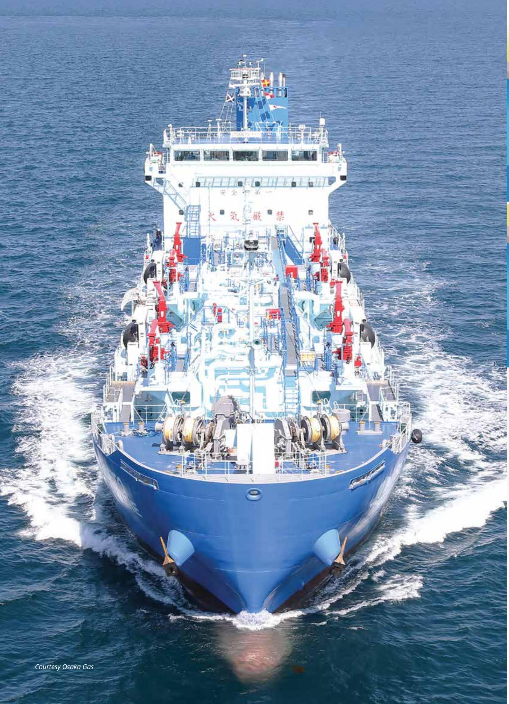

## 封面插图

**找不同？**

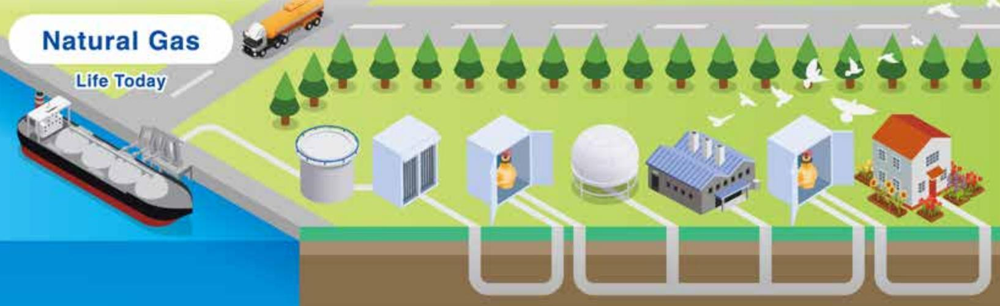

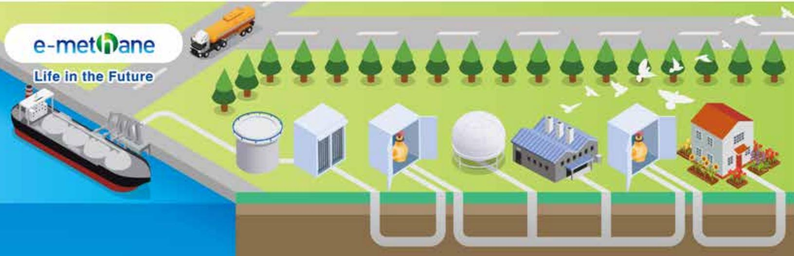

答：没有区别。相同的基础设施。一样的日常生活。电制甲烷可以通过充分利用天然气基础设施帮助实现向可持续世界的无缝过渡

**全球环境价值**

日本天然气行业正在努力制定从海外进口电制甲烷和沼气的国际规则。为了成功部署碳中性气体，日本需要转移环境属性的系统。
日本天然气协会正在采取行动来满足这一需求，包括颁发清洁气体证书，以实现环境属性的转移。

## 国际天然气联盟 (IGU) 主席致辞

我很高兴向大家介绍 IGU 的第 17 版《世界液化天然气报告》，该报告对行业在日益成熟和面临前所未有的挑战时提供了权威而全面的回顾。

该报告探讨了 2025 年液化天然气的里程碑式表现，包括创纪录的贸易量和接近创纪录的供应能力投资。它还讨论了这些成就如何影响市场对 2026 年中东冲突的反应。尽管存在持续的不确定性，但报告确认了强劲的基本面，使液化天然气行业能够在到 2035 年的十年内加强其中期扩张道路。

2025年，全球液化天然气贸易量增长6.3%，达到4.37亿吨，这是自2022年以来最快的增速，加拿大和毛里塔尼亚/塞内加尔加入了出口国行列，而美国提供了大部分增量出口。共新增13个再气化终端，其中一个市场开设了首个液化天然气再气化终端，另外8个潜在市场正在推进再气化项目。

2025年批准的液化产能为 68.4 吨/年，仅略低于创纪录的 2019 年，这证明了投资者的持续信心。这一结果为 2021 年至 2025 年的非凡投资周期画上了句号，其中批准了 206 吨/年的液化产能，是前一个五年期间的两倍。

从液化天然气海上加注的快速扩张到液化项目中低排放技术的整合，不同领域的创新也在持续快速发展。浮式液化天然气技术的成熟度进一步得到证实，2025年产能将达到9.5 Mtpa。

2025 年贸易流量的突出特点是北美出口激增，较上年增加 25.3 公吨，欧洲进口也相应增加，因为欧洲地区重新发挥了核心平衡市场的作用。

2026年，液化天然气贸易现已进入未知领域。海湾地区的冲突损害了液化天然气基础设施，给该地区的扩建项目前景蒙上了阴影，并使亚洲买家面临流动的不确定性和价格上涨的风险。在以往的能源危机中，液化天然气作为宝贵的“减震器”的重要作用正在接受考验。

安德里亚·斯蒂格 (Andrea Stegher) 国际天然气联盟主席

\* 定义为现货货物和一年以下的合同。资料来源：IGU 2026 年批发天然气价格调查

然而市场的反应表明这个行业已经成熟。规模更大、更多元化的供应链能够调动 40% 的现货量*，这有助于遏制霍尔木兹海峡危机的直接影响。全球天然气基准流动性的增加为参与者提供了管理风险的工具。

展望未来，支撑 2035 年液化天然气需求长期前景的基本驱动因素仍然完好无损。人口增长、城市化、数字化、不断增长的电力需求以及对清洁能源系统的持续追求将需要可靠和灵活的能源解决方案，而液化天然气具有独特的优势。

2026 年的挑战是巨大的，但它们不会改变行业的长期轨迹。相反，它们强调了持续投资、创新和国际合作的重要性，以确保液化天然气能够继续向世界各地的社区提供安全、负担得起和低排放的能源。

为了确保这些利益，政策制定者必须采取行动保护能源基础设施、确保航行自由并避免对贸易造成不必要的障碍。

在此背景下，本报告为了解液化天然气行业目前的状况以及未来十年的发展情况提供了及时而实用的参考。它旨在为讨论提供信息、支持决策并提供行业应对挑战的结构化观点。


1. 液化天然气行业状况——2026 年基本面强劲

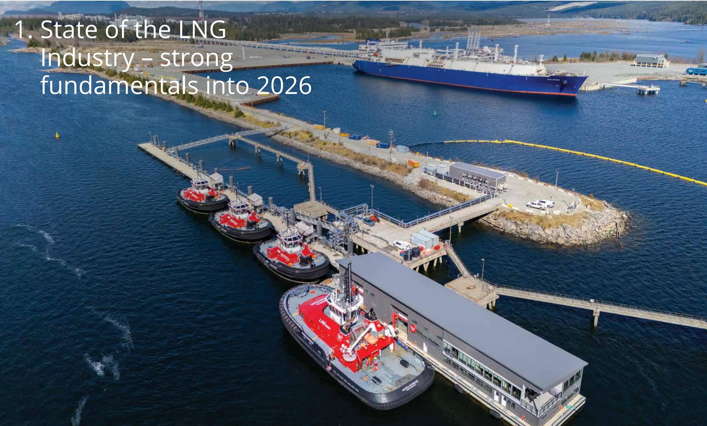  
由加拿大液化天然气公司提供


2025年，全球液化天然气（LNG）贸易量创下43698万吨的新纪录，比2024年增长25.74吨，即6.3%，连接了24个出口市场和50个进口市场。增长主要由美国产量增加推动，同比增加 22.3 公吨，同时卡塔尔、马来西亚、安哥拉和尼日利亚出口增加。加拿大和毛里塔尼亚/塞内加尔也首次实现液化天然气出口，分别增加 2.14 公吨和 1.22 公吨，而转口贸易量基本稳定在 4.91 公吨。

亚太地区1仍然是最大的出口地区，2025年出口量为138.76吨，与2024年基本持平。北美地区出口增长最为强劲，增长了25.3吨，达到113.91吨，主要由美国推动。中东仍然是主要供应地区，在卡塔尔产量增加的支撑下，出口量增加 3.8 吨至 98.03 吨。非洲增加了1.8吨，达到39.77吨，而俄罗斯的出口量下降了3.0吨，达到30.52吨。美国仍然是世界上最大的液化天然气出口国，出口量为110.74吨，其次是卡塔尔，为81.51吨，澳大利亚为80.32吨。

在进口方面，亚太地区仍然是最大的液化天然气进口地区，2025年进口量为168.7吨，比上年增加3.6吨。最大的转变是欧洲重新成为主要需求增长中心，随着该地区取代俄罗斯管道天然气流量的减少并补充储存库存，进口量增加了 26.1 吨，达到 126.2 吨。非洲也成为一个更强大的进口地区，进口量从 2.7 吨增加到 9.8 吨，这几乎完全是由于埃及更高的液化天然气需求。相比之下，亚洲的进口量下降 9.2 公吨，至 108.7 公吨，主要是由于中国和印度的进口量减少。

2025年，中国仍是全球最大的液化天然气进口国，进口量为69.77吨，但由于冬季需求温和、国内天然气产量增加以及从俄罗斯的管道进口增加，进口量同比下降8.9吨。日本是第二大进口国，进口量为 67.37 公吨，与 2024 年基本持平，而韩国进口量增加了 1.7 公吨，达到 48.67 公吨。在欧洲，进口增长基础广泛，其中意大利（+4.4 公吨）、法国（+3.6 公吨）、西班牙（+3.6 公吨）、土耳其（+3.4 公吨）、荷兰（+2.9 公吨）、比利时（+2.5 公吨）和德国（+2.2 公吨）。欧洲的强劲拉动，加上亚洲现货需求的疲软，将更多��大西洋盆地供应转向欧洲，并促进了液化天然气贸易流量区域化的小幅增长。

2026 年第一季度，中东的混乱和霍尔木兹海峡周围风险的加剧改变了近期液化天然气贸易动态。 2025 年，卡塔尔的液化天然气运输量为 81.5 吨，占全球出口量的 18.7%，该地区的供应风险迅速收紧了市场情绪，并加剧了对灵活货物的竞争。亚洲买家将大西洋盆地的货物从欧洲转移出去，突显了当供应安全担忧上升时贸易流量调整的速度有多快，这凸显了随着市场进入 2026 年，灵活的大西洋供应、投资组合优化和目的地灵活性的重要性。

价格趋势
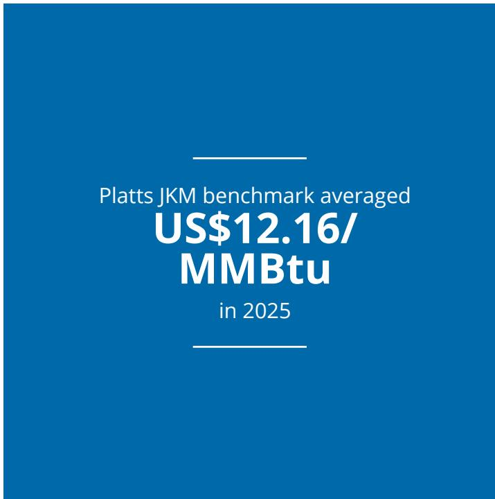

2025年液化天然气价格反映了全球市场日益区域化，亚洲表现出更强的季节性波动，而大西洋盆地仍然供应充足。 Platts JKM 基准平均每百万英国热量单位 (MMBtu) 为 12.16 美元，较 2024 年上涨 2.1%，交易区间更宽，为 9.39 美元至 17.12 美元/MMBtu。价格变动是由季节性需求模式、与天气相关的采购需求以及灵活货物的竞争驱动的。今年经历了两次价格上涨：第一次是在二月初，当时天气转冷和欧洲天然气储存量下降推高了价格；第二次是在六月中旬，当时以色列和哈马斯之间不断升级的紧张局势增加了暂时的地缘政治风险溢价。

在大西洋盆地，今年大部分时间里，强劲的供应和亚洲买家向东的拉动有限，减少了盆地间的竞争。 2025 年，北亚经好望角相对于大西洋的平均套利估计为负 0.71 美元/MMBtu，这表明流向大西洋的流量仍然比流向亚洲的流量更经济。加上运费低迷，这使得大西洋盆地的结构性变长，并加强了欧洲作为过剩液化天然气供应清算市场的作用。欧洲夏季补货不足进一步限制了价格的持续上涨。

2026 年第一季度市场动态发生变化。中东地缘政治动荡减少了可用供应，导致各盆地之间的价差急剧扩大。由于市场参与者对冲供应风险，这引发了对灵活货物的竞争加剧、价格波动加剧以及实物和衍生品交易活动增强。 Platts JKM 于 3 月 3 日上涨近 70%，至 25.39 美元/MMBtu，为 2022 年 12 月以来的最高水平。供应冲击也提振了交易活动，亚洲实物 Platts MOC 交易量在 2026 年第一季度同比增长 77% 至 62 份，而衍生品交易量同比飙升 251% 至 1,744 份合约，因为参与者对冲价格波动和供应风险。

总体而言，液化天然气定价继续朝着流动性更强、全球互联的系统发展。与 2022 年能源危机相比，2026 年的价格反应迄今为止更加有限，反映出市场供应更好、与基准挂钩的流动性更深、以及通过实物和衍生品市场进行更积极的对冲。然而，套利经济学、区域供需平衡和跨流域利差仍然是贸易流动的关键驱动因素，特别是在供应中断期间。

## 液化厂

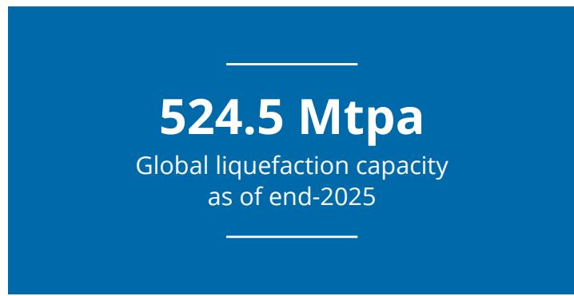

2025 年，全球液化能力每年增长 3010 万吨 (Mtpa)，到年底达到约 524.5 Mtpa。产能增长主要由美国 Plaquemines 液化天然气列车 (15.1 Mtpa)、美国科珀斯克里斯蒂 3 期 (6.0 Mtpa)、加拿大液化天然气 (7.0 Mtpa)、毛里塔尼亚/塞内加尔 Tortue/Ahmeyim 浮动液化天然气 (FLNG) (2.5 Mtpa) 和 Arctic LNG 2 增加 6.6 Mtpa 的增加和调试推动。容量。这些增加部分被澳大利亚、特立尼达和多巴哥以及美国的旧设施退役所抵消。按液化产能计算，美国、澳大利亚和卡塔尔仍然��三大液化天然气出口市场，合计占全球产能的一半以上。尽管装机容量有所增加，但由于维护活动、机械故障、恶劣天气事件以及新启动设施的调试相关挑战，全球利用率略有下降至 83.9%。

液化最终投资决策 (FID) 活动在 2025 年强劲反弹，批准产能为 68.4 Mtpa，这是自 2019 年以来的最高年度水平。在支持液化天然气开发的监管变化之后，大多数 FID 集中在美国。年内达到 FID 的主要项目包括 Woodside Louisiana LNG (16.5 Mtpa)、Calcasieu Pass 2 LNG (14.4 Mtpa)、Port Arthur Phase 2 (13.0 Mtpa)、Rio Grande Phase 2 (12.0 Mtpa) 和 Corpus Christi Midscale Trains 8-9 (3.0 Mtpa)。北美以外，莫桑比克的Coral North FLNG（每年3.6 Mtpa）和阿根廷的Southern Energy FLNG（每年6.0 Mtpa）也达到了最终投资决定，凸显了对灵活的海上液化天然气开发的持续投资兴趣。 2025 年，脱碳和减排继续影响液化项目的发展。开发商越来越多地将电驱动液化系统、可再生能源整合以及碳捕获和存储 (CCS) 解决方案纳入新的液化天然气项目中。 北美和中东的几项拟议开发项目推进了旨在降低生命周期排放强度的低排放项目设计，同时运营商还继续探索整个液化天然气价值链中的生物液化天然气和合成甲烷整合。即便如此，成本通胀、许可复杂性和基础设施限制仍然对一些脱碳举措的实施构成挑战。

今年，浮式液化天然气（FLNG）继续扩大其在全球液化领域的作用。到 2025 年底，全球 8 艘 FLNG 运营产能达到 16.6 Mtpa，这得益于 Tortue/Ahmeyim FLNG 的首批液化天然气生产，该公司于 4 月份出口了第一批货物，到年底利用率达到 90% 左右。莫桑比克和阿根廷的其他浮式开发项目取得进展，Coral North FLNG已达到最终投资决定，预计将使莫桑比克的FLNG产能翻一番，达到约7Mtpa，而Southern Energy FLNG则被批准为阿根廷第一个液化天然气出口项目。总体而言，到 2025 年底，拟议的液化��力将有 172 Mtpa 与 FLNG 开发相关，这反映出人们对模块化海上解决方案的兴趣日益浓厚，这些解决方案可以将搁浅的天然气资源货币化，减少陆上基础设施需求，并提供更短的开发时间表。

技术创新仍然是整个液化行业的重要焦点。模块化和中型液化概念获得了进一步的发展，特别是在北美，开发商越来越多地采用可扩展的列车配置和预制施工方法来提高项目的灵活性和执行力。霍尼韦尔技术继续主导全球液化装机容量，而替代液化技术则扩大了其在新液化天然气开发领域的影响力。随着液化天然气市场的不断发展，技术选择、排放性能和施工效率预计仍将是未来液化项目的关键差异化因素。

2026 年初，尽管出现了新的供应初创企业，但液化基本面仍更容易受到地缘政治风险的影响。 Golden Pass LNG于3月份获得了第一批液化天然气，并于4月22日出口了第一批货物，为市场增加了新的美国供应。然而，霍尔木兹海峡关闭以及卡塔尔和阿联酋液化能力中断后，人们对中东供应的担忧日益加剧，抵消了这一影响。卡塔尔能源公司 (QatarEnergy) 宣布多个液化天然气合同遭遇不可抗力，而两艘拉斯拉凡液化天然气 (Ras Lafan) 液化天然气列车遭受导弹损坏，预计将导致 12.8 Mtpa 的铭牌容量在三到五年内无法运行。这些事态发展收紧了近期供应前景，并凸显了随着市场进入 2026 年，多元化液化产能的重要性。

## 拟议的新液化厂


截至2025年底，全球潜在液化能力有1,105.4 Mtpa仍处于FID前阶段，与2024年基本持平。北美所占份额最大，为650.3 Mtpa，其中美国384.4 Mtpa，加拿大227.3 Mtpa，墨西哥38.6 Mtpa。其次是俄罗斯（170.4 Mtpa）、非洲（121.1 Mtpa）、亚太地区（67.0 Mtpa）和中东（65.7 Mtpa），其他地区约有 31 Mtpa。

在美国有利的投资环境和灵活的商业结构的支持下，拟议的管道仍然集中在北美。在美国，拟议的产能包括大规模墨西哥湾沿岸开发和浮式液化天然气概念，例如 Delfin FLNG。在加拿大，227.3 Mtpa 管道中只有有限的一部分被认为是可行的，其中比较突出的项目包括 Ksi Lisims LNG、LNG Canada Phase 2 和 Cedar LNG。墨西哥拟议的产能仍然以阿尔塔米拉周围的其他 FLNG 概念为中心。在北美以外，俄罗斯保留了一条通过剩余的北极液化天然气 2 号列车、Ob 液化天���气和摩尔曼斯克液化天然气的大量管道，尽管制裁、融资限制和获得西方技术的机会有限仍然对时间表造成压力。

非洲仍然是拟议液化天然气增长的主要来源，以莫桑比克为首，鲁伍马液化天然气、莫桑比克液化天然气和其他离岸液化天然气概念的年产量约为 45 吨。在亚太地区，澳大利亚仍然是拟议区域产能的最大来源，包括惠斯通3-5号线、戈尔贡4号线和阿博特角液化天然气公司，而印度尼西亚的管道由阿巴迪液化天然气公司主导。在中东，拟议的产能集中在伊朗和卡塔尔，另外还有伊拉克和阿曼的项目。

2026 年初的地缘政治发展增加了区域项目时间安排的不确定性，包括北部油田扩建计划。霍尔木兹海峡周围的潜在限制以及卡塔尔和阿联酋液化能力的中断可能会对未来的最终投资决定产生复杂的影响：加剧能源安全担忧并支持供应多元化的兴趣，同时也增加地缘政治风险、成本压力、承包商限制和融资挑战。虽然能源安全担忧可能会支撑对新供应的兴趣，但成本通胀、监管限制、承包商可用性以及 2025 年后更严峻的项目经济状况意味着全球 FID 前的项目预计只有一部分会向前推进。

## 液化天然气运输

## 804 艘船只

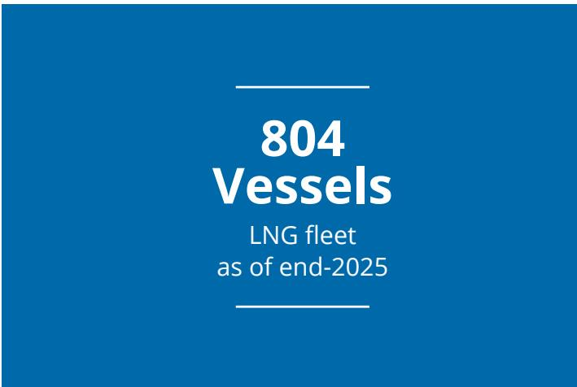

截至 2025 年底液化天然气船队

由于液化天然气供应增长有限与另一波船舶交付浪潮同时发生，2025年液化天然气运输市场仍面临巨大压力。年内共记录了 6,870 艘液化天然气贸易航次，较 2024 年下降 2.8%，反映出大型船舶的使用。相比之下，截至2025年底，现役液化天然气运输船队规模扩大至804艘，其中包括49艘FSRU和11艘FSU，交付79艘，同比增长8.4%。与液化天然气贸易增长相关的船队持续扩张导致市场供应过剩，并在今年大部分时间打压了运费。

在 2025 年的大部分时间里，包机费率仍处于历史低位。现代二冲程船舶的费率经常勉强覆盖运营成本，而一些蒸汽轮机船舶的交易水平等于或低于现金盈亏平衡水平。由于冬季库存、货运延误和美国新液化产能的增加，10 月和 11 月期间出现了暂时的紧缩。在此期间，X-DF和ME-GI船舶的运价恢复到6万美元/天以上，最高时超过10万美元/天，尽管大盘整体仍然疲弱。欧洲对大西洋盆地货物的持续拉动进一步加剧了船舶供应过剩，这导致船舶在区域内受到限制，从而减少了吨英里需求。

贸易路线继续受到物流和地缘政治干扰的影响。尽管与 2023 年严重干旱破坏相比，巴拿马运河状况有所改善，但拥堵和天气相关风险仍然令人担忧。与此同时，红海周围的紧张局势继续阻碍液化天然气运输船通过苏伊士运河，迫使许多大西洋-太平洋航线改道经好望角。尽管如此，与 2022 年和 2023 年市场趋紧相比，过剩的航运运力意味着这些中断对租船费率的影响有限。

在技​​术方面，X-DF推进系统进一步巩固了其作为液化天然气新建船的主导选择的地位。到 2025 年底，大约订购了 185 艘 X-DF 船，而 ME-GA 和 23 艘 ME-GI 则为 47 艘。在 Everllence B&W 于 2024 年底宣布，由于国际海事组织 (IMO) 氮氧化物 (NOx) 法规预计从 2027 年起收紧，它将停止生产 ME-GA 发动机后，势头进一步转向 X-DF 技术。船舶更大、更高效的趋势也在继续，2025 年交付的所有传统液化天然气运输船的运力均超过 170,000 立方米。

展望2026年，霍尔木兹危机给液化天然气运输市场增加了巨大的不确定性，扭转了年初的疲软费率环境，苏伊士以东即期费率从2月初的约14,250美元/天飙升至3月5日的30万美元/天的峰值，随后有所回落，但到4月底仍保持在10万美元/天附近。此次中断还影响了卡塔尔船舶需求的时间和规模，因为北油田东扩容的任何延迟都可能推迟一些近期的吨位需求，尽管一旦项目时间表正常化，对大容量液化天然气运输船的长期需求预计仍然存在。

## 再再气化终端


## 1,113.5 Mtpa

截至 2025 年底全球名义再气化能力

2025年，全球液化天然气再气化基础设施继续扩张，50个市场的总装机容量达到1,113.5 Mtpa。年内，在 13 个市场投产了 20 个再气化项目，其中包括 13 个新终端和 7 个现有设施的扩建。这些新增产能为全球贡献了 62.9 Mtpa 的新增产能。上线的最大项目包括埃及的 Ain Sokhna (Sonkar) FSRU 和 Ain Sokhna (Sumed) FSRU，每个项目的产能均为 5.7 Mtpa，此外约旦的 Aqaba FSRU 产能为 5.7 Mtpa。中国仍然是全球再气化增长的最大贡献者，投产了五个项目，合计���增产能达 15.1 Mtpa。

2025年，新基础设施的构成将继续发展。浮动进口码头仍然是运力增长的重要来源，特别是在优先考虑部署速度、较低的前期成本和供应灵活性的市场中。亚洲新增产量所占份额最大，为 22.2 Mtpa，其次是非洲，为 17.2 Mtpa，欧洲为 11.0 Mtpa，亚太地区为 6.6 Mtpa，中东为 5.7 Mtpa。在新增总量中，42.6 Mtpa 来自新投产的码头，而 20.3 Mtpa 则通过现有设施的扩建而增加。

尽管产能不断增加，但全球再气化利用率仅从 2024 年的 38.5% 小幅上升至 2025 年的 39.2%。区域利用率趋势仍然不平衡。在欧洲，随着俄罗斯管道天然气于 2025 年初停止通过乌克兰运输，液化天然气进口量增加，支持终端利用率的温和复苏。然而，利用率水平仍远低于欧洲天然气供应危机高峰时期的水平。在亚洲，液化天然气需求增长疲弱、国内天然气产量强劲以及来自管道进口、煤炭和可再生能源的竞争继续限制了利用量。

2025年，中国仍是再气化开发最活跃的市场。新项目包括舟山新奥液化天然气3号、上海液化天然气1号、温州华港液化天然气1号、阳江液化天然气和芜湖液化天然气。印度在其拖延已久的防波堤基础设施竣工后，通过 Chhara LNG 的投产和 Dabhol LNG 的扩建，产量增加了 7.1 Mtpa。在整个亚洲，投资继续主要集中于与国内天然气输送系统相结合的大型陆上终端。

欧洲继续扩大液化天然气进口基础设施，但速度慢于 2022 年能源危机后的快速建设时期。德国、克罗地亚、波兰和意大利今年均增加了进口能力。该地区对基于 FSRU 的基础设施的持续偏好反映了与浮动码头相关的灵活性和更短的建设时间。

受埃及通过艾因苏赫纳终端投产恢复液化天然气进口的推动，非洲在 2025 年实现了最强劲的再气化增长。塞内加尔今年还进入了液化天然气进口市场，反映出新兴市场对灵活的天然气供应解决方案的兴趣日益浓厚。在中东，约旦通过亚喀巴FSRU的投产加强了国内天然气供应安全。

截至2025年底，全球在建再气化产能达229.3Mtpa，其中亚洲占在建总产能的一半以上。中国仍然是最大的建筑市场，其次是德国、中华台北和印度。包括尼加拉瓜、伊拉克、塞浦路斯、澳大利亚、加纳、俄罗斯、巴哈马、安提瓜和巴布达在内的几个新兴市场也继续开发其首个液化天然气进口终端，凸显液化天然气基础设施不断扩展到新的进口地区。

尽管多个市场的长期需求基本面仍然具有支撑性，但短期内利用风险仍然存在。价格波动、不确定的天然气需求增长、替代燃料的竞争以及不断变化的能源政策继续影响项目的经济性，特别是在较新的液化天然气进口市场。尽管如此，2026 年第一季度凸显了再气化基础设施的战略价值，因为液化天然气价格波动加剧和供应不确定性增强了对灵活进口能力的需求。欧洲的液化天然气进口需求已经因 2025 年初停止经由乌克兰的俄罗斯管道天然气运输而得到支持，而新兴进口市场则继续开发第一个液化天然气进口终端，以加强供应多元化。在此背景下，全球在建的每年 229.3 Mtpa 的再气化产能提供了重要的能源安全灵活性，尽管近期利用率仍将对液化天然气价格和货物供应敏感。

## 浮式和海上再气化

## 216.1 Mtpa

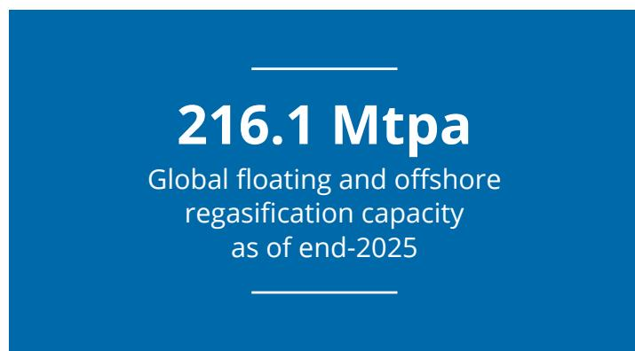

截至 2025 年底全球浮式和海上再气化能力

截至2025年底，全球55个在运再气化项目的浮式和海上再气化产能达到216.1Mtpa，约占全球再气化总产能的19.4%。年内投产了 9 个浮式和海上再气化项目，新增产能 32.6 Mtpa。非洲以 17.2 Mtpa 的增幅领先，主要是由埃及和塞内加尔基于 FSRU 的新项目推动，其次是欧洲（9.4 Mtpa）和中东（5.7 Mtpa）。其中最大的项目包括埃及的 Ain Sokhna (Sonkar) FSRU 和 Ain Sokhna (Sumed) FSRU，以及约旦的亚喀巴 FSRU，每个项目的再气化能力均为 5.7 Mtpa。 FSRU 在支持能源安全和在成熟市场和新兴市场实现灵活的液化天然气进口解决方案方面继续发挥重要作用。

截至 2025 年底，全球有 12 个浮式和海上再气化项目已达到最终投资决定，预计到 2030 年，未来在线产能将达 41.8 Mtpa。欧洲在即将推出的浮式再气化产能中所占份额最大，其次是非洲和拉丁美洲。尼加拉瓜、伊拉克、塞浦路斯、加纳、澳大利亚和俄罗斯等几个新市场也继续开发基于浮动解决方案的液化天然气进口基础设施。浮式和海上再气化基础设施在全球液化天然气贸易中的作用不断扩大，目前有 17 个液化天然气进口市场完全依赖浮式终端，而另外 10 个市场则运营着浮式和陆上再气化设施。

## 液化天然气加注船和码头

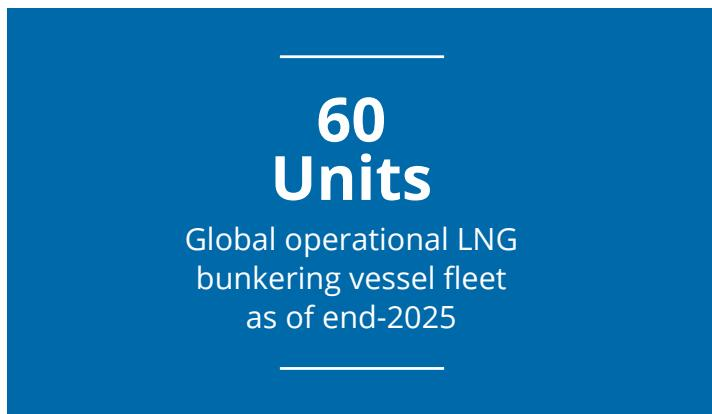

截至 2025 年底全球运营液化天然气加注船船队

在具有竞争力的液化天然气定价、收紧的环境法规和不断发展的加注基础设施的支持下，液化天然气加注量将在 2025 年继续扩大。液化天然气价格在第一季度保持相对较高的水平，然后在今年剩余时间内比竞争船用燃料下降得更快，从而提高了液化天然气作为船用燃料的竞争力。 2025 年 1 月 1 日推出的 FuelEU Maritime 进一步支持了对低碳船用燃料的需求，而生物液化天然气作为未来排放目标的合规解决方案获得了发展势头。

到 2025 年底，全球液化天然气加注船队规模扩大到 60 艘运营船，比 2024 年增加了 4 艘，同时订单量大幅增加至 43 艘在建船舶，总容量达 759,100 立方米 (cm)。按运营能力计算，欧洲仍然是最大的液化天然气加注市场，其次是亚洲和北美。主要港口LNG加注量持续增长，其中新加坡2025年LNG加注量为57.14万吨，同比增长23%，鹿特丹超过99.2万立方厘米，上海达到71.2万立方米。生物液化天然气加注活动也急剧增加，特别是在欧洲，鹿特丹的生物液化天然气数量从 2024 年的 2,775 立方厘米增加到 2025 年�� 17,644 立方厘米，增长了六倍。北美、欧洲和亚洲也得到了更广泛的采用，突显了人们对与现有液化天然气基础设施和发动机兼容的低排放直接燃料解决方案越来越感兴趣。

2026 年第一季度，中东供应中断后，液化天然气加注面临较高的价格波动，增加了燃料经济的短期不确定性。即便如此，在 FuelEU Maritime、收紧排放要求以及生物液化天然气和 RFNBO 液化天然气作为替代低碳燃料的供应不断增加的支持下，该行业的长期驱动因素仍然完好无损。因此，2026 年初的波动增加了成本压力，但并没有改变液化天然气、生物液化天然气和电子液化天然气在海上脱碳中的更广泛作用。

2. 液化天然气行业通往2035年的道路——渡过难关，坚持到底

继 2025 年贸易量创纪录之后，全球液化天然气市场在 2026 年初再次受到冲击。在 COVID-19 大流行和俄罗斯-乌克兰冲突之后，中东冲突不断升级，导致卡塔尔和阿联酋通过霍尔木兹海峡的所有供应暂时丧失，液化天然气基础设施受到直接打击。虽然大多数液化天然气流量应在霍尔木兹海峡重新开放后几个月内恢复，但基础设施损坏和新工厂的延误将影响 2026 年以后的液化天然气供应和价格。尽管 2026 年初发生了戏剧性的事件及其破坏性影响，但液化天然气作为一种比化石能源更灵活且排放强度较低的能源载体的基本优势仍然完好无损。尽管下一波液化天然气供应的到来将有所延迟，而不是取消，但其灵活性对于实现能源安全和减排仍然具有吸引力。随着危机后能源需求持续增长，必须采取更多的最终投资决定以避免长期供应短缺，这可能有利于除现有企业以外的市场，以推动多元化和弹性。

  
由加拿大液化天然气公司提供

## 2.1

# 中东冲突未来几年的影响

冲突之前，液化天然气生产商预计继 2025 年供应量扩张 25.7 公吨之后，2026 年将迎来更强劲的增长时代。相反，这似乎越来越有可能导致贸易同比收缩。尽管持续不断的冲突绝不是困扰液化天然气行业的第一场全球危机，但历史上没有先例。过去的一些危机——例如2011年地震和海啸后的福岛第一核电站事故或2022年的俄罗斯-乌克兰冲突——刺激了短期液化天然气需求和长期产能增加，因为获得竞争性能源在结构上受到限制。 COVID-19大流行扰乱了液化天然气需求，导致价格在2020年暴跌至历史新低，但也引发了疫情后的复苏，在此期间液化无法跟上需求增长，现货价格飙升至历史高位。

与之前的危机不同的是，当前的全球危机正在减少液化天然气供应，并产生连锁反应，造成短期需求破坏。在海峡关闭期间，尽管最近穿过海峡的货物有限，但卡塔尔和阿联酋（这两个国家的液化产能合计占全球液化产能的 15.8%）与全球市场的联系被切断。即使在可能重新开放海峡之后，液化厂受损也会导致运营能力下降，这种情况可能持续三到五年。供应中断导致亚洲和欧洲的价格上涨，并引发了相应程度的短期需求破坏。

截至撰写本文时，解决冲突的途径和时间表仍不确定。尽管如此，一旦敌对行动停止并且贸易流动可靠地恢复，随着新产能和运营优化相结合以补偿现有基础设施的损坏，液化天然气市场有望正常化。其结果将是回到危机前价格下跌和需求增长的轨迹，除非爆发冲突、更广泛的基础设施损坏或长期需求破坏。因此，2026 年最终可能被视为推迟而非显着改变液化天然气行业扩张的一年。

## 2.2

## 危机后之路——通向 2035 年之路

尽管地缘政治阻力持续存在，但全球能源需求预计将继续其长期增长轨迹，特别是在人口增长、使人们摆脱贫困以及人工智能应用和数据中心容量扩张的推动下的电力消耗。鉴于天然气发电的可调度性和平衡可变发电的能力，在可再生能源渗透率不断提高的电力系统中，临时供应中断和价格波动不会降低燃气发电的系统价值。同样，液化天然气的排放强度低于煤炭和石油，这一因素从长远来看仍然具有相关性，尽管在市场压力时期供应安全考虑往往占主导地位。这些结构特征支持液化天然气继续作为成熟市场和新兴市场全球能源结构的关键组成部分。随着更多且更多样化的液化天然气供应进入市场，可用性的提高预计将提高其相对承受能力，并增强这种灵活能源载体的前景。

假设 — — 并承认当前中东冲突的解决存在重大不确定性 — — 地缘政治紧张局势及时且持久地正常化，预计到 2030 年，液化产能和在建产能合计将超过 700 吨，比 2025 年水平增加 40%。相关产量增长预计将超过液化天然气进口增长，导致暂时的市场供应过剩，并导致现货价格面临美国墨西哥湾沿岸液化能力短期边际成本（SRMC）的下行压力。从 2030 年代中期左右开始，随着需求增长吸收增量供应，全球液化天然气市场预计将重新平衡。由于需求最终超过液化天然气供应，长期价格形成预计将受到平衡市场所需的边际供应的长期边际成本（LRMC）的影响。


图2.1：2010-2035年全球液化天然气供应发展和需求前景
  
资料来源：Rystad Energy 图 2.1 已更新至 2026 年 6 月的数据，以反映近期的 FID

在建或批准开发的234.3 Mtpa液化产能中，约47.8%位于美国，卡塔尔占另外20%。虽然美国在全球拟建液化产能中所占份额最大，达到 34.8%，但在地缘政治不确定性加剧的情况下，更加注重供应多元化可能会为加拿大、莫桑比克或阿根廷等国拟建项目提供额外动力。最终达成最终投资决策（FID）的拟议项目的数量和构成将取决于危机驱动的需求动态对长期市场增长预期的影响程度。如果液化天然气定价条件变得更加有利���无论是通过燃料转换还是工业削减，近期需求破坏可能是可逆转的。相比之下，加速可再生能源的部署或推迟燃煤发电的退役可能会导致未来液化天然气需求增长的持续下降。新兴经济体（尤其是南亚和东南亚部分地区）的液化天然气需求增长可能在价格长期持续上涨的情况下受到最大影响。

图 2.2：1990-2031 年全球液化能力发展12.2
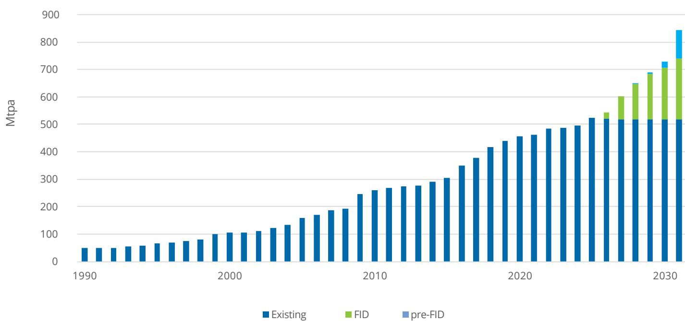  
资料来源：Rystad Energy

## 2.3

# 一路上的机遇和不确定性

上述液化天然气市场前景基于一系列基本假设，尤其是中东冲突的持久解决，尽管这种结果的时间和稳定性仍然高度不确定。除了地缘政治发展之外，还应考虑其他几个因素，每个因素都可能对液化天然气行业的长期轨迹产生重大影响，无论是积极还是消极。

## 机遇——前沿市场

尽管地缘政治阻力持续存在，液化天然气仍在地理和最终用途领域不断扩张。液化天然气在国家能源平衡中发挥着越来越大的作用，无论是作为国内天然气资源货币化的手段，还是作为支持安全和价格有竞争力的能源供应的手段。与此同时，液化天然气加注继续扩大燃料在海事领域的应用。

2025年新增2个出口市场，即加拿大和毛里塔尼亚/塞内加尔。在进口方面，与2024年相比，塞内加尔和巴林是2025年新增的两个液化天然气进口市场。预计还有8个市场将在2026年至2028年期间开始液化天然气进口。

浮动基础设施解决方案预计将在实现这一扩张中发挥重要作用，这反映出它们的部署时间较短、运营灵活性和相对较低的前期资本要求。截至 2025 年底，计划于 2028 年开始液化天然气进口的新进口市场中，约 75% 计划利用浮动进口码头，而拟议的液化能力约 170 Mtpa 与 FLNG 开发相关。

## 机遇——电力需求增长

不断增长的电力需求仍然是天然气需求前景的主要驱动力。在许多市场，能源转型的叙述正日益演变为能源增加之一，可再生能源容量的增加主要满足增量电力需求，而不是显着取代现有的火力发电。特别是在快速电气化的经济体中，保持多元化的能源结构仍然很重要，燃气发电继续受益于其灵活性以及通过可靠的负载匹配能力补充可变可再生能源发电的能力。

数据中心需求也逐渐成为电力增长的一个日益重要的来源。部署速度、可靠性、成本竞争力和运营灵活性的结合继续支撑着燃气发电在该领域的吸引力。与此同时，燃气发电与电池存储系统的集成作为为数据中心开发提供并网或专用电力的潜在解决方案而受到关注。

## 机会 – 创新

为了在高度不确定的世界中蓬勃发展，优先事项在能源安全、可负担性和可持续性之间摇摆，持续创新对于液化天然气行业仍然至关重要。虽然液化天然气已经通过替代高排放燃料（例如发电中的未减排煤炭和航运中的燃油）为减排做出了贡献，但价值链排放强度的进一步改善可以帮助解决可持续性问题并加强液化天然气在全球能源系统中的作用。一系列新兴技术预计将支持进一步减排，同时提高整个液化天然气价值链的运营效率。

## 图 2.3：2017-2031 年全球 FLNG 产能发展

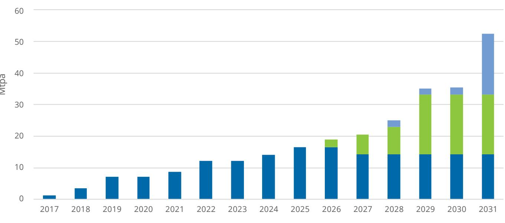  
资料来源：Rystad Energy

表2.1：LNG项目关键减排技术


```html
&lt;table&gt;&lt;tr&gt;&lt;td&gt;技术&lt;/td&gt;&lt;td&gt;减排&lt;/td&gt;&lt;td&gt;现状&lt;/td&gt;&lt;/tr&gt;&lt;tr&gt;&lt;td&gt;与液化天然气相关的CCS&lt;/td&gt;&lt;td&gt;在上游过程中或液化过程中燃烧后提取二氧化碳&lt;/td&gt;&lt;td&gt;液化天然气相关的碳捕获和封存（CCS）被越来越多地认为是一种关键的脱碳途径，是首创的由挪威的 Hammerfest LNG 建造，并已在多个地点进行整合，包括澳大利亚的 Gorgon LNG 和卡塔尔的 Ras Laffan。由于燃烧后捕获的成本特别高，因此在设计过程的早期考虑时，它对于新的开发是可行的。即将推出的 CCS 计划包括 Venture Global 的 Plaquemines LNG 和 Calcasieu Pass LNG，以及印度尼西亚的 Abadi LNG。&lt;/td&gt;&lt;/tr&gt;&lt;tr&gt;&lt;td&gt;液化天然气压缩电气化&lt;/td&gt;&lt;td&gt;降低压缩过程的排放强度&lt;/td&gt;&lt;td&gt;当采用核能、水力或固定可再生能源等无排放来源作为燃料时，该技术可以完全消除压缩排放。 从运营角度来看，电力驱动具有减少原料气摄入量和逸散性甲烷排放的额外优势，但代价是更容易停电。美国 Freeport LNG 等老牌工厂已经实施了全电动配置，美国 Texas LNG、加拿大 LNG、Woodfibre 和加拿大 Ksi Lisims 等规划项目也计划采用该技术。&lt;/td&gt;&lt;/tr&gt;&lt;tr&gt;&lt;td&gt;生物液化天然气和液化电制甲烷&lt;/td&gt;&lt;td&gt;用可再生或合成气体替代天然气&lt;/td&gt;&lt;td&gt;化学性质与传统液化天然气相同，生物液化天然气和液化电制甲烷完全可与现有基础设施互操作。虽然它目前比化石来源液化天然气有溢价，但它可以帮助难以减少碳排放的行业脱碳，尤其是生物液化天然气开始在北美、欧洲和亚洲得到更广泛的采用。全球“e-NG”联盟的成员包括壳牌、TotalEnergies 和 INPEX 等全球重量级企业，预计到 2031 年，电制甲烷的产能将达到约 1.2 吨。电制甲烷、成本竞争力和规模化生产仍然是关键挑战。&lt;/td&gt;&lt;/tr&gt;&lt;/table&gt;
```


## 不确定性 – 地缘政治和全球运输路线

霍尔木兹海峡位于伊朗和阿曼之间，被广泛认为是全球最重要的液化天然气海上咽喉要道。潜在的干扰不仅限于这条走廊，因为其他战略过境路线仍然面临地缘政治紧张局势，在某些情况下还面临气候变化的影响。曼德海峡——苏伊士运河走廊，通过红海连接亚丁湾和地中海，在持续发生涉及胡塞叛军威胁的安全事件后，该海峡的交通尚未完全正常化。巴拿马运河是美国液化天然气货物运往亚洲市场的重要航线，也表现出容易受到非地缘政治干扰的影响，尤其是在 2023 年影响加通湖的干旱期间，船舶过境受���限制。除了这些海上阻塞点外，涉及开放水域液化天然气运输的事件，包括近年来报道的液化天然气运输船袭击事件，凸显了全球液化天然气贸易流更广泛地面临安全相关风险。

## 不确定性 - 政策

此前对政策风险的评估主要集中在排放监管和贸易限制上。虽然这些仍然是核心考虑因素，但未来几年另一个维度可能会变得更加突出。在澳大利亚、东南亚部分地区和美国等液化天然气出口市场，确保充足的国内供应和限制全球液化天然气价格波动之间的紧张关系可能会出现。如果及早发现，这些挑战可以通过适当的市场设计和监管框架来解决。即便如此，突然或反应性的政策反应可能会增加不确定性，并阻碍对液化天然气基础设施和供应能力的投资，而这些基础设施和供应能力是支持系统应对未来供应问题的弹性所必需的。与此同时，当前供应紧张和价格上涨的环境可能会促使亚洲新兴市场重新评估能源政策，从而可能影响长期液化天然气需求增长的速度和轨迹。

## 不确定性 – 替代供应和项目风险

液化天然气供应的长期中断可能不仅会增加人们对替代能源的兴趣，而且还会增加人们对补充天然气供应选择的兴趣。在一些市场，之前逐步取消的国内生产可能会重新审视，这可能会抵消部分液化天然气进口需求。另一个不确定性涉及俄罗斯管道天然气可能返回欧洲，或出口基础设施的加速发展，例如向中国出口的西伯利亚力量2。此类发展可能会减缓未来液化天然气进口增长，并影响选定液化项目的商业前景。

液化天然气项目在地缘政治发展、贸易政策动态、通胀压力以及劳动力和供应链限制等不断变化的风险中继续运营。即使中东冲突在2026年得到解决，物流和供应链的全面调整仍需要一段正常化的时间。与此同时，包括Arctic LNG 2、Portovaya LNG和Vysotsk LNG在内的俄罗斯液化天然气设施继续受到制裁相关限制的影响。

＃＃ 概括

总之，液化天然气行业进入未来十年，将受到广泛的结构性增长驱动因素以及成熟市场和新兴市场不断扩大的机会的支持。持续的地域多元化、浮动基础设施解决方案的规模化以及新进口市场的出现，凸显了液化天然气在全球能源安全和发展中日益重要的作用。与此同时，不断增长的电力需求（尤其是电气化趋势和数据中心的增长）增强了液化天然气作为可再生能源系统灵活可靠补充的价值。

整个价值链的持续创新正在进一步提高液化天然气的环境绩效和运营效率，支持其在不断发展的脱碳路径中的地位。尽管地缘政治、政策和项目相关的不确定性仍然是经营环境的一部分，但该行业的适应性和持续的投资动力表明了具有弹性和建设性的长期前景。总体而言，液化天然气处于有利地位，仍将是全球能源系统的核心支柱，在快速变化的能源格局中提供可负担性、安全性和灵活性。

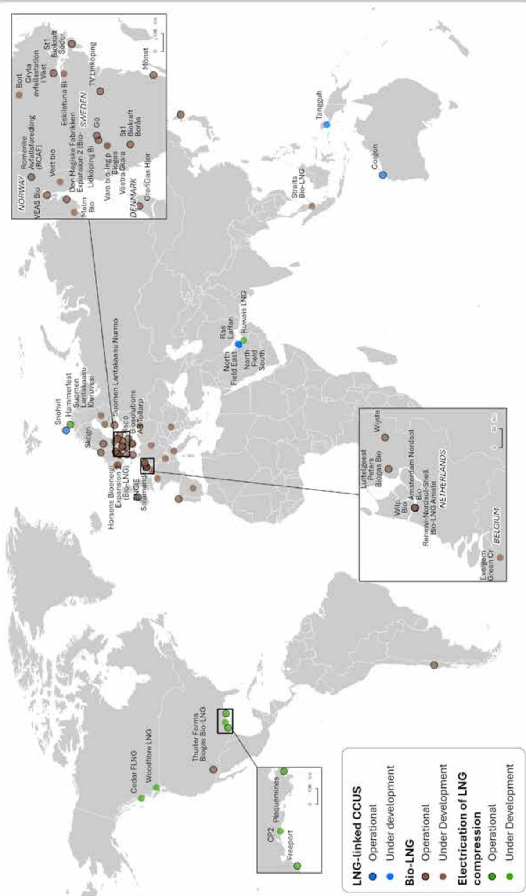  
项目 列表 may 不 be exha rce： Rystad Ene
图2.4：液化天然气行业减排技术类型图


##

## 液化天然气贸易

2025 年全球液化天然气贸易量将增至创纪录的 437.0 公吨，增幅为 25.7 公吨。

2025 年，美国仍是最大出口国，出口总量为 110.7 公吨（较 2024 年增加 22.3 公吨）

卡塔尔成为第二大出口国，出口 81.5 公吨

澳大利亚出口 80.3 公吨

俄罗斯仍然是世界第四大出口国，出口量为 30.5 公吨

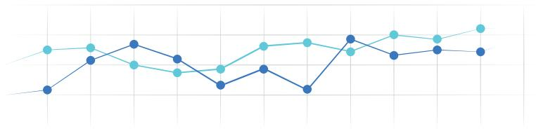

中国继续保持第一大进口国地位

进口量 69.8 公吨（与 2024 年相比为-8.9 公吨）


日本进口 67.4 公吨（与 2024 年相比-0.4 公吨）

全球最大的液化天然气贸易流动路线仍然是亚太地区内部贸易 101.8 吨

该图仅代表前 10 名出口商和前 10 名进口商之间的贸易流量。

## 3. 液化天然气贸易

2025 年，全球液化天然气贸易量将增长至 4.3698 亿吨，来自 24 个出口市场，并销往 50 个进口市场。 2025 年的再出口装载量基本稳定在 4.91 公吨，而 2024 年为 4.96 公吨。2025 年的高水平变化包括北美出口量急剧增加（+25.3 公吨）、中东出口量增加（+3.8 公吨）以及进口需求显着转向欧洲（+26.1 公吨），而亚洲的净进口量下降（-9.2 Mt）和非洲的进口强劲增长（+7.2 Mt），这主要是由于埃及的更高要求。

  
由商船三井航运公司提供

## 3.1 概述

2025 年液化天然气贸易增长 25.74 公吨，主要是由于美国（+22.3 公吨）、卡塔尔（+4.3 公吨）、马来西亚（+1.1 公吨）、安哥拉（+1.1 公吨）和尼日利亚（+1.0 公吨）产量增加​​推动，而加拿大（+2.1 公吨）和毛里塔尼亚/塞内加尔（+1.2 公吨）则首次实现液化天然气出口。在进口方面，去年的进口量主要转移到欧洲和非洲，其中意大利（+4.4公吨）、法国（+3.6公吨）、西班牙（+3.6公吨）、土耳其（+3.4公吨）、荷兰（+2.9公吨）、比利时（+2.5公吨）、德国（+2.2公吨）、中国台北（+2.3公吨）和埃及（+6.9公吨）记录最大收益。最显着的下降来自中国（-8.9 公吨）和印度（-1.5 公吨），这表明继 2024 年强劲反弹之后，2025 年亚洲拉力将放缓。

2025 年，亚太地区 1 仍是最大的液化天然气出口地区，出口量为 138.76 公吨，仅略高于 2024 年的 138.91 公吨。北美的年度增长最为强劲，出口量猛增 25.3 公吨，达到 113.91 公吨。中东按绝对值计算仍是第三大出口地区，但大幅增加了 3.8 公吨，使年出口量达到98.03 公吨，非洲出口量也增加了 1.8 公吨，达到 39.77 公吨，而前苏联则下降了 3.0 公吨，达到 30.52 公吨。

2025 年，美国以 110.74 公吨引领全球液化天然气出口，较 2024 年的 88.42 公吨大幅上升，卡塔尔紧随其后，从 77.23 公吨攀升至 81.51 公吨。澳大利亚仍是第三大出口国，但其出口量从 81.04 公吨小幅下滑至 80.32 公吨。

## 2025 年 3.0 公吨至 30.52 公吨，而马来西亚出口量增加至 28.80 公吨。

2025年，亚太地区再次成为最大的液化天然气进口地区，增长3.6吨，达到168.7吨。不过，2025年的关键区域转变是欧洲重新成为液化天然气需求的第二主要增长中心。欧洲进口量增加 26.1 公吨，达到 126.2 公吨，扭转了 2024 年的大部分跌幅。相比之下，亚洲进口量下降 9.2 公吨，达到 108.7 公吨，主要是由于中国、印度以及泰国和巴基斯坦等其他亚洲新兴市场的净进口量下降。到 2025 年，非洲也成为更重要的液化天然气进口地区，进口量从 2.7 吨增至 9.8 吨，这几乎完全是由于埃及对液化天然气货物的需求更加强烈。

2025年，中国仍是全球最大的液化天然气进口国，但受年初季节性需求温和、国内产量增加以及俄罗斯通过西伯利亚力量管道增加管道供应的推动，进口量大幅下降8.9吨至69.77吨。日本是第二大进口国，进口量为 67.37 公吨，与去年同期基本持平，而韩国的进口量增加了 1.7 公吨，达到 48.67 公吨。到 2025 年，这三个市场仍占全球液化天然气进口量的 42.6%。意大利、法国、西班牙、土耳其、荷兰、比利时和德国引领了来自欧洲的进口拉动强劲，而埃及的进口量增加反映了液化天然气下降的综合影响。国内生产，从以色列进口的管道天然气减少以及天然气需求增加。


```html
&lt;table&gt;&lt;tr&gt;&lt;td&gt;全球和区域趋势&lt;/td&gt;&lt;td&gt;液化天然气出口商&lt;/td&gt;&lt;td&gt;液化天然气进口商&lt;/td&gt;&lt;td&gt;液化天然气再出口&lt;/td&gt;&lt;/tr&gt;&lt;tr&gt;&lt;td&gt;2025年全球液化天然气贸易量创下436.98吨新纪录，较2024年增长6.3%&lt;/td&gt;&lt;td&gt;美国（+22.3 公吨）和卡塔尔（+4.3 公吨）推动 2025 年出口增长&lt;/td&gt;&lt;td&gt;中国（-8.9 公吨）和印度（-1.5 公吨）2025 年进口降幅最大&lt;/td&gt;&lt;td&gt;2025 年转口总量达 4.91 公吨&lt;/td&gt;&lt;/tr&gt;&lt;tr&gt;&lt;td&gt;全球液化天然气贸易增长2025 年 25.74 公吨&lt;/td&gt;&lt;td&gt;加拿大（2.14 公吨）和毛里塔尼亚/塞内加尔（1.22 公吨）首次实现液化天然气出口&lt;/td&gt;&lt;td&gt;埃及（+6.9 公吨）、意大利（+4.4 公吨）、法国和西班牙（+3.6 公吨）进口增幅最大&lt;/td&gt;&lt;td&gt;亚太地区和欧洲占主导地位转口装载量分别为 2.0 公吨&lt;/td&gt;&lt;/tr&gt;&lt;tr&gt;&lt;td&gt;欧洲净进口量变化最大（+26.10 公吨），而亚洲下降（-9.24 公吨）&lt;/td&gt;&lt;td&gt;俄罗斯出口降幅最大（-3.0 公吨）&lt;/td&gt;&lt;td&gt;亚太地区仍然是最大的进口地区，进口量为 168.7 公吨&lt;/td&gt;&lt;td&gt;亚洲是最大的转口接收国（1.61 公吨），其次是亚太地区（1.55 公吨）和欧洲（1.46 公吨）&lt;/td&gt;&lt;/tr&gt;&lt;tr&gt;&lt;td&gt;北美地区出口增幅最大（+25.3 公吨至 113.91 公吨）&lt;/td&gt;&lt;td&gt;美国（110.74 公吨）、卡塔尔（81.51 公吨）和澳大利亚（80.32 公吨）是 2025 年最大的液化天然气出口国&lt;/td&gt;&lt;td&gt;欧洲录得最强劲的地区进口增长（+26.1 公吨至 126.2 公吨）&lt;/td&gt;&lt;td&gt;再出口占全球液化天然气贸易的 1.1%&lt;/td&gt;&lt;/tr&gt;&lt;/table&gt;
```


资料来源：Rystad Energy

  
1 参见第9章区域和盆地定义

## 3.2 按市场划分的液化天然气出口

图 3.1：2025 年按出口市场划分的液化天然气出口量（百万吨）和市场份额（%）
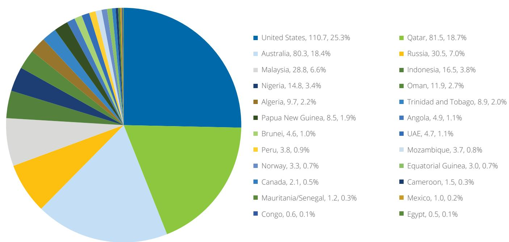  
资料来源：Rystad Energy

到2025年，美国将大幅扩大其作为全球最大液化天然气出口国的领先地位，总量为110.74吨，相当于全球液化天然气产量的25%，比上年增加22.3吨。这一增长表明可用出口能力的大幅扩张和利用率的提高，仅美国就占了 2025 年全球增长的绝大多数。这也大幅提升了北美在全球液化天然气贸易中的份额，并重塑了区域间流动，特别是流向欧洲的流动。

图 3.2：2025 年各市场液化天然气出口量相对 2024 年的变化（公吨）
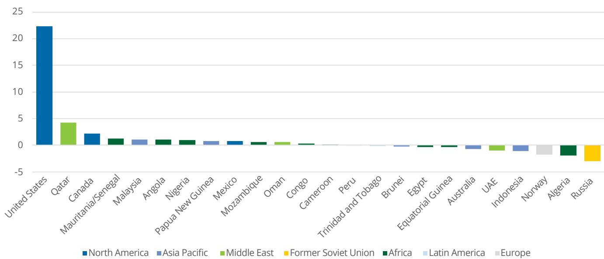  
资料来源：Rystad Energy

卡塔尔到 2025 年将成为全球第二位，出口量为 81.51 吨，比 2024 年增加 4.3 吨，相当于全球出口量的 19%。卡塔尔的高利用率得益于中央枢纽优化、上游和中游综合控制，以及 North Field East (NFE) 启动前的优化，这支持了市场在 2026 年初两列列车被毁之前以接近或超过铭牌容量运行的能力。澳大利亚排名第三，为 80.32 吨，同比下降 0.7 吨，但仍占全球供应量的 18%。到 2025 年，三大出口国合计将满足全球 62% 的液化天然气供应量。

俄罗斯在主要出口国中名义降幅最大，2025年下降3.0公吨至30.52公吨。阿尔及利亚也出现大幅下降，下降1.9公吨至9.70公吨，而印度尼西亚则下滑1.1公吨至16.55公吨。相比之下，马来西亚出口量增加1.1公吨至28.80公吨，尼日利亚增加1.0公吨至2025年。 14.78 公吨，阿曼增加了 0.5 公吨至 11.85 公吨。

加拿大和毛里塔尼亚/塞内加尔的新供应量在 2025 年也很突出，在数据集中可衡量出口的第一年，加拿大达到 2.14 公吨，毛里塔尼亚/塞内加尔达到 1.22 公吨。尽管俄罗斯总体供应量同比下降，但北极液化天然气2号仍于2025年实现了首次交付贸易。

2025 年，出口地区之间的平衡发生了重大变化。亚太地区仍然是最大的出口地区，达到 138.76 公吨，但同比增长几乎持平。北美地区的产量增长幅度迄今为止最大，从 2024 年的 88.64 公吨增至 113.91 公吨，这主要是由美国推动的，并受到加拿大首次出口以及墨西哥产量增加的支持。中东地区也出现了强劲增长，增加了 3.8 公吨，达到 98.03 公吨，这主要是由于卡塔尔流量增加。尽管阿尔及利亚和埃及的出口量下降，但由于尼日利亚、安哥拉、莫桑比克和毛里塔尼亚/塞内加尔供应量增加，非洲出口量升至 39.77 公吨。

在投资组合优化、套利机会和目的地灵活性的推动下，2025 年再出口量基本稳定在 4.91 公吨左右，相当于全球液化天然气贸易量的 1.1% 左右。进行转口装载的市场数量仍限于13个，与2024年持平。欧洲和亚太地区继续占据主导地位，这两个地区均占41%，而亚洲则贡献14%。印度尼西亚仍然是最大的单一再出口装载市场，达到 0.85 公吨，其次是西班牙（0.77 公吨）、中国（0.67 公吨）、韩国（0.65 公吨）、比利时（0.52 公吨）和新加坡（0.48 公吨）。马来西亚和多米尼加共和国于2025年加入转口装载机名单。

接受转口的市场仍然集中在亚洲、亚太地区和欧洲。中国是最大的转口接收国，为 0.90 公吨，其次是日本，为 0.69 公吨，孟加拉国为 0.54 公吨。从地区角度来看，2025 年亚洲接收了 1.61 公吨的转口货物，略高于亚太地区的 1.55 公吨和欧洲的 1.44 公吨。与 2024 年相比，转口接收活动在三个主要目的地的分布更加均匀地区，其中欧洲与亚洲市场一起保持着相当大的份额。

3.3图 3.3： 再出口 装载 按 再装载 市场 (Mt) 及 市场 共享 (%) 在 &lt;子&gt;2025&lt;/子&gt;
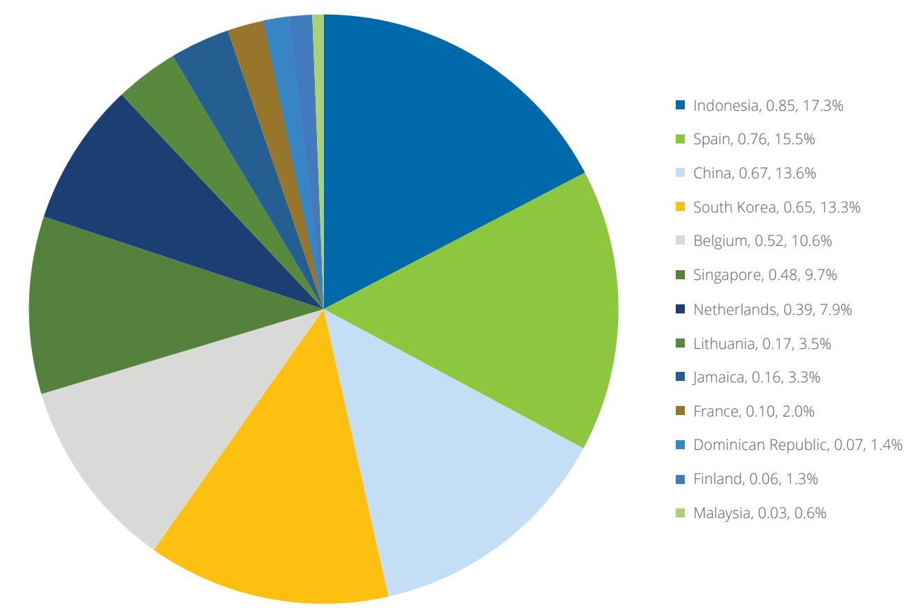  
资料来源：Rystad Energy

图 3.4：20253.4 年按接收市场划分的转口贸易量（百万吨）和市场份额（%）
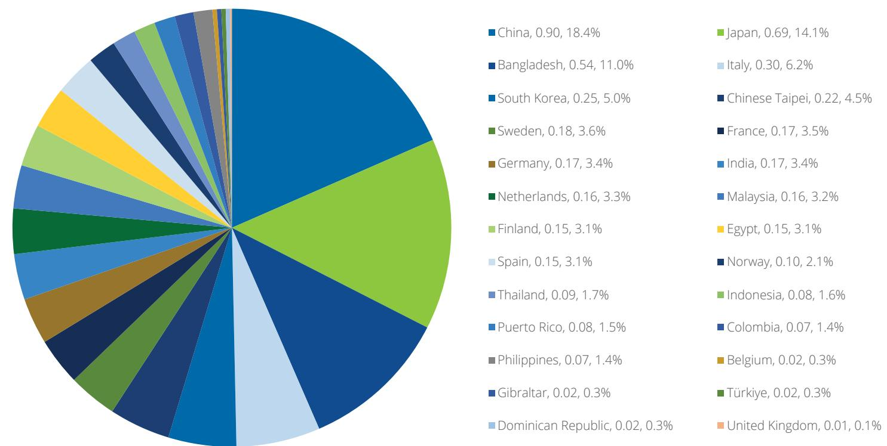  
资料来源：Rystad Energy


## 3.3

# 按市场划分的液化天然气净进口量

2025年，全球有50个市场接收液化天然气进口。中国仍保持最大进口国的地位，尽管进口量大幅下降8.9公吨，至69.77公吨。这是进口市场中同比降幅最大的一个，标志着2025年需求侧的关键发展之一。中国进口量的疲软是亚洲净进口收缩的一个主要因素，并有助于释放欧洲和其他市场的货物。

日本是第二大进口国，进口量为 67.37 公吨，同比基本持平。韩国进口量增加 1.7 公吨，至 48.67 公吨。中华台北是亚洲进口国中增幅最大的国家之一，进口量增加 2.3 公吨，至 24.17 公吨，而印度进口量下降 1.5 公吨，至 24.60 公吨。巴基斯坦的进口量也出现下降，下降了 0.8 公吨。至 6.46 公吨，表明 2025 年南亚需求与上一年相比更加受限。

由于需要补充因乌克兰天然气运输到期而损失的俄罗斯天然气量以及冬季大量储存的撤出，欧洲在 2025 年出现了大幅反弹。该地区最大的液化天然气进口国法国增加了3.6吨至21.64吨。西班牙增加了3.6吨至16.92吨，意大利增加了4.4吨至15.08吨，土耳其增加了3.4吨至12.43吨，荷兰增加了2.9吨至16.26吨，比利时增加了2.5吨至 9.28 公吨，德国增长 2.2 公吨至 7.07 公吨。英国也小幅增长 1.2 公吨至 9.27 公吨，而波兰的进口量增长 1.3 公吨至 6.22 公吨。总而言之，这些变化表明，继 2024 年进口疲软之后，欧洲对 2025 年液化天然气的需求大幅增强，而新增量主要由北美供应。

埃及是欧洲以外进口市场中最重要的推动者。 2025年，液化天然气流入市场猛增6.9吨至9.56吨，成为今年全球液化天然气市场最显着的变化之一。这反映出埃及需要获得更多液化天然气货物以支持国内市场。相比之下，巴西的进口量下降了 0.7 公吨，至 2.19 公吨，而拉丁美洲的进口量与 2024 年相比普遍疲软。

菲律宾和越南在前几年首次进入市场后，2025年进口量继续增加，分别增至1.85公吨和0.53公吨。孟加拉国也强劲增长1.9公吨至7.87公吨，而新加坡增加0.4公吨至6.66公吨。科威特基本稳定在7.33公吨，中东的进口量总体同比变化不大。

图 3.5: LNG 进口 按 接收 市场 (Mt) 和 市场 份额 (%) in 20253.5
  
资料来源：Rystad Energy

从地区层面来看，亚太地区在 2025 年仍然是最大的液化天然气进口地区，进口量为 168.7 吨，占全球总量的 38.6%，高于 2024 年的 165.1 吨。欧洲成为第二大地区，进口量为 126.2 吨，占全球总量的 28.9%，较 2024 年的 100.1 吨大幅上升，而亚洲则下滑至 108.7 吨。公吨或24.9%。亚洲和亚太地区的总进口份额仍占全球液化天然气进口的 63.5%，尽管由于中国和印度需求疲软以及欧洲的重新拉动，这一数字低于 2024 年。亚太地区的增长得益于日本的稳定进口、韩国和中国台北的进口量增加以及新兴东南亚市场的持续增长。

欧洲2025年的进口强劲反映了意大利、法国、西班牙、土耳其、荷兰、比利时、德国和英国的液化天然气吸收量普遍上升，表明该地区对海运天然气的需求比2024年更加强劲。相比之下，亚洲的下降主要是由于中国和印度的净进口量下降所致。拉丁美洲的液化天然气进口量下降了 2.0 公吨，至 11.0 公吨，而中东则减少了 0.4 公吨，至 9.4 公吨。相比之下，非洲则强劲增长至 9.8 公吨，几乎完全是由于埃及进口需求大幅上升所致。

图 3.6：2025 年各市场液化天然气进口量相对 2024 年的变化（百万吨）
  
资料来源：Rystad Energy

## 3.4

## 液化天然气区域间贸易

2025 年，全球液化天然气贸易的区域集中度仍然很高，尽管贸易流向因目的地而发生重大变化。亚太地区的货物吸收总量从 165.0 公吨增至 169.2 公吨，而欧洲的进口总量从 101.1 公吨大幅攀升至 126.7 公吨。相比之下，亚洲的进口总量从 117.6 公吨下降至 107.8 公吨。因此，亚太地区保留了全球进口的最大份额，而欧洲在 2024 年进口量疲软后重新成为目的地地区的重要性。

总体而言，这些转变表明 2025 年液化天然气贸易的区域化将小幅增长，​​大西洋盆地的供应（尤其是来自北美的供应）越来越多地流向欧洲，而亚太地区的需求更多地通过区域内和中东的出口来满足。

2025 年，亚太地区的液化天然气流量继续主导液化天然气贸易，总量为 101.8 吨，高于上一年的 96.8 吨。澳大利亚、马来西亚和印度尼西亚的出口仍然支撑着区域内贸易。亚太地区内部贸易的增长得到了来自中东和非洲的稳定或略有增加的流入的补充，而该地区从北美的进口量从 19.2 公吨下降到 15.9 公吨。这表明亚太地区的供应仍然充足，但北美增量产量的较大份额被转移到其他地方，主要是欧洲。

北美对欧洲的出口在 2025 年成为主要的区域间贸易路线，从 2024 年的 46.3 吨激增至 74.1 吨。这是迄今为止所有区域间贸易走廊中最大的变化，反映了美国出口供应的强劲增长和欧洲液化天然气需求的复苏。数据显示，北美，尤其是美国，将成为 2025 年欧洲的主要平衡供应国。欧洲从非洲的进口量也从 18.2 吨增加到 22.4 吨，而从俄罗斯的进口量从 16.9 吨下降到 14.0 吨，从中东的进口量从 10.6 吨下降到 9.1 吨。

到 2025 年，中东和亚洲之间的贸易仍然是全球最大的液化天然气航线之一，从 46.0 吨增加到 49.8 吨。这证实了中东在供应亚洲市场方面继续发挥核心作用，特别是在卡塔尔出口增加的情况下。与此同时，亚洲从亚太地区的进口量从 41.8 吨下降到 36.8 吨，从北美的进口量从 10.3 吨下降到 5.1 吨。非洲到亚洲的进口量也从 10.0 吨下降到 7.7 吨。这些变化与中国和印度净需求疲软以及灵活货物从亚洲的重新分配相一致。

中东对亚太地区的出口量从 32.2 公吨小幅上升至 32.5 公吨，俄罗斯对亚太地区的出口量从 7.9 公吨增至 8.8 公吨。拉丁美洲对亚太地区的出口量也有所增加，从 2.3 公吨增至 3.3 公吨，但基数要低得多。对于欧洲而言，来自亚太地区的进口量仍保持在 0.1 公吨的最低水平，这凸显了长途套利经济的持续存在，这种经济继续有利于大西洋盆地向欧洲交付和太平洋盆地向亚洲市场交付。

2025 年，非洲在区域间液化天然气贸易中的作用扩大。从非洲到欧洲的出口量增加了 4.2 公吨，达到 22.4 公吨，而流入亚太地区的量从 6.7 公吨微升至 7.0 公吨。相比之下，非洲到亚洲的出口量从 10 公吨下降到 7.7 公吨。北美到非洲的出口量从 2 公吨大幅增加到 8.9 公吨，几乎完全反映了埃及的液化天然气出口量。更高的进口需求。这是 2025 年贸易矩阵中最引人注目的发展之一，并凸显了各个进口市场的国内平衡收紧如何迅速改变区域间液化天然气流动。

表 3.1：地区间液化天然气贸易，2025 年与 2024 年（公吨）


```html
&lt;table&gt;&lt;tr&gt;&lt;td colspan="2"&gt;&lt;/td&gt;&lt;td&gt;亚太地区出口&lt;/td&gt;&lt;td&gt;中东出口&lt;/td&gt;&lt;td&gt;北美出口&lt;/td&gt;&lt;td&gt;非洲出口&lt;/td&gt;&lt;td&gt;俄罗斯出口&lt;/td&gt;&lt;td&gt;拉丁美洲出口&lt;/td&gt;&lt;td&gt;欧洲出口&lt;/td&gt;&lt;td&gt;大总计&lt;/td&gt;&lt;/tr&gt;&lt;tr&gt;&lt;td rowspan="2"&gt;亚太地区进口&lt;/td&gt;&lt;td&gt;2024&lt;/td&gt;&lt;td&gt;96.8&lt;/td&gt;&lt;td&gt;32.2&lt;/td&gt;&lt;td&gt;19.2&lt;/td&gt;&lt;td&gt;6.7&lt;/td&gt;&lt;td&gt;7.9&lt;/td&gt;&lt;td&gt;2.3&lt;/td&gt;&lt;td&gt;-&lt;/td&gt;&lt;td&gt;165.0&lt;/td&gt;&lt;/tr&gt; &lt;tr&gt;&lt;td&gt;2025&lt;/td&gt;&lt;td&gt;101.8&lt;/td&gt;&lt;td&gt;32.5&lt;/td&gt;&lt;td&gt;15.9&lt;/td&gt;&lt;td&gt;7.0&lt;/td&gt;&lt;td&gt;8.8&lt;/td&gt;&lt;td&gt;3.3&lt;/td&gt;&lt;td&gt;-&lt;/td&gt;&lt;td&gt;169.2&lt;/td&gt;&lt;/tr&gt;&lt;tr&gt;&lt;td rowspan="2"&gt;欧洲进口&lt;/td&gt;&lt;td&gt;2024&lt;/td&gt;&lt;td&gt;-&lt;/td&gt;&lt;td&gt;10.6&lt;/td&gt;&lt;td&gt;46.3&lt;/td&gt;&lt;td&gt;18.2&lt;/td&gt;&lt;td&gt;16.9&lt;/td&gt;&lt;td&gt;4.3&lt;/td&gt;&lt;td&gt;4.8&lt;/td&gt;&lt;td&gt;101.1&lt;/td&gt;&lt;/tr&gt; &lt;tr&gt;&lt;td&gt;2025&lt;/td&gt;&lt;td&gt;0.1&lt;/td&gt;&lt;td&gt;9.1&lt;/td&gt;&lt;td&gt;74.1&lt;/td&gt;&lt;td&gt;22.4&lt;/td&gt;&lt;td&gt;14.0&lt;/td&gt;&lt;td&gt;4.0&lt;/td&gt;&lt;td&gt;3.1&lt;/td&gt;&lt;td&gt;126.7&lt;/td&gt;&lt;/tr&gt;&lt;tr&gt;&lt;td rowspan="2"&gt;亚洲进口&lt;/td&gt;&lt;td&gt;2024&lt;/td&gt;&lt;td&gt;41.8&lt;/td&gt;&lt;td&gt;46.0&lt;/td&gt;&lt;td&gt;10.3&lt;/td&gt;&lt;td&gt;10.0&lt;/td&gt;&lt;td&gt;8.5&lt;/td&gt;&lt;td&gt;1.0&lt;/td&gt;&lt;td&gt;-&lt;/td&gt;&lt;td&gt;117.6&lt;/td&gt;&lt;/tr&gt;&lt;tr&gt;&lt;td&gt;2025&lt;/td&gt;&lt;td&gt;36.8&lt;/td&gt;&lt;td&gt;49.8&lt;/td&gt;&lt;td&gt;5.1&lt;/td&gt;&lt;td&gt;7.7&lt;/td&gt;&lt;td&gt;7.7&lt;/td&gt;&lt;td&gt;0.7&lt;/td&gt;&lt;td&gt;-&lt;/td&gt;&lt;td&gt;107.8&lt;/td&gt;&lt;/tr&gt;&lt;tr&gt;&lt;td rowspan="2"&gt;拉丁美洲进口&lt;/td&gt;&lt;td&gt;2024&lt;/td&gt;&lt;td&gt;-&lt;/td&gt;&lt;td&gt;-&lt;/td&gt;&lt;td&gt;8.7&lt;/td&gt;&lt;td&gt;0.8&lt;/td&gt;&lt;td&gt;-&lt;/td&gt;&lt;td&gt;3.3&lt;/td&gt;&lt;td&gt;-&lt;/td&gt;&lt;td&gt;12.9&lt;/td&gt;&lt;/tr&gt;&lt;tr&gt;&lt;td&gt;2025&lt;/td&gt;&lt;td&gt;-&lt;/td&gt;&lt;td&gt;0.1&lt;/td&gt;&lt;td&gt;7.2&lt;/td&gt;&lt;td&gt;0.7&lt;/td&gt;&lt;td&gt;-&lt;/td&gt;&lt;td&gt;3.1&lt;/td&gt;&lt;td&gt;0.02&lt;/td&gt;&lt;td&gt;11.1&lt;/td&gt;&lt;/tr&gt;&lt;tr&gt;&lt;td rowspan="2"&gt;中东进口&lt;/td&gt;&lt;td&gt;2024&lt;/td&gt;&lt;td&gt;0.04&lt;/td&gt;&lt;td&gt;5.4&lt;/td&gt;&lt;td&gt;1.7&lt;/td&gt;&lt;td&gt;1.6&lt;/td&gt;&lt;td&gt;0.2&lt;/td&gt;&lt;td&gt;0.1&lt;/td&gt;&lt;td&gt;-&lt;/td&gt;&lt;td&gt;9.1&lt;/td&gt;&lt;/tr&gt;&lt;tr&gt;&lt;td&gt;2025&lt;/td&gt;&lt;td&gt;-&lt;/td&gt;&lt;td&gt;6.6&lt;/td&gt;&lt;td&gt;1.4&lt;/td&gt;&lt;td&gt;1.5&lt;/td&gt;&lt;td&gt;-&lt;/td&gt;&lt;td&gt;-&lt;/td&gt;&lt;td&gt;0.03&lt;/td&gt;&lt;td&gt;9.4&lt;/td&gt;&lt;/tr&gt;&lt;tr&gt;&lt;td rowspan="2"&gt;北美进口&lt;/td&gt;&lt;td&gt;2024&lt;/td&gt;&lt;td&gt;0.3&lt;/td&gt;&lt;td&gt;-&lt;/td&gt;&lt;td&gt;0.3&lt;/td&gt;&lt;td&gt;0.3&lt;/td&gt;&lt;td&gt;-&lt;/td&gt;&lt;td&gt;2.0&lt;/td&gt;&lt;td&gt;0.2&lt;/td&gt;&lt;td&gt;3.2&lt;/td&gt;&lt;/tr&gt;&lt;tr&gt;&lt;td&gt;2025&lt;/td&gt;&lt;td&gt;0.1&lt;/td&gt;&lt;td&gt;-&lt;/td&gt;&lt;td&gt;1.3&lt;/td&gt;&lt;td&gt;0.2&lt;/td&gt;&lt;td&gt;-&lt;/td&gt;&lt;td&gt;1.4&lt;/td&gt;&lt;td&gt;-&lt;/td&gt;&lt;td&gt;3.1&lt;/td&gt;&lt;/tr&gt;&lt;tr&gt;&lt;td rowspan="2"&gt;非洲进口&lt;/td&gt;&lt;td&gt;2024&lt;/td&gt;&lt;td&gt;-&lt;/td&gt;&lt;td&gt;-&lt;/td&gt;&lt;td&gt;2.0&lt;/td&gt;&lt;td&gt;0.3&lt;/td&gt;&lt;td&gt;-&lt;/td&gt;&lt;td&gt;0.1&lt;/td&gt;&lt;td&gt;-&lt;/td&gt;&lt;td&gt;2.4&lt;/td&gt;&lt;/tr&gt; &lt;tr&gt;&lt;td&gt;2025&lt;/td&gt;&lt;td&gt;-&lt;/td&gt;&lt;td&gt;-&lt;/td&gt;&lt;td&gt;8.9&lt;/td&gt;&lt;td&gt;0.4&lt;/td&gt;&lt;td&gt;-&lt;/td&gt;&lt;td&gt;0.2&lt;/td&gt;&lt;td&gt;0.2&lt;/td&gt;&lt;td&gt;9.7&lt;/td&gt;&lt;/tr&gt;&lt;tr&gt;&lt;td rowspan="2"&gt;俄罗斯进口&lt;/td&gt;&lt;td&gt;2024&lt;/td&gt;&lt;td&gt;-&lt;/td&gt;&lt;td&gt;-&lt;/td&gt;&lt;td&gt;-&lt;/td&gt;&lt;td&gt;-&lt;/td&gt;&lt;td&gt;0.1&lt;/td&gt;&lt;td&gt;-&lt;/td&gt;&lt;td&gt;-&lt;/td&gt;&lt;td&gt;0.1&lt;/td&gt;&lt;td&gt;0.1&lt;/td&gt;&lt;td&gt;0.1&lt;/td&gt;&lt;/tr&gt;&lt;tr&gt;&lt;td&gt;2025&lt;/td&gt;&lt;td&gt;-&lt;/td&gt;&lt;td&gt;-&lt;/td&gt;&lt;td&gt;-&lt;/td&gt;&lt;td&gt;-&lt;/td&gt;&lt;td&gt;-&lt;/td&gt;&lt;td&gt;-&lt;/td&gt;&lt;td&gt;-&lt;/td&gt;&lt;td&gt;-&lt;/td&gt;&lt;/tr&gt;&lt;tr&gt;&lt;td rowspan="2"&gt;总计&lt;/td&gt;&lt;td&gt;2024&lt;/td&gt;&lt;td&gt;138.9&lt;/td&gt;&lt;td&gt;94.2&lt;/td&gt;&lt;td&gt;88.6 &lt;/td&gt;&lt;td&gt;38.0&lt;/td&gt;&lt;td&gt;33.5&lt;/td&gt;&lt;td&gt;12.9&lt;/td&gt;&lt;td&gt;5.0&lt;/td&gt;&lt;td&gt;411.2&lt;/td&gt; &lt;/tr&gt;&lt;tr&gt;&lt;td&gt;2025&lt;/td&gt;&lt;td&gt;138.8&lt;/td&gt;&lt;td&gt;98.0&lt;/td&gt;&lt;td&gt;113.9&lt;/td&gt;&lt;td&gt;39。8&lt;/td&gt;&lt;td&gt;30.5&lt;/td&gt;&lt;td&gt;12.7&lt;/td&gt;&lt;td&gt;3.3&lt;/td&gt;&lt;td&gt;437.0&lt;/td&gt;&lt;/tr&gt;&lt;/table&gt;
```


资料来源：Rystad Energy
请注意，区域间贸易不包括再出口

图 3.7：2025 年地区间液化天然气贸易
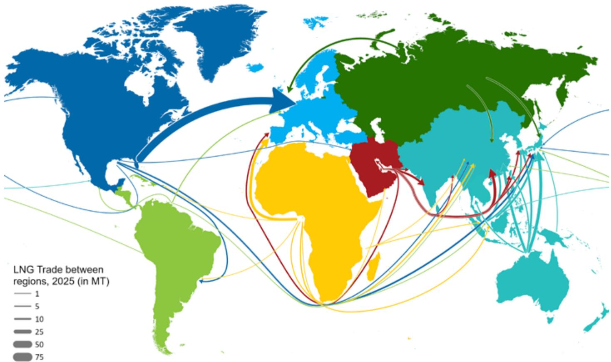  
资料来源：Rystad Energy

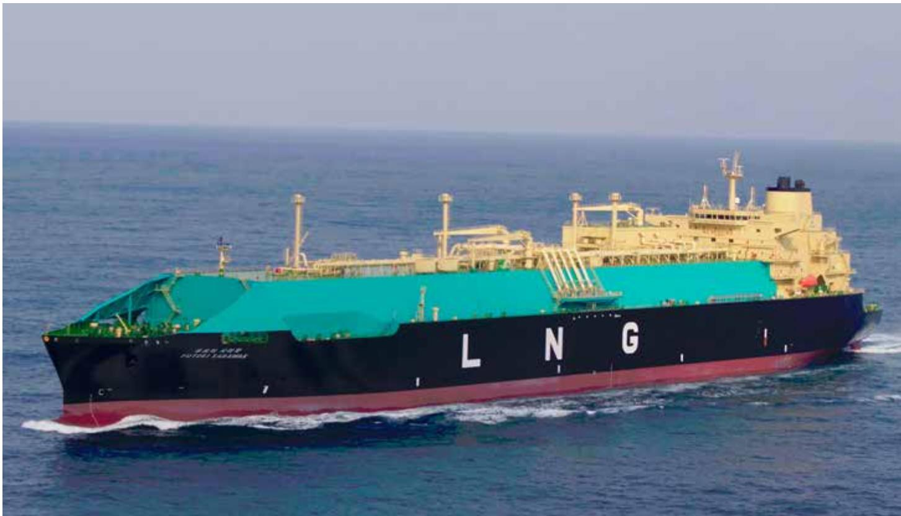  
由 SK 航运提供

表 3.2：2025 年市场间液化天然气贸易量（百万吨）


```html
&lt;table&gt;&lt;tr&gt;&lt;td&gt;市场&lt;/td&gt;&lt;td&gt;阿尔及利亚&lt;/td&gt;&lt;td&gt;安哥拉&lt;/td&gt;&lt;td&gt;澳大利亚&lt;/td&gt;&lt;td&gt;文莱&lt;/td&gt;&lt;td&gt;喀麦隆&lt;/td&gt;&lt;td&gt;加拿大&lt;/td&gt;&lt;td&gt;柬埔寨&lt;/td&gt;&lt;td&gt;埃及&lt;/td&gt;&lt;td&gt;赤道几内亚&lt;/td&gt;&lt;td&gt;印度尼西亚&lt;/td&gt;&lt;td&gt;马来西亚&lt;/td&gt;&lt;td&gt;毛里塔尼亚/塞内&lt;/td&gt;&lt;td&gt;墨西哥&lt;/td&gt;&lt;td&gt;莫桑比克&lt;/td&gt;&lt;/tr&gt;&lt;tr&gt;&lt;td&gt;中国&lt;/td&gt;&lt;td&gt;中国加尔&lt;/td&gt;&lt;td&gt; td&gt;&lt;td&gt;0.10&lt;/td&gt;&lt;td&gt;-&lt;/td&gt;&lt;td&gt;21.59&lt;/td&gt;&lt;td&gt;0.33&lt;/td&gt;&lt;td&gt;-&lt;/td&gt; &lt;td&gt;0.46&lt;/td&gt;&lt;td&gt;-&lt;/td&gt;&lt;td&gt;-&lt;/td&gt;&lt;td&gt;0.18&lt;/td&gt;&lt;td&gt;3.93&lt;/td&gt;&lt;td&gt;7 .40&lt;/td&gt;&lt;td&gt;0.15&lt;/td&gt;&lt;td&gt;-&lt;/td&gt;&lt;td&gt;0.19&lt;/td&gt;&lt;/tr&gt;&lt;tr&gt;&lt;td&gt;印度&lt;/td&gt;&lt;td&gt;-&lt;/td&gt;&lt;td&gt;1.54&lt;/td&gt;&lt;td&gt;0.46&lt;/td&gt;&lt;td&gt;-&lt;/td&gt;&lt;td&gt;0.41&lt;/td&gt;&lt;td&gt;-&lt;/td&gt;&lt;td&gt;-&lt;/td&gt;&lt;td&gt;-&lt;/td&gt;&lt;td&gt;0.15&lt;/td&gt;&lt;td&gt;-&lt;/td&gt;&lt;td&gt;0.12&lt;/td&gt;&lt;td&gt;0.15&lt;/td&gt;&lt;td&gt;0.07&lt;/td&gt;&lt;td&gt;0.61&lt;/td&gt;&lt;/tr&gt;&lt;tr&gt;&lt;td&gt;巴基斯坦&lt;/td&gt;&lt;td&gt;-&lt;/td&gt;&lt;td&gt;-&lt;/td&gt;&lt;td&gt;-&lt;/td&gt;&lt;td&gt;-&lt;/td&gt;&lt;td&gt;-&lt;/td&gt;&lt;td&gt;-&lt;/td&gt;&lt;td&gt;-&lt;/td&gt;&lt;td&gt;-&lt;/td&gt;&lt;td&gt;-&lt;/td&gt;&lt;td&gt;-&lt;/td&gt;&lt;td&gt;-&lt;/td&gt;&lt;td&gt;-&lt;/td&gt;&lt;td&gt;- &lt;/td&gt;&lt;td&gt;-&lt;/td&gt;&lt;/tr&gt;&lt;tr&gt;&lt;td&gt;精度&lt;/td&gt;&lt;td&gt;-&lt;/td&gt;&lt;td&gt;0.07&lt;/td&gt;&lt;td&gt;0.29&lt;/td&gt;&lt;td&gt;-&lt;/td&gt;&lt;td&gt;-&lt;/td&gt;&lt;td&gt;-&lt;/td&gt;&lt;td&gt;-&lt;/td&gt;&lt;td&gt;-&lt;/td&gt;&lt;td&gt;0.12&lt;/td&gt;&lt;td&gt;0.08&lt;/td&gt;&lt;td&gt;0.13&lt;/td&gt;&lt;td&gt;-&lt;/td&gt;&lt;td&gt;-&lt;/td&gt;&lt;td&gt;0.30&lt;/td&gt;&lt;/tr&gt;&lt;tr&gt;&lt;td&gt;其&lt;/td&gt;&lt;td&gt;-&lt;/td&gt;&lt;td&gt;-&lt;/td&gt;&lt;td&gt;-&lt;/td&gt;&lt;td&gt;-&lt;/td&gt;&lt;td&gt;-&lt;/td&gt;&lt;td&gt;-&lt;/td&gt;&lt;td&gt;-&lt;/td&gt;&lt;td&gt;-&lt;/td&gt;&lt;td&gt;-&lt;/td&gt;&lt;td&gt;-&lt;/td&gt;&lt;td&gt;0.04&lt;/td&gt;&lt;td&gt;-&lt;/td&gt;&lt;td&gt;-&lt;/td&gt;&lt;td&gt;-&lt;/td&gt;&lt;/tr&gt;&lt;/table&gt;
```


```html
&lt;table&gt;&lt;tr&gt;&lt;td&gt;亚洲&lt;/td&gt;&lt;td&gt;0.10&lt;/td&gt;&lt;td&gt;1.62&lt;/td&gt;&lt;td&gt;22.34&lt;/td&gt;&lt;td&gt;0.33&lt;/td&gt;&lt;td&gt;0.41&lt;/td&gt;&lt;td&gt;0.46&lt;/td&gt;&lt;td&gt;-&lt;/td&gt;&lt;td&gt;-&lt;/td&gt;&lt;td&gt;0.46&lt;/td&gt;&lt;td&gt;4.00&lt;/td&gt;&lt;td&gt;7.69&lt;/td&gt;&lt;td&gt;0.31&lt;/td&gt;&lt;td&gt;0.07&lt;/td&gt;&lt;td&gt;1.10&lt;/td&gt;&lt;/tr&gt;&lt;tr&gt;&lt;td&gt;日本&lt;/td&gt;&lt;td&gt;-&lt;/td&gt;&lt;td&gt;-&lt;/td&gt;&lt;td&gt;26.56&lt;/td&gt;&lt;td&gt;2.33&lt;/td&gt;&lt;td&gt;-&lt;/td&gt;&lt;td&gt;0.61&lt;/td&gt;&lt;td&gt;-&lt;/td&gt;&lt;td&gt;-&lt;/td&gt;&lt;td&gt;0.22&lt;/td&gt;&lt;td&gt;3.81&lt;/td&gt;&lt;td&gt;9.97&lt;/td&gt;&lt;td&gt;-&lt;/td&gt;&lt;td&gt;-&lt;/td&gt;&lt;td&gt;0.23&lt;/td&gt;&lt;/tr&gt;&lt;tr&gt;&lt;td&gt;南韩国&lt;/td&gt;&lt;td&gt;0.04&lt;/td&gt;&lt;td&gt;-&lt;/td&gt;&lt;td&gt;15.63&lt;/td&gt;&lt;td&gt;0.92&lt;/td&gt;&lt;td&gt;0.08&lt;/td&gt;&lt;td&gt;0.76&lt;/td&gt;&lt;td&gt;0.08&lt;/td&gt;&lt;td&gt;-&lt;/td&gt;&lt;td&gt;0.23&lt;/td&gt;&lt;td&gt;2.23&lt;/td&gt;&lt;td&gt;7.89&lt;/td&gt;&lt;td&gt;-&lt;/td&gt;&lt;td&gt;0.07&lt;/td&gt;&lt;td&gt;0.95&lt;/td&gt;&lt;/tr&gt;&lt;tr&gt;&lt;td&gt;中文&lt;/td&gt;&lt;td&gt;-&lt;/td&gt;&lt;td&gt;-&lt;/td&gt;&lt;td&gt;7.80&lt;/td&gt;&lt;td&gt;0.67&lt;/td&gt;&lt;td&gt;-&lt;/td&gt;&lt;td&gt;0.31&lt;/td&gt;&lt;td&gt;-&lt;/td&gt;&lt;td&gt;0.08&lt;/td&gt;&lt;td&gt;-&lt;/td&gt;&lt;td&gt;0.39&lt;/td&gt;&lt;td&gt;0.26&lt;/td&gt;&lt;td&gt;-&lt;/td&gt;&lt;td&gt;-&lt;/td&gt;&lt;td&gt;-&lt;/td&gt;&lt;/tr&gt;&lt;tr&gt;&lt;td&gt;泰国&lt;/td&gt;&lt;td&gt;-&lt;/td&gt;&lt;td&gt;0.21&lt;/td&gt;&lt;td&gt;2.12&lt;/td&gt;&lt;td&gt; 0.20&lt;/td&gt;&lt;td&gt;0.23&lt;/td&gt;&lt;td&gt;-&lt;/td&gt;&lt;td&gt;0.14&lt;/td&gt;&lt;td&gt;-&lt;/td&gt;&lt;td&gt;0.31&lt;/td&gt;&lt;td&gt;0.15&lt;/td&gt;&lt;td&gt;1.80&lt;/td&gt;&lt;td&gt;-&lt;/td&gt;&lt;td&gt;-&lt;/td&gt;&lt;td&gt;0.62&lt;/td&gt;&lt;/tr&gt;&lt;tr&gt;&lt;td&gt;新加钜&lt;/td&gt;&lt;td&gt;-&lt;/td&gt;&lt;td&gt;-&lt;/td&gt;&lt;td&gt;2.40&lt;/td&gt;&lt;td&gt;-&lt;/td&gt;&lt;td&gt;-&lt;/td&gt;&lt;td&gt;-&lt;/td&gt;&lt;td&gt;-&lt;/td&gt;&lt;td&gt;-&lt;/td&gt;&lt;td&gt;0.08&lt;/td&gt;&lt;td&gt;0.08&lt;/td&gt;&lt;td&gt;0.40&lt;/td&gt;&lt;td&gt;-&lt;/td&gt;&lt;td&gt;-&lt;/td&gt;&lt;td&gt;0.58&lt;/td&gt;&lt;/tr&gt; &lt;tr&gt;&lt;td&gt;印尼语&lt;/td&gt;&lt;td&gt;-&lt;/td&gt;&lt;td&gt;-&lt;/td&gt;&lt;td&gt;0.42&lt;/td&gt;&lt;td&gt;-&lt;/td&gt;&lt;td&gt;0.19&lt;/td&gt;&lt;td&gt;-&lt;/td&gt;&lt;td&gt;-&lt;/td&gt;&lt;td&gt;-&lt;/td&gt;&lt;td&gt;-&lt;/td&gt;&lt;td&gt;5.68&lt;/td&gt;&lt;td&gt;-&lt;/td&gt;&lt;td&gt;-&lt;/td&gt;&lt;td&gt;-&lt;/td&gt;&lt;td&gt;-&lt;/td&gt;&lt;/tr&gt;&lt;tr&gt;&lt;td&gt;马来西亚&lt;/td&gt;&lt;td&gt;-&lt;/td&gt;&lt;td&gt;-&lt;/td&gt;&lt;td&gt;2.34&lt;/td&gt;&lt;td&gt;-&lt;/td&gt;&lt;td&gt;-&lt;/td&gt;&lt;td&gt;-&lt;/td&gt;&lt;td&gt;-&lt;/td&gt;&lt;td&gt;-&lt;/td&gt;&lt;td&gt;-&lt;/td&gt;&lt;td&gt;-&lt;/td&gt;&lt;td&gt;0.38&lt;/td&gt;&lt;td&gt;-&lt;/td&gt;&lt;td&gt;-&lt;/td&gt;&lt;td&gt;-&lt;/td&gt;&lt;/tr&gt;&lt;tr&gt;&lt;td&gt;防御&lt;/td&gt;&lt;td&gt;-&lt;/td&gt;&lt;td&gt;-&lt;/td&gt;&lt;td&gt;0.57&lt;/td&gt;&lt;td&gt;-&lt;/td&gt;&lt;td&gt;-&lt;/td&gt;&lt;td&gt;-&lt;/td&gt;&lt;td&gt;-&lt;/td&gt;&lt;td&gt;-&lt;/td&gt;&lt;td&gt;-&lt;/td&gt;&lt;td&gt;0。 15&lt;/td&gt;&lt;td&gt;0.21&lt;/td&gt;&lt;td&gt;-&lt;/td&gt;&lt;td&gt;-&lt;/td&gt;&lt;td&gt;0.03&lt;/td&gt;&lt;/tr&gt;&lt;tr&gt;&lt;td&gt;越南&lt;/td&gt;&lt;td&gt;-&lt;/td&gt;&lt;td&gt;-&lt;/td&gt;&lt;td&gt;-&lt;/td&gt;&lt;td&gt;0.14&lt;/td&gt;&lt;td&gt;-&lt;/td&gt;&lt;td&gt;-&lt;/td&gt;&lt;td&gt;-&lt;/td&gt;&lt;td&gt;-&lt;/td&gt;&lt;td&gt;-&lt;/td&gt;&lt;td&gt;-&lt;/td&gt;&lt;td&gt;0.19&lt;/td&gt;&lt;td&gt;-&lt;/td&gt;&lt;td&gt;-&lt;/td&gt;&lt;td&gt;-&lt;/td&gt;&lt;/tr&gt;&lt;/table&gt;
```


```html
&lt;table&gt;&lt;tr&gt;&lt;td&gt;亚洲太平洋&lt;/td&gt;&lt;td&gt;0.04&lt;/td&gt;&lt;td&gt;0.21&lt;/td&gt;&lt;td&gt;57.83&lt;/td&gt;&lt;td&gt;4.25&lt;/td&gt;&lt;td&gt;0.50&lt;/td&gt;&lt;td&gt;1.68&lt;/td&gt;&lt;td&gt;0.21&lt;/td&gt;&lt;td&gt;0.08&lt;/td&gt;&lt;td&gt;0.83&lt;/td&gt;&lt;td&gt;12.48&lt;/td&gt;&lt;td&gt;21.11&lt;/td&gt;&lt;td&gt;-&lt;/td&gt;&lt;td&gt;0.07&lt;/td&gt;&lt;td&gt;2.40 &lt;/td&gt;&lt;/tr&gt;&lt;tr&gt;&lt;td&gt;法国&lt;/td&gt;&lt;td&gt;2.35&lt;/td&gt;&lt;td&gt;0.27&lt;/td&gt;&lt;td&gt;0.08&lt;/td&gt;&lt;td&gt;-&lt;/td&gt;&lt;td&gt;0.15&lt;/td&gt;&lt;td&gt;-&lt;/td&gt;&lt;td&gt;0.08&lt;/td&gt;&lt;td&gt;-&lt;/td&gt;&lt;td&gt;0.08&lt;/td&gt;&lt;td&gt;-&lt;/td&gt;&lt;td&gt;-&lt;/td&gt;&lt;td&gt;-&lt;/td&gt;&lt;td&gt;0.07&lt;/td&gt;&lt;td&gt;-&lt;/td&gt;&lt;/tr&gt;&lt;tr&gt;&lt;td&gt;西班牙&lt;/td&gt;&lt;td&gt;1.49&lt;/td&gt;&lt;td&gt;1.37&lt;/td&gt;&lt;td&gt;-&lt;/td&gt;&lt;td&gt;-&lt;/td&gt;&lt;td&gt;0.06&lt;/td&gt;&lt;td&gt;-&lt;/td&gt;&lt;td&gt;0.18&lt;/td&gt;&lt;td&gt;0.08&lt;/td&gt;&lt;td&gt;0.15&lt;/td&gt;&lt;td&gt;-&lt;/td&gt;&lt;td&gt;-&lt;/td&gt;&lt;td&gt;-&lt;/td&gt;&lt;td&gt;-&lt;/td&gt;&lt;td&gt;-&lt;/td&gt;&lt;/tr&gt;&lt;tr&gt;&lt;td&gt;荷兰&lt;/td&gt;&lt;td&gt;-&lt;/td&gt;&lt;td&gt;0.77&lt;/td&gt;&lt;td&gt;-&lt;/td&gt;&lt;td&gt;-&lt;/td&gt;&lt;td&gt;-&lt;/td&gt;&lt;td&gt;-&lt;/td&gt;&lt;td&gt;-&lt;/td&gt; &lt;td&gt;-&lt;/td&gt;&lt;td&gt;0.32&lt;/td&gt;&lt;td&gt;-&lt;/td&gt;&lt;td&gt;-&lt;/td&gt;&lt;td&gt;-&lt;/td&gt;&lt;td&gt;0.04&lt;/td&gt;&lt;td&gt;-&lt;/td&gt;&lt;/tr&gt;&lt;tr&gt;&lt;td&gt;美国王国&lt;/td&gt;&lt;td&gt;0.58&lt;/td&gt;&lt;td&gt;0.21&lt;/td&gt;&lt;td&gt;-&lt;/td&gt;&lt;td&gt;-&lt;/td&gt;&lt;td&gt;-&lt;/td&gt;&lt;td&gt;-&lt;/td&gt;&lt;td&gt;-&lt;/td&gt;&lt;td&gt;-&lt;/td&gt;&lt;td&gt;0.08&lt;/td&gt;&lt;td&gt;-&lt;/td&gt;&lt;td&gt;-&lt;/td&gt;&lt;td&gt;-&lt;/td&gt;&lt;td&gt;0.07&lt;/td&gt;&lt;td&gt;- &lt;/td&gt;&lt;/tr&gt;&lt;tr&gt;&lt;td&gt;意大利&lt;/td&gt;&lt;td&gt;1.77&lt;/td&gt;&lt;td&gt;-&lt;/td&gt;&lt;td&gt;-&lt;/td&gt;&lt;td&gt;-&lt;/td&gt;&lt;td&gt;-&lt;/td&gt;&lt;td&gt;-&lt;/td&gt;&lt;td&gt;0.06&lt;/td&gt;&lt;td&gt;-&lt;/td&gt;&lt;td&gt;0.23&lt;/td&gt;&lt;td&gt;-&lt;/td&gt;&lt;td&gt;-&lt;/td&gt;&lt;td&gt;0.15&lt;/td&gt; &lt;td&gt;-&lt;/td&gt;&lt;td&gt;-&lt;/td&gt;&lt;/tr&gt;&lt;tr&gt;&lt;td&gt;土耳其&lt;/td&gt;&lt;td&gt;3.09&lt;/td&gt;&lt;td&gt;0.14&lt;/td&gt;&lt;td&gt;-&lt;/td&gt;&lt;td&gt;-&lt;/td&gt;&lt;td&gt;0.28&lt;/td&gt;&lt;td&gt;-&lt;/td&gt;&lt;td&gt;-&lt;/td&gt;&lt;td&gt;0 .17&lt;/td&gt;&lt;td&gt;0.38&lt;/td&gt;&lt;td&gt;-&lt;/td&gt; &lt;td&gt;-&lt;/td&gt;&lt;td&gt;0.22&lt;/td&gt;&lt;td&gt;-&lt;/td&gt;&lt;td&gt;0.08&lt;/td&gt;&lt;/tr&gt;&lt;tr&gt;&lt;td&gt;比利时&lt;/td&gt;&lt;td&gt;-&lt;/td&gt;&lt;td&gt;0.14&lt;/td&gt;&lt;td&gt;-&lt;/td&gt;&lt;td&gt;-&lt;/td&gt;&lt;td&gt;-&lt;/td&gt;&lt;td&gt;-&lt;/td&gt;&lt;td&gt;-&lt;/td&gt;&lt;td&gt;-&lt;/td&gt;&lt;td&gt;0。 08&lt;/td&gt;&lt;td&gt;-&lt;/td&gt;&lt;td&gt;-&lt;/td&gt;&lt;td&gt;0.08&lt;/td&gt;&lt;td&gt;-&lt;/td&gt;&lt;td&gt;-&lt;/td&gt;&lt;/tr&gt;&lt;tr&gt;&lt;td&gt;德国&lt;/td&gt;&lt;td&gt;-&lt;/td&gt;&lt;td&gt;-&lt;/td&gt;&lt;td&gt;-&lt;/td&gt;&lt;td&gt;-&lt;/td&gt;&lt;td&gt;-&lt;/td&gt;&lt;td&gt;-&lt;/td&gt;&lt;td&gt;0.08&lt;/td&gt;&lt;td&gt;-&lt;/td&gt;&lt;td&gt;0.08&lt;/td&gt;&lt;td&gt;-&lt;/td&gt;&lt;td&gt;-&lt;/td&gt;&lt;td&gt;-&lt;/td&gt;&lt;td&gt;0.07&lt;/td&gt;&lt;td&gt;-&lt;/td&gt;&lt;/tr&gt;&lt;tr&gt;&lt;td&gt;波兰&lt;/td&gt;&lt;td&gt;-&lt;/td&gt;&lt;td&gt;-&lt;/td&gt;&lt;td&gt;-&lt;/td&gt;&lt;td&gt;-&lt;/td&gt;&lt;td&gt;-&lt;/td&gt;&lt;td&gt;-&lt;/td&gt;&lt;td&gt;-&lt;/td&gt;&lt;td&gt;-&lt;/td&gt;&lt;td&gt;-&lt;/td&gt;&lt;td&gt;-&lt;/td&gt;&lt;td&gt;-&lt;/td&gt;&lt;td&gt;0.08&lt;/td&gt;&lt;td&gt;-&lt;/td&gt;&lt;td&gt;-&lt;/td&gt;&lt;/tr&gt;&lt;tr&gt;&lt;td&gt;葡萄牙&lt;/td&gt;&lt;td&gt;-&lt;/td&gt;&lt;td&gt;-&lt;/td&gt;&lt;td&gt;-&lt;/td&gt;&lt;td&gt;-&lt;/td&gt;&lt;td&gt;-&lt;/td&gt;&lt;td&gt;-&lt;/td&gt;&lt;td&gt;-&lt;/td&gt;&lt;td&gt;-&lt;/td&gt;&lt;td&gt;-&lt;/td&gt;&lt;td&gt;-&lt;/td&gt;&lt;td&gt;-&lt;/td&gt;&lt;td&gt;-&lt;/td&gt;&lt;td&gt;-&lt;/td&gt;&lt;td&gt;-&lt;/td&gt;&lt;/tr&gt;&lt;tr&gt;&lt;td&gt;立陶宛&lt;/td&gt;&lt;td&gt;-&lt;/td&gt;&lt;td&gt;-&lt;/td&gt;&lt;td&gt;-&lt;/td&gt;&lt;td&gt;-&lt;/td&gt;&lt;td&gt;-&lt;/td&gt;&lt;td&gt;-&lt;/td&gt;&lt;td&gt;-&lt;/td&gt;&lt;td&gt;-&lt;/td&gt;&lt;td&gt;-&lt;/td&gt;&lt;td&gt;-&lt;/td&gt;&lt;td&gt;-&lt;/td&gt;&lt;td&gt;0.08&lt;/td&gt;&lt;td&gt;-&lt;/td&gt;&lt;td&gt;-&lt;/td&gt;&lt;/tr&gt;&lt;tr&gt;&lt;td&gt;希腊&lt;/td&gt;&lt;td&gt;0.09&lt;/td&gt;&lt;td&gt;-&lt;/td&gt;&lt;td&gt;-&lt;/td&gt;&lt;td&gt;-&lt;/td&gt;&lt;td&gt;-&lt;/td&gt;&lt;td&gt;-&lt;/td&gt;&lt;td&gt;-&lt;/td&gt;&lt;td&gt;0.08&lt;/td&gt;&lt;td&gt;-&lt;/td&gt;&lt;td&gt;-&lt;/td&gt;&lt;td&gt;-&lt;/td&gt;&lt;td&gt;-&lt;/td&gt;&lt;td&gt;-&lt;/td&gt;&lt;td&gt;-&lt;/td&gt;&lt;/tr&gt;&lt;tr&gt;&lt;td&gt;克罗地亚&lt;/td&gt;&lt;td&gt;0.17&lt;/td&gt;&lt;td&gt;-&lt;/td&gt;&lt;td&gt;- &lt;/td&gt;&lt;td&gt;-&lt;/td&gt;&lt;td&gt;-&lt;/td&gt;&lt;td&gt;-&lt;/td&gt;&lt;td&gt;-&lt;/td&gt;&lt;td&gt;-&lt;/td&gt;&lt;td&gt;-&lt;/td&gt;&lt;td&gt;-&lt;/td&gt;&lt;td&gt;- &lt;/td&gt;&lt;td&gt;-&lt;/td&gt;&lt;td&gt;0.03&lt;/td&gt;&lt;td&gt;-&lt;/td&gt;&lt;/tr&gt;&lt;tr&gt;&lt;td&gt;芬兰&lt;/td&gt;&lt;td&gt;-&lt;/td&gt;&lt;td&gt;-&lt;/td&gt; td&gt;&lt;td&gt;-&lt;/td&gt;&lt;td&gt;-&lt;/td&gt;&lt;td&gt;-&lt;/td&gt;&lt;td&gt;-&lt;/td&gt;&lt;td&gt;-&lt;/td&gt;&lt;td&gt;-&lt;/td&gt;&lt;td&gt;-&lt;/td&gt;&lt;td&gt;-&lt;/td&gt;&lt;td&gt;-&lt;/td&gt;&lt;td&gt;-&lt;/td&gt;&lt;td&gt;-&lt;/td&gt;&lt;td&gt;-&lt;/td&gt;&lt;/tr&gt;&lt;tr&gt;&lt;td&gt;瑞典&lt;/td&gt;&lt;td&gt;-&lt;/td&gt;&lt;td&gt;-&lt;/td&gt;&lt;td&gt;-&lt;/td&gt;&lt;td&gt;-&lt;/td&gt;&lt;td&gt;-&lt;/td&gt;&lt;td&gt;-&lt;/td&gt;&lt;td&gt;-&lt;/td&gt;&lt;td&gt;-&lt;/td&gt;&lt;td&gt;-&lt;/td&gt;&lt;td&gt;-&lt;/td&gt;&lt;td&gt;-&lt;/td&gt;&lt;td&gt;-&lt;/td&gt;&lt;td&gt;-&lt;/td&gt;&lt;td&gt;-&lt;/td&gt;&lt;/tr&gt;&lt;tr&gt;&lt;td&gt;马耳他&lt;/td&gt;&lt;td&gt;-&lt;/td&gt; &lt;td&gt;-&lt;/td&gt;&lt;td&gt;-&lt;/td&gt;&lt;td&gt;-&lt;/td&gt;&lt;td&gt;-&lt;/td&gt;&lt;td&gt;-&lt;/td&gt;&lt;td&gt;-&lt;/td&gt;&lt;td&gt;-&lt;/td&gt;&lt;td&gt;-&lt;/td&gt; &lt;td&gt;-&lt;/td&gt;&lt;td&gt;-&lt;/td&gt;&lt;td&gt;-&lt;/td&gt;&lt;td&gt;-&lt;/td&gt;&lt;td&gt;-&lt;/td&gt;&lt;/tr&gt;&lt;tr&gt;&lt;td&gt;挪威&lt;/td&gt;&lt;td&gt;-&lt;/td&gt;&lt;td&gt;-&lt;/td&gt;&lt;td&gt;-&lt;/td&gt;&lt;td&gt;-&lt;/td&gt;&lt;td&gt;-&lt;/td&gt;&lt;td&gt;-&lt;/td&gt;&lt;td&gt;-&lt;/td&gt;&lt;td&gt;-&lt;/td&gt;&lt;td&gt;-&lt;/td&gt;&lt;td&gt;-&lt;/td&gt;&lt;td&gt;-&lt;/td&gt;&lt;td&gt;-&lt;/td&gt;&lt;td&gt;-&lt;/td&gt;&lt;td&gt;-&lt;/td&gt;&lt;/tr&gt;&lt;tr&gt;&lt;td&gt;直布罗陀&lt;/td&gt;&lt;td&gt;0.01&lt;/td&gt;&lt;td&gt;-&lt;/td&gt;&lt;td&gt;-&lt;/td&gt;&lt;td&gt;-&lt;/td&gt;&lt;td&gt;-&lt;/td&gt;&lt;td&gt;-&lt;/td&gt;&lt;td&gt;-&lt;/td&gt;&lt;td&gt;-&lt;/td&gt;&lt;td&gt;-&lt;/td&gt;&lt;td&gt;-&lt;/td&gt;&lt;td&gt;-&lt;/td&gt;&lt;td&gt;0.01&lt;/td&gt;&lt;td&gt;-&lt;/td&gt;&lt;td&gt;-&lt;/td&gt;&lt;/tr&gt;&lt;/table&gt;
```


```html
&lt;table&gt;&lt;tr&gt;&lt;td&gt;欧洲&lt;/td&gt;&lt;td&gt;9.54&lt;/td&gt;&lt;td&gt;2.90&lt;/td&gt;&lt;td&gt;0.08&lt;/td&gt;&lt;td&gt; -&lt;/td&gt;&lt;td&gt;0.50&lt;/td&gt;&lt;td&gt;-&lt;/td&gt;&lt;td&gt;0.40&lt;/td&gt;&lt;td&gt;0.32&lt;/td&gt;&lt;td&gt;1.39&lt;/td&gt;&lt;td&gt;-&lt;/td&gt;&lt;td&gt;-&lt;/td&gt;&lt;td&gt;0.61&lt;/td&gt;&lt;td&gt;0.28&lt;/td&gt;&lt;td&gt;0.08&lt;/td&gt;&lt;/tr&gt;&lt;tr&gt;&lt;td&gt;智利&lt;/td&gt;&lt;td&gt;-&lt;/td&gt;&lt;td&gt;-&lt;/td&gt;&lt;td&gt;-&lt;/td&gt;&lt;td&gt;-&lt;/td&gt;&lt;td&gt;-&lt;/td&gt;&lt;td&gt;-&lt;/td&gt;&lt;td&gt;-&lt;/td&gt;&lt;td&gt;-&lt;/td&gt;&lt;td&gt;-&lt;/td&gt;&lt;td&gt;-&lt;/td&gt;&lt;td&gt;-&lt;/td&gt;&lt;td&gt;-&lt;/td&gt;&lt;td&gt;-&lt;/td&gt;&lt;td&gt;0.01&lt;/td&gt;&lt;/tr&gt;&lt;tr&gt;&lt;td&gt;阿根廷&lt;/td&gt;&lt;td&gt;-&lt;/td&gt;&lt;td&gt;-&lt;/td&gt;&lt;td&gt;-&lt;/td&gt;&lt;td&gt;-&lt;/td&gt;&lt;td&gt;-&lt;/td&gt;&lt;td&gt;-&lt;/td&gt;&lt;td&gt;-&lt;/td&gt;&lt;td&gt;-&lt;/td&gt;&lt;td&gt;-&lt;/td&gt;&lt;td&gt;- &lt;/td&gt;&lt;td&gt;-&lt;/td&gt;&lt;td&gt;-&lt;/td&gt;&lt;td&gt;-&lt;/td&gt;&lt;td&gt;0.01&lt;/td&gt;&lt;/tr&gt;&lt;tr&gt;&lt;td&gt;多米尼加共和国&lt;/td&gt;&lt;td&gt;-&lt;/td&gt;&lt;td&gt;-&lt;/td&gt;&lt;td&gt;-&lt;/td&gt;&lt;td&gt;-&lt;/td&gt;&lt;td&gt;-&lt;/td&gt;&lt;td&gt;-&lt;/td&gt;&lt;td&gt;-&lt;/td&gt; &lt;td&gt;-&lt;/td&gt;&lt;td&gt;-&lt;/td&gt;&lt;td&gt;-&lt;/td&gt;&lt;td&gt;-&lt;/td&gt;&lt;td&gt;-&lt;/td&gt;&lt;td&gt;-&lt;/td&gt;&lt;td&gt;-&lt;/td&gt;&lt;/tr&gt;&lt;tr&gt;&lt;td&gt;J amaica&lt;/td&gt;&lt;td&gt;-&lt;/td&gt;&lt;td&gt;-&lt;/td&gt;&lt;td&gt;-&lt;/td&gt;&lt;td&gt;-&lt;/td&gt;&lt;td&gt;-&lt;/td&gt;&lt;td&gt;-&lt;/td&gt;&lt;td&gt;-&lt;/td&gt;&lt;td&gt;-&lt;/td&gt;&lt;td&gt;-&lt;/td&gt;&lt;td&gt;-&lt;/td&gt;&lt;td&gt;-&lt;/td&gt;&lt;td&gt;-&lt;/td&gt;&lt;td&gt;0.09&lt;/td&gt;&lt;td&gt;-&lt;/td&gt;&lt;/tr&gt;&lt;tr&gt;&lt;td&gt;哥伦比亚&lt;/td&gt;&lt;td&gt;-&lt;/td&gt;&lt;td&gt;-&lt;/td&gt;&lt;td&gt;-&lt;/td&gt;&lt;td&gt;-&lt;/td&gt;&lt;td&gt;-&lt;/td&gt;&lt;td&gt;-&lt;/td&gt;&lt;td&gt;-&lt;/td&gt; &lt;td&gt;-&lt;/td&gt;&lt;td&gt;-&lt;/td&gt;&lt;td&gt;-&lt;/td&gt;&lt;td&gt;-&lt;/td&gt;&lt;td&gt;-&lt;/td&gt;&lt;td&gt;-&lt;/td&gt;&lt;td&gt;-&lt;/td&gt;&lt;/tr&gt;&lt;tr&gt;&lt;td&gt;布拉齐尔&lt;/td&gt;&lt;td&gt;-&lt;/td&gt;&lt;td&gt;-&lt;/td&gt;&lt;td&gt;-&lt;/td&gt;&lt;td&gt;-&lt;/td&gt;&lt;td&gt;0.06&lt;/td&gt;&lt;td&gt;-&lt;/td&gt;&lt;td&gt;-&lt;/td&gt;&lt;td&gt;-&lt;/td&gt;&lt;td&gt;-&lt;/td&gt;&lt;td&gt;-&lt;/td&gt;&lt;td&gt;-&lt;/td&gt;&lt;td&gt;-&lt;/td&gt;&lt;td&gt;-&lt;/td&gt;&lt;td&gt;-&lt;/td&gt;&lt;/tr&gt;&lt;tr&gt; &lt;td&gt;埃尔萨尔瓦多&lt;/td&gt;&lt;td&gt;-&lt;/td&gt;&lt;td&gt;-&lt;/td&gt;&lt;td&gt;-&lt;/td&gt;&lt;td&gt;-&lt;/td&gt;&lt;td&gt;-&lt;/td&gt;&lt;td&gt;-&lt;/td&gt;&lt;td&gt;-&lt;/td&gt; &lt;td&gt;-&lt;/td&gt;&lt;td&gt;-&lt;/td&gt;&lt;td&gt;-&lt;/td&gt;&lt;td&gt;-&lt;/td&gt;&lt;td&gt;-&lt;/td&gt;&lt;td&gt;-&lt;/td&gt;&lt;td&gt;-&lt;/td&gt;&lt;/tr&gt;&lt;tr&gt;&lt;td&gt;P anama&lt;/td&gt;&lt;td&gt;-&lt;/td&gt;&lt;td&gt;-&lt;/td&gt;&lt;td&gt;-&lt;/td&gt;&lt;td&gt;-&lt;/td&gt;&lt;td&gt;-&lt;/td&gt;&lt;td&gt;-&lt;/td&gt;&lt;td&gt;-&lt;/td&gt;&lt;td&gt; -&lt;/td&gt;&lt;td&gt;-&lt;/td&gt;&lt;td&gt;-&lt;/td&gt;&lt;td&gt;-&lt;/td&gt;&lt;td&gt;-&lt;/td&gt;&lt;td&gt;-&lt;/td&gt;&lt;td&gt;-&lt;/td&gt;&lt;/tr&gt;&lt;tr&gt;&lt;td&gt;拉丁语美国&lt;/td&gt;&lt;td&gt;-&lt;/td&gt;&lt;td&gt;-&lt;/td&gt;&lt;td&gt;-&lt;/td&gt;&lt;td&gt;-&lt;/td&gt;&lt;td&gt;0.06&lt;/td&gt;&lt;td&gt;-&lt;/td&gt;&lt;td&gt;-&lt;/td&gt;&lt;td&gt;- &lt;/td&gt;&lt;td&gt;-&lt;/td&gt;&lt;td&gt;-&lt;/td&gt;&lt;td&gt;-&lt;/td&gt;&lt;td&gt;-&lt;/td&gt;&lt;td&gt;0.09&lt;/td&gt;&lt;td&gt;0.02&lt;/td&gt;&lt;/tr&gt;&lt;tr&gt;&lt;td&gt;波多黎各理科&lt;/td&gt;&lt;td&gt;-&lt;/td&gt;&lt;td&gt;-&lt;/td&gt;&lt;td&gt;-&lt;/td&gt;&lt;td&gt;-&lt;/td&gt;&lt;td&gt;-&lt;/td&gt;&lt;td&gt;-&lt;/td&gt;&lt;td&gt;-&lt;/td&gt;&lt;td&gt;-&lt;/td&gt;&lt;td&gt;-&lt;/td&gt;&lt;td&gt;-&lt;/td&gt;&lt;td&gt;-&lt;/td&gt;&lt;td&gt;-&lt;/td&gt;&lt;td&gt;0.46&lt;/td&gt;&lt;td&gt;-&lt;/td&gt;&lt;/tr&gt;&lt;tr&gt;&lt;td&gt;墨西哥语o&lt;/td&gt;&lt;td&gt;-&lt;/td&gt;&lt;td&gt;-&lt;/td&gt;&lt;td&gt;-&lt;/td&gt;&lt;td&gt;-&lt;/td&gt;&lt;td&gt;-&lt;/td&gt;&lt;td&gt;-&lt;/td&gt;&lt;td&gt;-&lt;/td&gt;&lt;td&gt;-&lt;/td&gt;&lt;td&gt;-&lt;/td&gt;&lt;td&gt;0.07&lt;/td&gt;&lt;td&gt;-&lt;/td&gt;&lt;td&gt;-&lt;/td&gt;&lt;td&gt;0.06&lt;/td&gt;&lt;td&gt;-&lt;/td&gt;&lt;/tr&gt;&lt;tr&gt;&lt;td&gt;美国州&lt;/td&gt;&lt;td&gt;-&lt;/td&gt;&lt;td&gt;-&lt;/td&gt;&lt;td&gt;-&lt;/td&gt;&lt;td&gt;-&lt;/td&gt;&lt;td&gt;-&lt;/td&gt;&lt;td&gt;-&lt;/td&gt;&lt;td&gt;-&lt;/td&gt;&lt;td&gt;-&lt;/td&gt;&lt;td&gt;-&lt;/td&gt;&lt;td&gt;-&lt;/td&gt;&lt;td&gt;-&lt;/td&gt;&lt;td&gt;-&lt;/td&gt;&lt;td&gt;-&lt;/td&gt;&lt;td&gt;-&lt;/td&gt;&lt;/tr&gt;&lt;tr&gt;&lt;td&gt;加拿大a &lt;/td&gt;&lt;td&gt;-&lt;/td&gt;&lt;td&gt;-&lt;/td&gt;&lt;td&gt;0.07&lt;/td&gt;&lt;td&gt;-&lt;/td&gt;&lt;td&gt;-&lt;/td&gt;&lt;td&gt;-&lt;/td&gt;&lt;td&gt;-&lt;/td&gt;&lt;td&gt;0。 08&lt;/td&gt;&lt;td&gt;-&lt;/td&gt;&lt;td&gt;-&lt;/td&gt;&lt;td&gt;-&lt;/td&gt;&lt;td&gt;-&lt;/td&gt;&lt;td&gt;-&lt;/td&gt;&lt;td&gt;-&lt;/td&gt;&lt;/tr&gt;&lt;tr&gt;&lt;td&gt;北美洲&lt;/td&gt;&lt;td&gt;-&lt;/td&gt;&lt;td&gt;- &lt;/td&gt;&lt;td&gt;0.07&lt;/td&gt;&lt;td&gt;-&lt;/td&gt;&lt;td&gt;-&lt;/td&gt;&lt;td&gt;-&lt;/td&gt;&lt;td&gt;-&lt;/td&gt;&lt;td&gt;0.08&lt;/td&gt;&lt;td&gt;-&lt;/td&gt;&lt;td&gt;0.07&lt;/td&gt;&lt;td&gt;-&lt;/td&gt;&lt;td&gt;-&lt;/td&gt;&lt;td&gt;0.52&lt;/td&gt;&lt;td&gt;-&lt;/td&gt;&lt;/tr&gt;&lt;tr&gt;&lt;td&gt;酋&lt;/td&gt;&lt;td&gt;-&lt;/td&gt;&lt;td&gt;0.07&lt;/td&gt;&lt;td&gt;-&lt;/td&gt;&lt;td&gt;-&lt;/td&gt;&lt;td&gt;-&lt;/td&gt;&lt;td&gt;-&lt;/td&gt;&lt;td&gt;-&lt;/td&gt;&lt;td&gt;-&lt;/td&gt;&lt;td&gt;-&lt;/td&gt;&lt;td&gt;-&lt;/td&gt;&lt;td&gt;-&lt;/td&gt;&lt;td&gt;-&lt;/td&gt;&lt;td&gt;-&lt;/td&gt;&lt;td&gt;0.08&lt;/td&gt;&lt;/tr&gt;&lt;tr&gt;&lt;td&gt;爆发&lt;/td&gt;&lt;td&gt;-&lt;/td&gt;&lt;td&gt;0.07&lt;/td&gt;&lt;td&gt;-&lt;/td&gt;&lt;td&gt;-&lt;/td&gt;&lt;td&gt;-&lt;/td&gt;&lt;td&gt;-&lt;/td&gt;&lt;td&gt;-&lt;/td&gt;&lt;td&gt;-&lt;/td&gt;&lt;td&gt;0.08&lt;/td&gt;&lt;td&gt;-&lt;/td&gt;&lt;td&gt;-&lt;/td&gt;&lt;td&gt;-&lt;/td&gt;&lt;td&gt;-&lt;/td&gt;&lt;td&gt;-&lt;/td&gt;&lt;/tr&gt;&lt;tr&gt;&lt;td&gt;迪拜&lt;/td&gt;&lt;td&gt;-&lt;/td&gt;&lt;td&gt;-&lt;/td&gt;&lt;td&gt;-&lt;/td&gt;&lt;td&gt;-&lt;/td&gt;&lt;td&gt;-&lt;/td&gt;&lt;td&gt;-&lt;/td&gt;&lt;td&gt;-&lt;/td&gt;&lt;td&gt;-&lt;/td&gt;&lt;td&gt;-&lt;/td&gt;&lt;td&gt;-&lt;/td&gt;&lt;td&gt;-&lt;/td&gt;&lt;td&gt;0。 08&lt;/td&gt;&lt;td&gt;-&lt;/td&gt;&lt;td&gt;-&lt;/td&gt;&lt;/tr&gt;&lt;tr&gt;&lt;td&gt;巴林&lt;/td&gt;&lt;td&gt;-&lt;/td&gt;&lt;td&gt;-&lt;/td&gt;&lt;td&gt;-&lt;/td&gt;&lt;td&gt;-&lt;/td&gt;&lt;td&gt;-&lt;/td&gt;&lt;td&gt;- &lt;/td&gt;&lt;td&gt;-&lt;/td&gt;&lt;td&gt;-&lt;/td&gt;&lt;td&gt;0.08&lt;/td&gt;&lt;td&gt;-&lt;/td&gt;&lt;td&gt;-&lt;/td&gt;&lt;td&gt;-&lt;/td&gt;&lt;td&gt;-&lt;/td&gt;&lt;td&gt;-&lt;/td&gt;&lt;/tr&gt;&lt;tr&gt;&lt;td&gt;中东&lt;/td&gt;&lt;td&gt;-&lt;/td&gt;&lt;td&gt;0.14&lt;/td&gt;&lt;td&gt;-&lt;/td&gt;&lt;td&gt;-&lt;/td&gt;&lt;td&gt;-&lt;/td&gt;&lt;td&gt;-&lt;/td&gt;&lt;td&gt;-&lt;/td&gt;&lt;td&gt;-&lt;/td&gt;&lt;td&gt;0.15&lt;/td&gt;&lt;td&gt;-&lt;/td&gt;&lt;td&gt;-&lt;/td&gt;&lt;td&gt;0.08&lt;/td&gt;&lt;td&gt;-&lt;/td&gt;&lt;td&gt;0.08&lt;/td&gt;&lt;/tr&gt;&lt;tr&gt;&lt;td&gt;埃及&lt;/td&gt;&lt;td&gt;-&lt;/td&gt;&lt;td&gt;-&lt;/td&gt;&lt;td&gt;-&lt;/td&gt;&lt;td&gt;-&lt;/td&gt;&lt;td&gt;-&lt;/td&gt;&lt;td&gt;-&lt;/td&gt;&lt;td&gt;-&lt;/td&gt;&lt;td&gt;-&lt;/td&gt;&lt;td&gt;0.15&lt;/td&gt;&lt;td&gt;-&lt;/td&gt;&lt;td&gt;-&lt;/td&gt;&lt;td&gt;0.22&lt;/td&gt;&lt;td&gt;-&lt;/td&gt;&lt;td&gt;-&lt;/td&gt;&lt;/tr&gt;&lt;tr&gt;&lt;td&gt;塞内加尔&lt;/td&gt;&lt;td&gt;-&lt;/td&gt;&lt;td&gt;-&lt;/td&gt;&lt;td&gt;-&lt;/td&gt;&lt;td&gt;-&lt;/td&gt;&lt;td&gt;-&lt;/td&gt;&lt;td&gt;-&lt;/td&gt;&lt;td&gt;-&lt;/td&gt;&lt;td&gt;-&lt;/td&gt;&lt;td&gt;-&lt;/td&gt;&lt;td&gt;-&lt;/td&gt;&lt;td&gt;-&lt;/td&gt;&lt;td&gt;-&lt;/td&gt;&lt;td&gt;-&lt;/td&gt;&lt;td&gt;-&lt;/td&gt;&lt;/tr&gt;&lt;tr&gt;&lt;td&gt;非洲&lt;/td&gt;&lt;td&gt;-&lt;/td&gt;&lt;td&gt;-&lt;/td&gt;&lt;td&gt;-&lt;/td&gt;&lt;td&gt;-&lt;/td&gt;&lt;td&gt;-&lt;/td&gt;&lt;td&gt;-&lt;/td&gt;&lt;td&gt;-&lt;/td&gt;&lt;td&gt;-&lt;/td&gt;&lt;td&gt;0.15&lt;/td&gt;&lt;td&gt;-&lt;/td&gt;&lt;td&gt;-&lt;/td&gt;&lt;td&gt; 0.22&lt;/td&gt;&lt;td&gt;-&lt;/td&gt;&lt;td&gt;-&lt;/td&gt;&lt;/tr&gt;&lt;tr&gt;&lt;td&gt;俄罗斯&lt;/td&gt;&lt;td&gt;-&lt;/td&gt;&lt;td&gt;-&lt;/td&gt;&lt;td&gt;-&lt;/td&gt;&lt;td&gt;-&lt;/td&gt;&lt;td&gt;-&lt;/td&gt;&lt;td&gt;-&lt;/td&gt;&lt;td&gt;-&lt;/td&gt;&lt;td&gt;-&lt;/td&gt;&lt;td&gt;-&lt;/td&gt;&lt;td&gt;-&lt;/td&gt;&lt;td&gt;-&lt;/td&gt;&lt;td&gt;-&lt;/td&gt;&lt;td&gt;-&lt;/td&gt;&lt;td&gt;-&lt;/td&gt;&lt;/tr&gt; &lt;tr&gt;&lt;td&gt;前任苏联联合&lt;/td&gt;&lt;td&gt;-&lt;/td&gt;&lt;td&gt;-&lt;/td&gt;&lt;td&gt;-&lt;/td&gt;&lt;td&gt;-&lt;/td&gt;&lt;td&gt;-&lt;/td&gt;&lt;td&gt;-&lt;/td&gt;&lt;td&gt;-&lt;/td&gt;&lt;td&gt;-&lt;/td&gt;&lt;td&gt;-&lt;/td&gt;&lt;td&gt;-&lt;/td&gt;&lt;td&gt;-&lt;/td&gt;&lt;td&gt;-&lt;/td&gt;&lt;td&gt;-&lt;/td&gt;&lt;td&gt;-&lt;/td&gt;&lt;/tr&gt;&lt;tr&gt;&lt;td&gt;2025出口&lt;/td&gt;&lt;td&gt;9.68&lt;/td&gt;&lt;td&gt;4.87&lt;/td&gt;&lt;td&gt;80.32&lt;/td&gt;&lt;td&gt;4.59&lt;/td&gt;&lt;td&gt;1.48&lt;/td&gt;&lt;td&gt;2.14&lt;/td&gt;&lt;td&gt;0.61&lt;/td&gt;&lt;td&gt;0.47&lt;/td&gt;&lt;td&gt;2.99&lt;/td&gt;&lt;td&gt;16.55&lt;/td&gt;&lt;td&gt;28.80&lt;/td&gt;&lt;td&gt;1.22&lt;/td&gt;&lt;td&gt;1.03&lt;/td&gt;&lt;td&gt;3.68&lt;/td&gt;&lt;/tr&gt;&lt;tr&gt;&lt;td&gt; 2024出口&lt;/td&gt;&lt;td&gt;11.59&lt;/td&gt;&lt;td&gt;3.81&lt;/td&gt;&lt;td&gt;81.04&lt;/td&gt;&lt;td&gt;4.83&lt;/td&gt;&lt;td&gt;1.33&lt;/td&gt;&lt;td&gt;0.00&lt;/td&gt;&lt;td&gt;0.30&lt;/td&gt; &lt;td&gt;0.78&lt;/td&gt;&lt;td&gt;3.30&lt;/td&gt;&lt;td&gt;17.61&lt;/td&gt;&lt;td&gt;27.73&lt;/td&gt;&lt;td&gt;0.00&lt;/td&gt;&lt;td&gt;0.22&lt;/td&gt;&lt;td&gt;3.06&lt;/td&gt;&lt;/tr&gt;&lt;/table&gt;
```


资料来源：Rystad Energy


```html
&lt;table&gt;&lt;tr&gt;&lt;td&gt;尼日利亚&lt;/td&gt;&lt;td&gt;挪威&lt;/td&gt;&lt;td&gt;阿曼&lt;/td&gt;&lt;td&gt;巴布亚新几内亚&lt;/td&gt;&lt;td&gt;克罗地亚&lt;/td&gt;&lt;td&gt;土耳其&lt;/td&gt;&lt;td&gt;&lt;/td&gt;&lt;td&gt;特立尼达和多巴哥&lt;/td&gt;&lt;td&gt;俄罗斯仓储&lt;/td&gt;&lt;td&gt;美国各地&lt;/td&gt;&lt;td&gt;接收转口货&lt;/td&gt;&lt;td&gt;装载转口货&lt;/td&gt;&lt;td&gt;2025年净进口量&lt;/td&gt;&lt;td&gt;2024年净进口量进口&lt;/td&gt;&lt;/tr&gt;&lt;tr&gt;&lt;td&gt;1.83&lt;/td&gt;&lt;td&gt;-&lt;/td&gt;&lt;td&gt;1.61&lt;/td&gt;&lt;td&gt;2.42&lt;/td&gt;&lt;td&gt;0.23&lt;/td&gt;&lt;td&gt;20.40&lt;/td&gt;&lt;td&gt;7.68&lt;/td&gt; &lt;td&gt;0.30&lt;/td&gt;&lt;td&gt;0.43&lt;/td&gt;&lt;td&gt;0.30&lt;/td&gt;&lt;td&gt;0.90&lt;/td&gt;&lt;td&gt;-0.67&lt;/td&gt;&lt;td&gt;69.77&lt;/td&gt;&lt;td&gt;78.64&lt;/td&gt;&lt;/tr&gt;&lt;tr&gt;&lt;td&gt;1.65 &lt;/td&gt;&lt;td&gt;-&lt;/td&gt;&lt;td&gt;2.18&lt;/td&gt;&lt;td&gt;-&lt;/td&gt;&lt;td&gt;-&lt;/td&gt;&lt;td&gt;11.27&lt;/td&gt;&lt;td&gt;-&lt;/td&gt;&lt;td&gt;0.08&lt;/td&gt;&lt;td&gt;2.89&lt;/td&gt;&lt;td&gt;2.84&lt;/td&gt;&lt;td&gt;0.17&lt;/td&gt;&lt;td&gt;-&lt;/td&gt;&lt;td&gt;24.60&lt;/td&gt;&lt;td&gt;26.15&lt;/td&gt;&lt;/tr&gt;&lt;tr&gt;&lt;td&gt;0.08&lt;/td&gt;&lt;td&gt;-&lt;/td&gt;&lt;td&gt;-&lt;/td&gt;&lt;td&gt;-&lt;/td&gt;&lt;td&gt;-&lt;/td&gt;&lt;td&gt;-&lt;/td&gt;&lt;td&gt;-&lt;/td&gt;&lt;td&gt;-&lt;/td&gt;&lt;td&gt;-&lt;/td&gt;&lt;td&gt;6.38&lt;/td&gt;&lt;td&gt;-&lt;/td&gt;&lt;td&gt;-&lt;/td&gt;&lt;td&gt;-&lt;/td&gt;&lt;td&gt;-&lt;/td&gt;&lt;td&gt;-&lt;/td&gt;&lt;td&gt;-&lt;/td&gt;&lt;td&gt;6.46&lt;/td&gt;&lt;td&gt;7.22&lt;/td&gt;&lt;/tr&gt;&lt;tr&gt;&lt;td&gt;0.14&lt;/td&gt;&lt;td&gt;-&lt;/td&gt;&lt;td&gt;-&lt;/td&gt;&lt;td&gt;-&lt;/td&gt;&lt;td&gt;-&lt;/td&gt;&lt;td&gt;4.65&lt;/td&gt;&lt;td&gt;0.03&lt;/td&gt;&lt;td&gt;0.08&lt;/td&gt;&lt;td&gt;-&lt;/td&gt;&lt;td&gt;1.42 &lt;/td&gt;&lt;td&gt;0.54&lt;/td&gt;&lt;td&gt;-&lt;/td&gt;&lt;td&gt;7.87&lt;/td&gt;&lt;td&gt;5.96&lt;/td&gt;&lt;/tr&gt;&lt;tr&gt;&lt;td&gt;-&lt;/td&gt;&lt;td&gt;-&lt;/td&gt;&lt;td&gt;-&lt;/td&gt;&lt;td&gt;-&lt;/td&gt;&lt;td&gt;-&lt;/td&gt;&lt;td&gt;-&lt;/td&gt;&lt;td&gt;-&lt;/td&gt;&lt;td&gt;-&lt;/td&gt;&lt;td&gt;-&lt;/td&gt;&lt;td&gt;-&lt;/td&gt;&lt;td&gt;-&lt;/td&gt;&lt;td&gt;-&lt;/td&gt;&lt;td&gt;0.04&lt;/td&gt;&lt;td&gt;0.00&lt;/td&gt;&lt;/tr&gt;&lt;/table&gt;
```


```html
&lt;table&gt;&lt;tr&gt;&lt;td&gt;3.70&lt;/td&gt;&lt;td&gt;-&lt;/td&gt;&lt;td&gt;3.79&lt;/td&gt;&lt;td&gt;2.42&lt;/td&gt;&lt;td&gt;0.23&lt;/td&gt;&lt;td&gt;42.70&lt;/td&gt;&lt;td&gt;7.71&lt;/td&gt;&lt;td&gt;0.46&lt;/td&gt; td&gt;&lt;td&gt;3.33&lt;/td&gt;&lt;td&gt;4.57&lt;/td&gt;&lt;td&gt;1.61&lt;/td&gt;&lt;td&gt;-0.67&lt;/td&gt;&lt;td&gt;108.73&lt;/td&gt;&lt;td&gt;117.97&lt;/td&gt;&lt;/tr&gt;&lt;tr&gt;&lt;td&gt;0.68&lt;/td&gt;&lt;td&gt;-&lt;/td&gt;&lt;td&gt;3.08&lt;/td&gt;&lt;td&gt;3.51&lt;/td&gt;&lt;td&gt;0.61&lt;/td&gt;&lt;td&gt;3.51&lt;/td&gt;&lt;td&gt;5.94&lt;/td&gt;&lt;td&gt;-&lt;/td&gt;&lt;td&gt;0.73&lt;/td&gt;&lt;td&gt;4.90&lt;/td&gt;&lt;td&gt;0.69&lt;/td&gt;&lt;td&gt;-&lt;/td&gt;&lt;td&gt;67.37&lt;/td&gt;&lt;td&gt;67.72&lt;/td&gt;&lt;/tr&gt;&lt;tr&gt;&lt;td&gt;0.67&lt;/td&gt;&lt;td&gt;-&lt;/td&gt;&lt;td&gt;1.99&lt;/td&gt;&lt;td&gt;0.75&lt;/td&gt;&lt;td&gt; 1.17&lt;/td&gt;&lt;td&gt;7.13&lt;/td&gt;&lt;td&gt;2.41&lt;/td&gt;&lt;td&gt;1.20&lt;/td&gt;&lt;td&gt;0.22&lt;/td&gt;&lt;td&gt;4.65&lt;/td&gt;&lt;td&gt;0.25&lt;/td&gt;&lt;td&gt;-0.65&lt;/td&gt;&lt;td&gt;48.67 &lt;/td&gt;&lt;td&gt;47.01&lt;/td&gt;&lt;/tr&gt;&lt;tr&gt;&lt;td&gt;0.20&lt;/td&gt;&lt;td&gt;-&lt;/td&gt;&lt;td&gt;0.97&lt;/td&gt;&lt;td&gt;1.81&lt;/td&gt;&lt;td&gt;0.15&lt;/td&gt;&lt;td&gt;8.12&lt;/td&gt;&lt;td&gt;0.37 &lt;/td&gt;&lt;td&gt;-&lt;/td&gt;&lt;td&gt;0.15&lt;/td&gt;&lt;td&gt;2.69&lt;/td&gt;&lt;td&gt;0.22&lt;/td&gt;&lt;td&gt;-&lt;/td&gt;&lt;td&gt;24.17&lt;/td&gt;&lt;td&gt;21.83&lt;/td&gt;&lt;/tr&gt;&lt;tr&gt;&lt;td&gt;0.59&lt;/td&gt;&lt;td&gt;-&lt;/td&gt;&lt;td&gt;0.80&lt;/td&gt;&lt;td&gt;0.01&lt;/td&gt;&lt;td&gt;-&lt;/td&gt;&lt;td&gt;2.23&lt;/td&gt;&lt;td&gt;-&lt;/td&gt;&lt;td&gt;-&lt;/td&gt;&lt;td&gt;0.07&lt;/td&gt;&lt;td&gt;1.38&lt;/td&gt;&lt;td&gt;0.09&lt;/td&gt;&lt;td&gt;-&lt;/td&gt;&lt;td&gt;10.93&lt;/td&gt;&lt;td&gt;11.80&lt;/td&gt;&lt;/tr&gt;&lt;tr&gt;&lt;td&gt;-&lt;/td&gt;&lt;td&gt;-&lt;/td&gt;&lt;td&gt;-&lt;/td&gt;&lt;td&gt;-&lt;/td&gt;&lt;td&gt;-&lt;/td&gt;&lt;td&gt;3.21&lt;/td&gt;&lt;td&gt;-&lt;/td&gt;&lt;td&gt;-&lt;/td&gt;&lt;td&gt;-&lt;/td&gt;&lt;td&gt;0.40&lt;/td&gt;&lt;td&gt;-&lt;/td&gt;&lt;td&gt;-0.48&lt;/td&gt;&lt;td&gt;6.66&lt;/td&gt;&lt;td&gt;6.30&lt;/td&gt;&lt;/tr&gt;&lt;tr&gt;&lt;td&gt;-&lt;/td&gt;&lt;td&gt;-&lt;/td&gt;&lt;td&gt;-&lt;/td&gt;&lt;td&gt;-&lt;/td&gt;&lt;td&gt;-&lt;/td&gt;&lt;td&gt;-&lt;/td&gt;&lt;td&gt;-&lt;/td&gt;&lt;td&gt;-&lt;/td&gt; &lt;td&gt;-&lt;/td&gt;&lt;td&gt;-&lt;/td&gt;&lt;td&gt;0.08 &lt;/td&gt;&lt;td&gt;-0.85&lt;/td&gt;&lt;td&gt;5.52&lt;/td&gt;&lt;td&gt;5.24&lt;/td&gt;&lt;/tr&gt;&lt;tr&gt;&lt;td&gt;-&lt;/td&gt;&lt;td&gt;-&lt;/td&gt;&lt;td&gt;-&lt;/td&gt;&lt;td&gt;-&lt;/td&gt;&lt;td&gt;-&lt;/td&gt;&lt;td&gt;-&lt;/td&gt;&lt;td&gt;-&lt;/td&gt;&lt;td&gt;-&lt;/td&gt;&lt;td&gt;-&lt;/td&gt;&lt;td&gt;-&lt;/td&gt;&lt;td&gt;-&lt;/td&gt;&lt;td&gt;-&lt;/td&gt;&lt;td&gt;-&lt;/td&gt;&lt;td&gt;0.15&lt;/td&gt;&lt;td&gt;-&lt;/td&gt;&lt;td&gt;-&lt;/td&gt;&lt;td&gt;0.16&lt;/td&gt;&lt;td&gt;-0.03&lt;/td&gt;&lt;td&gt;2.99&lt;/td&gt;&lt;td&gt;3.48&lt;/td&gt;&lt;/tr&gt;&lt;tr&gt;&lt;td&gt;0.54&lt;/td&gt;&lt;td&gt;-&lt;/td&gt;&lt;td&gt;0.08&lt;/td&gt;&lt;td&gt;-&lt;/td&gt;&lt;td&gt;-&lt;/td&gt;&lt;td&gt;0.06&lt;/td&gt;&lt;td&gt;-&lt;/td&gt;&lt;td&gt;-&lt;/td&gt;&lt;td&gt;-&lt;/td&gt;&lt;td&gt;0.15&lt;/td&gt;&lt;td&gt;0.07&lt;/td&gt;&lt;td&gt;-&lt;/td&gt;&lt;td&gt;1.85&lt;/td&gt;&lt;td&gt;1.41&lt;/td&gt;&lt;/tr&gt;&lt;tr&gt;&lt;td&gt;-&lt;/td&gt;&lt;td&gt;-&lt;/td&gt;&lt;td&gt;-&lt;/td&gt;&lt;td&gt;-&lt;/td&gt;&lt;td&gt;-&lt;/td&gt;&lt;td&gt; 0.14&lt;/td&gt;&lt;td&gt;0.06&lt;/td&gt;&lt;td&gt;-&lt;/td&gt;&lt;td&gt;-&lt;/td&gt;&lt;td&gt;-&lt;/td&gt;&lt;td&gt;-&lt;/td&gt;&lt;td&gt;-&lt;/td&gt;&lt;td&gt;0.53&lt;/td&gt;&lt;td&gt;0.29&lt;/td&gt;&lt;/tr&gt;&lt;/table&gt;
```


&lt;表&gt;&lt;tr&gt;&lt;td&gt;2.68&lt;/td&gt;&lt;td&gt;-&lt;/td&gt;&lt;td&gt;6.92&lt;/td&gt;&lt;td&gt;6.09&lt;/td&gt;&lt;td&gt;1.93&lt;/td&gt;&lt;td&gt;24.39&lt;/td&gt;&lt;td&gt;8.78&lt;/td&gt;&lt;td&gt;1.35&lt;/td&gt;&lt;td&gt;1.16&lt;/td&gt;&lt;td&gt;14.16&lt;/td&gt;&lt;td&gt;1.55&lt;/td&gt;&lt;td&gt;-2.01&lt;/td&gt;&lt;td&gt;168.69&lt;/td&gt;&lt;td&gt;165.09&lt;/td&gt;&lt;/tr&gt;&lt;tr&gt;&lt;td&gt;1.20&lt;/td&gt;&lt;td&gt;0.64&lt;/td&gt;&lt;td&gt;-&lt;/td&gt;&lt;td&gt;-&lt;/td&gt;&lt;td&gt;0.54&lt;/td&gt;&lt;td&gt;-&lt;/td&gt;&lt;td&gt;5.64&lt;/td&gt;&lt;td&gt;0.03&lt;/td&gt;&lt;td&gt;- &lt;/td&gt;&lt;td&gt;10.45&lt;/td&gt;&lt;td&gt;0.17&lt;/td&gt;&lt;td&gt;-0.10&lt;/td&gt;&lt;td&gt;21.64&lt;/td&gt;&lt;td&gt;18.04&lt;/td&gt;&lt;/tr&gt;&lt;tr&gt;&lt;td&gt;1.84&lt;/td&gt;&lt;td&gt;0。 17&lt;/td&gt;&lt;td&gt;-&lt;/td&gt;&lt;td&gt;-&lt;/td&gt;&lt;td&gt;0.45&lt;/td&gt;&lt;td&gt;0.58&lt;/td&gt;&lt;td&gt;2.88&lt;/td&gt;&lt;td&gt;0.19&lt;/td&gt;&lt;td&gt;-&lt;/td&gt;&lt;td&gt;8.09&lt;/td&gt; &lt;td&gt;0.15&lt;/td&gt;&lt;td&gt;-0.76&lt;/td&gt;&lt;td&gt;16.92&lt;/td&gt;&lt;td&gt;13.32&lt;/td&gt;&lt;/tr&gt;&lt;tr&gt;&lt;td&gt;0.30&lt;/td&gt;&lt;td&gt;0.83&lt;/td&gt;&lt;td&gt;-&lt;/td&gt;&lt;td&gt;-&lt;/td&gt;&lt;td&gt;0.23&lt;/td&gt;&lt;td&gt;-&lt;/td&gt;&lt;td&gt;1.46&lt;/td&gt;&lt;td&gt;0.41&lt;/td&gt;&lt;td&gt;-&lt;/td&gt;&lt;td&gt;12.13&lt;/td&gt;&lt;td&gt;0.16&lt;/td&gt;&lt;td&gt;-0.3 9&lt;/td&gt;&lt;td&gt;16.26&lt;/td&gt;&lt;td&gt;13.34&lt;/td&gt;&lt;/tr&gt;&lt;tr&gt;&lt;td&gt;0.28&lt;/td&gt;&lt;td&gt;0.13&lt;/td&gt;&lt;td&gt;-&lt;/td&gt;&lt;td&gt;-&lt;/td&gt;&lt;td&gt;0.15&lt;/td&gt;&lt;td&gt;0.63&lt;/td&gt;&lt;td&gt;-&lt;/td&gt;&lt;td&gt;0.31&lt;/td&gt;&lt;td&gt;-&lt;/td&gt;&lt;td&gt;6.84&lt;/td&gt;&lt;td&gt;0.01&lt;/td&gt;&lt;td&gt;-&lt;/td&gt;&lt;td&gt;9.27&lt;/td&gt;&lt;td&gt;8.03 &lt;/td&gt;&lt;/tr&gt;&lt;tr&gt;&lt;td&gt;0.23&lt;/td&gt;&lt;td&gt;-&lt;/td&gt;&lt;td&gt;-&lt;/td&gt;&lt;td&gt;-&lt;/td&gt;&lt;td&gt;-&lt;/td&gt;&lt;td&gt;4.68&lt;/td&gt;&lt;td&gt;0.07&lt;/td&gt;&lt;td&gt;0.38&lt;/td&gt;&lt;td&gt;-&lt;/td&gt;&lt;td&gt;7.19&lt;/td&gt;&lt;td&gt;0.30&lt;/td&gt;&lt;td&gt;-&lt;/td&gt;&lt;td&gt;15.08&lt;/td&gt;&lt;td&gt;10.65&lt;/td&gt;&lt;/tr&gt;&lt;tr&gt;&lt;td&gt;0.64&lt;/td&gt;&lt;td&gt;-&lt;/td&gt;&lt;td&gt;0.06&lt;/td&gt;&lt;td&gt;-&lt;/td&gt;&lt;td&gt;-&lt;/td&gt;&lt;td&gt;-&lt;/td&gt;&lt;td&gt;-&lt;/td&gt;&lt;td&gt;0.28&lt;/td&gt;&lt;td&gt;-&lt;/td&gt;&lt;td&gt;7.07&lt;/td&gt;&lt;td&gt;0。 02&lt;/td&gt;&lt;td&gt;-&lt;/td&gt;&lt;td&gt;12.43&lt;/td&gt;&lt;td&gt;9.08&lt;/td&gt;&lt;/tr&gt;&lt;tr&gt;&lt;td&gt;0.29&lt;/td&gt;&lt;td&gt;0.12&lt;/td&gt;&lt;td&gt;-&lt;/td&gt;&lt;td&gt;-&lt;/td&gt;&lt;td&gt;-&lt;/td&gt;&lt;td&gt;1.61&lt;/td&gt;&lt;td&gt;3.75&lt;/td&gt;&lt;td&gt;0.15&lt;/td&gt;&lt;td&gt;-&lt;/td&gt;&lt;td&gt;3.56&lt;/td&gt;&lt;td&gt;0.02&lt;/td&gt;&lt;td&gt;-0.52&lt;/td&gt;&lt;td&gt;9. 28&lt;/td&gt;&lt;td&gt;6.75&lt;/td&gt;&lt;/tr&gt;&lt;tr&gt;&lt;td&gt;-&lt;/td&gt;&lt;td&gt;0.29&lt;/td&gt;&lt;td&gt;-&lt;/td&gt;&lt;td&gt;-&lt;/td&gt;&lt;td&gt;-&lt;/td&gt;&lt;td&gt;-&lt;/td&gt;&lt;td&gt;-&lt;/td&gt; &lt;td&gt;0.08&lt;/td&gt;&lt;td&gt;-&lt;/td&gt;&lt;td&gt;6.31&lt;/td&gt;&lt;td&gt;0.17&lt;/td&gt;&lt;td&gt;-&lt;/td&gt;&lt;td&gt;7.07&lt;/td&gt;&lt;td&gt;4.85&lt;/td&gt;&lt;/tr&gt;&lt;tr&gt;&lt;td&gt;-&lt;/td&gt;&lt;td&gt;-&lt;/td&gt;&lt;td&gt;-&lt;/td&gt;&lt;td&gt;-&lt;/td&gt;&lt;td&gt;-&lt;/td&gt;&lt;td&gt;1.54&lt;/td&gt;&lt;td&gt;-&lt;/td&gt;&lt;td&gt;0.08&lt;/td&gt;&lt;td&gt;-&lt;/td&gt;&lt;td&gt;4.53&lt;/td&gt;&lt;td&gt;-&lt;/td&gt;&lt;td&gt;-&lt;/td&gt;&lt;td&gt;6.22&lt;/td&gt;&lt;td&gt;4.88&lt;/td&gt;&lt;/tr&gt;&lt;tr&gt;&lt;td&gt;1.66&lt;/td&gt;&lt;td&gt;-&lt;/td&gt;&lt;td&gt;-&lt;/td&gt;&lt;td&gt;-&lt;/td&gt;&lt;td&gt;-&lt;/td&gt;&lt;td&gt;-&lt;/td&gt;&lt;td&gt;0.23&lt;/td&gt;&lt;td&gt;-&lt;/td&gt;&lt;td&gt;-&lt;/td&gt;&lt;td&gt;1.44&lt;/td&gt;&lt;td&gt;-&lt;/td&gt;&lt;td&gt;-&lt;/td&gt;&lt;td&gt;3.33&lt;/td&gt;&lt;td&gt;3.43&lt;/td&gt;&lt;/tr&gt;&lt;tr&gt;&lt;td&gt;-&lt;/td&gt;&lt;td&gt;0.60&lt;/td&gt;&lt;td&gt;-&lt;/td&gt;&lt;td&gt;-&lt;/td&gt;&lt;td&gt;-&lt;/td&gt;&lt;td&gt;-&lt;/td&gt;&lt;td&gt;-&lt;/td&gt;&lt;td&gt;0.08&lt;/td&gt;&lt;td&gt;-&lt;/td&gt;&lt;td&gt;1.75&lt;/td&gt;&lt;td&gt;-&lt;/td&gt;&lt;td&gt;-0.17&lt;/td&gt;&lt;td&gt;2.34&lt;/td&gt;&lt;td&gt;1.79&lt;/td&gt;&lt;/tr&gt;&lt;tr&gt;&lt;td&gt;0.15&lt;/td&gt;&lt;td&gt;0.07&lt;/td&gt;&lt;td&gt;-&lt;/td&gt;&lt;td&gt;-&lt;/td&gt;&lt;td&gt;-&lt;/td&gt;&lt;td&gt;-&lt;/td&gt;&lt;td&gt;-&lt;/td&gt;&lt;td&gt;-&lt;/td&gt;&lt;td&gt;-&lt;/td&gt;&lt;td&gt;2.23&lt;/td&gt;&lt;td&gt;-&lt;/td&gt;&lt;td&gt;-&lt;/td&gt;&lt;td&gt;2.62&lt;/td&gt;&lt;td&gt;1.48&lt;/td&gt;&lt;/tr&gt;&lt;tr&gt;&lt;td&gt;0.07&lt;/td&gt;&lt;td&gt;-&lt;/td&gt;&lt;td&gt;-&lt;/td&gt;&lt;td&gt;-&lt;/td&gt;&lt;td&gt;-&lt;/td&gt;&lt;td&gt;-&lt;/td&gt; &lt;td&gt;-&lt;/td&gt;&lt;td&gt;0.31&lt;/td&gt;&lt;td&gt;-&lt;/td&gt;&lt;td&gt;1.23&lt;/td&gt;&lt;td&gt;-&lt;/td&gt;&lt;td&gt;-&lt;/td&gt;&lt;td&gt;1.80&lt;/td&gt;&lt;td&gt;2.02&lt;/td&gt;&lt;/tr&gt;&lt;tr&gt;&lt;td&gt;-&lt;/td&gt;&lt;td&gt;0.15&lt;/td&gt;&lt;td&gt;-&lt;/td&gt;&lt;td&gt;-&lt;/td&gt;&lt;td&gt;-&lt;/td&gt;&lt;td&gt;-&lt;/td&gt;&lt;td&gt;-&lt;/td&gt;&lt;td&gt;-&lt;/td&gt;&lt;td&gt;-&lt;/td&gt;&lt;td&gt;0.76&lt;/td&gt;&lt;td&gt;0.15&lt;/td&gt;&lt;td&gt;-0.062&lt;/td&gt;&lt;td&gt;1.00&lt;/td&gt;&lt;td&gt;1.57&lt;/td&gt;&lt;/tr&gt;&lt;tr&gt; &lt;td&gt;-&lt;/td&gt;&lt;td&gt;0.05&lt;/td&gt;&lt;td&gt;-&lt;/td&gt;&lt;td&gt; -&lt;/td&gt;&lt;td&gt;-&lt;/td&gt;&lt;td&gt;-&lt;/td&gt;&lt;td&gt;-&lt;/td&gt;&lt;td&gt;-&lt;/td&gt;&lt;td&gt;-&lt;/td&gt;&lt;td&gt;-&lt;/td&gt;&lt;td&gt;0.18&lt;/td&gt;&lt;td&gt;-&lt;/td&gt;&lt;td&gt;0.22&lt;/td&gt; &lt;td&gt;0.22&lt;/td&gt;&lt;/tr&gt;&lt;tr&gt;&lt;td&gt;-&lt;/td&gt;&lt;td&gt;-&lt;/td&gt;&lt;td&gt;-&lt;/td&gt;&lt;td&gt;-&lt;/td&gt;&lt;td&gt;-&lt;/td&gt;&lt;td&gt;-&lt;/td&gt;&lt;td&gt;-&lt;/td&gt;&lt;td&gt;0.30&lt;/td&gt;&lt;td&gt;-&lt;/td&gt;&lt;td&gt;0.15&lt;/td&gt;&lt;td&gt;-&lt;/td&gt;&lt;td&gt;-&lt;/td&gt;&lt;td&gt;0.46&lt;/td&gt;&lt;td&gt;0.40&lt;/td&gt;&lt;/tr&gt;&lt;tr&gt;&lt;td&gt;-&lt;/td&gt;&lt;td&gt;0.01&lt;/td&gt;&lt;td&gt;-&lt;/td&gt;&lt;td&gt;-&lt;/td&gt;&lt;td&gt;-&lt;/td&gt;&lt;td&gt;-&lt;/td&gt;&lt;td&gt;-&lt;/td&gt;&lt;td&gt;-&lt;/td&gt;&lt;td&gt;-&lt;/td&gt;&lt;td&gt;-&lt;/td&gt;&lt;td&gt;0.10&lt;/td&gt;&lt;td&gt;-&lt;/td&gt;&lt;td&gt;0.11&lt;/td&gt;&lt;td&gt;0.14&lt;/td&gt;&lt;/tr&gt;&lt;tr&gt;&lt;td&gt;-&lt;/td&gt;&lt;td&gt;-&lt;/td&gt;&lt;td&gt;-&lt;/td&gt;&lt;td&gt;-&lt;/td&gt;&lt;td&gt;0.01&lt;/td&gt;&lt;td&gt;-&lt;/td&gt;&lt;td&gt;-&lt;/td&gt;&lt;td&gt;-&lt;/td&gt;&lt;td&gt;-&lt;/td&gt;&lt;td&gt;0.08&lt;/td&gt;&lt;td&gt;0.02&lt;/td&gt;&lt;td&gt;-&lt;/td&gt;&lt;td&gt;0.12&lt;/td&gt;&lt;td&gt;0.09&lt;/td&gt;&lt;/tr&gt;&lt;/table&gt;

&lt;表&gt;&lt;tr&gt;&lt;td&gt;6.64&lt;/td&gt;&lt;td&gt;3.06&lt;/td&gt;&lt;td&gt;0.06&lt;/td&gt;&lt;td&gt;-&lt;/td&gt;&lt;td&gt;1.37&lt;/td&gt;&lt;td&gt;9.04&lt;/td&gt;&lt;td&gt;14.03&lt;/td&gt;&lt;td&gt;2.61&lt;/td&gt;&lt;td&gt;-&lt;/td&gt;&lt;td&gt;73.81&lt;/td&gt;&lt;td&gt;1 .44&lt;/td&gt;&lt;td&gt;-2.00&lt;/td&gt;&lt;td&gt;126.17&lt;/td&gt;&lt;td&gt;100.07&lt;/td&gt;&lt;/tr&gt;&lt;tr&gt;&lt;td&gt;-&lt;/td&gt; &lt;td&gt;-&lt;/td&gt;&lt;td&gt;-&lt;/td&gt;&lt;td&gt;-&lt;/td&gt;&lt;td&gt;-&lt;/td&gt;&lt;td&gt;-&lt;/td&gt;&lt;td&gt;-&lt;/td&gt;&lt;td&gt;1.23&lt;/td&gt;&lt;td&gt;-&lt;/td&gt;&lt;td&gt;0.96&lt;/td&gt;&lt;td&gt;-&lt;/td&gt;&lt;td&gt;-&lt;/td&gt;&lt;td&gt;2.19&lt;/td&gt;&lt;td&gt;2.43&lt;/td&gt; &lt;/tr&gt;&lt;tr&gt;&lt;td&gt;-&lt;/td&gt;&lt;td&gt;-&lt;/td&gt;&lt;td&gt;-&lt;/td&gt;&lt;td&gt;-&lt;/td&gt;&lt;td&gt;-&lt;/td&gt;&lt;td&gt;-&lt;/td&gt;&lt;td&gt;-&lt;/td&gt;&lt;td&gt;0.38&lt;/td&gt;&lt;td&gt;-&lt;/td&gt;&lt;td&gt;0.29&lt;/td&gt;&lt;td&gt;-&lt;/td&gt;&lt;td&gt;-&lt;/td&gt;&lt;td&gt;0.6 8&lt;/td&gt;&lt;td&gt;1.29&lt;/td&gt;&lt;/tr&gt;&lt;tr&gt;&lt;td&gt;-&lt;/td&gt;&lt;td&gt;-&lt;/td&gt;&lt;td&gt;-&lt;/td&gt;&lt;td&gt;-&lt;/td&gt;&lt;td&gt;-&lt;/td&gt;&lt;td&gt;-&lt;/td&gt;&lt;td&gt;-&lt;/td&gt;&lt;td&gt;-&lt;/td&gt;&lt;td&gt;-&lt;/td&gt;&lt;td&gt;1.97&lt;/td&gt;&lt;td&gt;0.02&lt;/td&gt;&lt;td&gt;-0.07&lt;/td&gt;&lt;td&gt;1.92&lt;/td&gt;&lt;td&gt;2.25&lt;/td&gt;&lt;/tr&gt;&lt;tr&gt;&lt;td&gt;0.54&lt;/td&gt;&lt;td&gt;-&lt;/td&gt;&lt;td&gt;-&lt;/td&gt;&lt;td&gt;-&lt;/td&gt;&lt;td&gt;-&lt;/td&gt;&lt;td&gt;0.06&lt;/td&gt;&lt;td&gt;-&lt;/td&gt;&lt;td&gt;0.15&lt;/td&gt;&lt;td&gt;-&lt;/td&gt;&lt;td&gt;0.10&lt;/td&gt;&lt;td&gt;-&lt;/td&gt;&lt;td&gt;-0.16&lt;/td&gt;&lt;td&gt;0.78&lt;/td&gt;&lt;td&gt;0.94&lt;/td&gt; &lt;/tr&gt;&lt;tr&gt;&lt;td&gt;-&lt;/td&gt;&lt;td&gt;-&lt;/td&gt;&lt;td&gt;-&lt;/td&gt;&lt;td&gt;-&lt;/td&gt;&lt;td&gt;-&lt;/td&gt;&lt;td&gt;-&lt;/td&gt;&lt;td&gt;-&lt;/td&gt;&lt;td&gt;0.94&lt;/td&gt;&lt;td&gt;-&lt;/td&gt;&lt;td&gt;1.02&lt;/td&gt;&lt;td&gt;0.07&lt;/td&gt;&lt;td&gt;-&lt;/td&gt;&lt;td&gt; 2.02&lt;/td&gt;&lt;td&gt;2.11&lt;/td&gt;&lt;/tr&gt;&lt;tr&gt;&lt;td&gt;-&lt;/td&gt;&lt;td&gt;0.02&lt;/td&gt;&lt;td&gt;-&lt;/td&gt;&lt;td&gt;-&lt;/td&gt; td&gt;&lt;td&gt;-&lt;/td&gt;&lt;td&gt;-&lt;/td&gt;&lt;td&gt;-&lt;/td&gt;&lt;td&gt;0.23&lt;/td&gt;&lt;td&gt;-&lt;/td&gt;&lt;td&gt;1.88&lt;/td&gt;&lt;td&gt;-&lt;/td&gt;&lt;td&gt;-&lt;/td&gt;&lt;td&gt;2.19&lt;/td&gt;&lt;td&gt;2.94&lt;/td&gt;&lt;/tr&gt; &lt;tr&gt;&lt;td&gt;0.08&lt;/td&gt;&lt;td&gt;- &lt;/td&gt;&lt;td&gt;-&lt;/td&gt;&lt;td&gt;-&lt;/td&gt;&lt;td&gt;-&lt;/td&gt;&lt;td&gt;-&lt;/td&gt;&lt;td&gt;-&lt;/td&gt;&lt;td&gt;0.21&lt;/td&gt;&lt;td&gt;-&lt;/td&gt;&lt;td&gt;0.19&lt;/td&gt;&lt;td&gt;-&lt;/td&gt;&lt;td&gt;-&lt;/td&gt;&lt;td&gt;0.48&lt;/td&gt;&lt;td&gt;0.37&lt;/td&gt;&lt;/tr&gt; &lt;tr&gt;&lt;td&gt;-&lt;/td&gt;&lt;td&gt;-&lt;/td&gt;&lt;td&gt;-&lt;/td&gt;&lt;td&gt;-&lt;/td&gt;&lt;td&gt;-&lt;/td&gt;&lt;td&gt;-&lt;/td&gt;&lt;td&gt;-&lt;/td&gt;&lt;td&gt;-&lt;/td&gt;&lt;td&gt;-&lt;/td&gt;&lt;td&gt;0.72&lt;/td&gt;&lt;td&gt;-&lt;/td&gt;&lt;td&gt;-&lt;/td&gt;&lt;td&gt;0.72&lt;/td&gt;&lt;td&gt;0.61&lt;/td&gt;&lt;/tr&gt;&lt;tr&gt;&lt;td&gt;0.61&lt;/td&gt;&lt;td&gt;0.02&lt;/td&gt;&lt;td&gt;-&lt;/td&gt;&lt;td&gt;-&lt;/td&gt;&lt;td&gt;- &lt;/td&gt;&lt;td&gt;0.06&lt;/td&gt;&lt;td&gt;-&lt;/td&gt;&lt;td&gt;3.14&lt;/td&gt;&lt;td&gt;-&lt;/td&gt;&lt;td&gt;7.12&lt;/td&gt;&lt;td&gt;0.0 8&lt;/td&gt;&lt;td&gt;-0.23&lt;/td&gt;&lt;td&gt;10.98&lt;/td&gt;&lt;td&gt;12.95&lt;/td&gt;&lt;/tr&gt;&lt;tr&gt;&lt;td&gt;0.10&lt;/td&gt;&lt;td&gt;-&lt;/td&gt;&lt;td&gt;-&lt;/td&gt;&lt;td&gt;-&lt;/td&gt;&lt;td&gt;-&lt;/td&gt;&lt;td&gt;-&lt;/td&gt;&lt;td&gt;-&lt;/td&gt;&lt;td&gt;0.61&lt;/td&gt;&lt;td&gt;-&lt;/td&gt;&lt;td&gt;0.67&lt;/td&gt;&lt;td&gt;0.08&lt;/td&gt;&lt;td&gt;-&lt;/td&gt;&lt;td&gt;1.92&lt;/td&gt;&lt;td&gt;1.91&lt;/td&gt;&lt;/tr&gt;&lt;tr&gt;&lt;td&gt;-&lt;/td&gt;&lt;td&gt;-&lt;/td&gt;&lt;td&gt;-&lt;/td&gt;&lt;td&gt;-&lt;/td&gt;&lt;td&gt;0.15&lt;/td&gt;&lt;td&gt;-&lt;/td&gt;&lt;td&gt;-&lt;/td&gt;&lt;td&gt;-&lt;/td&gt;&lt;td&gt;-&lt;/td&gt;&lt;td&gt;0.14&lt;/td&gt;&lt;td&gt;-&lt;/td&gt;&lt;td&gt;-&lt;/td&gt;&lt;td&gt;0 .42&lt;/td&gt;&lt;td&gt;0.74&lt;/td&gt;&lt;/tr&gt;&lt;tr&gt;&lt;td&gt;-&lt;/td&gt;&lt;td&gt;-&lt;/td&gt;&lt;td&gt;-&lt;/td&gt;&lt;td&gt;-&lt;/td&gt;&lt;td&gt;-&lt;/td&gt;&lt;td&gt;-&lt;/td&gt;&lt;td&gt;-&lt;/td&gt;&lt;td&gt;0.10&lt;/td&gt;&lt;td&gt;-&lt;/td&gt;&lt;td&gt;-&lt;/td&gt;&lt;td&gt;-&lt;/td&gt;&lt;td&gt;-&lt;/td&gt;&lt;td&gt;0.10&lt;/td&gt;&lt;td&gt;0.34&lt;/td&gt;&lt;/tr&gt;&lt;tr&gt;&lt;td&gt;-&lt;/td&gt;&lt;td&gt;-&lt;/td&gt;&lt;td&gt;- &lt;/td&gt;&lt;td&gt;-&lt;/td&gt;&lt;td&gt;0.16&lt;/td&gt;&lt;td&gt;-&lt;/td&gt;&lt;td&gt;-&lt;/td&gt;&lt;td&gt;0.38&lt;/td&gt;&lt;td&gt;-&lt;/td&gt; &lt;td&gt;-&lt;/td&gt;&lt;td&gt;-&lt;/td&gt;&lt;td&gt;-&lt;/td&gt;&lt;td&gt;0.69&lt;/td&gt;&lt;td&gt;0.31&lt;/td&gt;&lt;/tr&gt;&lt;tr&gt;&lt;td&gt;0。10&lt;/td&gt;&lt;td&gt;-&lt;/td&gt;&lt;td&gt;-&lt;/td&gt;&lt;td&gt;-&lt;/td&gt;&lt;td&gt;0.32&lt;/td&gt;&lt;td&gt;-&lt;/td&gt;&lt;td&gt;-&lt;/td&gt;&lt;td&gt;1.09&lt;/td&gt;&lt;td&gt;-&lt;/td&gt;&lt;td&gt;0.81&lt;/td&gt;&lt;td&gt;0.08&lt;/td&gt;&lt;td&gt;-&lt;/td&gt;&lt;td&gt;3.13&lt;/td&gt; &lt;td&gt;3.30&lt;/td&gt;&lt;/tr&gt;&lt;tr&gt;&lt;td&gt;0.93&lt;/td&gt;&lt;td&gt;-&lt;/td&gt;&lt;td&gt;1.01&lt;/td&gt;&lt;td&gt;-&lt;/td&gt;&lt;td&gt;-&lt;/td&gt;&lt;td&gt;5.02&lt;/td&gt;&lt;td&gt;-&lt;/td&gt;&lt;td&gt;-&lt;/td&gt;&lt;td&gt;0.06&lt;/td&gt;&lt;td&gt;0.16&lt;/td&gt;&lt;td&gt;- &lt;/td&gt;&lt;td&gt;-&lt;/td&gt;&lt;td&gt;7.33&lt;/td&gt;&lt;td&gt;7.23&lt;/td&gt;&lt;/tr&gt;&lt;tr&gt;&lt;td&gt;0.08&lt;/td&gt;&lt;td&gt;-&lt;/td&gt;&lt;td&gt;0.08&lt;/td&gt;&lt;td&gt;-&lt;/td&gt;&lt;td&gt;-&lt;/td&gt;&lt;td&gt;0.14&lt;/td&gt;&lt;td&gt;-&lt;/td&gt;&lt;td&gt;-&lt;/td&gt;&lt;td&gt;0.12&lt;/td&gt;&lt;td&gt;0.11&lt;/td&gt;&lt;td&gt;-&lt;/td&gt;&lt;td&gt;-&lt;/td&gt;&lt;td&gt;0.67&lt;/td&gt;&lt;td&gt;1.02&lt;/td&gt;&lt;/tr&gt;&lt;tr&gt;&lt;td&gt;-&lt;/td&gt;&lt;td&gt;0.03&lt;/td&gt;&lt;td&gt;-&lt;/td&gt;&lt;td&gt;-&lt;/td&gt;&lt;td&gt;-&lt;/td&gt;&lt;td&gt;-&lt;/td&gt;&lt;td&gt;-&lt;/td&gt;&lt;td&gt;-&lt;/td&gt;&lt;td&gt;-&lt;/td&gt;&lt;td&gt;0.72&lt;/td&gt;&lt;td&gt;-&lt;/td&gt;&lt;td&gt;-&lt;/td&gt;&lt;td&gt;0.83&lt;/td&gt;&lt;td&gt;0.88&lt;/td&gt;&lt;/tr&gt;&lt;tr&gt;&lt;td&gt;-&lt;/td&gt;&lt;td&gt;-&lt;/td&gt;&lt;td&gt;-&lt;/td&gt;&lt;td&gt;-&lt;/td&gt;&lt;td&gt;- &lt;/td&gt;&lt;td&gt;0.15&lt;/td&gt;&lt;td&gt;-&lt;/td&gt;&lt;td&gt;-&lt;/td&gt;&lt;td&gt;-&lt;/td&gt;&lt;td&gt;0.38&lt;/td&gt;&lt;td&gt;-&lt;/td&gt; &lt;td&gt;-&lt;/td&gt;&lt;td&gt;0.61&lt;/td&gt;&lt;td&gt;0.00&lt;/td&gt;&lt;/tr&gt;&lt;tr&gt;&lt;td&gt;1.01&lt;/td&gt;&lt;td&gt;0.03&lt;/td&gt; &lt;td&gt;1.09&lt;/td&gt;&lt;td&gt;-&lt;/td&gt;&lt;td&gt;-&lt;/td&gt;&lt;td&gt;5.31&lt;/td&gt;&lt;td&gt;-&lt;/td&gt;&lt;td&gt;-&lt;/td&gt;&lt;td&gt;0 .18&lt;/td&gt;&lt;td&gt;1.38&lt;/td&gt;&lt;td&gt;-&lt;/td&gt;&lt;td&gt;-&lt;/td&gt;&lt;td&gt;9.44&lt;/td&gt;&lt;td&gt;9.13&lt;/td&gt;&lt;/tr&gt;&lt;tr&gt;&lt;td&gt;-&lt;/td&gt;&lt;td&gt;0.15&lt;/td&gt;&lt;td&gt;-&lt;/td&gt;&lt;td&gt;-&lt;/td&gt;&lt;td&gt;-&lt;/td&gt;&lt;td&gt;-&lt;/td&gt;&lt;td&gt;-&lt;/td&gt;&lt;td&gt;0.23&lt;/td&gt;&lt;td&gt;-&lt;/td&gt;&lt;td&gt;8.66&lt;/td&gt;&lt;td&gt;0.15&lt;/td&gt;&lt;td&gt;-&lt;/td&gt;&lt;td&gt;9 .56&lt;/td&gt;&lt;td&gt;2.66&lt;/td&gt;&lt;/tr&gt;&lt;tr&gt;&lt;td&gt;0.04&lt;/td&gt;&lt;td&gt;-&lt;/td&gt;&lt;td&gt;-&lt;/td&gt;&lt;td&gt;-&lt;/td&gt;&lt;td&gt;-&lt;/td&gt;&lt;td&gt;-&lt;/td&gt;&lt;td&gt;-&lt;/td&gt;&lt;td&gt;-&lt;/td&gt;&lt;td&gt;-&lt;/td&gt;&lt;td&gt;0.24&lt;/td&gt;&lt;td&gt;-&lt;/td&gt;&lt;td&gt;-&lt;/td&gt;&lt;td&gt;0.27&lt;/td&gt;&lt;td&gt;0.00&lt;/td&gt;&lt;/tr&gt;&lt;tr&gt;&lt;td&gt;0.04&lt;/td&gt;&lt;td&gt;0.15&lt;/td&gt;&lt;td&gt;-&lt;/td&gt;&lt;td&gt;-&lt;/td&gt;&lt;td&gt;-&lt;/td&gt;&lt;td&gt;-&lt;/td&gt;&lt;td&gt;-&lt;/td&gt;&lt;td&gt;0.23&lt;/td&gt;&lt;td&gt; -&lt;/td&gt;&lt;td&gt;8.89&lt;/td&gt;&lt;td&gt;0.15&lt;/td&gt;&lt;td&gt;-&lt;/td&gt;&lt;td&gt;9.83&lt;/td&gt;&lt;td&gt;2.66&lt;/td&gt;&lt;/tr&gt;&lt;tr&gt;&lt;td&gt;-&lt;/td&gt;&lt;td&gt;-&lt;/td&gt;&lt;td&gt;-&lt;/td&gt;&lt;td&gt;-&lt;/td&gt;&lt;td&gt;-&lt;/td&gt;&lt;td&gt;-&lt;/td&gt;&lt;td&gt;- &lt;/td&gt;&lt;td&gt;-&lt;/td&gt;&lt;td&gt;-&lt;/td&gt;&lt;td&gt;-&lt;/td&gt;&lt;td&gt;-&lt;/td&gt;&lt;td&gt;-&lt;/td&gt;&lt;td&gt;0.00&lt;/td&gt;&lt;td&gt;0.08&lt;/td&gt;&lt;/tr&gt;&lt;tr&gt;&lt;td&gt;-&lt;/td&gt;&lt;td&gt;-&lt;/td&gt;&lt;td&gt;-&lt;/td&gt;&lt;td&gt;-&lt;/td&gt;&lt;td&gt;-&lt;/td&gt;&lt;td&gt;-&lt;/td&gt;&lt;td&gt;-&lt;/td&gt;&lt;td&gt;-&lt;/td&gt;&lt;td&gt;-&lt;/td&gt;&lt;td&gt;-&lt;/td&gt;&lt;td&gt;-&lt;/td&gt;&lt;td&gt;-&lt;/td&gt;&lt;td&gt;0.00&lt;/td&gt;&lt;td&gt;0.08&lt;/td&gt;&lt;/tr&gt;&lt;tr&gt;&lt;td&gt;14.78&lt;/td&gt;&lt;td&gt;3.26&lt;/td&gt;&lt;td&gt;11.85&lt;/td&gt;&lt;td&gt;8.51&lt;/td&gt;&lt;td&gt;3.85&lt;/td&gt;&lt;td&gt;81.51&lt;/td&gt;&lt;td&gt;30.52&lt;/td&gt;&lt;td&gt;8.87&lt;/td&gt;&lt;td&gt;4.67&lt;/td&gt;&lt;td&gt;110.74&lt;/td&gt;&lt;td&gt;4.91&lt;/td&gt;&lt;td&gt;-4.91&lt;/td&gt;&lt;td&gt;436.98&lt;/td&gt;&lt;td&gt;&lt;/td&gt;&lt;/tr&gt;&lt;tr&gt;&lt;td&gt;13.79&lt;/td&gt;&lt;td&gt;4.99&lt;/td&gt;&lt;td&gt;11.32&lt;/td&gt;&lt;td&gt;7.69&lt;/td&gt;&lt;td&gt;3.91&lt;/td&gt;&lt;td&gt;77.23&lt;/td&gt;&lt;td&gt;33.53&lt;/td&gt;&lt;td&gt;9.04&lt;/td&gt;&lt;td&gt;5.70&lt;/td&gt;&lt;td&gt;88 .42&lt;/td&gt;&lt;td&gt;4.96&lt;/td&gt;&lt;td&gt;-4.96&lt;/td&gt;&lt;td&gt;&lt;/td&gt;&lt;td&gt;411.24&lt;/td&gt;&lt;/tr&gt;&lt;/table&gt;

## 4

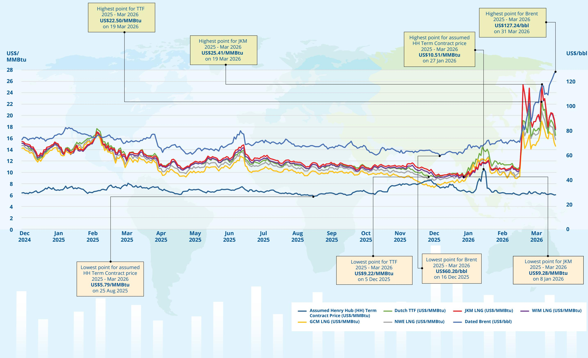

## 4. 价格趋势

2025 年液化天然气价格反映出亚太和大西洋市场结构之间的日益分化。在亚太盆地，随着需求、灵活供给和金融参与的深化，价格呈现出更宽的季节波动和更强的跨盆地敏感性。大西洋盆地的供应结构仍然良好，欧洲是过剩液化天然气的主要清算市场。在此背景下，与液化天然气基准挂钩的定价、流动性和风险管理活动继续在两个盆地扩大。

  
由 GAZ 系统提供

由于中东地缘政治紧张局势和对卡塔尔设施的军事袭击扰乱了全球供应链，2026 年第一季度液化天然气价格大幅上涨，卡塔尔在 2025 年的出货量为 81.5 吨，占全球出口量的 18.7%。随着亚洲液化天然气进口商和销售商消化了持续的影响，普氏 JKM 价格于 3 月 3 日上涨近 70%，至 25.393 美元/MMBtu，达到 2022 年 12 月 30 日以来的最高水平。

供应冲击引发了交易活动的激增，亚洲进口商转向现货市场以获得替代货物，而贸易商则纷纷对冲价格波动。亚洲实物普氏市场收盘评估过程中的液化天然气交易量同比增长 77%，至 2026 年第一季度的 62 笔交易，高于 2025 年第一季度的 35 笔交易。衍生品交易量同比飙升 251% 至 1,744 份合约（830 万吨），而去年同期为 497 份合约（2.3 公吨）。

图 4.1：2024 年 12 月至 2024 年 3 月主要液化天然气、管道天然气和石油基准比较20264.1
  
注：假设亨利中心定期合约价格 = HH\*115% + 2.75 美元/MMBtu 资料来源：S&P Global Energy

## 亚太地区液化天然气价格趋势

## 4.1

Platts JKM 基准反映了运往东北亚的液化天然气货物，2025 年平均价格为 12.16 美元/MMBtu，比 2024 年上涨 2.10%。通过普氏收盘市场 (MOC) 流程进行评估，报告称 2025 年交付的实物活动达到 15.5 公吨。 2025 年 JKM 价格范围较宽，为 9.39 美元-17.12 美元/MMBtu，而 2024 年为 7.98 美元-15.59 美元/MMBtu，反映出市场对季节性需求波动和跨流域竞争对灵活供应更加敏感。 2025 年价格于 2 月 10 日达到峰值，达到 17.123 美元/MMBtu，原因是亚洲买家在与欧洲液化天然气供应竞争加剧的情况下竞相获得及时的货物，而卖家则选择将美国货物转移到利润率比亚洲更有利的欧洲。

在整个亚洲，电力行业的动态直接影响了现货需求的基本面。日本的进口量基本持平，由于核产量增加、现货拉力减弱，同比下滑 0.35 公吨，即 0.5%，至 67.37 公吨，而韩国（+3.5%）和中国台北（+10.7%）的核供应紧张推动了现货购买增量。在东南亚，国内天然气下降结构性地增加了对液化天然气现货市场的依赖，其中印度尼西亚创纪录的进口量和新加坡同比增长 5.7% 带动了这一增长，但部分被泰国需求疲软所抵消。

图 4.2：2022 年至 2026 年第一季度价格基准 30 天移动年化波动率比较
  
资料来源：标普全球能源

第三和第四季度，努力在冬季需求之前对冲风险。泰国和印度的投标和报价显着增加，分别交付 87 架和 72 架，同比增长 165%，突显 JKT 中国核心市场之外的流动性和兴趣不断扩大。在一个案例中，据称一批 8 月中旬交付的货物在现货市场上交易了 46 次，这一记录凸显了市场参与者之间交易活动的深度。

亚太地区液化天然气市场受到北亚部分地区需求增长疲软和贸易流向变化的影响。

MOC 的液化天然气衍生品交易活动同比增长 156%，达到创纪录的 21.64 公吨当量，这是亚洲市场金融活动的一大进步，使买家能够在持续的市场波动中更有效地对冲远期价格风险。这种转变反映了实物参与的加强，并强化了市场向更积极、与基准挂钩的对冲和风险转移的转变。

在南亚，由于印度和巴基斯坦收缩，而孟加拉国扩张，液化天然气进口总量下降。印度的液化天然气定价和采购随着基准和交易所交易的使用不断发展而不断发展——4 月 2 日，印度天然气交易所 (IGX) 在哈兹拉 (Hazira) 5 月至 7 月交付的 322,000 MMBtu（6,190 吨）天然气以普氏西印度市场价格 (WIM) 成交，价格减去 0.70 美元/MMBtu，这表明短期采购越来越多地使用与指数挂钩的定价。

中东冲突爆发后，液化天然气价格波动性在 2026 年第一季度进一步上升，但在 4 月份有所下降。自2月28日中东战争爆发以来，亚洲液化天然气买家已将至少8艘大西洋盆地的货物从欧洲转移出去，原因是卡塔尔拉斯拉凡设施遭受袭击后供应风险不断升级，加剧了亚洲近期的紧迫性，并重塑了贸易流向。这一转变还凸显出，在亚洲现货市场活动和流动性不断加深的支撑下，市场在转移资源方面的灵活性不断增强。

2025年，中国仍然是全球最大的液化天然气进口国，尽管进口量从2024年的78.64吨减少到69.77吨，同比下降8.87吨，即11.3%，原因是国内供应强劲、管道流入量增加以及温和的天气减少了现货购买。即便如此，中国的转口量从上一年的 0.46 公吨增长了 45.8% 至 0.67 公吨，凸显了其在全球现货市场中日益重要的地位。随着全球现货价格高于国内水平，中国将套利交易量带回市场并在扩大的存储和再装货能力的支持下增加流动性，因此再装货量增加。

由于参与者寻求更高的价格透明度和更活跃的现货交易，亚洲市场活动大幅加强。普氏亚太地区货运 MOC 的现货液化天然气货运活动同比增长 132.2%，达到 2025 年交付量的创纪录水平，40 家公司报告了 5,739 笔出价、报价和交易。报告的 2025 年现货交割交易量达到 232 笔，同比增长 127%，其中参与度最高的是

整个2025年，亚洲的液化天然气风险管理框架继续深化，更加依赖与基准挂钩的定价，并采取更审慎的方法来对冲季节性风险。

中东冲突爆发后，液化天然气价格波动性在 2026 年第一季度进一步上升，但在 4 月份有所下降。自2月28日中东战争爆发以来，亚洲液化天然气买家已将至少8艘大西洋盆地的货物从欧洲转移出去，原因是卡塔尔拉斯拉凡设施遭受袭击后供应风险不断升级，加剧了亚洲近期的紧迫性，并重塑了贸易流向。这一转变还凸显出，在亚洲现货市场活动和流动性不断加深的支撑下，市场在转移资源方面的灵活性不断增强。

由于参与者寻求更高的价格透明度和更活跃的现货交易，亚洲市场活动大幅加强。普氏亚太地区货运 MOC 的现货液化天然气货运活动同比增长 132.2%，达到 2025 年交付量的创纪录水平，40 家公司报告了 5,739 笔出价、报价和交易。据报道，2025 年现货交割量达到 232 笔，同比增长 127%，其中第三和第四季度的参与最为强劲，并努力在冬季需求之前对冲风险。泰国和印度的投标和报价显着增加，分别交付 87 架和 72 架，同比增长 165%，突显 JKT 中国核心市场之外的流动性和兴趣不断扩大。在一个案例中，据称一批 8 月中旬交付的货物在现货市场上交易了 46 次，这一记录凸显了市场参与者之间交易活动的深度。

MOC 的液化天然气衍生品交易活动同比增长 156%，达到创纪录的 21.64 公吨当量，这是亚洲市场金融活动的一大进步，使买家能够在持续的市场波动中更有效地对冲远期价格风险。这种转变反映了实物参与的加强，并强化了市场向更积极、与基准挂钩的对冲和风险转移的转变。

图 4.3：2021 年至 2025 年普氏液化天然气货物和衍生品 MOC 交易
  
资料来源：标普全球能源

## 4.2

2025年，大西洋盆地的美国出口已饱和，导致盆地间竞争最小化，套利机会也有限。

# 大西洋液化天然气价格趋势

强劲的供应给全年大部分时间的价格和运费带来了下行压力。

2025年，欧洲进口了创纪录的126.2吨液化天然气，同比增长26.1%，因为该地区在乌克兰天然气过境协议到期后取代了失去的俄罗斯管道天然气。美国仍然是主要供应国，占净进口量的 58.5%（73.8 公吨），而俄罗斯是第二大供应国，占 11.1%（14.03 公吨）。美国液化天然气是 2025 年欧洲大西洋盆地供应的主要来源，美国到欧洲的最大流量输送到荷兰（12.1 公吨）、法国（10.5 公吨）和西班牙（8.1 公吨）。山）。意大利（7.2 公吨）、土耳其（7.1 公吨）、英国（6.8 公吨）和德国（6.3 公吨）也接收了大量美国液化天然气，这��显出欧洲越来越依赖灵活的美国液化天然气作为边际平衡供应。

欧洲对现货液化天然气的依赖似乎进一步加剧。预计 65.5% 的液化天然气进口来自现货采购，同比增长 17.4 个百分点。这增加了短期价格信号的风险，但在供应过剩的大西洋市场上，这也加剧了液化天然气交付价格的下行压力。夏季需求尤其低迷，因为欧洲理事会放宽天然气储存目标的决定扰乱了典型的补货模式并减少了增量现货购买兴趣。

2024 年的激烈跨流域竞争并未成为现实，套利经济学始终有利于大西洋流向。亚欧价差仍然太弱，无法吸引大西洋货物向东流动，Platts 评估北亚经好望角与大西洋套利的平均价格为 -0.71 美元/MMBtu。加上运费低迷，这使得大西洋盆地的结构性变长，并加强了欧洲作为过剩液化天然气供应清算市场的作用。

欧洲面临来自埃及的局部竞争，埃及转为净进口国，液化天然气需求量为 9.6 吨，同比增长 259.4%，超过 2016 年 7.3 吨的峰值。国内天然气产量下降以及对以色列天然气供应中断的担忧推动采购增加。埃及年内还获得了 4 个浮式储存和再气化装置（FSRU）以稳定发电。其他地区，拉丁美洲液化天然气需求减弱，进口量从 2024 年的 12.95 公吨下降至 10.98 公吨。季节性补货和与天气相关的需求支撑了 4 月至 8 月的进口，由于气温低于正常水平和管道中断，阿根廷占该地区 7 月进口量的 36%。

液化天然气供应增长仍然是 2025 年的一个关键主题，供应增加进一步影响市场平衡。

加拿大液化天然气公司 (LNG Canada) 发运了第一批货物，但由于运营问题，产量增长速度慢于预期，且 1 号列车从 10 月份开始一直持续出口。相比之下，Plaquemines LNG 在美国墨西哥湾沿岸的产量增长迅速，增加量强劲，而 Venture Global 也在 7 月份接受了 14.4 Mtpa CP2 LNG 项目的最终投资决定。

普氏能源资讯 2025 年西北欧 (NWE) 液化天然气平均价格为 11.423 美元/MMBtu，而 2024 年为 10.743 美元/MMBtu。DES NWE 价格相对于荷兰产权转让基金 (TTF) 的平均折扣为 54 美分/MMBtu，明显高于 2024 年 26 美分的平均折扣。这反映了充足的液化天然气欧洲的可用性以及大西洋盆地货物的竞争减少。

尽管价格变化总体平缓，但大西洋液化天然气市场经历了两次显着的价格上涨。第一次发生在 2 月初，受寒冷天气预测和欧洲天然气储存水平下降的推动，将价格推升至 2023 年 2 月初以来的最高水平。第二次发生在 6 月中旬，当时以色列和哈马斯之间不断升级的紧张局势给市场注入了暂时的地缘政治风险溢价，尽管基本供应没有中断。

图 4.4：2023 年 1 月至 2025 年 12 月美国至亚洲的液化天然气价格差异与销量变化
  
资料来源：标普全球能源

2025年，大西洋盆地在结构上仍然很长，在亚欧套利受到限制的情况下，加强了欧洲作为美国供应过剩的主要目的地的作用。价格和运费在很大程度上受到供应的限制，而波动主要由天气和地缘政治发展驱动。

到2026年，欧洲的液化天然气前景取决于Golden Pass液化天然气的生产状况、中东的稳定和储存注入的步伐。美伊冲突可能会导致价格中包含风险溢价，霍尔木兹海峡的不确定性导致全球液化天然气供应收紧，并迫使欧洲与亚洲就灵活的货物进行更激烈的竞争。尽管欧洲在俄罗斯入侵乌克兰后的2022年能源危机期间避免了困扰地区天然气市场的创纪录价格飙升，但随着夏季临近和需求降温，欧洲大陆仍然面临价格上行风险，尽管价格水平高企导致需求破坏的威胁可能会限制任何反弹。

＃＃ 结论

总体而言，2025 年液化天然气市场将日益受到各流域结构差异的影响。亚太地区的定价反映了流动性的成熟、对液化天然气基准的更大依赖以及对季节性和跨流域信号的敏感性提高。与此同时，大西洋的持续供应限制了价格上涨，并强化了欧洲作为全球液化天然气边际目的地的角色。展望 2026 年，价格动态预计将继续与以霍尔木兹海峡为中心的地缘政治发展、新供应初创企业、天气驱动的需求风险密切相关，液化天然气和天然气基准在所有地区的贸易中发挥着越来越大的作用。

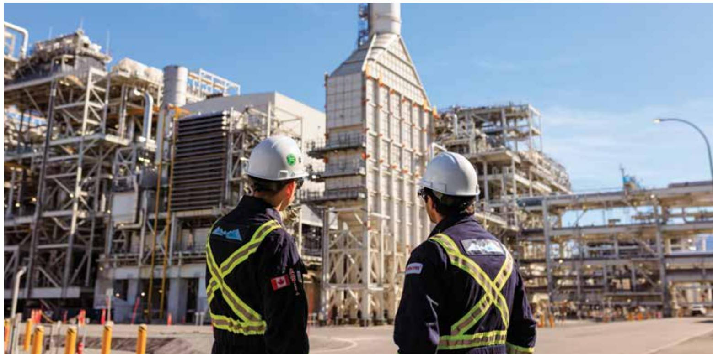  
由加拿大液化天然气公司提供

2025年全球液化能力达到524.5 Mtpa。

2025 年新增产能


30.1Mtpa液化产能上线


与 2024 年相比同比增长 6.1%


美国 116.9Mtpa

液化能力最高的市场

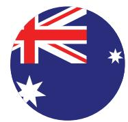

澳大利亚 85.1Mtpa

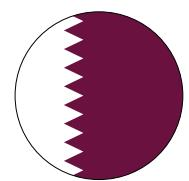

氢氧化钠 77.1Mtpa

## 预 FID


1,105.4Mtpa 液化能力目前处于预 FID 阶段

384.4Mtpa 来自美国

227.3Mtpa 来自加拿大


170.4Mtpa 俄罗斯 45.5Mtpa 来自澳大利亚

## FID 和建设中


2025 年最终投资决定 截至 2025 年 12 月，在建或批准开发的液化能力为 68.4Mtpa


6 个液化天然气项目 112Mtpa

# 5.液化厂

2025年液化产能总计新增30.1Mtpa，到2025年底全球产能将达到524.5Mtpa1。2025年全球平均利用率为83.9%，较2024年的86.5%略有下降，主要原因是极端天气模式、维护和机械故障。截至2025年底，已有7个项目达成最终投资决定（FID），使液化项目总核准产能达到234.3 Mtpa。

  
由加拿大液化天然气公司提供

## 5.1 概述

图 5.1：1990-2031 年按地区划分的全球液化能力增长
  
资料来源：Rystad Energy

2025年全球上线的液化能力包括增加Plaquemines LNG T9-T36（15.1 Mtpa，简单入门，假设2024年前四个区块的8条生产线启动）和美国（US）的科珀斯克里斯蒂第3阶段（6.0 Mtpa）、北美西海岸的LNG加拿大（7.0 Mtpa）、Tortue/Ahmeyim FLNG阶段非洲LNG 1（2.5 Mtpa）的产能，而Arctic LNG 2也增加了6.6 Mtpa的产能。

图 5.2：按地区和状况划分的全球液化能力，2025 年底
  
资料来源：Rystad Energy

特立尼达和多巴哥、澳大利亚和美国的退休抵消了其中的一些增加。美国、澳大利亚和卡塔尔在全球液化运营能力方面仍位居前三位。 2026年上半年，卡塔尔能源公司和埃克森美孚的合资企业Golden Pass于3月份实现了第一批液化天然气，并于4月22日出口了第一批货物。尽管引入了“黄金通道”供应，但由于 3 月初霍尔木兹海峡的关闭（截至 5 月 26 日仍然存在），全球液化天然气市场仍处于紧张状态，占用了卡塔尔2和阿拉伯联合酋长国（阿联酋）市场的液化能力，迫使两个市场关闭液化天然气生产。因此，卡塔尔能源公司宣布多项液化天然气合同遭遇不可抗力，导致近期市场陷入供应不足的状态。持续的地区紧张局势也将对市场产生长期影响，因为 3 月 18 日伊朗导弹袭击对卡塔尔拉斯拉凡液化天然气设施的两列液化天然气列车造成严重损坏。预计这两列列车将在未来三到五年内离线，这意味着卡塔尔的总铭牌运力在此期间损失 17%（12.8 Mtpa）。

2025年，批准的液化产能为68.4 Mtpa，与2024年的14.8 Mtpa相比显着上升，是自2019年以来的最高年度总量。2025年的液化天然气批准主要集中在美国，这是由政治和监管支持推动的，而不是供需冲击，这就是2022年俄罗斯-乌克兰冲突爆发后的情况。更具体地说，特朗普政府取消了对非自由贸易协定 (FTA) 批准的禁令，这阻碍了许多液化天然气项目在 2025 年之前完工。去年在美国，伍德赛德路易斯安那液化天然气 (16.5 Mtpa)、卡尔克苏帕斯 2 (CP2) 液化天然气 (14.4 Mtpa)、亚瑟港二期 (13.0 Mtpa)、里约热内卢Grande Phase 2 (12 Mtpa) 和 Corpus Christi Midscale T8-9 (3.0 Mtpa) 获得最终投资决定。 CP2 LNG 计划于 2027 年底成为第一个投产项目，而其他四个项目均将于 2029 年或 2030 年投产。澳大利亚公司 Woodside 于 2024 年从 Tellurian 手中收购了路易斯安那州 LNG 项目，使其重新焕发活力，并于 4 月初进行了最终投资决定。与路易斯安那液化天然气一样，CP2 是美国 2025 年批准的唯一绿地项目。 Venture Global 于 7 月对该项目进行了最终投资决定，将其运营和批准的液化能力提高到 43.8 Mtpa，仅次于 Cheniere 的 58.4 Mtpa。

其他三个项目是目前正在运营或正在建设中的棕地扩建项目。 Rio Grande二期工程包括4号线和5号线，均得到长期SPA的支持——主要买家包括ADNOC、TotalEnergies、Aramco、Jera和ConocoPhillips。亚瑟港二期项目于 2025 年获得能源部 (DOE) 出口授权，随后于今年晚些时候达成最终投资决定，这将使目前一期项目 13 Mtpa 的产能翻一番，达到 26 Mtpa 的总产能，一旦建成，将成为美国墨西哥湾沿岸最大的液化天然气设施之一。 Cheniere 的科珀斯克里斯蒂扩建项目中型列车 8 号和 9 号是最小的项目，容量为 3 Mtpa，但执行风险最小，采用 Cheniere 的标准“中型”列车设计来降低成本和执行风险。

美国墨西哥湾沿岸的这五个项目以及所有其他在建液化天然气接收站将对国内和全球液化天然气市场产生显着的价格影响。

在美国之外，阿根廷的 Southern Energy FLNG（6.0 Mtpa）和莫桑比克的 Coral North FLNG（3.6 Mtpa）也获得批准。 Coral North 是一个 3.6 Mtpa FLNG 终端，位于鲁伍马盆地超深水 4 区海岸约 55 公里处，将是正在运行的 Coral South FLNG 系统的复制品。天然气将从海底井生产并直接连接到浮船，在那里进行加工、液化、储存并卸载到液化天然气运输船，完全在海上进行，没有陆上液化基础设施。这种浮动模式在莫桑比克尤为重要，因为它绕过了陆上安全和基础设施限制，同时实现了陆上资源更快的货币化。该项目利用 Coral South 相同的设计、工程、采购和施工 (EPC) 执行以及运营经验，实现标准化、降低执行风险并提高运营正常运行时间。 Coral North由埃尼集团与中石油、埃克森美孚、KOGAS、ENH和ADNOC的XRG等合作伙伴共同运营，将有效地将莫桑比克的FLNG产量提高一倍，并加强该盆地可扩展的海上液化天然气开发模式。 Southern Energy FLNG 是阿根廷第一个液化天然气出口项目，基于两艘浮式液化船（Hilli Episeyo 和 MK II），总产能为 6.0 Mtpa。该项目位于圣马蒂亚斯湾近海，采用混合模式，天然气来自于多产的 Vaca Muerta 页岩区，通过管道输送至 FLNG 船进行液化和出口。第一个装置（Hilli，2.5 Mtpa）预计将于 2027 年上线，随后在额外管道基础设施的支持下，MK II（3.5 Mtpa）将于 2028 年上线。这两艘船都是采用模块化 Black & Veatch PRICO 技术改装的液化天然气运输船，与陆上码头相比，部署速度更快，资本密集度更低。船舶共置可实现共享物流和运营协同效应，而项目结构（YPF、PAE、Pampa、Harbour Energy、Golar）将上游供应与液化天然气出口整合在一起。

截至2025年底，1,105.4Mtpa的愿望液化能力处于FID前阶段。大多数拟议产能位于北美（650.3 Mtpa），其中美国为 384.4 Mtpa，加拿大为 227.3 Mtpa，墨西哥为 38.6 Mtpa。其次是俄罗斯（170.4 Mtpa）、非洲（121.1 Mtpa）、亚太地区（67.0 Mtpa）和中东（65.7 Mtpa）。世界其他地区提议建设约 31 Mtpa 的液化能力。总体而言，市场仍然受到俄罗斯和乌克兰冲突的影响，最近，霍尔木兹海峡的关闭给市场带来了鲜明的提醒，即能源安全需要成为各国政府能源政策的首要任务。能源安全的溢价将继续刺激对额外液化的投资，同时在这个快速变化的环境中平衡脱碳目标。尽管如此，随着 2025 年批准的每年第二大液化天然气产能，未来的经济环境将很困难，并将阻止许多项目达成积极的最终投资决定。

## 5.2

## 全球液化能力和利用率

截至 2025 年底，全球运营液化能力总计 524.54 Mtpa，与 2024 年相比增加了 30.1 Mtpa，因为三个北美项目 - Plaquemines (T9-T36)、Corpus Christi stage 3 和 LNG Canada - 上线。 2025年平均利用率为83.9%3，较2024年小幅下降2.6个百分点。2025年液化天然气计划外停运较多，主要是由于机械故障和维护，但也有停电和恶劣天气条件造成的。 2025年，25个液化天然气出口市场中有12个的利用率高于平均水平，包括

巴布亚新几内亚、阿曼、莫桑比克、卡塔尔、美国、刚果、澳大利亚、安哥拉、马来西亚、阿联酋、秘鲁、俄罗斯、赤道几内亚、特立尼达和多巴哥和墨西哥。与此同时，一些出口设施的运行速度低于平均水平，例如阿尔及利亚的三个Arzew工厂的利用率从2000年代初期的90%下降到2025年的38%。这一下降是由总原料气供应量减少和总液化能力增加共同造成的。此外，加拿大液化天然气公司在2025年的产能提升过程中出现了停运，导致利用率为30.6%。

资料来源：Rystad Energy

2025年美国液化厂平均运营利用率为94.7%，较2024年的93.9%略有上升，全年表现稳定。这尤其得益于自由港液化天然气设施的业绩反弹，该设施在 2024 年经历了 23 次停运，其中 91% 是计划外停运，导致利用率为 85%，显着低于平均水平 93.9%。 2025 年，弗里波特的平均运营利用率为 107%4，是美国表现最好的液化天然气设施之一。 Cheniere 位于科珀斯克里斯蒂和萨宾帕斯的液化天然气工厂到 2025 年仍表现稳定，略高于本已较高的历史利用率，并为强劲的整体平均水平做出了贡献。在北美其他地区，加拿大和墨西哥的工厂与同行相比表现不佳。加拿大液化天然气公司的停运影响了其 1 号列车的产能提升，该列车于 6 月开始生产，由于设备故障和必要的火炬燃烧，三个月后才开始持续出口货物，导致利用率为 30.6%。同样，墨西哥阿尔塔米拉液化天然气的利用也滞后，尽管程度不同。 阿尔塔米拉液化天然气列车 1 号在 2024 年启动时遇到的困难一直持续到 2025 年初，导致当年的整体利用率降至 73.7%。

在非洲，尼日利亚液化天然气(NLNG)5.3工厂2025年的铭牌利用率平均为66.6%，较2024年略有上升，但仍受到地区安全问题的影响，导致该工厂过去曾宣布不可抗力。原料气供应下降也是 NLNG 设施面临的一个主要问题，因为其传统合作伙伴剥离并转让了为 LNG 接收站提供原料的陆上资产。由于国内天然气短缺持续，埃及到2025年仍将是液化天然气净进口国。其液化天然气出口量下降至 0.5 吨，出发的货物非常稀少，而液化天然气进口量则增长至略低于 10 吨，其中大部分来自美国，这加剧了大西洋货物的竞争。其他表现良好的非洲市场还有莫桑比克、刚果和安哥拉，利用率分别为108.2%、101.4%和93.6%。

澳大利亚是全球第三大液化天然气出口国，全年运营利用率为 94.4%，与 2024 年的表现持平。市场最大的出口中心西北大陆架、Gorgon、Wheatstone 和 Ichthys 继续稳定产量，Gorgon 和 Wheatstone 受益于早期运营问题后可靠性的提高，而 Ichthys 则保持持续的高正常运行时间。在东海岸，昆士兰州的煤层气相关项目（QCLNG、APLNG、GLNG）也稳定运行，但与原料气可用性相关的波动性更大。

图 5.3：全球液化产能利用率，20255


图 5.4：全球液化能力发展，1990-20316
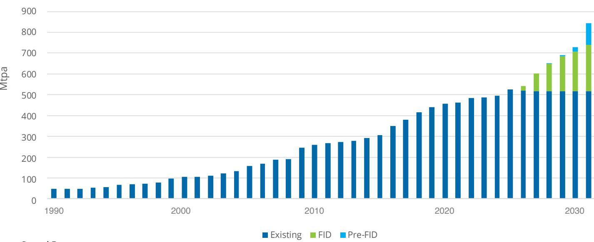

## 资料来源：Rystad Energy

## 5.3 按市场划分的液化能力

## 运营中

截至2025年底，有25个市场运营液化天然气出口设施。 2025年，美国仍然是运营液化能力最大的市场，为116.9 Mtpa。澳大利亚和卡塔尔排名第二和第三，分别为85.1 Mtpa和77.1 Mtpa，卡塔尔保持与上一年相同的能力，而澳大利亚则因运营商Woodside退役西北大陆架液化天然气接收站2号列车而略有下降。目前，三大液化天然气出口市场占全球产能的一半以上。

由于进入欧洲的俄罗斯管道流量到 2025 年已减少至 17.7 bcm（相对于 2022 年俄罗斯-乌克兰冲突前的 112.8 bcm），俄罗斯继续努力在 2025 年增加其液化天然气出口。虽然全年出口量保持相对弹性，但其出口和运输船队在结构上受到制裁的限制。 2025 年，俄罗斯液化天然气出口总量为 30.5 吨，比 2024 年水平下降 10.7%，这得益于亚马尔液化天然气接收站继续向欧洲运送液化天然气。制裁对增长的影响大于对现有供应的影响，旗舰北极液化天然气2号项目面临着物流、融资、技术获取和液化天然气运输船可用性方面的重大挑战，导致产能增加延迟和运营不一致，远低于产能。尽管一些货物已使用折扣价格和替代运输解决方案改道至中国，但整体表现仍然不稳定。没想到的是，北极2号液化天然气接收站全年仍成功出口多批液化天然气货物，以大幅折扣价格独家登陆中国北海接收站。 此外，Portovaya 和 Vysotsk LNG 合计同比下降 1.7 吨，进一步阻碍了俄罗斯 2025 年的液化天然气出口。

图 5.5：20255 年底全球液化运营能力 (Mtpa) 和市场份额 (%)（按市场划分）


## 建设中/最终投资决定

2025年底，在建或批准开发的液化能力为234.3 Mtpa，其中约48%位于北美。到2025年，总共批准了68.4 Mtpa的液化能力，其中五个美国墨西哥湾沿岸项目正在推进中，包括Woodside Louisiana LNG (16.5 Mtpa)、CP2 LNG (14.4 Mtpa)、Port Arthur Phase 2 (13 Mtpa)、Rio Grande Phase 2 (12 Mtpa) 和 Corpus Christi Midscale T8-9 (3.0 Mtpa) 以及阿根廷 Southern Energy FLNG（6.0 Mtpa）和莫桑比克 Coral North FLNG（3.6 Mtpa）的另外两个项目获得了积极的 FID。

目前，多个液化设施正在建设中，并即将竣工。科珀斯克里斯蒂第 3 阶段列车 5-7（5.3 Mtpa）将于 2026 年启动，预计将在年底前完成全面启动，而 Golden Pass（17.8 Mtpa）则于 2026 年 3 月 30 日实现了第一批液化天然气，并于 4 月 22 日出口了第一批液化天然气货物。同样，加拿大液化天然气列车 2（7 Mtpa）也将采取同样的做法，预计到年中（2026 年）将达到满负荷。在中东，由于中东冲突、霍尔木兹海峡关闭以及对拉斯拉凡工业城能源综合体造成的破坏，卡塔尔的 NFE T8-11（32 Mtpa）现将比原定于 2026 年第三季度开始的日期推迟至少一年。

图 5.6：20255.6 年底全球批准的液化能力（Mtpa）和市场份额（%）（按市场划分）


资料来源：Rystad Energy

截至 2025 年底，预 FID 阶段的潜在液化能力为 1105.4 Mtpa，与 2024 年相比基本持平。由于霍尔木兹海峡的紧张局势仍在持续，对受损的拉斯拉凡卡塔尔能源液化天然气设施的影响仍在处理中，这种不确定性可能会重新激发人们对许多预 FID 项目的兴趣，以帮助满足对更稳定的液化天然气来源的需求。然而，随着经济变得更具挑战性，每个项目的 FID 都会使后续的 FID 变得更加困难，因为这些将决定未来批准的液化天然气项目的数量。

＃＃ 建议的

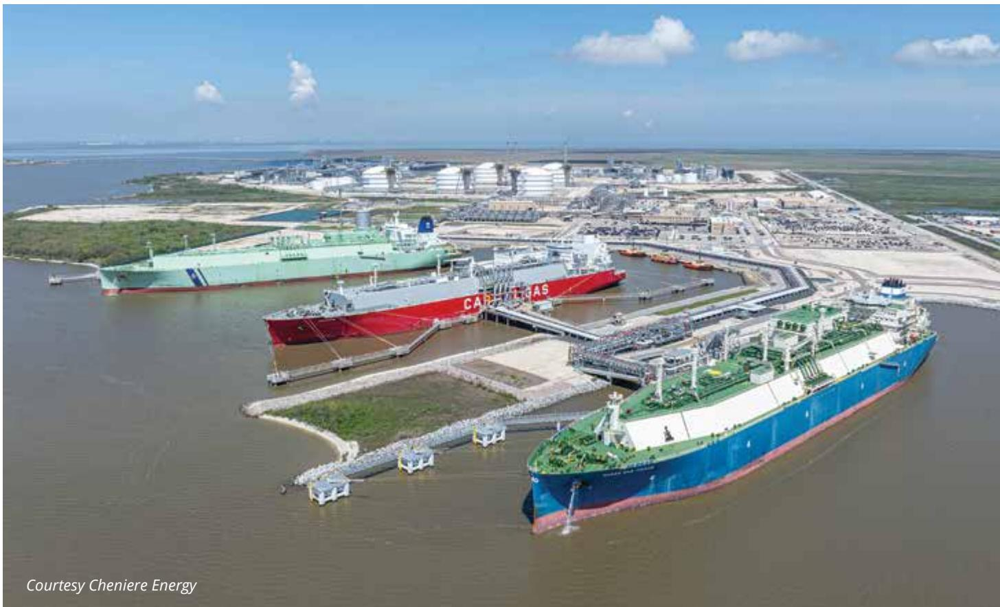  
切尼尔能源公司提供
图 5.7：2025 年底全球拟议液化能力（Mtpa）和市场份额（%）（按市场划分）

美国、384.4、34.8% 俄罗斯、170.4、15.4% 莫桑比克、45.0、4.1% 伊朗、36.8、3.3% 阿根廷、18.0、1.6% 坦桑尼亚、15.0、1.4% 吉布提、10.0、0.9% 巴布亚新几内亚、9.2、 0.8% 以色列、5.0、0.5% 伊拉克、4.5、0.4% 赤道几内亚、4.4、0.4% 塞浦路斯、2.0、0.2% 刚果、1.4、0.1%

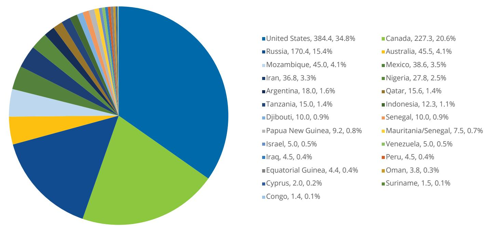  
资料来源：Rystad Energy

拟建的美国液化产能 384.4 Mtpa 继续得到液化天然气开发商和投资者的支持，他们希望利用美国友好的投资环境和美国液化天然气项目所带来的强劲经济效益。美国液化天然气项目的经济效益与全球其他综合项目显着不同，因为大多数美国项目都是收费和/或商业模式设施，这是在 2016-20 年美国产能增加浪潮期间引入全球市场的新方法。在收费模式中，液化天然气开发商不占有天然气，只是提供液化服务以收取收费，而商业设施则向承购商提供液化天然气，如果经济上没有意义，则可以灵活地不提货（我们在 2020 年看到，当时 TTF - 亨利中心价差跌至 1 美元/MMBtu 以下）。 2025 年美国墨西哥湾沿岸液化天然气核准产能的激增是由这些强劲的经济因素促成的，但也是由于美国能源部取消了对拟议液化天然气项目新的非自由贸易协定批准的暂停，这是在做出积极的 FID 之前必须获得的强制性授权。 然而，展望未来，由于服务于美国墨西哥湾沿岸的关键地区的天然气库存正在迅速耗尽，刺激天然气钻探和生产所需的价格上涨，预计拟议的美国墨西哥湾沿岸项目的经济性将面临更大的挑战。此外，随着德克萨斯州数据中心的大规模建设，人们越来越担心亨利中心价格将在中长期内结构性上涨至 5 美元/MMBtu 左右，这需要亚洲液化天然气现货价格高于 10 美元/MMBtu 才能实现液化天然气经济。

在加拿大拟议的 227.3 Mtpa 液化能力中，只有有限数量的项目被认为是可行的。与美国墨西哥湾沿岸项目相比，西海岸设施受益于亚洲运输成本较低，但面临管道开发和环境审批方面的关键挑战。许多项目已被推迟或取消，而那些正在推进的项目正在采用较低排放的解决方案，以满足监管和社会要求。例如，加拿大液化天然气公司二期T3-T4（14.0 Mtpa）计划使用高效航改燃气轮机并采用可再生能源来减少排放。

俄罗斯液化天然气扩张时间表已被推迟，有效限制了近期产能增长。展望未来，最有可能达成最终投资决定的项目是那些对西方技术依赖有限的项目，包括剩余的北极液化天然气2号列车、Ob液化天然气和摩尔曼斯克液化天然气，尽管在当前的制裁环境下所有项目都继续面临重大不确定性。

非洲拟议的液化能力已增至 121.1 Mtpa。莫桑比克拥有最大的管道，总容量为 45 Mtpa。 Rovuma LNG 在其新设计中可能会使用模块化方法，而不是固定式方法，容量从 15.2 Mtpa 扩大到 18 Mtpa。 2025年，莫桑比克鲁伍马盆地（第4区）的海上液化天然气取得了有意义的进展，而陆上项目则陷入停滞。关键进展是Coral North FLNG项目（3.6 Mtpa）的最终投资决定和政府批准，该项目建立在Coral South成功的基础上，预计于2028年左右上线，使莫桑比克的FLNG产量有效增加一倍，达到7 Mtpa以上。这强化了向海上 FLNG 解决方案的战略转变，该解决方案较少受到扰乱德尔加杜角陆上开发的安全风险的影响。相比之下，规模较大的鲁伍马液化天然气（18 Mtpa）和莫桑比克液化天然气（1 区）（12 Mtpa）项目尽管规模庞大且具有长期重要性，但由于持续的安全问题、融资挑战和成本通胀，到 2025 年仍被推迟。总体而言，2025年突出了两条轨道的发展路径： 海上项目推进天然气并实现货币化，而大型陆上液化天然气项目继续面临延误。

在亚太地区，澳大利亚仍然是预计产能最大的市场，预计到 2025 年产能将达到 45.5 Mtpa。 Abbot Point LNG T1-T4（1.9 Mtpa）、Gorgon LNG T4（5.2 Mtpa）和 Wheatstone LNG T3-T5（15.9 Mtpa）等拟议项目尚未取得进展，其中大多数仍处于可行性阶段。监管和联邦政策仍然是澳大利亚液化天然气行业的主要障碍，尤其是在东海岸。西澳大利亚州仍然更加支持液化天然气的进一步开发，支持西北陆架扩建和冥王星/斯卡伯勒等项目，但在寻求出口批准时仍须遵守强制性国内供应协议。因此，尽管有众多项目正在酝酿之中，但我们对液化天然气出口能力的预测从长期来看仍大致持平。在巴布亚新几内亚 (PNG)，埃克森美孚与 TotalEnergies 正在努力就巴布亚液化天然气项目 (4 Mtpa) 做出决定，尽管由于重新向更广泛的承包商群体开放招标，最终投资决定被推迟到 2026 年。

在东南亚，印度尼西亚提议建设总计 12.33 Mtpa 的新液化产能，主要由阿巴迪液化天然气项目（9.5 Mtpa）推动。该项目将由位于马塞拉生产分成合同（PSC）内的阿巴迪天然气和凝析油田供应，使其成为市场上最重要的未开发天然气资源之一。修订后的发展计划于 2023 年 12 月获得政府批准，其中特别纳入了碳捕获和封存 (CCS) 部分以解决排放问题，标志着在多年的修订和拖延后向前迈出了重要一步。该项目目前的目标是在 2020 年代后半叶进行最终投资决定，预计在 2030 年代初生产第一批液化天然气，但时间表仍取决于执行、融资和监管部门的批准。

## 退役并闲置

2025 年，三列液化天然气列车正式退役。阿拉斯加的基奈液化天然气接收站（1.5 Mtpa）是美国最古老的常设出口设施，自 2007 年以来一直没有生产液化天然气。

## 5.4

## 液化技术


在 2025 年投入运营的液化列车中，毛里塔尼亚/塞内加尔的 Tortue/Ahmeyim FLNG 设施采用了 Black & Veatch 的 PRICO 技术，正如许多 FLNG 过去所做的那样，包括刚果的 Marine XII FLNG。在美国，Plaquemines LNG T1-T36 采用了贝克休斯的 SCMR 技术，利用小型模块化列车实现操作灵活性、降低施工风险并加快产能周期。美国Corpus Christi Stage 3 T1-T7采用了Chart Industries的IPSMR技术。与此同时，俄罗斯的Arctic LNG 2 T1选择了林德的MFC技术。然而，由于许多西方公司在当前制裁环境下无法提供服务，因此难以确保供应商，因此俄罗斯未来液化天然气的发展形势仍然不确定。壳牌作为运营商，正在使用自己的 DMR 技术来建造和运营加拿大液化天然气公司。

2016年，Harvest Midstream于2025年购买，计划改建为液化天然气进口码头。 2025 年的退役反映出当地天然气资源的枯竭，标志着美国从阿拉斯加持续出口液化天然气的结束，并更广泛地转向低成本的墨西哥湾沿岸供应。然而，如果阿拉斯加液化天然气项目在最终投资决定方面取得进展，这种说法可能会受到挑战。澳大利亚西北陆架 (NWS) 液化天然气项目 2 号线 (2.5 Mtpa) 由于老化的岸上油田的原料气减少而于 2025 年永久退役。此次关闭反��了该资产的成熟度，工厂总产能降至 14.2 Mtpa，而其余列车继续采用回填天然气策略运营。特立尼达和多巴哥的大西洋液化天然气接收站正式退役其1号线（3 Mtpa），关闭的原因是成熟油田上游天然气供应减少以及国内石化和电力行业对天然气的竞争加剧。此外，利比亚的Marsa El Brega液化天然气工厂于2011年停产，由于目前没有重启计划，该项目已被排除在本报告之外。

目前，霍尼韦尔液化技术仍占据市场主导地位，到2025年约占总运营能力的65%，其中AP-C3MR约占55%的份额。在考虑已批准的液化天然气项目时，霍尼韦尔技术公司预计将保持对市场的控制，在本十年余下的时间内保持约三分之二的份额。采用霍尼韦尔技术建造的一些著名项目包括卡塔尔天然气液化天然气、N液化天然气、Golden Pass 液化天然气、Energía Costa Azul 液化天然气、莫桑比克液化天然气（1 区）、里奥格兰德液化天然气和亚瑟港液化天然气。

随着 Plaquemines 液化天然气项目的竣工，BHGE Technologies 预计其使用量将增至 31 Mtpa。随着 Arctic 2 LNG 的投入运营，林德技术公司预计到 2031 年底，其船队数量将增至 19 Mtpa，尽管这一数字低于之前的预期，因为许多俄罗斯液化天然气项目因制裁而受阻。一旦 Pluto LNG 扩建项目部署完成，康菲石油公司的优化级联技术的使用量预计将增至 121.8 Mtpa，并且具有巨大的上升空间，成为全球领先开发商之一 Cheniere 的主要技术提供商。

天然气液化技术的根源可以追溯到 20 世纪 60 年代，当时 Arzew GL4Z T1–T3 等早期出口设施采用了 Pritchard 开发的经典级联工艺，而 Kenai LNG 使用了优化级联工艺的早期版本。 20 世纪 70 年代，霍尼韦尔（前身为 Air Products7）推出了单一混合制冷剂 (AP-SMR) 技术，该技术首先部署在 Marsa El Brega 液化天然气工厂，标志着向更高效和可扩展的液化设计的转变。在此早期阶段，液化装置的容量通常限制在 1.0 至 1.5 Mtpa，这些装置充当实验平台，以改进能够将天然气冷却至 -162°C 进行运输的工艺。从那时起，液化天然气技术取得了显着发展，随着 20 世纪 80 年代 APCI 的 C3MR 工艺的发展，该工艺成为大型工厂的行业标准，随后 AP-X 和 AP-XP 技术使巨型列车能够超过 7-8 Mtpa，如卡塔尔所见。 最近，该行业已多元化发展到模块化和中型设计，包括双混合制冷剂 (DMR) 和氮基工艺，这些工艺广泛用于 FLNG 和小型陆上项目。如今，进步的重点是提高效率、减少排放以及整合电气化和碳捕获，反映出从纯粹扩大产能到优化性能和环境影响的转变。

图 5.8：1966 年至 2031 年按技术和启动年份划分的已安装和批准的液化能力
  
资料来源：Rystad Energy

AP-C3MR 技术于 1972 年首次在文莱液化天然气设施部署，现已逐渐成为主要的液化工艺，到 2025 年约占全球运营能力的 55%（包括其 SplitMR 变体）。其强大的市场地位主要得益于卡塔尔天然气公司的发展，自 1996 年卡塔尔天然气公司 1 号列车启动以来，产能每年增加约 30 吨。达米埃塔液化天然气设施是第一个采用 C3MR/SplitMR 配置的设施，该设施通过精细的机械布局改进了基础工艺，提高了涡轮机效率。

霍尼韦尔进一步推进了其技术组合，推出了 AP-X，该系统于 2009 年在卡塔尔天然气 2 号首次实施，每列液化装置容量为 7.8 Mtpa，这是迄今为止实现的最大液化装置尺寸。该技术还被用于 2021 年和 2023 年批准的卡塔尔能源扩建项目，其中包括六列类似容量的巨型列车。产量的增加是通过在传统的 C3MR 工艺中添加氮气制冷循环来实现的，提供额外的过冷能力并提高整体效率。此后，这种方法的变体已应用于陆上和 FLNG 开发中。

基于 AP-X 过冷概念的更紧凑的衍生产品 AP-N 已部署在马来西亚国家石油公司的 PFLNG1 和 PFLNG2 上，而莫桑比克的 Coral South FLNG 和墨西哥的 Energía Costa Azul LNG 等项目则使用 AP-DMR 技术。 AP-N 仍然是唯一广泛应用于海上液化天然气应用的基于膨胀机 (EXP) 的工艺，与混合制冷剂系统相比，配置更简单，设备要求更低。其他 FLNG 项目，包括喀麦隆 FLNG、Congo Marine XII 和 Tortue/Ahmeyim，都依赖 Black & Veatch 的 PRICO 技术，凸显了浮动应用中液化解决方案的多样性。

尽管霍尼韦尔继续保持市场领先地位，但其市场份额已从 2025 年 2025 年的 90% 以上下降至 65% 左右，反映出竞争的加剧。一个主要的挑战者是康菲石油公司的优化级联工艺，该工艺在昆士兰柯蒂斯液化天然气、澳大利亚太平洋液化天然气、萨宾帕斯液化天然气、惠斯通液化天然气和科珀斯克里斯蒂液化天然气等主要项目中获得了关注。如今，优化级联技术的运营能力约为 121.8 Mtpa，即市场份额的 21.5%，使其成为使用第二广泛的工艺。

该技术最初于 20 世纪 60 年代末在 Kenai LNG 引入，自 1999 年大西洋 LNG 1 号列车开始得到重新采用，支撑了其现代复兴。随着 Pluto LNG 2 扩建（4.9 Mtpa）计划于 2026 年上线时使用优化级联技术，这一数字还将继续增加。

预计2025年至2030年，新的液化项目将越来越多地进入市场，这主要是由于对中小型液化天然气生产线的需求不断增长。随着对开采少量滞留天然气（尤其是海上天然气）的关注不断增加，再加上金融家和液化天然气项目接收者之间的竞争加剧，中小型液化天然气列车正在成为一种风险较低的替代方案，不需要与大型巨型列车项目相同数量的资金。这些列车的特点是尺寸紧凑、设计简单、易于标准化和模块化，这意味着在建造和执行过程中节省了成本和时间。 2025 年，使用 BHGE SCMR 技术的 Plaquemines LNG 开始运营，并能够在 12 个月内将产能提升至 20 Mtpa，对于同等规模的设施来说，这是一个惊人的提升。 Plaquemines 还能够持续推动其小型模块化列车超越铭牌容量，以接近 27 Mtpa 的峰值容量运行。

虽然大规模液化天然气液化技术市场由少数公司主导，但新技术正在不断涌现。其中一项技术是 New Fortress Energy 的 Fast LNG，该技术已部署在 Altamira LNG T1（1.4 Mtpa）项目中，也将用于 Altamira T2（1.4 Mtpa）项目。运营商驱动的液化技术继续引起关注。由壳牌和APCI开发的双混合制冷剂（DMR）工艺已在萨哈林2号液化天然气和Prelude FLNG项目中成功实施，并于2025年在加拿大液化天然气项目中引入。该技术的配置过程与AP-C3MR方法类似，但DMR工艺不是在交换器中使用纯丙烷，而是使用主要由乙烷和丙烷组成的混合制冷剂进行预冷却。使用 DMR 工艺的好处在较冷的环境中变得更加明显，因为预冷却混合制冷剂可以避免丙烷在低温下的压力限制。诺瓦泰克北极级联工艺是诺瓦泰克专为北极气候设计的，已应用于亚马尔液化天然气T4，产能为0.9 Mtpa。

出于安全考虑（减少高度易燃制冷剂的使用）和紧凑甲板上的可用空间有限，小型浮式液化天然气通常采用相对简单的液化技术。第一艘投入运行的 FLNG PFLNG Satu 采用了霍尼韦尔的 AP-N 技术，该技术基于简单的氮气冷却循环。博莱克威奇的 PRICO 工艺已成功应用于喀麦隆 FLNG。与较大的列车相比，这些较小的模块容量约为 0.6 Mtpa，可实现更优化的配置并更有效地利用有限的甲板面积。随着容量更���的 FLNG 的开发，越来越复杂的技术正在得到应用；例如，Prelude FLNG于2019年采用了壳牌的DMR技术，产能为3.6 Mtpa；Coral South FLNG于2022年采用了AP-DMR技术，产能为3.4 Mtpa。

## 创新推动减排

已经采取了一系列策略来降低整个液化供应链的二氧化碳排放量。液化天然气设施的排放情况主要由三个关键来源驱动：首先是酸性气体上游加工过程中产生的二氧化碳；其次，为液化提供能源的燃气轮机的排放；第三，与电力生产相关的二氧化碳用于运行支持工厂系统。

另一种减少排放的方法是在液化过程中捕获和储存二氧化碳。例如，哈默菲斯特

挪威的液化天然气公司实施了全电动配置，自由港液化天然气公司也采用了这一概念，其中电动机驱动液化压缩机。电力驱动概念还提高了液化效率，减少了工艺过程中的原料气损失。这些工厂连接到包含可再生能源的区域电网，从而根据电力结构降低排放。其他拟议使用电力驱动概念的液化天然气项目包括 Glenfarne 的德克萨斯液化天然气项目和加拿大的 Ksi Lisims 液化天然气项目。其他缓解方案包括使用酸性气体去除装置 (AGRU)，该装置从进入的天然气流中提取二氧化碳和硫化合物。

碳捕获与封存（CCS）越来越被认为是液化天然气脱碳的关键途径。其应用通常集中在两个领域：直接从天然气储层中去除二氧化碳（如哈默菲斯特液化天然气项目所示）和捕获燃气轮机在燃烧过程中产生的排放物。尽管燃烧后捕集成本较高，但对于工厂设计和场地条件经过优化的新液化天然气开发来说，它是可行的。 Venture Global 等公司正在 Plaquemines LNG 和 Calcasieu Pass LNG 等设施中推进 CCS 计划，目标是每年捕获和封存约 500,000 公吨二氧化碳。随着全球液化能力不断扩大，优化工艺选择变得越来越重要，运营商优先考虑符合严格排放标准的灵活、经济高效的技术。

图 5.9：按技术和启动年份划分的已安装和未来批准的液化能力的份额
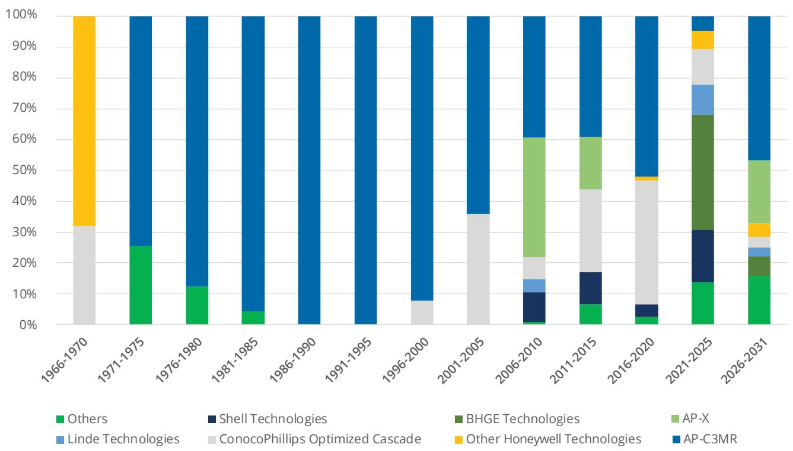  
资料来源：Rystad Energy

## 5.5 浮动式液化天然气（FLNG）

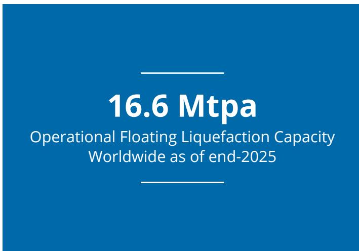

截至 2025 年底，全球浮动液化运营能力为 16.6 Mtpa

截至 2025 年底，全球共有 8 座正在运营的 FLNG 装置。 Petronas FLNG Satu 由韩国大宇造船海洋工程公司（现称为韩华海洋）建造，是世界上第一座 FLNG 设施，设计能力为 1.2 Mtpa。该设施于2019年从东马砂拉越Kanowit天然气田转运，目前位于东马沙巴州Kebabangan气田。 Petronas FLNG Rotan 是 Petronas 的后续 FLNG 项目，由韩国三星重工建造，采用风扇增强型设计能力为 1.5 Mtpa。 Petronas 的��三个 FLNG 装置 FLNG Tiga 目前正在开发中，预计将于 2027 年初上线。

喀麦隆FLNG码头位于喀麦隆海洋部克里比海岸，容量为2.4 Mtpa。 2023年2月，新堡能源同意将该项目的全部权益出售给Golar LNG。

Prelude FLNG 由三星重工建造，设计产能为 3.6 Mtpa，是迄今为止全球最大的 FLNG 装置。 2022 年，该设施的产出相对于其产能明显低于预期，最初归因于火灾事件导致从 2021 年 12 月到 2022 年 4 月上旬进行了为期四个月的维护停工。这种表现不佳的情况持续了整个 2023 年。2023 年 5 月，壳牌管理的工厂由于技术问题暂时停止生产。然而，在 2024 年和 2025 年，该设施的表现要好得多，在此期间接近满负荷运行。

Coral South FLNG终端也称为Coral Sul FLNG终端，位于莫桑比克德尔加杜角省海岸鲁伍马盆地，设计能力为3.4 Mtpa。 2022年10月，浮动码头开始运营。该项目与鲁伍马盆地近海的主要珊瑚水库相关，是第一个在非洲深水近海地区投入运营的 FLNG 设施。 Coral North FLNG 终端是 Coral South 的精确复制品，于 2025 年 10 月获得批准，预计将于 2029 年投入运营，使莫桑比克的 FLNG 容量增加一倍，达到 7 Mtpa。

刚果 FLNG 码头由埃尼刚果公司运营，位于 Marine XII 区块，距海岸 20 公里。 2022年8月，埃尼宣布从Exmar购买液化能力超过0.6 Mtpa的Tango FLNG船，并租用了Exmar拥有和运营的FSU Excalibur。 2023年12月，埃尼开始将天然气引入Tango FLNG设施，创下了FID后天然气引入时间的纪录。 2023年晚些时候，埃尼与中国惠生重工签署合同，建造和安装一座产能为2.4 Mtpa的FLNG工厂，将市场FLNG总体产能增加至3 Mtpa。第二艘 FLNG 装置名为 Congo Marine XII FLNG 2，于 2026 年 2 月出口了第一批液化天然气货物。

New Fortress Altamira FLNG 终端，称为 Altamira Fast LNG，是一座位于墨西哥的 FLNG。 2022 年 7 月，New Fortress Energy (NFE) 与墨西哥联邦电力委员会 (CFE) 建立了合作伙伴关系，承接各种天然气项目，其中包括在阿尔塔米拉海岸开发 FLNG 枢纽。该枢纽将与现有的阿尔塔米拉液化天然气进口终端位于同一地点。该设施的原料气将由 CFE 现有的管道网络供应。 NFE 计划在该枢纽内部署多个 FLNG 装置，每个装置的容量为 1.4 Mtpa。这些装置将采用 NFE 的“快速液化天然气”设计，该设计融合了模块化、中型液化技术和类似于自升式钻井平台的海上基础设施。商业运营于 2024 年 8 月开始。

图 5.10a：2025 年底全球 FLNG 运营能力（Mtpa）和市场份额（%）（按市场划分）
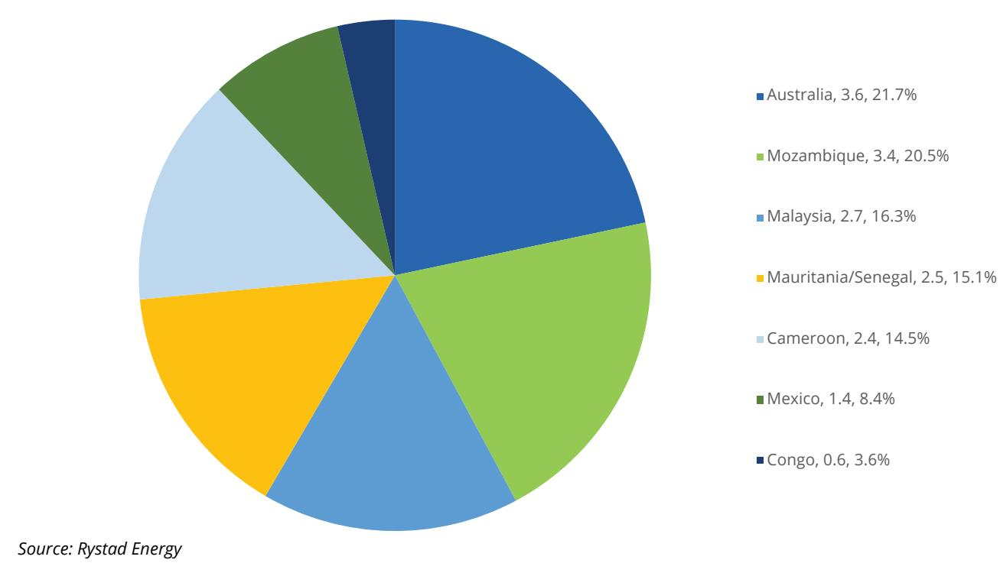

图 5.10b：2025 年底全球批准的 FLNG 产能（Mtpa）和市场份额（%）（按市场划分）
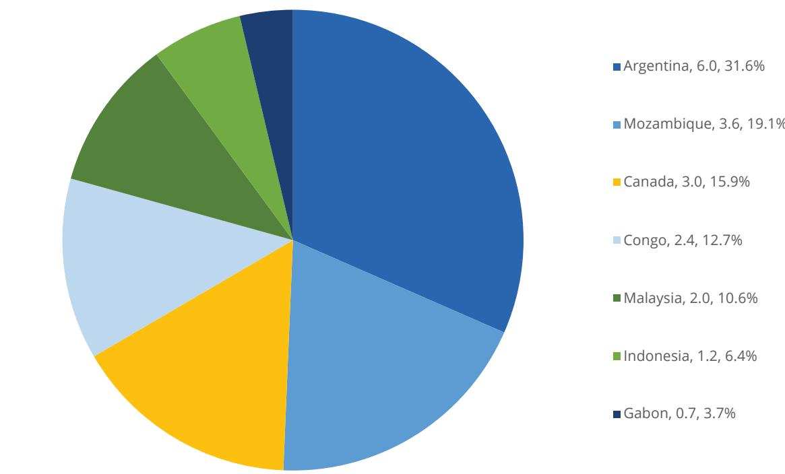  
资料来源：Rystad Energy

Greater Tortue Ahmeyim FLNG终端，也称为GTA LNG，是一座位于塞内加尔和毛里塔尼亚海上边界的FLNG终端，设计能力为2.5 Mtpa。第一阶段的最终投资决定于 2018 年 12 月做出。最初，第一批天然气预计在 2022 年交付，但由于新冠肺炎 (COVID-19) 疫情以及浮式生产储油卸油 (FPSO) 船的其他技术问题，这一计划被推迟，直到 2025 年 1 月才实现，随后于 2025 年 4 月首次出口液化天然气货物。FLNG Gimi 成功、平稳地提高产量，使该设施的利用率达到 90%。到2025年底，出口1.2吨液化天然气。除非出现不可预见的情况，预计明年将接近充分利用。

截至 2025 年底，目前预计 FLNG 开发产能为 172 Mtpa，其中 124.6 Mtpa 在北美。

在美国，拟议的 Delfin FLNG 项目将由三艘浮式液化船组成，每艘液化船的容量为 4.4 Mtpa。与许多其他液化天然气项目类似，Delfin FLNG 在 2025 年取得了显着的监管进展，获得了美国海事管理局 (MARAD) 颁发的深水建造和运营许可证以及美国能源部 (DOE) 颁发的非自由贸易区出口许可证。第一个浮动装置预计将于 2026 年做出最终投资决定，但由于仍需取得商业进展，这一点仍存在不确定性。在加拿大，Cedar FLNG 项目（3 Mtpa）继续朝着 2028 年启动日期迈进，这是展示 FLNG 项目相对于陆上设施优势的一个很好的例子。在环境干预措施通常遭到质疑的地区，FLNG 已成为一种有价值的解决方案，为传统陆上开发提供了可行的替代方案，同时最大限度地减少了生态影响。

2025年批准的三个FLNG项目中有两个来自阿根廷，即南方能源FLNG项目。该项目由两艘 FLNG 船组成：Hilli Episeyo（2.5 Mtpa）和 MK II（3.5 Mtpa），将部署在圣马蒂亚斯湾近海，原料气来自多产的 Vaca Muerta 页岩气区。这两套装置均获得与 Golar LNG 签订的 20 年包租协议的支持，第一套 FLNG 装置 Hilli 预计将于 2028 年初上线，第二套装置 MK II 预计将于 2028 年晚些时候上线。

在非洲，由于巨大的海上天然气储量和陆上安全问题，FLNG项目突出，FID之前的FLNG项目管道数量为12.8 Mtpa。其中包括康的Fast LNG（1.4 Mtpa）、吉布提FLNG（3 Mtpa）、赤道几内亚的Fortuna FLNG（4.4 Mtpa）、Tortue/Ahmeyim LNG今天（2.5） Mtpa）和尼日利亚的UTM海上FLNG（1.2 Mtpa）。 Coral North FLNG项目于2025年获得积极的FID。在亚太地区、中东、南美和俄罗斯，已提议建设约34.6 Mtpa的FLNG液化能力。

近年来，浮式液化技术取得了显着进步，特别是在 FLNG 装置设计的演变方面。壳牌、马来西亚国家石油公司和埃尼公司开发的早期项目是高度定制和资本密集型的​​，但较新的标准化 FLNG 解决方案大大降低了成本和开发时间。吉宝船厂和博莱克威奇取得了一项关键突破，他们利用博莱克威奇的 PRICO 液化技术将莫斯型液化天然气运输船 Hilli 改造为 FLNG 船，证明了模块化转换方法的可行性。

基于这一趋势，SBM Ofshore 推出了 TwinHull FLNG 概念，该概念将两艘经过改造的液化天然气运输船组合成一个集成结构，增加了存储容量，同时优化了甲板空间和效率。尽管这些下一代单元不太适合特定领域，但它们提供了更大的灵活性、更快的部署和更低的成本。 FLNG 解决方案特别适合较小或偏远的海上气田，在某些情况下可以比面临土地、许可或环境限制的陆上液化天然气开发更具优势。它们还可以充当临时货币化解决方案，在开发更大的陆上液化设施的同时实现早期生产。

图 5.11：2025 年底全球拟议 FLNG 产能（Mtpa）和市场份额（%）（按市场划分）
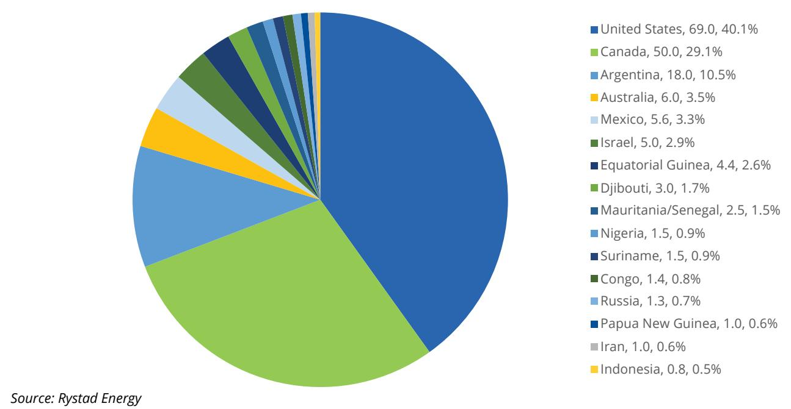

## 5.6

## 项目开发的风险

## 市场平衡

市场平衡仍然是液化天然气行业投资流入的关键决定因素，因为新的液化发展取决于支持性的需求预期、有利的远期定价和足够的市场确定性来支撑项目经济性和积极的投资回报。从历史上看，鉴于项目开发通常需要较长的交付时间，液化天然气市场的供应方面相对可预测，大多数从最终投资决定到首次生产需要三到六年的时间。尽管如此，这种说法在 2026 年受到了挑战，因为 2026 年 3 月上旬霍尔木兹海峡的关闭基本上夺走了卡塔尔和阿联酋市场的所有液化天然气供应。此次总体冲击是在俄罗斯-乌克兰冲突爆发四年后发生的，这场冲突导致全球液化天然气价格飙升，这是制裁、贸易争端和武装冲突导致地缘政治不稳定加剧的结果。市场波动加剧还增加了进一步供应中断和其他低概率、高影响事件的可能性，使供应和需求预测变得复杂。 在评估长期液化天然气市场平衡和项目可行性时，通过燃料转换、需求削减和工业活动变化进行的需求响应增加了进一步的不确定性。由于供应中断、扩建项目延迟以及欧洲和亚洲液化天然气需求持续增长，预计未来几年液化天然气市场将保持相对紧张。在欧洲，定价继续受到俄罗斯管道天然气流量、存储补充要求和天气驱动的消费之间相互作用的影响，凸显了市场的复杂性。在亚洲，液化天然气需求受到贸易政策、气候条件和工业活动等综合因素的影响——所有这些因素都使得在最��投资决策之前评估需求时难以可靠预测。

## 供需风险

俄罗斯与乌克兰冲突发生仅四年多，由于霍尔木兹海峡的关闭影响了卡塔尔和阿联酋的生产，液化天然气市场现在正面临另一场重大能源冲击。 2022 年能源危机重塑了欧洲天然气市场，液化天然气进口越来越多地取代了俄罗斯管道供应，强化了液化天然气在全球能源安全中的战略重要性。与此同时，制裁和西方公司撤出俄罗斯企业继续限制俄罗斯未来液化天然气供应增长的前景。欧盟的目标是到 2027 年底逐步停止进口俄罗斯天然气和液化天然气，预计将进一步支持替代液化天然气供应的需求。海峡关闭的持久影响尚待观察，但自封锁开始以来的轮流停电和工业停产预示着对亚洲价格敏感市场的长期影响。相对于 2022 年能源危机期间观察到的水平，到目前为止，这些价格敏感市场的需求反应已经减缓了全球液化天然气价格的上涨。 日本、韩国和中国台北等更成熟的进口市场通过提高煤炭和核能发电的利用率，在一定程度上缓解了供应中断的情况。虽然这些以能源安全为重点的市场的长期液化天然气需求基本面仍然相对有弹性，但在价格敏感市场中，需求不确定性更为明显，特别是在中国和印度等大型进口国。

## 承包趋势

鉴于液化开发相关的大量资本要求，长期液化天然气合同仍然是项目融资的关键推动因素。因此，监测承包活动可以为未来项目审批的前景提供重要的洞察。 2025年，液化天然气合同签订量约为85 Mtpa，而2024年为63 Mtpa，2023年为62.5 Mtpa，创下2021年以来的最高年度总量。2025年签署的合同中，超过一半的合同期限超过15年，另有10%的合同期限恰好为15年，这表明买家的长期承诺。在 2025 年签署的交易中，日本、印度、中国和土耳其等液化天然气聚合商���据了大部分的采购量。在供应方面，美国液化天然气开发商占合同量的近一半，支持了美国墨西哥湾沿岸液化产能的持续扩张。液化天然气聚合商占据第二大份额，占 25%，这反映出它们通过提高供应可用性和灵活性在投资组合优化和市场开发中发挥着越来越大的作用。 其他供应商市场，包括墨西哥、加拿大、阿联酋、卡塔尔和澳大利亚，分别占7%以下。

图5.12：2025年1月1日至2025年12月31日期间签署的全球SPA期限（Mtpa）


  
图 5.13：预计到 2030 年、2025 年底投产的全球运营液化厂和 FID 液化厂


资料来源：Rystad Energy


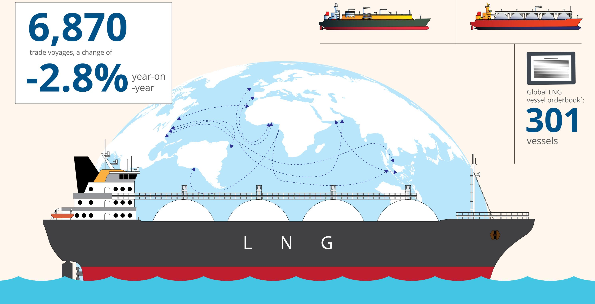

## 液化天然气运输

2025年全球液化天然气船队同比增长8.4%。

6,870

贸易航程的改变

-同期-2.8%

804

活跃血管

79

新船1

包括 49 个 FSRU

11个FSU

全球液化天然气船舶订单2：

301艘船

液化天然气

H

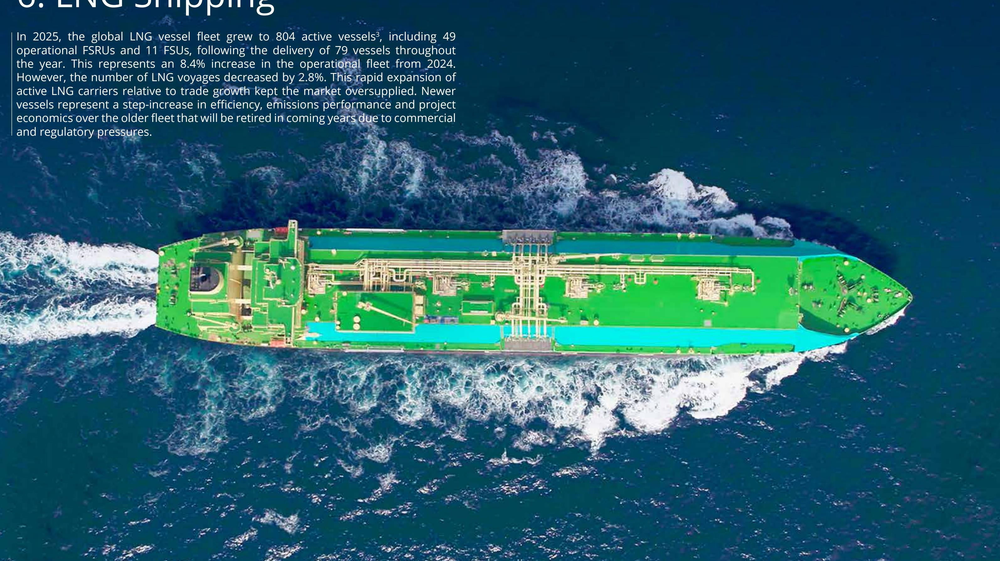

#6.液化天然气运输

2025 年，全球液化天然气船队在全年交付 79 艘船舶后，增至 804 艘现役船舶3，其中包括 49 艘运营中的 FSRU 和 11 艘 FSU。这意味着运营船队较 2024 年增加了 8.4%。然而，液化天然气航次数量减少了 2.8%。活跃液化天然气运输船相对于贸易增长的迅速扩张导致市场供应过剩。与因商业和监管压力而在未来几年退役的旧船队相比，新船代表着效率、排放​​绩效和项目经济性的显着提高。

由 SK 航运提供

## 6.1 概述

图 6.1：1991-2031 年全球活跃液化天然气船队和订单（按交付年份和平均容量划分）
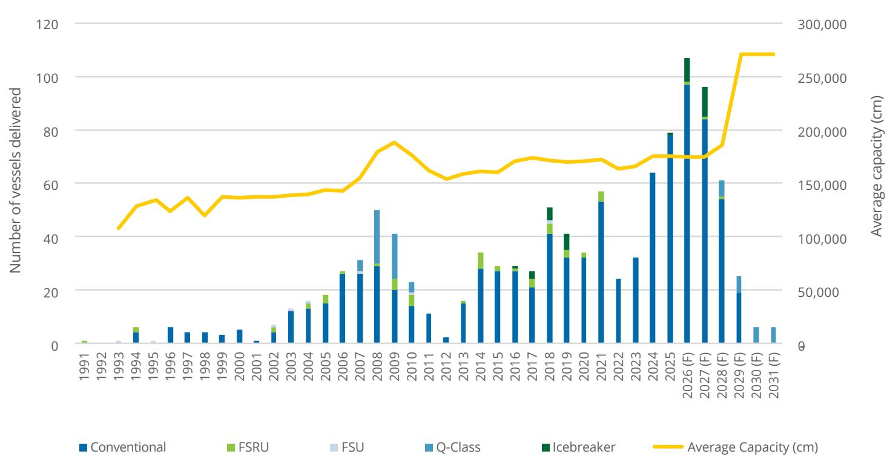

图 6.2：2017-203 年按推进类型划分的历史和未来船舶交付量
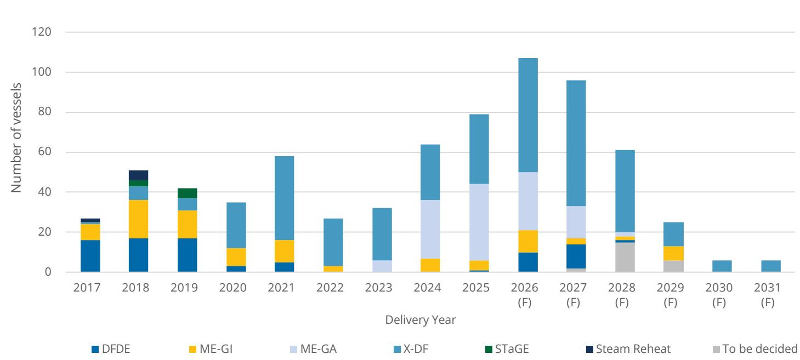  
资料来源：Rystad Energy
资料来源：Rystad Energy


2025 年交付的所有 79 艘新船的容量都在 172,600 至 200,000 立方厘米之间。巴拿马运河于 2016 年扩建后，这种规模的船舶仍处于其运力上限之内。它们还受益于规模经济，特别是随着美国墨西哥湾沿岸 (USGC) 开发了额外的液化天然气运力，用于向亚洲进行长途运输。卡塔尔能源液化天然气公司仍然处于船舶运力增长的前沿，它从沪东中华造船订购了24艘新的271,000厘米（QC-max）船舶，将于2028年至2031年间交付。这些船舶略大于韩国船厂于2007年至2010年交付的45艘卡塔尔Q级新船，其长度超过200,000厘米。

即便如此，考虑到规模经济，200,000厘米及以上的船舶在未来几年可能会越来越受到长途贸易的青睐，特别是在多年租船合同下。这仍然取决于运营商在航线和港口限制方面保持足够的灵活性，包括巴拿马运河的尺寸限制（通常在 200,000 厘米左右），该尺寸限制因船舶设计和码头兼容性而异。目前的订单包括 38 艘船舶，每艘船舶的运力为 200,000 立方厘米或 271,000 立方厘米，计划于 2026 年至 2031 年间交付。霍尔木兹海峡危机增加了卡塔尔船舶需求的时间和规模的不确定性，包括卡塔尔液化天然气运输公司 Nakilat 的订单中反映更多运力的速度。如果北油田东扩建被推迟，一些近期船舶需求可能会被推迟，尽管一旦项目时间表正常化，对大运力吨位的长期需求可能仍然存在。

截至 2025 年底，全球液化天然气订单簿中有 301 艘新建船舶在建，相当于当前活跃船队数量的 37.4%，交付期将持续到 2031 年。这表明船东预期液化天然气贸易将继续增长，符合预定的液化能力增长（尤其是来自美国和卡塔尔的液化能力），以及即将退役的老旧、效率较低的船舶带来的船队更新需求。预计 2026 年将交付 107 艘运输船。订单中包括用于俄罗斯北极 LNG 2 项目的 20 艘破冰船级船舶。这些是专为全年北极航行而设计的专业化和资本密集型船只，但自俄罗斯-乌克兰冲突以来，该船队计划因制裁而受到严重破坏。最初为 Arctic LNG 2 计划建造的 21 艘 Arc7 运输船中，有 15 艘是在 Zvezda 订购的，另外 6 艘是在韩华海洋订购的，但制裁已经扰乱了船厂合作、设备供应、密封技术、付款和交付。

到2025年底，只有非常有限的船舶数量接近完工，而其他几艘船舶仍未完工、无法交付或没有关键系统，使得该项目远远低于原计划的运输能力。

阿列克谢·柯西金 (Aleksey Kosygin) 是在 Zvezda 为 Arctic LNG 2 建造的第一艘 Arc7 液化天然气运输船，于 2024 年 12 月 25 日起航进行海试，并在 2025 年底前仍然是该项目最先进的国内新造船。它与 Pyotr Stolypin 一起，是在更广泛的计划停滞之前仅有的两艘配备 GTT 围护系统的 Zvezda 船舶之一，而在西方供应商退出后，其他下水的船体没有关键的货运技术。尽管阿列克谢·柯西金 (Aleksey Kosygin) 到 2025 年底仍未完全投入商业运营，但它已于 2026 年初交付，凸显了 Zvezda 的一些进展以及 Arctic LNG 2 预期 Arc7 船队面临的延误规模。

2020 年，交付的低压、低速、双燃料 WinGD (X-DF) 系统比任何其他类型的系统都要多，而 2023 年是第一年交付配备 Everllence B&W（M 型电控进气）ME-GA 发动机的船舶。利用提高燃油效率和降低排放的优势，X-DF 系统仍将是主要选择之一，截至 2025 年底，约有 185 套系统已被订购。高效的新一代 M 型电子控制进气 (ME-GA) 系统预计将与新造船的 X-DF 技术竞争。然而，Everllence B&W 于 2024 年 10 月宣布，由于 IMO 关于氮氧化物排放的法规收紧（预计将于 2027 年生效），将不再生产 ME-GA 发动机。因此，订单已变得偏向 WinGD X-DF 系统，未来的订单将主要依赖���版本的 X-DF。此外，还有23艘M型电控（ME-GI）高压喷射系统船正在建造中。 与上一代流行的推进系统——蒸汽轮机、双燃料柴电 (DFDE) 和三燃料柴电 (TFDE) 相比，ME-GI、ME-GA 和 X-DF 系统代表了对效率和环保性能的重大转变。

即便如此，基于其他内燃机或动力技术的新提案仍在推出。

随着越来越多的油基燃料（包括生物燃料）成为这些系统的选择，业界越来越多地将 TFDE 和 DFDE 归为一个类别 - DFDE - 现在代表液化天然气和油基燃料的“双”燃料。从本节开始，本报告将它们称为 DFDE。

韩国造船商HD现代重工造船集团、三星重工和韩华海洋仍然是排名前三的液化天然气运输船建造商，尽管中国的沪东中华近年来逐渐崭露头角。中国江南船厂、大连造船、扬子江船厂和招商局重工也已进军利润丰厚的传统液化天然气运输船建造市场，其他船厂可能很快就会进入该市场。新造船价格高昂和韩国船厂的产能限制支撑了他们的商业案例。后四家公司的订单总数为 28 艘，将于 2028 年底前交付。

2025年，由于2024年以来的供应过剩局面持续存在，液化天然气运输市场仍面临压力。持续的船舶交付速度超过了有限的液化天然气供应增长，而大西洋盆地航程的缩短减少了吨英里需求。今年大部分时间里，租船费率都保持在历史低位，现代船舶几乎无法弥补运营成本，一些蒸汽船的盈利接近或低于盈亏平衡。在中断和美国新液化产能的推动下，10 月至 11 月的短暂复苏将二冲程费率推至每天 60,000 美元以上，峰值超过 100,000 美元。尽管如此，2025 年仍然是液化天然气运输近年来最疲软的年份之一。

2025 年总共进行了 6,870 艘液化天然气贸易航次，比 2024 年的 7,065 艘减少了 2.8%。液化天然气产量大幅增长，但新船的庞大规模压低了货物数量。虽然亚洲仍然是主要的需求中心，有 4,235 个贸易航次，但由于 2025 年大部分时间的液化天然气需求强劲，欧洲在 2025 年增加了 6.4% 至 2,053 个贸易航次，其中欧洲进口了约 126 公吨。

## 6.2 液化天然气运输船

## 船龄和容量

考虑到最古老的运营液化天然气运输船建于 1977 年，目前全球液化天然气船队相对年轻。截至 2025 年底，约 84.8% 的船队船龄不足 20 年，这与世纪之交以来液化能力的快速增长一致。此外，较新的船舶更大、更高效，在其使用寿命内具有卓越的项目经济性。

从历史上看，船东在将船舶闲置之前会运营 35 至 40 年。尽管如此，不断上升的运营成本，特别是燃料成本，加上即将出台的减排法规——尤其是国际海事组织的 EEXI 和 CII、欧盟排放交易系统 (ETS)、更严格的甲烷逃逸处理和 FuelEU——可能会缩短一些旧船的使用寿命或刺激改造和转换。经济因素正在成为这一过程中越来越重要的驱动因素：即使在考虑监管处罚之前，旧的、效率较低的船舶也面临着日益扩大的成本劣势，这使得早期回收在某些情况下更具吸引力。由于技术的快速进步、排放规则的收紧和运营成本的提高，船舶的使用寿命变得越来越短。

截至2025年底，有18艘服役不到25年的船舶报废。

在其使用寿命结束时，可以决定是否报废一艘运输船、将其转变为浮动码头（进口或出口），或者在市场状况出现实质性改善时将其恢复运营。在调试新船时，船东根据其具体运营需求、当前市场趋势、可用技术以及越来越多的预期环境法规和未来液化天然气需求来确定船舶容量。液化天然气运输船设计实施新技术或解决方案的灵活性也很关键，船东要求能够在需要时轻松改造或升级的面向未来的概念。

液化和再气化厂也有停泊能力限制，而某些贸易航线可能会对船舶尺寸施加限制。在考虑船舶尺寸和兼容性时，这些因素非常重要。个别船东的需求也在很大程度上受到市场需求的影响，这意味着新造船运力主要保持在时期平均水平的小范围内，如图 6.3 所示。

图 6.3：按船龄划分的船队容量，2025 年底
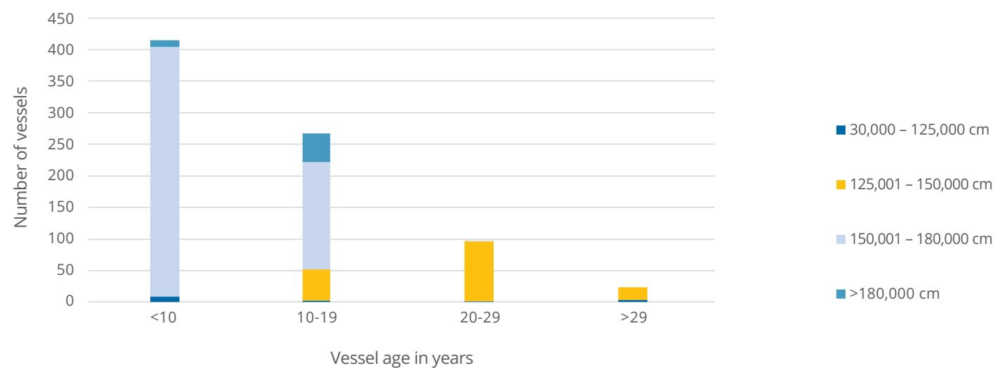  
资料来源：Rystad Energy

由于蒸汽轮机推进的早期主导地位，2000 年代中期之前交付的船舶全部小于 150,000 厘米，因为这是最适合蒸汽轮机推进系统的范围，其中许多配备了莫斯型货舱。当卡塔尔的 Nakilat 推出 Q-Flex（210,000 至 217,000 厘米）和 Q-Max（263,000 至 266,000 厘米）船舶时，液化天然气运输船格局发生了巨大变化，专门针对向亚洲和欧洲运送大量液化天然气。这些船舶凭借配备再液化装置 (SSDR) 的慢速柴油推进系统实现了更大的规模经济，代表了有史以来建造的 45 艘最大的液化天然气运输船。尽管如此，卡塔尔能源液化天然气公司北部油田扩建项目的下一代 271,000 立方米 QC-Max 订单仍将超越它们，该项目将配备现代推进技术。

大多数新船的尺寸都在 174,000 至 180,000 厘米之间。目前，该运力范围占当前机队的 40.3%。这种尺寸的采用是由技术进步推动的，特别是二冲程双燃料推进系统，可以在此范围内最大限度地提高燃油效率。

另一个关键因素是巴拿马运河的尺寸限制。作为 2016 年扩建的一部分引入的新船闸允许停放更大的船舶，这是从事涉及美国液化天然气供应贸易的船舶的一项关键发展。 2019年5月，尺寸超过20万厘米的Q-Flex LNG运输船Al Safliya成为第一艘Q-Flex型LNG运输船，也是通过巴拿马运河的载货量最大的LNG运输船。

虽然 174,000 厘米仍然是最常见的新建船舶尺寸，但较大的船舶再次引起了船东的兴趣。截至2025年底，已订购13艘20万立方米船舶，全部能够通过巴拿马运河新船闸。随着二冲程推进解决方案的进一步改进，例如新一代 X-DF 和 ME-GI 系统，从效率的角度来看，200,000 厘米运输船可能会成为流行的选择。然而，还必须考虑其他方面，例如灵活性和终端兼容性。截至2025年底，沪东中华还订购了24艘运输船，运力271,000立方米。

第 110 页的技术附件提供了有关安全壳系统和推进系统的更多详细信息。

## 按船龄划分的船队推进系统细分

在船龄超过 10 年的船舶中，蒸汽轮机系统占大多数，其中 DFDE 和 SSDR 占 47.3%。由于几乎所有 SSDR 船舶都是卡塔尔 Q 级船舶，因此船龄范围与交付时一致。除一处例外外，由于这些创新的最新性质，所有 ME-GI、ME-GA、X-DF 和 STaGE 容器都是全新的。订单显示，到 2026 年，两代 X-DF 系统都将占已交付船舶的很大一部分，之后 ME-GI 和 X-DF 系统预计将展开竞争。 6.4

图 6.4：2025 年底按船龄划分的船队推进类型
  
资料来源：Rystad Energy

6.3  
浮动储存和再气化装置 (FSRU) 所有权
  
资料来源：Rystad Energy

FSRU 除了作为常规液化天然气运输船外，还用于液化天然气储存和再气化，少数非推进装置除外。与传统的陆上再气化工厂相比，FSRU 具有更好的灵活性、更低的资本支出和更快的上市速度。共有 49 艘 FSRU，占全球活跃液化天然气船队的 6.1%。船东 Excelerate Energy、Energos（Apollo Funds 和 New Fortress Energy 的合资企业）、Hoegh 和 Karmol（Karpowership 和 MOL 之间的合作伙伴）继续运营着最大的现役 FSRU 船队，Energos 已经接管了 New Fortress Energy 的船队。

FSRU 能够通过“即插即用”解决方案进口液化天然气，因此可以灵活地满足所需地点的需求，然后再重新部署到其他地方。 FSRU 也部署在岸上，在土地稀缺地区或偏远地区具有优势。

FSRU 的资本支出仅为陆上终端的一半。虽然在拥有现有基础设施的地区安装可能需要几个月的时间，但这会被更高的运营支出所抵消。 FSRU 可以是新建的，也可以是现有液化天然气运输船改装而成的。新建 FSRU 提供设计灵活性和更广泛的舾装选项，但成本较高且建造时间较长。

尽管如此，交付延迟、停电和成本上升过去已经影响了某些项目，略微抑制了对该类型船舶的需求。此外，液化天然气运输包租费率的飙升可以激励船东将船舶用作液化天然气运输船，从而减少作为再气化或储存装置运行的浮式储存装置的数量。截至 2025 年底，订单包括三艘 FSRU 新建船——一艘正在为 Excelerate 建造，预计将于 2026 年建造，两艘为 MOL 订购，预计于 2027 年（格但斯克）和 2028 年（新加坡）——还有多艘旧的液化天然气运输船也正在考虑转换为 FSRU。两艘 MOL FSRU 由 HD 现代重工造船集团建造，另一艘由韩华海洋建造。由于大多数造船厂都专注于建造 2026 年至 2028 年一波项目产能增加所需的标准液化天然气运输船队，因此订购 FSRU 新建船的能力有限。

事实证明，FSRU 的灵活性对于天然气需求不断变化的市场非常有用。预计 FSRU 在未来几年仍将是一种流行的存储和再气化解决方案。俄罗斯-乌克兰冲突激起了整个欧洲的FSRU兴趣，其上市速度优势有助于缓解供应紧缩并减少对俄罗斯管道天然气的依赖。 2021 年，FSRU 租船费率在每日低于 10 万美元的水平徘徊，但到 2022 年，部署到德国的船舶的租船费率迅速飙升至每天 20 万美元左右。费率随后在 2023 年有所放缓，并在 2024 年和 2025 年仍低于 2022 年的危机峰值（约 12 万美元 -每天 140,000 美元），因为欧洲最初对浮动再气化能力的争夺已经平息，尽管船舶供应仍然相对紧张，并且一些装置被重新部署或重新审视了租船条款。

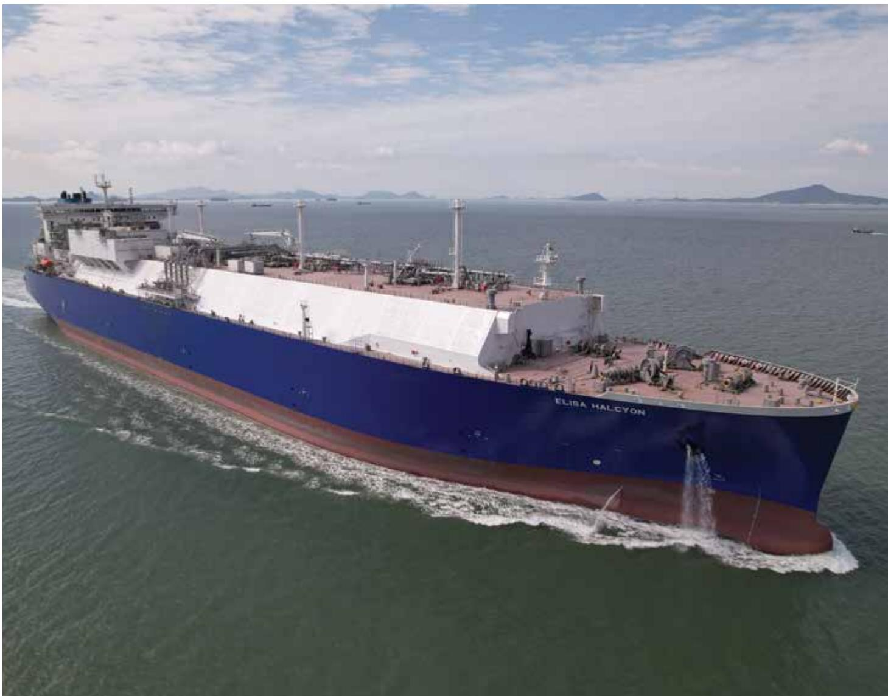  
由 NYK 线提供
图 6.6：20254 年底按船东划分的全球船队和订单簿
资料来源：Rystad Energy

## 6.4 液化天然气订单簿

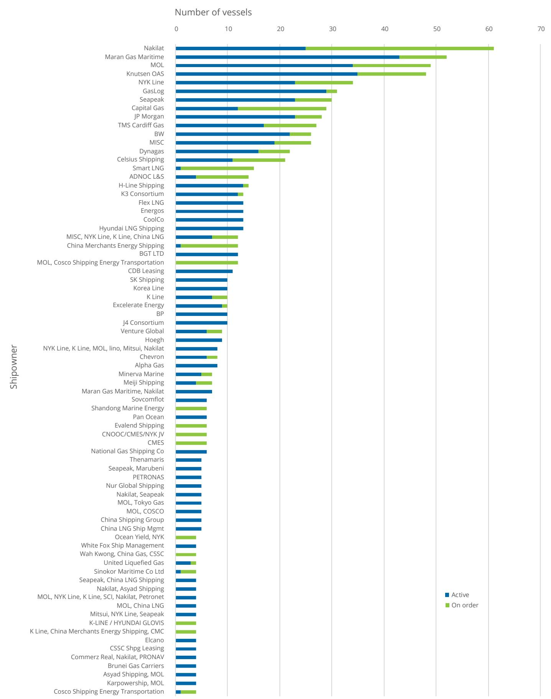  
4 包括拥有四艘或以上船舶的船东或财团。

  
截至 2025 年底，在建船舶 301 艘，其中 107 艘计划于 2026 年交付，其次是 2027 年交付 96 艘、2028 年交付 61 艘、2029 年交付 25 艘，2030 年和 2031 年各交付 6 艘。

107 艘液化天然气船计划于 2026 年交付，这是由正在讨论的大型项目推动的，例如卡塔尔能源液化天然气公司的项目，以及正在进行的美国液化天然气开发浪潮，其中运输对于最大限度地提高灵活性至关重要。尽管如此，最近的危机给卡塔尔船舶需求的时间和规模增加了不确定性。如果北田东扩建计划被推迟，则意味着航运市场的时间更长，近期液化天然气产量减少，可能会推迟一些船舶需求，同时一旦项目时间表正常化，仍能保留对运力的长期需求。此外，由于 IMO 的 EEXI 和 CII 规则自 2023 年起生效，船队更新变得越来越必要。2024 年，航运业被纳入 EU ETS，2025 年 FuelEU 法规正式生效。截至 2025 年底，IMO 净零框架已推迟至 2026 年，预计于 2028/2029 年生效。尽管如此，由于地缘政治紧张局势，修改法规的情况仍然有可能发生。

图 6.7：2025 年底按推进类型和造船厂划分的新船订单


## 船舶成本和交货时间表

图 6.8：2002-2025 年船舶交付时间表和新建成本
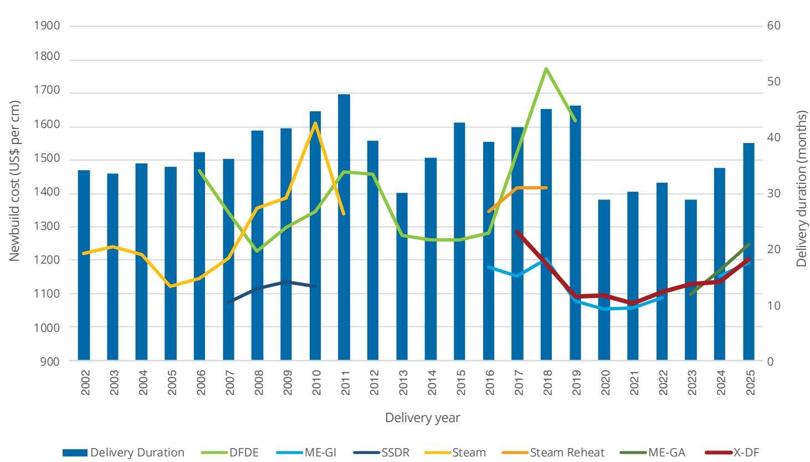  
资料来源：巴里·罗利亚诺·塞勒斯

## 资料来源：Rystad Energy

X-DF 系统凭借更高的燃油效率和更低的排放，到 2025 年底将成为首选的主要推进系统，已订购 185 套。竞争的ME-GI系统有23艘订单，而新一代ME-GA系统约占47艘，DFDE系统（主要用于FSRU和破冰船）占23艘船。除华翔航运拥有的一艘中型船舶外，所有订单船舶尺寸均在17万厘米以上，显示出明显的船舶大型化趋势，巴拿马运河新船闸已可容纳此类船舶。随着新一代二冲程推进系统的出现，由于长途航行和长期租船人的规模经济，船舶尺寸可能会逐渐向 200,000 厘米发展。目前已订购 13 艘 200,000 立方厘米容量的船舶，其中 6 艘为 Dynagas，3 艘为 Venture Global，4 艘为 Ocean Yield, NYK。 2022年，Dynagas拥有的两艘20万立方米的船舶被交付给租船人Cheniere Energy，两艘船舶都配备了X-DF推进装置。 2023 年，Dynagas 拥有的另外一艘 200,000 立方米的船舶被交付给 Cheniere Energy，配备 ME-GA 推进装置，随后在 2024 年和 2025 年又交付了四艘船舶，全部也配备了 ME-GA 推进装置。此外还订购了 24 艘 QC-max 船舶，容量为 271,000 立方厘米，全部用于卡塔尔能源液化天然气公司。这些将是有史以来建造的最大的液化天然气运输船，原则上配备 X-DF 发动机。

韩国造船商HD现代重工造船集团、三星重工和韩华海洋是液化天然气船舶的三大建造商，分别订购了84艘、62艘和60艘。此外，三星此前曾协助俄罗斯Zvezda造船厂为Arctic LNG 2建造15艘破冰船，不过该计划因美国制裁而陷入停滞。现代和三星正在开发大量配备两代 X-DF 系统和 ME-GA 的新船，而韩华海洋的订单涵盖 X-DF、ME-GI、ME-GA 和少量 DFDE/TFDE 船舶。中国建造商沪东中华目前正在建造 52 艘船舶，订单簿将持续到 2031 年，所有船舶均配备 X-DF 推进系统。

2025年签约新液化天然气船平均交付时间为34个月

建造液化天然气运输船的成本取决于推进系统、容量和涉及船舶设计的其他规格等特性。从历史上看，DFDE 船舶的起始价格高于蒸汽轮机船舶，较高的新建成本被运营更现代化船舶的效率收益所抵消。由于规格标准不同，DFDE 新建成本多年来差异很大 - 一个突出的例子是 2018 年为亚马尔液化天然气服务订购的 15 艘破冰船级船舶的峰值超过每平方厘米 1,700 美元。这些船舶从 2017 年开始签约，单价约为 3.2 亿美元，推高了平均价格。

虽然配备 X-DF 系统的船舶最初每立方米的价格略高于配备 ME-GI 推进系统的船舶，但现在它们具有成本竞争力。如图 6.8 所示，2020 年交付的 X-DF、ME-GI 和 ME-GA 船舶成本从每厘米 1,200 美元至 1,300 美元下降至每厘米 1,000 美元至 1,100 美元左右，然后到 2025 年反弹至每厘米 1,200 美元至 1,250 美元。

尽管平均船舶尺寸随着时间的推移而发生变化，造船厂仍然能够保持一致的交付时间表，在引入新的推进系统期间会出现在此范围内的差异。这可以归因于造船厂必须适应新发动机的新颖设计，例如在引入 DFDE/TFDE 系统后的几年中几乎需要 50 个月。然而，由于中国造船厂产能增加以及占用运力的油轮减少，2025 年订购的船舶交付时间现已缩短至 34 个月（不到三年）。

2025 年新建液化天然气运输船的价格略有下降，原因是船东鉴于价格高企和当前船舶供应过剩而开始推迟订单。对于韩国船厂的标准 174,000 厘米二冲程液化天然气运输船，基准定价到 2025 年将基本持平或略有下降，平均每艘船价格在 2.50-2.55 亿美元左右徘徊。中国船厂定价总体上比韩国船厂水平低 2000 万美元左右。

来源：阿格斯

## 6.6

## 包机市场

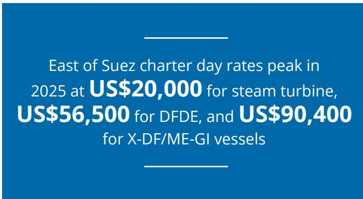

苏伊士以东的蒸汽轮机日租费将于 2025 年达到峰值 20,000 美元，DFDE 为 56,500 美元，X-DF/ME-GI 船舶为 90,400 美元

运输液化天然气时，运输成本占净回值计算的重要比例。因此，在制定市场策略时，会认真考虑包机费率。从历史上看，液化天然气主要通过长期合同进行营销，鼓励船东与大型企业签订定期租船合同。随着投资组合参与者的出现，现货市场上出现了越来越多的船舶，从而促进了包机和定价的市场深度。尽管如此，由于供需之间的不匹配，流动性缺乏可能会导致租船费率波动。自俄罗斯和乌克兰冲突以来，租船人越来越倾向于选择期限较长的租船，以确保供应安全。

采用 X-DF/ME-GI、DFDE 和蒸汽轮机推进的船舶之间的价格差异可以通过使用更新的推进系统带来的效率增益来解释。蒸汽轮机系统的效率明显低于 DFDE 系统，而 DFDE 系统的效率又低于 X-DF、ME-GA 和 ME-GI 发动机。此外，使用蒸汽轮机的船舶尺寸往往较小，限制了可用性，因为现货货物往往至少有 150,000 厘米。最后，意识到承运人排放问题的承租人需要更新的技术，这进一步扩大了价差。随着 IMO 法规（EEXI 和 CII）和欧盟法规的生效，蒸汽轮机和其他效率较低的推进类型可能仅限于某些贸易航线。市场参与者在选择承运商和相关推进系统时必须平衡燃油效率、沸腾气体节省和更高的成本。

图 6.9：2012-2025 年液化产能增长与全球液化天然气船队数量增长对比
  
资料来源：Rystad Energy
2013年以来，船舶交付速度远远超过液化运力增长速度，导致LNG运力过剩，租船费率稳步下降。这种情况一直持续到 2015 年，此后价格一直保持在每天 15,000 美元至 50,000 美元之间（蒸汽轮机），直到 2017 年第四季度，亚洲液化天然气需求的快速增长引发了租船费率的上涨，租船费率在整个 2018 年仍然波动。

图 6.10：2016 年至 2025 年底苏伊士以东现货租船费率
  
来源：阿格斯

图 6.11：2016 年至 2025 年底苏伊士以西现货租船费率


2021年至2024年，液化天然气运输市场从极度波动转向供应过剩。在 Ever Give 堵塞、欧亚货运竞争、创纪录的天然气价格和亚洲需求强劲的推动下，运价在年初低点后于 2021 年大幅反弹，到 12 月中旬，X-DF/ME-GI 船舶的运价达到每天 25 万美元。

2022 年，乌克兰危机结构性提振了欧洲液化天然气需求，并在 10 月底将苏伊士以西 X-DF/ME-GI 费率推至每天 45 万美元，之后温和的天气和高库存将费率推低至 2023 年。随着美国帮助填补欧洲的供应缺口，市场于 2023 年趋于稳定，尽管巴拿马运河干旱和后来的红海袭击增加了路线中断。到 2024 年，有限的液化天然气产量增长和一波船舶交付造成了市场供应过剩，X-DF/ME-GI 价格在夏季短暂达到每天 94,000 美元，然后到 12 月跌破了 COVID-19 时代的低点。

2025年，继2024年出现供应过剩之后，液化天然气航运市场仍面临巨大压力。年初，由于船舶交付量持续超过有限的液化天然气供应增长，以及大西洋盆地航程缩短导致吨英里需求减少，租船费率处于历史低位。现代船舶的费率降至几乎无法覆盖运营成本的水平，在某些情况下，蒸汽轮机船舶的收益接近或低于零。亚洲需求疲软和欧洲对大西洋货物的持续拉动进一步削弱了市场状况，导致区域内船舶受到限制。由于冬季库存、货运延误以及美国新液化产能的增加，10 月和 11 月出现了暂时的紧缩。在此期间，现代二冲程船舶的苏伊士以东租船费率到年底恢复到每天 60,000 美元以上，最高时超过每天 90,000 美元。尽管出现了年底的反弹，但 2025 年总体上仍然是液化天然气运输近年历史上最疲软的年份之一。

2026年，液化天然气运输市场因战争和霍尔木兹海峡关闭而受到严重扰乱，扭转了年初的疲软利率环境。 2月初，苏伊士以东即期费率已降至每天14,250美元左右，随后在2月底稳步上升，然后从2月27日的每天45,000美元飙升至3月2日的每天105,000美元。由于通过海峡的液化天然气流量受到限制，价格于 3 月 5 日达到每天 30 万美元的峰值，然后在 3 月下半月和 4 月有所回落。尽管如此，市场仍未恢复到危机前的水平，截至 4 月底，费率仍约为每天 10 万美元，反映出运输、保险和货物供应方面的持续不确定性。

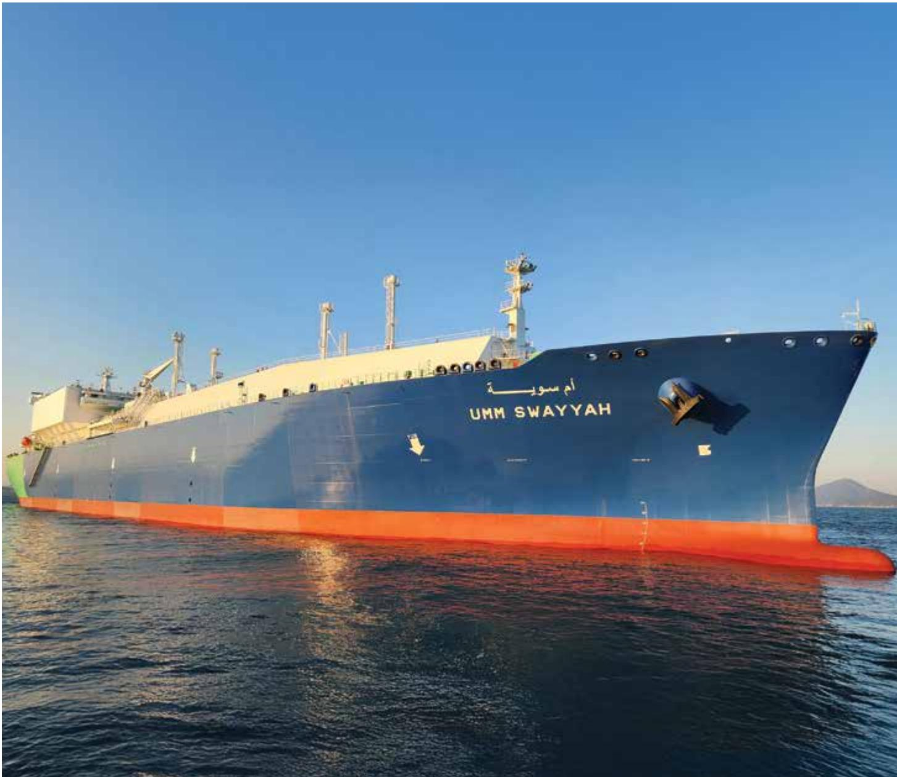  
由泛洋提供

  
图 6.12：2025 年主要液化天然气运输航线
资料来源：Rystad Energy

## 6.7

## 船队航次和船舶利用率

2025 年 6,870 次液化天然气贸易航次

2025 年的航次仅为 6,870 次，比 2024 年减少 2.8%，因为大型船舶减少了运输液化天然气所需的航次。随着液化天然气船队增长 8.4%，液化天然气运输市场在 2025 年的大部分时间里仍处于供应过剩状态。

2016年巴拿马运河拓宽和加深，使从美国萨宾帕斯码头至日本川崎液化天然气设施的航程距离和时间缩短至9,400海里（nm）和29天。相比之下，穿越苏伊士运河的航程为 14,500 海里，耗时 45 天；绕好望角航程近 16,000 海里，耗时 49 天。然而，由于该航线的受欢迎，巴拿马运河已成为瓶颈。这种情况在 2023 年尤为严重，当时干旱导致加通湖水位下降，迫使一些路线改道经好望角。虽然运河状况后来有所改善，但这一事件��显了该路线面临与天气相关的中断和运输限制的风险。

图 6.13：2016-2025 年液化天然气进口量和前往亚洲和欧洲的航次
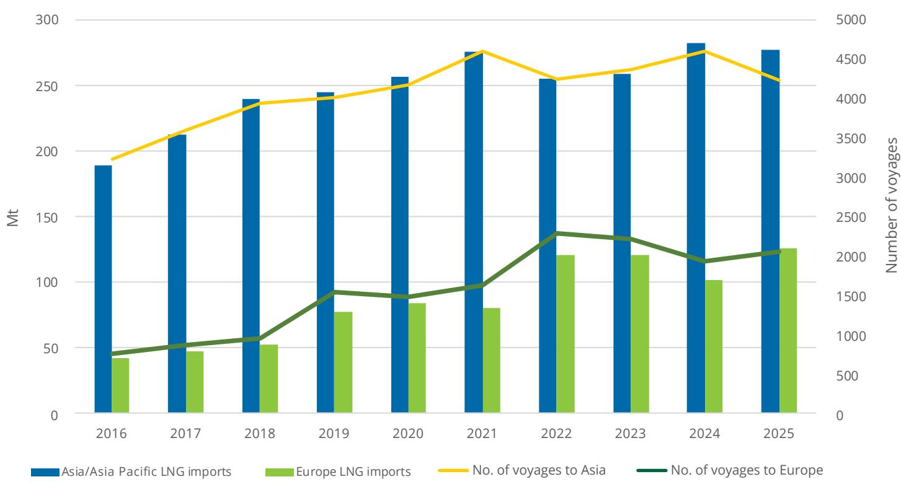  
资料来源：Rystad Energy、伦敦证券交易所集团

随着美国液化天然气产能的增加和欧洲需求的激增，从美国到欧洲的液化天然气贸易航次从2024年的693个增加到2025年的1,099个。

2025 年全球最常见的航次是从澳大利亚到日本，有 390 批货物。2025 年到欧洲最常见的航次是从美国到荷兰，有 188 批货物。日本、中国和韩国接收的货物数量是全球最多的，总共接收了 2,793 批货物，分别为 1,046 件、1,044 件和 703 件。 2025 年，每艘船平均完成航次为 9.0 次，低于 2024 年（9.5 次），原因是新船交付量与产量增长相比较大，而且新船的规模也较大。

## 6.8

# 液化天然气运输的近期和近期发展

## 主要考虑因素

液化天然气运输业仍然具有高度的创造力和适应性，但目前的重点已转向效率、运营支出 (OPEX) 减少和运营灵活性。尽管脱碳仍然很重要，但货运市场疲软、燃料成本高昂和地缘政治混乱意味着人们越来越多地根据其减少燃料消耗、降低运营成本和保持贸易灵活性的能力来评判最新技术的发展。

在船东、承租人、船厂和设备供应商控制的参数范围内，创新和卓越运营可以帮助行业向前发展，尽管其中许多解决方案会增加新液化天然气运输船项目的资本支出 (CAPEX)。因此，最相关的发展是那些改善船舶环境状况和商业竞争力的发展。

货物作为燃料和沸腾管理：从技术和商业角度来看，液化天然气仍然是液化天然气运输船最可行的燃料选择。然而，焦点已经从简单地使用沸腾气体作为燃料转向最大限度地提高处理沸腾气体的灵活性。新建液化天然气运输船越来越多地配备再液化或过冷系统，使船东和承租人能够在燃料使用、货物保存和市场条件之间进行优化。随着燃料价格、排放规则和承租人偏好的发展，这种灵活性变得越来越重要。

替代燃料：替代燃料仍在考虑中，但大多数对于大型液化天然气运输船来说还没有商业吸引力。生物燃料和生物甲烷可用于现有的双燃料发动机，只需进行有限的或无需技术改造，但可用性和成本仍然是主要限制因素。随着时间的推移，电子液化天然气和氢气可能会变得相关，但产量仍然有限，成本仍然很高。氢还需要对安全壳、燃料系统和发动机进行重大改变，从而增加资本支出。由于价格、可用性、毒性、基础设施和技术适应方面的挑战，氨和甲醇对于液化天然气运输船来说不太现实。

## 液化天然气运输船设计和技术的演变

液化天然气运输船设计：由于终端兼容性和商业灵活性，标准 174,000 厘米液化天然气运输船仍然是行业主力。然而，在项目经济性和码头限制允许的情况下，正在考虑约 200,000 厘米（有时甚至 271,000 厘米）的较大设计。这些大型船舶可以降低单位货运成本，特别是在长途贸易中，但其商业价值取决于保留航线和港口的灵活性。设计优化也越来越关注实际运行速度，因为液化天然气运输船通常以 15-16 节左右的速度航行，而不是最大服务速度，尽管船东和承租人仍然希望推进灵活性高达 19-19.5 节。

新的储罐和布局概念：最近的设计开发包括三储罐配置，而不是传统的四储罐布局。由于提高了储罐容积与表面的效率，这可以增加货物容量，降低建造成本并略微降低沸腾率。 BW 于 2025 年订购的两艘采用该解决方案的液化天然气运输船标志着从概念批准到商业采用的重要一步。前舱设计也在讨论中，主要与风力推进系统和能见度要求有关，尽管尚未采用这种布局建造大型液化天然气运输船。

效率技术：新的液化天然气运输船设计越来越多地融入优化的船体形状、空气动力学改进、节能装置、凸头鳍、舵球和空气润滑系统。重点正在从最大设计速度下的理论效率转向船舶实际运行曲线上的性能。这很重要，因为较低的平均速度可以显着降低燃料消耗、运营成本和排放。

货物储存和装卸：对于标准 174,000 厘米船舶，现代膜围护系统现在可以在满载条件下实现每天货物体积的低至 0.07% 左右的沸腾率，对于较大或三罐设计，甚至可以实现更低的沸腾率。还引入了智能货物管理系统、实时监控和晃动检测，以提高安全性、货物控制和运营效率。

推进和动力系统：目前大型液化天然气运输船普遍配备双燃料内燃机和机械驱动双螺杆推进。与旧技术相比，二冲程双燃料发动机仍然是首选解决方案，因为其效率更高、燃料消耗率更低、甲烷逃逸率更低。轴带发电机越来越多地被采用，以通过使用主发动机在特定航行速度下进行船上发电来提高效率。混合电力推进概念，包括现代四冲程发动机、电力推进和电池的组合，正在接受评估，但尚未有大型液化天然气运输船项目采用这些系统。

减少甲烷泄漏：无论推进类型如何，甲烷泄漏仍然是液化天然气燃料运输的核心问题。发动机制造商正在开发技术改进以减少未燃烧的甲烷排放，同时还提出了催化甲烷减排系统。随着监管机构和承租人更加重视整个生命周期的温室气体绩效，这一点仍然很重要。

风力推进系统：风力推进作为一种实用的效率措施正在受到关注。第一批采用该技术建造的大型液化天然气运输船是韩华海洋的两艘 MOL 船舶，配备了 MOL 的 Wind Challenger 可伸缩刚性帆。其他船舶类型的经验表明，风力推进可以减少约 10% 的燃料消耗，具体取决于安装的系统数量、船舶速度、天气航线和运行情况。

碳捕获、燃料电池和岸电：未来液化天然气运输船的设计中提出了船载碳捕获和燃料电池，但两者仍处于早期阶段。碳捕获面临着船载二氧化碳储存和终端处置基础设施的挑战。从沸腾气体中产生氢气和固体碳的预燃烧概念也正在探索中，尽管成熟度仍然有限​​。使用液化天然气或氢气的固体氧化物燃料电池可以提供高效率和低排放，但商业应用仍在开发中。岸电也在研究中，但其在液化天然气运输船中的使用可能会受到货物作业期间所需的高电力以及在码头停留时间短的限制。

卓越运营和数字化：数字工具对于降低运营支出和排放变得越来越重要。天气航线、优化的到达计划、实时发动机和货物监控、预测性维护和远程诊断都可以提高船舶性能并降低燃油消耗。这些技术还支持更安全、更高效的运营，尽管数字化程度的提高需要更强大的网络安全保护。

＃＃ 结论

由于液化天然气运输船相对于贸易量而言供应过剩，部分原因是近年来液化天然气出口终端调试的延迟，航运公司在2025年面临着非常疲软的现货市场。这对于配备蒸汽轮机和柴电推进系统的老旧船舶来说尤其具有挑战性。从节省运营支出的角度来看，效率比脱碳途径变得更加重要。此外，地缘政治的不确定性使行业规划变得越来越复杂，因为红海和霍尔木兹海峡等主要航线的中断仍然难以预测。与此同时，监管前景尚未完全确定，IMO 净零框架在最终批准之前仍可能发生变化。

然而，尽管面临这些挑战，液化天然气航运业仍在向前推进，提出高度创新的解决方案，在不影响安全的情况下提高效率。

## 2025 年新增接收能力 62.9 Mtpa。

13

2025 年新航站楼

现有航站楼扩建项目

中国投产了 4 个新的陆上接收站并扩建了 1 个现有的液化天然气再气化厂

5个新浮动码头：埃及（2）、约旦（1）、意大利（1）、塞内加尔（1）

新市场正在建设首个液化天然气进口终端

12

浮式和海上项目已达到最终投资决定

正在建设的新再气化产能

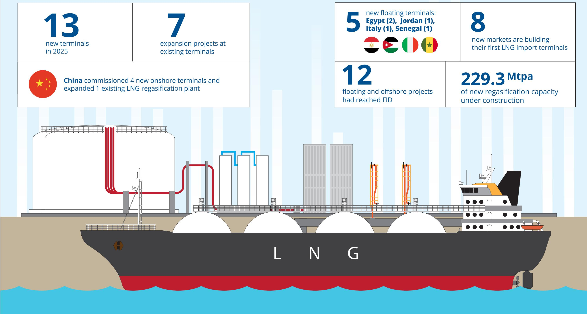

#7. 液化天然气接收站

截至 2025 年底，全球 50 个市场的再气化能力达到 1,113.5 Mtpa。年内，由于八个新陆上进口码头、五个新浮动码头以及七个现有设施扩建项目的启动，每年新增产能 62.9 吨。 2025 年投产的最大项目包括三个浮式项目，包括埃及的 Ain Sokhna (Sonkar) FSRU (Energos Power) 和 Ain Sokhna (Sumed) FSRU (Energos Eskimo) 以及约旦的亚喀巴 FSRU (Energos Force)，每个项目的再气化能力均为 5.7 Mtpa。

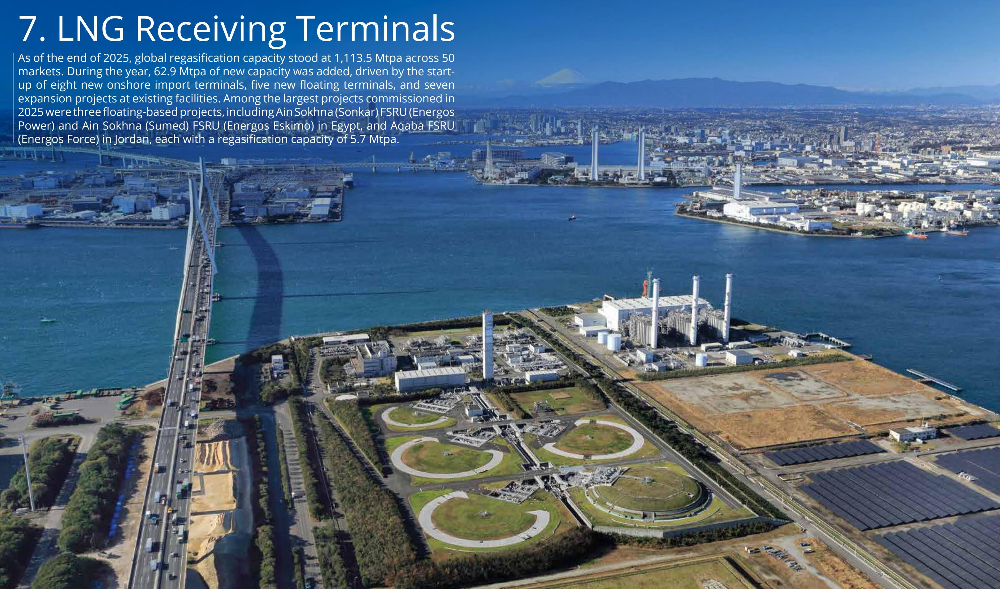  
东京燃气公司提供

## 7.1 概述


截至 2025 年底，全球液化天然气再气化能力为 1,113.5 Mtpa

2025年，全球液化天然气再气化能力继续保持强劲增长势头，13个市场有20个项目投产。这标志着 2024 年在七个市场上线的 18 个项目有所增加。亚洲以 22.2 Mtpa 的产能增幅领先于 2025 年，其次是非洲，为 17.2 Mtpa，欧洲为 11.0 Mtpa，亚太地区为 6.6 Mtpa，中东为 5.7 Mtpa，拉丁美洲为 0.2 Mtpa。

2025 年全球新增吞吐量 62.9 Mtpa 中，42.6 Mtpa 来自 13 个新码头，20.3 Mtpa 来自现有设施的 7 个扩建项目。在 2025 年投产的最大项目中，有两个项目位于埃及艾因苏赫纳港：Sonkar FSRU (Energos Power) 和 Sumed FSRU (Energos Eskimo)，每个项目的再气化能力均为 5.7 Mtpa。随着 FSRU 船 Hoegh Galleon 的抵达，埃及于 2024 年恢复进口液化天然气。这有助于解决埃及日益扩大的供需缺口并加强能源安全，因为天然气供应因地区动荡和国内产量增长缓慢而面临压力。

主要由中国推动的亚洲在 2025 年新增产能中所占份额最大，新增产能达 22.2 Mtpa。仅中国就委托了五个项目，总计增加了 15.1 Mtpa。这些项目包括舟山新奥LNG 3（5 Mtpa）、上海LNG 1（3 Mtpa）、温州华港LNG 1（3 Mtpa）、阳江LNG（2.1 Mtpa）和内河码头芜湖LNG（2 Mtpa）。与此同时，印度通过新的陆上再再气化终端 Chhara LNG（5 Mtpa）和陆上扩建项目 Dabhol LNG 防波堤竣工（2.1 Mtpa）的投产，到 2025 年增加了 7.1 Mtpa。

# 接收终端容量和全球利用率

2025 年，全球再气化能力继续增长，亚洲、非洲、欧洲、亚太地区、中东和拉丁美洲新增 62.9 Mtpa。去年新增的运力大致平均分为两种类型的码头：陆上码头和浮动码头。浮式码头继续发挥着关键作用，由于其灵活性和较低的资本投资，九个项目的总产能增加了 32.6 Mtpa。这九个项目中，三个位于埃及，其余六个位于约旦、意大利、德国、克罗地亚、塞内加尔和哥伦比亚。这些浮动码头增��了 110 万立方米 (mcm) 液化天然气储存能力。

亚洲是新增产能最大的地区，通过五个新项目和现有码头的两个扩建项目，每年新增产能 22.2 吨。总产能为15.1 Mtpa的5个新项目中，4个位于中国，1个位于印度。两个扩建项目中，一个位于中国，另一个位于印度，总产能为7.1 Mtpa。非洲是继亚洲之后第二大产能增加地区，通过启动两个新的基于 FSRU 的终端、扩建埃及的 Sumed 终端以及塞内加尔的另一个新的基于 FSRU 的终端，年产能增加了 17.2 Mt。欧洲通过德国、克罗地亚和波兰现有码头的三个扩建项目（每个码头各有一个初创公司）以及意大利的一个新浮动码头，到 2025 年将增加 11.0 Mtpa。

2025年，全球有13个新的再再气化终端开始运营，总产能增加42.6 Mtpa。其中，8个为陆上接收站，其中4个位于中国（上海液化天然气、温州华港液化天然气、阳江液化天然气、芜湖液化天然气），中国台北、印度、越南和印度尼西亚各1个。去年，五个新的基于 FSRU 的海上码头投入使用，其中两个在埃及，一个在约旦，一个在意大利，一个在塞内加尔。这些浮动码头总共增加了 20.9 Mtpa 的再气化能力和 0.78 mcm 的 LNG 存储能力。

现有码头的七个项目将于2025年投产，再气化能力增加20.3 Mtpa。其中中国的舟山ENN LNG 3（5 Mtpa）、埃及的Ain Sokhna（Sumed）FSRU - Energos Eskimo（5.7 Mtpa）、德国的Wilhelmshaven FSRU 2（3.4 Mtpa）、克罗地亚的Krk LNG接收站2（2.4） Mtpa）、印度的Dabhol LNG防波堤竣工（2.1 Mtpa）、Swinoujscie波兰的前期2（1.5 Mtpa）和哥伦比亚的SPEC FSRU前期1（0.2 Mtpa）。

截至2025年底，全球在建新增再气化产能229.3Mtpa，其中陆上项目50个，总产能193.0Mtpa，浮基项目10个，总产能36.4Mtpa。亚洲在这一发展中处于领先地位，占全球在建再气化产能的 55.6%，其次是欧洲（17.1%）和亚太地区（15.0%）。从市场角度来看，中国将继续引领新造船市场，其次是德国、中国台北和印度。中国每年在建产能为 116.2 吨，全部在陆上，包括 16 个新码头和 14 个现有码头的扩建项目。德国有两个陆上扩建项目和一个新的基于 FSRU 的终端，计划于 2026 年至 2029 年上线。在中国台北，两个新终端和一个扩建项目正在建设中，预计于 2030 年完工。这将使市场的总再气化能力达到 33.0 Mtpa。印度有4个陆上项目，其中3个是现有码头的扩建项目，1个是新项目，总计11.3 Mtpa。

图 7.1：截至 2025 年底按状况和地区划分的液化天然气再气化能力
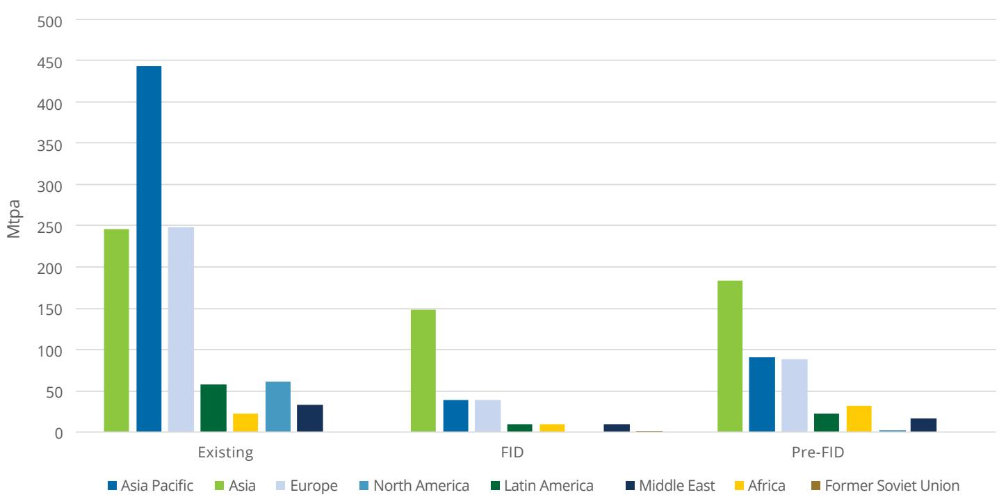  
资料来源：Rystad Energy

图7.2：2000-2030年全球接收站容量
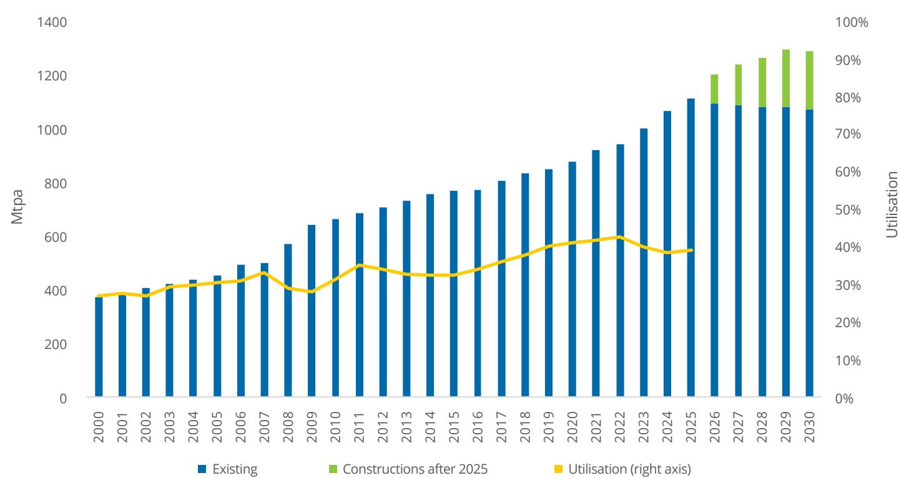  
资料来源：Rystad Energy

包括尼加拉瓜、伊拉克、塞浦路斯、澳大利亚、加纳、俄罗斯、巴哈马、安提瓜和巴布达在内的八个新市场目前正在建设首个液化天然气进口终端，并计划在2026年至2028年开始液化天然气进口。这八个新市场预计将通过建设两个陆上终端和六个浮动终端，增加15.4 Mtpa的再气化能力。这也表明基于浮动的解决方案通常在新兴市场更受欢迎，因为它们提供更大的部署灵活性和更低的固定成本。

15个现有市场也在建设中，包括中国、德国、中国台北、印度、泰国、韩国、埃及、约旦、波兰、英国、多米尼加共和国、荷兰、法国、比利时和日本。中国在建的30个项目中，有6个于2021年获批，10个于2022年获批，4个于2024年获批，1个于2025年获批。尽管中国接收站审批速度放缓，但在未来几年一波项目竣工的支持下，液化天然气进口能力预计将继续增加。预计到 2026 年，中国将有 8 个新建项目和 6 个扩建项目投产，总产能为 63.2 Mtpa。中石化龙口液化天然气和烟台西港（西港）液化天然气产能均为6.5 Mtpa，到2026年将成为中国再气化能力最大的初创企业。这两个项目将新增9个LNG储罐，总容量为1.9 mcm。

全球再气化利用率从 2024 年的 38.5% 上升至 2025 年的平均 39.2%，这一增长主要受到欧洲强劲需求的推动。俄罗斯途经乌克兰的管道天然气运输于 2025 年初停止，导致流向欧洲的液化天然气数量增加，以满足地区天然气需求。

## 7.3

# 按市场划分的接收码头容量和利用率2

图 7.3：按市场划分的液化天然气再气化能力 (Mtpa) 和年度再气化利用率，2025 年
  
资料来源：Rystad Energy

2025年，中国将投产5个再气化项目，其中新建项目4个，扩建项目1个。所有这些都是陆上接收站，总共贡献了15.1 Mtpa的额外再气化能力，包括舟山新奥LNG 3（5 Mtpa）、上海LNG 1（3 Mtpa）、温州华港LNG 1（3 Mtpa）、阳江LNG（2.1 Mtpa）和芜湖LNG接收站（2 Mtpa）。到2030年，在34个在建或达到最终投资决定的液化天然气接收站项目的支持下，中国液化天然气再气化能力预计将再增加137.1 Mtpa。近年来，中国液化天然气再气化接收站利用率逐渐下降，预计到2025年将达到40%左右。这一下降趋势主要是由于大量新接收站投产，再气化能力迅速扩张，超过了液化天然气进口增长。

韩国是全球第三大液化天然气再气化市场，其特点是拥有庞大而成熟的终端网络，总容量约为143.5 Mtpa，分布在八个液化天然气接收终端。超大容量接收站是韩国液化天然气基础设施的重要组成部分，拥有多个世界上容量最大的液化天然气进口设施。其中包括仁川液化天然气（54.9 Mtpa）和平泽液化天然气（41 Mtpa），它们是世界上最大和第二大液化天然气接收站。其他重要的接收站包括统营液化天然气 (Tongyeong LNG) (26.5 Mtpa) 和三陟液化天然气 (Samcheok LNG) (11.6 Mtpa)。产能将进一步扩大，目前有两个项目正在开发中，预计将贡献 8.1

到 2027 年，再气化能力达到 Mtpa。2025 年，韩国液化天然气接收站利用率为 34%，与上一年基本持平。

到 2025 年，印度将超过西班牙，成为第四大再气化能力市场，八个终端的再气化能力达到 52.5 Mtpa。在印度运营的液化天然气再再气化终端中，Dahej LNG（17.5 Mtpa）是唯一的超大型设施，在全球排名第六。其余七个接收站属于大型接收站，每个接收站的再气化能力为 5 Mtpa。 2025年，印度投产了两个液化天然气再气化项目，包括一个新的陆上终端Chhara LNG，再气化能力为5 Mtpa，以及通过完成防波堤基础设施在Dabhol LNG终端进行的一个扩建项目。该项目有效提高了码头的运营效率，吞吐量从2.9 Mtpa增加到5 Mtpa。此前在季风季节闲置的 Dabhol 液化天然气接收站现在在防波堤投入使用后可以全年不间断运行。印度目前有四个液化天然气项目在建，包括一个新接收站和三个现有设施的扩建项目，其中包括印度最大的接收站 Dahej LNG 的扩建。 一旦投产，预计到 2028 年，这些项目将总共增加 11.3 Mtpa 的再气化能力。印度的液化天然气再气化利用率从 2024 年的 58% 降至 2025 年的约 47%。这一下降反映出夏季液化天然气进口疲软以及近期基础设施扩建后再气化能力的增加。

图 7.4：2025 年前五名液化天然气进口国的月度再气化利用率
  
资料来源：Rystad Energy

日本继续成为全球最大的液化天然气再气化产能市场，截至2025年底，总产能达到219 Mtpa，占全球总产能的近20%。该市场是大型液化天然气再气化接收站最集中的市场之一，目前运营中的液化天然气再气化接收站有42个。其中，有四家跻身全球十大液化天然气公司之列：Sodegaura LNG (29.4 Mtpa)、Chita LNG (18.4 Mtpa)、Futtsu LNG (16 Mtpa) 和 Senboku I & II LNG (15.3 Mtpa)。尽管近年来没有新增产能，但市场继续受益于庞大且成熟的终端网络。再气化利用率基本保持不变，到 2025 年约为 31%，这表明整个系统的运行状况稳定。

中国仍然是全球第二大液化天然气再气化能力市场，并继续积极扩大其液化天然气基础设施。截至2025年底，中国已运营LNG再气化接收站36座，总再气化能力达175Mtpa，约占全球产能的15.7%。与此同时，中国的产能扩张继续引领全球，创下年度新增产能最多的纪录。

西班牙是全球第五大液化天然气再气化市场，拥有欧洲最大的液化天然气再气化能力。该市场是液化天然气基础设施发展的先行者，欧洲第一个液化天然气接收站巴塞罗那液化天然气（12.6 Mtpa）于 1969 年投入运行。继 2007 年 Mugardos 液化天然气投入运行后，多年来没有新的液化天然气接收站投入运行。此后唯一值得注意的进展是之前闲置的 El Musel 液化天然气接收站于 2023 年投入运行，以应对俄罗斯-乌克兰冲突引发的天然气供应担忧。西班牙液化天然气再气化利用率从2024年的27%增加到2025年的34%。

## 2025 年产能增加

2025年，共有20个LNG再气化项目投产，新增再气化能力62.9Mtpa。这些活动分布在 13 个市场，包括亚洲（22.2 Mtpa）、非洲（17.2 Mtpa）、欧洲（11.0 Mtpa）、亚太地区（6.6 Mtpa）、中东（5.7 Mtpa）和拉丁美洲（0.2 Mtpa）。与2024年新增LNG接收站相比，更多LNG基础设施建设发生在新兴和前沿市场。 2025年，亚洲在全球液化天然气再气化产能增量中处于领先地位，所有新增产能均来自中国和印度，分别贡献15.1 Mtpa和7.1 Mtpa，分别占全球新增产能的24%和11.3%。自2023年以来，在中国和印度持续扩张的支持下，该地区仍然是新投产项目产能增长的主要驱动力。

2025年，非洲是液化天然气再气化能力增长的第二大贡献者，以埃及和塞内加尔为首。埃及通过三个基于 FSRU 的项目的投产增加了 14.9 Mtpa，而塞内加尔推出了其第一个 LNG 接收站，即基于 FSRU 的设施（2.3 Mtpa），标志着市场上第一个 LNG 发电开发项目。拉丁美洲 2025 年新增产能最低，哥伦比亚的一个扩建项目已上线。

图 7.5：2025 年按市场划分的接收站进口能力和再气化利用率
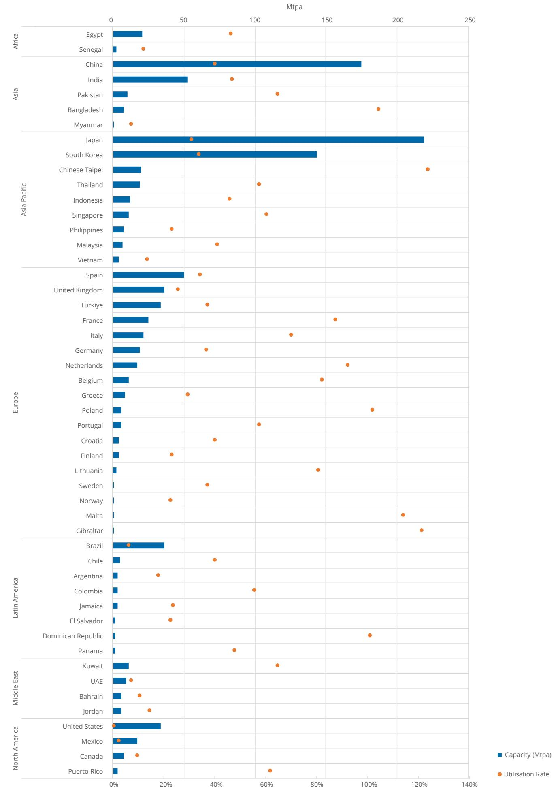

SPEC FSRU 扩建 1（0.2 Mtpa）扩大了哥伦比亚唯一运营的液化天然气再再气化终端，将其总容量提高到 3.6 Mtpa。与此同时，一直在巴西 Gas Sul LNG 终端运营的 FSRU 船 Energos Winter 于 2025 年重新部署到埃及 Damietta LNG 终端。

埃及是 2025 年液化天然气再气化产能增量的第二大贡献者，仅次于中国，其总产能几乎翻了两番，达到约 20.7 Mtpa。在国内产量下降、电力和工业需求强劲的背景下，埃及已从液化天然气净出口国转变为净进口国。 2024 年，埃及将 FSRU Hoegh Galleon 在艾因苏赫纳（苏梅德）码头投入运行。投产后，码头利用率迅速提高至铭牌容量。 2025 年，随着艾因苏赫纳 (Sumed) 终端的 FSRU Energos Eskimo (5.7 Mtpa)、艾因苏赫纳 (Sonkar) 终端的 FSRU Energos Power (5.7 Mtpa) 和达米埃塔 (Damietta) 终端的 FSRU Energos Winter (3.4 Mtpa) 的 FSRU Energos Winter 投入运行，额外的再气化能力将增加。埃及目前正在建设一个项目，即位于艾因苏赫纳 (Sumed) 码头的 FSRU Hoegh Gandria，预计将于 2026 年第四季度投入使用，每年增加 7.6 Mtpa 的产能。 埃及再气化能力的增加是应对国内生产短缺和管道流量中断的有效缓冲，旨在确保能源安全和更加多元化的供应。

对于约旦附近市场，FSRU船Energos Eskimo于2025年第二季度离开约旦前往埃及后，FSRU Energos Force于8月在亚喀巴码头投入使用（5.7 Mtpa）。该船由约旦和埃及共同共享，使埃及能够通过与液化天然气终端相连的阿拉伯天然气管道利用高达 1.8 Mtpa 的液化天然气。约旦还有一个正在建设的陆上液化天然气再再气化终端Aqaba LNG，预计将于2026年投入使用，再气化能力为5.8 Mtpa。此后，现有的 FSRU 将被 FSU 取代。

截至2025年底，欧洲液化天然气再气化总能力达到248.4 Mtpa，位居全球第二，仅次于亚太地区。西班牙、英国和土耳其的产能份额最大，分别为 49.8 Mtpa、36.4 Mtpa 和 33.4 Mtpa。欧洲有9个在建项目，预计到2029年将增加39.1 Mtpa的再气化能力。自2022年俄罗斯-乌克兰冲突爆发以来，德国的再气化能力增长最快，通过多个基于FSRU的终端的投产，从2021年没有液化天然气进口基础设施扩大到2025年底的19.3 Mtpa再气化能力。在德国，穆克兰液化天然气接收站的利用率仍然较低，因为与西北海岸的接收站相比，其运输和边际再气化成本较高。因此，运营商 Deutsche Regas 在 2025 年终止了 FSRU 船舶 Energos Power 的使用，仅在该设施保留 FSRU 船舶 Neptune。 此外，德国于 2025 年在威廉港码头启用了浮式扩建项目 FSRU Excelsior，增加了 3.4 Mtpa 的再气化能力，使码头总容量增加至 8.9 Mtpa。这使得该接收站超越了布伦斯比特尔液化天然气接收站，成为德国最大的液化天然气进口设施。欧洲还投产了一个新的液化天然气进口终端和两个扩建项目：意大利的 Ravenna FSRU BW Singapore（3.7 Mtpa）、克罗地亚的 Krk LNG FSRU 2 号终端（2.4 Mtpa）和波兰的 Swinoujscie 第二期扩建项目（1.5 Mtpa）。与此同时，法国勒阿弗尔FSRU已退役，自2024年7月起不再进口液化天���气。尽管如此，截至2025年底，法国再气化总能力为24.7Mtpa，位居欧洲第四，终端利用率较高，达88%。

亚太地区在全球液化天然气再气化产能中所占份额最大，其中日本和韩国合计占该地区总产能的81.8%。中国台北紧随其后，产能为 19.5 Mtpa，占地区总量的 4.4%。 2025年，在新陆上接收站投产的推动下，亚太地区的产能增加跨越三个市场：中华台北的桃园液化天然气（3 Mtpa）、越南的Cai Mep LNG（3 Mtpa）和印度尼西亚的Batu Hijau LNG接收站（0.6 Mtpa）。中华台北拥有3个正在运营的液化天然气接收站和3个在建项目，预计到2030年将新增产能13.5Mtpa。中华台北2025年的接收站利用率全年相对稳定，在124%左右，为全球最高。利用率是根据铭牌容量计算的，这通常会为实际产量超出容量留下一些空间。这种高利用率主要是由于增加燃气发电、减少对煤炭和核能的依赖以及天然气供应几乎完全依赖进口液化天然气而做出的努力。


表 7.1：2025 年 1 月至 12 月液化天然气再再气化终端


```html
&lt;table&gt;&lt;tr&gt;&lt;td&gt;接收能力&lt;/td&gt;&lt;td&gt;市场数量&lt;/td&gt;&lt;td&gt;新增进口码头&lt;/td&gt;&lt;td&gt;拓展&lt;/td&gt;&lt;/tr&gt;&lt;tr&gt;&lt;td&gt;2025年全球接收能力增长46.0 Mtpanet，新增62.9 Mtpa，因码头原因减少17.0 Mtpa关闭。&lt;/td&gt;&lt;td&gt;2025年内将有1个新市场塞加尔今年出现，具有再气化能力。&lt;/td&gt;&lt;td&gt;中国、埃及、曼谷、印度、意大利、中国台北、越南、塞内加尔和印度尼西亚的新码头新增产能达42.6 Mtpa。&lt;/td&gt;&lt;td&gt;埃及、中国、德国、克罗地亚、印度、波兰和印度尼西亚的近期项目新增20.3 Mtpaof产能。哥伦比亚。&lt;/td&gt;&lt;/tr&gt;&lt;tr&gt;&lt;td&gt;四个FSRU出发，运力减少了。 17.0 Mtpa：终极LNG - Energos Eskimo（3.8 Mtpa）、勒阿弗尔FSRU（3.7 Mtpa）、Mukran LNG - Energos Power（5.5 Mtpa）和Terminal Gas Sul LNG - Energos Winter（4.0 Mtpa）Mtpa）。&lt;/td&gt;&lt;td&gt;截止2025年底，拥有再气化能力的市场数量增加至50 &lt;/td&gt;&lt;td&gt;&lt;/td&gt;&lt;td&gt;&lt;/td&gt;&lt;/tr&gt;&lt;tr&gt;&lt;td&gt;2025年底铭牌再气化能力达到1,113.5 Mtpa。&lt;/td&gt;&lt;td&gt;&lt;/td&gt;&lt;td&gt;&lt;/td&gt;&lt;td&gt;&lt;/td&gt;&lt;/tr&gt;&lt;/table&gt;
```


图 7.6：2025 年按市场划分的 LNG 储罐容量（mcm）及其占总量的百分比


资料来源：Rystad Energy

## 7.4

# 接收站液化天然气储存能力

截至 2025 年底，全球存储容量为 92.2 mcm

2025年，全球液化天然气储存能力继续呈上升趋势，达到92.2立方厘米。这一增长得益于 13 个新建航站楼的启动和 7 个扩建项目的完成，总共增加了 4.9 mcm。从地区来看，亚洲仍然是扩张的主要推动力，其中中国在五个项目中贡献了 2.6 mcm 的增量产能，占全球增长的 53.6%。与 2024 年相比，非洲成为 2025 年存储增长的第二大贡献者，增加了 0.60 mcm。与此同时，亚太地区的产能增长了 0.59 mcm，与非洲基本一致。其次是欧洲和中东，其液化天然气储存能力分别扩大了0.49 mcm和0.17 mcm。

2025年，中国、日本和韩国继续主导全球液化天然气运营储存能力格局，合计占总量的64%。其中，中国占28.8%，其次是日本（20.6%）和韩国（14.8%）。从区域来看，亚太地区与亚洲合计占

占全球液化天然气储存能力的75.8%。截至2025年，全球存储容量最大的前三大LNG再气化接收站均位于韩国：平泽LNG、仁川LNG和统营LNG，容量均超过2.5 mcm。就2025年新增产能而言，增量最大的是中国的上海液化天然气1号和舟山新奥液化天然气3号扩建项目，各增加0.88 mcm的液化天然气储存能力。

2025年，中国继续保持全球最大LNG存储容量市场的地位，总容量达到26.5立方米。 2021年以来，产能增长显着加快，年均新增量在3.2 mcm左右。到2025年，中国将投产5个液化天然气再气化项目，新增储存能力2.6立方米。展望未来，30 个在建项目预计将额外提供 22.9 mcm 的存储容量。此外，中国正在展示采用超大型液化天然气储罐的明显趋势，其中两个运营中的液化天然气再气化项目已经部署了最大的液化天然气储罐（0.27 mcm）。其中包括江苏盐城滨海LNG 1 扩建项目（6 个0.27 mcm 储罐）和山东青岛LNG 3 项目（1 个0.27 mcm 储罐）。这一趋势在在建项目中仍在延续，多个接收站规划了类似的大型液化天然气储存配置，例如浙江宁波LNG 3项目包括6个0.27 mcm LNG储罐，珠海LNG 2项目包括5个0.27 mcm储罐。

另一个值得强调的地区是非洲，其 2025 年 LNG 存储容量增量排名全球第二。增长主要由埃及推动，该国委托了三个 LNG 再气化项目：艾因苏赫纳 (Sonkar) 终端的 FSRU Energos Power、艾因苏赫纳 (Sumed) 终端的 FSRU Energos Eskimo 和达米埃塔 (Damietta) 终端的 FSRU Energos Winter，合计增加了 0.47 mcm 的存储容量。与此同时，塞内加尔进入市场，其首个液化天然气再再气化终端将于 2025 年上线，即塞内加尔 FSRU 项目，进一步增加了 0.13 mcm。该地区液化天然气储存量的增加完全是由浮动液化天然气基础设施（FSRU）驱动的，而不是陆上储罐的开发。

## 7.5

# 接收码头停泊能力

液化天然气再再气化终端处理不同类型液化天然气运输船的能力从根本上受到其停泊能力的限制，而这反过来又对运输效率和可用操作选项的范围产生重要影响。一般来说，液化天然气运输船通常分为四个尺寸等级：容量为125,000至175,000厘米的传统船舶、能够通过新巴拿马运河船闸的新型200,000厘米运输船、约210,000厘米的Q-Flex运输船和约260,000厘米的Q-Max运输船，它们是目前在役的最大液化天然气船舶。

截至2025年底，全球已运营液化天然气再气化接收站203个，其中大部分具备常规船舶停泊能力，共计104个接收站。这占全球总数的一半以上，反映出传统船舶泊位仍然是在不同市场条件下广泛适用的解决方案。能够停泊大型Q级船舶（Q-Max和Q-Flex）的码头相对较少，能够停泊Q-Max的码头有69个，可停泊Q-Flex运输船的码头有30个。在最近投入使用的液化天然气再再气化终端中可以观察到一种新兴趋势，人们越来越倾向于能够处理 Q-Max 运输船的更大容量的停泊基础设施。

2025年投产的新建液化天然气再气化接收站中，三座可容纳Q-Max运输船，其余则可容纳Q-Max运输船。

10个项目专为常规船舶配置。值得注意的是，所有具有Q-Max停泊能力的码头都是陆上设施，反映出与容纳超大型液化天然气运输船相关的更高的技术和空间要求。因此，陆上码头继续主导大容量停泊基础设施的发展，与 FSRU 等浮动解决方案形成鲜明对比，FSRU 更常为小型船舶类别设计。

全球液化天然气再再气化终端接收大型运输船的能力不断扩大。截至2025年底，全球有69个码头有能力停泊Q-Max船舶，按地区分布：亚洲28个、欧洲18个、亚太15个、北美4个、拉丁美洲3个、中东1个。对于Q级液化天然气运输船来说，相关基础设施主要集中在亚洲和亚太地区，共有65个能够容纳此类船舶的码头，占全球总数的66%。在可容纳Q级船舶的所有LNG接收站中，亚洲以36%的份额领先，位居全球第一。相比之下，对于传统液化天然气运输船来说，亚太地区拥有最多的兼容码头，共有40个设施，占全球总数的38%。

随着各地区液化天然气需求的不断增长以及全球液化天然气市场的不断变化，通过扩大停泊能力来升级码头基础设施将继续在增强供应适应性和有效应对市场动态的能力方面发挥至关重要的作用。

图7.7：截至2025年底按最大停泊能力和地区划分的液化天然气接收站数量


仅在岸进口商 陆上和 FSRU/离岸 FSRU/仅离岸进口商

# 浮动和海上再气化


截至 2025 年底，每年 41.8 Mtpa 的浮动码头和海上码头已达到最终投资决定

浮式和海上再气化解决方案已成为全球液化天然气进口能力的重要组成部分，特别是在寻求快速市场进入和灵活基础设施的地区。浮式和海上项目具有多种结构性优势，包括显着缩短开发时间和降低前期资本支出。截至2025年底，全球共有55个浮式和海上再气化项目在运营，铭牌再气化能力为216.1Mtpa。这些接收站约占全球再气化总能力的19.4%，多年来呈逐渐上升趋势，显示出它们在全球天然气供应动态中的重要性不断上升。尽管陆上液化天然气进口终端在装机容量方面继续占据主导地位，但 FSRU 越来越多地被采用作为新兴市场的首选解决方案。

2025 年，全球共有 9 个浮式和海上再再气化终端投入运行，新增再气化能力达 32.6 Mtpa。其中，五个项目是绿地开发，其余四个项目是现有基础设施的扩建。从区域角度来看，非洲的产能增幅最大，全年贡献 17.2 Mtpa。这一增长主要由埃及推动，该国新上线的海上项目数量最多，共有三个项目，新增产能达 14.9 Mtpa。随着第一个基于 FSRU 的液化天然气接收站的调试，塞内加尔建立了第一个液化天然气进口基础设���。欧洲排名第二，新增产能9.4 Mtpa，反映出加强能源安全和天然气供应来源多元化的持续努力。其次是中东和拉丁美洲，分别增加了 5.7 Mtpa 和 0.2 Mtpa。

图 7.8：2000-2030 年按类型划分的再气化市场数量
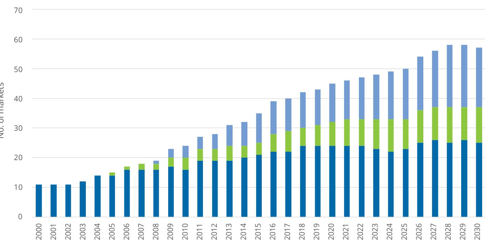

图 7.9：2005-2030 年按状况和项目数量划分的浮式和海上再气化能力
  
资料来源：Rystad Energy

截至 2025 年底，共有 12 个浮式和海上项目已达到最终投资决定，预计到 2030 年将新增再气化产能 41.8 Mtpa。这些项目跨越 12 个市场，反映出液化天然气进口基础设施在不同地区的持续扩张。欧洲在即将新增的产能中所占份额最大，为 12.3 Mtpa，约占 29.4%，其次是非洲，为 9.3 Mtpa，拉丁美洲为 9.0 Mtpa。与此同时，在浮式再气化设施（尤其是FSRU）部署的推动下，预计多个市场将首次进入液化天然气进口市场，这使得项目开发能够更快、更灵活。

LNG市场发展初期，再气化基础设施完全以陆上接收站为主，主要集中在日本、韩国等成熟进口市场，反映出对大规模、稳定、长期供应解决方案的需求。然而，在过去十年中，在液化天然气运输船和海上再气化技术进步的支持下，浮式和海上液化天然气接收装置的部署显着加速。与此同时，新兴市场的液化天然气需求扩张使浮动再再气化终端成为一种有吸引力的解决方案，与传统陆上终端相比，其运营灵活性、快速部署能力以及较低的前期资本投资为其提供了支持。除新兴市场外，欧洲浮式再气化能力也显着扩张。俄罗斯-乌克兰冲突导致管道天然气供应中断后，欧洲加快了液化天然气进口基础设施的快速部署，以增强能源安全并实现供应来源多元化，导致多个市场的FSRU安装量激增。

从全球角度来看，到2025年底，23个市场完全依赖陆上液化天然气接收站，10个市场同时拥有陆上和浮式再气化基础设施，17个市场仅由浮式液化天然气进口设施提供服务。与2015年相比，同时拥有陆上和浮动基础设施的市场数量从4个增加到10个，而完全依赖浮动和海上进口解决方案的市场数量从10个增加到17个，凸显了过去十年浮动和海上再气化的快速扩张。展望2030年，根据已完成最终投资决定、在建或已投产的项目，在新兴液化天然气进口商进入的推动下，仅由浮动液化天然气接收站服务的市场数量预计将进一步增加至20个。

# 具有重新装载和转运能力的接收码头

2025 年再出口量最高：印度尼西亚，0.85 公吨

全球液化天然气再出口市场的快速增长反映了进口码头角色的转变，这些码头现在提供传统再气化之外更广泛的服务。这些设施越来越多地充当综合液化天然气枢纽，提供重新装载、转运、小规模加油和卡车装载能力。这些发展使进口商能够抓住跨市场套利机会，并通过定期合同更灵活地管理其液化天然气投资组合。随着各个市场的重新装载和转运能力得到增强，它们在将液化天然气有效地重新分配到需求强劲或价格更优惠的地区方面发挥着至关重要的作用。这种演变凸显了进口码头如何成为现代液化天然气贸易格局的中心节点。

2025年全球液化天然气再出口量小幅下降1%，从上年同期的4.96吨下降至4.92吨。涉及再出口货物的市场数量仍为13个，与2023年持平。来自欧洲的再出口量同比下降0.28吨，至2025年的2.01吨。其他地区的增长在很大程度上抵消了这一影响下降：亚太地区的再出口量增加了 0.11 公吨，达到 2.01 公吨，而拉丁美洲的再出口量增加了 0.11 公吨，达到 0.23 公吨。欧洲再出口量的下降反映了欧洲液化天然气需求的强劲，以及相对于亚洲和亚太地区的区域价格上涨。

2025年，印尼将成为全球最大的转口市场，总量为0.85公吨，与上年同期基本持平。 TotalEnergies 与 Pertamina 于 2021 年签署的协议将阿伦液化天然气终端用作交易中心，为这一点提供了支撑。根据协议，码头的两个储罐将用于储存来自国际来源的液化天然气，作为更广泛的全球营销战略的一部分。阿伦最初是作为出口设施建造的，2015 年改建为进口码头。

西班牙是2025年第二大液化天然气再出口市场，其数量基本保持在0.77吨，而2024年为0.78吨。作为欧洲再气化能力最高的市场，西班牙已成为重要的区域液化天然气枢纽，使其能够将货物重新分配到意大利、荷兰和法国等其他欧洲市场。西班牙的5.9Mtpa El Musel码头因需求不足而闲置了近10年，于2023年投入使用。该码头配备两个15万立方厘米的液化天然气储罐，预计主要用于储存和转口。其业务旨在支持欧洲的供应安全，重点是为附近城市重新装载液化天然气并再出口到其他欧洲市场。

与此同时，来自中国的转口从上一年的0.46吨增加到2025年的0.67吨，占全球总量的13.6%。成交量增加主要是由于中国内需不温不火所致。 PipeChina的海南洋浦液化天然气接收站是中国第一个提供转口服务的接收站，并继续处理中国大部分的转口量。作为国内为数不多的同时具备换装和转运能力的设施之一，它在支持中国液化天然气转口活动方面发挥着关键作用。中国越来越多的再气化码头开始发展再出口业务，通过建设保税储罐来��现业务组合多元化。当液化天然气货物卸入保税仓库时，可以免除进口关税和增值税（VAT）。然后，货物可以再出口（全额免税）或进入国内市场（清关时需缴纳进口税）。截至2025年底，全国13个码头已投入使用16个保税储罐，总容量达3.3立方米，形成了覆盖东北、华北、华东、华南的全国配送网络。


## 液化天然气加注船和码头

60

活跃血管

16 30 亚洲/亚太地区 欧洲

北美 11 个

2 拉丁美洲

1 在 俄罗斯

活跃船队平均容量 8,785 立方厘米

o43on 订单簿

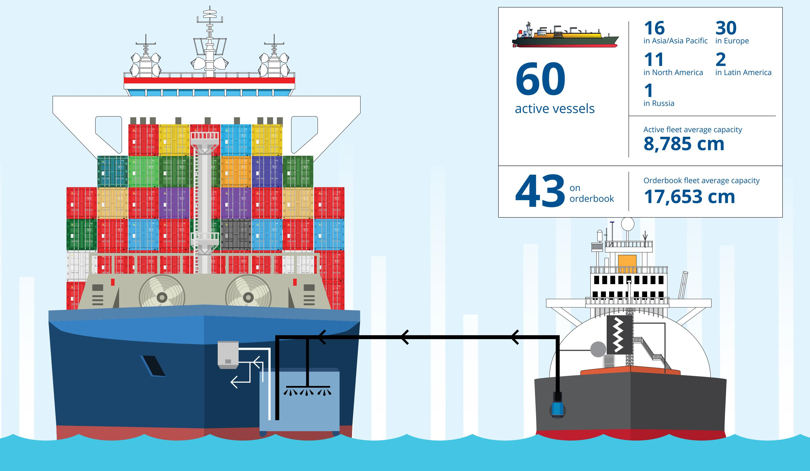

订单船队平均容量 17,653 立方厘米

# 8. 液化天然气加注船和码头

如果说 2024 年对于液化天然气加注来说是重要的一年，那么 2025 年又是该行业表现强劲的一年。由于天气比去年稍凉，2025 年第一季度液化天然气价格上涨。然而，这种情况很快发生了变化，因为与 MGO 等其他船用燃料相比，今年剩余时间价格下降速度更快，MGO 刺激了液化天然气加注。

大阪燃气公司提供


```html
&lt;table&gt;&lt;tr&gt;&lt;td colspan="4"&gt;截至 2025 年底，全球运营 60 艘液化天然气加注船队&lt;/td&gt;&lt;/tr&gt;&lt;tr&gt;&lt;td colspan="4"&gt;作为全球最大的加注港口，新加坡港在 2025 年加注了 571,400 吨液化天然气，比 2020 年的 463,900 吨增加了约 23% 2024 年，世界第二大加注港口鹿特丹港 2025 年加注 LNG 量为 992,911 立方米 (cm)，略高于 2024 年的 941,366 立方米。加注生物液化天然气量的激增值得注意，从 2024 年的 2,775 立方米增加到 2024 年的 17,644 立方米，增加了六倍。 2025年。 2025年，上海港的液化天然气加注量为712,000立方厘米，而预计2024年加注的液化天然气量为450,000立方厘米。 2025年1月1日，FuelEU海事立法生效，要求在欧盟水域运营的托运人在2025年将航运活动产生的温室气体排放量与2020年基准相比减少2%。这相当于 2026 年的井醒 (WtW) 碳强度要求为每兆焦耳二氧化碳当量 (gCO2eq/MJ) 约 89.34 克。 这一要求将逐渐变得更加严格，到2030年进一步收紧6%（85.69 gCO2eq/MJ），到2035年收紧14.5%（77.94 gCO2eq/MJ），到2040年收紧31%（62.90 gCO2eq/MJ），到2045年收紧62%（34.64 gCO2eq/MJ），到 2050 年将达到 80% (18.23 gCO2eq/MJ)。通过使用更清洁的燃料（如配备合适发动机的液化天然气）或使用具有较低 WtW 强度的生物燃料或非生物来源可再生燃料 (RFNBO) 可以降低温室气体排放。例如，使用 ME-GI (Everilence) 的船舶的 WtW 强度约为 76.13 gCO2eq/MJ，这意味着这些船舶至少在 2035 年之前不会遭受 FuelEU 海事处罚。为了降低 WtW 强度水平，2025 年也是生物 LNG 的一年，与化石来源 LNG 相比，生物 LNG 的综合 WtW 排放量较低，尽管其价格将高于化石来源 LNG。 2025 年，生物液化天然气开始在北美、欧洲和亚洲的各种形式的加油活动中得到更广泛的采用。西班牙 ENAGAS 于 2025 年 3 月开始为韦尔瓦和巴塞罗那的船对船 (STS) 和卡车对船加油提供生物液化天然气。 它还于 2025 年 8 月开始在卡塔赫纳进行生物液化天然气加注&lt;/td&gt;&lt;/tr&gt;&lt;tr&gt;&lt;td colspan="4"&gt;图 8.1： 重要政策时间表&lt;/td&gt;&lt;/tr&gt;&lt;tr&gt;&lt;td rowspan="2"&gt;&lt;/td&gt;&lt;td&gt;2020IMO 2020年全球硫限量：• 全球船用燃油最高硫含量从3.5%降至0.5%• 在特定硫排放控制区（sECA）内，限量将更严格为0.1%&lt;/td&gt;&lt;td&gt;2024年附件六修订MARPOL 公约 (MEPC.385(81))• 根据 2024 年 LCA 指南对燃料排放进行标准化计算• 引入了低闪点燃料和气体燃料等的关键条款• 增强了 IMO 船舶燃料消耗数据库 (IMO DCS) 的粒度 2024 年 7 月 1 日开始北极航运禁止 HFO&lt;/td&gt;&lt;td&gt;2026 年开始实施加拿大北极 ECA 和挪威海 ECA 2026 年 3 月 1 日：• 两个排放控制区均涵盖硫氧化物、氮氧化物和颗粒物 (PM)&lt;/td&gt;&lt;/tr&gt;&lt;tr&gt;&lt;td&gt;2023IMO 修订的温室气体 (GHG) 战略：• 到 2050 年，5,000 总吨或以上船舶的温室气体净零排放• 与 2008 年相比，2030 年和 2040 年中期温室气体减排目标水平&lt;/td&gt;&lt;td&gt;2025采用全球燃料标准（GFS）和全球经济措施地中海硫氧化物（SOx）ECA于2025年5月1日开始实施&lt;/td&gt;&lt;td&gt;2027采用即将到来的东北大西洋ECA于2026年5月正式生效。• ECA将于2027年9月启动，实施于2028年9月开始• ECA涵盖SOx、NOx、并PM&lt;/td&gt;&lt;/tr&gt;&lt;/table&gt;
```


2025 年，Seaspan Baker（7,600 厘米）交付。该船由中集太平洋海工建造，是Seaspan Energy订购的三艘7,600厘米液化天然气加注船中的第三艘。 Seaspan于2025年1月接收了该船，随后将其部署到北美西海岸。

Green Pearl（7,500厘米）也于2025年交付。它由Axpo租赁用，由意大利San Giorgio del Porto造船厂建造，将在地中海提供加油服务。

Alisios 液化天然气（12,500 厘米）加注船由 Scale Green Energy（以前称为 Scale Gas）所有，由 Axpo 租赁，在中国南通中集太平洋海洋工程造船厂建造。该船预计将在伊比利亚半岛南部海岸附近运营，并于2025年交付。

United LNG I (8,000 cm) 于 2025 年交付，在安特卫普港命名，预计于 2026 年投入使用。该船由 Somtrans 拥有和运营，预计将在比利时和荷兰港口进行加油活动。

预计将于 2026 年交付 7 艘新加油船。由 Osaka Gas、NS United Coastal Tanker 和神户大阪国际港务公司的合资企业拥有的 Seto Azure（3,500 厘米）也将于 2026 年交付。该船预计将于 2026 年 4 月在濑户内海和大阪湾周围开始 STS。

液化天然气加注船队集中在欧洲，运营加注船的运力最高。其次是亚洲和北美，这两个地区在过去五年中都出现了快速扩张。该船队相当年轻，大多数现役加注船都是在过去五年内交付的，而液化天然气加注船的典型尺寸随着时间的推移而增加。

与 IGU 去年（2025 年）的《世界液化天然气报告》相比，截至 2025 年底，订单量几乎翻了一番。目前在建船舶43艘，总加油能力759,100立方米。预计 2026 年交付 7 架，2027 年交付 24 架，2028 年交付 12 架。

截至 2025 年底，欧洲拥有最高的加油能力，目前该地区运营的 30 艘船舶的加油能力总计达 233,257 厘米。欧洲液化天然气加注行业经历了显着增长，其特点是基础设施发展的增加和液化天然气燃料船舶订单的激增。

截至 2025 年底，亚洲的加油能力位居第二，运营中的 16 艘船舶的加油能力总计达 172,200 立方厘米。

亚太方面，三菱重工与KEYS Bunkering West Japan签订合同建造的KEYS Azalea（3,500厘米）于2024年交付并投入运营。该船为停靠在九州濑户内海地区港口的远洋船舶提供LNG加注服务，从事LNG沿海运输业务。 Ecobunker 东京湾（2,500 厘米）是 Ecobunker 拥有的一艘多加油船，能够进行 STS LNG 和 VLSFO（极低硫燃油）加油

航运，将从2026年开始在东京湾提供液化天然气加注服务。大阪燃气计划于2026年4月在大阪湾和濑户内海地区使用濑户Azure（3,500厘米）加注船推出STS液化天然气加注服务。

继2022年中石油8500厘米“新奥普陀号”号进行首次LNG STS加注后，中国目前已有5艘正在运营的LNG加注船。中海油的首次STS移交是由中国造船厂江南造船（集团）建造的海洋石油301船（30,000厘米）于2023年1月进行的。另一艘中国建造的LNG加注船“海港未来”（20,000 cm）也于2022年进行了首次STS加注。该船由上海上港能源服务运营，由南通中集太平洋海工建造。该船主要为上海洋山港的船舶进行LNG STS加注作业。中海油第二艘LNG加注船海洋石油302船，容量约12000立方米，于2024年在江苏省投入运营。该船凭借“江海直达”和“冰级通航”的优势，可为我国江海LNG船舶提供灵活的加注服务。另一艘中国自主研发的液化天然气加注船淮河能源启航号（14,000厘米）于2024年交付。 该船隶属于淮河能源控股集团，由沪东中华造船集团建造。该船为CCS级加油船，可远洋和长江航行，主要作业区域为上海洋山港和长江沿岸以及中国沿海地区。

韩国目前有四艘加注船提供STS加注服务，分别是正在维修的SM Jeju LNG1（7,500 cm）、SM Jeju LNG2（7,500 cm）、K LNG Dream（500 cm）和Blue Whale（7,500 cm）。 Blue Whale于2023年开始运营，由现代重工建造并交付给Kogas，标志着市场STS加油能力的进步。虽然到 2026 年韩国不会有新的液化天然气加注船投入使用，但市场正计划增强拟议的 13.7 吨/年唐津液化天然气进口设施的液化天然气加注能力。 SM Jeju LNG 1 在 2024 年 2 月发生碰撞后于 2025 年 10 月完成维修。

新加坡目前有三艘加油船正在运营。除了2021年推出的FueLNG Bellina（7,500厘米）之外，FueLNG Venosa（18,000厘米）和LNG Brassavola（12,000厘米）是新加坡继2023年推出后的第二艘和第三艘加油船。

到 2025 年，北美地区将继续发展成为液化天然气加注的重要供应商，到年底，11 艘运营船舶的总容量将达到 92,000 立方米。 Seaspan Baker（7,600 厘米）于 2025 年推出，进一步增强了该地区的液化天然气加注能力。

Green Zeebrugge（5,000 厘米）液化天然气加注船于 2024 年底移至迪拜，并在中东进行了首次液化天然气加注。该船已于 2025 年 7 月从波斯湾迁出，目前在欧洲运营。

数字 8.2： 累计 数量  运营 LNG 加油 船舶 按 地区 和 平均 船舶 容量， 基于 基于 LNG 加油8.1起始年\*，2011年至2026年底
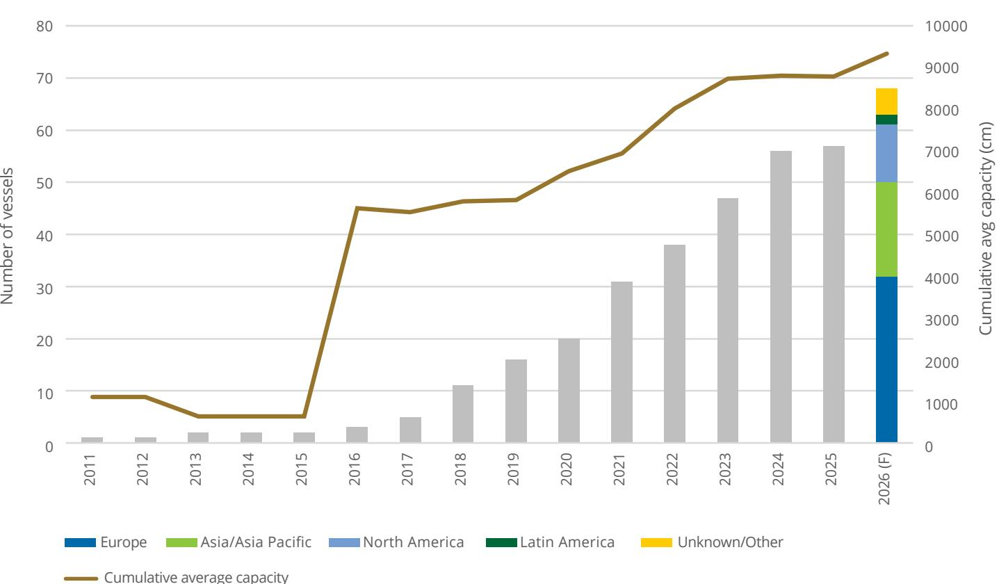  
资料来源：Rystad Energy \*请注意，LNG 加注起始年份是指 LNG 加注开始年份，而不是 LNG 加注船的交付年份

  
礼貌规模绿色能源

表8.1：全球LNG加注船表


```html
&lt;table&gt;&lt;tr&gt;&lt;td&gt;市场&lt;/td&gt;&lt;td&gt;区域市场&lt;/td&gt;&lt;td&gt;船舶名称&lt;/td&gt;&lt;td&gt;交付&lt;/td&gt;&lt;td&gt;LNG加注开始年份&lt;/td&gt;&lt;td&gt;内容量（厘米）&lt;/td&gt;&lt;td&gt;概念&lt;/td&gt;&lt;td&gt;基础设施生命周期&lt;/td&gt;&lt;/tr&gt;&lt;tr&gt;&lt;td&gt;北方欧洲&lt;/td&gt;&lt;td&gt;欧洲&lt;/td&gt;&lt;td&gt;先锋克努森&lt;/td&gt;&lt;td&gt;2004&lt;/td&gt;&lt;td&gt;2011&lt;/td&gt;&lt;td&gt;1100&lt;/td&gt;&lt;td&gt;加油&lt;/td&gt;&lt;td&gt;运营&lt;/td&gt;&lt;/tr&gt;&lt;tr&gt;&lt;td&gt;北美&lt;/td&gt;&lt;td&gt;北部美洲&lt;/td&gt;&lt;td&gt;蚕豆��瑚&lt;/td&gt;&lt;td&gt;2010&lt;/td&gt;&lt;td&gt;2 024&lt;/td&gt;&lt;td&gt;10000&lt;/td&gt;&lt;td&gt;小型/可加油&lt;/td&gt;&lt;td&gt;运营&lt;/td&gt;&lt;/tr&gt;&lt;tr&gt;&lt;td&gt;瑞典&lt;/td&gt;&lt;td&gt;欧洲&lt;/td&gt;&lt;td&gt;Seagas&lt;/td&gt;&lt;td&gt;2013&lt;/td&gt;&lt;td&gt;2013&lt;/td&gt;&lt;td&gt;187&lt;/td&gt;&lt;td&gt;加油船船舶&lt;/td&gt;&lt;td&gt;运营&lt;/td&gt;&lt;/tr&gt;&lt;tr&gt;&lt;td&gt;欧洲&lt;/td&gt;&lt;td&gt;欧洲&lt;/td&gt;&lt;td&gt;珊瑚能源&lt;/td&gt;&lt;td&gt;2013&lt;/td&gt;&lt;td&gt;2016&lt;/td&gt;&lt;td&gt;15600&lt;/td&gt;&lt;td&gt;小型/可加油&lt;/td&gt;&lt;td&gt;运营&lt;/td&gt;&lt;/tr&gt;&lt;tr&gt;&lt;td&gt;北欧&lt;/td&gt;&lt;td&gt;欧洲&lt;/td&gt;&lt;td&gt;Coralius&lt;/td&gt;&lt;td&gt;2017&lt;/td&gt;&lt;td&gt;2017&lt;/td&gt;&lt;td&gt;5800&lt;/td&gt;&lt;td&gt;加油船舶&lt;/td&gt;&lt;td&gt;运营&lt;/td&gt;&lt;/tr&gt;&lt;tr&gt;&lt;td&gt;欧洲&lt;/td&gt;&lt;td&gt;欧洲&lt;/td&gt;&lt;td&gt;绿色泽布吕赫&lt;/td&gt;&lt;td&gt;2017&lt;/td&gt;&lt;td&gt;2017&lt;/td&gt;&lt;td&gt;5000&lt;/td&gt;&lt;td&gt;加油船舶&lt;/td&gt;&lt;td&gt;运营&lt;/td&gt;&lt;/tr&gt;&lt;tr&gt;&lt;td&gt;欧洲&lt;/td&gt;&lt;td&gt;欧洲&lt;/td&gt;&lt;td&gt;新前沿1（前Cardissa）&lt;/td&gt;&lt;td&gt;2017&lt;/td&gt;&lt;td&gt;2018&lt;/td&gt;&lt;td&gt;6500&lt;/td&gt;&lt;td&gt;加油船舶&lt;/td&gt;&lt;td&gt;运营&lt;/td&gt;&lt;/tr&gt;&lt;tr&gt;&lt;td&gt;西班牙&lt;/td&gt;&lt;td&gt;欧洲&lt;/td&gt;&lt;td&gt;奥兹门迪&lt;/td&gt;&lt;td&gt;2017&lt;/td&gt;&lt;td&gt;2018&lt;/td&gt;&lt;td&gt;660&lt;/td&gt;&lt;td&gt;FO/DO/ LNG加油船舶&lt;/td&gt;&lt;td&gt;运营&lt;/td&gt;&lt;/tr&gt;&lt;tr&gt;&lt;td&gt;欧洲&lt;/td&gt;&lt;td&gt;欧洲&lt;/td&gt;&lt;td&gt;珊瑚礁&lt;/td&gt;&lt;td&gt;2018&lt;/td&gt;&lt;td&gt;2018 &lt;/td&gt;&lt;td&gt;7500&lt;/td&gt;&lt;td&gt;小型/可装燃料&lt;/td&gt;&lt;td&gt;运营&lt;/td&gt;&lt;/tr&gt;&lt;tr&gt;&lt;td&gt;北欧&lt;/td&gt;&lt;td&gt;欧洲&lt;/td&gt;&lt;td&gt;珊瑚能源&lt;/td&gt; &lt;td&gt;2018&lt;/td&gt;&lt;td&gt;2018&lt;/td&gt;&lt;td&gt;18000&lt;/td&gt;&lt;td&gt;小型/可加油&lt;/td&gt;&lt;td&gt;运营&lt;/td&gt;&lt;/tr&gt;&lt;tr&gt;&lt;td&gt;北欧&lt;/td&gt;&lt;td&gt;欧洲&lt;/td&gt;&lt;td&gt;凯罗斯&lt;/td&gt;&lt;td&gt;2018&lt;/td&gt;&lt;td&gt;2019&lt;/td&gt;&lt;td&gt;7500&lt;/td&gt;&lt;td&gt;加油船舶&lt;/td&gt;&lt;td&gt;运营&lt;/td&gt; td&gt;&lt;/tr&gt;&lt;tr&gt;&lt;td&gt;美国东海岸&lt;/td&gt;&lt;td&gt;北美&lt;/td&gt;&lt;td&gt;清洁杰克逊维尔&lt;/td&gt;&lt;td&gt;2018&lt;/td&gt;&lt;td&gt;2018&lt;/td&gt;&lt;td&gt;2 200&lt;/td&gt;&lt;td&gt;非推进式加油驳船（琼斯法案）&lt;/td&gt;&lt;td&gt;运营&lt;/td&gt;&lt;/tr&gt;&lt;tr&gt;&lt;td&gt;西班牙&lt;/td&gt;&lt;td&gt;欧洲&lt;/td&gt;&lt;td&gt;地堡Breeze&lt;/td&gt;&lt;td&gt;2018&lt;/td&gt;&lt;td&gt;2018&lt;/td&gt;&lt;td&gt;1200&lt;/td&gt;&lt;td&gt;FO/DO加油船；液化天然气加油站设计&lt;/td&gt;&lt;td&gt;运营&lt;/td&gt;&lt;/tr&gt;&lt;tr&gt;&lt;td&gt;韩国&lt;/td&gt;&lt;td&gt;亚洲&lt;/td&gt;&lt;td&gt;SM Jeju LNG1&lt;/td&gt;&lt;td&gt;2019&lt;/td&gt;&lt;td&gt;2019&lt;/td&gt;&lt;td&gt;7500&lt;/td&gt;&lt;td&gt;加油船&lt;/td&gt;&lt;td&gt;运营（之后维修）&lt;/td&gt;&lt;/tr&gt;&lt;tr&gt;&lt;td&gt;荷兰&lt;/td&gt;&lt;td&gt;欧洲&lt;/td&gt;&lt;td&gt;FlexFueler 001&lt;/td&gt;&lt;td&gt;2019&lt;/td&gt;&lt;td&gt;2019&lt;/td&gt;&lt;td&gt;1480&lt;/td&gt;&lt;td&gt;非推进式加油驳船（内陆）&lt;/td&gt;&lt;td&gt;运营&lt;/td&gt;&lt;/tr&gt;&lt;tr&gt;&lt;td&gt;加勒比&lt;/td&gt;&lt;td&gt;北美&lt;/td&gt;&lt;td&gt;珊瑚Fraseri&lt;/td&gt;&lt;td&gt;2019&lt;/td&gt;&lt;td&gt;2019&lt;/td&gt;&lt;td&gt;10000&lt;/td&gt;&lt;td&gt;小型/可加注&lt;/td&gt;&lt;td&gt;运营&lt;/td&gt;&lt;/tr&gt;&lt;tr&gt;&lt;td&gt;北欧&lt;/td&gt;&lt;td&gt;欧洲&lt;/td&gt;&lt;td&gt;液化天然气伦敦&lt;/td&gt;&lt;td&gt;2019&lt;/td&gt;&lt;td&gt;2019&lt;/td&gt;&lt;td&gt;3000&lt;/td&gt;&lt;td&gt;加油船（内陆）&lt;/td&gt;&lt;td&gt;运营&lt;/td&gt;&lt;/tr&gt;&lt;tr&gt;&lt;td&gt;韩国&lt;/td&gt;&lt;td&gt;亚洲&lt;/td&gt;&lt;td&gt;SM济州岛LNG2&lt;/td&gt;&lt;td&gt;2020&lt;/td&gt;&lt;td&gt;2020&lt;/td&gt;&lt;td&gt;7500&lt;/td&gt;&lt;td&gt;加油船舶&lt;/td&gt;&lt;td&gt;运营&lt;/td&gt;&lt;/tr&gt;&lt;tr&gt;&lt;td&gt;日本&lt;/td&gt;&lt;td&gt;亚洲&lt;/td&gt;&lt;td&gt;Kaguya&lt;/td&gt;&lt;td&gt;202 0&lt;/td&gt;&lt;td&gt;2020&lt;/td&gt;&lt;td&gt;3500&lt;/td&gt;&lt;td&gt;加油船舶&lt;/td&gt;&lt;td&gt;运营&lt;/td&gt;&lt;/tr&gt;&lt;tr&gt;&lt;td&gt;荷兰&lt;/td&gt;&lt;td&gt;欧洲&lt;/td&gt;&lt;td&gt;敏捷天然气性&lt;/td&gt;&lt;td&gt;2020&lt;/td&gt;&lt;td&gt;2020&lt;/td&gt; td&gt;&lt;td&gt;18600&lt;/td&gt;&lt;td&gt;加油船舶&lt;/td&gt;&lt;td&gt;运营&lt;/td&gt;&lt;/tr&gt;&lt;tr&gt;&lt;td&gt;欧洲&lt;/td&gt;&lt;td&gt;欧洲&lt;/td&gt;&lt;td&gt;Avenir优势&lt;/td&gt;&lt;td&gt;2020&lt;/td&gt;&lt;td&gt;2020&lt;/td&gt;&lt;td&gt;7500&lt;/td&gt;&lt;td&gt;加油船舶&lt;/td&gt;&lt;td&gt;运营&lt;/td&gt;&lt;/tr&gt;&lt;tr&gt;&lt;td&gt;比利时&lt;/td&gt;&lt;td&gt;欧洲&lt;/td&gt;&lt;td&gt;FlexFueler 002&lt;/td&gt;&lt;td&gt;2020&lt;/td&gt;&lt;td&gt;2021&lt;/td&gt;&lt;td&gt;1480&lt;/td&gt;&lt;td&gt;非推进式加油驳船（内陆）&lt;/td&gt;&lt;td&gt;运营&lt;/td&gt;&lt;/tr&gt;&lt;tr&gt;&lt;td&gt;新加坡&lt;/td&gt;&lt;td&gt;亚洲&lt;/td&gt;&lt;td&gt;FueLNG贝利纳&lt;/td&gt;&lt;td&gt;2021&lt;/td&gt;&lt;td&gt;2021&lt;/td&gt;&lt;td&gt;7500&lt;/td&gt;&lt;td&gt;加油船舶&lt;/td&gt;&lt;td&gt;运营&lt;/td&gt;&lt;/tr&gt;&lt;tr&gt;&lt;td&gt;中国&lt;/td&gt;&lt;td&gt;亚洲&lt;/td&gt;&lt;td&gt;海港未来（前Avenir）忠诚）&lt;/td&gt;&lt;td&gt;2021&lt;/td&gt;&lt;td&gt;2021&lt;/td&gt;&lt;td&gt;20000&lt;/td&gt;&lt;td&gt;加油船舶&lt;/td&gt;&lt;td&gt;运营&lt;/td&gt;&lt;/tr&gt;&lt;tr&gt;&lt;td&gt;美国&lt;/td&gt;&lt;td&gt;北美&lt;/td&gt;&lt;td&gt;Q-LNG ATB 4000&lt;/td&gt;&lt;td&gt;2021&lt;/td&gt;&lt;td&gt;2021&lt;/td&gt;&lt;td&gt;4000&lt;/td&gt;&lt;td&gt;非推进式加油驳船（琼斯行动）&lt;/td&gt;&lt;td&gt;运营&lt;/td&gt;&lt;/tr&gt;&lt;tr&gt;&lt;td&gt;加勒比&lt;/td&gt;&lt;td&gt;南美洲&lt;/td&gt;&lt;td&gt;Avenir荣誉&lt;/td&gt;&lt;td&gt;2021&lt;/td&gt;&lt;td&gt;2021&lt;/td&gt;&lt;td&gt;7500&lt;/td&gt;&lt;td&gt;小型/可加油&lt;/td&gt;&lt;td&gt;运营&lt;/td&gt;&lt;/tr&gt;&lt;tr&gt;&lt;td&gt;俄罗斯&lt;/td&gt;&lt;td&gt;未知/其他&lt;/td&gt;&lt;td&gt;德米特里·门捷列夫&lt;/td&gt;&lt;td&gt;2021&lt;/td&gt;&lt;td&gt;2021&lt;/td&gt;&lt;td&gt;5800&lt;/td&gt;&lt;td&gt;加油船舶&lt;/td&gt;&lt;td&gt;运营&lt;/td&gt;&lt;/tr&gt;&lt;tr&gt;&lt;td&gt;挪威&lt;/td&gt;&lt;td&gt;欧洲&lt;/td&gt;&lt;td&gt;卑尔根液化天然气&lt;/td&gt;&lt;td&gt;2021&lt;/td&gt;&lt;td&gt;2021&lt;/td&gt;&lt;td&gt;850&lt;/td&gt;&lt;td&gt;加油船舶&lt;/td&gt;&lt;td&gt;运营&lt;/td&gt;&lt;/tr&gt;&lt;/table&gt;
```


```html
&lt;table&gt;&lt;tr&gt;&lt;td&gt;市场&lt;/td&gt;&lt;td&gt;区域市场&lt;/td&gt;&lt;td&gt;船舶名称&lt;/td&gt;&lt;td&gt;交付&lt;/td&gt;&lt;td&gt;LNG加注开始年份&lt;/td&gt;&lt;td&gt;容量（厘米）&lt;/td&gt;&lt;td&gt;概念&lt;/td&gt;&lt;td&gt;基础设施生命周期&lt;/td&gt;&lt;/tr&gt;&lt;tr&gt;&lt;td&gt;北方欧洲&lt;/td&gt;&lt;td&gt;欧洲&lt;/td&gt;&lt;td&gt;Avenir愿望&lt;/td&gt;&lt;td&gt;2021&lt;/td&gt;&lt;td&gt;2021&lt;/td&gt;&lt;td&gt;7500&lt;/td&gt;&lt;td&gt;加油船舶&lt;/td&gt;&lt;td&gt;运营&lt;/td&gt;&lt;/tr&gt;&lt;tr&gt;&lt;td&gt;法国&lt;/td&gt;&lt;td&gt;欧洲&lt;/td&gt;&lt;td&gt;天然气活力&lt;/td&gt;&lt;td&gt;2021&lt;/td&gt;&lt;td&gt;2021&lt;/td&gt;&lt;td&gt;18600&lt;/td&gt;&lt;td&gt;加油轮&lt;/td&gt;&lt;td&gt;运营&lt;/td&gt;&lt;/tr&gt;&lt;tr&gt;&lt;td&gt;美国东海岸&lt;/td&gt;&lt;td&gt;北美&lt;/td&gt;&lt;td&gt;清洁卡纳维拉尔&lt;/td&gt;&lt;td&gt;2021&lt;/td&gt;&lt;td&gt;2021&lt;/td&gt;&lt;td&gt;5500&lt;/td&gt;&lt;td&gt;加油船舶&lt;/td&gt;&lt;td&gt;��营&lt;/td&gt;&lt;/tr&gt;&lt;tr&gt;&lt;td&gt;韩国&lt;/td&gt;&lt;td&gt;亚洲&lt;/td&gt;&lt;td&gt;K液化天然气梦想&lt;/td&gt;&lt;td&gt;2022&lt;/td&gt;&lt;td&gt;2022&lt;/td&gt;&lt;td&gt;500&lt;/td&gt;&lt;td&gt;加油船舶&lt;/td&gt;&lt;td&gt;运营&lt;/td&gt;&lt;/tr&gt;&lt;tr&gt;&lt;td&gt;中国&lt;/td&gt;&lt;td&gt;亚洲&lt;/td&gt;&lt;td&gt;新奥普陀号&lt;/td&gt;&lt;td&gt;2022&lt;/td&gt;&lt;td&gt;2022&lt;/td&gt;&lt;td&gt;8500&lt;/td&gt;&lt;td&gt;加油船舶&lt;/td&gt;&lt;td&gt;运营&lt;/td&gt;&lt;/tr&gt;&lt;tr&gt;&lt;td&gt;中国&lt;/td&gt;&lt;td&gt;亚洲&lt;/td&gt;&lt;td&gt;海洋石油301&lt;/td&gt;&lt;td&gt;2022&lt;/td&gt;&lt;td&gt;2022 &lt;/td&gt;&lt;td&gt;30000&lt;/td&gt;&lt;td&gt;小型/可装燃料&lt;/td&gt;&lt;td&gt;运营&lt;/td&gt;&lt;/tr&gt;&lt;tr&gt;&lt;td&gt;荷兰&lt;/td&gt;&lt;td&gt;欧洲&lt;/td&gt;&lt;td&gt;K. 莲花&lt;/td&gt;&lt;td&gt;2022&lt;/td&gt;&lt;td&gt;2022&lt;/td&gt;&lt;td&gt;18000&lt;/td&gt;&lt;td&gt;加油船&lt;/td&gt;&lt;td&gt;运营&lt;/td&gt;&lt;/tr&gt;&lt;tr&gt;&lt;td&gt;北美&lt;/td&gt;&lt;td&gt;北美&lt;/td&gt;&lt;td&gt;Avenir成就&lt;/td&gt;&lt;td&gt;2022&lt;/td&gt;&lt;td&gt;2022&lt;/td&gt;&lt;td&gt;20000&lt;/td&gt;&lt;td&gt;小型/可加注&lt;/td&gt;&lt;td&gt;运营&lt;/td&gt;&lt;/tr&gt;&lt;tr&gt;&lt;td&gt;北欧&lt;/td&gt;&lt;td&gt;欧洲&lt;/td&gt;&lt;td&gt;Avenir升腾&lt;/td&gt;&lt;td&gt;2022&lt;/td&gt;&lt;td&gt;2022&lt;/td&gt;&lt;td&gt;7500&lt;/td&gt;&lt;td&gt;加油船&lt;/td&gt;&lt;td&gt;运营&lt;/td&gt;&lt;/tr&gt;&lt;tr&gt;&lt;td&gt;西班牙&lt;/td&gt;&lt;td&gt;欧洲&lt;/td&gt;&lt;td&gt;海宁格松克努森&lt;/td&gt;&lt;td&gt;2022&lt;/td&gt;&lt;td&gt;2022&lt;/td&gt;&lt;td&gt;5000&lt;/td&gt;&lt;td&gt;加油船&lt;/td&gt;&lt;td&gt;运营&lt;/td&gt;&lt;/tr&gt;&lt;tr&gt;&lt;td&gt;欧洲&lt;/td&gt;&lt;td&gt;欧洲&lt;/td&gt;&lt;td&gt;Alice Cosulich&lt;/td&gt;&lt;td&gt;2023&lt;/td&gt;&lt;td&gt;2023&lt;/td&gt;&lt;td&gt;8200&lt;/td&gt;&lt;td&gt;小型/可加注&lt;/td&gt;&lt;td&gt;运营&lt;/td&gt;&lt;/tr&gt;&lt;tr&gt;&lt;td&gt;亚洲&lt;/td&gt;&lt;td&gt;亚洲&lt;/td&gt;&lt;td&gt;泰坦Unikum&lt;/td&gt;&lt;td&gt;2023&lt;/td&gt;&lt;td&gt;2023&lt;/td&gt;&lt;td&gt;12000&lt;/td&gt;&lt;td&gt;小型/可加注&lt;/td&gt;&lt;td&gt;运营&lt;/td&gt;&lt;/tr&gt;&lt;tr&gt;&lt;td&gt;欧洲&lt;/td&gt;&lt;td&gt;欧洲&lt;/td&gt;&lt;td&gt;泰坦愿景&lt;/td&gt;&lt;td&gt;2023&lt;/td&gt;&lt;td&gt;2023&lt;/td&gt;&lt;td&gt;12000&lt;/td&gt;&lt;td&gt;小型/可加注&lt;/td&gt;&lt;td&gt;运营&lt;/td&gt;&lt;/tr&gt;&lt;tr&gt;&lt;td&gt;西班牙&lt;/td&gt;&lt;td&gt;欧洲&lt;/td&gt;&lt;td&gt;万莱特液化天然气&lt;/td&gt;&lt;td&gt;2023&lt;/td&gt;&lt;td&gt;20 23&lt;/td&gt;&lt;td&gt;12500&lt;/td&gt;&lt;td&gt;加油船&lt;/td&gt;&lt;td&gt;运营&lt;/td&gt;&lt;/tr&gt;&lt;tr&gt;&lt;td&gt;新加坡&lt;/td&gt;&lt;td&gt;亚洲&lt;/td&gt;&lt;td&gt;FuelLNG维诺萨&lt;/td&gt;&lt;td&gt;2023&lt;/td&gt;&lt;td&gt;2023&lt;/td&gt;&lt;td&gt;18000&lt;/td&gt;&lt;td&gt;加油船&lt;/td&gt;&lt;td&gt;运营&lt;/td&gt;&lt;/tr&gt;&lt;tr&gt;&lt;td&gt;韩国&lt;/td&gt;&lt;td&gt;亚洲&lt;/td&gt;&lt;td&gt;蓝鲸&lt;/td&gt;&lt;td&gt;2023&lt;/td&gt;&lt;td&gt;2023&lt;/td&gt;&lt;td&gt;7500&lt;/td&gt;&lt;td&gt;加油船&lt;/td&gt;&lt;td&gt;运营&lt;/td&gt;&lt;/tr&gt;&lt;tr&gt;&lt;td&gt;美国&lt;/td&gt;&lt;td&gt;北美&lt;/td&gt;&lt;td&gt;清洁大沼泽地&lt;/td&gt;&lt;td&gt;2023&lt;/td&gt;&lt;td&gt;2023&lt;/td&gt;&lt;td&gt;5500&lt;/td&gt;&lt;td&gt;非推进式加油驳船 （琼斯联盟）&lt;/td&gt;&lt;td&gt;运营&lt;/td&gt;&lt;/tr&gt;&lt;tr&gt;&lt;td&gt;新加坡&lt;/td&gt;&lt;td&gt;亚洲&lt;/td&gt;&lt;td&gt;液化天然气布拉萨沃拉&lt;/td&gt;&lt;td&gt;2023&lt;/td&gt;&lt;td&gt;2023&lt;/td&gt;&lt;td&gt;12000&lt;/td&gt;&lt;td&gt;加油船&lt;/td&gt;&lt;td&gt;运营&lt;/td&gt;&lt;/tr&gt;&lt;tr&gt;&lt;td&gt;南美洲&lt;/td&gt;&lt;td&gt;南美洲&lt;/td&gt;&lt;td&gt;新Frontier 2&lt;/td&gt;&lt;td&gt;2023&lt;/td&gt;&lt;td&gt;2023&lt;/td&gt;&lt;td&gt;18000&lt;/td&gt;&lt;td&gt;加油船&lt;/td&gt;&lt;td&gt;运营&lt;/td&gt;&lt;/tr&gt;&lt;tr&gt;&lt;td&gt;亚洲&lt;/td&gt;&lt;td&gt;亚洲&lt;/td&gt;&lt;td&gt;Paolina Cosulich&lt;/td&gt;&lt;td&gt;2024&lt;/td&gt;&lt;td&gt;2024&lt;/td&gt;&lt;td&gt;8200&lt;/td&gt;&lt;td&gt;小型/可加注&lt;/td&gt;&lt;td&gt;运营&lt;/td&gt;&lt;/tr&gt;&lt;tr&gt;&lt;td&gt;日本&lt;/td&gt;&lt;td&gt;亚洲&lt;/td&gt;&lt;td&gt;关键Azalea&lt;/td&gt;&lt;td&gt;2024&lt;/td&gt;&lt;td&gt;2024&lt;/td&gt;&lt;td&gt;3500&lt;/td&gt;&lt;td&gt;加油船&lt;/td&gt;&lt;td&gt;运营&lt;/td&gt;&lt;/tr&gt;&lt;tr&gt;&lt;td&gt;中国&lt;/td&gt;&lt;td&gt;亚洲&lt;/td&gt;&lt;td&gt;海洋石油302&lt;/td&gt;&lt;td&gt;2024&lt;/td&gt;&lt;td&gt;2024&lt;/td&gt;&lt;td&gt;12000&lt;/td&gt;&lt;td&gt;加油船&lt;/td&gt;&lt;td&gt;运营&lt;/td&gt;&lt;/tr&gt;&lt;tr&gt;&lt;td&gt;中国&lt;/td&gt;&lt;td&gt;亚洲&lt;/td&gt;&lt;td&gt;淮河能源启航&lt;/td&gt;&lt;td&gt;2024&lt;/td&gt;&lt;td&gt;2024&lt;/td&gt;&lt;td&gt;14000&lt;/td&gt;&lt;td&gt;加油船&lt;/td&gt;&lt;td&gt;运营&lt;/td&gt;&lt;/tr&gt;&lt;tr&gt;&lt;td&gt;美国西海岸&lt;/td&gt;&lt;td&gt;北美&lt;/td&gt;&lt;td&gt;Seaspan加里波第&lt;/td&gt;&lt;td&gt;2024&lt;/td&gt;&lt;td&gt;2024&lt;/td&gt;&lt;td&gt;7600&lt;/td&gt; &lt;td&gt;加油船&lt;/td&gt;&lt;td&gt;运营&lt;/td&gt;&lt;/tr&gt;&lt;tr&gt;&lt;td&gt;欧洲&lt;/td&gt;&lt;td&gt;欧洲&lt;/td&gt;&lt;td&gt;能源斯德哥尔摩&lt;/td&gt;&lt;td&gt;2024&lt;/td&gt;&lt;td&gt;2024&lt;/td&gt;&lt;td&gt; 8000&lt;/td&gt;&lt;td&gt;加油船（内陆）&lt;/td&gt;&lt;td&gt;运营&lt;/td&gt;&lt;/tr&gt;&lt;tr&gt;&lt;td&gt;美国&lt;/td&gt;&lt;td&gt;北美&lt;/td&gt;&lt;td&gt;进展&lt;/td&gt;&lt;td&gt;2024&lt;/td&gt;&lt;td&gt;202 4&lt;/td&gt;&lt;td&gt;12000&lt;/td&gt;&lt;td&gt;非推进式加油回应船（琼斯法案）&lt;/td&gt;&lt;td&gt;运营&lt;/td&gt;&lt;/tr&gt;&lt;tr&gt;&lt;td&gt;美国西海岸&lt;/td&gt;&lt;td&gt;北部美洲&lt;/td&gt;&lt;td&gt;Seaspan狮子&lt;/td&gt;&lt;td&gt;2024&lt;/td&gt;&lt;td&gt;2024&lt;/td&gt;&lt;td&gt;7600&lt;/td&gt;&lt;td&gt;加油船&lt;/td&gt;&lt;td&gt;运营&lt;/td&gt;&lt;/tr&gt;&lt;tr&gt;&lt;td&gt;美国西海岸&lt;/td&gt;&lt;td&gt;北 美&lt;/td&gt;&lt;td&gt;Seaspan贝克&lt;/td&gt;&lt;td&gt;2025&lt;/td&gt;&lt;td&gt;2025&lt;/td&gt;&lt;td&gt;7600&lt;/td&gt;&lt;td&gt;加油船&lt;/td&gt;&lt;td&gt;运营&lt;/td&gt;&lt;/tr&gt;&lt;tr&gt;&lt;td&gt;地中海&lt;/td&gt;&lt;td&gt;欧洲&lt;/td&gt;&lt;td&gt;绿色珍珠&lt;/td&gt;&lt;td&gt;2025&lt;/td&gt;&lt;td&gt;2026&lt;/td&gt;&lt;td&gt;7500&lt;/td&gt;&lt;td&gt;加油船&lt;/td&gt;&lt;td&gt;运营&lt;/td&gt;&lt;/tr&gt;&lt;tr&gt;&lt;td&gt;西班牙&lt;/td&gt;&lt;td&gt;欧洲&lt;/td&gt;&lt;td&gt;Alisios液化天然气&lt;/td&gt;&lt;td&gt;2025&lt;/td&gt;&lt;td&gt;2026&lt;/td&gt;&lt;td&gt;12500&lt;/td&gt;&lt;td&gt;加油船&lt;/td&gt;&lt;td&gt;运营&lt;/td&gt;&lt;/tr&gt;&lt;tr&gt;&lt;td&gt;欧洲&lt;/td&gt;&lt;td&gt;欧洲&lt;/td&gt;&lt;td&gt;联合航空液化天然气I&lt;/td&gt;&lt;td&gt;2025&lt;/td&gt;&lt;td&gt;2026&lt;/td&gt;&lt;td&gt;8000&lt;/td&gt;&lt;td&gt;加油船（内陆）&lt;/td&gt;&lt;td&gt;运营&lt;/td&gt;&lt;/tr&gt;&lt;tr&gt;&lt;td&gt;日本&lt;/td&gt;&lt;td&gt;亚洲&lt;/td&gt;&lt;td&gt;濑户Azur e&lt;/td&gt;&lt;td&gt;2026&lt;/td&gt;&lt;td&gt;2026&lt;/td&gt;&lt;td&gt;3500&lt;/td&gt;&lt;td&gt;加油船&lt;/td&gt;&lt;td&gt;正在建造&lt;/td&gt;&lt;/tr&gt;&lt;tr&gt;&lt;td&gt;日本&lt;/td&gt;&lt;td&gt;亚洲&lt;/td&gt;&lt;td&gt;Ecobunker东京湾&lt;/td&gt;&lt;td&gt;2026&lt;/td&gt;&lt;td&gt;2026&lt;/td&gt;&lt;td&gt;2500&lt;/td&gt;&lt;td&gt;加油船&lt;/td&gt;&lt;td&gt;在建&lt;/td&gt;&lt;/tr&gt;&lt;tr&gt;&lt;td&gt;&lt;/td&gt;&lt;td&gt;&lt;/td&gt;&lt;td&gt;哈尔滨工业投资令一号S1070&lt;/td&gt;&lt;td&gt;2026&lt;/td&gt;&lt;td&gt;2026&lt;/td&gt;&lt;td&gt;19600&lt;/td&gt;&lt;td&gt;加油船&lt;/td&gt;&lt;td&gt;在建&lt;/td&gt;&lt;/tr&gt;&lt;tr&gt;&lt;td&gt;&lt;/td&gt;&lt;td&gt;&lt;/td&gt;&lt;td&gt;哈尔滨工业投资令第2号S1071&lt;/td&gt;&lt;td&gt;2026&lt;/td&gt;&lt;td&gt;20 26&lt;/td&gt;&lt;td&gt;19600&lt;/td&gt;&lt;td&gt;加油船&lt;/td&gt;&lt;td&gt;在建&lt;/td&gt;&lt;/tr&gt;&lt;tr&gt;&lt;td&gt;欧洲&lt;/td&gt;&lt;td&gt;欧洲&lt;/td&gt;&lt;td&gt;Avenir BV订单1号S1123&lt;/td&gt;&lt;td&gt;2026&lt;/td&gt;&lt;td&gt;2026&lt;/td&gt;&lt;td&gt;20000&lt;/td&gt;&lt;td&gt;加油船&lt;/td&gt;&lt;td&gt;在建&lt;/td&gt;&lt;/tr&gt;&lt;tr&gt;&lt;td&gt;&lt;/td&gt;&lt;td&gt;&lt;/td&gt;&lt;td&gt;维多BV订单1号S1125&lt;/td&gt;&lt;td&gt;2026&lt;/td&gt;&lt;td&gt;2026&lt;/td&gt;&lt;td&gt;12500&lt;/td&gt;&lt;td&gt;加油船&lt;/td&gt;&lt;td&gt;在建&lt;/td&gt;&lt;/tr&gt;&lt;tr&gt;&lt;td&gt;&lt;/td&gt;&lt;td&gt;&lt;/td&gt;&lt;td&gt;Grupo Ibaizabal沪东中华BV订单1号&lt;/td&gt;&lt;td&gt;20 26&lt;/td&gt;&lt;td&gt;2026&lt;/td&gt;&lt;td&gt;18600&lt;/td&gt;&lt;td&gt;加油船&lt;/td&gt;&lt;td&gt;在建&lt;/td&gt;&lt;/tr&gt;&lt;tr&gt;&lt;td&gt;&lt;/td&gt;&lt;td&gt;&lt;/td&gt;&lt;td&gt;五洋油轮BV订单&lt;/td&gt;&lt;td&gt;2027&lt;/td&gt;&lt;td&gt;2027&lt;/td&gt;&lt;td&gt;12000&lt;/td&gt;&lt;td&gt;加油船&lt;/td&gt;&lt;td&gt;在建&lt;/td&gt;&lt;/tr&gt;&lt;tr&gt;&lt;td&gt;&lt;/td&gt;&lt;td&gt;&lt;/td&gt;&lt;td&gt;赤道海洋BV订单S1128&lt;/td&gt;&lt;td&gt;2027&lt;/td&gt;&lt;td&gt;2027&lt;/td&gt;&lt;td&gt;20000&lt;/td&gt;&lt;td&gt;加油船&lt;/td&gt;&lt;td&gt;在建&lt;/td&gt;&lt;/tr&gt;&lt;tr&gt;&lt;td&gt;&lt;/td&gt;&lt;td&gt;&lt;/td&gt;&lt;td&gt;中集船体S1075&lt;/td&gt;&lt;td&gt;2027&lt;/td&gt;&lt;td&gt;2027&lt;/td&gt;&lt;td&gt;19600&lt;/td&gt;&lt;td&gt;加油船&lt;/td&gt;&lt;td&gt;在建&lt;/td&gt;&lt;/tr&gt;&lt;tr&gt;&lt;td&gt;&lt;/td&gt;&lt;td&gt;&lt;/td&gt;&lt;td&gt;GSX Energy BV订单第1号&lt;/td&gt;&lt;td&gt;2027&lt;/td&gt;&lt;td&gt;2027&lt;/td&gt;&lt;td&gt;20000&lt;/td&gt;&lt;td&gt;加油船&lt;/td&gt;&lt;td&gt;在建&lt;/td&gt;&lt;/tr&gt;&lt;tr&gt;&lt;td&gt;&lt;/td&gt;&lt;td&gt;&lt;/td&gt;&lt;td&gt;GSX Energy BV订单第2号&lt;/td&gt;&lt;td&gt;2027&lt;/td&gt;&lt;td&gt;2027&lt;/td&gt;&lt;td&gt;20000&lt;/td&gt;&lt;td&gt;加油船&lt;/td&gt;&lt;td&gt;在建&lt;/td&gt;&lt;/tr&gt;&lt;tr&gt;&lt;td&gt;&lt;/td&gt;&lt;td&gt;&lt;/td&gt;&lt;td&gt;Gasum和Sirius BV订单号1&lt;/td&gt;&lt;td&gt;2027&lt;/td&gt;&lt;td&gt;2027&lt;/td&gt;&lt;td&gt;7800&lt;/td&gt;&lt;td&gt;加油船&lt;/td&gt;&lt;td&gt;���建&lt;/td&gt;&lt;/tr&gt;&lt;tr&gt;&lt;td&gt;&lt;/td&gt;&lt;td&gt;&lt;/td&gt;&lt;td&gt;Seacon Hull XL-238&lt;/td&gt;&lt;td&gt;2027&lt;/td&gt;&lt;td&gt;2027&lt;/td&gt;&lt;td&gt;20000&lt;/td&gt;&lt;td&gt;加油船&lt;/td&gt;&lt;td&gt;在建&lt;/td&gt;&lt;/tr&gt;&lt;tr&gt;&lt;td&gt;&lt;/td&gt;&lt;td&gt;&lt;/td&gt;&lt;td&gt;Seacon船体XL-239&lt;/td&gt;&lt;td&gt;2027年&lt;/td&gt;&lt;td&gt;2027年&lt;/td&gt;&lt;td&gt;20000&lt;/td&gt;&lt;td&gt;加油船&lt;/td&gt;&lt;td&gt;在建&lt;/td&gt;&lt;/tr&gt;&lt;tr&gt;&lt;td&gt;&lt;/td&gt;&lt;td&gt;&lt;/td&gt;&lt;td&gt;中集船体S1076&lt;/td&gt;&lt;td&gt;2027&lt;/td&gt;&lt;td&gt;2027&lt;/td&gt;&lt;td&gt;19600&lt;/td&gt;&lt;td&gt;加油船&lt;/td&gt;&lt;td&gt;在建&lt;/td&gt;&lt;/tr&gt;&lt;tr&gt;&lt;td&gt;&lt;/td&gt;&lt;td&gt;&lt;/td&gt;&lt;td&gt;Avenir BV订单2号S1124&lt;/td&gt;&lt;td&gt;2027&lt;/td&gt;&lt;td&gt;2027&lt;/td&gt;&lt;td&gt;20000&lt;/td&gt;&lt;td&gt;加油船&lt;/td&gt;&lt;td&gt;在建&lt;/td&gt;&lt;/tr&gt;&lt;tr&gt;&lt;td&gt;&lt;/td&gt;&lt;td&gt;&lt;/td&gt;&lt;td&gt;Somtrans BV订单1号S1129&lt;/td&gt;&lt;td&gt;2027&lt;/td&gt;&lt;td&gt;2027&lt;/td&gt;&lt;td&gt;20000&lt;/td&gt;&lt;td&gt;加油船&lt;/td&gt;&lt;td&gt;在建&lt;/td&gt;&lt;/tr&gt;&lt;tr&gt;&lt;td&gt;&lt;/td&gt;&lt;td&gt;&lt;/td&gt;&lt;td&gt;SIPG BV订单号1&lt;/td&gt;&lt;td&gt;2027&lt;/td&gt;&lt;td&gt;2027&lt;/td&gt;&lt;td&gt;20000&lt;/td&gt;&lt;td&gt;加油船&lt;/td&gt;&lt;td&gt;在建&lt;/td&gt;&lt;/tr&gt;&lt;tr&gt;&lt;td&gt;&lt;/td&gt;&lt;td&gt;&lt;/td&gt;&lt;td&gt;浦项国际BV订单&lt;/td&gt;&lt;td&gt;2027&lt;/td&gt;&lt;td&gt;2027&lt;/td&gt;&lt;td&gt;12500&lt;/td&gt;&lt;td&gt;加油船&lt;/td&gt;&lt;td&gt;在建&lt;/td&gt;&lt;/tr&gt;&lt;tr&gt;&lt;td&gt;&lt;/td&gt;&lt;td&gt;&lt;/td&gt;&lt;td&gt;Celsius Tankers与Caravel Group JV BV订单第1号&lt;/td&gt;&lt;td&gt;2027&lt;/td&gt;&lt;td&gt;2027&lt;/td&gt;&lt;td&gt;20000&lt;/td&gt;&lt;td&gt;加油船&lt;/td&gt;&lt;td&gt;在建&lt;/td&gt;&lt;/tr&gt;&lt;tr&gt;&lt;td&gt;&lt;/td&gt;&lt;td&gt;&lt;/td&gt;&lt;td&gt;Singfar BV订单号1&lt;/td&gt;&lt;td&gt;2027&lt;/td&gt;&lt;td&gt;2027&lt;/td&gt;&lt;td&gt;20000&lt;/td&gt;&lt;td&gt;加油船&lt;/td&gt;&lt;td&gt;在建&lt;/td&gt;&lt;/tr&gt;&lt;/table&gt;
```


```html
&lt;table&gt;&lt;tr&gt;&lt;td&gt;市场&lt;/td&gt;&lt;td&gt;区域市场&lt;/td&gt;&lt;td&gt;船舶名称&lt;/td&gt;&lt;td&gt;交付&lt;/td&gt;&lt;td&gt;LNG加注开始年份&lt;/td&gt;&lt;td&gt;容量（cm）&lt;/td&gt;&lt;td&gt;概念&lt;/td&gt;&lt;td&gt;基础设施周期寿命&lt;/td&gt;&lt;/tr&gt;&lt;tr&gt;&lt;td&gt;&lt;/td&gt;&lt;td&gt;&lt;/td&gt;&lt;td&gt;Singfar BV订单第2号&lt;/td&gt;&lt;td&gt;2027&lt;/td&gt;&lt;td&gt;2027&lt;/td&gt;&lt;td&gt;20000&lt;/td&gt;&lt;td&gt;加油船&lt;/td&gt;&lt;td&gt;下施工&lt;/td&gt;&lt;/tr&gt;&lt;tr&gt;&lt;td&gt;&lt;/td&gt;&lt;td&gt;&lt;/td&gt;&lt;td&gt;Grupo Ibaizabal Hyundai MIPO BV订单第1号&lt;/td&gt;&lt;td&gt;2027&lt;/td&gt;&lt;td&gt;2027&lt;/td&gt;&lt;td&gt;18000&lt;/td&gt;&lt;td&gt;加油船&lt;/td&gt;&lt;td&gt;在建施工&lt;/td&gt;&lt;/tr&gt;&lt;tr&gt;&lt;td&gt;&lt;/td&gt;&lt;td&gt;&lt;/td&gt;&lt;td&gt;Grupo Ibaizabal Hyundai MIPO BV订单第2号&lt;/td&gt;&lt;td&gt;2027&lt;/td&gt;&lt;td&gt;2027&lt;/td&gt;&lt;td&gt;18000&lt;/td&gt;&lt;td&gt;加油船&lt;/td&gt;&lt;td&gt;在建建造中&lt;/td&gt;&lt;/tr&gt;&lt;tr&gt;&lt;td&gt;&lt;/td&gt;&lt;td&gt;&lt;/td&gt;&lt;td&gt;Vitol BV订单第2号&lt;/td&gt;&lt;td&gt;2027&lt;/td&gt;&lt;td&gt;2027&lt;/td&gt;&lt;td&gt;20000&lt;/td&gt;&lt;td&gt;加油船&lt;/td&gt;&lt;td&gt;在建施工&lt;/td&gt;&lt;/tr&gt;&lt;tr&gt;&lt;td&gt;&lt;/td&gt;&lt;td&gt;&lt;/td&gt;&lt;td&gt;Somtrans BV订单第2号S1130&lt;/td&gt;&lt;td&gt;2027&lt;/td&gt;&lt;td&gt;2027&lt;/td&gt;&lt;td&gt;20000&lt;/td&gt;&lt;td&gt;加油船&lt;/td&gt;&lt;td&gt;在建施工&lt;/td&gt;&lt;/tr&gt;&lt;tr&gt;&lt;td&gt;&lt;/td&gt;&lt;td&gt;&lt;/td&gt;&lt;td&gt;Celsius Tankers与Caravel Group JV BV订单第2号&lt;/td&gt;&lt;td&gt;2027&lt;/td&gt;&lt;td&gt;2027&lt;/td&gt;&lt;td&gt;20000&lt;/td&gt;&lt;td&gt;加油船&lt;/td&gt;&lt;td&gt;在建施工&lt;/td&gt;&lt;/tr&gt;&lt;tr&gt;&lt;td&gt;&lt;/td&gt;&lt;td&gt;&lt;/td&gt;&lt;td&gt;半岛BV订单号1&lt;/td&gt;&lt;td&gt;2027&lt;/td&gt;&lt;td&gt;2027&lt;/td&gt;&lt;td&gt;18000&lt;/td&gt;&lt;td&gt;加油船&lt;/td&gt;&lt;td&gt;在建施工&lt;/td&gt;&lt;/tr&gt;&lt;tr&gt;&lt;td&gt;&lt;/td&gt;&lt;td&gt;&lt;/td&gt;&lt;td&gt;H-Line HJ Heavy Industries BV订单第1号&lt;/td&gt;&lt;td&gt;2027&lt;/td&gt;&lt;td&gt;2027&lt;/td&gt;&lt;td&gt;18000&lt;/td&gt;&lt;td&gt;加油船&lt;/td&gt;&lt;td&gt;在建施工&lt;/td&gt;&lt;/tr&gt;&lt;tr&gt;&lt;td&gt;&lt;/td&gt;&lt;td&gt;&lt;/td&gt;&lt;td&gt;Grupo Ibaizabal Hudong中华BV订单 第2号&lt;/td&gt;&lt;td&gt;2027&lt;/td&gt;&lt;td&gt;2027&lt;/td&gt;&lt;td&gt;18600&lt;/td&gt;&lt;td&gt;加油船&lt;/td&gt;&lt;td&gt;在建施工&lt;/td&gt;&lt;/tr&gt;&lt;tr&gt;&lt;td&gt;欧洲&lt;/td&gt;&lt;td&gt;欧洲&lt;/td&gt;&lt;td&gt;规模绿色能源BV订单第1号&lt;/td&gt;&lt;td&gt;2028&lt;/td&gt;&lt;td&gt;2028&lt;/td&gt;&lt;td&gt;18900&lt;/td&gt;&lt;td&gt;加油船&lt;/td&gt;&lt;td&gt;下施工&lt;/td&gt;&lt;/tr&gt;&lt;tr&gt;&lt;td&gt;&lt;/td&gt;&lt;td&gt;&lt;/td&gt;&lt;td&gt;中能拉珠BV订单1号&lt;/td&gt;&lt;td&gt;2028&lt;/td&gt;&lt;td&gt;2028&lt;/td&gt;&lt;td&gt;20000&lt;/td&gt;&lt;td&gt;加油船&lt;/td&gt;&lt;td&gt;在建施工&lt;/td&gt;&lt;/tr&gt;&lt;tr&gt;&lt;td&gt;&lt;/td&gt;&lt;td&gt;&lt;/td&gt;&lt;td&gt;EPS - 现代尾浦 BV 第 1 号订单&lt;/td&gt;&lt;td&gt;2028&lt;/td&gt;&lt;td&gt;2028&lt;/td&gt;&lt;td&gt;18000&lt;/td&gt;&lt;td&gt;加油船&lt;/td&gt;&lt;td&gt;正在进行施工&lt;/td&gt;&lt;/tr&gt;&lt;tr&gt;&lt;td&gt;&lt;/td&gt;&lt;td&gt;&lt;/td&gt;&lt;td&gt;EPS - 现代尾浦 BV 第 2 号订单号&lt;/td&gt;&lt;td&gt;2028&lt;/td&gt;&lt;td&gt;2028&lt;/td&gt;&lt;td&gt;18000&lt;/td&gt;&lt;td&gt;加油船&lt;/td&gt;&lt;td&gt;正在进行施工施工&lt;/td&gt;&lt;/tr&gt;&lt;tr&gt;&lt;td&gt;&lt;/td&gt;&lt;td&gt;&lt;/td&gt;&lt;td&gt;EPS - 现代尾浦BV第3号订单号&lt;/td&gt;&lt;td&gt;2028&lt;/td&gt;&lt;td&gt;2028&lt;/td&gt;&lt;td&gt;18000&lt;/td&gt;&lt;td&gt;加油船&lt;/td&gt;&lt;td&gt;下施工&lt;/td&gt;&lt;/tr&gt;&lt;tr&gt;&lt;td&gt;&lt;/td&gt;&lt;td&gt;&lt;/td&gt;&lt;td&gt;EPS - 现代尾浦BV第4号订单号&lt;/td&gt;&lt;td&gt;2028&lt;/td&gt;&lt;td&gt;2028&lt;/td&gt;&lt;td&gt;18000&lt;/td&gt;&lt;td&gt;加油船&lt;/td&gt;&lt;td&gt;下施工&lt;/td&gt;&lt;/tr&gt;&lt;tr&gt;&lt;td&gt;&lt;/td&gt;&lt;td&gt;&lt;/td&gt;&lt;td&gt;Purus BV订单第1号&lt;/td&gt;&lt;td&gt;2028&lt;/td&gt;&lt;td&gt;2028&lt;/td&gt;&lt;td&gt;18900&lt;/td&gt;&lt;td&gt;加油船&lt;/td&gt;&lt;td&gt;下施工&lt;/td&gt;&lt;/tr&gt;&lt;tr&gt;&lt;td&gt;&lt;/td&gt;&lt;td&gt;&lt;/td&gt;&lt;td&gt;Purus BV订单第2号&lt;/td&gt;&lt;td&gt;2028&lt;/td&gt;&lt;td&gt;2028&lt;/td&gt;&lt;td&gt;18900&lt;/td&gt;&lt;td&gt;加油船&lt;/td&gt;&lt;td&gt;下施工&lt;/td&gt;&lt;/tr&gt;&lt;tr&gt;&lt;td&gt;&lt;/td&gt;&lt;td&gt;&lt;/td&gt;&lt;td&gt;Evalend Shipping - BV订单号1&lt;/td&gt;&lt;td&gt;2028&lt;/td&gt;&lt;td&gt;2028&lt;/td&gt;&lt;td&gt;18000&lt;/td&gt;&lt;td&gt;加油船&lt;/td&gt;&lt;td&gt;正在建造&lt;/td&gt;&lt;/tr&gt;&lt;tr&gt;&lt;td&gt;&lt;/td&gt;&lt;td&gt;&lt;/td&gt;&lt;td&gt;Evalend Shipping - BV 订单 号2&lt;/td&gt;&lt;td&gt;2028&lt;/td&gt;&lt;td&gt;2028&lt;/td&gt;&lt;td&gt;18000&lt;/td&gt;&lt;td&gt;加油船&lt;/td&gt;&lt;td&gt;正在建造&lt;/td&gt;&lt;/tr&gt;&lt;tr&gt;&lt;td&gt;&lt;/td&gt;&lt;td&gt;&lt;/td&gt;&lt;td&gt;Evalend Shipping - BV订单号3&lt;/td&gt;&lt;td&gt;2028&lt;/td&gt;&lt;td&gt;2028&lt;/td&gt;&lt;td&gt;18000&lt;/td&gt;&lt;td&gt;加油船&lt;/td&gt;&lt;td&gt;正在建造&lt;/td&gt;&lt;/tr&gt;&lt;tr&gt;&lt;td&gt;&lt;/td&gt;&lt;td&gt;&lt;/td&gt;&lt;td&gt;Evalend Shipping - BV订单号4&lt;/td&gt;&lt;td&gt;2028&lt;/td&gt;&lt;td&gt;2028&lt;/td&gt;&lt;td&gt;18000&lt;/td&gt;&lt;td&gt;加油船&lt;/td&gt;&lt;td&gt;在建&lt;/td&gt;&lt;/tr&gt;&lt;/table&gt;
```


资料来源：Rystad Energy

# 9. 参考文献和致谢

## 9.1 数据收集

2026年IGU世界液化天然气报告第1、2、5、6、7、8和9章中的数据来自一系列公共和私人领域，包括Rystad Energy、能源研究所世界能源统计评论、国际能源署（IEA）、牛津能源研究所（OIES）、美国能源信息管理局（EIA）、美国能源部（DOE）、阿格斯、LSEG Workspace、DNV GL、Barry Rogliano Salles (BRS)、公司报告和公告。从第三方组织获得的任何私人数据均被引用为参考点的来源（即图表和表格）。赞助商对报告中提供的数据和预测的准确性或完整性不作任何明示或暗示的陈��或保证。除非另有说明，2026 年 IGU 世界液化天然气报告使用截至 2025 年 12 月 31 日的数据作为分界点。

## 9.2 第 3 章的数据收集

2026 年 IGU 世界液化天然气报告第 3 章中的 2025 年贸易数据来自 Rystad Energy，基于 2025 年 1 月 1 日至 12 月 31 日期间到达的货物的装载货物量。赞助商对报告中提供的数据和预测的准确性或完整性不作任何明示或暗示的陈述或保证。

## 9.3 第 4 章的数据收集

《2026 年 IGU 世界液化天然气报告》第 4 章的数据来源于标准普尔全球能源公司。赞助商对报告中提供的数据和预测的准确性或完整性不作任何明示或暗示的陈述或保证。

## 9.4 致谢

IGU 对受托监督本报告的编写和出版的下列组织和工作组成员表示感谢：

• 克罗地亚Hrvoje Pozar能源研究所：Daniel Golja

• 日本大阪燃气有限公司：菅野敦夫、松本诚

• FTI Consulting，法国：Emmanuel Grand

• 法国必维国际检验集团：Carlos Guerrero Pozuelo

• 新加坡标普全球能源：Kenneth Foo

• GAZ-SYSTEM，波兰：Łukasz Trzeszczkowsk

• CNOOC EEI，中国：王凯、赵思兴

• 国际天然气联盟，英国：Mark McCrory、Simon Ellis

• Rystad Energy，挪威：Xi Nan、Jan-Eric Fähnrich、Kaushal Ramesh、Christoph Halser、Mathieu Utting、Ole Dramdal、Wei Xiong、Jingya Zhang、Lu Ming Pang

## 9.5 定义

棕地液化项目：位于现有液化天然气基础设施（如码头、储罐、液化设施或再气化设施）的地点的陆上液化天然气项目。

商业运营：对于液化天然气液化厂，当工厂根据与客户的供应合同交付商业货物时，商业运营就开始了。

苏伊士以东和以西：苏伊士以东和以西一词是指液化天然气油轮固定装置开始的位置。出于这些目的，苏伊士运河、好望角或新地岛以西，但火地岛、巴拿马运河或兰开斯特海峡以东的海洋地点被认为位于苏伊士以西。其他地点被认为位于苏伊士运河以东。

预测数据：预测液化和再气化产能数据仅考虑现有和批准的产能（采用 FID 的标准），并且基于公司宣布的开始日期。

绿地液化项目：一个陆上液化天然气项目，位于以前未开发过液化天然气基础设施的地点。

国内市场：公司所在的市场。

闲置船舶：当船舶处于闲置状态并暂时停止商业运营时，即被视为闲置船舶。这可能是由于货运需求低或运行成本超过当前货运费率造成的。闲置的液化天然气船可以恢复商业运营、进行 FSU/FSRU 转换或继续出售以报废。

液化和再气化能力：除非另有说明，本文件中的液化和再气化能力均指标称能力。必须指出的是，再装载和储存活动会显着降低可用于再气化的有效容量。

液化天然气运输船：就本报告而言，只有容量大于 30,000 立方厘米的 Q 级和传统液化天然气船舶被视为“液化天然气运输船”一章（第 6 章）中讨论的全球船队的一部分。容量为 30,000 立方厘米或以下的船舶被视为小型液化天然气运输船。

液化天然气列车规模：

• 小型：每列列车容量为 0-0.5 Mtpa

• 中等规模：每列列车&gt;0.5-1.5 Mtpa 容量

• 大规模：每列列车运力超过 1.5 Mtpa

现货租船费率（Spot Charter Rates）：指从评估日期后第 5 天起至次月月末期间开始执行的租船成交价格。

## 9.6 区域与海盆

本报告中 IGU 所使用的区域划分，依据下图的颜色分区界定。报告同时采用三大海盆概念：大西洋海盆、太平洋海盆和中东海盆。大西洋海盆涵盖所有毗邻大西洋或地中海的市场；太平洋海盆涵盖所有毗邻太平洋和印度洋的市场。但以下市场不归入前述两类，而单列为中东海盆：巴林、伊朗、伊拉克、以色列、约旦、科威特、阿曼、卡塔尔、阿联酋和也门。对于在多个海盆同时开展液化或再气化业务的市场，IGU 亦已据此对数据进行了相应校准。


## 9.7 缩略语

AP = 空气产品公司 AGRU = 酸性气体去除装置 BHGE = 贝克休斯 CAPEX = 资本支出 CCS = 碳捕集和封存 CCUS = 碳捕集、利用和封存 CII = 碳强度指标 CO2 = 二氧化碳 CNG = 压缩天然气 DOE = 美国能源部 DES = 出厂交付 DFDE = 双燃料柴油电动 DMR = 双混合制冷剂 ECA = 排放控制区EEXI = 现有船舶能效指数 EPC = 工程、采购和建造 ETS = 排放交易系统 EU = 欧盟 EXP = 基于膨胀机的 FEED = 前端工程和设计 FERC = 联邦能源管理委员会 FID = 最终投资决策 FLNG = 浮式液化天然气/浮式液化 FOB = 免费船上 FPSO = 浮式生产、储存和卸载

## 9.8 单位

FRU = 浮式再气化装置 FSRU = 浮式储存和再气化装置 FSU = 浮式储存装置 FTA = 自由贸易协定 GCU = 天然气燃烧装置 GHG = 温室气体 GTT = Gaztransport & Technigaz HFO = 重燃料 Oi IHI = 石川岛播磨重工 IMO = 国际海事组织 ISO = 国际标准化组织 JKM = 普氏日韩 Marker LNG =液化天然气 LPG = 液化石油气 LRMC = 长期边际成本 MARPOL = 国际防止船舶污染公约 MEGA = M 型、电子控制、进气 MEGI = M 型、电子控制、气体注入 MEPC = 海洋环境保护委员会 MFC = 混合流体级联 MMLS = 可移动模块化液化系统 MR = 混合制冷剂 NFE = North Field扩张

NOx = 氮氧化物 NWE = 普氏西北欧标记 OPEX = 运营支出 PM = 颗粒无光泽 PSC = 生产共享合同 PRICO = 聚合制冷剂集成循环操作 RFNBO = 非生物来源可再生燃料 SCMR = 单循环混合制冷剂 sECA = 硫排放控制区 SOx = 硫氧化物 SPA = 销售和采购协议 SPB = B 型自承式棱柱形 SRMC = 短期边际成本 STaGE = 汽轮机和燃气发动机 SSDR = 带再液化装置的低速柴油机 STS = 船对船 TFDE = 三燃料柴油电动 TTF = 所有权转让设施 UAE = 阿拉伯联合酋长国 UK = 英国 US = 美国 USGC = 美国墨西哥湾沿岸 VLSFO = 极低硫燃油 WtW =醒来时的健康状况 YoY = 同比

bbl = 桶 boe = 桶油当量 bcm = 十亿立方米 Btu = 英国热量单位 mcm = 百万立方米

mcf = 百万立方英尺 Mt = 百万吨 Mtpa = 每年百万吨 cm = 立方米 US​​\$ = 美元

MJ = 兆焦耳热 = 100,000 Btu MMBtu = 1,000,000 Btu Mt CO2 = 兆吨二氧化碳 gCO eq = 克二氧化碳当量 tCO eq = 吨二氧化碳当量

## 9.9

## 换算系数

表 9.1：换算系数总览


```html
&lt;table&gt;&lt;tr&gt;&lt;td&gt;&lt;/td&gt;&lt;td&gt;吨液化天然气&lt;/td&gt;&lt;td&gt;厘米液化天然气&lt;/td&gt;&lt;td&gt;mcm天然气&lt;/td&gt;&lt;td&gt;mcf天然气&lt;/td&gt;&lt;td&gt;MMBtu&lt;/td&gt;&lt;td&gt;boe&lt;/td&gt;&lt;/tr&gt;&lt;tr&gt;&lt;td&gt;吨液化天然气&lt;/td&gt;&lt;td&gt;-&lt;/td&gt;&lt;td&gt;2.222&lt;/td&gt;&lt;td&gt;0.00134&lt;/td&gt;&lt;td&gt;0.0474&lt;/td&gt;&lt;td&gt;52&lt;/td&gt;&lt;td&gt;8.97&lt;/td&gt;&lt;/tr&gt;&lt;tr&gt;&lt;td&gt;cm液化天然气&lt;/td&gt;&lt;td&gt;0.45&lt;/td&gt;&lt;td&gt;-&lt;/td&gt;&lt;td&gt;0.000603&lt;/td&gt;&lt;td&gt;0.0213&lt;/td&gt;&lt;td&gt;23.4&lt;/td&gt;&lt;td&gt;4.034&lt;/td&gt;&lt;/tr&gt;&lt;tr&gt;&lt;td&gt;mcm气体&lt;/td&gt;&lt;td&gt;745.6&lt;/td&gt;&lt;td&gt;1658&lt;/td&gt;&lt;td&gt;-&lt;/td&gt;&lt;td&gt;35.31&lt;/td&gt;&lt;td&gt;38665&lt;/td&gt;&lt;td&gt;6666&lt;/td&gt;&lt;/tr&gt;&lt;tr&gt;&lt;td&gt;mcf天然气&lt;/td&gt;&lt;td&gt;21.11&lt;/td&gt;&lt;td&gt;46.97&lt;/td&gt;&lt;td&gt;0.0283&lt;/td&gt;&lt;td&gt;-&lt;/td&gt;&lt;td&gt;1095&lt;/td&gt;&lt;td&gt;1 57.5&lt;/td&gt;&lt;/tr&gt;&lt;tr&gt;&lt;td&gt;MMBtu&lt;/td&gt;&lt;td&gt;0.01923&lt;/td&gt;&lt;td&gt;0.0427&lt;/td&gt;&lt;td&gt;2.586E-05&lt;/td&gt;&lt;td&gt;0.0009132&lt;/td&gt;&lt;td&gt;-&lt;/td&gt;&lt;td&gt;0.172&lt;/td&gt;&lt;/tr&gt;&lt;tr&gt;&lt;td&gt;京东方&lt;/td&gt;&lt;td&gt;0.1115&lt;/td&gt;&lt;td&gt;0.248&lt;/td&gt;&lt;td&gt;0.00015&lt;/td&gt;&lt;td&gt;0.00635&lt;/td&gt;&lt;td&gt;5.8&lt;/td&gt;&lt;td&gt;-&lt;/td&gt;&lt;/tr&gt;&lt;/table&gt;
```


## 附录 1 - LNG 航运

## 围护系统

LNG 围护系统用于在约 -162°C（-260°F）的深冷条件下储存液化天然气。该系统可分为两大类型：薄膜型系统与自支撑系统（亦称独立舱）。薄膜型系统主要由 Gaztransport & Technigaz（GTT）设计；自支撑系统则主要包括球形 Moss 型以及石川岛播磨重工（IHI）B 型舱。基于下文所述优势，现代新造 LNG 船基本已全面采用薄膜型方案。

表 1：围护系统概览


```html
&lt;table&gt;&lt;tr&gt;&lt;td&gt;&lt;/td&gt;&lt;td&gt;膜&lt;/td&gt;&lt;td&gt;自支撑&lt;/td&gt;&lt;/tr&gt;&lt;tr&gt;&lt;td&gt;当前车队数量&lt;/td&gt;&lt;td&gt;691&lt;/td&gt;&lt;td&gt;113&lt;/td&gt;&lt;/tr&gt;&lt;tr&gt;&lt;td&gt;当前车队比例(%)&lt;/td&gt;&lt;td&gt;85.9%&lt;/td&gt;&lt;td&gt;14.1%&lt;/td&gt;&lt;/tr&gt;&lt;tr&gt;&lt;td&gt;系统&lt;/td&gt;&lt;td&gt;GTT 设计：Mark III、Mark III Flex、Mark III Flex+、NO96 系列、NO96 Super+、CS1、NEXT1（商业化中）KC LNG TECH 设计：KC-1、 KC-2&lt;/td&gt;&lt;td&gt;Moss 海事设计：Moss RosenbergIHI 设计：SPBLNT 海事设计：LNT A-BOX&lt;/td&gt;&lt;/tr&gt;&lt;tr&gt;&lt;td&gt;优点&lt;/td&gt;&lt;td&gt;• 节省空间• 更薄、更轻的围护系统• 更高的燃油效率• 更低的驾驶室高度&lt;/td&gt;&lt;td&gt;• 在恶劣条件下更坚固• 可部分装载• 更快结构&lt;/td&gt;&lt;/tr&gt;&lt;tr&gt;&lt;td&gt;缺点&lt;/td&gt;&lt;td&gt;• 部分负载受限• 在恶劣条件下稳定性较差&lt;/td&gt;&lt;td&gt;• 球形设计空间利用率低• 冷却速度较慢• 安全壳系统较厚、较重&lt;/td&gt;&lt;/tr&gt;&lt;/table&gt;
```


## 资料来源：Rystad Energy

在上述两类系统中，航行期间均会发生少量 LNG 的自然蒸发（boil-off）。其成因包括外界传热、液体运动或晃荡（sloshing）、舱体冷却过程以及舱体泄压过程。新型薄膜船在满载条件下的日蒸发率通常低于舱容的 0.10%，若配置部分或全再液化系统，该数值还可进一步降低。相比之下，较早期的自支撑船日均蒸发率约为舱容的 0.15%。薄膜型与自支撑型还可细分为若干具体技术路径，下文将进一步说明。

当前主流的两类薄膜型 LNG 围护系统分别为 Technigaz 的 Mark III 与 Gaztransport 的 NO96，二者后续合并为 GTT。薄膜型系统由主、次两层薄膜构成，材料为金属或复合材料，在低温下收缩较小。Mark III 采用双层泡沫保温结构；NO96 采用充氮保温胶合板箱体。该箱体填充材料经历了由珍珠岩到玻璃棉、再到泡沫保温材料的演进。GTT 还开发了 Next1 围护系统，采用两层因瓦合金金属薄膜，并辅以增强聚氨酯保温层支撑。

GTT 给出的 Mark III Flex+ 蒸发率为 0.07%，其 Next1 目标值与之接近；新一代 NO96 Super+ 蒸发率约为 0.085%。在一定装载液位区间内，船舶海上纵摇、横摇与液面自由液面效应会诱发舱内液体冲击，进而对舱壁产生高冲击压力。该现象称为“晃荡”（sloshing），可能导致结构损伤。首要控制措施是将液位维持在 GTT 规定的安全区间内，通常需低于舱高约 10% 的液位或高于舱高约 70% 的液位。尽管受晃荡约束而存在部分装载限制，薄膜型系统仍凭借棱柱形空间利用效率和较低蒸发率成为主流选择。

新一代 200,000 立方米级船舶普遍采用四舱薄膜布置，有别于 Q-Flex/Q-Max 的五舱方案；而新一代 271,000 立方米级船舶则配置五舱结构。

Moss Rosenberg B 型系统自 1973 年首船交付以来已运行 54 年。该设计通常采用 4 或 5 个自支撑铝合金球形舱，并以充氮聚氨酯泡沫保温。球形结构有利于应力与疲劳精确评估，从而提升耐久性，并无需完整次屏障；其底部设置托盘式局部次屏障以收集潜在泄漏。与薄膜舱相比，独立球舱可在航行中实施部分装载；但其球形几何导致空间利用率偏低，且围护结构整体更重。

三菱推出的 Sayaendo 型船是对传统 Moss Rosenberg 系统的近期改进：其球舱被拉伸为“苹果形”，提升了容积效率，并在外部配置轻量化棱柱形船壳以降低风阻。Sayaendo 船型采用超蒸汽轮机装置（再热蒸汽轮机），效率高于常规蒸汽轮机方案。

同为三菱开发的Sayaringo蒸汽轮机与燃气发动机（STaGE）船型，在Sayaendo基础上进一步优化。STaGE 原生Sayaendo船型并结合


```html
&lt;table&gt;&lt;tr&gt;&lt;td&gt;混合动力推进系统，结合蒸汽涡轮机和燃气发动机以最大限度地提高效率。 2018 年至 2019 年间交付了 8 艘 STaGE 新船。IHI 设计的自承式 B 型棱柱 (SPB) 系统于 1993 年首次在两艘 89,900 厘米液化天然气运输船 Polar Spirit 和 Arctic Spirit 上实施。此后，在东京燃气委托四艘采用该设计的 165,000 立方米船舶之前，它已被用于多艘液化石油气和小型液化天然气船舶，主要用于从美国 Cove Point 进行运输。该设计涉及四个内部细分的储罐，允许在航行期间部分装载。储罐内部有一个纵向分区和一个横向分区，以减少晃动。结果缓解了晃动问题，并且不需要压差，蒸发率相对较低，为 0.08%。值得注意的是，SPB系统比Moss Rosenberg设计具有更高的空间效率并且更轻。一些造船厂正在探索新的独立 B 型系统，类似于 SPB，包括高锰钢。Moss Rosenberg 和 IHI SPB 储罐类型占现役船队的比例不到 20%。 尽管膜已成为 LNG 运输船的首选储罐，但自支撑技术仍然可用，并完全符合国际法规。LNT A-Box 是 A 型自支撑设计，旨在提供价格合理的 LNG 围护系统。它的主要屏障由不锈钢或 9% 镍钢制成，辅助屏障由液密聚氨酯板制成，安装在船舶舱壁、甲板和货舱天花板上。该系统的形状与 IHI-SPB 设计类似，通过独立罐来减轻晃动，目的是最大限度地减少蒸发气体。第一艘配备该系统的 45,000 厘米新造船嘉兴号（前佐贺黎明号）于 2019 年 12 月交付。LNT Marine 联合开发了一艘采用 LNG A-BOX 系统的 175,000 厘米新型液化天然气运输船设计。推进系统推进系统影响资本支出、运营费用、排放、船舶尺寸范围、船舶可靠性和法规遵从性。在 2000 年代初之前，使用蒸发气体和重燃油的蒸汽轮机系统是液化天然气运输船唯一可用的推进解决方案。 不断增加的燃油成本和更严格的排放法规导致了更高效替代方案的开发，例如双燃料柴油电动（DFDE）、三燃料柴油电动（TFDE）和带再液化装置的低速柴油（SSDR）。近年来，产生较低蒸发气体的现代围护系统以及液化天然气短期和现货交易的兴起催生了对更灵活和更高效的推进系统的需求，以适应不同的航行速度、距离和条件。这些因素催生了新一波的双燃料推进系统，这些系统也用少量引燃燃料或柴油来燃烧蒸发气体。其中包括高压MAN B&W M型电控气体喷射（ME-GI）系统、低压喷射M���电控进气系统（ME-GA）（最近退出）以及两代低压喷射Winterthur Gas & Diesel（WinGD）X-DF。特别值得一提的是ABB的Azipod装置，该装置已部署在亚马尔液化天然气服役的15艘Arc7破冰船中俄罗斯项目。 该推进系统的电动机安装在液化天然气运输船船体外部的水下吊舱内，具有 360 度旋转能力。由此带来的更高的机动性使高功率装置能够有效地穿越北极，包括穿越厚达 2.1 米的冰层。该推进系统将部署在为 Novatek 的 Arctic LNG 2 项目订购的 Arc7 破冰船上。减少船上燃油消耗的其他系统包括推进管路中的空气润滑系统和 PTO 轴发电机。这些技术目前已在许多订购的船舶上实施。目前正在评估其他系统，例如风力辅助推进、机载碳捕获或燃料电池等。 2024 年，商船三井宣布在韩华海洋的一艘新建液化天然气运输船上安装风力辅助推进系统。还值得注意的是，作为示范项目的一部分，LNG 运输船 Seapeak Arwa 于 2023 年安装了船载碳捕获系统，为期数月。 一些建造商目前正在提议采用此类新技术的设计。 蒸汽轮机用于船舶推进的蒸汽轮机现在被认为是一种被取代的技术，雇用具有蒸汽经验的船员变得越来越困难。在蒸汽轮机推进系统中，两台锅炉先向高压涡轮机供应超过 500°C (932°F) 的高压蒸汽，然后向低压涡轮机提供动力，为主推进系统和辅助系统提供动力。汽轮机的主要燃料来源是蒸发气，如果前者不足，则可以使用重燃油作为替代品。燃料可以以任何比例燃烧，多余的蒸发气体可以转化为蒸汽，使发动机可靠，并且无需��体燃烧装置。维护成本也相对较低。蒸汽轮机的主要缺点是效率低，满载时运行效率为 35%（效率最高）。新一代推进系统 DFDE/TFDE 和 ME-GI/ME-GA/X-DF 发动机的效率分别比蒸汽高约 25% 和 50%。 2015年之前交付的现役汽轮机推进船有194艘，占现役船队总数的24.1%。2015年对汽轮机进行了改进，包括对循环中的蒸汽进行再加热，将效率提高了30%以上。恰如其分地命名为蒸汽再热系统（或超级蒸汽涡轮机），目前有 12 艘现役船舶配备了该推进系统，但不会再有新造船了。双燃料柴油电动/三燃料柴油电动（DFDE 和 TFDE）DFDE 推进系统于 2006 年推出，作为蒸汽涡轮系统的第一个替代方案。它们可以以不同的模式使用柴油和蒸发气体运行，为发电机提供动力，产生电力来驱动电动机进行推进。辅助电力也通过这些发电机提供，并且在存在过量蒸发气体时安装了气体燃烧装置 (GCU)。 2008年，TFDE船舶的到来提高了此类船舶的适应性，可以选择燃烧重燃油作为额外的燃料来源。 能够在不同的航行条件和现行燃料价格下选择不同的燃料，与蒸汽涡轮推进相比，整体效率提高了 30%。此外，这些船舶在动态负载下（例如在恶劣天气条件下）的响应被认为非常出色。&lt;/td&gt;&lt;/tr&gt;&lt;/table&gt;
```


然而，DFDE和TFDE推进系统也有一定的缺点。资本支出和维护成本相对较高，部分原因是需要 GCU 以及发动机和气缸的数量。如果气体沸腾成分超出发动机规定的范围，则在气体模式下可能会发生爆震和失火。爆震是指发动机在最佳点之前点火，这可能不利于发动机运行。截至 2025 年底，现役 TFDE/DFDE 船舶有 195 艘，占现有船队的 24.3%。目前有 23 艘配备 DFDE 系统���新建船舶待交付，20 艘破冰船为 Arctic LNG 2 项目提供服务，还有 3 艘新建 FSRU 可能配备 DFDE 系统。由于美国的制裁，北极液化天然气2号项目船舶的交付继续严重延迟。

## 带再液化装置的慢速柴油 (SSDR)

SSDR 采用 DFDE 推进系统，运行两台低速柴油发动机和四台辅助发电机，并配有完整的再液化装置，将沸腾气体以液态返回液化天然气罐。直接的优势是可以忽略不计的沸腾，这在 2022 年的高油价环境下优化了货物价值，并且可以选择有效地使用重燃油或柴油作为燃料来源。然而，再液化厂的大量用电量可能会抵消效率增益，并将 SSDR 限制为仅适用于超大型运输公司（以实现规模经济）。目前活跃的液化天然气船队中有 48 艘 SSDR 船舶，其中 44 艘是 Nakilat 的 Q 级船舶。 Q-Max 船 (Rasheeda) 之前运行 SSDR 发动机，然后于 2015 年改装为 ME-GI 型船。由于更严格的环境法规和第三代发动机的引入，没有订购 SSDR 发动机。

## M 型，电子控制（MAN B&W ME-GI、ME-GA）

MAN B&W 于 2015 年推出二冲程 M 型电控气体喷射系统，通常称为 ME-GI，将沸腾气体加压至 350 bar 左右，并用少量喷射的柴油（引燃燃料）进行燃烧。由于低速发动机可以使用高比例的沸腾气体运行，因此可以最大限度地提高效率，同时最大限度地降低爆震风险。当切换燃料源时，会观察到类似的效率和可靠性水平，因为发动机始终以柴油热力循环运行。

大型液化天然气运输船的燃料效率得到了最大化，大型液化天然气运输船占当今新建船舶的大多数。因此，目前服役的现代液化天然气船队体现了ME-GI推进系统的明显优势。自 2015 年以来，共有 81 艘配备 ME-GI 系统的新建船舶已交付，另有 23 艘配备该系统的新建船舶正在建造中。

MAN B&W 开发了一款基于低压奥托循环的新型发动机，即二冲程 M 型电控进气系统 (ME-GA)，专为 LNG 运输船领域设计，并在奥托热力循环上运行。该系统允许较低的供气压力，并且更适合使用沸腾气体作为燃料。 ME-GA 还被誉为比当前一代发动机具有更低的资本支出、运营支出和氮氧化物排放。 ME-GA 发动机的受欢迎程度大幅上升，2024 年交付了 29 架，2025 年交付了 38 架。然而，2024 年 10 月，MAN B&W 宣布将停止生产 ME GA 发动机，理由是 IMO 关于氮氧化物排放的法规收紧，订单主要转向 X-DF。

目前订购的 47 艘 ME-GA 船中，29 艘将于 2026 年交付，16 艘将于 2027 年交付，2 艘将于 2028 年交付。

低压慢速双燃料（Winterthur Gas & Diesel X-DF）

温特图尔燃气柴油机 (WinGD) X-DF 由瓦锡兰推出，于 2017 年在韩国新建船 SK Audace 上首次亮相。 X-DF 采用奥托热力循环，燃烧高空燃比的燃油空气混合物，并在低压下喷射。燃烧天然气时，使用少量燃油作为引燃燃料。由于维持的压力较低，该系统更容易实施并与一系列供应商集成。

在船舶整体油耗和效率方面，配备ME-GI和第一代X-DF的液化天然气运输船从船舶的整体方法来看是相当的。第一代X-DF在安全性和排放方面脱颖而出，由于氮排放水平低且无需后处理系统，超越了ME-GI。 ME-GI 通过略微降低的燃油/燃气消耗和更好的动态响应来弥补这一点。

在其早期成功的基础上，WinGD 于 2020 年推出了第二代 X-DF 系统。第二代 X-DF（2.1 和 2.2 发动机版本）将甲烷逃逸量减少了一半，并通过废气回收系统将燃料消耗降低了 3% 至 5%。总体效率已提高至 50% 以上，而运营和维护要求仍然非常出色。第二代 X-DF 已与 ME-GA 系统竞争，目前有 192 艘船在役。液化天然气运输船订单簿中包含两代 X-DF 船舶 185 艘，占新船交付总量的 61.5%。

## 蒸汽轮机和燃气发动机（STaGE）

Sayaringo STaGE 推进系统于 2018 年首次推出，可运行蒸汽涡轮机和双燃料发动机。双燃料发动机运行产生的废热被回收来加热给水并为汽轮机产生蒸汽，从而显着提高整体效率。连接到双燃料发动机的发电机为推进系统和船载系统提供动力，从而无需额外的涡轮发电机。除了效率之外，两个推进系统的组合还提高了船舶的适应性，同时减少了总体排放。作为日本的一项创新，STaGE系统由三菱独家生产，并于2018���和2019年交付了八艘新船。不过，目前还没有订购STaGE船舶。

  
大阪燃气公司提供


附录 1：2025 年底全球液化工厂表


```html
&lt;table&gt;&lt;tr&gt;&lt;td&gt;参考编号&lt;/td&gt;&lt;td&gt;市场&lt;/td&gt;&lt;td&gt;液化厂名称&lt;/td&gt;&lt;td&gt;液化厂列车&lt;/td&gt;&lt;td&gt;液化技术&lt;/td&gt;&lt;td&gt;基础设施启动年份&lt;/td&gt;&lt;td&gt;液化能力（百万吨/年）&lt;/td&gt;&lt;td&gt;所有权&lt;/td&gt;&lt;/tr&gt;&lt;tr&gt;&lt;td&gt;1&lt;/td&gt;&lt;td&gt;文莱&lt;/td&gt;&lt;td&gt;文莱液化天然气&lt;/td&gt;&lt;td&gt;文莱液化天然气T1-T2&lt;/td&gt;&lt;td&gt;AP-C3MR&lt;/td&gt;&lt;td&gt;1972&lt;/td&gt;&lt;td&gt;2.88&lt;/td&gt;&lt;td&gt;壳牌*（25%）；文莱政府（50%）；三菱公司（25%）&lt;/td&gt;&lt;/tr&gt;&lt;tr&gt;&lt;td&gt;1&lt;/td&gt;&lt;td&gt;文莱&lt;/td&gt;&lt;td&gt;文莱液化天然气&lt;/td&gt;&lt;td&gt;文莱液化天然气T3-T4&lt;/td&gt;&lt;td&gt;AP-C3MR&lt;/td&gt;&lt;td&gt;1973&lt;/td&gt;&lt;td&gt;2.88&lt;/td&gt;&lt;td&gt;壳牌* (25%)；文莱政府（50%）；三菱公司 (25%)&lt;/td&gt;&lt;/tr&gt;&lt;tr&gt;&lt;td&gt;1&lt;/td&gt;&lt;td&gt;文莱&lt;/td&gt;&lt;td&gt;文莱液化天然气&lt;/td&gt;&lt;td&gt;文莱液化天然气 T5&lt;/td&gt;&lt;td&gt;AP-C3MR&lt;/td&gt;&lt;td&gt;1974&lt;/td&gt;&lt;td&gt;1.44&lt;/td&gt;&lt;td&gt;壳牌* (25%)；文莱政府（50%）；三菱公司 (25%)&lt;/td&gt;&lt;/tr&gt;&lt;tr&gt;&lt;td&gt;2&lt;/td&gt;&lt;td&gt;阿联酋&lt;/td&gt;&lt;td&gt;Adgas LNG&lt;/td&gt;&lt;td&gt;Adgas LNG T1&lt;/td&gt;&lt;td&gt;AP-C3MR&lt;/td&gt;&lt;td&gt;1977&lt;/td&gt;&lt;td&gt;1.15&lt;/td&gt;&lt;td&gt;ADNOC LNG* (0%)；阿布扎比国家石油公司（70%）；三井物产（15%）；血压（10%）； TotalEnergies (5%)&lt;/td&gt;&lt;/tr&gt;&lt;tr&gt;&lt;td&gt;2&lt;/td&gt;&lt;td&gt;阿联酋&lt;/td&gt;&lt;td&gt;Adgas LNG&lt;/td&gt;&lt;td&gt;Adgas LNG T2&lt;/td&gt;&lt;td&gt;AP-C3MR&lt;/td&gt;&lt;td&gt;1977&lt;/td&gt;&lt;td&gt;1.15&lt;/td&gt;&lt;td&gt;ADNOC LNG* (0%)；阿布扎比国家石油公司（70%）；三井物产（15%）；血压（10%）； TotalEnergies (5%)&lt;/td&gt;&lt;/tr&gt;&lt;tr&gt;&lt;td&gt;2&lt;/td&gt;&lt;td&gt;阿联酋&lt;/td&gt;&lt;td&gt;Adgas LNG&lt;/td&gt;&lt;td&gt;Adgas LNG T3&lt;/td&gt;&lt;td&gt;AP-C3MR&lt;/td&gt;&lt;td&gt;1994&lt;/td&gt;&lt;td&gt;3.00&lt;/td&gt;&lt;td&gt;ADNOC LNG* (0%)；阿布扎比国家石油公司（70%）；三井物产（15%）；血压（10%）； TotalEnergies (5%)&lt;/td&gt;&lt;/tr&gt;&lt;tr&gt;&lt;td&gt;3&lt;/td&gt;&lt;td&gt;阿尔及利亚&lt;/td&gt;&lt;td&gt;Arzew GL1Z&lt;/td&gt;&lt;td&gt;Arzew GL1Z T1-T6&lt;/td&gt;&lt;td&gt;AP-C3MR&lt;/td&gt;&lt;td&gt;1978&lt;/td&gt;&lt;td&gt;7.90&lt;/td&gt;&lt;td&gt;Sonatrach* (100%)&lt;/td&gt;&lt;/tr&gt;&lt;tr&gt;&lt;td&gt;4&lt;/td&gt;&lt;td&gt;阿尔及利亚&lt;/td&gt;&lt;td&gt;Arzew GL2Z&lt;/td&gt;&lt;td&gt;Arzew GL2Z T1-T6&lt;/td&gt;&lt;td&gt;AP-C3MR&lt;/td&gt;&lt;td&gt;1981&lt;/td&gt;&lt;td&gt;8.40&lt;/td&gt;&lt;td&gt;Sonatrach* (100%)&lt;/td&gt;&lt;/tr&gt;&lt;tr&gt;&lt;td&gt;5&lt;/td&gt;&lt;td&gt;马来西亚&lt;/td&gt;&lt;td&gt;MLNG&lt;/td&gt;&lt;td&gt;MLNG Satu T1-T3&lt;/td&gt;&lt;td&gt;AP-C3MR&lt;/td&gt;&lt;td&gt;1982&lt;/td&gt;&lt;td&gt;8.40&lt;/td&gt;&lt;td&gt;马来西亚国家石油公司*（90%）；三菱公司（5%）；砂拉越州 (5%)&lt;/td&gt;&lt;/tr&gt;&lt;tr&gt;&lt;td&gt;5&lt;/td&gt;&lt;td&gt;马来西亚&lt;/td&gt;&lt;td&gt;MLNG&lt;/td&gt;&lt;td&gt;MLNG Dua T4-T6&lt;/td&gt;&lt;td&gt;AP-C3MR&lt;/td&gt;&lt;td&gt;1995&lt;/td&gt;&lt;td&gt;9.60&lt;/td&gt;&lt;td&gt;马来西亚国家石油公司* (80%)；三菱公司（10%）；砂拉越州 (10%)&lt;/td&gt;&lt;/tr&gt;&lt;tr&gt;&lt;td&gt;5&lt;/td&gt;&lt;td&gt;马来西亚&lt;/td&gt;&lt;td&gt;MLNG&lt;/td&gt;&lt;td&gt;MLNG Tiga T7-T8&lt;/td&gt;&lt;td&gt;AP-C3MR&lt;/td&gt;&lt;td&gt;2003&lt;/td&gt;&lt;td&gt;7.70&lt;/td&gt;&lt;td&gt;马来西亚国家石油公司* (60%);砂拉越州（25%）； JX日本石油天然气公司（10%）； 三菱公司 (5%)&lt;/td&gt;&lt;/tr&gt;&lt;tr&gt;&lt;td&gt;5&lt;/td&gt;&lt;td&gt;马来西亚&lt;/td&gt;&lt;td&gt;MLNG&lt;/td&gt;&lt;td&gt;MLNG T9&lt;/td&gt;&lt;td&gt;AP-C3MR/SplitMR&lt;/td&gt;&lt;td&gt;2017&lt;/td&gt;&lt;td&gt;3.60&lt;/td&gt;&lt;td&gt;马来西亚国家石油公司* (80%); JX日本石油天然气公司（10%）；砂拉越州（10%）&lt;/td&gt;&lt;/tr&gt;&lt;tr&gt;&lt;td&gt;6&lt;/td&gt;&lt;td&gt;印度尼西亚&lt;/td&gt;&lt;td&gt;Bontang LNG&lt;/td&gt;&lt;td&gt;Bontang LNG TC-TD&lt;/td&gt;&lt;td&gt;AP-C3MR&lt;/td&gt;&lt;td&gt;1983&lt;/td&gt;&lt;td&gt;5.60&lt;/td&gt;&lt;td&gt;Pertamina* (55%)；日本印度尼西亚液化天然气公司（JILCO）（20%）； PT VICO 印度尼西亚 (15%)； TotalEnergies (10%)&lt;/td&gt;&lt;/tr&gt;&lt;tr&gt;&lt;td&gt;6&lt;/td&gt;&lt;td&gt;印度尼西亚&lt;/td&gt;&lt;td&gt;Bontang LNG&lt;/td&gt;&lt;td&gt;Bontang LNG TE&lt;/td&gt;&lt;td&gt;AP-C3MR&lt;/td&gt;&lt;td&gt;1989&lt;/td&gt;&lt;td&gt;2.80&lt;/td&gt;&lt;td&gt;Pertamina* (55%)；日本印度尼西亚液化天然气公司（JILCO）（20%）； PT VICO 印度尼西亚 (15%)； TotalEnergies (10%)&lt;/td&gt;&lt;/tr&gt;&lt;tr&gt;&lt;td&gt;6&lt;/td&gt;&lt;td&gt;印度尼西亚&lt;/td&gt;&lt;td&gt;Bontang LNG&lt;/td&gt;&lt;td&gt;Bontang LNG TF&lt;/td&gt;&lt;td&gt;AP-C3MR&lt;/td&gt;&lt;td&gt;1993&lt;/td&gt;&lt;td&gt;2.80&lt;/td&gt;&lt;td&gt;Pertamina* (55%)；日本印度尼西亚液化天然气公司（JILCO）（20%）； PT VICO 印度尼西亚 (15%)； TotalEnergies (10%)&lt;/td&gt;&lt;/tr&gt;&lt;tr&gt;&lt;td&gt;6&lt;/td&gt;&lt;td&gt;印度尼西亚&lt;/td&gt;&lt;td&gt;Bontang LNG&lt;/td&gt;&lt;td&gt;Bontang LNG TG&lt;/td&gt;&lt;td&gt;AP-C3MR&lt;/td&gt;&lt;td&gt;1998&lt;/td&gt;&lt;td&gt;2.80&lt;/td&gt;&lt;td&gt;Pertamina* (55%)；日本印度尼西亚液化天然气公司（JILCO）（20%）； PT VICO 印度尼西亚 (15%)； TotalEnergies (10%)&lt;/td&gt;&lt;/tr&gt;&lt;tr&gt;&lt;td&gt;6&lt;/td&gt;&lt;td&gt;印度尼西亚&lt;/td&gt;&lt;td&gt;Bontang LNG&lt;/td&gt;&lt;td&gt;Bontang LNG TH&lt;/td&gt;&lt;td&gt;AP-C3MR&lt;/td&gt;&lt;td&gt;1999&lt;/td&gt;&lt;td&gt;2.95&lt;/td&gt;&lt;td&gt;Pertamina* (55%)；日本印度尼西亚液化天然气公司（JILCO）（20%）； PT VICO 印度尼西亚 (15%)； TotalEnergies (10%)&lt;/td&gt;&lt;/tr&gt;&lt;tr&gt;&lt;td&gt;7&lt;/td&gt;&lt;td&gt;澳大利亚&lt;/td&gt;&lt;td&gt;西北陆架液化天然气&lt;/td&gt;&lt;td&gt;西北陆架液化天然气 T1&lt;/td&gt;&lt;td&gt;AP-C3MR&lt;/td&gt;&lt;td&gt;1989&lt;/td&gt;&lt;td&gt;2.50&lt;/td&gt;&lt;td&gt;伍德赛德* (33.33%)；英国石油公司（16.67%）；雪佛龙 (16.67%)；壳牌 (16.67%)；三菱商事（8.33%）；三井物产 (8.33%)&lt;/td&gt;&lt;/tr&gt;&lt;tr&gt;&lt;td&gt;7&lt;/td&gt;&lt;td&gt;澳大利亚&lt;/td&gt;&lt;td&gt;西北陆架液化天然气&lt;/td&gt;&lt;td&gt;西北陆架液化天然气 T3&lt;/td&gt;&lt;td&gt;AP-C3MR&lt;/td&gt;&lt;td&gt;1993&lt;/td&gt;&lt;td&gt;2.50&lt;/td&gt;&lt;td&gt;伍德赛德* (33.33%)；英国石油公司（16.67%）；雪佛龙 (16.67%)；壳牌 (16.67%)；三菱商事（8.33%）；三井物产 (8.33%)&lt;/td&gt;&lt;/tr&gt;&lt;tr&gt;&lt;td&gt;7&lt;/td&gt;&lt;td&gt;澳大利亚&lt;/td&gt;&lt;td&gt;西北陆架液化天然气&lt;/td&gt;&lt;td&gt;西北陆架液化天然气 T4&lt;/td&gt;&lt;td&gt;AP-C3MR&lt;/td&gt;&lt;td&gt;2004&lt;/td&gt;&lt;td&gt;4.60&lt;/td&gt;&lt;td&gt;伍德赛德* (33.33%)；英国石油公司（16.67%）；雪佛龙 (16.67%)；壳牌 (16.67%)；三菱商事（8.33%）；三井物产 (8.33%)&lt;/td&gt;&lt;/tr&gt;&lt;tr&gt;&lt;td&gt;7&lt;/td&gt;&lt;td&gt;澳大利亚&lt;/td&gt;&lt;td&gt;西北陆架液化天然气&lt;/td&gt;&lt;td&gt;西北陆架液化天然气 T5&lt;/td&gt;&lt;td&gt;AP-C3MR&lt;/td&gt;&lt;td&gt;2008&lt;/td&gt;&lt;td&gt;4.60&lt;/td&gt;&lt;td&gt;伍德赛德* (33.33%)；英国石油公司（16.67%）； 雪佛龙 (16.67%)；壳牌 (16.67%)；三菱商事（8.33%）；三井物产(8.33%)&lt;/td&gt;&lt;/tr&gt;&lt;tr&gt;&lt;td&gt;8&lt;/td&gt;&lt;td&gt;卡塔尔&lt;/td&gt;&lt;td&gt;卡塔尔天然气液化天然气&lt;/td&gt;&lt;td&gt;卡塔尔天然气1 T1&lt;/td&gt;&lt;td&gt;AP-C3MR&lt;/td&gt;&lt;td&gt;1996&lt;/td&gt;&lt;td&gt;3.20&lt;/td&gt;&lt;td&gt;卡塔尔能源液化天然气* (0%)；卡塔尔能源 (100%)&lt;/td&gt;&lt;/tr&gt;&lt;tr&gt;&lt;td&gt;8&lt;/td&gt;&lt;td&gt;卡塔尔&lt;/td&gt;&lt;td&gt;卡塔尔��然气液化天然气&lt;/td&gt;&lt;td&gt;卡塔尔天然气 1 T2&lt;/td&gt;&lt;td&gt;AP-C3MR&lt;/td&gt;&lt;td&gt;1996&lt;/td&gt;&lt;td&gt;3.20&lt;/td&gt;&lt;td&gt;卡塔尔能源液化天然气* (0%)；卡塔尔能源 (100%)&lt;/td&gt;&lt;/tr&gt;&lt;tr&gt;&lt;td&gt;8&lt;/td&gt;&lt;td&gt;卡塔尔&lt;/td&gt;&lt;td&gt;卡塔尔天然气液化天然气&lt;/td&gt;&lt;td&gt;卡塔尔天然气 1 T3&lt;/td&gt;&lt;td&gt;AP-C3MR&lt;/td&gt;&lt;td&gt;1996&lt;/td&gt;&lt;td&gt;3.20&lt;/td&gt;&lt;td&gt;卡塔尔能源液化天然气* (0%)；卡塔尔能源 (100%)&lt;/td&gt;&lt;/tr&gt;&lt;tr&gt;&lt;td&gt;8&lt;/td&gt;&lt;td&gt;卡塔尔&lt;/td&gt;&lt;td&gt;卡塔尔天然气液化天然气&lt;/td&gt;&lt;td&gt;Rasgas 1 T1&lt;/td&gt;&lt;td&gt;AP-C3MR&lt;/td&gt;&lt;td&gt;1999&lt;/td&gt;&lt;td&gt;3.30&lt;/td&gt;&lt;td&gt;卡塔尔能源液化天然气* (0%)；卡塔尔能源 (63%)；埃克森美孚 (25%)；伊藤忠商事 (4%)；韩国天然气 (3%)；双日 (1.5%)；住友商事 (1.5%)；三星 (0.5%)；现代（0.4%）； SK Earthon (0.4%)； LG国际（0.28%）；大成 (0.27%)；韩华能源 (0.15%)&lt;/td&gt;&lt;/tr&gt;&lt;tr&gt;&lt;td&gt;8&lt;/td&gt;&lt;td&gt;卡塔尔&lt;/td&gt;&lt;td&gt;卡塔尔天然气液化天然气&lt;/td&gt;&lt;td&gt;Rasgas 1 T2&lt;/td&gt;&lt;td&gt;AP-C3MR&lt;/td&gt;&lt;td&gt;1999&lt;/td&gt;&lt;td&gt;3.30&lt;/td&gt;&lt;td&gt;卡塔尔能源液化天然气* (0%)；卡塔尔能源 (63%)；埃克森美孚 (25%)；伊藤忠商事 (4%)；韩国天然气 (3%)；双日 (1.5%)；住友商事 (1.5%)；三星 (0.5%)； 现代（0.4%）； SK Earthon (0.4%)； LG 国际 (0.28%)；大成 (0.27%)；韩华能源 (0.15%)&lt;/td&gt;&lt;/tr&gt;&lt;tr&gt;&lt;td&gt;8&lt;/td&gt;&lt;td&gt;卡塔尔&lt;/td&gt;&lt;td&gt;卡塔尔天然气液化天然气&lt;/td&gt;&lt;td&gt;Rasgas 2 T3&lt;/td&gt;&lt;td&gt;AP-C3MR/SplitMR&lt;/td&gt;&lt;td&gt;2004&lt;/td&gt;&lt;td&gt;4.70&lt;/td&gt;&lt;td&gt;卡塔尔能源液化天然气* (0%)；卡塔尔能源 (70%)；埃克森美孚 (30%)&lt;/td&gt;&lt;/tr&gt;&lt;tr&gt;&lt;td&gt;8&lt;/td&gt;&lt;td&gt;卡塔尔&lt;/td&gt;&lt;td&gt;卡塔尔天然气液化天然气&lt;/td&gt;&lt;td&gt;Rasgas 2 T4&lt;/td&gt;&lt;td&gt;AP-C3MR/SplitMR&lt;/td&gt;&lt;td&gt;2005&lt;/td&gt;&lt;td&gt;4.70&lt;/td&gt;&lt;td&gt;卡塔尔能源液化天然气* (0%)；卡塔尔能源 (70%)；埃克森美孚 (30%)&lt;/td&gt;&lt;/tr&gt;&lt;tr&gt;&lt;td&gt;8&lt;/td&gt;&lt;td&gt;卡塔尔&lt;/td&gt;&lt;td&gt;卡塔尔天然气液化天然气&lt;/td&gt;&lt;td&gt;Rasgas 2 T5&lt;/td&gt;&lt;td&gt;AP-C3MR/SplitMR&lt;/td&gt;&lt;td&gt;2007&lt;/td&gt;&lt;td&gt;4.70&lt;/td&gt;&lt;td&gt;卡塔尔能源液化天然气* (0%)；卡塔尔能源 (70%)；埃克森美孚 (30%)&lt;/td&gt;&lt;/tr&gt;&lt;tr&gt;&lt;td&gt;8&lt;/td&gt;&lt;td&gt;卡塔尔&lt;/td&gt;&lt;td&gt;卡塔尔天然气液化天然气&lt;/td&gt;&lt;td&gt;卡塔尔天然气 2 T4&lt;/td&gt;&lt;td&gt;AP-X&lt;/td&gt;&lt;td&gt;2009&lt;/td&gt;&lt;td&gt;7.80&lt;/td&gt;&lt;td&gt;卡塔尔能源液化天然气* (0%)；卡塔尔能源 (67.5%)；埃克森美孚 (24.15%)； TotalEnergies (8.35%)&lt;/td&gt;&lt;/tr&gt;&lt;tr&gt;&lt;td&gt;8&lt;/td&gt;&lt;td&gt;卡塔尔&lt;/td&gt;&lt;td&gt;卡塔尔天然气液化天然气&lt;/td&gt;&lt;td&gt;卡塔尔天然气2 T5&lt;/td&gt;&lt;td&gt;AP-X&lt;/td&gt;&lt;td&gt;2009&lt;/td&gt;&lt;td&gt;7.80&lt;/td&gt;&lt;td&gt;卡塔尔能源液化天然气* (0%)；卡塔尔能源 (67.5%)；埃克森美孚 (24.15%)； TotalEnergies (8.35%)&lt;/td&gt;&lt;/tr&gt;&lt;tr&gt;&lt;td&gt;8&lt;/td&gt;&lt;td&gt;卡塔尔&lt;/td&gt;&lt;td&gt;卡塔尔天然气液化天然气&lt;/td&gt;&lt;td&gt;Rasgas 3 T6&lt;/td&gt;&lt;td&gt;AP-X&lt;/td&gt;&lt;td&gt;2009&lt;/td&gt;&lt;td&gt;7.80&lt;/td&gt;&lt;td&gt;卡塔尔能源液化天然气* (0%);卡塔尔能源 (70%)；埃克森美孚 (30%)&lt;/td&gt;&lt;/tr&gt;&lt;tr&gt;&lt;td&gt;8&lt;/td&gt;&lt;td&gt;卡塔尔&lt;/td&gt;&lt;td&gt;卡塔尔天然气液化天然气&lt;/td&gt;&lt;td&gt;Rasgas 3 T7&lt;/td&gt;&lt;td&gt;AP-X&lt;/td&gt;&lt;td&gt;2009&lt;/td&gt;&lt;td&gt;7.80&lt;/td&gt;&lt;td&gt;卡塔尔能源液化天然气* (0%);卡塔尔能源 (70%)；埃克森美孚 (30%)&lt;/td&gt;&lt;/tr&gt;&lt;tr&gt;&lt;td&gt;8&lt;/td&gt;&lt;td&gt;卡塔尔&lt;/td&gt;&lt;td&gt;卡塔尔天然气液化天然气&lt;/td&gt;&lt;td&gt;卡塔尔天然气 3 T6&lt;/td&gt;&lt;td&gt;AP-X&lt;/td&gt;&lt;td&gt;2010&lt;/td&gt;&lt;td&gt;7.80&lt;/td&gt;&lt;td&gt;卡塔尔能源液化天然气* (0%)；卡塔尔能源 (68.5%)；康菲石油公司 (30%)；三井物产 (1.5%)&lt;/td&gt;&lt;/tr&gt;&lt;tr&gt;&lt;td&gt;8&lt;/td&gt;&lt;td&gt;卡塔尔&lt;/td&gt;&lt;td&gt;卡塔尔天然气液化天然气&lt;/td&gt;&lt;td&gt;卡塔尔天然气 4 T7&lt;/td&gt;&lt;td&gt;AP-X&lt;/td&gt;&lt;td&gt;2011&lt;/td&gt;&lt;td&gt;7.80&lt;/td&gt;&lt;td&gt;卡塔尔能源液化天然气* (0%);卡塔尔能源 (70%)；壳牌 (30%)&lt;/td&gt;&lt;/tr&gt;&lt;tr&gt;&lt;td&gt;9&lt;/td&gt;&lt;td&gt;特立尼达和多巴哥&lt;/td&gt;&lt;td&gt;大西洋液化天然气&lt;/td&gt;&lt;td&gt;大西洋液化天然气 T2&lt;/td&gt;&lt;td&gt;康菲优化Cascade&lt;/td&gt;&lt;td&gt;2002&lt;/td&gt;&lt;td&gt;3.30&lt;/td&gt;&lt;td&gt;大西洋液化天然气* (0%)；壳牌 (51.1%)；英国石油公司（37.8%）； NGC (11.1%)&lt;/td&gt;&lt;/tr&gt;&lt;tr&gt;&lt;td&gt;9&lt;/td&gt;&lt;td&gt;特立尼达和多巴哥&lt;/td&gt;&lt;td&gt;大西洋液化天然气&lt;/td&gt;&lt;td&gt;大西洋液化天然气 T3&lt;/td&gt;&lt;td&gt;康菲优化Cascade&lt;/td&gt;&lt;td&gt;2003&lt;/td&gt;&lt;td&gt;3.30&lt;/td&gt;&lt;td&gt;大西洋液化天然气* (0%)；壳牌 (51.1%)； 英国石油公司（37.8%）； NGC（11.1%）&lt;/td&gt;&lt;/tr&gt;&lt;/table&gt;
```


附录 1：全球液化工厂表（续）


```html
&lt;table&gt;&lt;tr&gt;&lt;td&gt;参考编号&lt;/td&gt;&lt;td&gt;市场&lt;/td&gt;&lt;td&gt;液化厂名称&lt;/td&gt;&lt;td&gt;液化厂列车&lt;/td&gt;&lt;td&gt;液化技术&lt;/td&gt;&lt;td&gt;基础设施启动年份&lt;/td&gt;&lt;td&gt;液化能力（Mtpa）&lt;/td&gt;&lt;td&gt;所有权&lt;/td&gt;&lt;/tr&gt;&lt;tr&gt;&lt;td&gt;9&lt;/td&gt;&lt;td&gt;特立尼达和多巴哥&lt;/td&gt;&lt;td&gt;大西洋液化天然气&lt;/td&gt;&lt;td&gt;大西洋液化天然气T4&lt;/td&gt;&lt;td&gt;康菲优化Cascade&lt;/td&gt;&lt;td&gt;2005&lt;/td&gt;&lt;td&gt;5.20&lt;/td&gt;&lt;td&gt;大西洋液化天然气* (0%)；壳牌 (51.1%)；英国石油公司（37.8%）； NGC (11.1%)&lt;/td&gt;&lt;/tr&gt;&lt;tr&gt;&lt;td&gt;10&lt;/td&gt;&lt;td&gt;尼日利亚&lt;/td&gt;&lt;td&gt;NLNG&lt;/td&gt;&lt;td&gt;NLNG T1&lt;/td&gt;&lt;td&gt;AP-C3MR&lt;/td&gt;&lt;td&gt;1999&lt;/td&gt;&lt;td&gt;3.30&lt;/td&gt;&lt;td&gt;尼日利亚液化天然气（NLNG）* (0%); NNPC（尼日利亚）（49%）；壳牌 (25.6%)；总能源（15%）；埃尼 (10.4%)&lt;/td&gt;&lt;/tr&gt;&lt;tr&gt;&lt;td&gt;10&lt;/td&gt;&lt;td&gt;尼日利亚&lt;/td&gt;&lt;td&gt;NLNG&lt;/td&gt;&lt;td&gt;NLNG T2&lt;/td&gt;&lt;td&gt;AP-C3MR&lt;/td&gt;&lt;td&gt;1999&lt;/td&gt;&lt;td&gt;3.30&lt;/td&gt;&lt;td&gt;尼日利亚液化天然气 (NLNG)* (0%); NNPC（尼日利亚）（49%）；壳牌 (25.6%)；总能源（15%）；埃尼 (10.4%)&lt;/td&gt;&lt;/tr&gt;&lt;tr&gt;&lt;td&gt;10&lt;/td&gt;&lt;td&gt;尼日利亚&lt;/td&gt;&lt;td&gt;NLNG&lt;/td&gt;&lt;td&gt;NLNG T3&lt;/td&gt;&lt;td&gt;AP-C3MR&lt;/td&gt;&lt;td&gt;2002&lt;/td&gt;&lt;td&gt;3.30&lt;/td&gt;&lt;td&gt;尼日利亚液化天然气 (NLNG)* (0%); NNPC（尼日利亚）（49%）；壳牌 (25.6%)；总能源（15%）； 埃尼 (10.4%)&lt;/td&gt;&lt;/tr&gt;&lt;tr&gt;&lt;td&gt;10&lt;/td&gt;&lt;td&gt;尼日利亚&lt;/td&gt;&lt;td&gt;NLNG&lt;/td&gt;&lt;td&gt;NLNG T4&lt;/td&gt;&lt;td&gt;AP-C3MR&lt;/td&gt;&lt;td&gt;2005&lt;/td&gt;&lt;td&gt;4.10&lt;/td&gt;&lt;td&gt;尼日利亚液化天然气 (NLNG)* (0%); NNPC（尼日利亚）（49%）；壳牌 (25.6%)；总能源（15%）；埃尼 (10.4%)&lt;/td&gt;&lt;/tr&gt;&lt;tr&gt;&lt;td&gt;10&lt;/td&gt;&lt;td&gt;尼日利亚&lt;/td&gt;&lt;td&gt;NLNG&lt;/td&gt;&lt;td&gt;NLNG T5&lt;/td&gt;&lt;td&gt;AP-C3MR&lt;/td&gt;&lt;td&gt;2006&lt;/td&gt;&lt;td&gt;4.10&lt;/td&gt;&lt;td&gt;尼日利亚液化天然气 (NLNG)* (0%); NNPC（尼日利亚）（49%）；壳牌 (25.6%)；总能源（15%）；埃尼 (10.4%)&lt;/td&gt;&lt;/tr&gt;&lt;tr&gt;&lt;td&gt;10&lt;/td&gt;&lt;td&gt;尼日利亚&lt;/td&gt;&lt;td&gt;NLNG&lt;/td&gt;&lt;td&gt;NLNG T6&lt;/td&gt;&lt;td&gt;AP-C3MR&lt;/td&gt;&lt;td&gt;2007&lt;/td&gt;&lt;td&gt;4.10&lt;/td&gt;&lt;td&gt;尼日利亚液化天然气 (NLNG)* (0%); NNPC（尼日利亚）（49%）；壳牌 (25.6%)；总能源（15%）；埃尼 (10.4%)&lt;/td&gt;&lt;/tr&gt;&lt;tr&gt;&lt;td&gt;11&lt;/td&gt;&lt;td&gt;阿曼&lt;/td&gt;&lt;td&gt;阿曼液化天然气&lt;/td&gt;&lt;td&gt;阿曼液化天然气 T1&lt;/td&gt;&lt;td&gt;AP-C3MR&lt;/td&gt;&lt;td&gt;2000&lt;/td&gt;&lt;td&gt;3.55&lt;/td&gt;&lt;td&gt;阿曼液化天然气* (0%)；阿曼政府（51%）；壳牌（30%）；总能源 (5.54%)；韩国液化天然气（5%）；三菱商事 (2.77%)；三井物产（2.77%）； PTTEP (2%)；伊藤忠商事 (0.92%)&lt;/td&gt;&lt;/tr&gt;&lt;tr&gt;&lt;td&gt;11&lt;/td&gt;&lt;td&gt;阿曼&lt;/td&gt;&lt;td&gt;阿曼液化天然气&lt;/td&gt;&lt;td&gt;阿曼液化天然气 T2&lt;/td&gt;&lt;td&gt;AP-C3MR&lt;/td&gt;&lt;td&gt;2000&lt;/td&gt;&lt;td&gt;3.55&lt;/td&gt;&lt;td&gt;阿曼液化天然气* (0%)；阿曼政府（51%）；壳牌（30%）；总能源 (5.54%)；韩国液化天然气（5%）；三菱商事 (2.77%)；三井物产（2.77%）； PTTEP (2%)； 伊藤忠商事 (0.92%)&lt;/td&gt;&lt;/tr&gt;&lt;tr&gt;&lt;td&gt;11&lt;/td&gt;&lt;td&gt;阿曼&lt;/td&gt;&lt;td&gt;Ocean LNG&lt;/td&gt;&lt;td&gt;Ocean LNG T3 （Qalhat）&lt;/td&gt;&lt;td&gt;AP-C3MR&lt;/td&gt;&lt;td&gt;2006&lt;/td&gt;&lt;td&gt;3.30&lt;/td&gt;&lt;td&gt;海洋液化天然气*（0%）；阿曼政府（65.6%）；壳牌 (11.04%)；三菱公司（4.02%）；埃尼集团（3.68%）；自然 (3.68%)；伊藤忠商事（3.34%）；大阪燃气 (3%)；总能源 (2.04%)；韩国液化天然气（1.84%）；三井物产（1.02%）； PTTEP (0.74%)&lt;/td&gt;&lt;/tr&gt;&lt;tr&gt;&lt;td&gt;12&lt;/td&gt;&lt;td&gt;埃及&lt;/td&gt;&lt;td&gt;Damietta LNG&lt;/td&gt;&lt;td&gt;Damietta LNG T1&lt;/td&gt;&lt;td&gt;AP-C3MR/ SplitMR&lt;/td&gt;&lt;td&gt;2005&lt;/td&gt;&lt;td&gt;5.00&lt;/td&gt;&lt;td&gt;SEGAS* (0%);埃尼集团（50%）；埃加斯 (40%)； EGPC（埃及）（10%）&lt;/td&gt;&lt;/tr&gt;&lt;tr&gt;&lt;td&gt;13&lt;/td&gt;&lt;td&gt;埃及&lt;/td&gt;&lt;td&gt;埃及液化天然气（Idku）&lt;/td&gt;&lt;td&gt;埃及液化天然气（Idku）T1&lt;/td&gt;&lt;td&gt;康菲优化级联&lt;/td&gt;&lt;td&gt;2005&lt;/td&gt;&lt;td&gt;3.60&lt;/td&gt;&lt;td&gt;壳牌* (35.5%)；马来西亚国家石油公司 (35.5%)； EGPC（埃及）（24%）； TotalEnergies (5%)&lt;/td&gt;&lt;/tr&gt;&lt;tr&gt;&lt;td&gt;13&lt;/td&gt;&lt;td&gt;埃及&lt;/td&gt;&lt;td&gt;埃及液化天然气 (Idku)&lt;/td&gt;&lt;td&gt;埃及液化天然气 (Idku) T2&lt;/td&gt;&lt;td&gt;康菲石油公司优化Cascade&lt;/td&gt;&lt;td&gt;2005&lt;/td&gt;&lt;td&gt;3.60&lt;/td&gt;&lt;td&gt;壳牌* (38%)；马来西亚国家石油公司 (38%)； EGPC（埃及）（24%）&lt;/td&gt;&lt;/tr&gt;&lt;tr&gt;&lt;td&gt;14&lt;/td&gt;&lt;td&gt;澳大利亚&lt;/td&gt;&lt;td&gt;达尔文液化天然气&lt;/td&gt;&lt;td&gt;达尔文液化���然气T1&lt;/td&gt;&lt;td&gt;康菲优化级联&lt;/td&gt;&lt;td&gt;2006&lt;/td&gt;&lt;td&gt;3.70&lt;/td&gt;&lt;td&gt;桑托斯* (43.44%)； SK创新（25%）； Inpex (11.38%)；埃尼集团（10.98%）；杰拉 (6.13%)；东京燃气 (3.07%)&lt;/td&gt;&lt;/tr&gt;&lt;tr&gt;&lt;td&gt;15&lt;/td&gt;&lt;td&gt;赤道几内亚&lt;/td&gt;&lt;td&gt;EG LNG&lt;/td&gt;&lt;td&gt;EG LNG T1&lt;/td&gt;&lt;td&gt;康菲石油优化级联&lt;/td&gt;&lt;td&gt;2007&lt;/td&gt;&lt;td&gt;3.70&lt;/td&gt;&lt;td&gt;康菲石油* (56%)；索纳加斯·G.E. (25%)；三井物产（8.5%）；丸红 (6.5%)；赤道几内亚政府（4%）&lt;/td&gt;&lt;/tr&gt;&lt;tr&gt;&lt;td&gt;16&lt;/td&gt;&lt;td&gt;挪威&lt;/td&gt;&lt;td&gt;Snohvit LNG&lt;/td&gt;&lt;td&gt;Snohvit LNG T1&lt;/td&gt;&lt;td&gt;林德MFC&lt;/td&gt;&lt;td&gt;2007&lt;/td&gt;&lt;td&gt;4.30&lt;/td&gt;&lt;td&gt;Equinor* (36.79%)；佩托罗 (30%)；总能源 (18.4%)；瓦尔能源 (12%)；港湾能源 (2.81%)&lt;/td&gt;&lt;/tr&gt;&lt;tr&gt;&lt;td&gt;16&lt;/td&gt;&lt;td&gt;挪威&lt;/td&gt;&lt;td&gt;Nordic LNG&lt;/td&gt;&lt;td&gt;Nordic LNG T1&lt;/td&gt;&lt;td&gt;林德&lt;/td&gt;&lt;td&gt;2010&lt;/td&gt;&lt;td&gt;0.30&lt;/td&gt;&lt;td&gt;北海中游合作伙伴(100%)&lt;/td&gt;&lt;/tr&gt;&lt;tr&gt;&lt;td&gt;17&lt;/td&gt;&lt;td&gt;也门&lt;/td&gt;&lt;td&gt;也门液化天然气&lt;/td&gt;&lt;td&gt;也门液化天然气(T1+T2)&lt;/td&gt;&lt;td&gt;AP-C3MR/SplitMR&lt;/td&gt;&lt;td&gt;2009&lt;/td&gt;&lt;td&gt;6.70&lt;/td&gt;&lt;td&gt;总能源* (39.62%)；也门通用石油天然气公司（21.73%）；亨特石油公司 (17.22%)；韩国天然气 (8.88%)； SK Earthon (8.49%)；现代（3%）； KNOC（韩国）（1.06%）&lt;/td&gt;&lt;/tr&gt;&lt;tr&gt;&lt;td&gt;18&lt;/td&gt;&lt;td&gt;印度尼西亚&lt;/td&gt;&lt;td&gt;东固液化天然气&lt;/td&gt;&lt;td&gt;东固液化天然气T1&lt;/td&gt;&lt;td&gt;AP-C3MR/SplitMR&lt;/td&gt;&lt;td&gt;2009&lt;/td&gt;&lt;td&gt;3.80&lt;/td&gt;&lt;td&gt;BP* (40.22%)；中海油（13.9%）； JOGMEC (11.07%)；三菱公司（9.92%）； Inpex (7.79%)； JX日本石油天然气公司（7.46%）；双日 (3.67%)；住友商事（3.67%）；三井物产(2.3%)&lt;/td&gt;&lt;/tr&gt;&lt;tr&gt;&lt;td&gt;18&lt;/td&gt;&lt;td&gt;印度尼西亚&lt;/td&gt;&lt;td&gt;东固液化天然气&lt;/td&gt;&lt;td&gt;东固液化天然气T2&lt;/td&gt;&lt;td&gt;AP-C3MR/SplitMR&lt;/td&gt;&lt;td&gt;2009&lt;/td&gt;&lt;td&gt;3.80&lt;/td&gt;&lt;td&gt;BP* (40.22%)；中海油（13.9%）； JOGMEC (11.07%)；三菱公司（9.92%）； Inpex (7.79%)； JX日本石油天然气公司（7.46%）；双日 (3.67%)；住友商事(2.3%)&lt;/td&gt;&lt;/tr&gt;&lt;tr&gt;&lt;td&gt;18&lt;/td&gt;&lt;td&gt;印度尼西亚&lt;/td&gt;&lt;td&gt;东固液化天然气&lt;/td&gt;&lt;td&gt;东固液化天然气T3&lt;/td&gt;&lt;td&gt;AP-C3MR/SplitMR&lt;/td&gt;&lt;td&gt;2023&lt;/td&gt;&lt;td&gt;3.80&lt;/td&gt;&lt;td&gt;BP*（40.22%）；中海油（13.9%）； JOGMEC (11.07%)；三菱公司（9.92%）； Inpex (7.79%)； JX日本石油天然气公司（7.46%）；双日 (3.67%)；住友商事（3.67%）；三井物产 (2.3%) (2.3%)&lt;/td&gt;&lt;/tr&gt;&lt;tr&gt;&lt;td&gt;19&lt;/td&gt;&lt;td&gt;俄罗斯&lt;/td&gt;&lt;td&gt;萨哈林 2&lt;/td&gt;&lt;td&gt;萨哈林 2 T1&lt;/td&gt;&lt;td&gt;壳牌 DMR&lt;/td&gt;&lt;td&gt;2009&lt;/td&gt;&lt;td&gt;4.80&lt;/td&gt;&lt;td&gt;萨哈林能源有限责任公司* (0%)；俄罗斯天然气工业股份公司（77.5%）；三井物产（12.5%）；三菱公司（10%）&lt;/td&gt;&lt;/tr&gt;&lt;tr&gt;&lt;td&gt;19&lt;/td&gt;&lt;td&gt;俄罗斯&lt;/td&gt;&lt;td&gt;Sakhalin 2&lt;/td&gt;&lt;td&gt;Sakhalin 2 T2&lt;/td&gt;&lt;td&gt;壳牌DMR&lt;/td&gt;&lt;td&gt;2009&lt;/td&gt;&lt;td&gt;4.80&lt;/td&gt;&lt;td&gt;Sakhalin Energy LLC* (0%);俄罗斯天然气工业股份公司（77.5%）；三井物产（12.5%）； 三菱公司（10%）&lt;/td&gt;&lt;/tr&gt;&lt;tr&gt;&lt;td&gt;20&lt;/td&gt;&lt;td&gt;秘鲁&lt;/td&gt;&lt;td&gt;秘鲁液化天然气&lt;/td&gt;&lt;td&gt;秘鲁液化天然气T1&lt;/td&gt;&lt;td&gt;AP-C3MR/SplitMR&lt;/td&gt;&lt;td&gt;2010&lt;/td&gt;&lt;td&gt;4.45&lt;/td&gt;&lt;td&gt;Hunt Oil* (35%)；中洋能源 (35%)；壳牌（20%）；丸红(10%)&lt;/td&gt;&lt;/tr&gt;&lt;tr&gt;&lt;td&gt;21&lt;/td&gt;&lt;td&gt;澳大利亚&lt;/td&gt;&lt;td&gt;Pluto LNG&lt;/td&gt;&lt;td&gt;Pluto LNG T1&lt;/td&gt;&lt;td&gt;壳牌丙烷预冷混合制冷剂&lt;/td&gt;&lt;td&gt;2012&lt;/td&gt;&lt;td&gt;4.90&lt;/td&gt;&lt;td&gt;伍德赛德* (90%)；关西电力（5%）； MidOcean Energy (5%)&lt;/td&gt;&lt;/tr&gt;&lt;tr&gt;&lt;td&gt;22&lt;/td&gt;&lt;td&gt;安哥拉&lt;/td&gt;&lt;td&gt;安哥拉液化天然气&lt;/td&gt;&lt;td&gt;安哥拉液化天然气T1&lt;/td&gt;&lt;td&gt;康菲石油公司优化级联&lt;/td&gt;&lt;td&gt;2013&lt;/td&gt;&lt;td&gt;5.20&lt;/td&gt;&lt;td&gt;安哥拉液化天然气* (0%);雪佛龙 (36.4%)；蔚蓝能源 (27.2%)；安哥拉国家石油公司（22.8%）； TotalEnergies (13.6%)&lt;/td&gt;&lt;/tr&gt;&lt;tr&gt;&lt;td&gt;23&lt;/td&gt;&lt;td&gt;阿尔及利亚&lt;/td&gt;&lt;td&gt;Skikda GL1K&lt;/td&gt;&lt;td&gt;Skikda GL1K T1 （重建）&lt;/td&gt;&lt;td&gt;AP-C3MR/SplitMR&lt;/td&gt;&lt;td&gt;2013&lt;/td&gt;&lt;td&gt;4.50&lt;/td&gt;&lt;td&gt;Sonatrach* (100%)&lt;/td&gt;&lt;/tr&gt;&lt;tr&gt;&lt;td&gt;24&lt;/td&gt;&lt;td&gt;巴布亚新几内亚&lt;/td&gt;&lt;td&gt;PNG LNG&lt;/td&gt;&lt;td&gt;PNG LNG T1&lt;/td&gt;&lt;td&gt;AP-C3MR&lt;/td&gt;&lt;td&gt;2014&lt;/td&gt;&lt;td&gt;3.45&lt;/td&gt;&lt;td&gt;埃克森美孚* (33.2%)；桑托斯 (39.9%)；哈密​​石油控股有限公司（19.4%）； JX日本石油天然气公司（3.72%）；矿产资源开发（2.8%）； 丸红 (0.98%)&lt;/td&gt;&lt;/tr&gt;&lt;tr&gt;&lt;td&gt;24&lt;/td&gt;&lt;td&gt;巴布亚新几内亚&lt;/td&gt;&lt;td&gt;PNG LNG&lt;/td&gt;&lt;td&gt;PNG LNG T2&lt;/td&gt;&lt;td&gt;AP-C3MR&lt;/td&gt;&lt;td&gt;2014&lt;/td&gt;&lt;td&gt;3.45&lt;/td&gt;&lt;td&gt;埃克森美孚* (33.2%)；桑托斯 (39.9%)；哈密​​石油控股有限公司（19.4%）； JX日本石油天然气公司（3.72%）；矿产资源开发（2.8%）；丸红 (0.98%)&lt;/td&gt;&lt;/tr&gt;&lt;tr&gt;&lt;td&gt;25&lt;/td&gt;&lt;td&gt;阿尔及利亚&lt;/td&gt;&lt;td&gt;Arzew GL3Z (Gassi Touil)&lt;/td&gt;&lt;td&gt;Arzew GL3Z (Gassi Touil) T1&lt;/td&gt;&lt;td&gt;AP-C3MR/SplitMR&lt;/td&gt;&lt;td&gt;2014&lt;/td&gt;&lt;td&gt;4.70&lt;/td&gt;&lt;td&gt;Sonatrach* (100%)&lt;/td&gt;&lt;/tr&gt;&lt;tr&gt;&lt;td&gt;26&lt;/td&gt;&lt;td&gt;印度尼西亚&lt;/td&gt;&lt;td&gt;Donggi-Senoro液化天然气&lt;/td&gt;&lt;td&gt;Donggi-Senoro LNG T1&lt;/td&gt;&lt;td&gt;AP-C3MR&lt;/td&gt;&lt;td&gt;2015&lt;/td&gt;&lt;td&gt;2.00&lt;/td&gt;&lt;td&gt;Donggi-Senoro LNG (DSLNG)* (0%)；三菱商事（44.92%）；国家石油公司 (29%)；韩国天然气 (14.98%)； MedcoEnergi (11.1%)&lt;/td&gt;&lt;/tr&gt;&lt;tr&gt;&lt;td&gt;27&lt;/td&gt;&lt;td&gt;澳大利亚&lt;/td&gt;&lt;td&gt;GLNG&lt;/td&gt;&lt;td&gt;GLNG T1&lt;/td&gt;&lt;td&gt;康菲石油公司优化级联&lt;/td&gt;&lt;td&gt;2015&lt;/td&gt;&lt;td&gt;3.90&lt;/td&gt;&lt;td&gt;桑托斯* (30%)；马来西亚国家石油公司 (27.5%)；总能源 (27.5%)；韩国天然气 (15%)&lt;/td&gt;&lt;/tr&gt;&lt;tr&gt;&lt;td&gt;27&lt;/td&gt;&lt;td&gt;澳大利亚&lt;/td&gt;&lt;td&gt;GLNG&lt;/td&gt;&lt;td&gt;GLNG T2&lt;/td&gt;&lt;td&gt;康菲石油公司优化级联&lt;/td&gt;&lt;td&gt;2016&lt;/td&gt;&lt;td&gt;3.90&lt;/td&gt;&lt;td&gt;Santos* (30%)；马来西亚国家石油公司 (27.5%)；总能源 (27.5%)；韩国天然气(15%)&lt;/td&gt;&lt;/tr&gt;&lt;/table&gt;
```


附录 1：全球液化工厂表（续）


```html
&lt;table&gt;&lt;tr&gt;&lt;td&gt;参考编号&lt;/td&gt;&lt;td&gt;市场&lt;/td&gt;&lt;td&gt;液化厂名称&lt;/td&gt;&lt;td&gt;液化厂列车&lt;/td&gt;&lt;td&gt;液化技术&lt;/td&gt;&lt;td&gt;基础设施启动年份&lt;/td&gt;&lt;td&gt;液化能力（Mtpa）&lt;/td&gt;&lt;td&gt;所有权&lt;/td&gt;&lt;/tr&gt;&lt;tr&gt;&lt;td&gt;28&lt;/td&gt;&lt;td&gt;澳大利亚&lt;/td&gt;&lt;td&gt;昆士兰柯蒂斯液化天然气&lt;/td&gt;&lt;td&gt;昆士兰柯蒂斯液化天然气T1&lt;/td&gt;&lt;td&gt;康菲优化级联&lt;/td&gt;&lt;td&gt;2015&lt;/td&gt;&lt;td&gt;4.25&lt;/td&gt;&lt;td&gt;壳牌*（50%）；中海油（50%）&lt;/td&gt;&lt;/tr&gt;&lt;tr&gt;&lt;td&gt;28&lt;/td&gt;&lt;td&gt;澳大利亚&lt;/td&gt;&lt;td&gt;昆士兰柯蒂斯液化天然气&lt;/td&gt;&lt;td&gt;昆士兰柯蒂斯液化天然气T2&lt;/td&gt;&lt;td&gt;康菲优化级联&lt;/td&gt;&lt;td&gt;2015&lt;/td&gt;&lt;td&gt;4.25&lt;/td&gt;&lt;td&gt;壳牌* (97.5%)； MidOcean Energy (2.5%)&lt;/td&gt;&lt;/tr&gt;&lt;tr&gt;&lt;td&gt;29&lt;/td&gt;&lt;td&gt;澳大利亚&lt;/td&gt;&lt;td&gt;Gorgon LNG&lt;/td&gt;&lt;td&gt;Gorgon LNG T1&lt;/td&gt;&lt;td&gt;AP-C3MR/ SplitMR&lt;/td&gt;&lt;td&gt;2016&lt;/td&gt;&lt;td&gt;5.20&lt;/td&gt;&lt;td&gt;雪佛龙* (47.33%)；埃克森美孚 (25%)；壳牌 (25%)；大阪燃气 (1.25%)；中洋能源 (1%)； JERA (0.42%)&lt;/td&gt;&lt;/tr&gt;&lt;tr&gt;&lt;td&gt;29&lt;/td&gt;&lt;td&gt;澳大利亚&lt;/td&gt;&lt;td&gt;Gorgon LNG&lt;/td&gt;&lt;td&gt;Gorgon LNG T2&lt;/td&gt;&lt;td&gt;AP-C3MR/ SplitMR&lt;/td&gt;&lt;td&gt;2016&lt;/td&gt;&lt;td&gt;5.20&lt;/td&gt;&lt;td&gt;雪佛龙* (47.33%)；埃克森美孚 (25%)；壳牌 (25%)；大阪燃气 (1.25%)；中洋能源 (1%)； JERA (0.42%)&lt;/td&gt;&lt;/tr&gt;&lt;tr&gt;&lt;td&gt;29&lt;/td&gt;&lt;td&gt;澳大利亚&lt;/td&gt;&lt;td&gt;Gorgon LNG&lt;/td&gt;&lt;td&gt;Gorgon LNG T3&lt;/td&gt;&lt;td&gt;AP-C3MR/ SplitMR&lt;/td&gt;&lt;td&gt;2016&lt;/td&gt;&lt;td&gt;5.20&lt;/td&gt;&lt;td&gt;雪佛龙* (47.33%)；埃克森美孚 (25%)；壳牌 (25%)；大阪燃气 (1.25%)；中洋能源 (1%)； JERA (0.42%)&lt;/td&gt;&lt;/tr&gt;&lt;tr&gt;&lt;td&gt;30&lt;/td&gt;&lt;td&gt;澳大利亚&lt;/td&gt;&lt;td&gt;澳大利亚太平洋液化天然气&lt;/td&gt;&lt;td&gt;澳大利亚太平洋液化天然气 T1&lt;/td&gt;&lt;td&gt;康菲优化喀斯喀特&lt;/td&gt;&lt;td&gt;2016&lt;/td&gt;&lt;td&gt;4.50&lt;/td&gt;&lt;td&gt;康菲石油公司* (47.5%)；源能（27.5%）；中国石化集团（母公司）（25%）&lt;/td&gt;&lt;/tr&gt;&lt;tr&gt;&lt;td&gt;30&lt;/td&gt;&lt;td&gt;澳大利亚&lt;/td&gt;&lt;td&gt;澳大利亚太平洋液化天然气&lt;/td&gt;&lt;td&gt;澳大利亚太平洋液化天然气T2&lt;/td&gt;&lt;td&gt;康菲优化喀斯喀特&lt;/td&gt;&lt;td&gt;2016&lt;/td&gt;&lt;td&gt;4.50&lt;/td&gt;&lt;td&gt;康菲石油公司* (47.5%)；源能（27.5%）； 中国石化集团（母公司）（25%）&lt;/td&gt;&lt;/tr&gt;&lt;tr&gt;&lt;td&gt;31&lt;/td&gt;&lt;td&gt;美国&lt;/td&gt;&lt;td&gt;Sabine Pass LNG&lt;/td&gt;&lt;td&gt;Sabine Pass T1-T2&lt;/td&gt;&lt;td&gt;ConocoPhillips Optimized Cascade&lt;/td&gt;&lt;td&gt;2016&lt;/td&gt;&lt;td&gt;10.00&lt;/td&gt;&lt;td&gt;Cheniere Energy* (100%)&lt;/td&gt;&lt;/tr&gt;&lt;tr&gt;&lt;td&gt;31&lt;/td&gt;&lt;td&gt;美国&lt;/td&gt;&lt;td&gt;Sabine Pass LNG&lt;/td&gt;&lt;td&gt;Sabine Pass T3-T4&lt;/td&gt;&lt;td&gt;康菲石油公司优化级联&lt;/td&gt;&lt;td&gt;2017&lt;/td&gt;&lt;td&gt;10.00&lt;/td&gt;&lt;td&gt;Cheniere Energy* (100%)&lt;/td&gt;&lt;/tr&gt;&lt;tr&gt;&lt;td&gt;31&lt;/td&gt;&lt;td&gt;美国&lt;/td&gt;&lt;td&gt;Sabine Pass LNG&lt;/td&gt;&lt;td&gt;Sabine Pass T5&lt;/td&gt;&lt;td&gt;康菲石油公司优化Cascade&lt;/td&gt;&lt;td&gt;2019&lt;/td&gt;&lt;td&gt;5.00&lt;/td&gt;&lt;td&gt;Cheniere Energy* (100%)&lt;/td&gt;&lt;/tr&gt;&lt;tr&gt;&lt;td&gt;31&lt;/td&gt;&lt;td&gt;美国&lt;/td&gt;&lt;td&gt;Sabine Pass LNG&lt;/td&gt;&lt;td&gt;Sabine Pass T6&lt;/td&gt;&lt;td&gt;康菲优化Cascade&lt;/td&gt;&lt;td&gt;2022&lt;/td&gt;&lt;td&gt;5.00&lt;/td&gt;&lt;td&gt;Cheniere Energy* (100%)&lt;/td&gt;&lt;/tr&gt;&lt;tr&gt;&lt;td&gt;32&lt;/td&gt;&lt;td&gt;马来西亚&lt;/td&gt;&lt;td&gt;Petronas FLNG 1 Satu&lt;/td&gt;&lt;td&gt;Petronas FLNG Satu (PFLNG1)&lt;/td&gt;&lt;td&gt;AP-N&lt;/td&gt;&lt;td&gt;2017&lt;/td&gt;&lt;td&gt;1.20&lt;/td&gt;&lt;td&gt;马来西亚国家石油公司* (100%)&lt;/td&gt;&lt;/tr&gt;&lt;tr&gt;&lt;td&gt;33&lt;/td&gt;&lt;td&gt;澳大利亚&lt;/td&gt;&lt;td&gt;惠斯通液化天然气&lt;/td&gt;&lt;td&gt;惠斯通液化天然气T1&lt;/td&gt;&lt;td&gt;康菲石油公司优化级联&lt;/td&gt;&lt;td&gt;2017&lt;/td&gt;&lt;td&gt;4.45&lt;/td&gt;&lt;td&gt;雪佛龙* (64.14%)；科威特石油公司（KPC）（13.4%）；伍德赛德 (13%)； JOGMEC (3.36%)；三菱商事 (3.18%)；九州电力（1.46%）；日本邮船株式会社（NYK Line）（0.82%）； JERA (0.64%)&lt;/td&gt;&lt;/tr&gt;&lt;tr&gt;&lt;td&gt;33&lt;/td&gt;&lt;td&gt;澳大利亚&lt;/td&gt;&lt;td&gt;惠斯通液化天然气&lt;/td&gt;&lt;td&gt;惠斯通液化天然气 T2&lt;/td&gt;&lt;td&gt;康菲优化级联&lt;/td&gt;&lt;td&gt;2017&lt;/td&gt;&lt;td&gt;4.45&lt;/td&gt;&lt;td&gt;雪佛龙* (64.14%)；科威特石油公司（KPC）（13.4%）；伍德赛德 (13%)； JOGMEC (3.36%)；三菱商事 (3.18%)；九州电力（1.46%）；日本邮船株式会社（NYK Line）（0.82%）； JERA (0.64%)&lt;/td&gt;&lt;/tr&gt;&lt;tr&gt;&lt;td&gt;34&lt;/td&gt;&lt;td&gt;俄罗斯&lt;/td&gt;&lt;td&gt;亚马尔液化天然气&lt;/td&gt;&lt;td&gt;亚马尔液化天然气T1&lt;/td&gt;&lt;td&gt;AP-C3MR&lt;/td&gt;&lt;td&gt;2017&lt;/td&gt;&lt;td&gt;5.50&lt;/td&gt;&lt;td&gt;OOO亚马尔液化天然气* (0%);联咏科技 (50.1%)；中国石油集团（母公司）（20%）；总能源（20%）；丝路基金(9.9%)&lt;/td&gt;&lt;/tr&gt;&lt;tr&gt;&lt;td&gt;34&lt;/td&gt;&lt;td&gt;俄罗斯&lt;/td&gt;&lt;td&gt;亚马尔液化天然气&lt;/td&gt;&lt;td&gt;亚马尔液化天然气T2&lt;/td&gt;&lt;td&gt;AP-C3MR&lt;/td&gt;&lt;td&gt;2018&lt;/td&gt;&lt;td&gt;5.50&lt;/td&gt;&lt;td&gt;OOO亚马尔液化天然气* (0%);联咏科技 (50.1%)；中国石油集团（母公司）（20%）；总能源（20%）；丝路基金(9.9%)&lt;/td&gt;&lt;/tr&gt;&lt;tr&gt;&lt;td&gt;34&lt;/td&gt;&lt;td&gt;俄罗斯&lt;/td&gt;&lt;td&gt;亚马尔液化天然气&lt;/td&gt;&lt;td&gt;亚马尔液化天然气T3&lt;/td&gt;&lt;td&gt;AP-C3MR&lt;/td&gt;&lt;td&gt;2018&lt;/td&gt;&lt;td&gt;5.50&lt;/td&gt;&lt;td&gt;OOO亚马尔液化天然气* (0%);联咏科技 (50.1%)；中国石油集团（母公司）（20%）；总能源（20%）； 丝路基金(9.9%)&lt;/td&gt;&lt;/tr&gt;&lt;tr&gt;&lt;td&gt;34&lt;/td&gt;&lt;td&gt;俄罗斯&lt;/td&gt;&lt;td&gt;亚马尔液化天然气&lt;/td&gt;&lt;td&gt;亚马尔液化天然气T4&lt;/td&gt;&lt;td&gt;诺瓦泰克北极级联&lt;/td&gt;&lt;td&gt;2021&lt;/td&gt;&lt;td&gt;0.90&lt;/td&gt;&lt;td&gt;OOO亚马尔液化天然气* (0%);联咏科技 (50.1%)；中国石油集团（母公司）（20%）；总能源（20%）；丝路基金(9.9%)&lt;/td&gt;&lt;/tr&gt;&lt;tr&gt;&lt;td&gt;35&lt;/td&gt;&lt;td&gt;澳��利亚&lt;/td&gt;&lt;td&gt;Ichthys LNG&lt;/td&gt;&lt;td&gt;Ichthys LNG T1&lt;/td&gt;&lt;td&gt;AP-C3MR/SplitMR&lt;/td&gt;&lt;td&gt;2018&lt;/td&gt;&lt;td&gt;4.45&lt;/td&gt;&lt;td&gt;Inpex* (66.25%)；总能源 (26%)；中油集团（2.63%）；东京燃气 (1.58%)；关西电力（1.2%）；大阪燃气 (1.2%)；杰拉 (0.73%)；东邦天然气 (0.41%)&lt;/td&gt;&lt;/tr&gt;&lt;tr&gt;&lt;td&gt;35&lt;/td&gt;&lt;td&gt;澳大利亚&lt;/td&gt;&lt;td&gt;Ichthys LNG&lt;/td&gt;&lt;td&gt;Ichthys LNG T2&lt;/td&gt;&lt;td&gt;AP-C3MR/SplitMR&lt;/td&gt;&lt;td&gt;2018&lt;/td&gt;&lt;td&gt;4.45&lt;/td&gt;&lt;td&gt;Inpex* (66.25%)；总能源 (26%)；中油集团（2.63%）；东京燃气 (1.58%)；关西电力（1.2%）；大阪燃气 (1.2%)；杰拉 (0.73%)；东宝天然气 (0.41%)&lt;/td&gt;&lt;/tr&gt;&lt;tr&gt;&lt;td&gt;36&lt;/td&gt;&lt;td&gt;美国&lt;/td&gt;&lt;td&gt;Cove Point LNG&lt;/td&gt;&lt;td&gt;Cove Point LNG T1&lt;/td&gt;&lt;td&gt;AP-C3MR&lt;/td&gt;&lt;td&gt;2018&lt;/td&gt;&lt;td&gt;5.25&lt;/td&gt;&lt;td&gt;伯克希尔哈撒韦公司能源*（75%）； 布鲁克菲尔德资产管理公司（25%）&lt;/td&gt;&lt;/tr&gt;&lt;tr&gt;&lt;td&gt;37&lt;/td&gt;&lt;td&gt;喀麦隆&lt;/td&gt;&lt;td&gt;喀麦隆FLNG&lt;/td&gt;&lt;td&gt;喀麦隆FLNG&lt;/td&gt;&lt;td&gt;Black and Veatch PRICO&lt;/td&gt;&lt;td&gt;2018&lt;/td&gt;&lt;td&gt;2.40&lt;/td&gt;&lt;td&gt;Perenco* (75%)； SNH（喀麦隆）（25%）&lt;/td&gt;&lt;/tr&gt;&lt;tr&gt;&lt;td&gt;38&lt;/td&gt;&lt;td&gt;澳大利亚&lt;/td&gt;&lt;td&gt;Prelude FLNG&lt;/td&gt;&lt;td&gt;Prelude FLNG&lt;/td&gt;&lt;td&gt;壳牌DMR&lt;/td&gt;&lt;td&gt;2019&lt;/td&gt;&lt;td&gt;3.60&lt;/td&gt;&lt;td&gt;壳牌* (67.5%)； Inpex (17.5%)；韩国天然气 (10%)； CPC Corporation (5%)&lt;/td&gt;&lt;/tr&gt;&lt;tr&gt;&lt;td&gt;39&lt;/td&gt;&lt;td&gt;美国&lt;/td&gt;&lt;td&gt;Cameron LNG&lt;/td&gt;&lt;td&gt;Cameron LNG T1&lt;/td&gt;&lt;td&gt;AP-C3MR/SplitMR&lt;/td&gt;&lt;td&gt;2019&lt;/td&gt;&lt;td&gt;4.50&lt;/td&gt;&lt;td&gt;Cameron液化天然气* (0%)；森普拉 (50.2%)；三井物产（16.6%）；总能源 (16.6%)；三菱商事 (11.62%)；日本邮船株式会社（NYK Line）（4.98%）&lt;/td&gt;&lt;/tr&gt;&lt;tr&gt;&lt;td&gt;39&lt;/td&gt;&lt;td&gt;美国&lt;/td&gt;&lt;td&gt;Cameron LNG&lt;/td&gt;&lt;td&gt;Cameron LNG T2&lt;/td&gt;&lt;td&gt;AP-C3MR/SplitMR&lt;/td&gt;&lt;td&gt;2020&lt;/td&gt;&lt;td&gt;4.50&lt;/td&gt;&lt;td&gt;卡梅伦液化天然气*（0%）；森普拉 (50.2%)；三井物产（16.6%）；总能源 (16.6%)；三菱商事 (11.62%)；日本邮船株式会社（NYK Line）（4.98%）&lt;/td&gt;&lt;/tr&gt;&lt;tr&gt;&lt;td&gt;39&lt;/td&gt;&lt;td&gt;美国&lt;/td&gt;&lt;td&gt;Cameron LNG&lt;/td&gt;&lt;td&gt;Cameron LNG T3&lt;/td&gt;&lt;td&gt;AP-C3MR/SplitMR&lt;/td&gt;&lt;td&gt;2020&lt;/td&gt;&lt;td&gt;4.50&lt;/td&gt;&lt;td&gt;卡梅伦液化天然气*（0%）；森普拉 (50.2%)；三井物产（16.6%）； 总能源 (16.6%)；三菱商事 (11.62%)；日本邮船株式会社（NYK Line）（4.98%）&lt;/td&gt;&lt;/tr&gt;&lt;tr&gt;&lt;td&gt;40&lt;/td&gt;&lt;td&gt;美国&lt;/td&gt;&lt;td&gt;厄尔巴岛液化天然气&lt;/td&gt;&lt;td&gt;厄尔巴岛T1&lt;/td&gt;&lt;td&gt;壳牌MMLS&lt;/td&gt;&lt;td&gt;2019&lt;/td&gt;&lt;td&gt;0.25&lt;/td&gt;&lt;td&gt;南方液化天然气*（0%）；金德摩根 (51%)； EIG Partners (49%)&lt;/td&gt;&lt;/tr&gt;&lt;tr&gt;&lt;td&gt;40&lt;/td&gt;&lt;td&gt;美国&lt;/td&gt;&lt;td&gt;厄尔巴岛液化天然气&lt;/td&gt;&lt;td&gt;厄尔巴岛T2&lt;/td&gt;&lt;td&gt;壳牌MMLS&lt;/td&gt;&lt;td&gt;2019&lt;/td&gt;&lt;td&gt;0.25&lt;/td&gt;&lt;td&gt;南方液化天然气* (0%)；金德摩根 (51%)； EIG Partners (49%)&lt;/td&gt;&lt;/tr&gt;&lt;tr&gt;&lt;td&gt;40&lt;/td&gt;&lt;td&gt;美国&lt;/td&gt;&lt;td&gt;厄尔巴岛液化天然气&lt;/td&gt;&lt;td&gt;厄尔巴岛T3&lt;/td&gt;&lt;td&gt;壳牌MMLS&lt;/td&gt;&lt;td&gt;2019&lt;/td&gt;&lt;td&gt;0.25&lt;/td&gt;&lt;td&gt;南方液化天然气* (0%)；金德摩根 (51%)； EIG Partners (49%)&lt;/td&gt;&lt;/tr&gt;&lt;tr&gt;&lt;td&gt;40&lt;/td&gt;&lt;td&gt;美国&lt;/td&gt;&lt;td&gt;厄尔巴岛液化天然气&lt;/td&gt;&lt;td&gt;厄尔巴岛T4&lt;/td&gt;&lt;td&gt;壳牌MMLS&lt;/td&gt;&lt;td&gt;2019&lt;/td&gt;&lt;td&gt;0.25&lt;/td&gt;&lt;td&gt;南方液化天然气* (0%)；金德摩根 (51%)； EIG Partners (49%)&lt;/td&gt;&lt;/tr&gt;&lt;tr&gt;&lt;td&gt;40&lt;/td&gt;&lt;td&gt;美国&lt;/td&gt;&lt;td&gt;厄尔巴岛液化天然气&lt;/td&gt;&lt;td&gt;厄��巴岛T10&lt;/td&gt;&lt;td&gt;壳牌MMLS&lt;/td&gt;&lt;td&gt;2020&lt;/td&gt;&lt;td&gt;0.25&lt;/td&gt;&lt;td&gt;南方液化天然气* (0%)；金德摩根 (51%)； EIG Partners (49%)&lt;/td&gt;&lt;/tr&gt;&lt;tr&gt;&lt;td&gt;40&lt;/td&gt;&lt;td&gt;美国&lt;/td&gt;&lt;td&gt;厄尔巴岛液化天然气&lt;/td&gt;&lt;td&gt;厄尔巴岛T5&lt;/td&gt;&lt;td&gt;壳牌MMLS&lt;/td&gt;&lt;td&gt;2020&lt;/td&gt;&lt;td&gt;0.25&lt;/td&gt;&lt;td&gt;南方液化天然气* (0%)；金德摩根 (51%)； EIG Partners (49%)&lt;/td&gt;&lt;/tr&gt;&lt;tr&gt;&lt;td&gt;40&lt;/td&gt;&lt;td&gt;美国&lt;/td&gt;&lt;td&gt;厄尔巴岛液化天然气&lt;/td&gt;&lt;td&gt;厄尔巴岛T6&lt;/td&gt;&lt;td&gt;壳牌MMLS&lt;/td&gt;&lt;td&gt;2020&lt;/td&gt;&lt;td&gt;0.25&lt;/td&gt;&lt;td&gt;南方液化天然气* (0%)；金德摩根 (51%)； EIG Partners (49%)&lt;/td&gt;&lt;/tr&gt;&lt;tr&gt;&lt;td&gt;40&lt;/td&gt;&lt;td&gt;美国&lt;/td&gt;&lt;td&gt;厄尔巴岛液化天然气&lt;/td&gt;&lt;td&gt;厄尔巴岛T7&lt;/td&gt;&lt;td&gt;壳牌MMLS&lt;/td&gt;&lt;td&gt;2020&lt;/td&gt;&lt;td&gt;0.25&lt;/td&gt;&lt;td&gt;南方液化天然气* (0%)；金德摩根 (51%)； EIG 合作伙伴 (49%)&lt;/td&gt;&lt;/tr&gt;&lt;/table&gt;
```


附录 1：全球液化工厂表（续）


```html
&lt;table&gt;&lt;tr&gt;&lt;td&gt;Ref No.&lt;/td&gt;&lt;td&gt;Market&lt;/td&gt;&lt;td&gt;Liquefaction Plant Name&lt;/td&gt;&lt;td&gt;Liquefaction Plant Train&lt;/td&gt;&lt;td&gt;Liquefaction Technology&lt;/td&gt;&lt;td&gt;Infrastructure Start Year&lt;/td&gt;&lt;td&gt;Liquefaction Capacity (Mtpa)&lt;/td&gt;&lt;td&gt;Ownership&lt;/td&gt;&lt;/tr&gt;&lt;tr&gt;&lt;td&gt;40&lt;/td&gt;&lt;td&gt;United States&lt;/td&gt;&lt;td&gt;Elba Island LNG&lt;/td&gt;&lt;td&gt;Elba Island T8&lt;/td&gt;&lt;td&gt;Shell MMLS&lt;/td&gt;&lt;td&gt;2020&lt;/td&gt;&lt;td&gt;0.25&lt;/td&gt;&lt;td&gt;Southern LNG* (0%); Kinder Morgan (51%); EIG Partners (49%)&lt;/td&gt;&lt;/tr&gt;&lt;tr&gt;&lt;td&gt;40&lt;/td&gt;&lt;td&gt;United States&lt;/td&gt;&lt;td&gt;Elba Island LNG&lt;/td&gt;&lt;td&gt;Elba Island T9&lt;/td&gt;&lt;td&gt;Shell MMLS&lt;/td&gt;&lt;td&gt;2020&lt;/td&gt;&lt;td&gt;0.25&lt;/td&gt;&lt;td&gt;Southern LNG* (0%); Kinder Morgan (51%); EIG Partners (49%)&lt;/td&gt;&lt;/tr&gt;&lt;tr&gt;&lt;td&gt;41&lt;/td&gt;&lt;td&gt;Russia&lt;/td&gt;&lt;td&gt;Vysotsk LNG&lt;/td&gt;&lt;td&gt;Vysotsk LNG T1&lt;/td&gt;&lt;td&gt;Air Liquide Smartfin&lt;/td&gt;&lt;td&gt;2019&lt;/td&gt;&lt;td&gt;0.66&lt;/td&gt;&lt;td&gt;Novatek* (51%); Gazprom (49%)&lt;/td&gt;&lt;/tr&gt;&lt;tr&gt;&lt;td&gt;42&lt;/td&gt;&lt;td&gt;United States&lt;/td&gt;&lt;td&gt;Corpus Christi LNG&lt;/td&gt;&lt;td&gt;Corpus Christi T1&lt;/td&gt;&lt;td&gt;ConocoPhillips Optimized Cascade&lt;/td&gt;&lt;td&gt;2019&lt;/td&gt;&lt;td&gt;5.00&lt;/td&gt;&lt;td&gt;Cheniere Energy* (100%)&lt;/td&gt;&lt;/tr&gt;&lt;tr&gt;&lt;td&gt;42&lt;/td&gt;&lt;td&gt;United States&lt;/td&gt;&lt;td&gt;Corpus Christi LNG&lt;/td&gt;&lt;td&gt;Corpus Christi T2&lt;/td&gt;&lt;td&gt;ConocoPhillips Optimized Cascade&lt;/td&gt;&lt;td&gt;2019&lt;/td&gt;&lt;td&gt;5.00&lt;/td&gt;&lt;td&gt;Cheniere Energy* (100%)&lt;/td&gt;&lt;/tr&gt;&lt;tr&gt;&lt;td&gt;42&lt;/td&gt;&lt;td&gt;United States&lt;/td&gt;&lt;td&gt;Corpus Christi LNG&lt;/td&gt;&lt;td&gt;Corpus Christi T3&lt;/td&gt;&lt;td&gt;ConocoPhillips Optimized Cascade&lt;/td&gt;&lt;td&gt;2021&lt;/td&gt;&lt;td&gt;5.00&lt;/td&gt;&lt;td&gt;Cheniere Energy* (100%)&lt;/td&gt;&lt;/tr&gt;&lt;tr&gt;&lt;td&gt;42&lt;/td&gt;&lt;td&gt;United States&lt;/td&gt;&lt;td&gt;Corpus Christi LNG&lt;/td&gt;&lt;td&gt;Corpus Christi Stage 3 T1&lt;/td&gt;&lt;td&gt;Chart Industries IPSMR&lt;/td&gt;&lt;td&gt;2025&lt;/td&gt;&lt;td&gt;1.49&lt;/td&gt;&lt;td&gt;Cheniere Energy* (100%)&lt;/td&gt;&lt;/tr&gt;&lt;tr&gt;&lt;td&gt;42&lt;/td&gt;&lt;td&gt;United States&lt;/td&gt;&lt;td&gt;Corpus Christi LNG&lt;/td&gt;&lt;td&gt;Corpus Christi Stage 3 T2&lt;/td&gt;&lt;td&gt;Chart Industries IPSMR&lt;/td&gt;&lt;td&gt;2025&lt;/td&gt;&lt;td&gt;1.49&lt;/td&gt;&lt;td&gt;Cheniere Energy* (100%)&lt;/td&gt;&lt;/tr&gt;&lt;tr&gt;&lt;td&gt;42&lt;/td&gt;&lt;td&gt;United States&lt;/td&gt;&lt;td&gt;Corpus Christi LNG&lt;/td&gt;&lt;td&gt;Corpus Christi Stage 3 T3&lt;/td&gt;&lt;td&gt;Chart Industries IPSMR&lt;/td&gt;&lt;td&gt;2025&lt;/td&gt;&lt;td&gt;1.49&lt;/td&gt;&lt;td&gt;Cheniere Energy* (100%)&lt;/td&gt;&lt;/tr&gt;&lt;tr&gt;&lt;td&gt;42&lt;/td&gt;&lt;td&gt;United States&lt;/td&gt;&lt;td&gt;Corpus Christi LNG&lt;/td&gt;&lt;td&gt;Corpus Christi Stage 3 T4&lt;/td&gt;&lt;td&gt;Chart Industries IPSMR&lt;/td&gt;&lt;td&gt;2025&lt;/td&gt;&lt;td&gt;1.49&lt;/td&gt;&lt;td&gt;Cheniere Energy* (100%)&lt;/td&gt;&lt;/tr&gt;&lt;tr&gt;&lt;td&gt;43&lt;/td&gt;&lt;td&gt;United States&lt;/td&gt;&lt;td&gt;Freeport LNG&lt;/td&gt;&lt;td&gt;Freeport LNG T1&lt;/td&gt;&lt;td&gt;AP-C3MR&lt;/td&gt;&lt;td&gt;2019&lt;/td&gt;&lt;td&gt;5.10&lt;/td&gt;&lt;td&gt;Freeport LNG* (50%); JERA (25%); Osaka Gas (25%)&lt;/td&gt;&lt;/tr&gt;&lt;tr&gt;&lt;td&gt;43&lt;/td&gt;&lt;td&gt;United States&lt;/td&gt;&lt;td&gt;Freeport LNG&lt;/td&gt;&lt;td&gt;Freeport LNG T2&lt;/td&gt;&lt;td&gt;AP-C3MR&lt;/td&gt;&lt;td&gt;2020&lt;/td&gt;&lt;td&gt;5.10&lt;/td&gt;&lt;td&gt;Freeport LNG* (57.5%); Global Infrastructure Partners (GIP) (25%); Osaka Gas (10%); Dow Chemical Company (7.5%)&lt;/td&gt;&lt;/tr&gt;&lt;tr&gt;&lt;td&gt;43&lt;/td&gt;&lt;td&gt;United States&lt;/td&gt;&lt;td&gt;Freeport LNG&lt;/td&gt;&lt;td&gt;Freeport LNG T3&lt;/td&gt;&lt;td&gt;AP-C3MR&lt;/td&gt;&lt;td&gt;2020&lt;/td&gt;&lt;td&gt;5.10&lt;/td&gt;&lt;td&gt;Freeport LNG* (57.5%); Global Infrastructure Partners (GIP) (25%); Osaka Gas (10%); Dow Chemical Company (7.5%)&lt;/td&gt;&lt;/tr&gt;&lt;tr&gt;&lt;td&gt;44&lt;/td&gt;&lt;td&gt;Malaysia&lt;/td&gt;&lt;td&gt;Petronas FLNG 2 Rotan&lt;/td&gt;&lt;td&gt;Petronas FLNG Rotan (PFLNG2)&lt;/td&gt;&lt;td&gt;AP-N&lt;/td&gt;&lt;td&gt;2021&lt;/td&gt;&lt;td&gt;1.50&lt;/td&gt;&lt;td&gt;Petronas* (100%)&lt;/td&gt;&lt;/tr&gt;&lt;tr&gt;&lt;td&gt;45&lt;/td&gt;&lt;td&gt;Mozambique&lt;/td&gt;&lt;td&gt;Coral South FLNG&lt;/td&gt;&lt;td&gt;Coral South FLNG&lt;/td&gt;&lt;td&gt;AP-DMR&lt;/td&gt;&lt;td&gt;2022&lt;/td&gt;&lt;td&gt;3.40&lt;/td&gt;&lt;td&gt;Eni* (25%); ExxonMobil (25%); CNPC (parent) (20%); ENH (Mozambique) (10%); Galp Energia SA (10%); Korea Gas (10%)&lt;/td&gt;&lt;/tr&gt;&lt;tr&gt;&lt;td&gt;46&lt;/td&gt;&lt;td&gt;United States&lt;/td&gt;&lt;td&gt;Calcasieu Pass LNG&lt;/td&gt;&lt;td&gt;Calcasieu Pass LNG T1&lt;/td&gt;&lt;td&gt;BHGE SMR&lt;/td&gt;&lt;td&gt;2022&lt;/td&gt;&lt;td&gt;0.554&lt;/td&gt;&lt;td&gt;Venture Global LNG* (100%)&lt;/td&gt;&lt;/tr&gt;&lt;tr&gt;&lt;td&gt;46&lt;/td&gt;&lt;td&gt;United States&lt;/td&gt;&lt;td&gt;Calcasieu Pass LNG&lt;/td&gt;&lt;td&gt;Calcasieu Pass LNG T10&lt;/td&gt;&lt;td&gt;BHGE SMR&lt;/td&gt;&lt;td&gt;2022&lt;/td&gt;&lt;td&gt;0.554&lt;/td&gt;&lt;td&gt;Venture Global LNG* (100%)&lt;/td&gt;&lt;/tr&gt;&lt;tr&gt;&lt;td&gt;46&lt;/td&gt;&lt;td&gt;United States&lt;/td&gt;&lt;td&gt;Calcasieu Pass LNG&lt;/td&gt;&lt;td&gt;Calcasieu Pass LNG T11&lt;/td&gt;&lt;td&gt;BHGE SMR&lt;/td&gt;&lt;td&gt;2022&lt;/td&gt;&lt;td&gt;0.554&lt;/td&gt;&lt;td&gt;Venture Global LNG* (100%)&lt;/td&gt;&lt;/tr&gt;&lt;tr&gt;&lt;td&gt;46&lt;/td&gt;&lt;td&gt;United States&lt;/td&gt;&lt;td&gt;Calcasieu Pass LNG&lt;/td&gt;&lt;td&gt;Calcasieu Pass LNG T12&lt;/td&gt;&lt;td&gt;BHGE SMR&lt;/td&gt;&lt;td&gt;2022&lt;/td&gt;&lt;td&gt;0.554&lt;/td&gt;&lt;td&gt;Venture Global LNG* (100%)&lt;/td&gt;&lt;/tr&gt;&lt;tr&gt;&lt;td&gt;46&lt;/td&gt;&lt;td&gt;United States&lt;/td&gt;&lt;td&gt;Calcasieu Pass LNG&lt;/td&gt;&lt;td&gt;Calcasieu Pass LNG T13&lt;/td&gt;&lt;td&gt;BHGE SMR&lt;/td&gt;&lt;td&gt;2022&lt;/td&gt;&lt;td&gt;0.554&lt;/td&gt;&lt;td&gt;Venture Global LNG* (100%)&lt;/td&gt;&lt;/tr&gt;&lt;tr&gt;&lt;td&gt;46&lt;/td&gt;&lt;td&gt;United States&lt;/td&gt;&lt;td&gt;Calcasieu Pass LNG&lt;/td&gt;&lt;td&gt;Calcasieu Pass LNG T14&lt;/td&gt;&lt;td&gt;BHGE SMR&lt;/td&gt;&lt;td&gt;2022&lt;/td&gt;&lt;td&gt;0.554&lt;/td&gt;&lt;td&gt;Venture Global LNG* (100%)&lt;/td&gt;&lt;/tr&gt;&lt;tr&gt;&lt;td&gt;46&lt;/td&gt;&lt;td&gt;United States&lt;/td&gt;&lt;td&gt;Calcasieu Pass LNG&lt;/td&gt;&lt;td&gt;Calcasieu Pass LNG T15&lt;/td&gt;&lt;td&gt;BHGE SMR&lt;/td&gt;&lt;td&gt;2022&lt;/td&gt;&lt;td&gt;0.554&lt;/td&gt;&lt;td&gt;Venture Global LNG* (100%)&lt;/td&gt;&lt;/tr&gt;&lt;tr&gt;&lt;td&gt;46&lt;/td&gt;&lt;td&gt;United States&lt;/td&gt;&lt;td&gt;Calcasieu Pass LNG&lt;/td&gt;&lt;td&gt;Calcasieu Pass LNG T16&lt;/td&gt;&lt;td&gt;BHGE SMR&lt;/td&gt;&lt;td&gt;2022&lt;/td&gt;&lt;td&gt;0.554&lt;/td&gt;&lt;td&gt;Venture Global LNG* (100%)&lt;/td&gt;&lt;/tr&gt;&lt;tr&gt;&lt;td&gt;46&lt;/td&gt;&lt;td&gt;United States&lt;/td&gt;&lt;td&gt;Calcasieu Pass LNG&lt;/td&gt;&lt;td&gt;Calcasieu Pass LNG T17&lt;/td&gt;&lt;td&gt;BHGE SMR&lt;/td&gt;&lt;td&gt;2022&lt;/td&gt;&lt;td&gt;0.554&lt;/td&gt;&lt;td&gt;Venture Global LNG* (100%)&lt;/td&gt;&lt;/tr&gt;&lt;tr&gt;&lt;td&gt;46&lt;/td&gt;&lt;td&gt;United States&lt;/td&gt;&lt;td&gt;Calcasieu Pass LNG&lt;/td&gt;&lt;td&gt;Calcasieu Pass LNG T18&lt;/td&gt;&lt;td&gt;BHGE SMR&lt;/td&gt;&lt;td&gt;2022&lt;/td&gt;&lt;td&gt;0.554&lt;/td&gt;&lt;td&gt;Venture Global LNG* (100%)&lt;/td&gt;&lt;/tr&gt;&lt;tr&gt;&lt;td&gt;46&lt;/td&gt;&lt;td&gt;United States&lt;/td&gt;&lt;td&gt;Calcasieu Pass LNG&lt;/td&gt;&lt;td&gt;Calcasieu Pass LNG T2&lt;/td&gt;&lt;td&gt;BHGE SMR&lt;/td&gt;&lt;td&gt;2022&lt;/td&gt;&lt;td&gt;0.554&lt;/td&gt;&lt;td&gt;Venture Global LNG* (100%)&lt;/td&gt;&lt;/tr&gt;&lt;tr&gt;&lt;td&gt;46&lt;/td&gt;&lt;td&gt;United States&lt;/td&gt;&lt;td&gt;Calcasieu Pass LNG&lt;/td&gt;&lt;td&gt;Calcasieu Pass LNG T3&lt;/td&gt;&lt;td&gt;BHGE SMR&lt;/td&gt;&lt;td&gt;2022&lt;/td&gt;&lt;td&gt;0.554&lt;/td&gt;&lt;td&gt;Venture Global LNG* (100%)&lt;/td&gt;&lt;/tr&gt;&lt;tr&gt;&lt;td&gt;46&lt;/td&gt;&lt;td&gt;United States&lt;/td&gt;&lt;td&gt;Calcasieu Pass LNG&lt;/td&gt;&lt;td&gt;Calcasieu Pass LNG T4&lt;/td&gt;&lt;td&gt;BHGE SMR&lt;/td&gt;&lt;td&gt;2022&lt;/td&gt;&lt;td&gt;0.554&lt;/td&gt;&lt;td&gt;Venture Global LNG* (100%)&lt;/td&gt;&lt;/tr&gt;&lt;tr&gt;&lt;td&gt;46&lt;/td&gt;&lt;td&gt;United States&lt;/td&gt;&lt;td&gt;Calcasieu Pass LNG&lt;/td&gt;&lt;td&gt;Calcasieu Pass LNG T5&lt;/td&gt;&lt;td&gt;BHGE SMR&lt;/td&gt;&lt;td&gt;2022&lt;/td&gt;&lt;td&gt;0.554&lt;/td&gt;&lt;td&gt;Venture Global LNG* (100%)&lt;/td&gt;&lt;/tr&gt;&lt;tr&gt;&lt;td&gt;46&lt;/td&gt;&lt;td&gt;United States&lt;/td&gt;&lt;td&gt;Calcasieu Pass LNG&lt;/td&gt;&lt;td&gt;Calcasieu Pass LNG T6&lt;/td&gt;&lt;td&gt;BHGE SMR&lt;/td&gt;&lt;td&gt;2022&lt;/td&gt;&lt;td&gt;0.554&lt;/td&gt;&lt;td&gt;Venture Global LNG* (100%)&lt;/td&gt;&lt;/tr&gt;&lt;tr&gt;&lt;td&gt;46&lt;/td&gt;&lt;td&gt;United States&lt;/td&gt;&lt;td&gt;Calcasieu Pass LNG&lt;/td&gt;&lt;td&gt;Calcasieu Pass LNG T7&lt;/td&gt;&lt;td&gt;BHGE SMR&lt;/td&gt;&lt;td&gt;2022&lt;/td&gt;&lt;td&gt;0.554&lt;/td&gt;&lt;td&gt;Venture Global LNG* (100%)&lt;/td&gt;&lt;/tr&gt;&lt;tr&gt;&lt;td&gt;46&lt;/td&gt;&lt;td&gt;United States&lt;/td&gt;&lt;td&gt;Calcasieu Pass LNG&lt;/td&gt;&lt;td&gt;Calcasieu Pass LNG T8&lt;/td&gt;&lt;td&gt;BHGE SMR&lt;/td&gt;&lt;td&gt;2022&lt;/td&gt;&lt;td&gt;0.554&lt;/td&gt;&lt;td&gt;Venture Global LNG* (100%)&lt;/td&gt;&lt;/tr&gt;&lt;tr&gt;&lt;td&gt;46&lt;/td&gt;&lt;td&gt;United States&lt;/td&gt;&lt;td&gt;Calcasieu Pass LNG&lt;/td&gt;&lt;td&gt;Calcasieu Pass LNG T9&lt;/td&gt;&lt;td&gt;BHGE SMR&lt;/td&gt;&lt;td&gt;2022&lt;/td&gt;&lt;td&gt;0.554&lt;/td&gt;&lt;td&gt;Venture Global LNG* (100%)&lt;/td&gt;&lt;/tr&gt;&lt;tr&gt;&lt;td&gt;47&lt;/td&gt;&lt;td&gt;Russia&lt;/td&gt;&lt;td&gt;Portovaya LNG&lt;/td&gt;&lt;td&gt;Portovaya LNG T1&lt;/td&gt;&lt;td&gt;Linde LIMUM&lt;/td&gt;&lt;td&gt;2022&lt;/td&gt;&lt;td&gt;1.50&lt;/td&gt;&lt;td&gt;Gazprom* (100%)&lt;/td&gt;&lt;/tr&gt;&lt;tr&gt;&lt;td&gt;48&lt;/td&gt;&lt;td&gt;Mexico&lt;/td&gt;&lt;td&gt;Altamira LNG&lt;/td&gt;&lt;td&gt;Altamira LNG T1&lt;/td&gt;&lt;td&gt;Fast LNG&lt;/td&gt;&lt;td&gt;2024&lt;/td&gt;&lt;td&gt;1.40&lt;/td&gt;&lt;td&gt;New Fortress Energy* (85%); Comision Federal de Electricidad (15%)&lt;/td&gt;&lt;/tr&gt;&lt;tr&gt;&lt;td&gt;49&lt;/td&gt;&lt;td&gt;United States&lt;/td&gt;&lt;td&gt;Plaquemines LNG&lt;/td&gt;&lt;td&gt;Plaquemines LNG T1&lt;/td&gt;&lt;td&gt;BHGE SCMR&lt;/td&gt;&lt;td&gt;2024&lt;/td&gt;&lt;td&gt;0.54&lt;/td&gt;&lt;td&gt;Venture Global LNG* (100%)&lt;/td&gt;&lt;/tr&gt;&lt;tr&gt;&lt;td&gt;49&lt;/td&gt;&lt;td&gt;United States&lt;/td&gt;&lt;td&gt;Plaquemines LNG&lt;/td&gt;&lt;td&gt;Plaquemines LNG T2&lt;/td&gt;&lt;td&gt;BHGE SCMR&lt;/td&gt;&lt;td&gt;2024&lt;/td&gt;&lt;td&gt;0.54&lt;/td&gt;&lt;td&gt;Venture Global LNG* (100%)&lt;/td&gt;&lt;/tr&gt;&lt;tr&gt;&lt;td&gt;49&lt;/td&gt;&lt;td&gt;United States&lt;/td&gt;&lt;td&gt;Plaquemines LNG&lt;/td&gt;&lt;td&gt;Plaquemines LNG T3&lt;/td&gt;&lt;td&gt;BHGE SCMR&lt;/td&gt;&lt;td&gt;2024&lt;/td&gt;&lt;td&gt;0.54&lt;/td&gt;&lt;td&gt;Venture Global LNG* (100%)&lt;/td&gt;&lt;/tr&gt;&lt;tr&gt;&lt;td&gt;49&lt;/td&gt;&lt;td&gt;United States&lt;/td&gt;&lt;td&gt;Plaquemines LNG&lt;/td&gt;&lt;td&gt;Plaquemines LNG T4&lt;/td&gt;&lt;td&gt;BHGE SCMR&lt;/td&gt;&lt;td&gt;2024&lt;/td&gt;&lt;td&gt;0.54&lt;/td&gt;&lt;td&gt;Venture Global LNG* (100%)&lt;/td&gt;&lt;/tr&gt;&lt;tr&gt;&lt;td&gt;49&lt;/td&gt;&lt;td&gt;United States&lt;/td&gt;&lt;td&gt;Plaquemines LNG&lt;/td&gt;&lt;td&gt;Plaquemines LNG T5&lt;/td&gt;&lt;td&gt;BHGE SCMR&lt;/td&gt;&lt;td&gt;2024&lt;/td&gt;&lt;td&gt;0.54&lt;/td&gt;&lt;td&gt;Venture Global LNG* (100%)&lt;/td&gt;&lt;/tr&gt;&lt;tr&gt;&lt;td&gt;49&lt;/td&gt;&lt;td&gt;United States&lt;/td&gt;&lt;td&gt;Plaquemines LNG&lt;/td&gt;&lt;td&gt;Plaquemines LNG T6&lt;/td&gt;&lt;td&gt;BHGE SCMR&lt;/td&gt;&lt;td&gt;2024&lt;/td&gt;&lt;td&gt;0.54&lt;/td&gt;&lt;td&gt;Venture Global LNG* (100%)&lt;/td&gt;&lt;/tr&gt;&lt;tr&gt;&lt;td&gt;49&lt;/td&gt;&lt;td&gt;United States&lt;/td&gt;&lt;td&gt;Plaquemines LNG&lt;/td&gt;&lt;td&gt;Plaquemines LNG T7&lt;/td&gt;&lt;td&gt;BHGE SCMR&lt;/td&gt;&lt;td&gt;2024&lt;/td&gt;&lt;td&gt;0.54&lt;/td&gt;&lt;td&gt;Venture Global LNG* (100%)&lt;/td&gt;&lt;/tr&gt;&lt;tr&gt;&lt;td&gt;49&lt;/td&gt;&lt;td&gt;United States&lt;/td&gt;&lt;td&gt;Plaquemines LNG&lt;/td&gt;&lt;td&gt;Plaquemines LNG T8&lt;/td&gt;&lt;td&gt;BHGE SCMR&lt;/td&gt;&lt;td&gt;2024&lt;/td&gt;&lt;td&gt;0.54&lt;/td&gt;&lt;td&gt;Venture Global LNG* (100%)&lt;/td&gt;&lt;/tr&gt;&lt;tr&gt;&lt;td&gt;49&lt;/td&gt;&lt;td&gt;United States&lt;/td&gt;&lt;td&gt;Plaquemines LNG&lt;/td&gt;&lt;td&gt;Plaquemines LNG T9&lt;/td&gt;&lt;td&gt;BHGE SCMR&lt;/td&gt;&lt;td&gt;2025&lt;/td&gt;&lt;td&gt;0.54&lt;/td&gt;&lt;td&gt;Venture Global LNG* (100%)&lt;/td&gt;&lt;/tr&gt;&lt;tr&gt;&lt;td&gt;49&lt;/td&gt;&lt;td&gt;United States&lt;/td&gt;&lt;td&gt;Plaquemines LNG&lt;/td&gt;&lt;td&gt;Plaquemines LNG T10&lt;/td&gt;&lt;td&gt;BHGE SCMR&lt;/td&gt;&lt;td&gt;2025&lt;/td&gt;&lt;td&gt;0.54&lt;/td&gt;&lt;td&gt;Venture Global LNG* (100%)&lt;/td&gt;&lt;/tr&gt;&lt;tr&gt;&lt;td&gt;49&lt;/td&gt;&lt;td&gt;United States&lt;/td&gt;&lt;td&gt;Plaquemines LNG&lt;/td&gt;&lt;td&gt;Plaquemines LNG T11&lt;/td&gt;&lt;td&gt;BHGE SCMR&lt;/td&gt;&lt;td&gt;2025&lt;/td&gt;&lt;td&gt;0.54&lt;/td&gt;&lt;td&gt;Venture Global LNG* (100%)&lt;/td&gt;&lt;/tr&gt;&lt;tr&gt;&lt;td&gt;49&lt;/td&gt;&lt;td&gt;United States&lt;/td&gt;&lt;td&gt;Plaquemines LNG&lt;/td&gt;&lt;td&gt;Plaquemines LNG T12&lt;/td&gt;&lt;td&gt;BHGE SCMR&lt;/td&gt;&lt;td&gt;2025&lt;/td&gt;&lt;td&gt;0.54&lt;/td&gt;&lt;td&gt;Venture Global LNG* (100%)&lt;/td&gt;&lt;/tr&gt;&lt;/table&gt;
```


Appendix 1: Table of Global Liquefaction Plants (continued)


```html
&lt;table&gt;&lt;tr&gt;&lt;td&gt;Ref No.&lt;/td&gt;&lt;td&gt;Market&lt;/td&gt;&lt;td&gt;Liquefaction Plant Name&lt;/td&gt;&lt;td&gt;Liquefaction Plant Train&lt;/td&gt;&lt;td&gt;Liquefaction Technology&lt;/td&gt;&lt;td&gt;Infrastructure Start Year&lt;/td&gt;&lt;td&gt;Liquefaction Capacity (Mtpa)&lt;/td&gt;&lt;td&gt;Ownership&lt;/td&gt;&lt;/tr&gt;&lt;tr&gt;&lt;td&gt;49&lt;/td&gt;&lt;td&gt;United States&lt;/td&gt;&lt;td&gt;Plaquemines LNG&lt;/td&gt;&lt;td&gt;Plaquemines LNG T13&lt;/td&gt;&lt;td&gt;BHGE SCMR&lt;/td&gt;&lt;td&gt;2025&lt;/td&gt;&lt;td&gt;0.54&lt;/td&gt;&lt;td&gt;Venture Global LNG* (100%)&lt;/td&gt;&lt;/tr&gt;&lt;tr&gt;&lt;td&gt;49&lt;/td&gt;&lt;td&gt;United States&lt;/td&gt;&lt;td&gt;Plaquemines LNG&lt;/td&gt;&lt;td&gt;Plaquemines LNG T14&lt;/td&gt;&lt;td&gt;BHGE SCMR&lt;/td&gt;&lt;td&gt;2025&lt;/td&gt;&lt;td&gt;0.54&lt;/td&gt;&lt;td&gt;Venture Global LNG* (100%)&lt;/td&gt;&lt;/tr&gt;&lt;tr&gt;&lt;td&gt;49&lt;/td&gt;&lt;td&gt;United States&lt;/td&gt;&lt;td&gt;Plaquemines LNG&lt;/td&gt;&lt;td&gt;Plaquemines LNG T15&lt;/td&gt;&lt;td&gt;BHGE SCMR&lt;/td&gt;&lt;td&gt;2025&lt;/td&gt;&lt;td&gt;0.54&lt;/td&gt;&lt;td&gt;Venture Global LNG* (100%)&lt;/td&gt;&lt;/tr&gt;&lt;tr&gt;&lt;td&gt;49&lt;/td&gt;&lt;td&gt;United States&lt;/td&gt;&lt;td&gt;Plaquemines LNG&lt;/td&gt;&lt;td&gt;Plaquemines LNG T16&lt;/td&gt;&lt;td&gt;BHGE SCMR&lt;/td&gt;&lt;td&gt;2025&lt;/td&gt;&lt;td&gt;0.54&lt;/td&gt;&lt;td&gt;Venture Global LNG* (100%)&lt;/td&gt;&lt;/tr&gt;&lt;tr&gt;&lt;td&gt;49&lt;/td&gt;&lt;td&gt;United States&lt;/td&gt;&lt;td&gt;Plaquemines LNG&lt;/td&gt;&lt;td&gt;Plaquemines LNG T17&lt;/td&gt;&lt;td&gt;BHGE SCMR&lt;/td&gt;&lt;td&gt;2025&lt;/td&gt;&lt;td&gt;0.54&lt;/td&gt;&lt;td&gt;Venture Global LNG* (100%)&lt;/td&gt;&lt;/tr&gt;&lt;tr&gt;&lt;td&gt;49&lt;/td&gt;&lt;td&gt;United States&lt;/td&gt;&lt;td&gt;Plaquemines LNG&lt;/td&gt;&lt;td&gt;Plaquemines LNG T18&lt;/td&gt;&lt;td&gt;BHGE SCMR&lt;/td&gt;&lt;td&gt;2025&lt;/td&gt;&lt;td&gt;0.54&lt;/td&gt;&lt;td&gt;Venture Global LNG* (100%)&lt;/td&gt;&lt;/tr&gt;&lt;tr&gt;&lt;td&gt;49&lt;/td&gt;&lt;td&gt;United States&lt;/td&gt;&lt;td&gt;Plaquemines LNG&lt;/td&gt;&lt;td&gt;Plaquemines LNG T19&lt;/td&gt;&lt;td&gt;BHGE SCMR&lt;/td&gt;&lt;td&gt;2025&lt;/td&gt;&lt;td&gt;0.54&lt;/td&gt;&lt;td&gt;Venture Global LNG* (100%)&lt;/td&gt;&lt;/tr&gt;&lt;tr&gt;&lt;td&gt;49&lt;/td&gt;&lt;td&gt;United States&lt;/td&gt;&lt;td&gt;Plaquemines LNG&lt;/td&gt;&lt;td&gt;Plaquemines LNG T20&lt;/td&gt;&lt;td&gt;BHGE SCMR&lt;/td&gt;&lt;td&gt;2025&lt;/td&gt;&lt;td&gt;0.54&lt;/td&gt;&lt;td&gt;Venture Global LNG* (100%)&lt;/td&gt;&lt;/tr&gt;&lt;tr&gt;&lt;td&gt;49&lt;/td&gt;&lt;td&gt;United States&lt;/td&gt;&lt;td&gt;Plaquemines LNG&lt;/td&gt;&lt;td&gt;Plaquemines LNG T21&lt;/td&gt;&lt;td&gt;BHGE SCMR&lt;/td&gt;&lt;td&gt;2025&lt;/td&gt;&lt;td&gt;0.54&lt;/td&gt;&lt;td&gt;Venture Global LNG* (100%)&lt;/td&gt;&lt;/tr&gt;&lt;tr&gt;&lt;td&gt;49&lt;/td&gt;&lt;td&gt;United States&lt;/td&gt;&lt;td&gt;Plaquemines LNG&lt;/td&gt;&lt;td&gt;Plaquemines LNG T22&lt;/td&gt;&lt;td&gt;BHGE SCMR&lt;/td&gt;&lt;td&gt;2025&lt;/td&gt;&lt;td&gt;0.54&lt;/td&gt;&lt;td&gt;Venture Global LNG* (100%)&lt;/td&gt;&lt;/tr&gt;&lt;tr&gt;&lt;td&gt;49&lt;/td&gt;&lt;td&gt;United States&lt;/td&gt;&lt;td&gt;Plaquemines LNG&lt;/td&gt;&lt;td&gt;Plaquemines LNG T23&lt;/td&gt;&lt;td&gt;BHGE SCMR&lt;/td&gt;&lt;td&gt;2025&lt;/td&gt;&lt;td&gt;0.54&lt;/td&gt;&lt;td&gt;Venture Global LNG* (100%)&lt;/td&gt;&lt;/tr&gt;&lt;tr&gt;&lt;td&gt;49&lt;/td&gt;&lt;td&gt;United States&lt;/td&gt;&lt;td&gt;Plaquemines LNG&lt;/td&gt;&lt;td&gt;Plaquemines LNG T24&lt;/td&gt;&lt;td&gt;BHGE SCMR&lt;/td&gt;&lt;td&gt;2025&lt;/td&gt;&lt;td&gt;0.54&lt;/td&gt;&lt;td&gt;Venture Global LNG* (100%)&lt;/td&gt;&lt;/tr&gt;&lt;tr&gt;&lt;td&gt;49&lt;/td&gt;&lt;td&gt;United States&lt;/td&gt;&lt;td&gt;Plaquemines LNG&lt;/td&gt;&lt;td&gt;Plaquemines LNG T25&lt;/td&gt;&lt;td&gt;BHGE SCMR&lt;/td&gt;&lt;td&gt;2025&lt;/td&gt;&lt;td&gt;0.54&lt;/td&gt;&lt;td&gt;Venture Global LNG* (100%)&lt;/td&gt;&lt;/tr&gt;&lt;tr&gt;&lt;td&gt;49&lt;/td&gt;&lt;td&gt;United States&lt;/td&gt;&lt;td&gt;Plaquemines LNG&lt;/td&gt;&lt;td&gt;Plaquemines LNG T26&lt;/td&gt;&lt;td&gt;BHGE SCMR&lt;/td&gt;&lt;td&gt;2025&lt;/td&gt;&lt;td&gt;0.54&lt;/td&gt;&lt;td&gt;Venture Global LNG* (100%)&lt;/td&gt;&lt;/tr&gt;&lt;tr&gt;&lt;td&gt;49&lt;/td&gt;&lt;td&gt;United States&lt;/td&gt;&lt;td&gt;Plaquemines LNG&lt;/td&gt;&lt;td&gt;Plaquemines LNG T27&lt;/td&gt;&lt;td&gt;BHGE SCMR&lt;/td&gt;&lt;td&gt;2025&lt;/td&gt;&lt;td&gt;0.54&lt;/td&gt;&lt;td&gt;Venture Global LNG* (100%)&lt;/td&gt;&lt;/tr&gt;&lt;tr&gt;&lt;td&gt;49&lt;/td&gt;&lt;td&gt;United States&lt;/td&gt;&lt;td&gt;Plaquemines LNG&lt;/td&gt;&lt;td&gt;Plaquemines LNG T28&lt;/td&gt;&lt;td&gt;BHGE SCMR&lt;/td&gt;&lt;td&gt;2025&lt;/td&gt;&lt;td&gt;0.54&lt;/td&gt;&lt;td&gt;Venture Global LNG* (100%)&lt;/td&gt;&lt;/tr&gt;&lt;tr&gt;&lt;td&gt;49&lt;/td&gt;&lt;td&gt;United States&lt;/td&gt;&lt;td&gt;Plaquemines LNG&lt;/td&gt;&lt;td&gt;Plaquemines LNG T29&lt;/td&gt;&lt;td&gt;BHGE SCMR&lt;/td&gt;&lt;td&gt;2025&lt;/td&gt;&lt;td&gt;0.54&lt;/td&gt;&lt;td&gt;Venture Global LNG* (100%)&lt;/td&gt;&lt;/tr&gt;&lt;tr&gt;&lt;td&gt;49&lt;/td&gt;&lt;td&gt;United States&lt;/td&gt;&lt;td&gt;Plaquemines LNG&lt;/td&gt;&lt;td&gt;Plaquemines LNG T30&lt;/td&gt;&lt;td&gt;BHGE SCMR&lt;/td&gt;&lt;td&gt;2025&lt;/td&gt;&lt;td&gt;0.54&lt;/td&gt;&lt;td&gt;Venture Global LNG* (100%)&lt;/td&gt;&lt;/tr&gt;&lt;tr&gt;&lt;td&gt;49&lt;/td&gt;&lt;td&gt;United States&lt;/td&gt;&lt;td&gt;Plaquemines LNG&lt;/td&gt;&lt;td&gt;Plaquemines LNG T31&lt;/td&gt;&lt;td&gt;BHGE SCMR&lt;/td&gt;&lt;td&gt;2025&lt;/td&gt;&lt;td&gt;0.54&lt;/td&gt;&lt;td&gt;Venture Global LNG* (100%)&lt;/td&gt;&lt;/tr&gt;&lt;tr&gt;&lt;td&gt;49&lt;/td&gt;&lt;td&gt;United States&lt;/td&gt;&lt;td&gt;Plaquemines LNG&lt;/td&gt;&lt;td&gt;Plaquemines LNG T32&lt;/td&gt;&lt;td&gt;BHGE SCMR&lt;/td&gt;&lt;td&gt;2025&lt;/td&gt;&lt;td&gt;0.54&lt;/td&gt;&lt;td&gt;Venture Global LNG* (100%)&lt;/td&gt;&lt;/tr&gt;&lt;tr&gt;&lt;td&gt;49&lt;/td&gt;&lt;td&gt;United States&lt;/td&gt;&lt;td&gt;Plaquemines LNG&lt;/td&gt;&lt;td&gt;Plaquemines LNG T33&lt;/td&gt;&lt;td&gt;BHGE SCMR&lt;/td&gt;&lt;td&gt;2025&lt;/td&gt;&lt;td&gt;0.54&lt;/td&gt;&lt;td&gt;Venture Global LNG* (100%)&lt;/td&gt;&lt;/tr&gt;&lt;tr&gt;&lt;td&gt;49&lt;/td&gt;&lt;td&gt;United States&lt;/td&gt;&lt;td&gt;Plaquemines LNG&lt;/td&gt;&lt;td&gt;Plaquemines LNG T34&lt;/td&gt;&lt;td&gt;BHGE SCMR&lt;/td&gt;&lt;td&gt;2025&lt;/td&gt;&lt;td&gt;0.54&lt;/td&gt;&lt;td&gt;Venture Global LNG* (100%)&lt;/td&gt;&lt;/tr&gt;&lt;tr&gt;&lt;td&gt;49&lt;/td&gt;&lt;td&gt;United States&lt;/td&gt;&lt;td&gt;Plaquemines LNG&lt;/td&gt;&lt;td&gt;Plaquemines LNG T35&lt;/td&gt;&lt;td&gt;BHGE SCMR&lt;/td&gt;&lt;td&gt;2025&lt;/td&gt;&lt;td&gt;0.54&lt;/td&gt;&lt;td&gt;Venture Global LNG* (100%)&lt;/td&gt;&lt;/tr&gt;&lt;tr&gt;&lt;td&gt;49&lt;/td&gt;&lt;td&gt;United States&lt;/td&gt;&lt;td&gt;Plaquemines LNG&lt;/td&gt;&lt;td&gt;Plaquemines LNG T36&lt;/td&gt;&lt;td&gt;BHGE SCMR&lt;/td&gt;&lt;td&gt;2025&lt;/td&gt;&lt;td&gt;0.54&lt;/td&gt;&lt;td&gt;Venture Global LNG* (100%)&lt;/td&gt;&lt;/tr&gt;&lt;tr&gt;&lt;td&gt;50&lt;/td&gt;&lt;td&gt;Congo&lt;/td&gt;&lt;td&gt;Congo Marine XII FLNG&lt;/td&gt;&lt;td&gt;Congo Marine XII FLNG&lt;/td&gt;&lt;td&gt;Black and Veatch PRICO&lt;/td&gt;&lt;td&gt;2024&lt;/td&gt;&lt;td&gt;0.60&lt;/td&gt;&lt;td&gt;Eni* (100%)&lt;/td&gt;&lt;/tr&gt;&lt;tr&gt;&lt;td&gt;51&lt;/td&gt;&lt;td&gt;Mauritania&lt;/td&gt;&lt;td&gt;Tortue/ Ahmeyim FLNG&lt;/td&gt;&lt;td&gt;Tortue/Ahmeyim FLNG T1&lt;/td&gt;&lt;td&gt;Black and Veatch PRICO&lt;/td&gt;&lt;td&gt;2025&lt;/td&gt;&lt;td&gt;2.50&lt;/td&gt;&lt;td&gt;BP* (56.29%); Kosmos Energy (26.71%); Petrosen (10%); Societe Mauritanienne des Hydrocarbures (7%)&lt;/td&gt;&lt;/tr&gt;&lt;tr&gt;&lt;td&gt;52&lt;/td&gt;&lt;td&gt;Russia&lt;/td&gt;&lt;td&gt;Arctic LNG 2&lt;/td&gt;&lt;td&gt;Arctic LNG 2 T1&lt;/td&gt;&lt;td&gt;Linde MFC&lt;/td&gt;&lt;td&gt;2025&lt;/td&gt;&lt;td&gt;6.60&lt;/td&gt;&lt;td&gt;OOO Arctic LNG-2* (0%); Novatek (60%); CNOOC (10%); CNPC (parent) (10%); TotalEnergies (10%); JOGMEC (7.5%); Mitsui (2.5%)&lt;/td&gt;&lt;/tr&gt;&lt;tr&gt;&lt;td&gt;53&lt;/td&gt;&lt;td&gt;Canada&lt;/td&gt;&lt;td&gt;LNG Canada&lt;/td&gt;&lt;td&gt;LNG Canada T1&lt;/td&gt;&lt;td&gt;Shell DMR&lt;/td&gt;&lt;td&gt;2025&lt;/td&gt;&lt;td&gt;7.00&lt;/td&gt;&lt;td&gt;Shell* (40%); Petronas (20%); MidOcean Energy (5%); Mitsubishi Corp (15%); PetroChina (15%); Korea Gas (5%);&lt;/td&gt;&lt;/tr&gt;&lt;tr&gt;&lt;td&gt;54&lt;/td&gt;&lt;td&gt;China&lt;/td&gt;&lt;td&gt;Inland facilities&lt;/td&gt;&lt;td&gt;-&lt;/td&gt;&lt;td&gt;-&lt;/td&gt;&lt;td&gt;-&lt;/td&gt;&lt;td&gt;3.87&lt;/td&gt;&lt;td&gt;-&lt;/td&gt;&lt;/tr&gt;&lt;/table&gt;
```


Appendix 2: Table of Liquefaction Plants Sanctioned or Under Construction, end-2025


```html
&lt;table&gt;&lt;tr&gt;&lt;td&gt;Ref No.&lt;/td&gt;&lt;td&gt;Market&lt;/td&gt;&lt;td&gt;Liquefaction plant name&lt;/td&gt;&lt;td&gt;Liquefaction plant train&lt;/td&gt;&lt;td&gt;Liquefaction technology&lt;/td&gt;&lt;td&gt;Infrastructure start year&lt;/td&gt;&lt;td&gt;Liquefaction capacity (Mtpa)&lt;/td&gt;&lt;td&gt;Ownership&lt;/td&gt;&lt;/tr&gt;&lt;tr&gt;&lt;td&gt;42&lt;/td&gt;&lt;td&gt;United States&lt;/td&gt;&lt;td&gt;Corpus Christi LNG&lt;/td&gt;&lt;td&gt;Corpus Christi Stage 3 T5&lt;/td&gt;&lt;td&gt;Chart Industries IPSMR&lt;/td&gt;&lt;td&gt;2026&lt;/td&gt;&lt;td&gt;1.49&lt;/td&gt;&lt;td&gt;Cheniere Energy (100%)&lt;/td&gt;&lt;/tr&gt;&lt;tr&gt;&lt;td&gt;42&lt;/td&gt;&lt;td&gt;United States&lt;/td&gt;&lt;td&gt;Corpus Christi LNG&lt;/td&gt;&lt;td&gt;Corpus Christi Stage 3 T6&lt;/td&gt;&lt;td&gt;Chart Industries IPSMR&lt;/td&gt;&lt;td&gt;2026&lt;/td&gt;&lt;td&gt;1.49&lt;/td&gt;&lt;td&gt;Cheniere Energy (100%)&lt;/td&gt;&lt;/tr&gt;&lt;tr&gt;&lt;td&gt;42&lt;/td&gt;&lt;td&gt;United States&lt;/td&gt;&lt;td&gt;Corpus Christi LNG&lt;/td&gt;&lt;td&gt;Corpus Christi Stage 3 T7&lt;/td&gt;&lt;td&gt;Chart Industries IPSMR&lt;/td&gt;&lt;td&gt;2026&lt;/td&gt;&lt;td&gt;1.49&lt;/td&gt;&lt;td&gt;Cheniere Energy (100%)&lt;/td&gt;&lt;/tr&gt;&lt;tr&gt;&lt;td&gt;50&lt;/td&gt;&lt;td&gt;Congo&lt;/td&gt;&lt;td&gt;Congo Marine XII FLNG&lt;/td&gt;&lt;td&gt;Congo Marine XII FLNG 2&lt;/td&gt;&lt;td&gt;Chart Industries IPSMR&lt;/td&gt;&lt;td&gt;2026&lt;/td&gt;&lt;td&gt;2.40&lt;/td&gt;&lt;td&gt;Eni (100%)&lt;/td&gt;&lt;/tr&gt;&lt;tr&gt;&lt;td&gt;55&lt;/td&gt;&lt;td&gt;United States&lt;/td&gt;&lt;td&gt;Golden Pass LNG&lt;/td&gt;&lt;td&gt;Golden Pass LNG T1&lt;/td&gt;&lt;td&gt;AP-C3MR&lt;/td&gt;&lt;td&gt;2026&lt;/td&gt;&lt;td&gt;6.00&lt;/td&gt;&lt;td&gt;ExxonMobil (30%); QatarEnergy (70%)&lt;/td&gt;&lt;/tr&gt;&lt;tr&gt;&lt;td&gt;56&lt;/td&gt;&lt;td&gt;Mexico&lt;/td&gt;&lt;td&gt;Energía Costa Azul LNG&lt;/td&gt;&lt;td&gt;Energía Costa Azul LNG T1&lt;/td&gt;&lt;td&gt;AP-DMR&lt;/td&gt;&lt;td&gt;2026&lt;/td&gt;&lt;td&gt;3.25&lt;/td&gt;&lt;td&gt;Sempra (83.4%); TotalEnergies (16.6%)&lt;/td&gt;&lt;/tr&gt;&lt;tr&gt;&lt;td&gt;53&lt;/td&gt;&lt;td&gt;Canada&lt;/td&gt;&lt;td&gt;LNG Canada&lt;/td&gt;&lt;td&gt;LNG Canada T2&lt;/td&gt;&lt;td&gt;Shell DMR&lt;/td&gt;&lt;td&gt;2025&lt;/td&gt;&lt;td&gt;7.00&lt;/td&gt;&lt;td&gt;Shell* (40%); Petronas (20%); MidOcean Energy (5%); Mitsubishi Corp (15%); PetroChina (15%); Korea Gas (5%)&lt;/td&gt;&lt;/tr&gt;&lt;tr&gt;&lt;td&gt;8&lt;/td&gt;&lt;td&gt;Qatar&lt;/td&gt;&lt;td&gt;QatarGas LNG&lt;/td&gt;&lt;td&gt;QatarGas LNG T8&lt;/td&gt;&lt;td&gt;AP-X&lt;/td&gt;&lt;td&gt;2027&lt;/td&gt;&lt;td&gt;7.80&lt;/td&gt;&lt;td&gt;CNPC (parent) (1.25%); ConocoPhillips (3.125%); CPC Corporation (1.25%); Eni (3.125%); ExxonMobil (6.25%); QatarEnergy (71.25%); Shell (6.25%); Sinopec Group (parent) (1.25%); TotalEnergies (6.25%)&lt;/td&gt;&lt;/tr&gt;&lt;tr&gt;&lt;td&gt;10&lt;/td&gt;&lt;td&gt;Nigeria&lt;/td&gt;&lt;td&gt;NLNG&lt;/td&gt;&lt;td&gt;NLNG T7&lt;/td&gt;&lt;td&gt;AP-C3MR&lt;/td&gt;&lt;td&gt;2027&lt;/td&gt;&lt;td&gt;8.00&lt;/td&gt;&lt;td&gt;Eni (10.4%); NNPC (Nigeria) (49%); Shell (25.6%); TotalEnergies (15%)&lt;/td&gt;&lt;/tr&gt;&lt;tr&gt;&lt;td&gt;21&lt;/td&gt;&lt;td&gt;Australia&lt;/td&gt;&lt;td&gt;Pluto LNG&lt;/td&gt;&lt;td&gt;Pluto LNG T2 (expansion)&lt;/td&gt;&lt;td&gt;ConocoPhillips Optimized Cascade&lt;/td&gt;&lt;td&gt;2027&lt;/td&gt;&lt;td&gt;5.00&lt;/td&gt;&lt;td&gt;Global Infrastructure Partners (GIP) (49%); Woodside (51%)&lt;/td&gt;&lt;/tr&gt;&lt;tr&gt;&lt;td&gt;48&lt;/td&gt;&lt;td&gt;Mexico&lt;/td&gt;&lt;td&gt;Altamira LNG&lt;/td&gt;&lt;td&gt;Altamira LNG T2&lt;/td&gt;&lt;td&gt;Chart Industries IPSMR&lt;/td&gt;&lt;td&gt;2027&lt;/td&gt;&lt;td&gt;1.40&lt;/td&gt;&lt;td&gt;New Fortress Energy (100%)&lt;/td&gt;&lt;/tr&gt;&lt;tr&gt;&lt;td&gt;55&lt;/td&gt;&lt;td&gt;United States&lt;/td&gt;&lt;td&gt;Golden Pass LNG&lt;/td&gt;&lt;td&gt;Golden Pass LNG T2&lt;/td&gt;&lt;td&gt;AP-C3MR&lt;/td&gt;&lt;td&gt;2027&lt;/td&gt;&lt;td&gt;6.00&lt;/td&gt;&lt;td&gt;ExxonMobil (30%); QatarEnergy (70%)&lt;/td&gt;&lt;/tr&gt;&lt;tr&gt;&lt;td&gt;55&lt;/td&gt;&lt;td&gt;United States&lt;/td&gt;&lt;td&gt;Golden Pass LNG&lt;/td&gt;&lt;td&gt;Golden Pass LNG T3&lt;/td&gt;&lt;td&gt;AP-C3MR&lt;/td&gt;&lt;td&gt;2027&lt;/td&gt;&lt;td&gt;6.00&lt;/td&gt;&lt;td&gt;ExxonMobil (30%); QatarEnergy (70%)&lt;/td&gt;&lt;/tr&gt;&lt;tr&gt;&lt;td&gt;57&lt;/td&gt;&lt;td&gt;United States&lt;/td&gt;&lt;td&gt;Port Arthur LNG&lt;/td&gt;&lt;td&gt;Port Arthur LNG T1&lt;/td&gt;&lt;td&gt;AP-C3MR&lt;/td&gt;&lt;td&gt;2027&lt;/td&gt;&lt;td&gt;6.50&lt;/td&gt;&lt;td&gt;ConocoPhillips (30%); Kohlberg Kravis Roberts (KKR) (42%); Sempra (28%)&lt;/td&gt;&lt;/tr&gt;&lt;tr&gt;&lt;td&gt;58&lt;/td&gt;&lt;td&gt;Canada&lt;/td&gt;&lt;td&gt;Woodfibre LNG&lt;/td&gt;&lt;td&gt;Woodfibre LNG T1&lt;/td&gt;&lt;td&gt;AP-C3MR&lt;/td&gt;&lt;td&gt;2027&lt;/td&gt;&lt;td&gt;2.10&lt;/td&gt;&lt;td&gt;Enbridge (30%); Pacific Energy Corporation (70%)&lt;/td&gt;&lt;/tr&gt;&lt;tr&gt;&lt;td&gt;59&lt;/td&gt;&lt;td&gt;Malaysia&lt;/td&gt;&lt;td&gt;Petronas FLNG 3 Tiga&lt;/td&gt;&lt;td&gt;Petronas FLNG Tiga (PFLNG3)&lt;/td&gt;&lt;td&gt;AP-N&lt;/td&gt;&lt;td&gt;2027&lt;/td&gt;&lt;td&gt;2.00&lt;/td&gt;&lt;td&gt;Petronas (75%); Sabah State Government (25%)&lt;/td&gt;&lt;/tr&gt;&lt;tr&gt;&lt;td&gt;60&lt;/td&gt;&lt;td&gt;Indonesia&lt;/td&gt;&lt;td&gt;Genting FLNG&lt;/td&gt;&lt;td&gt;Genting FLNG&lt;/td&gt;&lt;td&gt;Chart Industries IPSMR&lt;/td&gt;&lt;td&gt;2027&lt;/td&gt;&lt;td&gt;1.20&lt;/td&gt;&lt;td&gt;Genting (100%)&lt;/td&gt;&lt;/tr&gt;&lt;tr&gt;&lt;td&gt;61&lt;/td&gt;&lt;td&gt;Gabon&lt;/td&gt;&lt;td&gt;Gabon LNG&lt;/td&gt;&lt;td&gt;Gabon LNG&lt;/td&gt;&lt;td&gt;Aragon's ODEC&lt;/td&gt;&lt;td&gt;2027&lt;/td&gt;&lt;td&gt;0.70&lt;/td&gt;&lt;td&gt;Perenco (100%)&lt;/td&gt;&lt;/tr&gt;&lt;tr&gt;&lt;td&gt;62&lt;/td&gt;&lt;td&gt;United States&lt;/td&gt;&lt;td&gt;CP2 LNG&lt;/td&gt;&lt;td&gt;CP2 LNG T1&lt;/td&gt;&lt;td&gt;BHGE SMR&lt;/td&gt;&lt;td&gt;2027&lt;/td&gt;&lt;td&gt;0.55&lt;/td&gt;&lt;td&gt;Venture Global (100%)&lt;/td&gt;&lt;/tr&gt;&lt;tr&gt;&lt;td&gt;62&lt;/td&gt;&lt;td&gt;United States&lt;/td&gt;&lt;td&gt;CP2 LNG&lt;/td&gt;&lt;td&gt;CP2 LNG T10&lt;/td&gt;&lt;td&gt;BHGE SMR&lt;/td&gt;&lt;td&gt;2027&lt;/td&gt;&lt;td&gt;0.55&lt;/td&gt;&lt;td&gt;Venture Global (100%)&lt;/td&gt;&lt;/tr&gt;&lt;tr&gt;&lt;td&gt;62&lt;/td&gt;&lt;td&gt;United States&lt;/td&gt;&lt;td&gt;CP2 LNG&lt;/td&gt;&lt;td&gt;CP2 LNG T11&lt;/td&gt;&lt;td&gt;BHGE SMR&lt;/td&gt;&lt;td&gt;2027&lt;/td&gt;&lt;td&gt;0.55&lt;/td&gt;&lt;td&gt;Venture Global (100%)&lt;/td&gt;&lt;/tr&gt;&lt;tr&gt;&lt;td&gt;62&lt;/td&gt;&lt;td&gt;United States&lt;/td&gt;&lt;td&gt;CP2 LNG&lt;/td&gt;&lt;td&gt;CP2 LNG T12&lt;/td&gt;&lt;td&gt;BHGE SMR&lt;/td&gt;&lt;td&gt;2027&lt;/td&gt;&lt;td&gt;0.55&lt;/td&gt;&lt;td&gt;Venture Global (100%)&lt;/td&gt;&lt;/tr&gt;&lt;tr&gt;&lt;td&gt;62&lt;/td&gt;&lt;td&gt;United States&lt;/td&gt;&lt;td&gt;CP2 LNG&lt;/td&gt;&lt;td&gt;CP2 LNG T13&lt;/td&gt;&lt;td&gt;BHGE SMR&lt;/td&gt;&lt;td&gt;2027&lt;/td&gt;&lt;td&gt;0.55&lt;/td&gt;&lt;td&gt;Venture Global (100%)&lt;/td&gt;&lt;/tr&gt;&lt;tr&gt;&lt;td&gt;62&lt;/td&gt;&lt;td&gt;United States&lt;/td&gt;&lt;td&gt;CP2 LNG&lt;/td&gt;&lt;td&gt;CP2 LNG T14&lt;/td&gt;&lt;td&gt;BHGE SMR&lt;/td&gt;&lt;td&gt;2027&lt;/td&gt;&lt;td&gt;0.55&lt;/td&gt;&lt;td&gt;Venture Global (100%)&lt;/td&gt;&lt;/tr&gt;&lt;tr&gt;&lt;td&gt;62&lt;/td&gt;&lt;td&gt;United States&lt;/td&gt;&lt;td&gt;CP2 LNG&lt;/td&gt;&lt;td&gt;CP2 LNG T15&lt;/td&gt;&lt;td&gt;BHGE SMR&lt;/td&gt;&lt;td&gt;2027&lt;/td&gt;&lt;td&gt;0.55&lt;/td&gt;&lt;td&gt;Venture Global (100%)&lt;/td&gt;&lt;/tr&gt;&lt;tr&gt;&lt;td&gt;62&lt;/td&gt;&lt;td&gt;United States&lt;/td&gt;&lt;td&gt;CP2 LNG&lt;/td&gt;&lt;td&gt;CP2 LNG T16&lt;/td&gt;&lt;td&gt;BHGE SMR&lt;/td&gt;&lt;td&gt;2027&lt;/td&gt;&lt;td&gt;0.55&lt;/td&gt;&lt;td&gt;Venture Global (100%)&lt;/td&gt;&lt;/tr&gt;&lt;tr&gt;&lt;td&gt;62&lt;/td&gt;&lt;td&gt;United States&lt;/td&gt;&lt;td&gt;CP2 LNG&lt;/td&gt;&lt;td&gt;CP2 LNG T2&lt;/td&gt;&lt;td&gt;BHGE SMR&lt;/td&gt;&lt;td&gt;2027&lt;/td&gt;&lt;td&gt;0.55&lt;/td&gt;&lt;td&gt;Venture Global (100%)&lt;/td&gt;&lt;/tr&gt;&lt;tr&gt;&lt;td&gt;62&lt;/td&gt;&lt;td&gt;United States&lt;/td&gt;&lt;td&gt;CP2 LNG&lt;/td&gt;&lt;td&gt;CP2 LNG T3&lt;/td&gt;&lt;td&gt;BHGE SMR&lt;/td&gt;&lt;td&gt;2027&lt;/td&gt;&lt;td&gt;0.55&lt;/td&gt;&lt;td&gt;Venture Global (100%)&lt;/td&gt;&lt;/tr&gt;&lt;tr&gt;&lt;td&gt;62&lt;/td&gt;&lt;td&gt;United States&lt;/td&gt;&lt;td&gt;CP2 LNG&lt;/td&gt;&lt;td&gt;CP2 LNG T4&lt;/td&gt;&lt;td&gt;BHGE SMR&lt;/td&gt;&lt;td&gt;2027&lt;/td&gt;&lt;td&gt;0.55&lt;/td&gt;&lt;td&gt;Venture Global (100%)&lt;/td&gt;&lt;/tr&gt;&lt;tr&gt;&lt;td&gt;62&lt;/td&gt;&lt;td&gt;United States&lt;/td&gt;&lt;td&gt;CP2 LNG&lt;/td&gt;&lt;td&gt;CP2 LNG T5&lt;/td&gt;&lt;td&gt;BHGE SMR&lt;/td&gt;&lt;td&gt;2027&lt;/td&gt;&lt;td&gt;0.55&lt;/td&gt;&lt;td&gt;Venture Global (100%)&lt;/td&gt;&lt;/tr&gt;&lt;tr&gt;&lt;td&gt;62&lt;/td&gt;&lt;td&gt;United States&lt;/td&gt;&lt;td&gt;CP2 LNG&lt;/td&gt;&lt;td&gt;CP2 LNG T6&lt;/td&gt;&lt;td&gt;BHGE SMR&lt;/td&gt;&lt;td&gt;2027&lt;/td&gt;&lt;td&gt;0.55&lt;/td&gt;&lt;td&gt;Venture Global (100%)&lt;/td&gt;&lt;/tr&gt;&lt;tr&gt;&lt;td&gt;62&lt;/td&gt;&lt;td&gt;United States&lt;/td&gt;&lt;td&gt;CP2 LNG&lt;/td&gt;&lt;td&gt;CP2 LNG T7&lt;/td&gt;&lt;td&gt;BHGE SMR&lt;/td&gt;&lt;td&gt;2027&lt;/td&gt;&lt;td&gt;0.55&lt;/td&gt;&lt;td&gt;Venture Global (100%)&lt;/td&gt;&lt;/tr&gt;&lt;tr&gt;&lt;td&gt;62&lt;/td&gt;&lt;td&gt;United States&lt;/td&gt;&lt;td&gt;CP2 LNG&lt;/td&gt;&lt;td&gt;CP2 LNG T8&lt;/td&gt;&lt;td&gt;BHGE SMR&lt;/td&gt;&lt;td&gt;2027&lt;/td&gt;&lt;td&gt;0.55&lt;/td&gt;&lt;td&gt;Venture Global (100%)&lt;/td&gt;&lt;/tr&gt;&lt;tr&gt;&lt;td&gt;62&lt;/td&gt;&lt;td&gt;United States&lt;/td&gt;&lt;td&gt;CP2 LNG&lt;/td&gt;&lt;td&gt;CP2 LNG T9&lt;/td&gt;&lt;td&gt;BHGE SMR&lt;/td&gt;&lt;td&gt;2027&lt;/td&gt;&lt;td&gt;0.55&lt;/td&gt;&lt;td&gt;Venture Global (100%)&lt;/td&gt;&lt;/tr&gt;&lt;tr&gt;&lt;td&gt;8&lt;/td&gt;&lt;td&gt;Qatar&lt;/td&gt;&lt;td&gt;QatarGas LNG&lt;/td&gt;&lt;td&gt;QatarGas LNG T10&lt;/td&gt;&lt;td&gt;AP-X&lt;/td&gt;&lt;td&gt;2028&lt;/td&gt;&lt;td&gt;7.80&lt;/td&gt;&lt;td&gt;CNPC (parent) (1.25%); ConocoPhillips (3.125%); CPC Corporation (1.25%); Eni (3.125%); ExxonMobil (6.25%); QatarEnergy (71.25%); Shell (6.25%); Sinopec Group (parent) (1.25%); TotalEnergies (6.25%)&lt;/td&gt;&lt;/tr&gt;&lt;tr&gt;&lt;td&gt;8&lt;/td&gt;&lt;td&gt;Qatar&lt;/td&gt;&lt;td&gt;QatarGas LNG&lt;/td&gt;&lt;td&gt;QatarGas LNG T9&lt;/td&gt;&lt;td&gt;AP-X&lt;/td&gt;&lt;td&gt;2028&lt;/td&gt;&lt;td&gt;7.80&lt;/td&gt;&lt;td&gt;CNPC (parent) (1.25%); ConocoPhillips (3.125%); CPC Corporation (1.25%); Eni (3.125%); ExxonMobil (6.25%); QatarEnergy (71.25%); Shell (6.25%); Sinopec Group (parent) (1.25%);TotalEnergies (6.25%)&lt;/td&gt;&lt;/tr&gt;&lt;tr&gt;&lt;td&gt;57&lt;/td&gt;&lt;td&gt;United States&lt;/td&gt;&lt;td&gt;Port Arthur LNG&lt;/td&gt;&lt;td&gt;Port Arthur LNG T2&lt;/td&gt;&lt;td&gt;AP-C3MR&lt;/td&gt;&lt;td&gt;2028&lt;/td&gt;&lt;td&gt;6.50&lt;/td&gt;&lt;td&gt;ConocoPhillips (30%); Kohlberg Kravis Roberts (KKR) (42%); Sempra (28%)&lt;/td&gt;&lt;/tr&gt;&lt;tr&gt;&lt;td&gt;62&lt;/td&gt;&lt;td&gt;United States&lt;/td&gt;&lt;td&gt;CP2 LNG&lt;/td&gt;&lt;td&gt;CP2 LNG T17&lt;/td&gt;&lt;td&gt;BHGE SMR&lt;/td&gt;&lt;td&gt;2028&lt;/td&gt;&lt;td&gt;0.55&lt;/td&gt;&lt;td&gt;Venture Global (100%)&lt;/td&gt;&lt;/tr&gt;&lt;tr&gt;&lt;td&gt;62&lt;/td&gt;&lt;td&gt;United States&lt;/td&gt;&lt;td&gt;CP2 LNG&lt;/td&gt;&lt;td&gt;CP2 LNG T18&lt;/td&gt;&lt;td&gt;BHGE SMR&lt;/td&gt;&lt;td&gt;2028&lt;/td&gt;&lt;td&gt;0.55&lt;/td&gt;&lt;td&gt;Venture Global (100%)&lt;/td&gt;&lt;/tr&gt;&lt;tr&gt;&lt;td&gt;62&lt;/td&gt;&lt;td&gt;United States&lt;/td&gt;&lt;td&gt;CP2 LNG&lt;/td&gt;&lt;td&gt;CP2 LNG T19&lt;/td&gt;&lt;td&gt;BHGE SMR&lt;/td&gt;&lt;td&gt;2028&lt;/td&gt;&lt;td&gt;0.55&lt;/td&gt;&lt;td&gt;Venture Global (100%)&lt;/td&gt;&lt;/tr&gt;&lt;tr&gt;&lt;td&gt;62&lt;/td&gt;&lt;td&gt;United States&lt;/td&gt;&lt;td&gt;CP2 LNG&lt;/td&gt;&lt;td&gt;CP2 LNG T20&lt;/td&gt;&lt;td&gt;BHGE SMR&lt;/td&gt;&lt;td&gt;2028&lt;/td&gt;&lt;td&gt;0.55&lt;/td&gt;&lt;td&gt;Venture Global (100%)&lt;/td&gt;&lt;/tr&gt;&lt;tr&gt;&lt;td&gt;62&lt;/td&gt;&lt;td&gt;United States&lt;/td&gt;&lt;td&gt;CP2 LNG&lt;/td&gt;&lt;td&gt;CP2 LNG T21&lt;/td&gt;&lt;td&gt;BHGE SMR&lt;/td&gt;&lt;td&gt;2028&lt;/td&gt;&lt;td&gt;0.55&lt;/td&gt;&lt;td&gt;Venture Global (100%)&lt;/td&gt;&lt;/tr&gt;&lt;tr&gt;&lt;td&gt;62&lt;/td&gt;&lt;td&gt;United States&lt;/td&gt;&lt;td&gt;CP2 LNG&lt;/td&gt;&lt;td&gt;CP2 LNG T22&lt;/td&gt;&lt;td&gt;BHGE SMR&lt;/td&gt;&lt;td&gt;2028&lt;/td&gt;&lt;td&gt;0.55&lt;/td&gt;&lt;td&gt;Venture Global (100%)&lt;/td&gt;&lt;/tr&gt;&lt;tr&gt;&lt;td&gt;62&lt;/td&gt;&lt;td&gt;United States&lt;/td&gt;&lt;td&gt;CP2 LNG&lt;/td&gt;&lt;td&gt;CP2 LNG T23&lt;/td&gt;&lt;td&gt;BHGE SMR&lt;/td&gt;&lt;td&gt;2028&lt;/td&gt;&lt;td&gt;0.55&lt;/td&gt;&lt;td&gt;Venture Global (100%)&lt;/td&gt;&lt;/tr&gt;&lt;/table&gt;
```


Appendix 2: Table of Liquefaction Plants Sanctioned or Under Construction (continued)


```html
&lt;table&gt;&lt;tr&gt;&lt;td&gt;Ref No.&lt;/td&gt;&lt;td&gt;Market&lt;/td&gt;&lt;td&gt;Liquefaction plant name&lt;/td&gt;&lt;td&gt;Liquefaction plant train&lt;/td&gt;&lt;td&gt;Liquefaction technology&lt;/td&gt;&lt;td&gt;Infrastructure start year&lt;/td&gt;&lt;td&gt;Liquefaction capacity (Mtpa)&lt;/td&gt;&lt;td&gt;Ownership&lt;/td&gt;&lt;/tr&gt;&lt;tr&gt;&lt;td&gt;62&lt;/td&gt;&lt;td&gt;United States&lt;/td&gt;&lt;td&gt;CP2 LNG&lt;/td&gt;&lt;td&gt;CP2 LNG T24&lt;/td&gt;&lt;td&gt;BHGE SMR&lt;/td&gt;&lt;td&gt;2028&lt;/td&gt;&lt;td&gt;0.55&lt;/td&gt;&lt;td&gt;Venture Global (100%)&lt;/td&gt;&lt;/tr&gt;&lt;tr&gt;&lt;td&gt;62&lt;/td&gt;&lt;td&gt;United States&lt;/td&gt;&lt;td&gt;CP2 LNG&lt;/td&gt;&lt;td&gt;CP2 LNG T25&lt;/td&gt;&lt;td&gt;BHGE SMR&lt;/td&gt;&lt;td&gt;2028&lt;/td&gt;&lt;td&gt;0.55&lt;/td&gt;&lt;td&gt;Venture Global (100%)&lt;/td&gt;&lt;/tr&gt;&lt;tr&gt;&lt;td&gt;62&lt;/td&gt;&lt;td&gt;United States&lt;/td&gt;&lt;td&gt;CP2 LNG&lt;/td&gt;&lt;td&gt;CP2 LNG T26&lt;/td&gt;&lt;td&gt;BHGE SMR&lt;/td&gt;&lt;td&gt;2028&lt;/td&gt;&lt;td&gt;0.55&lt;/td&gt;&lt;td&gt;Venture Global (100%)&lt;/td&gt;&lt;/tr&gt;&lt;tr&gt;&lt;td&gt;63&lt;/td&gt;&lt;td&gt;United States&lt;/td&gt;&lt;td&gt;Rio Grande LNG&lt;/td&gt;&lt;td&gt;Rio Grande LNG T1&lt;/td&gt;&lt;td&gt;AP-C3MR&lt;/td&gt;&lt;td&gt;2028&lt;/td&gt;&lt;td&gt;5.87&lt;/td&gt;&lt;td&gt;NextDecade (20.8%); Global Infrastructure Partners (34.4%); TotalEnergies (16.7%); XRG (11.7%); GIC (9.9%); Mubadala (6.5%)&lt;/td&gt;&lt;/tr&gt;&lt;tr&gt;&lt;td&gt;63&lt;/td&gt;&lt;td&gt;United States&lt;/td&gt;&lt;td&gt;Rio Grande LNG&lt;/td&gt;&lt;td&gt;Rio Grande LNG T2&lt;/td&gt;&lt;td&gt;AP-C3MR&lt;/td&gt;&lt;td&gt;2028&lt;/td&gt;&lt;td&gt;5.87&lt;/td&gt;&lt;td&gt;NextDecade (20.8%); Global Infrastructure Partners (34.4%); TotalEnergies (16.7%); XRG (11.7%); GIC (9.9%); Mubadala (6.5%)&lt;/td&gt;&lt;/tr&gt;&lt;tr&gt;&lt;td&gt;64&lt;/td&gt;&lt;td&gt;Oman&lt;/td&gt;&lt;td&gt;Marsa LNG&lt;/td&gt;&lt;td&gt;Marsa LNG Train 1&lt;/td&gt;&lt;td&gt;AP-SMR&lt;/td&gt;&lt;td&gt;2028&lt;/td&gt;&lt;td&gt;1.00&lt;/td&gt;&lt;td&gt;TotalEnergies (80%); OQ(20%)&lt;/td&gt;&lt;/tr&gt;&lt;tr&gt;&lt;td&gt;65&lt;/td&gt;&lt;td&gt;UAE&lt;/td&gt;&lt;td&gt;Ruwais LNG&lt;/td&gt;&lt;td&gt;Ruwais LNG T1&lt;/td&gt;&lt;td&gt;AP-C3MR&lt;/td&gt;&lt;td&gt;2028&lt;/td&gt;&lt;td&gt;4.80&lt;/td&gt;&lt;td&gt;ADNOC (60%); BP (10%); Mitsui (10%); Shell (10%); TotalEnergies (10%)&lt;/td&gt;&lt;/tr&gt;&lt;tr&gt;&lt;td&gt;65&lt;/td&gt;&lt;td&gt;UAE&lt;/td&gt;&lt;td&gt;Ruwais LNG&lt;/td&gt;&lt;td&gt;Ruwais LNG T2&lt;/td&gt;&lt;td&gt;AP-C3MR&lt;/td&gt;&lt;td&gt;2028&lt;/td&gt;&lt;td&gt;4.80&lt;/td&gt;&lt;td&gt;ADNOC (60%); BP (10%); Mitsui (10%); Shell (10%); TotalEnergies (10%)&lt;/td&gt;&lt;/tr&gt;&lt;tr&gt;&lt;td&gt;66&lt;/td&gt;&lt;td&gt;Argentina&lt;/td&gt;&lt;td&gt;Southern Energy FLNG&lt;/td&gt;&lt;td&gt;Southern Energy FLNG&lt;/td&gt;&lt;td&gt;Black and Veatch PRICO&lt;/td&gt;&lt;td&gt;2028&lt;/td&gt;&lt;td&gt;2.45&lt;/td&gt;&lt;td&gt;Pan American Energy (30%); YPF (25%); Pampa Energia (20%); Harbour Energy (15%); Golar LNG (10%)&lt;/td&gt;&lt;/tr&gt;&lt;tr&gt;&lt;td&gt;66&lt;/td&gt;&lt;td&gt;Argentina&lt;/td&gt;&lt;td&gt;Southern Energy FLNG&lt;/td&gt;&lt;td&gt;Southern Energy FLNG MK II&lt;/td&gt;&lt;td&gt;Black and Veatch PRICO&lt;/td&gt;&lt;td&gt;2028&lt;/td&gt;&lt;td&gt;3.50&lt;/td&gt;&lt;td&gt;Pan American Energy (30%); YPF (25%); Pampa Energia (20%); Harbour Energy (15%); Golar LNG (10%)&lt;/td&gt;&lt;/tr&gt;&lt;tr&gt;&lt;td&gt;8&lt;/td&gt;&lt;td&gt;Qatar&lt;/td&gt;&lt;td&gt;QatarGas LNG&lt;/td&gt;&lt;td&gt;QatarGas LNG T11&lt;/td&gt;&lt;td&gt;AP-X&lt;/td&gt;&lt;td&gt;2029&lt;/td&gt;&lt;td&gt;7.80&lt;/td&gt;&lt;td&gt;CNPC (parent) (1.25%); ConocoPhillips (3.125%); CPC Corporation (1.25%); Eni (3.125%); ExxonMobil (6.25%); QatarEnergy (71.25%); Shell (6.25%); Sinopec Group (parent) (1.25%); TotalEnergies (6.25%)&lt;/td&gt;&lt;/tr&gt;&lt;tr&gt;&lt;td&gt;62&lt;/td&gt;&lt;td&gt;United States&lt;/td&gt;&lt;td&gt;CP2 LNG&lt;/td&gt;&lt;td&gt;CP2 LNG T27&lt;/td&gt;&lt;td&gt;BHGE SMR&lt;/td&gt;&lt;td&gt;2029&lt;/td&gt;&lt;td&gt;0.55&lt;/td&gt;&lt;td&gt;Venture Global (100%)&lt;/td&gt;&lt;/tr&gt;&lt;tr&gt;&lt;td&gt;62&lt;/td&gt;&lt;td&gt;United States&lt;/td&gt;&lt;td&gt;CP2 LNG&lt;/td&gt;&lt;td&gt;CP2 LNG T28&lt;/td&gt;&lt;td&gt;BHGE SMR&lt;/td&gt;&lt;td&gt;2029&lt;/td&gt;&lt;td&gt;0.55&lt;/td&gt;&lt;td&gt;Venture Global (100%)&lt;/td&gt;&lt;/tr&gt;&lt;tr&gt;&lt;td&gt;62&lt;/td&gt;&lt;td&gt;United States&lt;/td&gt;&lt;td&gt;CP2 LNG&lt;/td&gt;&lt;td&gt;CP2 LNG T29&lt;/td&gt;&lt;td&gt;BHGE SMR&lt;/td&gt;&lt;td&gt;2029&lt;/td&gt;&lt;td&gt;0.55&lt;/td&gt;&lt;td&gt;Venture Global (100%)&lt;/td&gt;&lt;/tr&gt;&lt;tr&gt;&lt;td&gt;62&lt;/td&gt;&lt;td&gt;United States&lt;/td&gt;&lt;td&gt;CP2 LNG&lt;/td&gt;&lt;td&gt;CP2 LNG T30&lt;/td&gt;&lt;td&gt;BHGE SMR&lt;/td&gt;&lt;td&gt;2029&lt;/td&gt;&lt;td&gt;0.55&lt;/td&gt;&lt;td&gt;Venture Global (100%)&lt;/td&gt;&lt;/tr&gt;&lt;tr&gt;&lt;td&gt;62&lt;/td&gt;&lt;td&gt;United States&lt;/td&gt;&lt;td&gt;CP2 LNG&lt;/td&gt;&lt;td&gt;CP2 LNG T31&lt;/td&gt;&lt;td&gt;BHGE SMR&lt;/td&gt;&lt;td&gt;2029&lt;/td&gt;&lt;td&gt;0.55&lt;/td&gt;&lt;td&gt;Venture Global (100%)&lt;/td&gt;&lt;/tr&gt;&lt;tr&gt;&lt;td&gt;62&lt;/td&gt;&lt;td&gt;United States&lt;/td&gt;&lt;td&gt;CP2 LNG&lt;/td&gt;&lt;td&gt;CP2 LNG T32&lt;/td&gt;&lt;td&gt;BHGE SMR&lt;/td&gt;&lt;td&gt;2029&lt;/td&gt;&lt;td&gt;0.55&lt;/td&gt;&lt;td&gt;Venture Global (100%)&lt;/td&gt;&lt;/tr&gt;&lt;tr&gt;&lt;td&gt;62&lt;/td&gt;&lt;td&gt;United States&lt;/td&gt;&lt;td&gt;CP2 LNG&lt;/td&gt;&lt;td&gt;CP2 LNG T33&lt;/td&gt;&lt;td&gt;BHGE SMR&lt;/td&gt;&lt;td&gt;2029&lt;/td&gt;&lt;td&gt;0.55&lt;/td&gt;&lt;td&gt;Venture Global (100%)&lt;/td&gt;&lt;/tr&gt;&lt;tr&gt;&lt;td&gt;62&lt;/td&gt;&lt;td&gt;United States&lt;/td&gt;&lt;td&gt;CP2 LNG&lt;/td&gt;&lt;td&gt;CP2 LNG T34&lt;/td&gt;&lt;td&gt;BHGE SMR&lt;/td&gt;&lt;td&gt;2029&lt;/td&gt;&lt;td&gt;0.55&lt;/td&gt;&lt;td&gt;Venture Global (100%)&lt;/td&gt;&lt;/tr&gt;&lt;tr&gt;&lt;td&gt;62&lt;/td&gt;&lt;td&gt;United States&lt;/td&gt;&lt;td&gt;CP2 LNG&lt;/td&gt;&lt;td&gt;CP2 LNG T35&lt;/td&gt;&lt;td&gt;BHGE SMR&lt;/td&gt;&lt;td&gt;2029&lt;/td&gt;&lt;td&gt;0.55&lt;/td&gt;&lt;td&gt;Venture Global (100%)&lt;/td&gt;&lt;/tr&gt;&lt;tr&gt;&lt;td&gt;62&lt;/td&gt;&lt;td&gt;United States&lt;/td&gt;&lt;td&gt;CP2 LNG&lt;/td&gt;&lt;td&gt;CP2 LNG T36&lt;/td&gt;&lt;td&gt;BHGE SMR&lt;/td&gt;&lt;td&gt;2029&lt;/td&gt;&lt;td&gt;0.55&lt;/td&gt;&lt;td&gt;Venture Global (100%)&lt;/td&gt;&lt;/tr&gt;&lt;tr&gt;&lt;td&gt;63&lt;/td&gt;&lt;td&gt;United States&lt;/td&gt;&lt;td&gt;Rio Grande LNG&lt;/td&gt;&lt;td&gt;Rio Grande LNG T3&lt;/td&gt;&lt;td&gt;AP-C3MR&lt;/td&gt;&lt;td&gt;2029&lt;/td&gt;&lt;td&gt;5.87&lt;/td&gt;&lt;td&gt;NextDecade (20.8%); Global Infrastructure Partners (34.4%); TotalEnergies (16.7%); XRG (11.7%); GIC (9.9%); Mubadala (6.5%)&lt;/td&gt;&lt;/tr&gt;&lt;tr&gt;&lt;td&gt;67&lt;/td&gt;&lt;td&gt;Canada&lt;/td&gt;&lt;td&gt;Cedar FLNG&lt;/td&gt;&lt;td&gt;Cedar FLNG 1&lt;/td&gt;&lt;td&gt;Black and Veatch PRICO&lt;/td&gt;&lt;td&gt;2029&lt;/td&gt;&lt;td&gt;3.30&lt;/td&gt;&lt;td&gt;Haisla Nation (50.1%); Pembina Pipeline Corporation (49.9%)&lt;/td&gt;&lt;/tr&gt;&lt;tr&gt;&lt;td&gt;68&lt;/td&gt;&lt;td&gt;Mozambique&lt;/td&gt;&lt;td&gt;Coral North FLNG&lt;/td&gt;&lt;td&gt;Coral North FLNG&lt;/td&gt;&lt;td&gt;AP-DMR&lt;/td&gt;&lt;td&gt;2029&lt;/td&gt;&lt;td&gt;3.60&lt;/td&gt;&lt;td&gt;ADNOC (10%); CNPC (parent) (20%); ENH (Mozambique) (10%); Eni (25%); ExxonMobil (25%); Korea Gas (10%)&lt;/td&gt;&lt;/tr&gt;&lt;tr&gt;&lt;td&gt;69&lt;/td&gt;&lt;td&gt;United States&lt;/td&gt;&lt;td&gt;Woodside Louisiana LNG&lt;/td&gt;&lt;td&gt;Woodside Louisiana LNG T1&lt;/td&gt;&lt;td&gt;Chart Industries IPSMR&lt;/td&gt;&lt;td&gt;2029&lt;/td&gt;&lt;td&gt;5.50&lt;/td&gt;&lt;td&gt;Woodside (60%); Stonepeak (40%)&lt;/td&gt;&lt;/tr&gt;&lt;tr&gt;&lt;td&gt;8&lt;/td&gt;&lt;td&gt;Qatar&lt;/td&gt;&lt;td&gt;QatarGas LNG&lt;/td&gt;&lt;td&gt;QatarGas LNG T12&lt;/td&gt;&lt;td&gt;AP-X&lt;/td&gt;&lt;td&gt;2030&lt;/td&gt;&lt;td&gt;7.80&lt;/td&gt;&lt;td&gt;ConocoPhillips (6.25%); QatarEnergy (73.125%); Shell (9.375%); Sinopec Group (parent) (1.875%); TotalEnergies (9.375%)&lt;/td&gt;&lt;/tr&gt;&lt;tr&gt;&lt;td&gt;42&lt;/td&gt;&lt;td&gt;United States&lt;/td&gt;&lt;td&gt;Corpus Christi LNG&lt;/td&gt;&lt;td&gt;Corpus Christi Midscale T8&lt;/td&gt;&lt;td&gt;ConocoPhillips Optimized Cascade&lt;/td&gt;&lt;td&gt;2030&lt;/td&gt;&lt;td&gt;1.49&lt;/td&gt;&lt;td&gt;Cheniere Energy (100%)&lt;/td&gt;&lt;/tr&gt;&lt;tr&gt;&lt;td&gt;42&lt;/td&gt;&lt;td&gt;United States&lt;/td&gt;&lt;td&gt;Corpus Christi LNG&lt;/td&gt;&lt;td&gt;Corpus Christi Midscale T9&lt;/td&gt;&lt;td&gt;ConocoPhillips Optimized Cascade&lt;/td&gt;&lt;td&gt;2030&lt;/td&gt;&lt;td&gt;1.49&lt;/td&gt;&lt;td&gt;Cheniere Energy (100%)&lt;/td&gt;&lt;/tr&gt;&lt;tr&gt;&lt;td&gt;57&lt;/td&gt;&lt;td&gt;United States&lt;/td&gt;&lt;td&gt;Port Arthur LNG&lt;/td&gt;&lt;td&gt;Port Arthur LNG T3&lt;/td&gt;&lt;td&gt;AP-C3MR&lt;/td&gt;&lt;td&gt;2030&lt;/td&gt;&lt;td&gt;6.50&lt;/td&gt;&lt;td&gt;Sempra (50.1%); Blackstone/ Consortium (49.9%)&lt;/td&gt;&lt;/tr&gt;&lt;tr&gt;&lt;td&gt;63&lt;/td&gt;&lt;td&gt;United States&lt;/td&gt;&lt;td&gt;Rio Grande LNG&lt;/td&gt;&lt;td&gt;Rio Grande LNG T4&lt;/td&gt;&lt;td&gt;AP-C3MR&lt;/td&gt;&lt;td&gt;2030&lt;/td&gt;&lt;td&gt;6.00&lt;/td&gt;&lt;td&gt;NextDecade (40%); Global Infrastructure Partners (29.3%); TotalEnergies (10%); GIC (7.9%); Mubadala (5.2%); XRG (7.6%)&lt;/td&gt;&lt;/tr&gt;&lt;tr&gt;&lt;td&gt;69&lt;/td&gt;&lt;td&gt;United States&lt;/td&gt;&lt;td&gt;Woodside Louisiana LNG&lt;/td&gt;&lt;td&gt;Woodside Louisiana LNG T2&lt;/td&gt;&lt;td&gt;Chart Industries IPSMR&lt;/td&gt;&lt;td&gt;2030&lt;/td&gt;&lt;td&gt;5.50&lt;/td&gt;&lt;td&gt;Woodside (60%); Stonepeak (40%)&lt;/td&gt;&lt;/tr&gt;&lt;/table&gt;
```


Appendix 3: Table of Global Active LNG Fleet, end-2025


```html
&lt;table&gt;&lt;tr&gt;&lt;td&gt;IMO Number&lt;/td&gt;&lt;td&gt;Name&lt;/td&gt;&lt;td&gt;Shipowner&lt;/td&gt;&lt;td&gt;Shipbuilder&lt;/td&gt;&lt;td&gt;Capacity (cm)&lt;/td&gt;&lt;td&gt;Cargo Type&lt;/td&gt;&lt;td&gt;Vessel Type&lt;/td&gt;&lt;td&gt;Propulsion Type&lt;/td&gt;&lt;td&gt;Delivery Year&lt;/td&gt;&lt;td&gt;Age&lt;/td&gt;&lt;/tr&gt;&lt;tr&gt;&lt;td&gt;9443401&lt;/td&gt;&lt;td&gt;Aamira&lt;/td&gt;&lt;td&gt;Nakilat&lt;/td&gt;&lt;td&gt;HD Hyundai&lt;/td&gt;&lt;td&gt;266000&lt;/td&gt;&lt;td&gt;Membrane&lt;/td&gt;&lt;td&gt;Q-Max&lt;/td&gt;&lt;td&gt;SSD&lt;/td&gt;&lt;td&gt;2010&lt;/td&gt;&lt;td&gt;16&lt;/td&gt;&lt;/tr&gt;&lt;tr&gt;&lt;td&gt;9501186&lt;/td&gt;&lt;td&gt;Adam LNG&lt;/td&gt;&lt;td&gt;Asyad Shipping&lt;/td&gt;&lt;td&gt;HD Hyundai&lt;/td&gt;&lt;td&gt;162000&lt;/td&gt;&lt;td&gt;Membrane&lt;/td&gt;&lt;td&gt;Conventional&lt;/td&gt;&lt;td&gt;DFDE&lt;/td&gt;&lt;td&gt;2014&lt;/td&gt;&lt;td&gt;12&lt;/td&gt;&lt;/tr&gt;&lt;tr&gt;&lt;td&gt;9879698&lt;/td&gt;&lt;td&gt;Adamastos&lt;/td&gt;&lt;td&gt;Capital Gas&lt;/td&gt;&lt;td&gt;HD Hyundai&lt;/td&gt;&lt;td&gt;174000&lt;/td&gt;&lt;td&gt;Membrane&lt;/td&gt;&lt;td&gt;Conventional&lt;/td&gt;&lt;td&gt;X-DF&lt;/td&gt;&lt;td&gt;2021&lt;/td&gt;&lt;td&gt;5&lt;/td&gt;&lt;/tr&gt;&lt;tr&gt;&lt;td&gt;9831220&lt;/td&gt;&lt;td&gt;Adriano Knutsen&lt;/td&gt;&lt;td&gt;Knutsen OAS&lt;/td&gt;&lt;td&gt;HD Hyundai&lt;/td&gt;&lt;td&gt;180000&lt;/td&gt;&lt;td&gt;Membrane&lt;/td&gt;&lt;td&gt;Conventional&lt;/td&gt;&lt;td&gt;ME-GI&lt;/td&gt;&lt;td&gt;2019&lt;/td&gt;&lt;td&gt;7&lt;/td&gt;&lt;/tr&gt;&lt;tr&gt;&lt;td&gt;9958286&lt;/td&gt;&lt;td&gt;Aktoras&lt;/td&gt;&lt;td&gt;Capital Gas&lt;/td&gt;&lt;td&gt;HD Hyundai&lt;/td&gt;&lt;td&gt;174000&lt;/td&gt;&lt;td&gt;Membrane&lt;/td&gt;&lt;td&gt;Conventional&lt;/td&gt;&lt;td&gt;ME-GA&lt;/td&gt;&lt;td&gt;2024&lt;/td&gt;&lt;td&gt;2&lt;/td&gt;&lt;/tr&gt;&lt;tr&gt;&lt;td&gt;9338266&lt;/td&gt;&lt;td&gt;Al Aamriya&lt;/td&gt;&lt;td&gt;NYK Line, K Line, MOL, lino, Mitsui, Nakilat&lt;/td&gt;&lt;td&gt;Hanwha Ocean&lt;/td&gt;&lt;td&gt;216200&lt;/td&gt;&lt;td&gt;Membrane&lt;/td&gt;&lt;td&gt;Q-Flex&lt;/td&gt;&lt;td&gt;SSD&lt;/td&gt;&lt;td&gt;2008&lt;/td&gt;&lt;td&gt;18&lt;/td&gt;&lt;/tr&gt;&lt;tr&gt;&lt;td&gt;9325697&lt;/td&gt;&lt;td&gt;Al Areesh&lt;/td&gt;&lt;td&gt;Seapeak&lt;/td&gt;&lt;td&gt;Hanwha Ocean&lt;/td&gt;&lt;td&gt;151700&lt;/td&gt;&lt;td&gt;Membrane&lt;/td&gt;&lt;td&gt;Conventional&lt;/td&gt;&lt;td&gt;Steam&lt;/td&gt;&lt;td&gt;2007&lt;/td&gt;&lt;td&gt;19&lt;/td&gt;&lt;/tr&gt;&lt;tr&gt;&lt;td&gt;9431147&lt;/td&gt;&lt;td&gt;Al Bahiya&lt;/td&gt;&lt;td&gt;Nakilat&lt;/td&gt;&lt;td&gt;Hanwha Ocean&lt;/td&gt;&lt;td&gt;210100&lt;/td&gt;&lt;td&gt;Membrane&lt;/td&gt;&lt;td&gt;Q-Flex&lt;/td&gt;&lt;td&gt;SSD&lt;/td&gt;&lt;td&gt;2010&lt;/td&gt;&lt;td&gt;16&lt;/td&gt;&lt;/tr&gt;&lt;tr&gt;&lt;td&gt;9132741&lt;/td&gt;&lt;td&gt;Al Bidda&lt;/td&gt;&lt;td&gt;J4 Consortium&lt;/td&gt;&lt;td&gt;Kawasaki&lt;/td&gt;&lt;td&gt;137300&lt;/td&gt;&lt;td&gt;Spherical&lt;/td&gt;&lt;td&gt;Conventional&lt;/td&gt;&lt;td&gt;Steam&lt;/td&gt;&lt;td&gt;1999&lt;/td&gt;&lt;td&gt;27&lt;/td&gt;&lt;/tr&gt;&lt;tr&gt;&lt;td&gt;9325702&lt;/td&gt;&lt;td&gt;Al Daayen&lt;/td&gt;&lt;td&gt;Seapeak&lt;/td&gt;&lt;td&gt;Hanwha Ocean&lt;/td&gt;&lt;td&gt;151700&lt;/td&gt;&lt;td&gt;Membrane&lt;/td&gt;&lt;td&gt;Conventional&lt;/td&gt;&lt;td&gt;Steam&lt;/td&gt;&lt;td&gt;2007&lt;/td&gt;&lt;td&gt;19&lt;/td&gt;&lt;/tr&gt;&lt;tr&gt;&lt;td&gt;9443683&lt;/td&gt;&lt;td&gt;Al Dafna&lt;/td&gt;&lt;td&gt;Nakilat&lt;/td&gt;&lt;td&gt;Samsung&lt;/td&gt;&lt;td&gt;266400&lt;/td&gt;&lt;td&gt;Membrane&lt;/td&gt;&lt;td&gt;Q-Max&lt;/td&gt;&lt;td&gt;SSD&lt;/td&gt;&lt;td&gt;2009&lt;/td&gt;&lt;td&gt;17&lt;/td&gt;&lt;/tr&gt;&lt;tr&gt;&lt;td&gt;9307176&lt;/td&gt;&lt;td&gt;Al Deebel&lt;/td&gt;&lt;td&gt;MOL, NYK Line, K Line&lt;/td&gt;&lt;td&gt;Samsung&lt;/td&gt;&lt;td&gt;145700&lt;/td&gt;&lt;td&gt;Membrane&lt;/td&gt;&lt;td&gt;Conventional&lt;/td&gt;&lt;td&gt;Steam&lt;/td&gt;&lt;td&gt;2005&lt;/td&gt;&lt;td&gt;21&lt;/td&gt;&lt;/tr&gt;&lt;tr&gt;&lt;td&gt;9337705&lt;/td&gt;&lt;td&gt;Al Gattara&lt;/td&gt;&lt;td&gt;Nakilat, Asyad Shipping&lt;/td&gt;&lt;td&gt;HD Hyundai&lt;/td&gt;&lt;td&gt;216200&lt;/td&gt;&lt;td&gt;Membrane&lt;/td&gt;&lt;td&gt;Q-Flex&lt;/td&gt;&lt;td&gt;SSD&lt;/td&gt;&lt;td&gt;2007&lt;/td&gt;&lt;td&gt;19&lt;/td&gt;&lt;/tr&gt;&lt;tr&gt;&lt;td&gt;9337987&lt;/td&gt;&lt;td&gt;Al Ghariya&lt;/td&gt;&lt;td&gt;Commerz Real, Nakilat, PRONAV&lt;/td&gt;&lt;td&gt;Hanwha Ocean&lt;/td&gt;&lt;td&gt;210200&lt;/td&gt;&lt;td&gt;Membrane&lt;/td&gt;&lt;td&gt;Q-Flex&lt;/td&gt;&lt;td&gt;SSD&lt;/td&gt;&lt;td&gt;2008&lt;/td&gt;&lt;td&gt;18&lt;/td&gt;&lt;/tr&gt;&lt;tr&gt;&lt;td&gt;9337717&lt;/td&gt;&lt;td&gt;Al Gharrafa&lt;/td&gt;&lt;td&gt;Nakilat, Asyad Shipping&lt;/td&gt;&lt;td&gt;HD Hyundai&lt;/td&gt;&lt;td&gt;216200&lt;/td&gt;&lt;td&gt;Membrane&lt;/td&gt;&lt;td&gt;Q-Flex&lt;/td&gt;&lt;td&gt;SSD&lt;/td&gt;&lt;td&gt;2008&lt;/td&gt;&lt;td&gt;18&lt;/td&gt;&lt;/tr&gt;&lt;tr&gt;&lt;td&gt;9397286&lt;/td&gt;&lt;td&gt;Al Ghashamiya&lt;/td&gt;&lt;td&gt;Nakilat&lt;/td&gt;&lt;td&gt;Samsung&lt;/td&gt;&lt;td&gt;217600&lt;/td&gt;&lt;td&gt;Membrane&lt;/td&gt;&lt;td&gt;Q-Flex&lt;/td&gt;&lt;td&gt;SSD&lt;/td&gt;&lt;td&gt;2009&lt;/td&gt;&lt;td&gt;17&lt;/td&gt;&lt;/tr&gt;&lt;tr&gt;&lt;td&gt;9372743&lt;/td&gt;&lt;td&gt;Al Ghuwairiya&lt;/td&gt;&lt;td&gt;Nakilat&lt;/td&gt;&lt;td&gt;Hanwha Ocean&lt;/td&gt;&lt;td&gt;263300&lt;/td&gt;&lt;td&gt;Membrane&lt;/td&gt;&lt;td&gt;Q-Max&lt;/td&gt;&lt;td&gt;SSD&lt;/td&gt;&lt;td&gt;2008&lt;/td&gt;&lt;td&gt;18&lt;/td&gt;&lt;/tr&gt;&lt;tr&gt;&lt;td&gt;9337743&lt;/td&gt;&lt;td&gt;Al Hamla&lt;/td&gt;&lt;td&gt;Nakilat, Asyad Shipping&lt;/td&gt;&lt;td&gt;Samsung&lt;/td&gt;&lt;td&gt;216200&lt;/td&gt;&lt;td&gt;Membrane&lt;/td&gt;&lt;td&gt;Q-Flex&lt;/td&gt;&lt;td&gt;SSD&lt;/td&gt;&lt;td&gt;2008&lt;/td&gt;&lt;td&gt;18&lt;/td&gt;&lt;/tr&gt;&lt;tr&gt;&lt;td&gt;9074640&lt;/td&gt;&lt;td&gt;Al Hamra&lt;/td&gt;&lt;td&gt;National Gas Shipping Co&lt;/td&gt;&lt;td&gt;Kvaerner Masa&lt;/td&gt;&lt;td&gt;135000&lt;/td&gt;&lt;td&gt;Spherical&lt;/td&gt;&lt;td&gt;Conventional&lt;/td&gt;&lt;td&gt;Steam&lt;/td&gt;&lt;td&gt;1997&lt;/td&gt;&lt;td&gt;29&lt;/td&gt;&lt;/tr&gt;&lt;tr&gt;&lt;td&gt;9360879&lt;/td&gt;&lt;td&gt;Al Huwaila&lt;/td&gt;&lt;td&gt;Nakilat, Seapeak&lt;/td&gt;&lt;td&gt;Samsung&lt;/td&gt;&lt;td&gt;217000&lt;/td&gt;&lt;td&gt;Membrane&lt;/td&gt;&lt;td&gt;Q-Flex&lt;/td&gt;&lt;td&gt;SSD&lt;/td&gt;&lt;td&gt;2008&lt;/td&gt;&lt;td&gt;18&lt;/td&gt;&lt;/tr&gt;&lt;tr&gt;&lt;td&gt;9132791&lt;/td&gt;&lt;td&gt;Al Jasra&lt;/td&gt;&lt;td&gt;J4 Consortium&lt;/td&gt;&lt;td&gt;Mitsubishi&lt;/td&gt;&lt;td&gt;137200&lt;/td&gt;&lt;td&gt;Spherical&lt;/td&gt;&lt;td&gt;Conventional&lt;/td&gt;&lt;td&gt;Steam&lt;/td&gt;&lt;td&gt;2000&lt;/td&gt;&lt;td&gt;26&lt;/td&gt;&lt;/tr&gt;&lt;tr&gt;&lt;td&gt;9324435&lt;/td&gt;&lt;td&gt;Al Jassasiya&lt;/td&gt;&lt;td&gt;Maran Gas Maritime, Nakilat&lt;/td&gt;&lt;td&gt;Hanwha Ocean&lt;/td&gt;&lt;td&gt;145700&lt;/td&gt;&lt;td&gt;Membrane&lt;/td&gt;&lt;td&gt;Conventional&lt;/td&gt;&lt;td&gt;Steam&lt;/td&gt;&lt;td&gt;2007&lt;/td&gt;&lt;td&gt;19&lt;/td&gt;&lt;/tr&gt;&lt;tr&gt;&lt;td&gt;9431123&lt;/td&gt;&lt;td&gt;Al Karaana&lt;/td&gt;&lt;td&gt;Nakilat&lt;/td&gt;&lt;td&gt;Hanwha Ocean&lt;/td&gt;&lt;td&gt;210100&lt;/td&gt;&lt;td&gt;Membrane&lt;/td&gt;&lt;td&gt;Q-Flex&lt;/td&gt;&lt;td&gt;SSD&lt;/td&gt;&lt;td&gt;2009&lt;/td&gt;&lt;td&gt;17&lt;/td&gt;&lt;/tr&gt;&lt;tr&gt;&lt;td&gt;9397327&lt;/td&gt;&lt;td&gt;Al Kharaitiyat&lt;/td&gt;&lt;td&gt;Nakilat&lt;/td&gt;&lt;td&gt;HD Hyundai&lt;/td&gt;&lt;td&gt;216300&lt;/td&gt;&lt;td&gt;Membrane&lt;/td&gt;&lt;td&gt;Q-Flex&lt;/td&gt;&lt;td&gt;SSD&lt;/td&gt;&lt;td&gt;2009&lt;/td&gt;&lt;td&gt;17&lt;/td&gt;&lt;/tr&gt;&lt;tr&gt;&lt;td&gt;9360881&lt;/td&gt;&lt;td&gt;Al Kharsaah&lt;/td&gt;&lt;td&gt;Nakilat, Seapeak&lt;/td&gt;&lt;td&gt;Samsung&lt;/td&gt;&lt;td&gt;217000&lt;/td&gt;&lt;td&gt;Membrane&lt;/td&gt;&lt;td&gt;Q-Flex&lt;/td&gt;&lt;td&gt;SSD&lt;/td&gt;&lt;td&gt;2008&lt;/td&gt;&lt;td&gt;18&lt;/td&gt;&lt;/tr&gt;&lt;tr&gt;&lt;td&gt;9431111&lt;/td&gt;&lt;td&gt;Al Khattiya&lt;/td&gt;&lt;td&gt;Nakilat&lt;/td&gt;&lt;td&gt;Hanwha Ocean&lt;/td&gt;&lt;td&gt;210200&lt;/td&gt;&lt;td&gt;Membrane&lt;/td&gt;&lt;td&gt;Q-Flex&lt;/td&gt;&lt;td&gt;SSD&lt;/td&gt;&lt;td&gt;2009&lt;/td&gt;&lt;td&gt;17&lt;/td&gt;&lt;/tr&gt;&lt;tr&gt;&lt;td&gt;9085613&lt;/td&gt;&lt;td&gt;Al Khor&lt;/td&gt;&lt;td&gt;J4 Consortium&lt;/td&gt;&lt;td&gt;Mitsubishi&lt;/td&gt;&lt;td&gt;137400&lt;/td&gt;&lt;td&gt;Spherical&lt;/td&gt;&lt;td&gt;Conventional&lt;/td&gt;&lt;td&gt;Steam&lt;/td&gt;&lt;td&gt;1996&lt;/td&gt;&lt;td&gt;30&lt;/td&gt;&lt;/tr&gt;&lt;tr&gt;&lt;td&gt;9360908&lt;/td&gt;&lt;td&gt;Al Khuwair&lt;/td&gt;&lt;td&gt;Nakilat, Seapeak&lt;/td&gt;&lt;td&gt;Samsung&lt;/td&gt;&lt;td&gt;217000&lt;/td&gt;&lt;td&gt;Membrane&lt;/td&gt;&lt;td&gt;Q-Flex&lt;/td&gt;&lt;td&gt;SSD&lt;/td&gt;&lt;td&gt;2008&lt;/td&gt;&lt;td&gt;18&lt;/td&gt;&lt;/tr&gt;&lt;tr&gt;&lt;td&gt;9397315&lt;/td&gt;&lt;td&gt;Al Mafyar&lt;/td&gt;&lt;td&gt;Nakilat&lt;/td&gt;&lt;td&gt;Samsung&lt;/td&gt;&lt;td&gt;266400&lt;/td&gt;&lt;td&gt;Membrane&lt;/td&gt;&lt;td&gt;Q-Max&lt;/td&gt;&lt;td&gt;SSD&lt;/td&gt;&lt;td&gt;2009&lt;/td&gt;&lt;td&gt;17&lt;/td&gt;&lt;/tr&gt;&lt;tr&gt;&lt;td&gt;9325685&lt;/td&gt;&lt;td&gt;Al Marrouna&lt;/td&gt;&lt;td&gt;Nakilat, Seapeak&lt;/td&gt;&lt;td&gt;Hanwha Ocean&lt;/td&gt;&lt;td&gt;152600&lt;/td&gt;&lt;td&gt;Membrane&lt;/td&gt;&lt;td&gt;Conventional&lt;/td&gt;&lt;td&gt;Steam&lt;/td&gt;&lt;td&gt;2006&lt;/td&gt;&lt;td&gt;20&lt;/td&gt;&lt;/tr&gt;&lt;tr&gt;&lt;td&gt;9397298&lt;/td&gt;&lt;td&gt;Al Mayeda&lt;/td&gt;&lt;td&gt;Nakilat&lt;/td&gt;&lt;td&gt;Samsung&lt;/td&gt;&lt;td&gt;266000&lt;/td&gt;&lt;td&gt;Membrane&lt;/td&gt;&lt;td&gt;Q-Max&lt;/td&gt;&lt;td&gt;SSD&lt;/td&gt;&lt;td&gt;2009&lt;/td&gt;&lt;td&gt;17&lt;/td&gt;&lt;/tr&gt;&lt;tr&gt;&lt;td&gt;9431135&lt;/td&gt;&lt;td&gt;Al Nuaman&lt;/td&gt;&lt;td&gt;Nakilat&lt;/td&gt;&lt;td&gt;Hanwha Ocean&lt;/td&gt;&lt;td&gt;210100&lt;/td&gt;&lt;td&gt;Membrane&lt;/td&gt;&lt;td&gt;Q-Flex&lt;/td&gt;&lt;td&gt;SSD&lt;/td&gt;&lt;td&gt;2009&lt;/td&gt;&lt;td&gt;17&lt;/td&gt;&lt;/tr&gt;&lt;tr&gt;&lt;td&gt;9360790&lt;/td&gt;&lt;td&gt;Al Oraiq&lt;/td&gt;&lt;td&gt;NYK Line, K Line, MOL, lino, Mitsui, Nakilat&lt;/td&gt;&lt;td&gt;Hanwha Ocean&lt;/td&gt;&lt;td&gt;210200&lt;/td&gt;&lt;td&gt;Membrane&lt;/td&gt;&lt;td&gt;Q-Flex&lt;/td&gt;&lt;td&gt;SSD&lt;/td&gt;&lt;td&gt;2008&lt;/td&gt;&lt;td&gt;18&lt;/td&gt;&lt;/tr&gt;&lt;tr&gt;&lt;td&gt;9976812&lt;/td&gt;&lt;td&gt;Al Qaiyyah&lt;/td&gt;&lt;td&gt;K3 Consortium&lt;/td&gt;&lt;td&gt;Samsung Heavy Industries&lt;/td&gt;&lt;td&gt;174000&lt;/td&gt;&lt;td&gt;Membrane&lt;/td&gt;&lt;td&gt;Conventional&lt;/td&gt;&lt;td&gt;ME-GA&lt;/td&gt;&lt;td&gt;2024&lt;/td&gt;&lt;td&gt;2&lt;/td&gt;&lt;/tr&gt;&lt;tr&gt;&lt;td&gt;9086734&lt;/td&gt;&lt;td&gt;Al Rayyan&lt;/td&gt;&lt;td&gt;J4 Consortium&lt;/td&gt;&lt;td&gt;Kawasaki&lt;/td&gt;&lt;td&gt;137400&lt;/td&gt;&lt;td&gt;Spherical&lt;/td&gt;&lt;td&gt;Conventional&lt;/td&gt;&lt;td&gt;Steam&lt;/td&gt;&lt;td&gt;1997&lt;/td&gt;&lt;td&gt;29&lt;/td&gt;&lt;/tr&gt;&lt;tr&gt;&lt;td&gt;9397339&lt;/td&gt;&lt;td&gt;Al Rekayyat&lt;/td&gt;&lt;td&gt;Nakilat&lt;/td&gt;&lt;td&gt;HD Hyundai&lt;/td&gt;&lt;td&gt;216300&lt;/td&gt;&lt;td&gt;Membrane&lt;/td&gt;&lt;td&gt;Q-Flex&lt;/td&gt;&lt;td&gt;SSD&lt;/td&gt;&lt;td&gt;2009&lt;/td&gt;&lt;td&gt;17&lt;/td&gt;&lt;/tr&gt;&lt;tr&gt;&lt;td&gt;9337951&lt;/td&gt;&lt;td&gt;Al Ruwais&lt;/td&gt;&lt;td&gt;Commerz Real, Nakilat, PRONAV&lt;/td&gt;&lt;td&gt;Hanwha Ocean&lt;/td&gt;&lt;td&gt;210200&lt;/td&gt;&lt;td&gt;Membrane&lt;/td&gt;&lt;td&gt;Q-Flex&lt;/td&gt;&lt;td&gt;SSD&lt;/td&gt;&lt;td&gt;2007&lt;/td&gt;&lt;td&gt;19&lt;/td&gt;&lt;/tr&gt;&lt;tr&gt;&lt;td&gt;9397341&lt;/td&gt;&lt;td&gt;Al Sadd&lt;/td&gt;&lt;td&gt;Nakilat&lt;/td&gt;&lt;td&gt;Hanwha Ocean&lt;/td&gt;&lt;td&gt;210200&lt;/td&gt;&lt;td&gt;Membrane&lt;/td&gt;&lt;td&gt;Q-Flex&lt;/td&gt;&lt;td&gt;SSD&lt;/td&gt;&lt;td&gt;2009&lt;/td&gt;&lt;td&gt;17&lt;/td&gt;&lt;/tr&gt;&lt;tr&gt;&lt;td&gt;9337963&lt;/td&gt;&lt;td&gt;Al Safliya&lt;/td&gt;&lt;td&gt;Commerz Real, Nakilat, PRONAV&lt;/td&gt;&lt;td&gt;Hanwha Ocean&lt;/td&gt;&lt;td&gt;210200&lt;/td&gt;&lt;td&gt;Membrane&lt;/td&gt;&lt;td&gt;Q-Flex&lt;/td&gt;&lt;td&gt;SSD&lt;/td&gt;&lt;td&gt;2007&lt;/td&gt;&lt;td&gt;19&lt;/td&gt;&lt;/tr&gt;&lt;tr&gt;&lt;td&gt;9360855&lt;/td&gt;&lt;td&gt;Al Sahla&lt;/td&gt;&lt;td&gt;NYK Line, K Line, MOL, lino, Mitsui, Nakilat&lt;/td&gt;&lt;td&gt;HD Hyundai&lt;/td&gt;&lt;td&gt;216200&lt;/td&gt;&lt;td&gt;Membrane&lt;/td&gt;&lt;td&gt;Q-Flex&lt;/td&gt;&lt;td&gt;SSD&lt;/td&gt;&lt;td&gt;2008&lt;/td&gt;&lt;td&gt;18&lt;/td&gt;&lt;/tr&gt;&lt;tr&gt;&lt;td&gt;9388821&lt;/td&gt;&lt;td&gt;Al Samriya&lt;/td&gt;&lt;td&gt;Nakilat&lt;/td&gt;&lt;td&gt;Hanwha Ocean&lt;/td&gt;&lt;td&gt;263300&lt;/td&gt;&lt;td&gt;Membrane&lt;/td&gt;&lt;td&gt;Q-Max&lt;/td&gt;&lt;td&gt;SSD&lt;/td&gt;&lt;td&gt;2009&lt;/td&gt;&lt;td&gt;17&lt;/td&gt;&lt;/tr&gt;&lt;tr&gt;&lt;td&gt;9360893&lt;/td&gt;&lt;td&gt;Al Shamal&lt;/td&gt;&lt;td&gt;Nakilat, Seapeak&lt;/td&gt;&lt;td&gt;Samsung&lt;/td&gt;&lt;td&gt;217000&lt;/td&gt;&lt;td&gt;Membrane&lt;/td&gt;&lt;td&gt;Q-Flex&lt;/td&gt;&lt;td&gt;SSD&lt;/td&gt;&lt;td&gt;2008&lt;/td&gt;&lt;td&gt;18&lt;/td&gt;&lt;/tr&gt;&lt;tr&gt;&lt;td&gt;9360831&lt;/td&gt;&lt;td&gt;Al Sheehaniya&lt;/td&gt;&lt;td&gt;Nakilat&lt;/td&gt;&lt;td&gt;Hanwha Ocean&lt;/td&gt;&lt;td&gt;210200&lt;/td&gt;&lt;td&gt;Membrane&lt;/td&gt;&lt;td&gt;Q-Flex&lt;/td&gt;&lt;td&gt;SSD&lt;/td&gt;&lt;td&gt;2009&lt;/td&gt;&lt;td&gt;17&lt;/td&gt;&lt;/tr&gt;&lt;tr&gt;&lt;td&gt;9965423&lt;/td&gt;&lt;td&gt;Al Shelila (ex-Jiangnan H2700)&lt;/td&gt;&lt;td&gt;ADNOC L&amp;S&lt;/td&gt;&lt;td&gt;Jiangnan&lt;/td&gt;&lt;td&gt;174000&lt;/td&gt;&lt;td&gt;Membrane&lt;/td&gt;&lt;td&gt;Conventional&lt;/td&gt;&lt;td&gt;X-DF&lt;/td&gt;&lt;td&gt;2024&lt;/td&gt;&lt;td&gt;2&lt;/td&gt;&lt;/tr&gt;&lt;tr&gt;&lt;td&gt;9298399&lt;/td&gt;&lt;td&gt;Al Thakhira&lt;/td&gt;&lt;td&gt;K Line, Qatar Shpg.&lt;/td&gt;&lt;td&gt;Samsung&lt;/td&gt;&lt;td&gt;145700&lt;/td&gt;&lt;td&gt;Membrane&lt;/td&gt;&lt;td&gt;Conventional&lt;/td&gt;&lt;td&gt;Steam&lt;/td&gt;&lt;td&gt;2005&lt;/td&gt;&lt;td&gt;21&lt;/td&gt;&lt;/tr&gt;&lt;tr&gt;&lt;td&gt;9360843&lt;/td&gt;&lt;td&gt;Al Thumama&lt;/td&gt;&lt;td&gt;NYK Line, K Line, MOL, lino, Mitsui, Nakilat&lt;/td&gt;&lt;td&gt;HD Hyundai&lt;/td&gt;&lt;td&gt;216200&lt;/td&gt;&lt;td&gt;Membrane&lt;/td&gt;&lt;td&gt;Q-Flex&lt;/td&gt;&lt;td&gt;SSD&lt;/td&gt;&lt;td&gt;2008&lt;/td&gt;&lt;td&gt;18&lt;/td&gt;&lt;/tr&gt;&lt;tr&gt;&lt;td&gt;9360867&lt;/td&gt;&lt;td&gt;Al Utouriya&lt;/td&gt;&lt;td&gt;NYK Line, K Line, MOL, lino, Mitsui, Nakilat&lt;/td&gt;&lt;td&gt;HD Hyundai&lt;/td&gt;&lt;td&gt;215000&lt;/td&gt;&lt;td&gt;Membrane&lt;/td&gt;&lt;td&gt;Q-Flex&lt;/td&gt;&lt;td&gt;SSD&lt;/td&gt;&lt;td&gt;2008&lt;/td&gt;&lt;td&gt;18&lt;/td&gt;&lt;/tr&gt;&lt;tr&gt;&lt;td&gt;9085625&lt;/td&gt;&lt;td&gt;Al Wajbah&lt;/td&gt;&lt;td&gt;J4 Consortium&lt;/td&gt;&lt;td&gt;Mitsubishi&lt;/td&gt;&lt;td&gt;137300&lt;/td&gt;&lt;td&gt;Spherical&lt;/td&gt;&lt;td&gt;Conventional&lt;/td&gt;&lt;td&gt;Steam&lt;/td&gt;&lt;td&gt;1997&lt;/td&gt;&lt;td&gt;29&lt;/td&gt;&lt;/tr&gt;&lt;tr&gt;&lt;td&gt;9086746&lt;/td&gt;&lt;td&gt;Al Wakrah&lt;/td&gt;&lt;td&gt;J4 Consortium&lt;/td&gt;&lt;td&gt;Kawasaki&lt;/td&gt;&lt;td&gt;137600&lt;/td&gt;&lt;td&gt;Spherical&lt;/td&gt;&lt;td&gt;Conventional&lt;/td&gt;&lt;td&gt;Steam&lt;/td&gt;&lt;td&gt;1998&lt;/td&gt;&lt;td&gt;28&lt;/td&gt;&lt;/tr&gt;&lt;tr&gt;&lt;td&gt;9085649&lt;/td&gt;&lt;td&gt;Al Zubarah&lt;/td&gt;&lt;td&gt;J4 Consortium&lt;/td&gt;&lt;td&gt;Mitsui&lt;/td&gt;&lt;td&gt;137600&lt;/td&gt;&lt;td&gt;Spherical&lt;/td&gt;&lt;td&gt;Conventional&lt;/td&gt;&lt;td&gt;Steam&lt;/td&gt;&lt;td&gt;1996&lt;/td&gt;&lt;td&gt;30&lt;/td&gt;&lt;/tr&gt;&lt;tr&gt;&lt;td&gt;9390185&lt;/td&gt;&lt;td&gt;Alexandroupolis&lt;/td&gt;&lt;td&gt;GasLog&lt;/td&gt;&lt;td&gt;Hanjin H.I.&lt;/td&gt;&lt;td&gt;153000&lt;/td&gt;&lt;td&gt;Membrane&lt;/td&gt;&lt;td&gt;FSRU&lt;/td&gt;&lt;td&gt;DFDE&lt;/td&gt;&lt;td&gt;2010&lt;/td&gt;&lt;td&gt;16&lt;/td&gt;&lt;/tr&gt;&lt;tr&gt;&lt;td&gt;9904194&lt;/td&gt;&lt;td&gt;Alicante Knutsen&lt;/td&gt;&lt;td&gt;Knutsen OAS&lt;/td&gt;&lt;td&gt;HD Hyundai&lt;/td&gt;&lt;td&gt;174000&lt;/td&gt;&lt;td&gt;Membrane&lt;/td&gt;&lt;td&gt;Conventional&lt;/td&gt;&lt;td&gt;X-DF&lt;/td&gt;&lt;td&gt;2022&lt;/td&gt;&lt;td&gt;4&lt;/td&gt;&lt;/tr&gt;&lt;tr&gt;&lt;td&gt;9343106&lt;/td&gt;&lt;td&gt;LNGT Karadeniz&lt;/td&gt;&lt;td&gt;Karadeniz&lt;/td&gt;&lt;td&gt;Mitsubishi Heavy Industries&lt;/td&gt;&lt;td&gt;147798&lt;/td&gt;&lt;td&gt;Spherical&lt;/td&gt;&lt;td&gt;Conventional&lt;/td&gt;&lt;td&gt;Steam&lt;/td&gt;&lt;td&gt;2008&lt;/td&gt;&lt;td&gt;18&lt;/td&gt;&lt;/tr&gt;&lt;tr&gt;&lt;td&gt;9682552&lt;/td&gt;&lt;td&gt;Amadi&lt;/td&gt;&lt;td&gt;Brunei Gas Carriers&lt;/td&gt;&lt;td&gt;HD Hyundai&lt;/td&gt;&lt;td&gt;154800&lt;/td&gt;&lt;td&gt;Membrane&lt;/td&gt;&lt;td&gt;Conventional&lt;/td&gt;&lt;td&gt;DFDE&lt;/td&gt;&lt;td&gt;2015&lt;/td&gt;&lt;td&gt;11&lt;/td&gt;&lt;/tr&gt;&lt;tr&gt;&lt;td&gt;9496317&lt;/td&gt;&lt;td&gt;Amali&lt;/td&gt;&lt;td&gt;Brunei Gas Carriers&lt;/td&gt;&lt;td&gt;Hanwha Ocean&lt;/td&gt;&lt;td&gt;147000&lt;/td&gt;&lt;td&gt;Membrane&lt;/td&gt;&lt;td&gt;Conventional&lt;/td&gt;&lt;td&gt;DFDE&lt;/td&gt;&lt;td&gt;2011&lt;/td&gt;&lt;td&gt;15&lt;/td&gt;&lt;/tr&gt;&lt;tr&gt;&lt;td&gt;9661869&lt;/td&gt;&lt;td&gt;Amani&lt;/td&gt;&lt;td&gt;Brunei Gas Carriers&lt;/td&gt;&lt;td&gt;HD Hyundai&lt;/td&gt;&lt;td&gt;154800&lt;/td&gt;&lt;td&gt;Membrane&lt;/td&gt;&lt;td&gt;Conventional&lt;/td&gt;&lt;td&gt;DFDE&lt;/td&gt;&lt;td&gt;2014&lt;/td&gt;&lt;td&gt;12&lt;/td&gt;&lt;/tr&gt;&lt;tr&gt;&lt;td&gt;9845776&lt;/td&gt;&lt;td&gt;Amberjack LNG&lt;/td&gt;&lt;td&gt;TMS Cardiff Gas&lt;/td&gt;&lt;td&gt;HD Hyundai&lt;/td&gt;&lt;td&gt;174000&lt;/td&gt;&lt;td&gt;Membrane&lt;/td&gt;&lt;td&gt;Conventional&lt;/td&gt;&lt;td&gt;X-DF&lt;/td&gt;&lt;td&gt;2020&lt;/td&gt;&lt;td&gt;6&lt;/td&gt;&lt;/tr&gt;&lt;tr&gt;&lt;td&gt;9943841&lt;/td&gt;&lt;td&gt;Amore Mio I&lt;/td&gt;&lt;td&gt;Capital Gas&lt;/td&gt;&lt;td&gt;HD Hyundai&lt;/td&gt;&lt;td&gt;174000&lt;/td&gt;&lt;td&gt;Membrane&lt;/td&gt;&lt;td&gt;Conventional&lt;/td&gt;&lt;td&gt;ME-GA&lt;/td&gt;&lt;td&gt;2023&lt;/td&gt;&lt;td&gt;3&lt;/td&gt;&lt;/tr&gt;&lt;tr&gt;&lt;td&gt;9317999&lt;/td&gt;&lt;td&gt;Amur River&lt;/td&gt;&lt;td&gt;CDB Leasing&lt;/td&gt;&lt;td&gt;HD Hyundai&lt;/td&gt;&lt;td&gt;149700&lt;/td&gt;&lt;td&gt;Membrane&lt;/td&gt;&lt;td&gt;Conventional&lt;/td&gt;&lt;td&gt;Steam&lt;/td&gt;&lt;td&gt;2008&lt;/td&gt;&lt;td&gt;18&lt;/td&gt;&lt;/tr&gt;&lt;tr&gt;&lt;td&gt;9957737&lt;/td&gt;&lt;td&gt;Apostolos (ex-Hyundai 3342)&lt;/td&gt;&lt;td&gt;Capital Gas&lt;/td&gt;&lt;td&gt;HD Hyundai&lt;/td&gt;&lt;td&gt;174000&lt;/td&gt;&lt;td&gt;Membrane&lt;/td&gt;&lt;td&gt;Conventional&lt;/td&gt;&lt;td&gt;ME-GA&lt;/td&gt;&lt;td&gt;2024&lt;/td&gt;&lt;td&gt;2&lt;/td&gt;&lt;/tr&gt;&lt;tr&gt;&lt;td&gt;9645970&lt;/td&gt;&lt;td&gt;Arctic Aurora&lt;/td&gt;&lt;td&gt;CDB Leasing&lt;/td&gt;&lt;td&gt;HD Hyundai&lt;/td&gt;&lt;td&gt;155000&lt;/td&gt;&lt;td&gt;Membrane&lt;/td&gt;&lt;td&gt;Conventional&lt;/td&gt;&lt;td&gt;DFDE&lt;/td&gt;&lt;td&gt;2013&lt;/td&gt;&lt;td&gt;13&lt;/td&gt;&lt;/tr&gt;&lt;tr&gt;&lt;td&gt;9276389&lt;/td&gt;&lt;td&gt;Arctic Discoverer&lt;/td&gt;&lt;td&gt;K Line, Equinor, Mitsui, lino&lt;/td&gt;&lt;td&gt;Mitsui&lt;/td&gt;&lt;td&gt;142600&lt;/td&gt;&lt;td&gt;Spherical&lt;/td&gt;&lt;td&gt;Conventional&lt;/td&gt;&lt;td&gt;Steam&lt;/td&gt;&lt;td&gt;2006&lt;/td&gt;&lt;td&gt;20&lt;/td&gt;&lt;/tr&gt;&lt;tr&gt;&lt;td&gt;9284192&lt;/td&gt;&lt;td&gt;Arctic Lady&lt;/td&gt;&lt;td&gt;Hoegh&lt;/td&gt;&lt;td&gt;Mitsubishi&lt;/td&gt;&lt;td&gt;148000&lt;/td&gt;&lt;td&gt;Spherical&lt;/td&gt;&lt;td&gt;Conventional&lt;/td&gt;&lt;td&gt;Steam&lt;/td&gt;&lt;td&gt;2006&lt;/td&gt;&lt;td&gt;20&lt;/td&gt;&lt;/tr&gt;&lt;tr&gt;&lt;td&gt;9271248&lt;/td&gt;&lt;td&gt;Arctic Princess&lt;/td&gt;&lt;td&gt;Hoegh, MOL, Equinor&lt;/td&gt;&lt;td&gt;Mitsubishi&lt;/td&gt;&lt;td&gt;148000&lt;/td&gt;&lt;td&gt;Spherical&lt;/td&gt;&lt;td&gt;Conventional&lt;/td&gt;&lt;td&gt;Steam&lt;/td&gt;&lt;td&gt;2006&lt;/td&gt;&lt;td&gt;20&lt;/td&gt;&lt;/tr&gt;&lt;tr&gt;&lt;td&gt;9275335&lt;/td&gt;&lt;td&gt;Arctic Voyager&lt;/td&gt;&lt;td&gt;K Line, Equinor, Mitsui, lino&lt;/td&gt;&lt;td&gt;Kawasaki&lt;/td&gt;&lt;td&gt;142800&lt;/td&gt;&lt;td&gt;Spherical&lt;/td&gt;&lt;td&gt;Conventional&lt;/td&gt;&lt;td&gt;Steam&lt;/td&gt;&lt;td&gt;2006&lt;/td&gt;&lt;td&gt;20&lt;/td&gt;&lt;/tr&gt;&lt;tr&gt;&lt;td&gt;9862918&lt;/td&gt;&lt;td&gt;Aristarchos&lt;/td&gt;&lt;td&gt;Capital Gas&lt;/td&gt;&lt;td&gt;HD Hyundai&lt;/td&gt;&lt;td&gt;174000&lt;/td&gt;&lt;td&gt;Membrane&lt;/td&gt;&lt;td&gt;Conventional&lt;/td&gt;&lt;td&gt;X-DF&lt;/td&gt;&lt;td&gt;2021&lt;/td&gt;&lt;td&gt;5&lt;/td&gt;&lt;/tr&gt;&lt;tr&gt;&lt;td&gt;9862906&lt;/td&gt;&lt;td&gt;Aristidis I&lt;/td&gt;&lt;td&gt;Capital Gas&lt;/td&gt;&lt;td&gt;HD Hyundai&lt;/td&gt;&lt;td&gt;174000&lt;/td&gt;&lt;td&gt;Membrane&lt;/td&gt;&lt;td&gt;Conventional&lt;/td&gt;&lt;td&gt;X-DF&lt;/td&gt;&lt;td&gt;2021&lt;/td&gt;&lt;td&gt;5&lt;/td&gt;&lt;/tr&gt;&lt;tr&gt;&lt;td&gt;9862891&lt;/td&gt;&lt;td&gt;Aristos I&lt;/td&gt;&lt;td&gt;Capital Gas&lt;/td&gt;&lt;td&gt;HD Hyundai&lt;/td&gt;&lt;td&gt;174000&lt;/td&gt;&lt;td&gt;Membrane&lt;/td&gt;&lt;td&gt;Conventional&lt;/td&gt;&lt;td&gt;X-DF&lt;/td&gt;&lt;td&gt;2020&lt;/td&gt;&lt;td&gt;6&lt;/td&gt;&lt;/tr&gt;&lt;tr&gt;&lt;td&gt;9496305&lt;/td&gt;&lt;td&gt;Arkat&lt;/td&gt;&lt;td&gt;Brunei Gas Carriers&lt;/td&gt;&lt;td&gt;Hanwha Ocean&lt;/td&gt;&lt;td&gt;147000&lt;/td&gt;&lt;td&gt;Membrane&lt;/td&gt;&lt;td&gt;Conventional&lt;/td&gt;&lt;td&gt;DFDE&lt;/td&gt;&lt;td&gt;2011&lt;/td&gt;&lt;td&gt;15&lt;/td&gt;&lt;/tr&gt;&lt;tr&gt;&lt;td&gt;8125868&lt;/td&gt;&lt;td&gt;Armada LNG Mediterrana&lt;/td&gt;&lt;td&gt;Bumi Armada Berhad&lt;/td&gt;&lt;td&gt;Mitsui&lt;/td&gt;&lt;td&gt;127209&lt;/td&gt;&lt;td&gt;Spherical&lt;/td&gt;&lt;td&gt;FSU&lt;/td&gt;&lt;td&gt;Steam&lt;/td&gt;&lt;td&gt;1985&lt;/td&gt;&lt;td&gt;41&lt;/td&gt;&lt;/tr&gt;&lt;tr&gt;&lt;td&gt;9319404&lt;/td&gt;&lt;td&gt;Arrow Spirit&lt;/td&gt;&lt;td&gt;Jovo Group&lt;/td&gt;&lt;td&gt;Imabari&lt;/td&gt;&lt;td&gt;155000&lt;/td&gt;&lt;td&gt;Membrane&lt;/td&gt;&lt;td&gt;Conventional&lt;/td&gt;&lt;td&gt;Steam&lt;/td&gt;&lt;td&gt;2008&lt;/td&gt;&lt;td&gt;18&lt;/td&gt;&lt;/tr&gt;&lt;tr&gt;&lt;td&gt;9377547&lt;/td&gt;&lt;td&gt;Aseem&lt;/td&gt;&lt;td&gt;MOL, NYK Line, K Line, SCI, Nakilat, Petronet&lt;/td&gt;&lt;td&gt;Samsung&lt;/td&gt;&lt;td&gt;155000&lt;/td&gt;&lt;td&gt;Membrane&lt;/td&gt;&lt;td&gt;Conventional&lt;/td&gt;&lt;td&gt;DFDE&lt;/td&gt;&lt;td&gt;2009&lt;/td&gt;&lt;td&gt;17&lt;/td&gt;&lt;/tr&gt;&lt;tr&gt;&lt;td&gt;9610779&lt;/td&gt;&lt;td&gt;Asia Endeavour&lt;/td&gt;&lt;td&gt;Chevron&lt;/td&gt;&lt;td&gt;Samsung&lt;/td&gt;&lt;td&gt;160000&lt;/td&gt;&lt;td&gt;Membrane&lt;/td&gt;&lt;td&gt;Conventional&lt;/td&gt;&lt;td&gt;DFDE&lt;/td&gt;&lt;td&gt;2015&lt;/td&gt;&lt;td&gt;11&lt;/td&gt;&lt;/tr&gt;&lt;/table&gt;
```


Appendix 3: Table of Global Active LNG Fleet (continued)


```html
&lt;table&gt;&lt;tr&gt;&lt;td&gt;IMO Number&lt;/td&gt;&lt;td&gt;Name&lt;/td&gt;&lt;td&gt;Shipowner&lt;/td&gt;&lt;td&gt;Shipbuilder&lt;/td&gt;&lt;td&gt;Capacity (cm)&lt;/td&gt;&lt;td&gt;Cargo Type&lt;/td&gt;&lt;td&gt;Vessel Type&lt;/td&gt;&lt;td&gt;Propulsion Type&lt;/td&gt;&lt;td&gt;Delivery Year&lt;/td&gt;&lt;td&gt;Age&lt;/td&gt;&lt;/tr&gt;&lt;tr&gt;&lt;td&gt;9606950&lt;/td&gt;&lt;td&gt;Asia Energy&lt;/td&gt;&lt;td&gt;Chevron&lt;/td&gt;&lt;td&gt;Samsung&lt;/td&gt;&lt;td&gt;160000&lt;/td&gt;&lt;td&gt;Membrane&lt;/td&gt;&lt;td&gt;Conventional&lt;/td&gt;&lt;td&gt;DFDE&lt;/td&gt;&lt;td&gt;2014&lt;/td&gt;&lt;td&gt;12&lt;/td&gt;&lt;/tr&gt;&lt;tr&gt;&lt;td&gt;9610767&lt;/td&gt;&lt;td&gt;Asia Excellence&lt;/td&gt;&lt;td&gt;Chevron&lt;/td&gt;&lt;td&gt;Samsung&lt;/td&gt;&lt;td&gt;160000&lt;/td&gt;&lt;td&gt;Membrane&lt;/td&gt;&lt;td&gt;Conventional&lt;/td&gt;&lt;td&gt;DFDE&lt;/td&gt;&lt;td&gt;2015&lt;/td&gt;&lt;td&gt;11&lt;/td&gt;&lt;/tr&gt;&lt;tr&gt;&lt;td&gt;9680188&lt;/td&gt;&lt;td&gt;Asia Integrity&lt;/td&gt;&lt;td&gt;Chevron&lt;/td&gt;&lt;td&gt;Samsung&lt;/td&gt;&lt;td&gt;160000&lt;/td&gt;&lt;td&gt;Membrane&lt;/td&gt;&lt;td&gt;Conventional&lt;/td&gt;&lt;td&gt;DFDE&lt;/td&gt;&lt;td&gt;2017&lt;/td&gt;&lt;td&gt;9&lt;/td&gt;&lt;/tr&gt;&lt;tr&gt;&lt;td&gt;9680190&lt;/td&gt;&lt;td&gt;Asia Venture&lt;/td&gt;&lt;td&gt;Chevron&lt;/td&gt;&lt;td&gt;Samsung&lt;/td&gt;&lt;td&gt;160000&lt;/td&gt;&lt;td&gt;Membrane&lt;/td&gt;&lt;td&gt;Conventional&lt;/td&gt;&lt;td&gt;DFDE&lt;/td&gt;&lt;td&gt;2017&lt;/td&gt;&lt;td&gt;9&lt;/td&gt;&lt;/tr&gt;&lt;tr&gt;&lt;td&gt;9606948&lt;/td&gt;&lt;td&gt;Asia Vision&lt;/td&gt;&lt;td&gt;Chevron&lt;/td&gt;&lt;td&gt;Samsung&lt;/td&gt;&lt;td&gt;160000&lt;/td&gt;&lt;td&gt;Membrane&lt;/td&gt;&lt;td&gt;Conventional&lt;/td&gt;&lt;td&gt;DFDE&lt;/td&gt;&lt;td&gt;2014&lt;/td&gt;&lt;td&gt;12&lt;/td&gt;&lt;/tr&gt;&lt;tr&gt;&lt;td&gt;9884021&lt;/td&gt;&lt;td&gt;Asklipios&lt;/td&gt;&lt;td&gt;Capital Gas&lt;/td&gt;&lt;td&gt;HD Hyundai&lt;/td&gt;&lt;td&gt;174000&lt;/td&gt;&lt;td&gt;Membrane&lt;/td&gt;&lt;td&gt;Conventional&lt;/td&gt;&lt;td&gt;X-DF&lt;/td&gt;&lt;td&gt;2021&lt;/td&gt;&lt;td&gt;5&lt;/td&gt;&lt;/tr&gt;&lt;tr&gt;&lt;td&gt;9957725&lt;/td&gt;&lt;td&gt;Assos (ex-3341)&lt;/td&gt;&lt;td&gt;Capital Gas&lt;/td&gt;&lt;td&gt;HD Hyundai&lt;/td&gt;&lt;td&gt;174000&lt;/td&gt;&lt;td&gt;Membrane&lt;/td&gt;&lt;td&gt;Conventional&lt;/td&gt;&lt;td&gt;ME-GA&lt;/td&gt;&lt;td&gt;2024&lt;/td&gt;&lt;td&gt;2&lt;/td&gt;&lt;/tr&gt;&lt;tr&gt;&lt;td&gt;9892298&lt;/td&gt;&lt;td&gt;Asterix I&lt;/td&gt;&lt;td&gt;Capital Gas&lt;/td&gt;&lt;td&gt;HD Hyundai&lt;/td&gt;&lt;td&gt;174000&lt;/td&gt;&lt;td&gt;Membrane&lt;/td&gt;&lt;td&gt;Conventional&lt;/td&gt;&lt;td&gt;X-DF&lt;/td&gt;&lt;td&gt;2023&lt;/td&gt;&lt;td&gt;3&lt;/td&gt;&lt;/tr&gt;&lt;tr&gt;&lt;td&gt;9972672&lt;/td&gt;&lt;td&gt;Athos LNG (ex-Samsung 2635)&lt;/td&gt;&lt;td&gt;TMS Cardiff Gas&lt;/td&gt;&lt;td&gt;Samsung&lt;/td&gt;&lt;td&gt;174000&lt;/td&gt;&lt;td&gt;Membrane&lt;/td&gt;&lt;td&gt;Conventional&lt;/td&gt;&lt;td&gt;ME-GA&lt;/td&gt;&lt;td&gt;2024&lt;/td&gt;&lt;td&gt;2&lt;/td&gt;&lt;/tr&gt;&lt;tr&gt;&lt;td&gt;9862920&lt;/td&gt;&lt;td&gt;Attalos&lt;/td&gt;&lt;td&gt;Capital Gas&lt;/td&gt;&lt;td&gt;HD Hyundai&lt;/td&gt;&lt;td&gt;174000&lt;/td&gt;&lt;td&gt;Membrane&lt;/td&gt;&lt;td&gt;Conventional&lt;/td&gt;&lt;td&gt;X-DF&lt;/td&gt;&lt;td&gt;2021&lt;/td&gt;&lt;td&gt;5&lt;/td&gt;&lt;/tr&gt;&lt;tr&gt;&lt;td&gt;9943853&lt;/td&gt;&lt;td&gt;Axios II&lt;/td&gt;&lt;td&gt;Capital Gas&lt;/td&gt;&lt;td&gt;HD Hyundai&lt;/td&gt;&lt;td&gt;174000&lt;/td&gt;&lt;td&gt;Membrane&lt;/td&gt;&lt;td&gt;Conventional&lt;/td&gt;&lt;td&gt;ME-GA&lt;/td&gt;&lt;td&gt;2024&lt;/td&gt;&lt;td&gt;2&lt;/td&gt;&lt;/tr&gt;&lt;tr&gt;&lt;td&gt;9401295&lt;/td&gt;&lt;td&gt;Barcelona Knutsen&lt;/td&gt;&lt;td&gt;Knutsen OAS&lt;/td&gt;&lt;td&gt;Hanwha Ocean&lt;/td&gt;&lt;td&gt;173400&lt;/td&gt;&lt;td&gt;Membrane&lt;/td&gt;&lt;td&gt;Conventional&lt;/td&gt;&lt;td&gt;DFDE&lt;/td&gt;&lt;td&gt;2009&lt;/td&gt;&lt;td&gt;17&lt;/td&gt;&lt;/tr&gt;&lt;tr&gt;&lt;td&gt;9713105&lt;/td&gt;&lt;td&gt;Bauhinia Spirit&lt;/td&gt;&lt;td&gt;MOL&lt;/td&gt;&lt;td&gt;Hanwha Ocean&lt;/td&gt;&lt;td&gt;263000&lt;/td&gt;&lt;td&gt;Membrane&lt;/td&gt;&lt;td&gt;FSRU&lt;/td&gt;&lt;td&gt;DFDE&lt;/td&gt;&lt;td&gt;2017&lt;/td&gt;&lt;td&gt;9&lt;/td&gt;&lt;/tr&gt;&lt;tr&gt;&lt;td&gt;9613159&lt;/td&gt;&lt;td&gt;Beidou Star&lt;/td&gt;&lt;td&gt;MOL, China LNG&lt;/td&gt;&lt;td&gt;Hudong-Zhonghua&lt;/td&gt;&lt;td&gt;171800&lt;/td&gt;&lt;td&gt;Membrane&lt;/td&gt;&lt;td&gt;Conventional&lt;/td&gt;&lt;td&gt;SSD&lt;/td&gt;&lt;td&gt;2015&lt;/td&gt;&lt;td&gt;11&lt;/td&gt;&lt;/tr&gt;&lt;tr&gt;&lt;td&gt;9256597&lt;/td&gt;&lt;td&gt;Berge Arzew&lt;/td&gt;&lt;td&gt;BW&lt;/td&gt;&lt;td&gt;Hanwha Ocean&lt;/td&gt;&lt;td&gt;138000&lt;/td&gt;&lt;td&gt;Membrane&lt;/td&gt;&lt;td&gt;Conventional&lt;/td&gt;&lt;td&gt;Steam&lt;/td&gt;&lt;td&gt;2004&lt;/td&gt;&lt;td&gt;22&lt;/td&gt;&lt;/tr&gt;&lt;tr&gt;&lt;td&gt;9236432&lt;/td&gt;&lt;td&gt;Bilbao Knutsen&lt;/td&gt;&lt;td&gt;Knutsen OAS&lt;/td&gt;&lt;td&gt;IZAR&lt;/td&gt;&lt;td&gt;138000&lt;/td&gt;&lt;td&gt;Membrane&lt;/td&gt;&lt;td&gt;FSU&lt;/td&gt;&lt;td&gt;Steam&lt;/td&gt;&lt;td&gt;2004&lt;/td&gt;&lt;td&gt;22&lt;/td&gt;&lt;/tr&gt;&lt;tr&gt;&lt;td&gt;9691137&lt;/td&gt;&lt;td&gt;Bishu Maru&lt;/td&gt;&lt;td&gt;Trans Pacific Shipping&lt;/td&gt;&lt;td&gt;Kawasaki&lt;/td&gt;&lt;td&gt;164700&lt;/td&gt;&lt;td&gt;Spherical&lt;/td&gt;&lt;td&gt;Conventional&lt;/td&gt;&lt;td&gt;Steam reheat&lt;/td&gt;&lt;td&gt;2017&lt;/td&gt;&lt;td&gt;9&lt;/td&gt;&lt;/tr&gt;&lt;tr&gt;&lt;td&gt;9845788&lt;/td&gt;&lt;td&gt;Bonito LNG&lt;/td&gt;&lt;td&gt;TMS Cardiff Gas&lt;/td&gt;&lt;td&gt;HD Hyundai&lt;/td&gt;&lt;td&gt;174000&lt;/td&gt;&lt;td&gt;Membrane&lt;/td&gt;&lt;td&gt;Conventional&lt;/td&gt;&lt;td&gt;X-DF&lt;/td&gt;&lt;td&gt;2020&lt;/td&gt;&lt;td&gt;6&lt;/td&gt;&lt;/tr&gt;&lt;tr&gt;&lt;td&gt;9768394&lt;/td&gt;&lt;td&gt;Boris Davydov&lt;/td&gt;&lt;td&gt;Sovcomflot&lt;/td&gt;&lt;td&gt;Hanwha Ocean&lt;/td&gt;&lt;td&gt;172000&lt;/td&gt;&lt;td&gt;Membrane&lt;/td&gt;&lt;td&gt;Icebreaker&lt;/td&gt;&lt;td&gt;DFDE&lt;/td&gt;&lt;td&gt;2018&lt;/td&gt;&lt;td&gt;8&lt;/td&gt;&lt;/tr&gt;&lt;tr&gt;&lt;td&gt;9768368&lt;/td&gt;&lt;td&gt;Boris Vilkitsky&lt;/td&gt;&lt;td&gt;Sovcomflot&lt;/td&gt;&lt;td&gt;Hanwha Ocean&lt;/td&gt;&lt;td&gt;172000&lt;/td&gt;&lt;td&gt;Membrane&lt;/td&gt;&lt;td&gt;Icebreaker&lt;/td&gt;&lt;td&gt;DFDE&lt;/td&gt;&lt;td&gt;2017&lt;/td&gt;&lt;td&gt;9&lt;/td&gt;&lt;/tr&gt;&lt;tr&gt;&lt;td&gt;9766542&lt;/td&gt;&lt;td&gt;British Achiever&lt;/td&gt;&lt;td&gt;BP&lt;/td&gt;&lt;td&gt;Hanwha Ocean&lt;/td&gt;&lt;td&gt;173400&lt;/td&gt;&lt;td&gt;Membrane&lt;/td&gt;&lt;td&gt;Conventional&lt;/td&gt;&lt;td&gt;ME-GI&lt;/td&gt;&lt;td&gt;2018&lt;/td&gt;&lt;td&gt;8&lt;/td&gt;&lt;/tr&gt;&lt;tr&gt;&lt;td&gt;9766554&lt;/td&gt;&lt;td&gt;British Contributor&lt;/td&gt;&lt;td&gt;BP&lt;/td&gt;&lt;td&gt;Hanwha Ocean&lt;/td&gt;&lt;td&gt;173400&lt;/td&gt;&lt;td&gt;Membrane&lt;/td&gt;&lt;td&gt;Conventional&lt;/td&gt;&lt;td&gt;ME-GI&lt;/td&gt;&lt;td&gt;2018&lt;/td&gt;&lt;td&gt;8&lt;/td&gt;&lt;/tr&gt;&lt;tr&gt;&lt;td&gt;9766566&lt;/td&gt;&lt;td&gt;British Listener&lt;/td&gt;&lt;td&gt;BP&lt;/td&gt;&lt;td&gt;Hanwha Ocean&lt;/td&gt;&lt;td&gt;173400&lt;/td&gt;&lt;td&gt;Membrane&lt;/td&gt;&lt;td&gt;Conventional&lt;/td&gt;&lt;td&gt;ME-GI&lt;/td&gt;&lt;td&gt;2019&lt;/td&gt;&lt;td&gt;7&lt;/td&gt;&lt;/tr&gt;&lt;tr&gt;&lt;td&gt;9766578&lt;/td&gt;&lt;td&gt;British Mentor&lt;/td&gt;&lt;td&gt;BP&lt;/td&gt;&lt;td&gt;Hanwha Ocean&lt;/td&gt;&lt;td&gt;173400&lt;/td&gt;&lt;td&gt;Membrane&lt;/td&gt;&lt;td&gt;Conventional&lt;/td&gt;&lt;td&gt;ME-GI&lt;/td&gt;&lt;td&gt;2019&lt;/td&gt;&lt;td&gt;7&lt;/td&gt;&lt;/tr&gt;&lt;tr&gt;&lt;td&gt;9766530&lt;/td&gt;&lt;td&gt;British Partner&lt;/td&gt;&lt;td&gt;BP&lt;/td&gt;&lt;td&gt;Hanwha Ocean&lt;/td&gt;&lt;td&gt;173400&lt;/td&gt;&lt;td&gt;Membrane&lt;/td&gt;&lt;td&gt;Conventional&lt;/td&gt;&lt;td&gt;ME-GI&lt;/td&gt;&lt;td&gt;2018&lt;/td&gt;&lt;td&gt;8&lt;/td&gt;&lt;/tr&gt;&lt;tr&gt;&lt;td&gt;9766580&lt;/td&gt;&lt;td&gt;British Sponsor&lt;/td&gt;&lt;td&gt;BP&lt;/td&gt;&lt;td&gt;Hanwha Ocean&lt;/td&gt;&lt;td&gt;173400&lt;/td&gt;&lt;td&gt;Membrane&lt;/td&gt;&lt;td&gt;Conventional&lt;/td&gt;&lt;td&gt;ME-GI&lt;/td&gt;&lt;td&gt;2019&lt;/td&gt;&lt;td&gt;7&lt;/td&gt;&lt;/tr&gt;&lt;tr&gt;&lt;td&gt;9085651&lt;/td&gt;&lt;td&gt;Broog&lt;/td&gt;&lt;td&gt;J4 Consortium&lt;/td&gt;&lt;td&gt;Mitsui&lt;/td&gt;&lt;td&gt;137500&lt;/td&gt;&lt;td&gt;Spherical&lt;/td&gt;&lt;td&gt;Conventional&lt;/td&gt;&lt;td&gt;Steam&lt;/td&gt;&lt;td&gt;1998&lt;/td&gt;&lt;td&gt;28&lt;/td&gt;&lt;/tr&gt;&lt;tr&gt;&lt;td&gt;9976824&lt;/td&gt;&lt;td&gt;Bu Fintas&lt;/td&gt;&lt;td&gt;K3 Consortium&lt;/td&gt;&lt;td&gt;Samsung&lt;/td&gt;&lt;td&gt;174000&lt;/td&gt;&lt;td&gt;Membrane&lt;/td&gt;&lt;td&gt;Conventional&lt;/td&gt;&lt;td&gt;ME-GI&lt;/td&gt;&lt;td&gt;2024&lt;/td&gt;&lt;td&gt;2&lt;/td&gt;&lt;/tr&gt;&lt;tr&gt;&lt;td&gt;9388833&lt;/td&gt;&lt;td&gt;Bu Samra&lt;/td&gt;&lt;td&gt;Nakilat&lt;/td&gt;&lt;td&gt;Samsung&lt;/td&gt;&lt;td&gt;266000&lt;/td&gt;&lt;td&gt;Membrane&lt;/td&gt;&lt;td&gt;Q-Max&lt;/td&gt;&lt;td&gt;SSD&lt;/td&gt;&lt;td&gt;2008&lt;/td&gt;&lt;td&gt;18&lt;/td&gt;&lt;/tr&gt;&lt;tr&gt;&lt;td&gt;9796793&lt;/td&gt;&lt;td&gt;Bushu Maru&lt;/td&gt;&lt;td&gt;NYK Line, JERA&lt;/td&gt;&lt;td&gt;Mitsubishi&lt;/td&gt;&lt;td&gt;180000&lt;/td&gt;&lt;td&gt;Spherical&lt;/td&gt;&lt;td&gt;Conventional&lt;/td&gt;&lt;td&gt;STaGE&lt;/td&gt;&lt;td&gt;2019&lt;/td&gt;&lt;td&gt;7&lt;/td&gt;&lt;/tr&gt;&lt;tr&gt;&lt;td&gt;9368302&lt;/td&gt;&lt;td&gt;BW Batangas&lt;/td&gt;&lt;td&gt;BW&lt;/td&gt;&lt;td&gt;Hanwha Ocean&lt;/td&gt;&lt;td&gt;162400&lt;/td&gt;&lt;td&gt;Membrane&lt;/td&gt;&lt;td&gt;FSRU&lt;/td&gt;&lt;td&gt;DFDE&lt;/td&gt;&lt;td&gt;2009&lt;/td&gt;&lt;td&gt;17&lt;/td&gt;&lt;/tr&gt;&lt;tr&gt;&lt;td&gt;9230062&lt;/td&gt;&lt;td&gt;BW Boston&lt;/td&gt;&lt;td&gt;BW, Total&lt;/td&gt;&lt;td&gt;Hanwha Ocean&lt;/td&gt;&lt;td&gt;138000&lt;/td&gt;&lt;td&gt;Membrane&lt;/td&gt;&lt;td&gt;Conventional&lt;/td&gt;&lt;td&gt;Steam&lt;/td&gt;&lt;td&gt;2003&lt;/td&gt;&lt;td&gt;23&lt;/td&gt;&lt;/tr&gt;&lt;tr&gt;&lt;td&gt;9368314&lt;/td&gt;&lt;td&gt;BW Brussels&lt;/td&gt;&lt;td&gt;BW&lt;/td&gt;&lt;td&gt;Hanwha Ocean&lt;/td&gt;&lt;td&gt;162500&lt;/td&gt;&lt;td&gt;Membrane&lt;/td&gt;&lt;td&gt;Conventional&lt;/td&gt;&lt;td&gt;DFDE&lt;/td&gt;&lt;td&gt;2009&lt;/td&gt;&lt;td&gt;17&lt;/td&gt;&lt;/tr&gt;&lt;tr&gt;&lt;td&gt;9896933&lt;/td&gt;&lt;td&gt;BW Cassia&lt;/td&gt;&lt;td&gt;BW&lt;/td&gt;&lt;td&gt;Hanwha Ocean&lt;/td&gt;&lt;td&gt;174000&lt;/td&gt;&lt;td&gt;Membrane&lt;/td&gt;&lt;td&gt;Conventional&lt;/td&gt;&lt;td&gt;ME-GI&lt;/td&gt;&lt;td&gt;2022&lt;/td&gt;&lt;td&gt;4&lt;/td&gt;&lt;/tr&gt;&lt;tr&gt;&lt;td&gt;9413327&lt;/td&gt;&lt;td&gt;BW Clear Sky&lt;/td&gt;&lt;td&gt;BW&lt;/td&gt;&lt;td&gt;Hanwha Ocean&lt;/td&gt;&lt;td&gt;173000&lt;/td&gt;&lt;td&gt;Membrane&lt;/td&gt;&lt;td&gt;Conventional&lt;/td&gt;&lt;td&gt;DFDE&lt;/td&gt;&lt;td&gt;2011&lt;/td&gt;&lt;td&gt;15&lt;/td&gt;&lt;/tr&gt;&lt;tr&gt;&lt;td&gt;9383900&lt;/td&gt;&lt;td&gt;BW ENN Crystal Sky&lt;/td&gt;&lt;td&gt;BW&lt;/td&gt;&lt;td&gt;Hanwha Ocean&lt;/td&gt;&lt;td&gt;173000&lt;/td&gt;&lt;td&gt;Membrane&lt;/td&gt;&lt;td&gt;Conventional&lt;/td&gt;&lt;td&gt;DFDE&lt;/td&gt;&lt;td&gt;2011&lt;/td&gt;&lt;td&gt;15&lt;/td&gt;&lt;/tr&gt;&lt;tr&gt;&lt;td&gt;9896921&lt;/td&gt;&lt;td&gt;BW ENN Snow Lotus&lt;/td&gt;&lt;td&gt;BW&lt;/td&gt;&lt;td&gt;Hanwha Ocean&lt;/td&gt;&lt;td&gt;174000&lt;/td&gt;&lt;td&gt;Membrane&lt;/td&gt;&lt;td&gt;Conventional&lt;/td&gt;&lt;td&gt;ME-GI&lt;/td&gt;&lt;td&gt;2022&lt;/td&gt;&lt;td&gt;4&lt;/td&gt;&lt;/tr&gt;&lt;tr&gt;&lt;td&gt;9873852&lt;/td&gt;&lt;td&gt;BW Helios&lt;/td&gt;&lt;td&gt;BW&lt;/td&gt;&lt;td&gt;Hanwha Ocean&lt;/td&gt;&lt;td&gt;174000&lt;/td&gt;&lt;td&gt;Membrane&lt;/td&gt;&lt;td&gt;Conventional&lt;/td&gt;&lt;td&gt;ME-GI&lt;/td&gt;&lt;td&gt;2021&lt;/td&gt;&lt;td&gt;5&lt;/td&gt;&lt;/tr&gt;&lt;tr&gt;&lt;td&gt;9724946&lt;/td&gt;&lt;td&gt;BW Integrity&lt;/td&gt;&lt;td&gt;BW, MOL&lt;/td&gt;&lt;td&gt;Samsung&lt;/td&gt;&lt;td&gt;173400&lt;/td&gt;&lt;td&gt;Membrane&lt;/td&gt;&lt;td&gt;FSRU&lt;/td&gt;&lt;td&gt;DFDE&lt;/td&gt;&lt;td&gt;2017&lt;/td&gt;&lt;td&gt;9&lt;/td&gt;&lt;/tr&gt;&lt;tr&gt;&lt;td&gt;9873840&lt;/td&gt;&lt;td&gt;BW Lesmes&lt;/td&gt;&lt;td&gt;BW&lt;/td&gt;&lt;td&gt;Hanwha Ocean&lt;/td&gt;&lt;td&gt;174000&lt;/td&gt;&lt;td&gt;Membrane&lt;/td&gt;&lt;td&gt;Conventional&lt;/td&gt;&lt;td&gt;ME-GI&lt;/td&gt;&lt;td&gt;2021&lt;/td&gt;&lt;td&gt;5&lt;/td&gt;&lt;/tr&gt;&lt;tr&gt;&lt;td&gt;9758076&lt;/td&gt;&lt;td&gt;BW Lilac&lt;/td&gt;&lt;td&gt;BW&lt;/td&gt;&lt;td&gt;Hanwha Ocean&lt;/td&gt;&lt;td&gt;173400&lt;/td&gt;&lt;td&gt;Membrane&lt;/td&gt;&lt;td&gt;Conventional&lt;/td&gt;&lt;td&gt;ME-GI&lt;/td&gt;&lt;td&gt;2018&lt;/td&gt;&lt;td&gt;8&lt;/td&gt;&lt;/tr&gt;&lt;tr&gt;&lt;td&gt;9792591&lt;/td&gt;&lt;td&gt;BW Magna&lt;/td&gt;&lt;td&gt;BW&lt;/td&gt;&lt;td&gt;Hanwha Ocean&lt;/td&gt;&lt;td&gt;173400&lt;/td&gt;&lt;td&gt;Membrane&lt;/td&gt;&lt;td&gt;FSRU&lt;/td&gt;&lt;td&gt;DFDE&lt;/td&gt;&lt;td&gt;2019&lt;/td&gt;&lt;td&gt;7&lt;/td&gt;&lt;/tr&gt;&lt;tr&gt;&lt;td&gt;9850666&lt;/td&gt;&lt;td&gt;BW Magnolia&lt;/td&gt;&lt;td&gt;BW&lt;/td&gt;&lt;td&gt;Hanwha Ocean&lt;/td&gt;&lt;td&gt;173400&lt;/td&gt;&lt;td&gt;Membrane&lt;/td&gt;&lt;td&gt;Conventional&lt;/td&gt;&lt;td&gt;ME-GI&lt;/td&gt;&lt;td&gt;2020&lt;/td&gt;&lt;td&gt;6&lt;/td&gt;&lt;/tr&gt;&lt;tr&gt;&lt;td&gt;9792606&lt;/td&gt;&lt;td&gt;BW Pavilion Aranda&lt;/td&gt;&lt;td&gt;BW, Pavilion LNG&lt;/td&gt;&lt;td&gt;Hanwha Ocean&lt;/td&gt;&lt;td&gt;173400&lt;/td&gt;&lt;td&gt;Membrane&lt;/td&gt;&lt;td&gt;Conventional&lt;/td&gt;&lt;td&gt;ME-GI&lt;/td&gt;&lt;td&gt;2019&lt;/td&gt;&lt;td&gt;7&lt;/td&gt;&lt;/tr&gt;&lt;tr&gt;&lt;td&gt;9850678&lt;/td&gt;&lt;td&gt;Bw Pavilion Aranthera&lt;/td&gt;&lt;td&gt;BW&lt;/td&gt;&lt;td&gt;Hanwha Ocean&lt;/td&gt;&lt;td&gt;170800&lt;/td&gt;&lt;td&gt;Membrane&lt;/td&gt;&lt;td&gt;Conventional&lt;/td&gt;&lt;td&gt;ME-GI&lt;/td&gt;&lt;td&gt;2020&lt;/td&gt;&lt;td&gt;6&lt;/td&gt;&lt;/tr&gt;&lt;tr&gt;&lt;td&gt;9640645&lt;/td&gt;&lt;td&gt;BW Pavilion Leeara&lt;/td&gt;&lt;td&gt;BW, Pavilion LNG&lt;/td&gt;&lt;td&gt;HD Hyundai&lt;/td&gt;&lt;td&gt;162000&lt;/td&gt;&lt;td&gt;Membrane&lt;/td&gt;&lt;td&gt;Conventional&lt;/td&gt;&lt;td&gt;DFDE&lt;/td&gt;&lt;td&gt;2015&lt;/td&gt;&lt;td&gt;11&lt;/td&gt;&lt;/tr&gt;&lt;tr&gt;&lt;td&gt;9640437&lt;/td&gt;&lt;td&gt;BW Pavilion Vanda&lt;/td&gt;&lt;td&gt;BW, Pavilion LNG&lt;/td&gt;&lt;td&gt;HD Hyundai&lt;/td&gt;&lt;td&gt;162000&lt;/td&gt;&lt;td&gt;Membrane&lt;/td&gt;&lt;td&gt;Conventional&lt;/td&gt;&lt;td&gt;DFDE&lt;/td&gt;&lt;td&gt;2015&lt;/td&gt;&lt;td&gt;11&lt;/td&gt;&lt;/tr&gt;&lt;tr&gt;&lt;td&gt;9684495&lt;/td&gt;&lt;td&gt;BW Singapore&lt;/td&gt;&lt;td&gt;Snam&lt;/td&gt;&lt;td&gt;Samsung&lt;/td&gt;&lt;td&gt;170200&lt;/td&gt;&lt;td&gt;Membrane&lt;/td&gt;&lt;td&gt;FSRU&lt;/td&gt;&lt;td&gt;DFDE&lt;/td&gt;&lt;td&gt;2015&lt;/td&gt;&lt;td&gt;11&lt;/td&gt;&lt;/tr&gt;&lt;tr&gt;&lt;td&gt;9236626&lt;/td&gt;&lt;td&gt;BW Tatiana (ex-Gallina)&lt;/td&gt;&lt;td&gt;BW, Invenenergy Investment Company&lt;/td&gt;&lt;td&gt;Mitsubishi&lt;/td&gt;&lt;td&gt;136600&lt;/td&gt;&lt;td&gt;Spherical&lt;/td&gt;&lt;td&gt;FSRU&lt;/td&gt;&lt;td&gt;Steam&lt;/td&gt;&lt;td&gt;2002&lt;/td&gt;&lt;td&gt;24&lt;/td&gt;&lt;/tr&gt;&lt;tr&gt;&lt;td&gt;9758064&lt;/td&gt;&lt;td&gt;BW Tulip&lt;/td&gt;&lt;td&gt;BW&lt;/td&gt;&lt;td&gt;Hanwha Ocean&lt;/td&gt;&lt;td&gt;173400&lt;/td&gt;&lt;td&gt;Membrane&lt;/td&gt;&lt;td&gt;Conventional&lt;/td&gt;&lt;td&gt;ME-GI&lt;/td&gt;&lt;td&gt;2018&lt;/td&gt;&lt;td&gt;8&lt;/td&gt;&lt;/tr&gt;&lt;tr&gt;&lt;td&gt;9246578&lt;/td&gt;&lt;td&gt;Cadiz Knutsen&lt;/td&gt;&lt;td&gt;Knutsen OAS&lt;/td&gt;&lt;td&gt;IZAR&lt;/td&gt;&lt;td&gt;138000&lt;/td&gt;&lt;td&gt;Membrane&lt;/td&gt;&lt;td&gt;Conventional&lt;/td&gt;&lt;td&gt;Steam&lt;/td&gt;&lt;td&gt;2004&lt;/td&gt;&lt;td&gt;22&lt;/td&gt;&lt;/tr&gt;&lt;tr&gt;&lt;td&gt;9390680&lt;/td&gt;&lt;td&gt;Cape Ann&lt;/td&gt;&lt;td&gt;Hoegh, MOL, TLTC&lt;/td&gt;&lt;td&gt;Samsung&lt;/td&gt;&lt;td&gt;145000&lt;/td&gt;&lt;td&gt;Membrane&lt;/td&gt;&lt;td&gt;FSRU&lt;/td&gt;&lt;td&gt;DFDE&lt;/td&gt;&lt;td&gt;2010&lt;/td&gt;&lt;td&gt;16&lt;/td&gt;&lt;/tr&gt;&lt;tr&gt;&lt;td&gt;9742819&lt;/td&gt;&lt;td&gt;Castillo De Caldelas&lt;/td&gt;&lt;td&gt;Elcano&lt;/td&gt;&lt;td&gt;Imabari&lt;/td&gt;&lt;td&gt;178800&lt;/td&gt;&lt;td&gt;Membrane&lt;/td&gt;&lt;td&gt;Conventional&lt;/td&gt;&lt;td&gt;ME-GI&lt;/td&gt;&lt;td&gt;2018&lt;/td&gt;&lt;td&gt;8&lt;/td&gt;&lt;/tr&gt;&lt;tr&gt;&lt;td&gt;9742807&lt;/td&gt;&lt;td&gt;Castillo De Merida&lt;/td&gt;&lt;td&gt;Elcano&lt;/td&gt;&lt;td&gt;Imabari&lt;/td&gt;&lt;td&gt;178800&lt;/td&gt;&lt;td&gt;Membrane&lt;/td&gt;&lt;td&gt;Conventional&lt;/td&gt;&lt;td&gt;ME-GI&lt;/td&gt;&lt;td&gt;2018&lt;/td&gt;&lt;td&gt;8&lt;/td&gt;&lt;/tr&gt;&lt;tr&gt;&lt;td&gt;9433717&lt;/td&gt;&lt;td&gt;Castillo De Santisteban&lt;/td&gt;&lt;td&gt;Elcano&lt;/td&gt;&lt;td&gt;STX&lt;/td&gt;&lt;td&gt;173600&lt;/td&gt;&lt;td&gt;Membrane&lt;/td&gt;&lt;td&gt;Conventional&lt;/td&gt;&lt;td&gt;DFDE&lt;/td&gt;&lt;td&gt;2010&lt;/td&gt;&lt;td&gt;16&lt;/td&gt;&lt;/tr&gt;&lt;tr&gt;&lt;td&gt;9236418&lt;/td&gt;&lt;td&gt;Castillo De Villalba&lt;/td&gt;&lt;td&gt;Elcano&lt;/td&gt;&lt;td&gt;IZAR&lt;/td&gt;&lt;td&gt;138200&lt;/td&gt;&lt;td&gt;Membrane&lt;/td&gt;&lt;td&gt;Conventional&lt;/td&gt;&lt;td&gt;Steam&lt;/td&gt;&lt;td&gt;2003&lt;/td&gt;&lt;td&gt;23&lt;/td&gt;&lt;/tr&gt;&lt;tr&gt;&lt;td&gt;9864796&lt;/td&gt;&lt;td&gt;Celsius Canberra&lt;/td&gt;&lt;td&gt;Celsius Shipping&lt;/td&gt;&lt;td&gt;Samsung&lt;/td&gt;&lt;td&gt;180000&lt;/td&gt;&lt;td&gt;Membrane&lt;/td&gt;&lt;td&gt;Conventional&lt;/td&gt;&lt;td&gt;X-DF&lt;/td&gt;&lt;td&gt;2021&lt;/td&gt;&lt;td&gt;5&lt;/td&gt;&lt;/tr&gt;&lt;tr&gt;&lt;td&gt;9878723&lt;/td&gt;&lt;td&gt;Celsius Carolina&lt;/td&gt;&lt;td&gt;Celsius Shipping, Basalt&lt;/td&gt;&lt;td&gt;Samsung&lt;/td&gt;&lt;td&gt;180000&lt;/td&gt;&lt;td&gt;Membrane&lt;/td&gt;&lt;td&gt;Conventional&lt;/td&gt;&lt;td&gt;X-DF&lt;/td&gt;&lt;td&gt;2021&lt;/td&gt;&lt;td&gt;5&lt;/td&gt;&lt;/tr&gt;&lt;tr&gt;&lt;td&gt;9878711&lt;/td&gt;&lt;td&gt;Celsius Charlotte&lt;/td&gt;&lt;td&gt;Celsius Shipping&lt;/td&gt;&lt;td&gt;Samsung&lt;/td&gt;&lt;td&gt;180000&lt;/td&gt;&lt;td&gt;Membrane&lt;/td&gt;&lt;td&gt;Conventional&lt;/td&gt;&lt;td&gt;X-DF&lt;/td&gt;&lt;td&gt;2021&lt;/td&gt;&lt;td&gt;5&lt;/td&gt;&lt;/tr&gt;&lt;tr&gt;&lt;td&gt;9864784&lt;/td&gt;&lt;td&gt;Celsius Copenhagen&lt;/td&gt;&lt;td&gt;Celsius Shipping, Basalt&lt;/td&gt;&lt;td&gt;Samsung&lt;/td&gt;&lt;td&gt;180000&lt;/td&gt;&lt;td&gt;Membrane&lt;/td&gt;&lt;td&gt;Conventional&lt;/td&gt;&lt;td&gt;X-DF&lt;/td&gt;&lt;td&gt;2020&lt;/td&gt;&lt;td&gt;6&lt;/td&gt;&lt;/tr&gt;&lt;tr&gt;&lt;td&gt;9946829&lt;/td&gt;&lt;td&gt;Celsius Gandhinagar (2579)&lt;/td&gt;&lt;td&gt;Celsius Shipping&lt;/td&gt;&lt;td&gt;Samsung&lt;/td&gt;&lt;td&gt;180000&lt;/td&gt;&lt;td&gt;Membrane&lt;/td&gt;&lt;td&gt;Conventional&lt;/td&gt;&lt;td&gt;ME-GA&lt;/td&gt;&lt;td&gt;2024&lt;/td&gt;&lt;td&gt;2&lt;/td&gt;&lt;/tr&gt;&lt;tr&gt;&lt;td&gt;9945435&lt;/td&gt;&lt;td&gt;Celsius Geneva&lt;/td&gt;&lt;td&gt;Celsius Shipping&lt;/td&gt;&lt;td&gt;Samsung&lt;/td&gt;&lt;td&gt;180000&lt;/td&gt;&lt;td&gt;Membrane&lt;/td&gt;&lt;td&gt;Conventional&lt;/td&gt;&lt;td&gt;ME-GA&lt;/td&gt;&lt;td&gt;2023&lt;/td&gt;&lt;td&gt;3&lt;/td&gt;&lt;/tr&gt;&lt;tr&gt;&lt;td&gt;9945447&lt;/td&gt;&lt;td&gt;Celsius Giza&lt;/td&gt;&lt;td&gt;Celsius Shipping&lt;/td&gt;&lt;td&gt;Samsung&lt;/td&gt;&lt;td&gt;180000&lt;/td&gt;&lt;td&gt;Membrane&lt;/td&gt;&lt;td&gt;Conventional&lt;/td&gt;&lt;td&gt;ME-GA&lt;/td&gt;&lt;td&gt;2023&lt;/td&gt;&lt;td&gt;3&lt;/td&gt;&lt;/tr&gt;&lt;tr&gt;&lt;td&gt;9945459&lt;/td&gt;&lt;td&gt;Celsius Glarus&lt;/td&gt;&lt;td&gt;Celsius Shipping&lt;/td&gt;&lt;td&gt;Samsung&lt;/td&gt;&lt;td&gt;180000&lt;/td&gt;&lt;td&gt;Membrane&lt;/td&gt;&lt;td&gt;Conventional&lt;/td&gt;&lt;td&gt;ME-GA&lt;/td&gt;&lt;td&gt;2024&lt;/td&gt;&lt;td&gt;2&lt;/td&gt;&lt;/tr&gt;&lt;tr&gt;&lt;td&gt;9948736&lt;/td&gt;&lt;td&gt;Celsius Granada (2585)&lt;/td&gt;&lt;td&gt;Celsius Shipping&lt;/td&gt;&lt;td&gt;Samsung&lt;/td&gt;&lt;td&gt;180000&lt;/td&gt;&lt;td&gt;Membrane&lt;/td&gt;&lt;td&gt;Conventional&lt;/td&gt;&lt;td&gt;ME-GA&lt;/td&gt;&lt;td&gt;2024&lt;/td&gt;&lt;td&gt;2&lt;/td&gt;&lt;/tr&gt;&lt;tr&gt;&lt;td&gt;9948724&lt;/td&gt;&lt;td&gt;Celsius Greenwich (ex-2584)&lt;/td&gt;&lt;td&gt;Celsius Shipping&lt;/td&gt;&lt;td&gt;Samsung&lt;/td&gt;&lt;td&gt;180000&lt;/td&gt;&lt;td&gt;Membrane&lt;/td&gt;&lt;td&gt;Conventional&lt;/td&gt;&lt;td&gt;ME-GA&lt;/td&gt;&lt;td&gt;2024&lt;/td&gt;&lt;td&gt;2&lt;/td&gt;&lt;/tr&gt;&lt;tr&gt;&lt;td&gt;9672844&lt;/td&gt;&lt;td&gt;Cesi Beihai&lt;/td&gt;&lt;td&gt;China Shipping Group&lt;/td&gt;&lt;td&gt;Hudong-Zhonghua&lt;/td&gt;&lt;td&gt;174100&lt;/td&gt;&lt;td&gt;Membrane&lt;/td&gt;&lt;td&gt;Conventional&lt;/td&gt;&lt;td&gt;DFDE&lt;/td&gt;&lt;td&gt;2017&lt;/td&gt;&lt;td&gt;9&lt;/td&gt;&lt;/tr&gt;&lt;tr&gt;&lt;td&gt;9672820&lt;/td&gt;&lt;td&gt;Cesi Gladstone&lt;/td&gt;&lt;td&gt;Chuo Kaiun/Shinwa Chem.&lt;/td&gt;&lt;td&gt;Hudong-Zhonghua&lt;/td&gt;&lt;td&gt;174100&lt;/td&gt;&lt;td&gt;Membrane&lt;/td&gt;&lt;td&gt;Conventional&lt;/td&gt;&lt;td&gt;DFDE&lt;/td&gt;&lt;td&gt;2016&lt;/td&gt;&lt;td&gt;10&lt;/td&gt;&lt;/tr&gt;&lt;tr&gt;&lt;td&gt;9672818&lt;/td&gt;&lt;td&gt;Cesi Lianyungang&lt;/td&gt;&lt;td&gt;China Shipping Group&lt;/td&gt;&lt;td&gt;Hudong-Zhonghua&lt;/td&gt;&lt;td&gt;174100&lt;/td&gt;&lt;td&gt;Membrane&lt;/td&gt;&lt;td&gt;Conventional&lt;/td&gt;&lt;td&gt;DFDE&lt;/td&gt;&lt;td&gt;2018&lt;/td&gt;&lt;td&gt;8&lt;/td&gt;&lt;/tr&gt;&lt;tr&gt;&lt;td&gt;9672832&lt;/td&gt;&lt;td&gt;Cesi Qingdao&lt;/td&gt;&lt;td&gt;China Shipping Group&lt;/td&gt;&lt;td&gt;Hudong-Zhonghua&lt;/td&gt;&lt;td&gt;174100&lt;/td&gt;&lt;td&gt;Membrane&lt;/td&gt;&lt;td&gt;Conventional&lt;/td&gt;&lt;td&gt;DFDE&lt;/td&gt;&lt;td&gt;2017&lt;/td&gt;&lt;td&gt;9&lt;/td&gt;&lt;/tr&gt;&lt;tr&gt;&lt;td&gt;9694749&lt;/td&gt;&lt;td&gt;Cesi Tianjin&lt;/td&gt;&lt;td&gt;China Shipping Group&lt;/td&gt;&lt;td&gt;Hudong-Zhonghua&lt;/td&gt;&lt;td&gt;174100&lt;/td&gt;&lt;td&gt;Membrane&lt;/td&gt;&lt;td&gt;Conventional&lt;/td&gt;&lt;td&gt;DFDE&lt;/td&gt;&lt;td&gt;2017&lt;/td&gt;&lt;td&gt;9&lt;/td&gt;&lt;/tr&gt;&lt;tr&gt;&lt;td&gt;9694751&lt;/td&gt;&lt;td&gt;Cesi Wenzhou&lt;/td&gt;&lt;td&gt;China Shipping Group&lt;/td&gt;&lt;td&gt;Hudong-Zhonghua&lt;/td&gt;&lt;td&gt;174100&lt;/td&gt;&lt;td&gt;Membrane&lt;/td&gt;&lt;td&gt;Conventional&lt;/td&gt;&lt;td&gt;DFDE&lt;/td&gt;&lt;td&gt;2018&lt;/td&gt;&lt;td&gt;8&lt;/td&gt;&lt;/tr&gt;&lt;/table&gt;
```


Appendix 3: Table of Global Active LNG Fleet (continued)


```html
&lt;table&gt;&lt;tr&gt;&lt;td&gt;IMO Number&lt;/td&gt;&lt;td&gt;Name&lt;/td&gt;&lt;td&gt;Shipowner&lt;/td&gt;&lt;td&gt;Shipbuilder&lt;/td&gt;&lt;td&gt;Capacity (cm)&lt;/td&gt;&lt;td&gt;Cargo Type&lt;/td&gt;&lt;td&gt;Vessel Type&lt;/td&gt;&lt;td&gt;Propulsion Type&lt;/td&gt;&lt;td&gt;Delivery Year&lt;/td&gt;&lt;td&gt;Age&lt;/td&gt;&lt;/tr&gt;&lt;tr&gt;&lt;td&gt;9324344&lt;/td&gt;&lt;td&gt;Cheikh Bouamama&lt;/td&gt;&lt;td&gt;HYPROC, Sonatrach, Itochu, MOL&lt;/td&gt;&lt;td&gt;Universal&lt;/td&gt;&lt;td&gt;75500&lt;/td&gt;&lt;td&gt;Membrane&lt;/td&gt;&lt;td&gt;Conventional&lt;/td&gt;&lt;td&gt;Steam&lt;/td&gt;&lt;td&gt;2008&lt;/td&gt;&lt;td&gt;18&lt;/td&gt;&lt;/tr&gt;&lt;tr&gt;&lt;td&gt;9324332&lt;/td&gt;&lt;td&gt;Cheikh El Mokrani&lt;/td&gt;&lt;td&gt;HYPROC, Sonatrach, Itochu, MOL&lt;/td&gt;&lt;td&gt;Universal&lt;/td&gt;&lt;td&gt;75500&lt;/td&gt;&lt;td&gt;Membrane&lt;/td&gt;&lt;td&gt;Conventional&lt;/td&gt;&lt;td&gt;Steam&lt;/td&gt;&lt;td&gt;2007&lt;/td&gt;&lt;td&gt;19&lt;/td&gt;&lt;/tr&gt;&lt;tr&gt;&lt;td&gt;9737187&lt;/td&gt;&lt;td&gt;Christophe De Margerie&lt;/td&gt;&lt;td&gt;Sovcomflot&lt;/td&gt;&lt;td&gt;Hanwha Ocean&lt;/td&gt;&lt;td&gt;172000&lt;/td&gt;&lt;td&gt;Membrane&lt;/td&gt;&lt;td&gt;Icebreaker&lt;/td&gt;&lt;td&gt;DFDE&lt;/td&gt;&lt;td&gt;2016&lt;/td&gt;&lt;td&gt;10&lt;/td&gt;&lt;/tr&gt;&lt;tr&gt;&lt;td&gt;9886732&lt;/td&gt;&lt;td&gt;Clean Cajun&lt;/td&gt;&lt;td&gt;Dynagas&lt;/td&gt;&lt;td&gt;HD Hyundai&lt;/td&gt;&lt;td&gt;200000&lt;/td&gt;&lt;td&gt;Membrane&lt;/td&gt;&lt;td&gt;Conventional&lt;/td&gt;&lt;td&gt;X-DF&lt;/td&gt;&lt;td&gt;2022&lt;/td&gt;&lt;td&gt;4&lt;/td&gt;&lt;/tr&gt;&lt;tr&gt;&lt;td&gt;9886744&lt;/td&gt;&lt;td&gt;Clean Copano&lt;/td&gt;&lt;td&gt;Dynagas&lt;/td&gt;&lt;td&gt;HD Hyundai&lt;/td&gt;&lt;td&gt;200000&lt;/td&gt;&lt;td&gt;Membrane&lt;/td&gt;&lt;td&gt;Conventional&lt;/td&gt;&lt;td&gt;X-DF&lt;/td&gt;&lt;td&gt;2022&lt;/td&gt;&lt;td&gt;4&lt;/td&gt;&lt;/tr&gt;&lt;tr&gt;&lt;td&gt;9943487&lt;/td&gt;&lt;td&gt;Clean Destiny&lt;/td&gt;&lt;td&gt;Dynagas&lt;/td&gt;&lt;td&gt;HD Hyundai&lt;/td&gt;&lt;td&gt;200000&lt;/td&gt;&lt;td&gt;Membrane&lt;/td&gt;&lt;td&gt;Conventional&lt;/td&gt;&lt;td&gt;ME-GA&lt;/td&gt;&lt;td&gt;2023&lt;/td&gt;&lt;td&gt;3&lt;/td&gt;&lt;/tr&gt;&lt;tr&gt;&lt;td&gt;9323687&lt;/td&gt;&lt;td&gt;Clean Energy&lt;/td&gt;&lt;td&gt;CDB Leasing&lt;/td&gt;&lt;td&gt;HD Hyundai&lt;/td&gt;&lt;td&gt;149700&lt;/td&gt;&lt;td&gt;Membrane&lt;/td&gt;&lt;td&gt;Conventional&lt;/td&gt;&lt;td&gt;Steam&lt;/td&gt;&lt;td&gt;2007&lt;/td&gt;&lt;td&gt;19&lt;/td&gt;&lt;/tr&gt;&lt;tr&gt;&lt;td&gt;9943504&lt;/td&gt;&lt;td&gt;Clean Future (ex-3293)&lt;/td&gt;&lt;td&gt;Dynagas&lt;/td&gt;&lt;td&gt;HD Hyundai&lt;/td&gt;&lt;td&gt;200000&lt;/td&gt;&lt;td&gt;Membrane&lt;/td&gt;&lt;td&gt;Conventional&lt;/td&gt;&lt;td&gt;ME-GA&lt;/td&gt;&lt;td&gt;2024&lt;/td&gt;&lt;td&gt;2&lt;/td&gt;&lt;/tr&gt;&lt;tr&gt;&lt;td&gt;9655444&lt;/td&gt;&lt;td&gt;Clean Horizon&lt;/td&gt;&lt;td&gt;Dynagas&lt;/td&gt;&lt;td&gt;HD Hyundai&lt;/td&gt;&lt;td&gt;162000&lt;/td&gt;&lt;td&gt;Membrane&lt;/td&gt;&lt;td&gt;Conventional&lt;/td&gt;&lt;td&gt;DFDE&lt;/td&gt;&lt;td&gt;2015&lt;/td&gt;&lt;td&gt;11&lt;/td&gt;&lt;/tr&gt;&lt;tr&gt;&lt;td&gt;9637492&lt;/td&gt;&lt;td&gt;Clean Ocean&lt;/td&gt;&lt;td&gt;Dynagas&lt;/td&gt;&lt;td&gt;HD Hyundai&lt;/td&gt;&lt;td&gt;162000&lt;/td&gt;&lt;td&gt;Membrane&lt;/td&gt;&lt;td&gt;Conventional&lt;/td&gt;&lt;td&gt;DFDE&lt;/td&gt;&lt;td&gt;2014&lt;/td&gt;&lt;td&gt;12&lt;/td&gt;&lt;/tr&gt;&lt;tr&gt;&lt;td&gt;9637507&lt;/td&gt;&lt;td&gt;Clean Planet&lt;/td&gt;&lt;td&gt;Dynagas&lt;/td&gt;&lt;td&gt;HD Hyundai&lt;/td&gt;&lt;td&gt;162000&lt;/td&gt;&lt;td&gt;Membrane&lt;/td&gt;&lt;td&gt;Conventional&lt;/td&gt;&lt;td&gt;DFDE&lt;/td&gt;&lt;td&gt;2014&lt;/td&gt;&lt;td&gt;12&lt;/td&gt;&lt;/tr&gt;&lt;tr&gt;&lt;td&gt;9943475&lt;/td&gt;&lt;td&gt;Clean Resolution&lt;/td&gt;&lt;td&gt;Dynagas&lt;/td&gt;&lt;td&gt;HD Hyundai&lt;/td&gt;&lt;td&gt;200000&lt;/td&gt;&lt;td&gt;Membrane&lt;/td&gt;&lt;td&gt;Conventional&lt;/td&gt;&lt;td&gt;ME-GA&lt;/td&gt;&lt;td&gt;2023&lt;/td&gt;&lt;td&gt;3&lt;/td&gt;&lt;/tr&gt;&lt;tr&gt;&lt;td&gt;9655456&lt;/td&gt;&lt;td&gt;Clean Vision&lt;/td&gt;&lt;td&gt;Dynagas&lt;/td&gt;&lt;td&gt;HD Hyundai&lt;/td&gt;&lt;td&gt;162000&lt;/td&gt;&lt;td&gt;Membrane&lt;/td&gt;&lt;td&gt;Conventional&lt;/td&gt;&lt;td&gt;DFDE&lt;/td&gt;&lt;td&gt;2016&lt;/td&gt;&lt;td&gt;10&lt;/td&gt;&lt;/tr&gt;&lt;tr&gt;&lt;td&gt;9943499&lt;/td&gt;&lt;td&gt;Clean Vitality&lt;/td&gt;&lt;td&gt;Dynagas&lt;/td&gt;&lt;td&gt;HD Hyundai&lt;/td&gt;&lt;td&gt;200000&lt;/td&gt;&lt;td&gt;Membrane&lt;/td&gt;&lt;td&gt;Conventional&lt;/td&gt;&lt;td&gt;ME-GA&lt;/td&gt;&lt;td&gt;2024&lt;/td&gt;&lt;td&gt;2&lt;/td&gt;&lt;/tr&gt;&lt;tr&gt;&lt;td&gt;9869306&lt;/td&gt;&lt;td&gt;Cobia LNG&lt;/td&gt;&lt;td&gt;TMS Cardiff Gas&lt;/td&gt;&lt;td&gt;HD Hyundai&lt;/td&gt;&lt;td&gt;174000&lt;/td&gt;&lt;td&gt;Membrane&lt;/td&gt;&lt;td&gt;Conventional&lt;/td&gt;&lt;td&gt;X-DF&lt;/td&gt;&lt;td&gt;2021&lt;/td&gt;&lt;td&gt;5&lt;/td&gt;&lt;/tr&gt;&lt;tr&gt;&lt;td&gt;9307205&lt;/td&gt;&lt;td&gt;LNG Soars (ex-Methane Lydon Volney)&lt;/td&gt;&lt;td&gt;TMS Cardiff Gas&lt;/td&gt;&lt;td&gt;Samsung&lt;/td&gt;&lt;td&gt;145000&lt;/td&gt;&lt;td&gt;Membrane&lt;/td&gt;&lt;td&gt;Conventional&lt;/td&gt;&lt;td&gt;Steam&lt;/td&gt;&lt;td&gt;2006&lt;/td&gt;&lt;td&gt;20&lt;/td&gt;&lt;/tr&gt;&lt;tr&gt;&lt;td&gt;9861031&lt;/td&gt;&lt;td&gt;Cool Discoverer&lt;/td&gt;&lt;td&gt;Thenamaris&lt;/td&gt;&lt;td&gt;HD Hyundai&lt;/td&gt;&lt;td&gt;174000&lt;/td&gt;&lt;td&gt;Membrane&lt;/td&gt;&lt;td&gt;Conventional&lt;/td&gt;&lt;td&gt;X-DF&lt;/td&gt;&lt;td&gt;2020&lt;/td&gt;&lt;td&gt;6&lt;/td&gt;&lt;/tr&gt;&lt;tr&gt;&lt;td&gt;9640023&lt;/td&gt;&lt;td&gt;Cool Explorer&lt;/td&gt;&lt;td&gt;Thenamaris&lt;/td&gt;&lt;td&gt;Samsung&lt;/td&gt;&lt;td&gt;160000&lt;/td&gt;&lt;td&gt;Membrane&lt;/td&gt;&lt;td&gt;Conventional&lt;/td&gt;&lt;td&gt;DFDE&lt;/td&gt;&lt;td&gt;2015&lt;/td&gt;&lt;td&gt;11&lt;/td&gt;&lt;/tr&gt;&lt;tr&gt;&lt;td&gt;9869265&lt;/td&gt;&lt;td&gt;Cool Racer&lt;/td&gt;&lt;td&gt;Thenamaris&lt;/td&gt;&lt;td&gt;HD Hyundai&lt;/td&gt;&lt;td&gt;174000&lt;/td&gt;&lt;td&gt;Membrane&lt;/td&gt;&lt;td&gt;Conventional&lt;/td&gt;&lt;td&gt;ME-GI&lt;/td&gt;&lt;td&gt;2021&lt;/td&gt;&lt;td&gt;5&lt;/td&gt;&lt;/tr&gt;&lt;tr&gt;&lt;td&gt;9333606&lt;/td&gt;&lt;td&gt;Cool Ranger&lt;/td&gt;&lt;td&gt;BP&lt;/td&gt;&lt;td&gt;HD Hyundai&lt;/td&gt;&lt;td&gt;155000&lt;/td&gt;&lt;td&gt;Membrane&lt;/td&gt;&lt;td&gt;Conventional&lt;/td&gt;&lt;td&gt;DFDE&lt;/td&gt;&lt;td&gt;2008&lt;/td&gt;&lt;td&gt;18&lt;/td&gt;&lt;/tr&gt;&lt;tr&gt;&lt;td&gt;9333591&lt;/td&gt;&lt;td&gt;Cool Rider&lt;/td&gt;&lt;td&gt;BP&lt;/td&gt;&lt;td&gt;HD Hyundai&lt;/td&gt;&lt;td&gt;155000&lt;/td&gt;&lt;td&gt;Membrane&lt;/td&gt;&lt;td&gt;Conventional&lt;/td&gt;&lt;td&gt;DFDE&lt;/td&gt;&lt;td&gt;2007&lt;/td&gt;&lt;td&gt;19&lt;/td&gt;&lt;/tr&gt;&lt;tr&gt;&lt;td&gt;9333618&lt;/td&gt;&lt;td&gt;Cool Rover&lt;/td&gt;&lt;td&gt;BP&lt;/td&gt;&lt;td&gt;HD Hyundai&lt;/td&gt;&lt;td&gt;155000&lt;/td&gt;&lt;td&gt;Membrane&lt;/td&gt;&lt;td&gt;Conventional&lt;/td&gt;&lt;td&gt;DFDE&lt;/td&gt;&lt;td&gt;2008&lt;/td&gt;&lt;td&gt;18&lt;/td&gt;&lt;/tr&gt;&lt;tr&gt;&lt;td&gt;9636797&lt;/td&gt;&lt;td&gt;Cool Runner&lt;/td&gt;&lt;td&gt;Thenamaris&lt;/td&gt;&lt;td&gt;Samsung&lt;/td&gt;&lt;td&gt;160000&lt;/td&gt;&lt;td&gt;Membrane&lt;/td&gt;&lt;td&gt;Conventional&lt;/td&gt;&lt;td&gt;DFDE&lt;/td&gt;&lt;td&gt;2014&lt;/td&gt;&lt;td&gt;12&lt;/td&gt;&lt;/tr&gt;&lt;tr&gt;&lt;td&gt;9636785&lt;/td&gt;&lt;td&gt;Cool Voyager&lt;/td&gt;&lt;td&gt;Thenamaris&lt;/td&gt;&lt;td&gt;Samsung&lt;/td&gt;&lt;td&gt;160000&lt;/td&gt;&lt;td&gt;Membrane&lt;/td&gt;&lt;td&gt;Conventional&lt;/td&gt;&lt;td&gt;DFDE&lt;/td&gt;&lt;td&gt;2013&lt;/td&gt;&lt;td&gt;13&lt;/td&gt;&lt;/tr&gt;&lt;tr&gt;&lt;td&gt;9693719&lt;/td&gt;&lt;td&gt;Coral Encanto&lt;/td&gt;&lt;td&gt;Anthony Veder&lt;/td&gt;&lt;td&gt;Ningbo Xinle Shipbuilding Co Ltd&lt;/td&gt;&lt;td&gt;30000&lt;/td&gt;&lt;td&gt;Type C&lt;/td&gt;&lt;td&gt;Small-scale&lt;/td&gt;&lt;td&gt;DFDE&lt;/td&gt;&lt;td&gt;2020&lt;/td&gt;&lt;td&gt;6&lt;/td&gt;&lt;/tr&gt;&lt;tr&gt;&lt;td&gt;9955521&lt;/td&gt;&lt;td&gt;Coral Evolutionist&lt;/td&gt;&lt;td&gt;Anthony Veder&lt;/td&gt;&lt;td&gt;HD Hyundai&lt;/td&gt;&lt;td&gt;30000&lt;/td&gt;&lt;td&gt;Type C&lt;/td&gt;&lt;td&gt;Small-scale&lt;/td&gt;&lt;td&gt;X-DF&lt;/td&gt;&lt;td&gt;2023&lt;/td&gt;&lt;td&gt;3&lt;/td&gt;&lt;/tr&gt;&lt;tr&gt;&lt;td&gt;9919890&lt;/td&gt;&lt;td&gt;Coral Nordic&lt;/td&gt;&lt;td&gt;Anthony Veder&lt;/td&gt;&lt;td&gt;Jiangnan&lt;/td&gt;&lt;td&gt;30000&lt;/td&gt;&lt;td&gt;Type C&lt;/td&gt;&lt;td&gt;Small-scale&lt;/td&gt;&lt;td&gt;X-DF&lt;/td&gt;&lt;td&gt;2022&lt;/td&gt;&lt;td&gt;4&lt;/td&gt;&lt;/tr&gt;&lt;tr&gt;&lt;td&gt;9636711&lt;/td&gt;&lt;td&gt;Corcovado LNG&lt;/td&gt;&lt;td&gt;TMS Cardiff Gas&lt;/td&gt;&lt;td&gt;Hanwha Ocean&lt;/td&gt;&lt;td&gt;160100&lt;/td&gt;&lt;td&gt;Membrane&lt;/td&gt;&lt;td&gt;Conventional&lt;/td&gt;&lt;td&gt;DFDE&lt;/td&gt;&lt;td&gt;2014&lt;/td&gt;&lt;td&gt;12&lt;/td&gt;&lt;/tr&gt;&lt;tr&gt;&lt;td&gt;9491812&lt;/td&gt;&lt;td&gt;Cubal&lt;/td&gt;&lt;td&gt;Mitsui, NYK Line, Seapeak&lt;/td&gt;&lt;td&gt;Samsung&lt;/td&gt;&lt;td&gt;160000&lt;/td&gt;&lt;td&gt;Membrane&lt;/td&gt;&lt;td&gt;Conventional&lt;/td&gt;&lt;td&gt;DFDE&lt;/td&gt;&lt;td&gt;2012&lt;/td&gt;&lt;td&gt;14&lt;/td&gt;&lt;/tr&gt;&lt;tr&gt;&lt;td&gt;9376294&lt;/td&gt;&lt;td&gt;Cygnus Passage&lt;/td&gt;&lt;td&gt;TEPCO, NYK Line, Mitsubishi&lt;/td&gt;&lt;td&gt;Mitsubishi&lt;/td&gt;&lt;td&gt;147000&lt;/td&gt;&lt;td&gt;Spherical&lt;/td&gt;&lt;td&gt;Conventional&lt;/td&gt;&lt;td&gt;Steam&lt;/td&gt;&lt;td&gt;2009&lt;/td&gt;&lt;td&gt;17&lt;/td&gt;&lt;/tr&gt;&lt;tr&gt;&lt;td&gt;9308481&lt;/td&gt;&lt;td&gt;Dapeng Moon&lt;/td&gt;&lt;td&gt;China LNG Ship Mgmt&lt;/td&gt;&lt;td&gt;Hudong-Zhonghua&lt;/td&gt;&lt;td&gt;147200&lt;/td&gt;&lt;td&gt;Membrane&lt;/td&gt;&lt;td&gt;Conventional&lt;/td&gt;&lt;td&gt;Steam&lt;/td&gt;&lt;td&gt;2008&lt;/td&gt;&lt;td&gt;18&lt;/td&gt;&lt;/tr&gt;&lt;tr&gt;&lt;td&gt;9937907&lt;/td&gt;&lt;td&gt;Dapeng Princess&lt;/td&gt;&lt;td&gt;Shenzhen Gas&lt;/td&gt;&lt;td&gt;Hudong-Zhonghua&lt;/td&gt;&lt;td&gt;80000&lt;/td&gt;&lt;td&gt;Membrane&lt;/td&gt;&lt;td&gt;Mid-scale&lt;/td&gt;&lt;td&gt;X-DF&lt;/td&gt;&lt;td&gt;2023&lt;/td&gt;&lt;td&gt;3&lt;/td&gt;&lt;/tr&gt;&lt;tr&gt;&lt;td&gt;9369473&lt;/td&gt;&lt;td&gt;Dapeng Star&lt;/td&gt;&lt;td&gt;China LNG Ship Mgmt&lt;/td&gt;&lt;td&gt;Hudong-Zhonghua&lt;/td&gt;&lt;td&gt;147600&lt;/td&gt;&lt;td&gt;Membrane&lt;/td&gt;&lt;td&gt;Conventional&lt;/td&gt;&lt;td&gt;Steam&lt;/td&gt;&lt;td&gt;2009&lt;/td&gt;&lt;td&gt;17&lt;/td&gt;&lt;/tr&gt;&lt;tr&gt;&lt;td&gt;9308479&lt;/td&gt;&lt;td&gt;Dapeng Sun&lt;/td&gt;&lt;td&gt;China LNG Ship Mgmt&lt;/td&gt;&lt;td&gt;Hudong-Zhonghua&lt;/td&gt;&lt;td&gt;147200&lt;/td&gt;&lt;td&gt;Membrane&lt;/td&gt;&lt;td&gt;Conventional&lt;/td&gt;&lt;td&gt;Steam&lt;/td&gt;&lt;td&gt;2008&lt;/td&gt;&lt;td&gt;18&lt;/td&gt;&lt;/tr&gt;&lt;tr&gt;&lt;td&gt;9874454&lt;/td&gt;&lt;td&gt;Diamond Gas Crystal&lt;/td&gt;&lt;td&gt;MISC, Mitsubishi, NYK Line&lt;/td&gt;&lt;td&gt;HD Hyundai&lt;/td&gt;&lt;td&gt;174000&lt;/td&gt;&lt;td&gt;Membrane&lt;/td&gt;&lt;td&gt;Conventional&lt;/td&gt;&lt;td&gt;X-DF&lt;/td&gt;&lt;td&gt;2021&lt;/td&gt;&lt;td&gt;5&lt;/td&gt;&lt;/tr&gt;&lt;tr&gt;&lt;td&gt;9862487&lt;/td&gt;&lt;td&gt;Diamond Gas Metropolis&lt;/td&gt;&lt;td&gt;NYK Line&lt;/td&gt;&lt;td&gt;HD Hyundai&lt;/td&gt;&lt;td&gt;174000&lt;/td&gt;&lt;td&gt;Membrane&lt;/td&gt;&lt;td&gt;Conventional&lt;/td&gt;&lt;td&gt;X-DF&lt;/td&gt;&lt;td&gt;2020&lt;/td&gt;&lt;td&gt;6&lt;/td&gt;&lt;/tr&gt;&lt;tr&gt;&lt;td&gt;9779226&lt;/td&gt;&lt;td&gt;Diamond Gas Orchid&lt;/td&gt;&lt;td&gt;NYK Line&lt;/td&gt;&lt;td&gt;Mitsubishi&lt;/td&gt;&lt;td&gt;165000&lt;/td&gt;&lt;td&gt;Spherical&lt;/td&gt;&lt;td&gt;Conventional&lt;/td&gt;&lt;td&gt;STaGE&lt;/td&gt;&lt;td&gt;2018&lt;/td&gt;&lt;td&gt;8&lt;/td&gt;&lt;/tr&gt;&lt;tr&gt;&lt;td&gt;9779238&lt;/td&gt;&lt;td&gt;Diamond Gas Rose&lt;/td&gt;&lt;td&gt;NYK Line&lt;/td&gt;&lt;td&gt;Mitsubishi&lt;/td&gt;&lt;td&gt;165000&lt;/td&gt;&lt;td&gt;Spherical&lt;/td&gt;&lt;td&gt;Conventional&lt;/td&gt;&lt;td&gt;STaGE&lt;/td&gt;&lt;td&gt;2018&lt;/td&gt;&lt;td&gt;8&lt;/td&gt;&lt;/tr&gt;&lt;tr&gt;&lt;td&gt;9810020&lt;/td&gt;&lt;td&gt;Diamond Gas Sakura&lt;/td&gt;&lt;td&gt;NYK Line&lt;/td&gt;&lt;td&gt;Mitsubishi&lt;/td&gt;&lt;td&gt;165000&lt;/td&gt;&lt;td&gt;Spherical&lt;/td&gt;&lt;td&gt;Conventional&lt;/td&gt;&lt;td&gt;STaGE&lt;/td&gt;&lt;td&gt;2019&lt;/td&gt;&lt;td&gt;7&lt;/td&gt;&lt;/tr&gt;&lt;tr&gt;&lt;td&gt;9874466&lt;/td&gt;&lt;td&gt;Diamond Gas Victoria&lt;/td&gt;&lt;td&gt;MISC, Mitsubishi, NYK Line, Toho LNG Shipping&lt;/td&gt;&lt;td&gt;HD Hyundai&lt;/td&gt;&lt;td&gt;174000&lt;/td&gt;&lt;td&gt;Membrane&lt;/td&gt;&lt;td&gt;Conventional&lt;/td&gt;&lt;td&gt;X-DF&lt;/td&gt;&lt;td&gt;2021&lt;/td&gt;&lt;td&gt;5&lt;/td&gt;&lt;/tr&gt;&lt;tr&gt;&lt;td&gt;9250713&lt;/td&gt;&lt;td&gt;Disha&lt;/td&gt;&lt;td&gt;MOL, NYK Line, K Line, SCI, Nakilat, Petronet&lt;/td&gt;&lt;td&gt;Hanwha Ocean&lt;/td&gt;&lt;td&gt;138100&lt;/td&gt;&lt;td&gt;Membrane&lt;/td&gt;&lt;td&gt;Conventional&lt;/td&gt;&lt;td&gt;Steam&lt;/td&gt;&lt;td&gt;2004&lt;/td&gt;&lt;td&gt;22&lt;/td&gt;&lt;/tr&gt;&lt;tr&gt;&lt;td&gt;9085637&lt;/td&gt;&lt;td&gt;Doha&lt;/td&gt;&lt;td&gt;J4 Consortium&lt;/td&gt;&lt;td&gt;Mitsubishi&lt;/td&gt;&lt;td&gt;137300&lt;/td&gt;&lt;td&gt;Spherical&lt;/td&gt;&lt;td&gt;Conventional&lt;/td&gt;&lt;td&gt;Steam&lt;/td&gt;&lt;td&gt;1999&lt;/td&gt;&lt;td&gt;27&lt;/td&gt;&lt;/tr&gt;&lt;tr&gt;&lt;td&gt;9863182&lt;/td&gt;&lt;td&gt;Dorado LNG&lt;/td&gt;&lt;td&gt;TMS Cardiff Gas&lt;/td&gt;&lt;td&gt;Samsung&lt;/td&gt;&lt;td&gt;174000&lt;/td&gt;&lt;td&gt;Membrane&lt;/td&gt;&lt;td&gt;Conventional&lt;/td&gt;&lt;td&gt;X-DF&lt;/td&gt;&lt;td&gt;2020&lt;/td&gt;&lt;td&gt;6&lt;/td&gt;&lt;/tr&gt;&lt;tr&gt;&lt;td&gt;9337975&lt;/td&gt;&lt;td&gt;Duhail&lt;/td&gt;&lt;td&gt;Commerz Real, Nakilat, PRONAV&lt;/td&gt;&lt;td&gt;Hanwha Ocean&lt;/td&gt;&lt;td&gt;210200&lt;/td&gt;&lt;td&gt;Membrane&lt;/td&gt;&lt;td&gt;Q-Flex&lt;/td&gt;&lt;td&gt;SSD&lt;/td&gt;&lt;td&gt;2008&lt;/td&gt;&lt;td&gt;18&lt;/td&gt;&lt;/tr&gt;&lt;tr&gt;&lt;td&gt;9216298&lt;/td&gt;&lt;td&gt;Arctic Vostok&lt;/td&gt;&lt;td&gt;Nur Global Shipping&lt;/td&gt;&lt;td&gt;HD Hyundai&lt;/td&gt;&lt;td&gt;137000&lt;/td&gt;&lt;td&gt;Spherical&lt;/td&gt;&lt;td&gt;Conventional&lt;/td&gt;&lt;td&gt;Steam&lt;/td&gt;&lt;td&gt;2002&lt;/td&gt;&lt;td&gt;24&lt;/td&gt;&lt;/tr&gt;&lt;tr&gt;&lt;td&gt;9750696&lt;/td&gt;&lt;td&gt;Eduard Toll&lt;/td&gt;&lt;td&gt;Seapeak&lt;/td&gt;&lt;td&gt;Hanwha Ocean&lt;/td&gt;&lt;td&gt;172000&lt;/td&gt;&lt;td&gt;Membrane&lt;/td&gt;&lt;td&gt;Icebreaker&lt;/td&gt;&lt;td&gt;DFDE&lt;/td&gt;&lt;td&gt;2017&lt;/td&gt;&lt;td&gt;9&lt;/td&gt;&lt;/tr&gt;&lt;tr&gt;&lt;td&gt;9334076&lt;/td&gt;&lt;td&gt;Ejnan&lt;/td&gt;&lt;td&gt;K Line, MOL, NYK Line, Mitsui, Nakilat&lt;/td&gt;&lt;td&gt;Samsung&lt;/td&gt;&lt;td&gt;145000&lt;/td&gt;&lt;td&gt;Membrane&lt;/td&gt;&lt;td&gt;Conventional&lt;/td&gt;&lt;td&gt;Steam&lt;/td&gt;&lt;td&gt;2007&lt;/td&gt;&lt;td&gt;19&lt;/td&gt;&lt;/tr&gt;&lt;tr&gt;&lt;td&gt;8706155&lt;/td&gt;&lt;td&gt;Ekaputra 1&lt;/td&gt;&lt;td&gt;P.T. Humpuss Trans&lt;/td&gt;&lt;td&gt;Mitsubishi&lt;/td&gt;&lt;td&gt;137000&lt;/td&gt;&lt;td&gt;Spherical&lt;/td&gt;&lt;td&gt;Conventional&lt;/td&gt;&lt;td&gt;Steam&lt;/td&gt;&lt;td&gt;1990&lt;/td&gt;&lt;td&gt;36&lt;/td&gt;&lt;/tr&gt;&lt;tr&gt;&lt;td&gt;9884473&lt;/td&gt;&lt;td&gt;Elisa Aquila&lt;/td&gt;&lt;td&gt;NYK Line&lt;/td&gt;&lt;td&gt;HD Hyundai&lt;/td&gt;&lt;td&gt;174000&lt;/td&gt;&lt;td&gt;Membrane&lt;/td&gt;&lt;td&gt;Conventional&lt;/td&gt;&lt;td&gt;X-DF&lt;/td&gt;&lt;td&gt;2022&lt;/td&gt;&lt;td&gt;4&lt;/td&gt;&lt;/tr&gt;&lt;tr&gt;&lt;td&gt;9980540&lt;/td&gt;&lt;td&gt;Elisa Ardea (Hyundai Samho 8049)&lt;/td&gt;&lt;td&gt;NYK Line&lt;/td&gt;&lt;td&gt;HD Hyundai&lt;/td&gt;&lt;td&gt;174000&lt;/td&gt;&lt;td&gt;Membrane&lt;/td&gt;&lt;td&gt;Conventional&lt;/td&gt;&lt;td&gt;X-DF&lt;/td&gt;&lt;td&gt;2024&lt;/td&gt;&lt;td&gt;2&lt;/td&gt;&lt;/tr&gt;&lt;tr&gt;&lt;td&gt;9852975&lt;/td&gt;&lt;td&gt;Elisa Larus&lt;/td&gt;&lt;td&gt;GazOcean&lt;/td&gt;&lt;td&gt;HD Hyundai&lt;/td&gt;&lt;td&gt;174000&lt;/td&gt;&lt;td&gt;Membrane&lt;/td&gt;&lt;td&gt;Conventional&lt;/td&gt;&lt;td&gt;X-DF&lt;/td&gt;&lt;td&gt;2020&lt;/td&gt;&lt;td&gt;6&lt;/td&gt;&lt;/tr&gt;&lt;tr&gt;&lt;td&gt;9958640&lt;/td&gt;&lt;td&gt;Emei&lt;/td&gt;&lt;td&gt;Cosco Shipping Energy Transportation&lt;/td&gt;&lt;td&gt;Hudong-Zhonghua&lt;/td&gt;&lt;td&gt;174000&lt;/td&gt;&lt;td&gt;Membrane&lt;/td&gt;&lt;td&gt;Conventional&lt;/td&gt;&lt;td&gt;X-DF&lt;/td&gt;&lt;td&gt;2023&lt;/td&gt;&lt;td&gt;3&lt;/td&gt;&lt;/tr&gt;&lt;tr&gt;&lt;td&gt;9626027&lt;/td&gt;&lt;td&gt;Energos Celsius&lt;/td&gt;&lt;td&gt;Energos&lt;/td&gt;&lt;td&gt;Samsung&lt;/td&gt;&lt;td&gt;160000&lt;/td&gt;&lt;td&gt;Membrane&lt;/td&gt;&lt;td&gt;FSRU&lt;/td&gt;&lt;td&gt;DFDE&lt;/td&gt;&lt;td&gt;2013&lt;/td&gt;&lt;td&gt;13&lt;/td&gt;&lt;/tr&gt;&lt;tr&gt;&lt;td&gt;9624940&lt;/td&gt;&lt;td&gt;Energos Eskimo&lt;/td&gt;&lt;td&gt;Energos&lt;/td&gt;&lt;td&gt;Samsung&lt;/td&gt;&lt;td&gt;160000&lt;/td&gt;&lt;td&gt;Membrane&lt;/td&gt;&lt;td&gt;FSRU&lt;/td&gt;&lt;td&gt;DFDE&lt;/td&gt;&lt;td&gt;2014&lt;/td&gt;&lt;td&gt;12&lt;/td&gt;&lt;/tr&gt;&lt;tr&gt;&lt;td&gt;9861811&lt;/td&gt;&lt;td&gt;Energos Force&lt;/td&gt;&lt;td&gt;Energos&lt;/td&gt;&lt;td&gt;Hudong-Zhonghua&lt;/td&gt;&lt;td&gt;174000&lt;/td&gt;&lt;td&gt;Membrane&lt;/td&gt;&lt;td&gt;FSRU&lt;/td&gt;&lt;td&gt;DFDE&lt;/td&gt;&lt;td&gt;2021&lt;/td&gt;&lt;td&gt;5&lt;/td&gt;&lt;/tr&gt;&lt;tr&gt;&lt;td&gt;7361922&lt;/td&gt;&lt;td&gt;Energos Freeze&lt;/td&gt;&lt;td&gt;Energos&lt;/td&gt;&lt;td&gt;HDW&lt;/td&gt;&lt;td&gt;125000&lt;/td&gt;&lt;td&gt;Spherical&lt;/td&gt;&lt;td&gt;FSRU&lt;/td&gt;&lt;td&gt;Steam&lt;/td&gt;&lt;td&gt;1977&lt;/td&gt;&lt;td&gt;49&lt;/td&gt;&lt;/tr&gt;&lt;tr&gt;&lt;td&gt;9303560&lt;/td&gt;&lt;td&gt;Energos Grand&lt;/td&gt;&lt;td&gt;Energos&lt;/td&gt;&lt;td&gt;Hanwha Ocean&lt;/td&gt;&lt;td&gt;145000&lt;/td&gt;&lt;td&gt;Membrane&lt;/td&gt;&lt;td&gt;Conventional&lt;/td&gt;&lt;td&gt;Steam&lt;/td&gt;&lt;td&gt;2005&lt;/td&gt;&lt;td&gt;21&lt;/td&gt;&lt;/tr&gt;&lt;tr&gt;&lt;td&gt;9633991&lt;/td&gt;&lt;td&gt;Energos Igloo&lt;/td&gt;&lt;td&gt;Energos&lt;/td&gt;&lt;td&gt;Samsung&lt;/td&gt;&lt;td&gt;170000&lt;/td&gt;&lt;td&gt;Membrane&lt;/td&gt;&lt;td&gt;FSRU&lt;/td&gt;&lt;td&gt;DFDE&lt;/td&gt;&lt;td&gt;2014&lt;/td&gt;&lt;td&gt;12&lt;/td&gt;&lt;/tr&gt;&lt;tr&gt;&lt;td&gt;9320374&lt;/td&gt;&lt;td&gt;Energos Maria&lt;/td&gt;&lt;td&gt;Energos&lt;/td&gt;&lt;td&gt;Hanwha Ocean&lt;/td&gt;&lt;td&gt;145000&lt;/td&gt;&lt;td&gt;Membrane&lt;/td&gt;&lt;td&gt;Conventional&lt;/td&gt;&lt;td&gt;Steam&lt;/td&gt;&lt;td&gt;2006&lt;/td&gt;&lt;td&gt;20&lt;/td&gt;&lt;/tr&gt;&lt;tr&gt;&lt;td&gt;9785500&lt;/td&gt;&lt;td&gt;Energos Nanook&lt;/td&gt;&lt;td&gt;Energos&lt;/td&gt;&lt;td&gt;Samsung&lt;/td&gt;&lt;td&gt;170000&lt;/td&gt;&lt;td&gt;Membrane&lt;/td&gt;&lt;td&gt;FSRU&lt;/td&gt;&lt;td&gt;DFDE&lt;/td&gt;&lt;td&gt;2018&lt;/td&gt;&lt;td&gt;8&lt;/td&gt;&lt;/tr&gt;&lt;tr&gt;&lt;td&gt;9624938&lt;/td&gt;&lt;td&gt;Energos Penguin&lt;/td&gt;&lt;td&gt;Energos&lt;/td&gt;&lt;td&gt;Samsung&lt;/td&gt;&lt;td&gt;160000&lt;/td&gt;&lt;td&gt;Membrane&lt;/td&gt;&lt;td&gt;Conventional&lt;/td&gt;&lt;td&gt;DFDE&lt;/td&gt;&lt;td&gt;2014&lt;/td&gt;&lt;td&gt;12&lt;/td&gt;&lt;/tr&gt;&lt;tr&gt;&lt;td&gt;9861809&lt;/td&gt;&lt;td&gt;Energos Power&lt;/td&gt;&lt;td&gt;Energos&lt;/td&gt;&lt;td&gt;Hudong-Zhonghua&lt;/td&gt;&lt;td&gt;174000&lt;/td&gt;&lt;td&gt;Membrane&lt;/td&gt;&lt;td&gt;FSRU&lt;/td&gt;&lt;td&gt;DFDE&lt;/td&gt;&lt;td&gt;2021&lt;/td&gt;&lt;td&gt;5&lt;/td&gt;&lt;/tr&gt;&lt;tr&gt;&lt;td&gt;9253715&lt;/td&gt;&lt;td&gt;Energos Princess&lt;/td&gt;&lt;td&gt;Energos&lt;/td&gt;&lt;td&gt;Hanwha Ocean&lt;/td&gt;&lt;td&gt;138000&lt;/td&gt;&lt;td&gt;Membrane&lt;/td&gt;&lt;td&gt;Conventional&lt;/td&gt;&lt;td&gt;Steam&lt;/td&gt;&lt;td&gt;2003&lt;/td&gt;&lt;td&gt;23&lt;/td&gt;&lt;/tr&gt;&lt;tr&gt;&lt;td&gt;9256614&lt;/td&gt;&lt;td&gt;Energos Winter&lt;/td&gt;&lt;td&gt;Energos&lt;/td&gt;&lt;td&gt;Hanwha Ocean&lt;/td&gt;&lt;td&gt;138000&lt;/td&gt;&lt;td&gt;Membrane&lt;/td&gt;&lt;td&gt;FSRU&lt;/td&gt;&lt;td&gt;Steam&lt;/td&gt;&lt;td&gt;2004&lt;/td&gt;&lt;td&gt;22&lt;/td&gt;&lt;/tr&gt;&lt;tr&gt;&lt;td&gt;9269180&lt;/td&gt;&lt;td&gt;Energy Advance&lt;/td&gt;&lt;td&gt;Tokyo Gas&lt;/td&gt;&lt;td&gt;Kawasaki&lt;/td&gt;&lt;td&gt;147000&lt;/td&gt;&lt;td&gt;Spherical&lt;/td&gt;&lt;td&gt;Conventional&lt;/td&gt;&lt;td&gt;Steam&lt;/td&gt;&lt;td&gt;2005&lt;/td&gt;&lt;td&gt;21&lt;/td&gt;&lt;/tr&gt;&lt;tr&gt;&lt;td&gt;9649328&lt;/td&gt;&lt;td&gt;Energy Atlantic&lt;/td&gt;&lt;td&gt;Alpha Gas&lt;/td&gt;&lt;td&gt;STX&lt;/td&gt;&lt;td&gt;159700&lt;/td&gt;&lt;td&gt;Membrane&lt;/td&gt;&lt;td&gt;Conventional&lt;/td&gt;&lt;td&gt;DFDE&lt;/td&gt;&lt;td&gt;2015&lt;/td&gt;&lt;td&gt;11&lt;/td&gt;&lt;/tr&gt;&lt;tr&gt;&lt;td&gt;9405588&lt;/td&gt;&lt;td&gt;Energy Confidence&lt;/td&gt;&lt;td&gt;NYK Line, Tokyo Gas&lt;/td&gt;&lt;td&gt;Kawasaki&lt;/td&gt;&lt;td&gt;155000&lt;/td&gt;&lt;td&gt;Spherical&lt;/td&gt;&lt;td&gt;Conventional&lt;/td&gt;&lt;td&gt;Steam&lt;/td&gt;&lt;td&gt;2009&lt;/td&gt;&lt;td&gt;17&lt;/td&gt;&lt;/tr&gt;&lt;tr&gt;&lt;td&gt;9854624&lt;/td&gt;&lt;td&gt;Energy Endeavour&lt;/td&gt;&lt;td&gt;Alpha Gas&lt;/td&gt;&lt;td&gt;Hanwha Ocean&lt;/td&gt;&lt;td&gt;173400&lt;/td&gt;&lt;td&gt;Membrane&lt;/td&gt;&lt;td&gt;Conventional&lt;/td&gt;&lt;td&gt;ME-GI&lt;/td&gt;&lt;td&gt;2021&lt;/td&gt;&lt;td&gt;5&lt;/td&gt;&lt;/tr&gt;&lt;/table&gt;
```


Appendix 3: Table of Global Active LNG Fleet (continued)


```html
&lt;table&gt;&lt;tr&gt;&lt;td&gt;IMO Number&lt;/td&gt;&lt;td&gt;Name&lt;/td&gt;&lt;td&gt;Shipowner&lt;/td&gt;&lt;td&gt;Shipbuilder&lt;/td&gt;&lt;td&gt;Capacity (cm)&lt;/td&gt;&lt;td&gt;Cargo Type&lt;/td&gt;&lt;td&gt;Vessel Type&lt;/td&gt;&lt;td&gt;Propulsion Type&lt;/td&gt;&lt;td&gt;Delivery Year&lt;/td&gt;&lt;td&gt;Age&lt;/td&gt;&lt;/tr&gt;&lt;tr&gt;&lt;td&gt;9948695&lt;/td&gt;&lt;td&gt;Energy Endurance&lt;/td&gt;&lt;td&gt;Alpha Gas&lt;/td&gt;&lt;td&gt;HD Hyundai&lt;/td&gt;&lt;td&gt;174000&lt;/td&gt;&lt;td&gt;Membrane&lt;/td&gt;&lt;td&gt;Conventional&lt;/td&gt;&lt;td&gt;X-DF&lt;/td&gt;&lt;td&gt;2024&lt;/td&gt;&lt;td&gt;2&lt;/td&gt;&lt;/tr&gt;&lt;tr&gt;&lt;td&gt;9540089&lt;/td&gt;&lt;td&gt;Energy Fidelity (ex-Jules Verne)&lt;/td&gt;&lt;td&gt;Alpha Gas&lt;/td&gt;&lt;td&gt;HD Hyundai&lt;/td&gt;&lt;td&gt;174000&lt;/td&gt;&lt;td&gt;Membrane&lt;/td&gt;&lt;td&gt;Conventional&lt;/td&gt;&lt;td&gt;X-DF&lt;/td&gt;&lt;td&gt;2023&lt;/td&gt;&lt;td&gt;3&lt;/td&gt;&lt;/tr&gt;&lt;tr&gt;&lt;td&gt;9948700&lt;/td&gt;&lt;td&gt;Energy Fortitude (ex-Victor Hugo (8107))&lt;/td&gt;&lt;td&gt;Alpha Gas&lt;/td&gt;&lt;td&gt;HD Hyundai&lt;/td&gt;&lt;td&gt;174000&lt;/td&gt;&lt;td&gt;Membrane&lt;/td&gt;&lt;td&gt;Conventional&lt;/td&gt;&lt;td&gt;X-DF&lt;/td&gt;&lt;td&gt;2024&lt;/td&gt;&lt;td&gt;2&lt;/td&gt;&lt;/tr&gt;&lt;tr&gt;&lt;td&gt;9245720&lt;/td&gt;&lt;td&gt;Arunika Jaya&lt;/td&gt;&lt;td&gt;Tokyo Gas&lt;/td&gt;&lt;td&gt;Kawasaki&lt;/td&gt;&lt;td&gt;147000&lt;/td&gt;&lt;td&gt;Spherical&lt;/td&gt;&lt;td&gt;Conventional&lt;/td&gt;&lt;td&gt;Steam&lt;/td&gt;&lt;td&gt;2003&lt;/td&gt;&lt;td&gt;23&lt;/td&gt;&lt;/tr&gt;&lt;tr&gt;&lt;td&gt;9752565&lt;/td&gt;&lt;td&gt;Energy Glory&lt;/td&gt;&lt;td&gt;NYK Line, Tokyo Gas&lt;/td&gt;&lt;td&gt;Japan Marine&lt;/td&gt;&lt;td&gt;165000&lt;/td&gt;&lt;td&gt;Self-Supporting Prismatic&lt;/td&gt;&lt;td&gt;Conventional&lt;/td&gt;&lt;td&gt;DFDE&lt;/td&gt;&lt;td&gt;2019&lt;/td&gt;&lt;td&gt;7&lt;/td&gt;&lt;/tr&gt;&lt;tr&gt;&lt;td&gt;9483877&lt;/td&gt;&lt;td&gt;Energy Horizon&lt;/td&gt;&lt;td&gt;NYK Line, TLTC&lt;/td&gt;&lt;td&gt;Kawasaki&lt;/td&gt;&lt;td&gt;177000&lt;/td&gt;&lt;td&gt;Spherical&lt;/td&gt;&lt;td&gt;Conventional&lt;/td&gt;&lt;td&gt;Steam&lt;/td&gt;&lt;td&gt;2011&lt;/td&gt;&lt;td&gt;15&lt;/td&gt;&lt;/tr&gt;&lt;tr&gt;&lt;td&gt;9758832&lt;/td&gt;&lt;td&gt;Energy Innovator&lt;/td&gt;&lt;td&gt;MOL, Tokyo Gas&lt;/td&gt;&lt;td&gt;Japan Marine&lt;/td&gt;&lt;td&gt;165000&lt;/td&gt;&lt;td&gt;Self-Supporting Prismatic&lt;/td&gt;&lt;td&gt;Conventional&lt;/td&gt;&lt;td&gt;DFDE&lt;/td&gt;&lt;td&gt;2019&lt;/td&gt;&lt;td&gt;7&lt;/td&gt;&lt;/tr&gt;&lt;tr&gt;&lt;td&gt;9859739&lt;/td&gt;&lt;td&gt;Energy Integrity&lt;/td&gt;&lt;td&gt;Alpha Gas&lt;/td&gt;&lt;td&gt;Hanwha Ocean&lt;/td&gt;&lt;td&gt;173400&lt;/td&gt;&lt;td&gt;Membrane&lt;/td&gt;&lt;td&gt;Conventional&lt;/td&gt;&lt;td&gt;ME-GI&lt;/td&gt;&lt;td&gt;2021&lt;/td&gt;&lt;td&gt;5&lt;/td&gt;&lt;/tr&gt;&lt;tr&gt;&lt;td&gt;9881201&lt;/td&gt;&lt;td&gt;Energy Intelligence&lt;/td&gt;&lt;td&gt;Alpha Gas&lt;/td&gt;&lt;td&gt;Hanwha Ocean&lt;/td&gt;&lt;td&gt;173400&lt;/td&gt;&lt;td&gt;Membrane&lt;/td&gt;&lt;td&gt;Conventional&lt;/td&gt;&lt;td&gt;ME-GI&lt;/td&gt;&lt;td&gt;2021&lt;/td&gt;&lt;td&gt;5&lt;/td&gt;&lt;/tr&gt;&lt;tr&gt;&lt;td&gt;9736092&lt;/td&gt;&lt;td&gt;Energy Liberty&lt;/td&gt;&lt;td&gt;MOL, Tokyo Gas&lt;/td&gt;&lt;td&gt;Japan Marine&lt;/td&gt;&lt;td&gt;165000&lt;/td&gt;&lt;td&gt;Self-Supporting Prismatic&lt;/td&gt;&lt;td&gt;Conventional&lt;/td&gt;&lt;td&gt;DFDE&lt;/td&gt;&lt;td&gt;2018&lt;/td&gt;&lt;td&gt;8&lt;/td&gt;&lt;/tr&gt;&lt;tr&gt;&lt;td&gt;9355264&lt;/td&gt;&lt;td&gt;Energy Navigator&lt;/td&gt;&lt;td&gt;MOL, Tokyo Gas&lt;/td&gt;&lt;td&gt;Kawasaki&lt;/td&gt;&lt;td&gt;147000&lt;/td&gt;&lt;td&gt;Spherical&lt;/td&gt;&lt;td&gt;Conventional&lt;/td&gt;&lt;td&gt;Steam&lt;/td&gt;&lt;td&gt;2008&lt;/td&gt;&lt;td&gt;18&lt;/td&gt;&lt;/tr&gt;&lt;tr&gt;&lt;td&gt;9854612&lt;/td&gt;&lt;td&gt;Energy Pacific&lt;/td&gt;&lt;td&gt;Alpha Gas&lt;/td&gt;&lt;td&gt;Hanwha Ocean&lt;/td&gt;&lt;td&gt;173400&lt;/td&gt;&lt;td&gt;Membrane&lt;/td&gt;&lt;td&gt;Conventional&lt;/td&gt;&lt;td&gt;ME-GI&lt;/td&gt;&lt;td&gt;2020&lt;/td&gt;&lt;td&gt;6&lt;/td&gt;&lt;/tr&gt;&lt;tr&gt;&lt;td&gt;9274226&lt;/td&gt;&lt;td&gt;Energy Progress&lt;/td&gt;&lt;td&gt;MOL&lt;/td&gt;&lt;td&gt;Kawasaki&lt;/td&gt;&lt;td&gt;147000&lt;/td&gt;&lt;td&gt;Spherical&lt;/td&gt;&lt;td&gt;Conventional&lt;/td&gt;&lt;td&gt;Steam&lt;/td&gt;&lt;td&gt;2006&lt;/td&gt;&lt;td&gt;20&lt;/td&gt;&lt;/tr&gt;&lt;tr&gt;&lt;td&gt;9269207&lt;/td&gt;&lt;td&gt;Energy Spirit&lt;/td&gt;&lt;td&gt;Jovo Group&lt;/td&gt;&lt;td&gt;Chantiers de l'Atlantique&lt;/td&gt;&lt;td&gt;74500&lt;/td&gt;&lt;td&gt;Membrane&lt;/td&gt;&lt;td&gt;Conventional&lt;/td&gt;&lt;td&gt;Steam&lt;/td&gt;&lt;td&gt;2006&lt;/td&gt;&lt;td&gt;20&lt;/td&gt;&lt;/tr&gt;&lt;tr&gt;&lt;td&gt;9758844&lt;/td&gt;&lt;td&gt;Energy Universe&lt;/td&gt;&lt;td&gt;MOL, Tokyo Gas&lt;/td&gt;&lt;td&gt;Japan Marine&lt;/td&gt;&lt;td&gt;165000&lt;/td&gt;&lt;td&gt;Self-Supporting Prismatic&lt;/td&gt;&lt;td&gt;Conventional&lt;/td&gt;&lt;td&gt;DFDE&lt;/td&gt;&lt;td&gt;2019&lt;/td&gt;&lt;td&gt;7&lt;/td&gt;&lt;/tr&gt;&lt;tr&gt;&lt;td&gt;9749609&lt;/td&gt;&lt;td&gt;Enshu Maru&lt;/td&gt;&lt;td&gt;K Line&lt;/td&gt;&lt;td&gt;Kawasaki&lt;/td&gt;&lt;td&gt;164700&lt;/td&gt;&lt;td&gt;Spherical&lt;/td&gt;&lt;td&gt;Conventional&lt;/td&gt;&lt;td&gt;Steam reheat&lt;/td&gt;&lt;td&gt;2018&lt;/td&gt;&lt;td&gt;8&lt;/td&gt;&lt;/tr&gt;&lt;tr&gt;&lt;td&gt;9859820&lt;/td&gt;&lt;td&gt;Ertugrul Gazi&lt;/td&gt;&lt;td&gt;Turkish Petroleum Corp&lt;/td&gt;&lt;td&gt;HD Hyundai&lt;/td&gt;&lt;td&gt;170000&lt;/td&gt;&lt;td&gt;Membrane&lt;/td&gt;&lt;td&gt;FSRU&lt;/td&gt;&lt;td&gt;DFDE&lt;/td&gt;&lt;td&gt;2021&lt;/td&gt;&lt;td&gt;5&lt;/td&gt;&lt;/tr&gt;&lt;tr&gt;&lt;td&gt;9666560&lt;/td&gt;&lt;td&gt;Esshu Maru&lt;/td&gt;&lt;td&gt;MOL, Tokyo Gas&lt;/td&gt;&lt;td&gt;Mitsubishi&lt;/td&gt;&lt;td&gt;153000&lt;/td&gt;&lt;td&gt;Spherical&lt;/td&gt;&lt;td&gt;Conventional&lt;/td&gt;&lt;td&gt;Steam&lt;/td&gt;&lt;td&gt;2014&lt;/td&gt;&lt;td&gt;12&lt;/td&gt;&lt;/tr&gt;&lt;tr&gt;&lt;td&gt;9236614&lt;/td&gt;&lt;td&gt;Etyfa Prometheus&lt;/td&gt;&lt;td&gt;Natural Gas Infrastructure Company of Cyprus&lt;/td&gt;&lt;td&gt;Mitsubishi&lt;/td&gt;&lt;td&gt;135000&lt;/td&gt;&lt;td&gt;Spherical&lt;/td&gt;&lt;td&gt;FSRU&lt;/td&gt;&lt;td&gt;Steam&lt;/td&gt;&lt;td&gt;2002&lt;/td&gt;&lt;td&gt;24&lt;/td&gt;&lt;/tr&gt;&lt;tr&gt;&lt;td&gt;9230050&lt;/td&gt;&lt;td&gt;Excalibur&lt;/td&gt;&lt;td&gt;Exmar&lt;/td&gt;&lt;td&gt;Hanwha Ocean&lt;/td&gt;&lt;td&gt;138000&lt;/td&gt;&lt;td&gt;Membrane&lt;/td&gt;&lt;td&gt;FSU&lt;/td&gt;&lt;td&gt;Steam&lt;/td&gt;&lt;td&gt;2002&lt;/td&gt;&lt;td&gt;24&lt;/td&gt;&lt;/tr&gt;&lt;tr&gt;&lt;td&gt;9820843&lt;/td&gt;&lt;td&gt;Excelerate Sequoia&lt;/td&gt;&lt;td&gt;Excelerate Energy&lt;/td&gt;&lt;td&gt;Hanwha Ocean&lt;/td&gt;&lt;td&gt;173400&lt;/td&gt;&lt;td&gt;Membrane&lt;/td&gt;&lt;td&gt;FSRU&lt;/td&gt;&lt;td&gt;DFDE&lt;/td&gt;&lt;td&gt;2020&lt;/td&gt;&lt;td&gt;6&lt;/td&gt;&lt;/tr&gt;&lt;tr&gt;&lt;td&gt;9252539&lt;/td&gt;&lt;td&gt;Excellence&lt;/td&gt;&lt;td&gt;Excelerate Energy&lt;/td&gt;&lt;td&gt;Hanwha Ocean&lt;/td&gt;&lt;td&gt;138000&lt;/td&gt;&lt;td&gt;Membrane&lt;/td&gt;&lt;td&gt;FSRU&lt;/td&gt;&lt;td&gt;Steam&lt;/td&gt;&lt;td&gt;2005&lt;/td&gt;&lt;td&gt;21&lt;/td&gt;&lt;/tr&gt;&lt;tr&gt;&lt;td&gt;9239616&lt;/td&gt;&lt;td&gt;Excelsior&lt;/td&gt;&lt;td&gt;Excelerate Energy&lt;/td&gt;&lt;td&gt;Hanwha Ocean&lt;/td&gt;&lt;td&gt;138000&lt;/td&gt;&lt;td&gt;Membrane&lt;/td&gt;&lt;td&gt;FSRU&lt;/td&gt;&lt;td&gt;Steam&lt;/td&gt;&lt;td&gt;2005&lt;/td&gt;&lt;td&gt;21&lt;/td&gt;&lt;/tr&gt;&lt;tr&gt;&lt;td&gt;9444649&lt;/td&gt;&lt;td&gt;Exemplar&lt;/td&gt;&lt;td&gt;Excelerate Energy&lt;/td&gt;&lt;td&gt;Hanwha Ocean&lt;/td&gt;&lt;td&gt;150900&lt;/td&gt;&lt;td&gt;Membrane&lt;/td&gt;&lt;td&gt;FSRU&lt;/td&gt;&lt;td&gt;Steam&lt;/td&gt;&lt;td&gt;2010&lt;/td&gt;&lt;td&gt;16&lt;/td&gt;&lt;/tr&gt;&lt;tr&gt;&lt;td&gt;9389643&lt;/td&gt;&lt;td&gt;Expedient&lt;/td&gt;&lt;td&gt;Excelerate Energy&lt;/td&gt;&lt;td&gt;Hanwha Ocean&lt;/td&gt;&lt;td&gt;150900&lt;/td&gt;&lt;td&gt;Membrane&lt;/td&gt;&lt;td&gt;FSRU&lt;/td&gt;&lt;td&gt;Steam&lt;/td&gt;&lt;td&gt;2010&lt;/td&gt;&lt;td&gt;16&lt;/td&gt;&lt;/tr&gt;&lt;tr&gt;&lt;td&gt;9638525&lt;/td&gt;&lt;td&gt;Experience&lt;/td&gt;&lt;td&gt;Excelerate Energy&lt;/td&gt;&lt;td&gt;Hanwha Ocean&lt;/td&gt;&lt;td&gt;173400&lt;/td&gt;&lt;td&gt;Membrane&lt;/td&gt;&lt;td&gt;FSRU&lt;/td&gt;&lt;td&gt;DFDE&lt;/td&gt;&lt;td&gt;2014&lt;/td&gt;&lt;td&gt;12&lt;/td&gt;&lt;/tr&gt;&lt;tr&gt;&lt;td&gt;9361079&lt;/td&gt;&lt;td&gt;Explorer&lt;/td&gt;&lt;td&gt;Excelerate Energy&lt;/td&gt;&lt;td&gt;Hanwha Ocean&lt;/td&gt;&lt;td&gt;150900&lt;/td&gt;&lt;td&gt;Membrane&lt;/td&gt;&lt;td&gt;FSRU&lt;/td&gt;&lt;td&gt;Steam&lt;/td&gt;&lt;td&gt;2008&lt;/td&gt;&lt;td&gt;18&lt;/td&gt;&lt;/tr&gt;&lt;tr&gt;&lt;td&gt;9361445&lt;/td&gt;&lt;td&gt;Express&lt;/td&gt;&lt;td&gt;Excelerate Energy&lt;/td&gt;&lt;td&gt;Hanwha Ocean&lt;/td&gt;&lt;td&gt;150900&lt;/td&gt;&lt;td&gt;Membrane&lt;/td&gt;&lt;td&gt;FSRU&lt;/td&gt;&lt;td&gt;Steam&lt;/td&gt;&lt;td&gt;2009&lt;/td&gt;&lt;td&gt;17&lt;/td&gt;&lt;/tr&gt;&lt;tr&gt;&lt;td&gt;9381134&lt;/td&gt;&lt;td&gt;Exquisite&lt;/td&gt;&lt;td&gt;Excelerate Energy, Nakilat&lt;/td&gt;&lt;td&gt;Hanwha Ocean&lt;/td&gt;&lt;td&gt;150900&lt;/td&gt;&lt;td&gt;Membrane&lt;/td&gt;&lt;td&gt;FSRU&lt;/td&gt;&lt;td&gt;Steam&lt;/td&gt;&lt;td&gt;2009&lt;/td&gt;&lt;td&gt;17&lt;/td&gt;&lt;/tr&gt;&lt;tr&gt;&lt;td&gt;9918157&lt;/td&gt;&lt;td&gt;Extremadura Knutsen&lt;/td&gt;&lt;td&gt;Knutsen OAS&lt;/td&gt;&lt;td&gt;HD Hyundai&lt;/td&gt;&lt;td&gt;174000&lt;/td&gt;&lt;td&gt;Membrane&lt;/td&gt;&lt;td&gt;Conventional&lt;/td&gt;&lt;td&gt;X-DF&lt;/td&gt;&lt;td&gt;2023&lt;/td&gt;&lt;td&gt;3&lt;/td&gt;&lt;/tr&gt;&lt;tr&gt;&lt;td&gt;9768370&lt;/td&gt;&lt;td&gt;Fedor Litke&lt;/td&gt;&lt;td&gt;LITKE&lt;/td&gt;&lt;td&gt;Hanwha Ocean&lt;/td&gt;&lt;td&gt;172000&lt;/td&gt;&lt;td&gt;Membrane&lt;/td&gt;&lt;td&gt;Icebreaker&lt;/td&gt;&lt;td&gt;DFDE&lt;/td&gt;&lt;td&gt;2017&lt;/td&gt;&lt;td&gt;9&lt;/td&gt;&lt;/tr&gt;&lt;tr&gt;&lt;td&gt;9918145&lt;/td&gt;&lt;td&gt;Ferrol Knutsen&lt;/td&gt;&lt;td&gt;Knutsen OAS&lt;/td&gt;&lt;td&gt;HD Hyundai&lt;/td&gt;&lt;td&gt;174000&lt;/td&gt;&lt;td&gt;Membrane&lt;/td&gt;&lt;td&gt;Conventional&lt;/td&gt;&lt;td&gt;X-DF&lt;/td&gt;&lt;td&gt;2023&lt;/td&gt;&lt;td&gt;3&lt;/td&gt;&lt;/tr&gt;&lt;tr&gt;&lt;td&gt;9857377&lt;/td&gt;&lt;td&gt;Flex Amber&lt;/td&gt;&lt;td&gt;Flex LNG&lt;/td&gt;&lt;td&gt;HD Hyundai&lt;/td&gt;&lt;td&gt;174000&lt;/td&gt;&lt;td&gt;Membrane&lt;/td&gt;&lt;td&gt;Conventional&lt;/td&gt;&lt;td&gt;X-DF&lt;/td&gt;&lt;td&gt;2020&lt;/td&gt;&lt;td&gt;6&lt;/td&gt;&lt;/tr&gt;&lt;tr&gt;&lt;td&gt;9851634&lt;/td&gt;&lt;td&gt;Flex Artemis&lt;/td&gt;&lt;td&gt;Flex LNG&lt;/td&gt;&lt;td&gt;Hanwha Ocean&lt;/td&gt;&lt;td&gt;173400&lt;/td&gt;&lt;td&gt;Membrane&lt;/td&gt;&lt;td&gt;Conventional&lt;/td&gt;&lt;td&gt;ME-GI&lt;/td&gt;&lt;td&gt;2020&lt;/td&gt;&lt;td&gt;6&lt;/td&gt;&lt;/tr&gt;&lt;tr&gt;&lt;td&gt;9857365&lt;/td&gt;&lt;td&gt;Flex Aurora&lt;/td&gt;&lt;td&gt;Flex LNG&lt;/td&gt;&lt;td&gt;HD Hyundai&lt;/td&gt;&lt;td&gt;174000&lt;/td&gt;&lt;td&gt;Membrane&lt;/td&gt;&lt;td&gt;Conventional&lt;/td&gt;&lt;td&gt;X-DF&lt;/td&gt;&lt;td&gt;2020&lt;/td&gt;&lt;td&gt;6&lt;/td&gt;&lt;/tr&gt;&lt;tr&gt;&lt;td&gt;9825427&lt;/td&gt;&lt;td&gt;Flex Constellation&lt;/td&gt;&lt;td&gt;Flex LNG&lt;/td&gt;&lt;td&gt;Hanwha Ocean&lt;/td&gt;&lt;td&gt;173400&lt;/td&gt;&lt;td&gt;Membrane&lt;/td&gt;&lt;td&gt;Conventional&lt;/td&gt;&lt;td&gt;ME-GI&lt;/td&gt;&lt;td&gt;2019&lt;/td&gt;&lt;td&gt;7&lt;/td&gt;&lt;/tr&gt;&lt;tr&gt;&lt;td&gt;9825439&lt;/td&gt;&lt;td&gt;Flex Courageous&lt;/td&gt;&lt;td&gt;Flex LNG&lt;/td&gt;&lt;td&gt;Hanwha Ocean&lt;/td&gt;&lt;td&gt;173400&lt;/td&gt;&lt;td&gt;Membrane&lt;/td&gt;&lt;td&gt;Conventional&lt;/td&gt;&lt;td&gt;ME-GI&lt;/td&gt;&lt;td&gt;2019&lt;/td&gt;&lt;td&gt;7&lt;/td&gt;&lt;/tr&gt;&lt;tr&gt;&lt;td&gt;9762261&lt;/td&gt;&lt;td&gt;Flex Endeavour&lt;/td&gt;&lt;td&gt;Flex LNG&lt;/td&gt;&lt;td&gt;Hanwha Ocean&lt;/td&gt;&lt;td&gt;173400&lt;/td&gt;&lt;td&gt;Membrane&lt;/td&gt;&lt;td&gt;Conventional&lt;/td&gt;&lt;td&gt;ME-GI&lt;/td&gt;&lt;td&gt;2018&lt;/td&gt;&lt;td&gt;8&lt;/td&gt;&lt;/tr&gt;&lt;tr&gt;&lt;td&gt;9762273&lt;/td&gt;&lt;td&gt;Flex Enterprise&lt;/td&gt;&lt;td&gt;Flex LNG&lt;/td&gt;&lt;td&gt;Hanwha Ocean&lt;/td&gt;&lt;td&gt;173400&lt;/td&gt;&lt;td&gt;Membrane&lt;/td&gt;&lt;td&gt;Conventional&lt;/td&gt;&lt;td&gt;ME-GI&lt;/td&gt;&lt;td&gt;2018&lt;/td&gt;&lt;td&gt;8&lt;/td&gt;&lt;/tr&gt;&lt;tr&gt;&lt;td&gt;9862308&lt;/td&gt;&lt;td&gt;Flex Freedom&lt;/td&gt;&lt;td&gt;Flex LNG&lt;/td&gt;&lt;td&gt;Hanwha Ocean&lt;/td&gt;&lt;td&gt;173400&lt;/td&gt;&lt;td&gt;Membrane&lt;/td&gt;&lt;td&gt;Conventional&lt;/td&gt;&lt;td&gt;ME-GI&lt;/td&gt;&lt;td&gt;2021&lt;/td&gt;&lt;td&gt;5&lt;/td&gt;&lt;/tr&gt;&lt;tr&gt;&lt;td&gt;9709037&lt;/td&gt;&lt;td&gt;Flex Rainbow&lt;/td&gt;&lt;td&gt;Flex LNG&lt;/td&gt;&lt;td&gt;Samsung&lt;/td&gt;&lt;td&gt;174000&lt;/td&gt;&lt;td&gt;Membrane&lt;/td&gt;&lt;td&gt;Conventional&lt;/td&gt;&lt;td&gt;ME-GI&lt;/td&gt;&lt;td&gt;2018&lt;/td&gt;&lt;td&gt;8&lt;/td&gt;&lt;/tr&gt;&lt;tr&gt;&lt;td&gt;9709025&lt;/td&gt;&lt;td&gt;Flex Ranger&lt;/td&gt;&lt;td&gt;Flex LNG&lt;/td&gt;&lt;td&gt;Samsung&lt;/td&gt;&lt;td&gt;174000&lt;/td&gt;&lt;td&gt;Membrane&lt;/td&gt;&lt;td&gt;Conventional&lt;/td&gt;&lt;td&gt;ME-GI&lt;/td&gt;&lt;td&gt;2018&lt;/td&gt;&lt;td&gt;8&lt;/td&gt;&lt;/tr&gt;&lt;tr&gt;&lt;td&gt;9851646&lt;/td&gt;&lt;td&gt;Flex Resolute&lt;/td&gt;&lt;td&gt;Flex LNG&lt;/td&gt;&lt;td&gt;Hanwha Ocean&lt;/td&gt;&lt;td&gt;173400&lt;/td&gt;&lt;td&gt;Membrane&lt;/td&gt;&lt;td&gt;Conventional&lt;/td&gt;&lt;td&gt;ME-GI&lt;/td&gt;&lt;td&gt;2020&lt;/td&gt;&lt;td&gt;6&lt;/td&gt;&lt;/tr&gt;&lt;tr&gt;&lt;td&gt;9862475&lt;/td&gt;&lt;td&gt;Flex Vigilant&lt;/td&gt;&lt;td&gt;Flex LNG&lt;/td&gt;&lt;td&gt;HD Hyundai&lt;/td&gt;&lt;td&gt;174000&lt;/td&gt;&lt;td&gt;Membrane&lt;/td&gt;&lt;td&gt;Conventional&lt;/td&gt;&lt;td&gt;X-DF&lt;/td&gt;&lt;td&gt;2021&lt;/td&gt;&lt;td&gt;5&lt;/td&gt;&lt;/tr&gt;&lt;tr&gt;&lt;td&gt;9862463&lt;/td&gt;&lt;td&gt;Flex Volunteer&lt;/td&gt;&lt;td&gt;Flex LNG&lt;/td&gt;&lt;td&gt;HD Hyundai&lt;/td&gt;&lt;td&gt;174000&lt;/td&gt;&lt;td&gt;Membrane&lt;/td&gt;&lt;td&gt;Conventional&lt;/td&gt;&lt;td&gt;X-DF&lt;/td&gt;&lt;td&gt;2021&lt;/td&gt;&lt;td&gt;5&lt;/td&gt;&lt;/tr&gt;&lt;tr&gt;&lt;td&gt;9360817&lt;/td&gt;&lt;td&gt;Fraiha&lt;/td&gt;&lt;td&gt;NYK Line, K Line, MOL, lino, Mitsui, Nakilat&lt;/td&gt;&lt;td&gt;Hanwha Ocean&lt;/td&gt;&lt;td&gt;210100&lt;/td&gt;&lt;td&gt;Membrane&lt;/td&gt;&lt;td&gt;Q-Flex&lt;/td&gt;&lt;td&gt;SSD&lt;/td&gt;&lt;td&gt;2008&lt;/td&gt;&lt;td&gt;18&lt;/td&gt;&lt;/tr&gt;&lt;/table&gt;
```


```html
&lt;table&gt;&lt;tr&gt;&lt;td&gt;9253284&lt;/td&gt;&lt;td&gt;FSRU Toscana&lt;/td&gt;&lt;td&gt;OLT Offshore LNG Toscana&lt;/td&gt;&lt;td&gt;HD Hyundai&lt;/td&gt;&lt;td&gt;137100&lt;/td&gt;&lt;td&gt;Spherical&lt;/td&gt;&lt;td&gt;FSRU&lt;/td&gt;&lt;td&gt;Steam&lt;/td&gt;&lt;td&gt;2004&lt;/td&gt;&lt;td&gt;22&lt;/td&gt;&lt;/tr&gt;&lt;tr&gt;&lt;td&gt;9256200&lt;/td&gt;&lt;td&gt;Fuwairit&lt;/td&gt;&lt;td&gt;MOL&lt;/td&gt;&lt;td&gt;Samsung&lt;/td&gt;&lt;td&gt;138300&lt;/td&gt;&lt;td&gt;Membrane&lt;/td&gt;&lt;td&gt;Conventional&lt;/td&gt;&lt;td&gt;Steam&lt;/td&gt;&lt;td&gt;2004&lt;/td&gt;&lt;td&gt;22&lt;/td&gt;&lt;/tr&gt;&lt;tr&gt;&lt;td&gt;9877145&lt;/td&gt;&lt;td&gt;Gail Bhuwan&lt;/td&gt;&lt;td&gt;MOL&lt;/td&gt;&lt;td&gt;Hanwha Ocean&lt;/td&gt;&lt;td&gt;176500&lt;/td&gt;&lt;td&gt;Membrane&lt;/td&gt;&lt;td&gt;Conventional&lt;/td&gt;&lt;td&gt;X-DF&lt;/td&gt;&lt;td&gt;2021&lt;/td&gt;&lt;td&gt;5&lt;/td&gt;&lt;/tr&gt;&lt;tr&gt;&lt;td&gt;9949027&lt;/td&gt;&lt;td&gt;Gail Urja&lt;/td&gt;&lt;td&gt;MOL&lt;/td&gt;&lt;td&gt;Hanwha Ocean&lt;/td&gt;&lt;td&gt;174000&lt;/td&gt;&lt;td&gt;Membrane&lt;/td&gt;&lt;td&gt;Conventional&lt;/td&gt;&lt;td&gt;X-DF&lt;/td&gt;&lt;td&gt;2024&lt;/td&gt;&lt;td&gt;2&lt;/td&gt;&lt;/tr&gt;&lt;tr&gt;&lt;td&gt;9864928&lt;/td&gt;&lt;td&gt;Gaslog Galveston&lt;/td&gt;&lt;td&gt;GasLog&lt;/td&gt;&lt;td&gt;Samsung&lt;/td&gt;&lt;td&gt;174000&lt;/td&gt;&lt;td&gt;Membrane&lt;/td&gt;&lt;td&gt;Conventional&lt;/td&gt;&lt;td&gt;X-DF&lt;/td&gt;&lt;td&gt;2021&lt;/td&gt;&lt;td&gt;5&lt;/td&gt;&lt;/tr&gt;&lt;tr&gt;&lt;td&gt;9707508&lt;/td&gt;&lt;td&gt;Gaslog Geneva&lt;/td&gt;&lt;td&gt;GasLog&lt;/td&gt;&lt;td&gt;Samsung&lt;/td&gt;&lt;td&gt;174000&lt;/td&gt;&lt;td&gt;Membrane&lt;/td&gt;&lt;td&gt;Conventional&lt;/td&gt;&lt;td&gt;DFDE&lt;/td&gt;&lt;td&gt;2016&lt;/td&gt;&lt;td&gt;10&lt;/td&gt;&lt;/tr&gt;&lt;tr&gt;&lt;td&gt;9744013&lt;/td&gt;&lt;td&gt;Gaslog Genoa&lt;/td&gt;&lt;td&gt;GasLog&lt;/td&gt;&lt;td&gt;Samsung&lt;/td&gt;&lt;td&gt;174000&lt;/td&gt;&lt;td&gt;Membrane&lt;/td&gt;&lt;td&gt;Conventional&lt;/td&gt;&lt;td&gt;X-DF&lt;/td&gt;&lt;td&gt;2018&lt;/td&gt;&lt;td&gt;8&lt;/td&gt;&lt;/tr&gt;&lt;tr&gt;&lt;td&gt;9864916&lt;/td&gt;&lt;td&gt;Gaslog Georgetown&lt;/td&gt;&lt;td&gt;GasLog&lt;/td&gt;&lt;td&gt;Samsung&lt;/td&gt;&lt;td&gt;174000&lt;/td&gt;&lt;td&gt;Membrane&lt;/td&gt;&lt;td&gt;Conventional&lt;/td&gt;&lt;td&gt;X-DF&lt;/td&gt;&lt;td&gt;2020&lt;/td&gt;&lt;td&gt;6&lt;/td&gt;&lt;/tr&gt;&lt;tr&gt;&lt;td&gt;9707510&lt;/td&gt;&lt;td&gt;Gaslog Gibraltar&lt;/td&gt;&lt;td&gt;GasLog&lt;/td&gt;&lt;td&gt;Samsung&lt;/td&gt;&lt;td&gt;174000&lt;/td&gt;&lt;td&gt;Membrane&lt;/td&gt;&lt;td&gt;Conventional&lt;/td&gt;&lt;td&gt;DFDE&lt;/td&gt;&lt;td&gt;2016&lt;/td&gt;&lt;td&gt;10&lt;/td&gt;&lt;/tr&gt;&lt;tr&gt;&lt;td&gt;9744025&lt;/td&gt;&lt;td&gt;Gaslog Gladstone&lt;/td&gt;&lt;td&gt;GasLog&lt;/td&gt;&lt;td&gt;Samsung&lt;/td&gt;&lt;td&gt;174000&lt;/td&gt;&lt;td&gt;Membrane&lt;/td&gt;&lt;td&gt;Conventional&lt;/td&gt;&lt;td&gt;X-DF&lt;/td&gt;&lt;td&gt;2019&lt;/td&gt;&lt;td&gt;7&lt;/td&gt;&lt;/tr&gt;&lt;tr&gt;&lt;td&gt;9687021&lt;/td&gt;&lt;td&gt;Gaslog Glasgow&lt;/td&gt;&lt;td&gt;GasLog&lt;/td&gt;&lt;td&gt;Samsung&lt;/td&gt;&lt;td&gt;174000&lt;/td&gt;&lt;td&gt;Membrane&lt;/td&gt;&lt;td&gt;Conventional&lt;/td&gt;&lt;td&gt;DFDE&lt;/td&gt;&lt;td&gt;2016&lt;/td&gt;&lt;td&gt;10&lt;/td&gt;&lt;/tr&gt;&lt;tr&gt;&lt;td&gt;9687019&lt;/td&gt;&lt;td&gt;Gaslog Greece&lt;/td&gt;&lt;td&gt;GasLog&lt;/td&gt;&lt;td&gt;Samsung&lt;/td&gt;&lt;td&gt;174000&lt;/td&gt;&lt;td&gt;Membrane&lt;/td&gt;&lt;td&gt;Conventional&lt;/td&gt;&lt;td&gt;DFDE&lt;/td&gt;&lt;td&gt;2016&lt;/td&gt;&lt;td&gt;10&lt;/td&gt;&lt;/tr&gt;&lt;tr&gt;&lt;td&gt;9748904&lt;/td&gt;&lt;td&gt;Gaslog Hongkong&lt;/td&gt;&lt;td&gt;GasLog&lt;/td&gt;&lt;td&gt;HD Hyundai&lt;/td&gt;&lt;td&gt;174000&lt;/td&gt;&lt;td&gt;Membrane&lt;/td&gt;&lt;td&gt;Conventional&lt;/td&gt;&lt;td&gt;X-DF&lt;/td&gt;&lt;td&gt;2018&lt;/td&gt;&lt;td&gt;8&lt;/td&gt;&lt;/tr&gt;&lt;tr&gt;&lt;td&gt;9748899&lt;/td&gt;&lt;td&gt;Gaslog Houston&lt;/td&gt;&lt;td&gt;GasLog&lt;/td&gt;&lt;td&gt;HD Hyundai&lt;/td&gt;&lt;td&gt;174000&lt;/td&gt;&lt;td&gt;Membrane&lt;/td&gt;&lt;td&gt;Conventional&lt;/td&gt;&lt;td&gt;X-DF&lt;/td&gt;&lt;td&gt;2018&lt;/td&gt;&lt;td&gt;8&lt;/td&gt;&lt;/tr&gt;&lt;tr&gt;&lt;td&gt;9962407&lt;/td&gt;&lt;td&gt;Gaslog Italy (2532)&lt;/td&gt;&lt;td&gt;Gaslog&lt;/td&gt;&lt;td&gt;Hanwha Ocean&lt;/td&gt;&lt;td&gt;174000&lt;/td&gt;&lt;td&gt;Membrane&lt;/td&gt;&lt;td&gt;Conventional&lt;/td&gt;&lt;td&gt;ME-GI&lt;/td&gt;&lt;td&gt;2024&lt;/td&gt;&lt;td&gt;2&lt;/td&gt;&lt;/tr&gt;&lt;tr&gt;&lt;td&gt;9638915&lt;/td&gt;&lt;td&gt;Gaslog Salem&lt;/td&gt;&lt;td&gt;CDB Leasing&lt;/td&gt;&lt;td&gt;Samsung&lt;/td&gt;&lt;td&gt;155000&lt;/td&gt;&lt;td&gt;Membrane&lt;/td&gt;&lt;td&gt;Conventional&lt;/td&gt;&lt;td&gt;DFDE&lt;/td&gt;&lt;td&gt;2015&lt;/td&gt;&lt;td&gt;11&lt;/td&gt;&lt;/tr&gt;&lt;tr&gt;&lt;td&gt;9600530&lt;/td&gt;&lt;td&gt;Gaslog Santiago&lt;/td&gt;&lt;td&gt;GasLog&lt;/td&gt;&lt;td&gt;Samsung&lt;/td&gt;&lt;td&gt;155000&lt;/td&gt;&lt;td&gt;Membrane&lt;/td&gt;&lt;td&gt;Conventional&lt;/td&gt;&lt;td&gt;DFDE&lt;/td&gt;&lt;td&gt;2013&lt;/td&gt;&lt;td&gt;13&lt;/td&gt;&lt;/tr&gt;&lt;tr&gt;&lt;td&gt;9638903&lt;/td&gt;&lt;td&gt;Gaslog Saratoga&lt;/td&gt;&lt;td&gt;CDB Leasing&lt;/td&gt;&lt;td&gt;Samsung&lt;/td&gt;&lt;td&gt;155000&lt;/td&gt;&lt;td&gt;Membrane&lt;/td&gt;&lt;td&gt;Conventional&lt;/td&gt;&lt;td&gt;DFDE&lt;/td&gt;&lt;td&gt;2014&lt;/td&gt;&lt;td&gt;12&lt;/td&gt;&lt;/tr&gt;&lt;tr&gt;&lt;td&gt;9352860&lt;/td&gt;&lt;td&gt;Gaslog Savannah&lt;/td&gt;&lt;td&gt;GasLog&lt;/td&gt;&lt;td&gt;Samsung&lt;/td&gt;&lt;td&gt;155000&lt;/td&gt;&lt;td&gt;Membrane&lt;/td&gt;&lt;td&gt;Conventional&lt;/td&gt;&lt;td&gt;DFDE&lt;/td&gt;&lt;td&gt;2010&lt;/td&gt;&lt;td&gt;16&lt;/td&gt;&lt;/tr&gt;&lt;tr&gt;&lt;td&gt;9634086&lt;/td&gt;&lt;td&gt;Gaslog Seattle&lt;/td&gt;&lt;td&gt;GasLog&lt;/td&gt;&lt;td&gt;Samsung&lt;/td&gt;&lt;td&gt;155000&lt;/td&gt;&lt;td&gt;Membrane&lt;/td&gt;&lt;td&gt;Conventional&lt;/td&gt;&lt;td&gt;DFDE&lt;/td&gt;&lt;td&gt;2013&lt;/td&gt;&lt;td&gt;13&lt;/td&gt;&lt;/tr&gt;&lt;tr&gt;&lt;td&gt;9600528&lt;/td&gt;&lt;td&gt;Gaslog Shanghai&lt;/td&gt;&lt;td&gt;CDB Leasing&lt;/td&gt;&lt;td&gt;Samsung&lt;/td&gt;&lt;td&gt;155000&lt;/td&gt;&lt;td&gt;Membrane&lt;/td&gt;&lt;td&gt;Conventional&lt;/td&gt;&lt;td&gt;DFDE&lt;/td&gt;&lt;td&gt;2013&lt;/td&gt;&lt;td&gt;13&lt;/td&gt;&lt;/tr&gt;&lt;tr&gt;&lt;td&gt;9355604&lt;/td&gt;&lt;td&gt;Gaslog Singapore&lt;/td&gt;&lt;td&gt;GasLog&lt;/td&gt;&lt;td&gt;Samsung&lt;/td&gt;&lt;td&gt;155000&lt;/td&gt;&lt;td&gt;Membrane&lt;/td&gt;&lt;td&gt;FSU&lt;/td&gt;&lt;td&gt;DFDE&lt;/td&gt;&lt;td&gt;2010&lt;/td&gt;&lt;td&gt;16&lt;/td&gt;&lt;/tr&gt;&lt;/table&gt;
```


Appendix 3: Table of Global Active LNG Fleet (continued)


```html
&lt;table&gt;&lt;tr&gt;&lt;td&gt;IMO Number&lt;/td&gt;&lt;td&gt;Name&lt;/td&gt;&lt;td&gt;Shipowner&lt;/td&gt;&lt;td&gt;Shipbuilder&lt;/td&gt;&lt;td&gt;Capacity (cm)&lt;/td&gt;&lt;td&gt;Cargo Type&lt;/td&gt;&lt;td&gt;Vessel Type&lt;/td&gt;&lt;td&gt;Propulsion Type&lt;/td&gt;&lt;td&gt;Delivery Year&lt;/td&gt;&lt;td&gt;Age&lt;/td&gt;&lt;/tr&gt;&lt;tr&gt;&lt;td&gt;9626285&lt;/td&gt;&lt;td&gt;Gaslog Skagen&lt;/td&gt;&lt;td&gt;CDB Leasing&lt;/td&gt;&lt;td&gt;Samsung&lt;/td&gt;&lt;td&gt;155000&lt;/td&gt;&lt;td&gt;Membrane&lt;/td&gt;&lt;td&gt;Conventional&lt;/td&gt;&lt;td&gt;DFDE&lt;/td&gt;&lt;td&gt;2013&lt;/td&gt;&lt;td&gt;13&lt;/td&gt;&lt;/tr&gt;&lt;tr&gt;&lt;td&gt;9626273&lt;/td&gt;&lt;td&gt;Gaslog Sydney&lt;/td&gt;&lt;td&gt;CDB Leasing&lt;/td&gt;&lt;td&gt;Samsung&lt;/td&gt;&lt;td&gt;155000&lt;/td&gt;&lt;td&gt;Membrane&lt;/td&gt;&lt;td&gt;Conventional&lt;/td&gt;&lt;td&gt;DFDE&lt;/td&gt;&lt;td&gt;2013&lt;/td&gt;&lt;td&gt;13&lt;/td&gt;&lt;/tr&gt;&lt;tr&gt;&lt;td&gt;9853137&lt;/td&gt;&lt;td&gt;Gaslog Wales&lt;/td&gt;&lt;td&gt;GasLog&lt;/td&gt;&lt;td&gt;Samsung&lt;/td&gt;&lt;td&gt;180000&lt;/td&gt;&lt;td&gt;Membrane&lt;/td&gt;&lt;td&gt;Conventional&lt;/td&gt;&lt;td&gt;X-DF&lt;/td&gt;&lt;td&gt;2020&lt;/td&gt;&lt;td&gt;6&lt;/td&gt;&lt;/tr&gt;&lt;tr&gt;&lt;td&gt;9816763&lt;/td&gt;&lt;td&gt;Gaslog Warsaw&lt;/td&gt;&lt;td&gt;GasLog&lt;/td&gt;&lt;td&gt;Samsung&lt;/td&gt;&lt;td&gt;180000&lt;/td&gt;&lt;td&gt;Membrane&lt;/td&gt;&lt;td&gt;Conventional&lt;/td&gt;&lt;td&gt;X-DF&lt;/td&gt;&lt;td&gt;2019&lt;/td&gt;&lt;td&gt;7&lt;/td&gt;&lt;/tr&gt;&lt;tr&gt;&lt;td&gt;9876660&lt;/td&gt;&lt;td&gt;Gaslog Wellington&lt;/td&gt;&lt;td&gt;GasLog&lt;/td&gt;&lt;td&gt;Samsung&lt;/td&gt;&lt;td&gt;180000&lt;/td&gt;&lt;td&gt;Membrane&lt;/td&gt;&lt;td&gt;Conventional&lt;/td&gt;&lt;td&gt;X-DF&lt;/td&gt;&lt;td&gt;2021&lt;/td&gt;&lt;td&gt;5&lt;/td&gt;&lt;/tr&gt;&lt;tr&gt;&lt;td&gt;9855812&lt;/td&gt;&lt;td&gt;Gaslog Westminster&lt;/td&gt;&lt;td&gt;GasLog&lt;/td&gt;&lt;td&gt;Samsung&lt;/td&gt;&lt;td&gt;180000&lt;/td&gt;&lt;td&gt;Membrane&lt;/td&gt;&lt;td&gt;Conventional&lt;/td&gt;&lt;td&gt;X-DF&lt;/td&gt;&lt;td&gt;2020&lt;/td&gt;&lt;td&gt;6&lt;/td&gt;&lt;/tr&gt;&lt;tr&gt;&lt;td&gt;9876737&lt;/td&gt;&lt;td&gt;Gaslog Winchester&lt;/td&gt;&lt;td&gt;GasLog&lt;/td&gt;&lt;td&gt;Samsung&lt;/td&gt;&lt;td&gt;180000&lt;/td&gt;&lt;td&gt;Membrane&lt;/td&gt;&lt;td&gt;Conventional&lt;/td&gt;&lt;td&gt;X-DF&lt;/td&gt;&lt;td&gt;2021&lt;/td&gt;&lt;td&gt;5&lt;/td&gt;&lt;/tr&gt;&lt;tr&gt;&lt;td&gt;9819650&lt;/td&gt;&lt;td&gt;Gaslog Windsor&lt;/td&gt;&lt;td&gt;GasLog&lt;/td&gt;&lt;td&gt;Samsung&lt;/td&gt;&lt;td&gt;180000&lt;/td&gt;&lt;td&gt;Membrane&lt;/td&gt;&lt;td&gt;Conventional&lt;/td&gt;&lt;td&gt;X-DF&lt;/td&gt;&lt;td&gt;2020&lt;/td&gt;&lt;td&gt;6&lt;/td&gt;&lt;/tr&gt;&lt;tr&gt;&lt;td&gt;9768382&lt;/td&gt;&lt;td&gt;Georgiy Brusilov&lt;/td&gt;&lt;td&gt;Dynagas&lt;/td&gt;&lt;td&gt;Hanwha Ocean&lt;/td&gt;&lt;td&gt;172600&lt;/td&gt;&lt;td&gt;Membrane&lt;/td&gt;&lt;td&gt;Icebreaker&lt;/td&gt;&lt;td&gt;DFDE&lt;/td&gt;&lt;td&gt;2018&lt;/td&gt;&lt;td&gt;8&lt;/td&gt;&lt;/tr&gt;&lt;tr&gt;&lt;td&gt;9750749&lt;/td&gt;&lt;td&gt;Georgiy Ushakov&lt;/td&gt;&lt;td&gt;Seapeak, China LNG Shipping&lt;/td&gt;&lt;td&gt;Hanwha Ocean&lt;/td&gt;&lt;td&gt;172000&lt;/td&gt;&lt;td&gt;Membrane&lt;/td&gt;&lt;td&gt;Icebreaker&lt;/td&gt;&lt;td&gt;DFDE&lt;/td&gt;&lt;td&gt;2019&lt;/td&gt;&lt;td&gt;7&lt;/td&gt;&lt;/tr&gt;&lt;tr&gt;&lt;td&gt;9360922&lt;/td&gt;&lt;td&gt;Gigira Laitebo&lt;/td&gt;&lt;td&gt;MOL, Itochu&lt;/td&gt;&lt;td&gt;HD Hyundai&lt;/td&gt;&lt;td&gt;155000&lt;/td&gt;&lt;td&gt;Membrane&lt;/td&gt;&lt;td&gt;Conventional&lt;/td&gt;&lt;td&gt;DFDE&lt;/td&gt;&lt;td&gt;2010&lt;/td&gt;&lt;td&gt;16&lt;/td&gt;&lt;/tr&gt;&lt;tr&gt;&lt;td&gt;9845013&lt;/td&gt;&lt;td&gt;Global Energy&lt;/td&gt;&lt;td&gt;Maran Gas Maritime&lt;/td&gt;&lt;td&gt;Hanwha Ocean&lt;/td&gt;&lt;td&gt;173400&lt;/td&gt;&lt;td&gt;Membrane&lt;/td&gt;&lt;td&gt;Conventional&lt;/td&gt;&lt;td&gt;ME-GI&lt;/td&gt;&lt;td&gt;2020&lt;/td&gt;&lt;td&gt;6&lt;/td&gt;&lt;/tr&gt;&lt;tr&gt;&lt;td&gt;9880465&lt;/td&gt;&lt;td&gt;Global Sea Spirit&lt;/td&gt;&lt;td&gt;Maran Gas Maritime&lt;/td&gt;&lt;td&gt;Hanwha Ocean&lt;/td&gt;&lt;td&gt;174000&lt;/td&gt;&lt;td&gt;Membrane&lt;/td&gt;&lt;td&gt;Conventional&lt;/td&gt;&lt;td&gt;X-DF&lt;/td&gt;&lt;td&gt;2021&lt;/td&gt;&lt;td&gt;5&lt;/td&gt;&lt;/tr&gt;&lt;tr&gt;&lt;td&gt;9880477&lt;/td&gt;&lt;td&gt;Global Sealine&lt;/td&gt;&lt;td&gt;Maran Gas Maritime&lt;/td&gt;&lt;td&gt;Hanwha Ocean&lt;/td&gt;&lt;td&gt;174000&lt;/td&gt;&lt;td&gt;Membrane&lt;/td&gt;&lt;td&gt;Conventional&lt;/td&gt;&lt;td&gt;X-DF&lt;/td&gt;&lt;td&gt;2022&lt;/td&gt;&lt;td&gt;4&lt;/td&gt;&lt;/tr&gt;&lt;tr&gt;&lt;td&gt;9859741&lt;/td&gt;&lt;td&gt;Global Star&lt;/td&gt;&lt;td&gt;Maran Gas Maritime, Nakilat&lt;/td&gt;&lt;td&gt;Hanwha Ocean&lt;/td&gt;&lt;td&gt;173400&lt;/td&gt;&lt;td&gt;Membrane&lt;/td&gt;&lt;td&gt;Conventional&lt;/td&gt;&lt;td&gt;ME-GI&lt;/td&gt;&lt;td&gt;2021&lt;/td&gt;&lt;td&gt;5&lt;/td&gt;&lt;/tr&gt;&lt;tr&gt;&lt;td&gt;9253105&lt;/td&gt;&lt;td&gt;SC SERENITY&lt;/td&gt;&lt;td&gt;Soechi Lines&lt;/td&gt;&lt;td&gt;Hanwha Ocean&lt;/td&gt;&lt;td&gt;140000&lt;/td&gt;&lt;td&gt;Membrane&lt;/td&gt;&lt;td&gt;Conventional&lt;/td&gt;&lt;td&gt;Steam&lt;/td&gt;&lt;td&gt;2003&lt;/td&gt;&lt;td&gt;23&lt;/td&gt;&lt;/tr&gt;&lt;tr&gt;&lt;td&gt;9655808&lt;/td&gt;&lt;td&gt;Italis LNG (ex-Golar Tundra)&lt;/td&gt;&lt;td&gt;Snam&lt;/td&gt;&lt;td&gt;Samsung&lt;/td&gt;&lt;td&gt;170000&lt;/td&gt;&lt;td&gt;Membrane&lt;/td&gt;&lt;td&gt;FSRU&lt;/td&gt;&lt;td&gt;DFDE&lt;/td&gt;&lt;td&gt;2015&lt;/td&gt;&lt;td&gt;11&lt;/td&gt;&lt;/tr&gt;&lt;tr&gt;&lt;td&gt;9321756&lt;/td&gt;&lt;td&gt;Golden Isaia (ex-Methane Shirley Elizabeth)&lt;/td&gt;&lt;td&gt;Sillo Maritime&lt;/td&gt;&lt;td&gt;Samsung&lt;/td&gt;&lt;td&gt;145000&lt;/td&gt;&lt;td&gt;Membrane&lt;/td&gt;&lt;td&gt;Conventional&lt;/td&gt;&lt;td&gt;Steam&lt;/td&gt;&lt;td&gt;2007&lt;/td&gt;&lt;td&gt;19&lt;/td&gt;&lt;/tr&gt;&lt;tr&gt;&lt;td&gt;9946374&lt;/td&gt;&lt;td&gt;Gordonwaters Knutsen&lt;/td&gt;&lt;td&gt;Knutsen OAS&lt;/td&gt;&lt;td&gt;HD Hyundai&lt;/td&gt;&lt;td&gt;174000&lt;/td&gt;&lt;td&gt;Membrane&lt;/td&gt;&lt;td&gt;Conventional&lt;/td&gt;&lt;td&gt;X-DF&lt;/td&gt;&lt;td&gt;2023&lt;/td&gt;&lt;td&gt;3&lt;/td&gt;&lt;/tr&gt;&lt;tr&gt;&lt;td&gt;9315707&lt;/td&gt;&lt;td&gt;Grace Acacia&lt;/td&gt;&lt;td&gt;NYK Line&lt;/td&gt;&lt;td&gt;HD Hyundai&lt;/td&gt;&lt;td&gt;150000&lt;/td&gt;&lt;td&gt;Membrane&lt;/td&gt;&lt;td&gt;Conventional&lt;/td&gt;&lt;td&gt;Steam&lt;/td&gt;&lt;td&gt;2007&lt;/td&gt;&lt;td&gt;19&lt;/td&gt;&lt;/tr&gt;&lt;tr&gt;&lt;td&gt;9315719&lt;/td&gt;&lt;td&gt;Grace Barleria&lt;/td&gt;&lt;td&gt;NYK Line&lt;/td&gt;&lt;td&gt;HD Hyundai&lt;/td&gt;&lt;td&gt;150000&lt;/td&gt;&lt;td&gt;Membrane&lt;/td&gt;&lt;td&gt;Conventional&lt;/td&gt;&lt;td&gt;Steam&lt;/td&gt;&lt;td&gt;2007&lt;/td&gt;&lt;td&gt;19&lt;/td&gt;&lt;/tr&gt;&lt;tr&gt;&lt;td&gt;9323675&lt;/td&gt;&lt;td&gt;Grace Cosmos&lt;/td&gt;&lt;td&gt;Sino Commerce Offshore&lt;/td&gt;&lt;td&gt;HD Hyundai&lt;/td&gt;&lt;td&gt;150000&lt;/td&gt;&lt;td&gt;Membrane&lt;/td&gt;&lt;td&gt;Conventional&lt;/td&gt;&lt;td&gt;Steam&lt;/td&gt;&lt;td&gt;2008&lt;/td&gt;&lt;td&gt;18&lt;/td&gt;&lt;/tr&gt;&lt;tr&gt;&lt;td&gt;9540716&lt;/td&gt;&lt;td&gt;Grace Dahlia&lt;/td&gt;&lt;td&gt;NYK Line&lt;/td&gt;&lt;td&gt;Kawasaki&lt;/td&gt;&lt;td&gt;177400&lt;/td&gt;&lt;td&gt;Spherical&lt;/td&gt;&lt;td&gt;Conventional&lt;/td&gt;&lt;td&gt;Steam&lt;/td&gt;&lt;td&gt;2013&lt;/td&gt;&lt;td&gt;13&lt;/td&gt;&lt;/tr&gt;&lt;tr&gt;&lt;td&gt;9884174&lt;/td&gt;&lt;td&gt;Grace Emelia&lt;/td&gt;&lt;td&gt;NYK Line&lt;/td&gt;&lt;td&gt;HD Hyundai&lt;/td&gt;&lt;td&gt;174000&lt;/td&gt;&lt;td&gt;Membrane&lt;/td&gt;&lt;td&gt;Conventional&lt;/td&gt;&lt;td&gt;X-DF&lt;/td&gt;&lt;td&gt;2021&lt;/td&gt;&lt;td&gt;5&lt;/td&gt;&lt;/tr&gt;&lt;tr&gt;&lt;td&gt;9903920&lt;/td&gt;&lt;td&gt;Grace Freesia&lt;/td&gt;&lt;td&gt;NYK Line&lt;/td&gt;&lt;td&gt;HD Hyundai&lt;/td&gt;&lt;td&gt;174000&lt;/td&gt;&lt;td&gt;Membrane&lt;/td&gt;&lt;td&gt;Conventional&lt;/td&gt;&lt;td&gt;X-DF&lt;/td&gt;&lt;td&gt;2022&lt;/td&gt;&lt;td&gt;4&lt;/td&gt;&lt;/tr&gt;&lt;tr&gt;&lt;td&gt;9338955&lt;/td&gt;&lt;td&gt;Grand Aniva&lt;/td&gt;&lt;td&gt;NYK Line, Sovcomflot&lt;/td&gt;&lt;td&gt;Mitsubishi&lt;/td&gt;&lt;td&gt;147000&lt;/td&gt;&lt;td&gt;Spherical&lt;/td&gt;&lt;td&gt;Conventional&lt;/td&gt;&lt;td&gt;Steam&lt;/td&gt;&lt;td&gt;2008&lt;/td&gt;&lt;td&gt;18&lt;/td&gt;&lt;/tr&gt;&lt;tr&gt;&lt;td&gt;9332054&lt;/td&gt;&lt;td&gt;Grand Elena&lt;/td&gt;&lt;td&gt;NYK Line, Sovcomflot&lt;/td&gt;&lt;td&gt;Mitsubishi&lt;/td&gt;&lt;td&gt;147000&lt;/td&gt;&lt;td&gt;Spherical&lt;/td&gt;&lt;td&gt;Conventional&lt;/td&gt;&lt;td&gt;Steam&lt;/td&gt;&lt;td&gt;2007&lt;/td&gt;&lt;td&gt;19&lt;/td&gt;&lt;/tr&gt;&lt;tr&gt;&lt;td&gt;9338929&lt;/td&gt;&lt;td&gt;Grand Mereya&lt;/td&gt;&lt;td&gt;MOL, K Line, Primorsk&lt;/td&gt;&lt;td&gt;Mitsui&lt;/td&gt;&lt;td&gt;147600&lt;/td&gt;&lt;td&gt;Spherical&lt;/td&gt;&lt;td&gt;Conventional&lt;/td&gt;&lt;td&gt;Steam&lt;/td&gt;&lt;td&gt;2008&lt;/td&gt;&lt;td&gt;18&lt;/td&gt;&lt;/tr&gt;&lt;tr&gt;&lt;td&gt;9922988&lt;/td&gt;&lt;td&gt;Grazyna Gesicka&lt;/td&gt;&lt;td&gt;Knutsen OAS&lt;/td&gt;&lt;td&gt;HD Hyundai&lt;/td&gt;&lt;td&gt;174000&lt;/td&gt;&lt;td&gt;Membrane&lt;/td&gt;&lt;td&gt;Conventional&lt;/td&gt;&lt;td&gt;X-DF&lt;/td&gt;&lt;td&gt;2023&lt;/td&gt;&lt;td&gt;3&lt;/td&gt;&lt;/tr&gt;&lt;tr&gt;&lt;td&gt;9961477&lt;/td&gt;&lt;td&gt;Greenergy Ocean (1880A)&lt;/td&gt;&lt;td&gt;MOL&lt;/td&gt;&lt;td&gt;Hudong-Zhonghua&lt;/td&gt;&lt;td&gt;174000&lt;/td&gt;&lt;td&gt;Membrane&lt;/td&gt;&lt;td&gt;Conventional&lt;/td&gt;&lt;td&gt;X-DF&lt;/td&gt;&lt;td&gt;2024&lt;/td&gt;&lt;td&gt;2&lt;/td&gt;&lt;/tr&gt;&lt;tr&gt;&lt;td&gt;9961489&lt;/td&gt;&lt;td&gt;Greenergy Pearl (ex-Hudong-Zhonghua H1881A)&lt;/td&gt;&lt;td&gt;MOL&lt;/td&gt;&lt;td&gt;Hudong-Zhonghua&lt;/td&gt;&lt;td&gt;174000&lt;/td&gt;&lt;td&gt;Membrane&lt;/td&gt;&lt;td&gt;Conventional&lt;/td&gt;&lt;td&gt;X-DF&lt;/td&gt;&lt;td&gt;2024&lt;/td&gt;&lt;td&gt;2&lt;/td&gt;&lt;/tr&gt;&lt;tr&gt;&lt;td&gt;9878888&lt;/td&gt;&lt;td&gt;Gui Ying&lt;/td&gt;&lt;td&gt;CSSC Shpg Leasing&lt;/td&gt;&lt;td&gt;Hudong-Zhonghua&lt;/td&gt;&lt;td&gt;174000&lt;/td&gt;&lt;td&gt;Membrane&lt;/td&gt;&lt;td&gt;Conventional&lt;/td&gt;&lt;td&gt;X-DF&lt;/td&gt;&lt;td&gt;2021&lt;/td&gt;&lt;td&gt;5&lt;/td&gt;&lt;/tr&gt;&lt;tr&gt;&lt;td&gt;9696266&lt;/td&gt;&lt;td&gt;Hai Yang Shi You 301&lt;/td&gt;&lt;td&gt;CNOOC&lt;/td&gt;&lt;td&gt;Jiangnan&lt;/td&gt;&lt;td&gt;30000&lt;/td&gt;&lt;td&gt;Membrane&lt;/td&gt;&lt;td&gt;Bunkering vessel&lt;/td&gt;&lt;td&gt;DFDE&lt;/td&gt;&lt;td&gt;2015&lt;/td&gt;&lt;td&gt;11&lt;/td&gt;&lt;/tr&gt;&lt;tr&gt;&lt;td&gt;9872999&lt;/td&gt;&lt;td&gt;Hellas Athina&lt;/td&gt;&lt;td&gt;Latsco (London)&lt;/td&gt;&lt;td&gt;HD Hyundai&lt;/td&gt;&lt;td&gt;174000&lt;/td&gt;&lt;td&gt;Membrane&lt;/td&gt;&lt;td&gt;Conventional&lt;/td&gt;&lt;td&gt;X-DF&lt;/td&gt;&lt;td&gt;2021&lt;/td&gt;&lt;td&gt;5&lt;/td&gt;&lt;/tr&gt;&lt;tr&gt;&lt;td&gt;9872987&lt;/td&gt;&lt;td&gt;Hellas Diana&lt;/td&gt;&lt;td&gt;Latsco (London)&lt;/td&gt;&lt;td&gt;HD Hyundai&lt;/td&gt;&lt;td&gt;174000&lt;/td&gt;&lt;td&gt;Membrane&lt;/td&gt;&lt;td&gt;Conventional&lt;/td&gt;&lt;td&gt;X-DF&lt;/td&gt;&lt;td&gt;2021&lt;/td&gt;&lt;td&gt;5&lt;/td&gt;&lt;/tr&gt;&lt;tr&gt;&lt;td&gt;9155078&lt;/td&gt;&lt;td&gt;HL Muscat&lt;/td&gt;&lt;td&gt;H-Line Shipping&lt;/td&gt;&lt;td&gt;Hanjin H.I.&lt;/td&gt;&lt;td&gt;138000&lt;/td&gt;&lt;td&gt;Membrane&lt;/td&gt;&lt;td&gt;Conventional&lt;/td&gt;&lt;td&gt;Steam&lt;/td&gt;&lt;td&gt;1999&lt;/td&gt;&lt;td&gt;27&lt;/td&gt;&lt;/tr&gt;&lt;tr&gt;&lt;td&gt;9953262&lt;/td&gt;&lt;td&gt;Hlaitan (ex-H1792A)&lt;/td&gt;&lt;td&gt;MOL&lt;/td&gt;&lt;td&gt;Hudong-Zhonghua&lt;/td&gt;&lt;td&gt;174000&lt;/td&gt;&lt;td&gt;Membrane&lt;/td&gt;&lt;td&gt;Conventional&lt;/td&gt;&lt;td&gt;X-DF&lt;/td&gt;&lt;td&gt;2024&lt;/td&gt;&lt;td&gt;2&lt;/td&gt;&lt;/tr&gt;&lt;tr&gt;&lt;td&gt;9941013&lt;/td&gt;&lt;td&gt;HLS Bilbao&lt;/td&gt;&lt;td&gt;Hyundai LNG Shipping&lt;/td&gt;&lt;td&gt;Hanwha Ocean&lt;/td&gt;&lt;td&gt;174000&lt;/td&gt;&lt;td&gt;Membrane&lt;/td&gt;&lt;td&gt;Conventional&lt;/td&gt;&lt;td&gt;ME-GI&lt;/td&gt;&lt;td&gt;2024&lt;/td&gt;&lt;td&gt;2&lt;/td&gt;&lt;/tr&gt;&lt;tr&gt;&lt;td&gt;9947691&lt;/td&gt;&lt;td&gt;HLS Cartagena (2522)&lt;/td&gt;&lt;td&gt;Hyundai LNG Shipping&lt;/td&gt;&lt;td&gt;Hanwha Ocean&lt;/td&gt;&lt;td&gt;174000&lt;/td&gt;&lt;td&gt;Membrane&lt;/td&gt;&lt;td&gt;Conventional&lt;/td&gt;&lt;td&gt;ME-GI&lt;/td&gt;&lt;td&gt;2024&lt;/td&gt;&lt;td&gt;2&lt;/td&gt;&lt;/tr&gt;&lt;tr&gt;&lt;td&gt;9780354&lt;/td&gt;&lt;td&gt;Hoegh Esperanza&lt;/td&gt;&lt;td&gt;Hoegh&lt;/td&gt;&lt;td&gt;HD Hyundai&lt;/td&gt;&lt;td&gt;170000&lt;/td&gt;&lt;td&gt;Membrane&lt;/td&gt;&lt;td&gt;FSRU&lt;/td&gt;&lt;td&gt;DFDE&lt;/td&gt;&lt;td&gt;2018&lt;/td&gt;&lt;td&gt;8&lt;/td&gt;&lt;/tr&gt;&lt;tr&gt;&lt;td&gt;9653678&lt;/td&gt;&lt;td&gt;Hoegh Gallant&lt;/td&gt;&lt;td&gt;Hoegh&lt;/td&gt;&lt;td&gt;HD Hyundai&lt;/td&gt;&lt;td&gt;170100&lt;/td&gt;&lt;td&gt;Membrane&lt;/td&gt;&lt;td&gt;FSRU&lt;/td&gt;&lt;td&gt;DFDE&lt;/td&gt;&lt;td&gt;2014&lt;/td&gt;&lt;td&gt;12&lt;/td&gt;&lt;/tr&gt;&lt;tr&gt;&lt;td&gt;9820013&lt;/td&gt;&lt;td&gt;Hoegh Galleon&lt;/td&gt;&lt;td&gt;Hoegh&lt;/td&gt;&lt;td&gt;Samsung&lt;/td&gt;&lt;td&gt;170000&lt;/td&gt;&lt;td&gt;Membrane&lt;/td&gt;&lt;td&gt;FSRU&lt;/td&gt;&lt;td&gt;DFDE&lt;/td&gt;&lt;td&gt;2019&lt;/td&gt;&lt;td&gt;7&lt;/td&gt;&lt;/tr&gt;&lt;tr&gt;&lt;td&gt;9822451&lt;/td&gt;&lt;td&gt;Hoegh Gannet&lt;/td&gt;&lt;td&gt;Hoegh&lt;/td&gt;&lt;td&gt;HD Hyundai&lt;/td&gt;&lt;td&gt;170000&lt;/td&gt;&lt;td&gt;Membrane&lt;/td&gt;&lt;td&gt;FSRU&lt;/td&gt;&lt;td&gt;DFDE&lt;/td&gt;&lt;td&gt;2018&lt;/td&gt;&lt;td&gt;8&lt;/td&gt;&lt;/tr&gt;&lt;tr&gt;&lt;td&gt;9762962&lt;/td&gt;&lt;td&gt;Hoegh Giant&lt;/td&gt;&lt;td&gt;Hoegh&lt;/td&gt;&lt;td&gt;HD Hyundai&lt;/td&gt;&lt;td&gt;170000&lt;/td&gt;&lt;td&gt;Membrane&lt;/td&gt;&lt;td&gt;FSRU&lt;/td&gt;&lt;td&gt;DFDE&lt;/td&gt;&lt;td&gt;2017&lt;/td&gt;&lt;td&gt;9&lt;/td&gt;&lt;/tr&gt;&lt;tr&gt;&lt;td&gt;9674907&lt;/td&gt;&lt;td&gt;Hoegh Grace&lt;/td&gt;&lt;td&gt;Hoegh&lt;/td&gt;&lt;td&gt;HD Hyundai&lt;/td&gt;&lt;td&gt;170000&lt;/td&gt;&lt;td&gt;Membrane&lt;/td&gt;&lt;td&gt;FSRU&lt;/td&gt;&lt;td&gt;DFDE&lt;/td&gt;&lt;td&gt;2016&lt;/td&gt;&lt;td&gt;10&lt;/td&gt;&lt;/tr&gt;&lt;tr&gt;&lt;td&gt;9250725&lt;/td&gt;&lt;td&gt;Hongkong Energy&lt;/td&gt;&lt;td&gt;Sinokor Merchant Marine&lt;/td&gt;&lt;td&gt;Hanwha Ocean&lt;/td&gt;&lt;td&gt;140500&lt;/td&gt;&lt;td&gt;Membrane&lt;/td&gt;&lt;td&gt;Conventional&lt;/td&gt;&lt;td&gt;Steam&lt;/td&gt;&lt;td&gt;2004&lt;/td&gt;&lt;td&gt;22&lt;/td&gt;&lt;/tr&gt;&lt;tr&gt;&lt;td&gt;9958652&lt;/td&gt;&lt;td&gt;Huashan (1835A)&lt;/td&gt;&lt;td&gt;United Liquefied Gas&lt;/td&gt;&lt;td&gt;Hudong-Zhonghua&lt;/td&gt;&lt;td&gt;174000&lt;/td&gt;&lt;td&gt;Membrane&lt;/td&gt;&lt;td&gt;Conventional&lt;/td&gt;&lt;td&gt;X-DF&lt;/td&gt;&lt;td&gt;2024&lt;/td&gt;&lt;td&gt;2&lt;/td&gt;&lt;/tr&gt;&lt;tr&gt;&lt;td&gt;9904209&lt;/td&gt;&lt;td&gt;Huelva Knutsen&lt;/td&gt;&lt;td&gt;Knutsen OAS&lt;/td&gt;&lt;td&gt;HD Hyundai&lt;/td&gt;&lt;td&gt;174000&lt;/td&gt;&lt;td&gt;Membrane&lt;/td&gt;&lt;td&gt;Conventional&lt;/td&gt;&lt;td&gt;X-DF&lt;/td&gt;&lt;td&gt;2022&lt;/td&gt;&lt;td&gt;4&lt;/td&gt;&lt;/tr&gt;&lt;tr&gt;&lt;td&gt;9372999&lt;/td&gt;&lt;td&gt;Hyundai Ecopia&lt;/td&gt;&lt;td&gt;Hyundai LNG Shipping&lt;/td&gt;&lt;td&gt;HD Hyundai&lt;/td&gt;&lt;td&gt;150000&lt;/td&gt;&lt;td&gt;Membrane&lt;/td&gt;&lt;td&gt;Conventional&lt;/td&gt;&lt;td&gt;Steam&lt;/td&gt;&lt;td&gt;2008&lt;/td&gt;&lt;td&gt;18&lt;/td&gt;&lt;/tr&gt;&lt;tr&gt;&lt;td&gt;9183269&lt;/td&gt;&lt;td&gt;Hyundai Oceanpia&lt;/td&gt;&lt;td&gt;Hyundai LNG Shipping&lt;/td&gt;&lt;td&gt;HD Hyundai&lt;/td&gt;&lt;td&gt;135000&lt;/td&gt;&lt;td&gt;Spherical&lt;/td&gt;&lt;td&gt;Conventional&lt;/td&gt;&lt;td&gt;Steam&lt;/td&gt;&lt;td&gt;2000&lt;/td&gt;&lt;td&gt;26&lt;/td&gt;&lt;/tr&gt;&lt;tr&gt;&lt;td&gt;9761853&lt;/td&gt;&lt;td&gt;Hyundai Peacepia&lt;/td&gt;&lt;td&gt;Hyundai LNG Shipping&lt;/td&gt;&lt;td&gt;Hanwha Ocean&lt;/td&gt;&lt;td&gt;174000&lt;/td&gt;&lt;td&gt;Membrane&lt;/td&gt;&lt;td&gt;Conventional&lt;/td&gt;&lt;td&gt;ME-GI&lt;/td&gt;&lt;td&gt;2017&lt;/td&gt;&lt;td&gt;9&lt;/td&gt;&lt;/tr&gt;&lt;tr&gt;&lt;td&gt;9761841&lt;/td&gt;&lt;td&gt;Hyundai Princepia&lt;/td&gt;&lt;td&gt;Hyundai LNG Shipping&lt;/td&gt;&lt;td&gt;Hanwha Ocean&lt;/td&gt;&lt;td&gt;174000&lt;/td&gt;&lt;td&gt;Membrane&lt;/td&gt;&lt;td&gt;Conventional&lt;/td&gt;&lt;td&gt;ME-GI&lt;/td&gt;&lt;td&gt;2017&lt;/td&gt;&lt;td&gt;9&lt;/td&gt;&lt;/tr&gt;&lt;tr&gt;&lt;td&gt;9018555&lt;/td&gt;&lt;td&gt;Hyundai Utopia&lt;/td&gt;&lt;td&gt;Hyundai LNG Shipping&lt;/td&gt;&lt;td&gt;HD Hyundai&lt;/td&gt;&lt;td&gt;125200&lt;/td&gt;&lt;td&gt;Spherical&lt;/td&gt;&lt;td&gt;Conventional&lt;/td&gt;&lt;td&gt;Steam&lt;/td&gt;&lt;td&gt;1994&lt;/td&gt;&lt;td&gt;32&lt;/td&gt;&lt;/tr&gt;&lt;tr&gt;&lt;td&gt;9326603&lt;/td&gt;&lt;td&gt;Iberica Knutsen&lt;/td&gt;&lt;td&gt;Knutsen OAS&lt;/td&gt;&lt;td&gt;Hanwha Ocean&lt;/td&gt;&lt;td&gt;138000&lt;/td&gt;&lt;td&gt;Membrane&lt;/td&gt;&lt;td&gt;Conventional&lt;/td&gt;&lt;td&gt;Steam&lt;/td&gt;&lt;td&gt;2006&lt;/td&gt;&lt;td&gt;20&lt;/td&gt;&lt;/tr&gt;&lt;tr&gt;&lt;td&gt;9326689&lt;/td&gt;&lt;td&gt;Ibra LNG&lt;/td&gt;&lt;td&gt;Asyad Shipping, MOL&lt;/td&gt;&lt;td&gt;Samsung&lt;/td&gt;&lt;td&gt;147600&lt;/td&gt;&lt;td&gt;Membrane&lt;/td&gt;&lt;td&gt;Conventional&lt;/td&gt;&lt;td&gt;Steam&lt;/td&gt;&lt;td&gt;2006&lt;/td&gt;&lt;td&gt;20&lt;/td&gt;&lt;/tr&gt;&lt;tr&gt;&lt;td&gt;9317315&lt;/td&gt;&lt;td&gt;Ibri LNG&lt;/td&gt;&lt;td&gt;Asyad Shipping, MOL, Mitsubishi&lt;/td&gt;&lt;td&gt;Mitsubishi&lt;/td&gt;&lt;td&gt;147600&lt;/td&gt;&lt;td&gt;Spherical&lt;/td&gt;&lt;td&gt;Conventional&lt;/td&gt;&lt;td&gt;Steam&lt;/td&gt;&lt;td&gt;2006&lt;/td&gt;&lt;td&gt;20&lt;/td&gt;&lt;/tr&gt;&lt;tr&gt;&lt;td&gt;9977220&lt;/td&gt;&lt;td&gt;Id'Asah (2596)&lt;/td&gt;&lt;td&gt;JP Morgan&lt;/td&gt;&lt;td&gt;Samsung&lt;/td&gt;&lt;td&gt;174000&lt;/td&gt;&lt;td&gt;Membrane&lt;/td&gt;&lt;td&gt;Conventional&lt;/td&gt;&lt;td&gt;ME-GA&lt;/td&gt;&lt;td&gt;2024&lt;/td&gt;&lt;td&gt;2&lt;/td&gt;&lt;/tr&gt;&lt;tr&gt;&lt;td&gt;9946398&lt;/td&gt;&lt;td&gt;Ignacy Lukasiewicz&lt;/td&gt;&lt;td&gt;Knutsen OAS&lt;/td&gt;&lt;td&gt;HD Hyundai&lt;/td&gt;&lt;td&gt;174000&lt;/td&gt;&lt;td&gt;Membrane&lt;/td&gt;&lt;td&gt;Conventional&lt;/td&gt;&lt;td&gt;X-DF&lt;/td&gt;&lt;td&gt;2024&lt;/td&gt;&lt;td&gt;2&lt;/td&gt;&lt;/tr&gt;&lt;tr&gt;&lt;td&gt;9629536&lt;/td&gt;&lt;td&gt;Independence&lt;/td&gt;&lt;td&gt;Klaipedos Nafta&lt;/td&gt;&lt;td&gt;HD Hyundai&lt;/td&gt;&lt;td&gt;170100&lt;/td&gt;&lt;td&gt;Membrane&lt;/td&gt;&lt;td&gt;FSRU&lt;/td&gt;&lt;td&gt;DFDE&lt;/td&gt;&lt;td&gt;2014&lt;/td&gt;&lt;td&gt;12&lt;/td&gt;&lt;/tr&gt;&lt;tr&gt;&lt;td&gt;9874820&lt;/td&gt;&lt;td&gt;Isabella&lt;/td&gt;&lt;td&gt;Maran Gas Maritime&lt;/td&gt;&lt;td&gt;Hanwha Ocean&lt;/td&gt;&lt;td&gt;173400&lt;/td&gt;&lt;td&gt;Membrane&lt;/td&gt;&lt;td&gt;Conventional&lt;/td&gt;&lt;td&gt;X-DF&lt;/td&gt;&lt;td&gt;2021&lt;/td&gt;&lt;td&gt;5&lt;/td&gt;&lt;/tr&gt;&lt;tr&gt;&lt;td&gt;9035864&lt;/td&gt;&lt;td&gt;Ish&lt;/td&gt;&lt;td&gt;National Gas Shipping Co&lt;/td&gt;&lt;td&gt;Mitsubishi&lt;/td&gt;&lt;td&gt;137300&lt;/td&gt;&lt;td&gt;Spherical&lt;/td&gt;&lt;td&gt;FSU&lt;/td&gt;&lt;td&gt;Steam&lt;/td&gt;&lt;td&gt;1995&lt;/td&gt;&lt;td&gt;31&lt;/td&gt;&lt;/tr&gt;&lt;tr&gt;&lt;td&gt;9854935&lt;/td&gt;&lt;td&gt;Jawa Satu&lt;/td&gt;&lt;td&gt;Jawa Satu Regas&lt;/td&gt;&lt;td&gt;Samsung&lt;/td&gt;&lt;td&gt;170000&lt;/td&gt;&lt;td&gt;Membrane&lt;/td&gt;&lt;td&gt;FSRU&lt;/td&gt;&lt;td&gt;DFDE&lt;/td&gt;&lt;td&gt;2021&lt;/td&gt;&lt;td&gt;5&lt;/td&gt;&lt;/tr&gt;&lt;tr&gt;&lt;td&gt;9901350&lt;/td&gt;&lt;td&gt;John A Angelicoussis&lt;/td&gt;&lt;td&gt;Maran Gas Maritime&lt;/td&gt;&lt;td&gt;Hanwha Ocean&lt;/td&gt;&lt;td&gt;174000&lt;/td&gt;&lt;td&gt;Membrane&lt;/td&gt;&lt;td&gt;Conventional&lt;/td&gt;&lt;td&gt;ME-GI&lt;/td&gt;&lt;td&gt;2022&lt;/td&gt;&lt;td&gt;4&lt;/td&gt;&lt;/tr&gt;&lt;tr&gt;&lt;td&gt;9157636&lt;/td&gt;&lt;td&gt;K. Acacia&lt;/td&gt;&lt;td&gt;Korea Line&lt;/td&gt;&lt;td&gt;Hanwha Ocean&lt;/td&gt;&lt;td&gt;138000&lt;/td&gt;&lt;td&gt;Membrane&lt;/td&gt;&lt;td&gt;Conventional&lt;/td&gt;&lt;td&gt;Steam&lt;/td&gt;&lt;td&gt;2000&lt;/td&gt;&lt;td&gt;26&lt;/td&gt;&lt;/tr&gt;&lt;tr&gt;&lt;td&gt;9186584&lt;/td&gt;&lt;td&gt;K. Freesia&lt;/td&gt;&lt;td&gt;Korea Line&lt;/td&gt;&lt;td&gt;Hanwha Ocean&lt;/td&gt;&lt;td&gt;138000&lt;/td&gt;&lt;td&gt;Membrane&lt;/td&gt;&lt;td&gt;Conventional&lt;/td&gt;&lt;td&gt;Steam&lt;/td&gt;&lt;td&gt;2000&lt;/td&gt;&lt;td&gt;26&lt;/td&gt;&lt;/tr&gt;&lt;tr&gt;&lt;td&gt;9373008&lt;/td&gt;&lt;td&gt;K. Jasmine&lt;/td&gt;&lt;td&gt;Korea Line&lt;/td&gt;&lt;td&gt;Hanwha Ocean&lt;/td&gt;&lt;td&gt;145700&lt;/td&gt;&lt;td&gt;Membrane&lt;/td&gt;&lt;td&gt;Conventional&lt;/td&gt;&lt;td&gt;Steam&lt;/td&gt;&lt;td&gt;2008&lt;/td&gt;&lt;td&gt;18&lt;/td&gt;&lt;/tr&gt;&lt;tr&gt;&lt;td&gt;9373010&lt;/td&gt;&lt;td&gt;K. Mugungwha&lt;/td&gt;&lt;td&gt;Korea Line&lt;/td&gt;&lt;td&gt;Hanwha Ocean&lt;/td&gt;&lt;td&gt;151700&lt;/td&gt;&lt;td&gt;Membrane&lt;/td&gt;&lt;td&gt;Conventional&lt;/td&gt;&lt;td&gt;Steam&lt;/td&gt;&lt;td&gt;2008&lt;/td&gt;&lt;td&gt;18&lt;/td&gt;&lt;/tr&gt;&lt;tr&gt;&lt;td&gt;9306495&lt;/td&gt;&lt;td&gt;Karadeniz LNGT Powership Anatolia (ex-LNG Unity / ex-Provalys)&lt;/td&gt;&lt;td&gt;Karpowership&lt;/td&gt;&lt;td&gt;Chantiers de l'Atlantique&lt;/td&gt;&lt;td&gt;154472&lt;/td&gt;&lt;td&gt;Membrane&lt;/td&gt;&lt;td&gt;Conventional&lt;/td&gt;&lt;td&gt;DFDE&lt;/td&gt;&lt;td&gt;2006&lt;/td&gt;&lt;td&gt;20&lt;/td&gt;&lt;/tr&gt;&lt;/table&gt;
```


Appendix 3: Table of Global Active LNG Fleet (continued)


```html
&lt;table&gt;&lt;tr&gt;&lt;td&gt;IMO Number&lt;/td&gt;&lt;td&gt;Name&lt;/td&gt;&lt;td&gt;Shipowner&lt;/td&gt;&lt;td&gt;Shipbuilder&lt;/td&gt;&lt;td&gt;Capacity (cm)&lt;/td&gt;&lt;td&gt;Cargo Type&lt;/td&gt;&lt;td&gt;Vessel Type&lt;/td&gt;&lt;td&gt;Propulsion Type&lt;/td&gt;&lt;td&gt;Delivery Year&lt;/td&gt;&lt;td&gt;Age&lt;/td&gt;&lt;/tr&gt;&lt;tr&gt;&lt;td&gt;9043677&lt;/td&gt;&lt;td&gt;Karmol LNGT Powership Africa (ex-Dwiputra)&lt;/td&gt;&lt;td&gt;Karpowership, MOL&lt;/td&gt;&lt;td&gt;Mitsubishi&lt;/td&gt;&lt;td&gt;127386&lt;/td&gt;&lt;td&gt;Spherical&lt;/td&gt;&lt;td&gt;FSRU&lt;/td&gt;&lt;td&gt;Steam&lt;/td&gt;&lt;td&gt;1994&lt;/td&gt;&lt;td&gt;32&lt;/td&gt;&lt;/tr&gt;&lt;tr&gt;&lt;td&gt;8608705&lt;/td&gt;&lt;td&gt;Karmol LNGT Powership Asia (ex-Northwest Shearwater)&lt;/td&gt;&lt;td&gt;Karpowership, MOL&lt;/td&gt;&lt;td&gt;Kawasaki&lt;/td&gt;&lt;td&gt;127000&lt;/td&gt;&lt;td&gt;Spherical&lt;/td&gt;&lt;td&gt;FSRU&lt;/td&gt;&lt;td&gt;Steam&lt;/td&gt;&lt;td&gt;1991&lt;/td&gt;&lt;td&gt;35&lt;/td&gt;&lt;/tr&gt;&lt;tr&gt;&lt;td&gt;9020766&lt;/td&gt;&lt;td&gt;Karmol LNGT Powership Europe (ex-LNG Vesta)&lt;/td&gt;&lt;td&gt;Karpowership, MOL&lt;/td&gt;&lt;td&gt;Mitsubishi&lt;/td&gt;&lt;td&gt;128000&lt;/td&gt;&lt;td&gt;Spherical&lt;/td&gt;&lt;td&gt;FSRU&lt;/td&gt;&lt;td&gt;Steam&lt;/td&gt;&lt;td&gt;1994&lt;/td&gt;&lt;td&gt;32&lt;/td&gt;&lt;/tr&gt;&lt;tr&gt;&lt;td&gt;9785158&lt;/td&gt;&lt;td&gt;Kinisis&lt;/td&gt;&lt;td&gt;Chandris Group&lt;/td&gt;&lt;td&gt;Hanwha Ocean&lt;/td&gt;&lt;td&gt;173400&lt;/td&gt;&lt;td&gt;Membrane&lt;/td&gt;&lt;td&gt;Conventional&lt;/td&gt;&lt;td&gt;ME-GI&lt;/td&gt;&lt;td&gt;2018&lt;/td&gt;&lt;td&gt;8&lt;/td&gt;&lt;/tr&gt;&lt;tr&gt;&lt;td&gt;9636723&lt;/td&gt;&lt;td&gt;Kita LNG&lt;/td&gt;&lt;td&gt;TMS Cardiff Gas&lt;/td&gt;&lt;td&gt;Hanwha Ocean&lt;/td&gt;&lt;td&gt;160100&lt;/td&gt;&lt;td&gt;Membrane&lt;/td&gt;&lt;td&gt;Conventional&lt;/td&gt;&lt;td&gt;DFDE&lt;/td&gt;&lt;td&gt;2014&lt;/td&gt;&lt;td&gt;12&lt;/td&gt;&lt;/tr&gt;&lt;tr&gt;&lt;td&gt;9064073&lt;/td&gt;&lt;td&gt;Karadeniz LNGT Powership Black Sea (ex-Portovenere / ex-LNG Portovenere)&lt;/td&gt;&lt;td&gt;MISC&lt;/td&gt;&lt;td&gt;Sestri&lt;/td&gt;&lt;td&gt;65000&lt;/td&gt;&lt;td&gt;Membrane&lt;/td&gt;&lt;td&gt;Conventional&lt;/td&gt;&lt;td&gt;Steam&lt;/td&gt;&lt;td&gt;1996&lt;/td&gt;&lt;td&gt;30&lt;/td&gt;&lt;/tr&gt;&lt;tr&gt;&lt;td&gt;9064085&lt;/td&gt;&lt;td&gt;Karadeniz LNGT Powership Marmara (ex-Lerici / ex-LNG Lerici)&lt;/td&gt;&lt;td&gt;MISC&lt;/td&gt;&lt;td&gt;Sestri&lt;/td&gt;&lt;td&gt;65000&lt;/td&gt;&lt;td&gt;Membrane&lt;/td&gt;&lt;td&gt;Conventional&lt;/td&gt;&lt;td&gt;Steam&lt;/td&gt;&lt;td&gt;1998&lt;/td&gt;&lt;td&gt;28&lt;/td&gt;&lt;/tr&gt;&lt;tr&gt;&lt;td&gt;9333620&lt;/td&gt;&lt;td&gt;Kmarin Diamond&lt;/td&gt;&lt;td&gt;BP&lt;/td&gt;&lt;td&gt;HD Hyundai&lt;/td&gt;&lt;td&gt;155000&lt;/td&gt;&lt;td&gt;Membrane&lt;/td&gt;&lt;td&gt;Conventional&lt;/td&gt;&lt;td&gt;DFDE&lt;/td&gt;&lt;td&gt;2008&lt;/td&gt;&lt;td&gt;18&lt;/td&gt;&lt;/tr&gt;&lt;tr&gt;&lt;td&gt;9958664&lt;/td&gt;&lt;td&gt;Kongtong (ex-Hudong-Zhonghua H1836A)&lt;/td&gt;&lt;td&gt;United Liquefied Gas&lt;/td&gt;&lt;td&gt;Hudong-Zhonghua&lt;/td&gt;&lt;td&gt;174000&lt;/td&gt;&lt;td&gt;Membrane&lt;/td&gt;&lt;td&gt;Conventional&lt;/td&gt;&lt;td&gt;X-DF&lt;/td&gt;&lt;td&gt;2024&lt;/td&gt;&lt;td&gt;2&lt;/td&gt;&lt;/tr&gt;&lt;tr&gt;&lt;td&gt;9654878&lt;/td&gt;&lt;td&gt;Cool Baltic (ex-SCF Melampus)&lt;/td&gt;&lt;td&gt;CoolCo&lt;/td&gt;&lt;td&gt;STX&lt;/td&gt;&lt;td&gt;170200&lt;/td&gt;&lt;td&gt;Membrane&lt;/td&gt;&lt;td&gt;Conventional&lt;/td&gt;&lt;td&gt;DFDE&lt;/td&gt;&lt;td&gt;2015&lt;/td&gt;&lt;td&gt;11&lt;/td&gt;&lt;/tr&gt;&lt;tr&gt;&lt;td&gt;9635315&lt;/td&gt;&lt;td&gt;Kool Blizzard&lt;/td&gt;&lt;td&gt;CoolCo&lt;/td&gt;&lt;td&gt;Samsung&lt;/td&gt;&lt;td&gt;160000&lt;/td&gt;&lt;td&gt;Membrane&lt;/td&gt;&lt;td&gt;Conventional&lt;/td&gt;&lt;td&gt;DFDE&lt;/td&gt;&lt;td&gt;2015&lt;/td&gt;&lt;td&gt;11&lt;/td&gt;&lt;/tr&gt;&lt;tr&gt;&lt;td&gt;9654880&lt;/td&gt;&lt;td&gt;Kool Boreas (ex-SCF Mitre)&lt;/td&gt;&lt;td&gt;CoolCo&lt;/td&gt;&lt;td&gt;STX&lt;/td&gt;&lt;td&gt;170200&lt;/td&gt;&lt;td&gt;Membrane&lt;/td&gt;&lt;td&gt;Conventional&lt;/td&gt;&lt;td&gt;DFDE&lt;/td&gt;&lt;td&gt;2015&lt;/td&gt;&lt;td&gt;11&lt;/td&gt;&lt;/tr&gt;&lt;tr&gt;&lt;td&gt;9624926&lt;/td&gt;&lt;td&gt;Kool Crystal&lt;/td&gt;&lt;td&gt;CoolCo&lt;/td&gt;&lt;td&gt;Samsung&lt;/td&gt;&lt;td&gt;160000&lt;/td&gt;&lt;td&gt;Membrane&lt;/td&gt;&lt;td&gt;Conventional&lt;/td&gt;&lt;td&gt;DFDE&lt;/td&gt;&lt;td&gt;2014&lt;/td&gt;&lt;td&gt;12&lt;/td&gt;&lt;/tr&gt;&lt;tr&gt;&lt;td&gt;9864746&lt;/td&gt;&lt;td&gt;Kool Firn (ex-SCF Barents)&lt;/td&gt;&lt;td&gt;CoolCo&lt;/td&gt;&lt;td&gt;HD Hyundai&lt;/td&gt;&lt;td&gt;174000&lt;/td&gt;&lt;td&gt;Membrane&lt;/td&gt;&lt;td&gt;Conventional&lt;/td&gt;&lt;td&gt;X-DF&lt;/td&gt;&lt;td&gt;2020&lt;/td&gt;&lt;td&gt;6&lt;/td&gt;&lt;/tr&gt;&lt;tr&gt;&lt;td&gt;9655042&lt;/td&gt;&lt;td&gt;Kool Frost&lt;/td&gt;&lt;td&gt;CoolCo&lt;/td&gt;&lt;td&gt;Samsung&lt;/td&gt;&lt;td&gt;160000&lt;/td&gt;&lt;td&gt;Membrane&lt;/td&gt;&lt;td&gt;Conventional&lt;/td&gt;&lt;td&gt;DFDE&lt;/td&gt;&lt;td&gt;2014&lt;/td&gt;&lt;td&gt;12&lt;/td&gt;&lt;/tr&gt;&lt;tr&gt;&lt;td&gt;9654696&lt;/td&gt;&lt;td&gt;Kool Glacier&lt;/td&gt;&lt;td&gt;CoolCo&lt;/td&gt;&lt;td&gt;HD Hyundai&lt;/td&gt;&lt;td&gt;162000&lt;/td&gt;&lt;td&gt;Membrane&lt;/td&gt;&lt;td&gt;Conventional&lt;/td&gt;&lt;td&gt;DFDE&lt;/td&gt;&lt;td&gt;2014&lt;/td&gt;&lt;td&gt;12&lt;/td&gt;&lt;/tr&gt;&lt;tr&gt;&lt;td&gt;9626039&lt;/td&gt;&lt;td&gt;Kool Husky&lt;/td&gt;&lt;td&gt;CoolCo&lt;/td&gt;&lt;td&gt;Samsung&lt;/td&gt;&lt;td&gt;160000&lt;/td&gt;&lt;td&gt;Membrane&lt;/td&gt;&lt;td&gt;Conventional&lt;/td&gt;&lt;td&gt;DFDE&lt;/td&gt;&lt;td&gt;2014&lt;/td&gt;&lt;td&gt;12&lt;/td&gt;&lt;/tr&gt;&lt;tr&gt;&lt;td&gt;9637325&lt;/td&gt;&lt;td&gt;Kool Ice&lt;/td&gt;&lt;td&gt;CoolCo&lt;/td&gt;&lt;td&gt;Samsung&lt;/td&gt;&lt;td&gt;160000&lt;/td&gt;&lt;td&gt;Membrane&lt;/td&gt;&lt;td&gt;Conventional&lt;/td&gt;&lt;td&gt;DFDE&lt;/td&gt;&lt;td&gt;2015&lt;/td&gt;&lt;td&gt;11&lt;/td&gt;&lt;/tr&gt;&lt;tr&gt;&lt;td&gt;9654701&lt;/td&gt;&lt;td&gt;Kool Kelvin&lt;/td&gt;&lt;td&gt;CoolCo&lt;/td&gt;&lt;td&gt;HD Hyundai&lt;/td&gt;&lt;td&gt;162000&lt;/td&gt;&lt;td&gt;Membrane&lt;/td&gt;&lt;td&gt;Conventional&lt;/td&gt;&lt;td&gt;DFDE&lt;/td&gt;&lt;td&gt;2015&lt;/td&gt;&lt;td&gt;11&lt;/td&gt;&lt;/tr&gt;&lt;tr&gt;&lt;td&gt;9870525&lt;/td&gt;&lt;td&gt;Kool Orca&lt;/td&gt;&lt;td&gt;CoolCo&lt;/td&gt;&lt;td&gt;HD Hyundai&lt;/td&gt;&lt;td&gt;174000&lt;/td&gt;&lt;td&gt;Membrane&lt;/td&gt;&lt;td&gt;Conventional&lt;/td&gt;&lt;td&gt;X-DF&lt;/td&gt;&lt;td&gt;2021&lt;/td&gt;&lt;td&gt;5&lt;/td&gt;&lt;/tr&gt;&lt;tr&gt;&lt;td&gt;9976135&lt;/td&gt;&lt;td&gt;Kool Tiger (HSHI-8196)&lt;/td&gt;&lt;td&gt;CoolCo&lt;/td&gt;&lt;td&gt;HD Hyundai&lt;/td&gt;&lt;td&gt;174000&lt;/td&gt;&lt;td&gt;Membrane&lt;/td&gt;&lt;td&gt;Conventional&lt;/td&gt;&lt;td&gt;ME-GA&lt;/td&gt;&lt;td&gt;2024&lt;/td&gt;&lt;td&gt;2&lt;/td&gt;&lt;/tr&gt;&lt;tr&gt;&lt;td&gt;9613161&lt;/td&gt;&lt;td&gt;Kumul&lt;/td&gt;&lt;td&gt;MOL, China LNG&lt;/td&gt;&lt;td&gt;Hudong-Zhonghua&lt;/td&gt;&lt;td&gt;172000&lt;/td&gt;&lt;td&gt;Membrane&lt;/td&gt;&lt;td&gt;Conventional&lt;/td&gt;&lt;td&gt;SSD&lt;/td&gt;&lt;td&gt;2016&lt;/td&gt;&lt;td&gt;10&lt;/td&gt;&lt;/tr&gt;&lt;tr&gt;&lt;td&gt;9915911&lt;/td&gt;&lt;td&gt;Kunlun&lt;/td&gt;&lt;td&gt;COSCO&lt;/td&gt;&lt;td&gt;Hudong-Zhonghua&lt;/td&gt;&lt;td&gt;174000&lt;/td&gt;&lt;td&gt;Membrane&lt;/td&gt;&lt;td&gt;Conventional&lt;/td&gt;&lt;td&gt;X-DF&lt;/td&gt;&lt;td&gt;2023&lt;/td&gt;&lt;td&gt;3&lt;/td&gt;&lt;/tr&gt;&lt;tr&gt;&lt;td&gt;9721724&lt;/td&gt;&lt;td&gt;La Mancha Knutsen&lt;/td&gt;&lt;td&gt;Knutsen OAS&lt;/td&gt;&lt;td&gt;HD Hyundai&lt;/td&gt;&lt;td&gt;176000&lt;/td&gt;&lt;td&gt;Membrane&lt;/td&gt;&lt;td&gt;Conventional&lt;/td&gt;&lt;td&gt;ME-GI&lt;/td&gt;&lt;td&gt;2016&lt;/td&gt;&lt;td&gt;10&lt;/td&gt;&lt;/tr&gt;&lt;tr&gt;&lt;td&gt;9845764&lt;/td&gt;&lt;td&gt;La Seine&lt;/td&gt;&lt;td&gt;TMS Cardiff Gas&lt;/td&gt;&lt;td&gt;HD Hyundai&lt;/td&gt;&lt;td&gt;174000&lt;/td&gt;&lt;td&gt;Membrane&lt;/td&gt;&lt;td&gt;Conventional&lt;/td&gt;&lt;td&gt;X-DF&lt;/td&gt;&lt;td&gt;2020&lt;/td&gt;&lt;td&gt;6&lt;/td&gt;&lt;/tr&gt;&lt;tr&gt;&lt;td&gt;9165011&lt;/td&gt;&lt;td&gt;Lady Eva&lt;/td&gt;&lt;td&gt;PT Mitrausaha Tanker Persada&lt;/td&gt;&lt;td&gt;Mitsubishi Heavy Industries&lt;/td&gt;&lt;td&gt;135225&lt;/td&gt;&lt;td&gt;Spherical&lt;/td&gt;&lt;td&gt;Conventional&lt;/td&gt;&lt;td&gt;Steam&lt;/td&gt;&lt;td&gt;2000&lt;/td&gt;&lt;td&gt;26&lt;/td&gt;&lt;/tr&gt;&lt;tr&gt;&lt;td&gt;9905980&lt;/td&gt;&lt;td&gt;Lagenda Serenity&lt;/td&gt;&lt;td&gt;K Line&lt;/td&gt;&lt;td&gt;Hudong-Zhonghua&lt;/td&gt;&lt;td&gt;80000&lt;/td&gt;&lt;td&gt;Membrane&lt;/td&gt;&lt;td&gt;Mid-scale&lt;/td&gt;&lt;td&gt;X-DF&lt;/td&gt;&lt;td&gt;2022&lt;/td&gt;&lt;td&gt;4&lt;/td&gt;&lt;/tr&gt;&lt;tr&gt;&lt;td&gt;9952816&lt;/td&gt;&lt;td&gt;Lagenda Setia&lt;/td&gt;&lt;td&gt;K Line&lt;/td&gt;&lt;td&gt;Hudong-Zhonghua&lt;/td&gt;&lt;td&gt;174000&lt;/td&gt;&lt;td&gt;Membrane&lt;/td&gt;&lt;td&gt;Conventional&lt;/td&gt;&lt;td&gt;X-DF&lt;/td&gt;&lt;td&gt;2023&lt;/td&gt;&lt;td&gt;3&lt;/td&gt;&lt;/tr&gt;&lt;tr&gt;&lt;td&gt;9905978&lt;/td&gt;&lt;td&gt;Lagenda Suria&lt;/td&gt;&lt;td&gt;K Line&lt;/td&gt;&lt;td&gt;Hudong-Zhonghua&lt;/td&gt;&lt;td&gt;80000&lt;/td&gt;&lt;td&gt;Membrane&lt;/td&gt;&lt;td&gt;Mid-scale&lt;/td&gt;&lt;td&gt;X-DF&lt;/td&gt;&lt;td&gt;2022&lt;/td&gt;&lt;td&gt;4&lt;/td&gt;&lt;/tr&gt;&lt;tr&gt;&lt;td&gt;9275347&lt;/td&gt;&lt;td&gt;Lalla Fatma N'soumer&lt;/td&gt;&lt;td&gt;HYPROC&lt;/td&gt;&lt;td&gt;Kawasaki&lt;/td&gt;&lt;td&gt;147300&lt;/td&gt;&lt;td&gt;Spherical&lt;/td&gt;&lt;td&gt;Conventional&lt;/td&gt;&lt;td&gt;Steam&lt;/td&gt;&lt;td&gt;2004&lt;/td&gt;&lt;td&gt;22&lt;/td&gt;&lt;/tr&gt;&lt;tr&gt;&lt;td&gt;9922976&lt;/td&gt;&lt;td&gt;Lech Kaczynski&lt;/td&gt;&lt;td&gt;Knutsen OAS&lt;/td&gt;&lt;td&gt;HD Hyundai&lt;/td&gt;&lt;td&gt;174000&lt;/td&gt;&lt;td&gt;Membrane&lt;/td&gt;&lt;td&gt;Conventional&lt;/td&gt;&lt;td&gt;X-DF&lt;/td&gt;&lt;td&gt;2023&lt;/td&gt;&lt;td&gt;3&lt;/td&gt;&lt;/tr&gt;&lt;tr&gt;&lt;td&gt;9629598&lt;/td&gt;&lt;td&gt;Lena River&lt;/td&gt;&lt;td&gt;Dynagas&lt;/td&gt;&lt;td&gt;HD Hyundai&lt;/td&gt;&lt;td&gt;155000&lt;/td&gt;&lt;td&gt;Membrane&lt;/td&gt;&lt;td&gt;Conventional&lt;/td&gt;&lt;td&gt;DFDE&lt;/td&gt;&lt;td&gt;2013&lt;/td&gt;&lt;td&gt;13&lt;/td&gt;&lt;/tr&gt;&lt;tr&gt;&lt;td&gt;9388819&lt;/td&gt;&lt;td&gt;Lijmiliya&lt;/td&gt;&lt;td&gt;Nakilat&lt;/td&gt;&lt;td&gt;Hanwha Ocean&lt;/td&gt;&lt;td&gt;263300&lt;/td&gt;&lt;td&gt;Membrane&lt;/td&gt;&lt;td&gt;Q-Max&lt;/td&gt;&lt;td&gt;SSD&lt;/td&gt;&lt;td&gt;2009&lt;/td&gt;&lt;td&gt;17&lt;/td&gt;&lt;/tr&gt;&lt;tr&gt;&lt;td&gt;9690171&lt;/td&gt;&lt;td&gt;LNG Abalamabie&lt;/td&gt;&lt;td&gt;BGT LTD&lt;/td&gt;&lt;td&gt;Samsung&lt;/td&gt;&lt;td&gt;175000&lt;/td&gt;&lt;td&gt;Membrane&lt;/td&gt;&lt;td&gt;Conventional&lt;/td&gt;&lt;td&gt;DFDE&lt;/td&gt;&lt;td&gt;2016&lt;/td&gt;&lt;td&gt;10&lt;/td&gt;&lt;/tr&gt;&lt;tr&gt;&lt;td&gt;9690169&lt;/td&gt;&lt;td&gt;LNG Abuja II&lt;/td&gt;&lt;td&gt;BGT LTD&lt;/td&gt;&lt;td&gt;Samsung&lt;/td&gt;&lt;td&gt;175000&lt;/td&gt;&lt;td&gt;Membrane&lt;/td&gt;&lt;td&gt;Conventional&lt;/td&gt;&lt;td&gt;DFDE&lt;/td&gt;&lt;td&gt;2016&lt;/td&gt;&lt;td&gt;10&lt;/td&gt;&lt;/tr&gt;&lt;tr&gt;&lt;td&gt;9262211&lt;/td&gt;&lt;td&gt;LNG Adamawa&lt;/td&gt;&lt;td&gt;BGT LTD&lt;/td&gt;&lt;td&gt;HD Hyundai&lt;/td&gt;&lt;td&gt;141000&lt;/td&gt;&lt;td&gt;Spherical&lt;/td&gt;&lt;td&gt;Conventional&lt;/td&gt;&lt;td&gt;Steam&lt;/td&gt;&lt;td&gt;2005&lt;/td&gt;&lt;td&gt;21&lt;/td&gt;&lt;/tr&gt;&lt;tr&gt;&lt;td&gt;9870159&lt;/td&gt;&lt;td&gt;LNG Adventure&lt;/td&gt;&lt;td&gt;France LNG Shipping&lt;/td&gt;&lt;td&gt;Samsung&lt;/td&gt;&lt;td&gt;174000&lt;/td&gt;&lt;td&gt;Membrane&lt;/td&gt;&lt;td&gt;Conventional&lt;/td&gt;&lt;td&gt;X-DF&lt;/td&gt;&lt;td&gt;2021&lt;/td&gt;&lt;td&gt;5&lt;/td&gt;&lt;/tr&gt;&lt;tr&gt;&lt;td&gt;9262209&lt;/td&gt;&lt;td&gt;LNG Akwa Ibom&lt;/td&gt;&lt;td&gt;BGT LTD&lt;/td&gt;&lt;td&gt;HD Hyundai&lt;/td&gt;&lt;td&gt;141000&lt;/td&gt;&lt;td&gt;Spherical&lt;/td&gt;&lt;td&gt;Conventional&lt;/td&gt;&lt;td&gt;Steam&lt;/td&gt;&lt;td&gt;2004&lt;/td&gt;&lt;td&gt;22&lt;/td&gt;&lt;/tr&gt;&lt;tr&gt;&lt;td&gt;9320075&lt;/td&gt;&lt;td&gt;LNG Alliance&lt;/td&gt;&lt;td&gt;GazOcean&lt;/td&gt;&lt;td&gt;Chantiers de l'Atlantique&lt;/td&gt;&lt;td&gt;154500&lt;/td&gt;&lt;td&gt;Membrane&lt;/td&gt;&lt;td&gt;Conventional&lt;/td&gt;&lt;td&gt;DFDE&lt;/td&gt;&lt;td&gt;2007&lt;/td&gt;&lt;td&gt;19&lt;/td&gt;&lt;/tr&gt;&lt;tr&gt;&lt;td&gt;7390181&lt;/td&gt;&lt;td&gt;LNG Aquarius&lt;/td&gt;&lt;td&gt;Hanochem&lt;/td&gt;&lt;td&gt;General Dynamics&lt;/td&gt;&lt;td&gt;126300&lt;/td&gt;&lt;td&gt;Spherical&lt;/td&gt;&lt;td&gt;Conventional&lt;/td&gt;&lt;td&gt;Steam&lt;/td&gt;&lt;td&gt;1977&lt;/td&gt;&lt;td&gt;49&lt;/td&gt;&lt;/tr&gt;&lt;tr&gt;&lt;td&gt;9341299&lt;/td&gt;&lt;td&gt;LNG Barka&lt;/td&gt;&lt;td&gt;Asyad Shipping, Osaka Gas, NYK Line, K Line&lt;/td&gt;&lt;td&gt;Kawasaki&lt;/td&gt;&lt;td&gt;153600&lt;/td&gt;&lt;td&gt;Spherical&lt;/td&gt;&lt;td&gt;Conventional&lt;/td&gt;&lt;td&gt;Steam&lt;/td&gt;&lt;td&gt;2008&lt;/td&gt;&lt;td&gt;18&lt;/td&gt;&lt;/tr&gt;&lt;tr&gt;&lt;td&gt;9241267&lt;/td&gt;&lt;td&gt;LNG Bayelsa&lt;/td&gt;&lt;td&gt;BGT LTD&lt;/td&gt;&lt;td&gt;HD Hyundai&lt;/td&gt;&lt;td&gt;137000&lt;/td&gt;&lt;td&gt;Spherical&lt;/td&gt;&lt;td&gt;Conventional&lt;/td&gt;&lt;td&gt;Steam&lt;/td&gt;&lt;td&gt;2003&lt;/td&gt;&lt;td&gt;23&lt;/td&gt;&lt;/tr&gt;&lt;tr&gt;&lt;td&gt;9267015&lt;/td&gt;&lt;td&gt;LNG Benue&lt;/td&gt;&lt;td&gt;BW&lt;/td&gt;&lt;td&gt;Hanwha Ocean&lt;/td&gt;&lt;td&gt;145700&lt;/td&gt;&lt;td&gt;Membrane&lt;/td&gt;&lt;td&gt;Conventional&lt;/td&gt;&lt;td&gt;Steam&lt;/td&gt;&lt;td&gt;2006&lt;/td&gt;&lt;td&gt;20&lt;/td&gt;&lt;/tr&gt;&lt;tr&gt;&lt;td&gt;9692002&lt;/td&gt;&lt;td&gt;LNG Bonny II&lt;/td&gt;&lt;td&gt;BGT LTD&lt;/td&gt;&lt;td&gt;HD Hyundai&lt;/td&gt;&lt;td&gt;177000&lt;/td&gt;&lt;td&gt;Membrane&lt;/td&gt;&lt;td&gt;Conventional&lt;/td&gt;&lt;td&gt;DFDE&lt;/td&gt;&lt;td&gt;2015&lt;/td&gt;&lt;td&gt;11&lt;/td&gt;&lt;/tr&gt;&lt;tr&gt;&lt;td&gt;9322803&lt;/td&gt;&lt;td&gt;LNG Borno&lt;/td&gt;&lt;td&gt;NYK Line&lt;/td&gt;&lt;td&gt;Samsung&lt;/td&gt;&lt;td&gt;149600&lt;/td&gt;&lt;td&gt;Membrane&lt;/td&gt;&lt;td&gt;Conventional&lt;/td&gt;&lt;td&gt;Steam&lt;/td&gt;&lt;td&gt;2007&lt;/td&gt;&lt;td&gt;19&lt;/td&gt;&lt;/tr&gt;&lt;tr&gt;&lt;td&gt;9256767&lt;/td&gt;&lt;td&gt;LNG Croatia&lt;/td&gt;&lt;td&gt;LNG Hrvatska&lt;/td&gt;&lt;td&gt;HD Hyundai&lt;/td&gt;&lt;td&gt;138000&lt;/td&gt;&lt;td&gt;Membrane&lt;/td&gt;&lt;td&gt;FSRU&lt;/td&gt;&lt;td&gt;Steam&lt;/td&gt;&lt;td&gt;2005&lt;/td&gt;&lt;td&gt;21&lt;/td&gt;&lt;/tr&gt;&lt;tr&gt;&lt;td&gt;9262223&lt;/td&gt;&lt;td&gt;LNG Cross River&lt;/td&gt;&lt;td&gt;BGT LTD&lt;/td&gt;&lt;td&gt;HD Hyundai&lt;/td&gt;&lt;td&gt;141000&lt;/td&gt;&lt;td&gt;Spherical&lt;/td&gt;&lt;td&gt;Conventional&lt;/td&gt;&lt;td&gt;Steam&lt;/td&gt;&lt;td&gt;2005&lt;/td&gt;&lt;td&gt;21&lt;/td&gt;&lt;/tr&gt;&lt;tr&gt;&lt;td&gt;9277620&lt;/td&gt;&lt;td&gt;LNG Dream&lt;/td&gt;&lt;td&gt;NYK Line&lt;/td&gt;&lt;td&gt;Kawasaki&lt;/td&gt;&lt;td&gt;145300&lt;/td&gt;&lt;td&gt;Spherical&lt;/td&gt;&lt;td&gt;Conventional&lt;/td&gt;&lt;td&gt;Steam&lt;/td&gt;&lt;td&gt;2006&lt;/td&gt;&lt;td&gt;20&lt;/td&gt;&lt;/tr&gt;&lt;tr&gt;&lt;td&gt;9834296&lt;/td&gt;&lt;td&gt;LNG Dubhe&lt;/td&gt;&lt;td&gt;MOL, COSCO&lt;/td&gt;&lt;td&gt;Hudong-Zhonghua&lt;/td&gt;&lt;td&gt;174000&lt;/td&gt;&lt;td&gt;Membrane&lt;/td&gt;&lt;td&gt;Conventional&lt;/td&gt;&lt;td&gt;X-DF&lt;/td&gt;&lt;td&gt;2019&lt;/td&gt;&lt;td&gt;7&lt;/td&gt;&lt;/tr&gt;&lt;tr&gt;&lt;td&gt;9329291&lt;/td&gt;&lt;td&gt;LNG Ebisu&lt;/td&gt;&lt;td&gt;MOL, KEPCO&lt;/td&gt;&lt;td&gt;Kawasaki&lt;/td&gt;&lt;td&gt;147500&lt;/td&gt;&lt;td&gt;Spherical&lt;/td&gt;&lt;td&gt;Conventional&lt;/td&gt;&lt;td&gt;Steam&lt;/td&gt;&lt;td&gt;2008&lt;/td&gt;&lt;td&gt;18&lt;/td&gt;&lt;/tr&gt;&lt;tr&gt;&lt;td&gt;9893606&lt;/td&gt;&lt;td&gt;LNG Endeavour&lt;/td&gt;&lt;td&gt;NYK Line&lt;/td&gt;&lt;td&gt;Samsung&lt;/td&gt;&lt;td&gt;174000&lt;/td&gt;&lt;td&gt;Membrane&lt;/td&gt;&lt;td&gt;Conventional&lt;/td&gt;&lt;td&gt;X-DF&lt;/td&gt;&lt;td&gt;2021&lt;/td&gt;&lt;td&gt;5&lt;/td&gt;&lt;/tr&gt;&lt;tr&gt;&lt;td&gt;9874492&lt;/td&gt;&lt;td&gt;LNG Endurance&lt;/td&gt;&lt;td&gt;NYK Line&lt;/td&gt;&lt;td&gt;Samsung&lt;/td&gt;&lt;td&gt;174000&lt;/td&gt;&lt;td&gt;Membrane&lt;/td&gt;&lt;td&gt;Conventional&lt;/td&gt;&lt;td&gt;X-DF&lt;/td&gt;&lt;td&gt;2021&lt;/td&gt;&lt;td&gt;5&lt;/td&gt;&lt;/tr&gt;&lt;tr&gt;&lt;td&gt;9874480&lt;/td&gt;&lt;td&gt;LNG Enterprise&lt;/td&gt;&lt;td&gt;NYK Line&lt;/td&gt;&lt;td&gt;Samsung&lt;/td&gt;&lt;td&gt;174000&lt;/td&gt;&lt;td&gt;Membrane&lt;/td&gt;&lt;td&gt;Conventional&lt;/td&gt;&lt;td&gt;X-DF&lt;/td&gt;&lt;td&gt;2021&lt;/td&gt;&lt;td&gt;5&lt;/td&gt;&lt;/tr&gt;&lt;tr&gt;&lt;td&gt;9266994&lt;/td&gt;&lt;td&gt;LNG Enugu&lt;/td&gt;&lt;td&gt;BW&lt;/td&gt;&lt;td&gt;Hanwha Ocean&lt;/td&gt;&lt;td&gt;145000&lt;/td&gt;&lt;td&gt;Membrane&lt;/td&gt;&lt;td&gt;Conventional&lt;/td&gt;&lt;td&gt;Steam&lt;/td&gt;&lt;td&gt;2005&lt;/td&gt;&lt;td&gt;21&lt;/td&gt;&lt;/tr&gt;&lt;tr&gt;&lt;td&gt;9690145&lt;/td&gt;&lt;td&gt;LNG Finima II&lt;/td&gt;&lt;td&gt;BGT LTD&lt;/td&gt;&lt;td&gt;Samsung&lt;/td&gt;&lt;td&gt;175000&lt;/td&gt;&lt;td&gt;Membrane&lt;/td&gt;&lt;td&gt;Conventional&lt;/td&gt;&lt;td&gt;DFDE&lt;/td&gt;&lt;td&gt;2015&lt;/td&gt;&lt;td&gt;11&lt;/td&gt;&lt;/tr&gt;&lt;tr&gt;&lt;td&gt;9666986&lt;/td&gt;&lt;td&gt;LNG Fukurokuju&lt;/td&gt;&lt;td&gt;MOL, KEPCO&lt;/td&gt;&lt;td&gt;Kawasaki&lt;/td&gt;&lt;td&gt;165100&lt;/td&gt;&lt;td&gt;Spherical&lt;/td&gt;&lt;td&gt;Conventional&lt;/td&gt;&lt;td&gt;Steam reheat&lt;/td&gt;&lt;td&gt;2016&lt;/td&gt;&lt;td&gt;10&lt;/td&gt;&lt;/tr&gt;&lt;tr&gt;&lt;td&gt;9892133&lt;/td&gt;&lt;td&gt;LNG Geneva&lt;/td&gt;&lt;td&gt;CSSC Shpg Leasing&lt;/td&gt;&lt;td&gt;Hudong-Zhonghua&lt;/td&gt;&lt;td&gt;174000&lt;/td&gt;&lt;td&gt;Membrane&lt;/td&gt;&lt;td&gt;Conventional&lt;/td&gt;&lt;td&gt;X-DF&lt;/td&gt;&lt;td&gt;2024&lt;/td&gt;&lt;td&gt;2&lt;/td&gt;&lt;/tr&gt;&lt;tr&gt;&lt;td&gt;9917555&lt;/td&gt;&lt;td&gt;LNG Harmony&lt;/td&gt;&lt;td&gt;JP Morgan&lt;/td&gt;&lt;td&gt;HD Hyundai&lt;/td&gt;&lt;td&gt;174000&lt;/td&gt;&lt;td&gt;Membrane&lt;/td&gt;&lt;td&gt;Conventional&lt;/td&gt;&lt;td&gt;X-DF&lt;/td&gt;&lt;td&gt;2023&lt;/td&gt;&lt;td&gt;3&lt;/td&gt;&lt;/tr&gt;&lt;tr&gt;&lt;td&gt;9311581&lt;/td&gt;&lt;td&gt;LNG Imo&lt;/td&gt;&lt;td&gt;BW&lt;/td&gt;&lt;td&gt;Hanwha Ocean&lt;/td&gt;&lt;td&gt;148500&lt;/td&gt;&lt;td&gt;Membrane&lt;/td&gt;&lt;td&gt;Conventional&lt;/td&gt;&lt;td&gt;Steam&lt;/td&gt;&lt;td&gt;2008&lt;/td&gt;&lt;td&gt;18&lt;/td&gt;&lt;/tr&gt;&lt;tr&gt;&lt;td&gt;9769855&lt;/td&gt;&lt;td&gt;LNG Jia Xing&lt;/td&gt;&lt;td&gt;Landmark Capital&lt;/td&gt;&lt;td&gt;Xiamen Shipbuilding Industry&lt;/td&gt;&lt;td&gt;45000&lt;/td&gt;&lt;td&gt;Self-Supporting Prismatic&lt;/td&gt;&lt;td&gt;Small-scale&lt;/td&gt;&lt;td&gt;DFDE&lt;/td&gt;&lt;td&gt;2019&lt;/td&gt;&lt;td&gt;7&lt;/td&gt;&lt;/tr&gt;&lt;tr&gt;&lt;td&gt;9774628&lt;/td&gt;&lt;td&gt;LNG Juno&lt;/td&gt;&lt;td&gt;MOL&lt;/td&gt;&lt;td&gt;Mitsubishi&lt;/td&gt;&lt;td&gt;177300&lt;/td&gt;&lt;td&gt;Spherical&lt;/td&gt;&lt;td&gt;Conventional&lt;/td&gt;&lt;td&gt;STaGE&lt;/td&gt;&lt;td&gt;2018&lt;/td&gt;&lt;td&gt;8&lt;/td&gt;&lt;/tr&gt;&lt;tr&gt;&lt;td&gt;9341689&lt;/td&gt;&lt;td&gt;LNG Jupiter&lt;/td&gt;&lt;td&gt;NYK Line, Osaka Gas&lt;/td&gt;&lt;td&gt;Kawasaki&lt;/td&gt;&lt;td&gt;156000&lt;/td&gt;&lt;td&gt;Spherical&lt;/td&gt;&lt;td&gt;Conventional&lt;/td&gt;&lt;td&gt;Steam&lt;/td&gt;&lt;td&gt;2009&lt;/td&gt;&lt;td&gt;17&lt;/td&gt;&lt;/tr&gt;&lt;/table&gt;
```


Appendix 3: Table of Global Active LNG Fleet (continued)


```html
&lt;table&gt;&lt;tr&gt;&lt;td&gt;IMO Number&lt;/td&gt;&lt;td&gt;Name&lt;/td&gt;&lt;td&gt;Shipowner&lt;/td&gt;&lt;td&gt;Shipbuilder&lt;/td&gt;&lt;td&gt;Capacity (cm)&lt;/td&gt;&lt;td&gt;Cargo Type&lt;/td&gt;&lt;td&gt;Vessel Type&lt;/td&gt;&lt;td&gt;Propulsion Type&lt;/td&gt;&lt;td&gt;Delivery Year&lt;/td&gt;&lt;td&gt;Age&lt;/td&gt;&lt;/tr&gt;&lt;tr&gt;&lt;td&gt;9666998&lt;/td&gt;&lt;td&gt;LNG Jurojin&lt;/td&gt;&lt;td&gt;MOL, KEPCO&lt;/td&gt;&lt;td&gt;Mitsubishi&lt;/td&gt;&lt;td&gt;155300&lt;/td&gt;&lt;td&gt;Spherical&lt;/td&gt;&lt;td&gt;Conventional&lt;/td&gt;&lt;td&gt;Steam reheat&lt;/td&gt;&lt;td&gt;2015&lt;/td&gt;&lt;td&gt;11&lt;/td&gt;&lt;/tr&gt;&lt;tr&gt;&lt;td&gt;9311567&lt;/td&gt;&lt;td&gt;LNG Kano&lt;/td&gt;&lt;td&gt;BW&lt;/td&gt;&lt;td&gt;Hanwha Ocean&lt;/td&gt;&lt;td&gt;148300&lt;/td&gt;&lt;td&gt;Membrane&lt;/td&gt;&lt;td&gt;Conventional&lt;/td&gt;&lt;td&gt;Steam&lt;/td&gt;&lt;td&gt;2007&lt;/td&gt;&lt;td&gt;19&lt;/td&gt;&lt;/tr&gt;&lt;tr&gt;&lt;td&gt;9372963&lt;/td&gt;&lt;td&gt;LNG Kolt&lt;/td&gt;&lt;td&gt;Pan Ocean&lt;/td&gt;&lt;td&gt;Hanjin H.I.&lt;/td&gt;&lt;td&gt;153000&lt;/td&gt;&lt;td&gt;Membrane&lt;/td&gt;&lt;td&gt;Conventional&lt;/td&gt;&lt;td&gt;Steam&lt;/td&gt;&lt;td&gt;2008&lt;/td&gt;&lt;td&gt;18&lt;/td&gt;&lt;/tr&gt;&lt;tr&gt;&lt;td&gt;9692014&lt;/td&gt;&lt;td&gt;LNG Lagos II&lt;/td&gt;&lt;td&gt;BGT LTD&lt;/td&gt;&lt;td&gt;HD Hyundai&lt;/td&gt;&lt;td&gt;177000&lt;/td&gt;&lt;td&gt;Membrane&lt;/td&gt;&lt;td&gt;Conventional&lt;/td&gt;&lt;td&gt;DFDE&lt;/td&gt;&lt;td&gt;2016&lt;/td&gt;&lt;td&gt;10&lt;/td&gt;&lt;/tr&gt;&lt;tr&gt;&lt;td&gt;9269960&lt;/td&gt;&lt;td&gt;LNG Lokoja&lt;/td&gt;&lt;td&gt;BW&lt;/td&gt;&lt;td&gt;Hanwha Ocean&lt;/td&gt;&lt;td&gt;148300&lt;/td&gt;&lt;td&gt;Membrane&lt;/td&gt;&lt;td&gt;Conventional&lt;/td&gt;&lt;td&gt;Steam&lt;/td&gt;&lt;td&gt;2006&lt;/td&gt;&lt;td&gt;20&lt;/td&gt;&lt;/tr&gt;&lt;tr&gt;&lt;td&gt;8701791&lt;/td&gt;&lt;td&gt;LNG Maleo&lt;/td&gt;&lt;td&gt;MOL, NYK Line, K Line&lt;/td&gt;&lt;td&gt;Mitsui&lt;/td&gt;&lt;td&gt;127700&lt;/td&gt;&lt;td&gt;Spherical&lt;/td&gt;&lt;td&gt;Conventional&lt;/td&gt;&lt;td&gt;Steam&lt;/td&gt;&lt;td&gt;1989&lt;/td&gt;&lt;td&gt;37&lt;/td&gt;&lt;/tr&gt;&lt;tr&gt;&lt;td&gt;9645748&lt;/td&gt;&lt;td&gt;LNG Mars&lt;/td&gt;&lt;td&gt;MOL, Osaka Gas&lt;/td&gt;&lt;td&gt;Mitsubishi&lt;/td&gt;&lt;td&gt;155000&lt;/td&gt;&lt;td&gt;Spherical&lt;/td&gt;&lt;td&gt;Conventional&lt;/td&gt;&lt;td&gt;Steam reheat&lt;/td&gt;&lt;td&gt;2016&lt;/td&gt;&lt;td&gt;10&lt;/td&gt;&lt;/tr&gt;&lt;tr&gt;&lt;td&gt;9834325&lt;/td&gt;&lt;td&gt;LNG Megrez&lt;/td&gt;&lt;td&gt;MOL, COSCO&lt;/td&gt;&lt;td&gt;Hudong-Zhonghua&lt;/td&gt;&lt;td&gt;174000&lt;/td&gt;&lt;td&gt;Membrane&lt;/td&gt;&lt;td&gt;Conventional&lt;/td&gt;&lt;td&gt;X-DF&lt;/td&gt;&lt;td&gt;2020&lt;/td&gt;&lt;td&gt;6&lt;/td&gt;&lt;/tr&gt;&lt;tr&gt;&lt;td&gt;9834301&lt;/td&gt;&lt;td&gt;LNG Merak&lt;/td&gt;&lt;td&gt;MOL, COSCO&lt;/td&gt;&lt;td&gt;Hudong-Zhonghua&lt;/td&gt;&lt;td&gt;174000&lt;/td&gt;&lt;td&gt;Membrane&lt;/td&gt;&lt;td&gt;Conventional&lt;/td&gt;&lt;td&gt;X-DF&lt;/td&gt;&lt;td&gt;2020&lt;/td&gt;&lt;td&gt;6&lt;/td&gt;&lt;/tr&gt;&lt;tr&gt;&lt;td&gt;9322815&lt;/td&gt;&lt;td&gt;LNG Ogun&lt;/td&gt;&lt;td&gt;NYK Line&lt;/td&gt;&lt;td&gt;Samsung&lt;/td&gt;&lt;td&gt;149600&lt;/td&gt;&lt;td&gt;Membrane&lt;/td&gt;&lt;td&gt;Conventional&lt;/td&gt;&lt;td&gt;Steam&lt;/td&gt;&lt;td&gt;2007&lt;/td&gt;&lt;td&gt;19&lt;/td&gt;&lt;/tr&gt;&lt;tr&gt;&lt;td&gt;9311579&lt;/td&gt;&lt;td&gt;LNG Ondo&lt;/td&gt;&lt;td&gt;BW&lt;/td&gt;&lt;td&gt;Hanwha Ocean&lt;/td&gt;&lt;td&gt;148300&lt;/td&gt;&lt;td&gt;Membrane&lt;/td&gt;&lt;td&gt;Conventional&lt;/td&gt;&lt;td&gt;Steam&lt;/td&gt;&lt;td&gt;2007&lt;/td&gt;&lt;td&gt;19&lt;/td&gt;&lt;/tr&gt;&lt;tr&gt;&lt;td&gt;9267003&lt;/td&gt;&lt;td&gt;LNG Oyo&lt;/td&gt;&lt;td&gt;BW&lt;/td&gt;&lt;td&gt;Hanwha Ocean&lt;/td&gt;&lt;td&gt;145800&lt;/td&gt;&lt;td&gt;Membrane&lt;/td&gt;&lt;td&gt;Conventional&lt;/td&gt;&lt;td&gt;Steam&lt;/td&gt;&lt;td&gt;2005&lt;/td&gt;&lt;td&gt;21&lt;/td&gt;&lt;/tr&gt;&lt;tr&gt;&lt;td&gt;9834313&lt;/td&gt;&lt;td&gt;LNG Phecda&lt;/td&gt;&lt;td&gt;MOL, COSCO&lt;/td&gt;&lt;td&gt;Hudong-Zhonghua&lt;/td&gt;&lt;td&gt;174000&lt;/td&gt;&lt;td&gt;Membrane&lt;/td&gt;&lt;td&gt;Conventional&lt;/td&gt;&lt;td&gt;X-DF&lt;/td&gt;&lt;td&gt;2020&lt;/td&gt;&lt;td&gt;6&lt;/td&gt;&lt;/tr&gt;&lt;tr&gt;&lt;td&gt;9690157&lt;/td&gt;&lt;td&gt;LNG Port-Harcourt II&lt;/td&gt;&lt;td&gt;BGT LTD&lt;/td&gt;&lt;td&gt;Samsung&lt;/td&gt;&lt;td&gt;175000&lt;/td&gt;&lt;td&gt;Membrane&lt;/td&gt;&lt;td&gt;Conventional&lt;/td&gt;&lt;td&gt;DFDE&lt;/td&gt;&lt;td&gt;2015&lt;/td&gt;&lt;td&gt;11&lt;/td&gt;&lt;/tr&gt;&lt;tr&gt;&lt;td&gt;9902938&lt;/td&gt;&lt;td&gt;LNG Prosperity&lt;/td&gt;&lt;td&gt;JP Morgan&lt;/td&gt;&lt;td&gt;HD Hyundai&lt;/td&gt;&lt;td&gt;174000&lt;/td&gt;&lt;td&gt;Membrane&lt;/td&gt;&lt;td&gt;Conventional&lt;/td&gt;&lt;td&gt;X-DF&lt;/td&gt;&lt;td&gt;2023&lt;/td&gt;&lt;td&gt;3&lt;/td&gt;&lt;/tr&gt;&lt;tr&gt;&lt;td&gt;9262235&lt;/td&gt;&lt;td&gt;LNG River Niger&lt;/td&gt;&lt;td&gt;BGT LTD&lt;/td&gt;&lt;td&gt;HD Hyundai&lt;/td&gt;&lt;td&gt;141000&lt;/td&gt;&lt;td&gt;Spherical&lt;/td&gt;&lt;td&gt;Conventional&lt;/td&gt;&lt;td&gt;Steam&lt;/td&gt;&lt;td&gt;2006&lt;/td&gt;&lt;td&gt;20&lt;/td&gt;&lt;/tr&gt;&lt;tr&gt;&lt;td&gt;9266982&lt;/td&gt;&lt;td&gt;Gas Garuda (ex-LNG River Orashi)&lt;/td&gt;&lt;td&gt;BW&lt;/td&gt;&lt;td&gt;Hanwha Ocean&lt;/td&gt;&lt;td&gt;145900&lt;/td&gt;&lt;td&gt;Membrane&lt;/td&gt;&lt;td&gt;Conventional&lt;/td&gt;&lt;td&gt;Steam&lt;/td&gt;&lt;td&gt;2004&lt;/td&gt;&lt;td&gt;22&lt;/td&gt;&lt;/tr&gt;&lt;tr&gt;&lt;td&gt;9877133&lt;/td&gt;&lt;td&gt;LNG Rosenrot&lt;/td&gt;&lt;td&gt;MOL&lt;/td&gt;&lt;td&gt;Hanwha Ocean&lt;/td&gt;&lt;td&gt;174000&lt;/td&gt;&lt;td&gt;Membrane&lt;/td&gt;&lt;td&gt;Conventional&lt;/td&gt;&lt;td&gt;X-DF&lt;/td&gt;&lt;td&gt;2021&lt;/td&gt;&lt;td&gt;5&lt;/td&gt;&lt;/tr&gt;&lt;tr&gt;&lt;td&gt;9774135&lt;/td&gt;&lt;td&gt;LNG Sakura&lt;/td&gt;&lt;td&gt;NYK Line, KEPCO&lt;/td&gt;&lt;td&gt;Kawasaki&lt;/td&gt;&lt;td&gt;177000&lt;/td&gt;&lt;td&gt;Spherical&lt;/td&gt;&lt;td&gt;Conventional&lt;/td&gt;&lt;td&gt;DFDE&lt;/td&gt;&lt;td&gt;2018&lt;/td&gt;&lt;td&gt;8&lt;/td&gt;&lt;/tr&gt;&lt;tr&gt;&lt;td&gt;9696149&lt;/td&gt;&lt;td&gt;LNG Saturn&lt;/td&gt;&lt;td&gt;MOL&lt;/td&gt;&lt;td&gt;Mitsubishi&lt;/td&gt;&lt;td&gt;155700&lt;/td&gt;&lt;td&gt;Spherical&lt;/td&gt;&lt;td&gt;Conventional&lt;/td&gt;&lt;td&gt;Steam reheat&lt;/td&gt;&lt;td&gt;2016&lt;/td&gt;&lt;td&gt;10&lt;/td&gt;&lt;/tr&gt;&lt;tr&gt;&lt;td&gt;9771913&lt;/td&gt;&lt;td&gt;LNG Schneeweisschen&lt;/td&gt;&lt;td&gt;MOL&lt;/td&gt;&lt;td&gt;Hanwha Ocean&lt;/td&gt;&lt;td&gt;180000&lt;/td&gt;&lt;td&gt;Membrane&lt;/td&gt;&lt;td&gt;Conventional&lt;/td&gt;&lt;td&gt;X-DF&lt;/td&gt;&lt;td&gt;2018&lt;/td&gt;&lt;td&gt;8&lt;/td&gt;&lt;/tr&gt;&lt;tr&gt;&lt;td&gt;9216303&lt;/td&gt;&lt;td&gt;LNG Sokoto&lt;/td&gt;&lt;td&gt;BGT LTD&lt;/td&gt;&lt;td&gt;HD Hyundai&lt;/td&gt;&lt;td&gt;137000&lt;/td&gt;&lt;td&gt;Spherical&lt;/td&gt;&lt;td&gt;Conventional&lt;/td&gt;&lt;td&gt;Steam&lt;/td&gt;&lt;td&gt;2002&lt;/td&gt;&lt;td&gt;24&lt;/td&gt;&lt;/tr&gt;&lt;tr&gt;&lt;td&gt;9645736&lt;/td&gt;&lt;td&gt;LNG Venus&lt;/td&gt;&lt;td&gt;MOL, Osaka Gas&lt;/td&gt;&lt;td&gt;Mitsubishi&lt;/td&gt;&lt;td&gt;155000&lt;/td&gt;&lt;td&gt;Spherical&lt;/td&gt;&lt;td&gt;Conventional&lt;/td&gt;&lt;td&gt;Steam&lt;/td&gt;&lt;td&gt;2014&lt;/td&gt;&lt;td&gt;12&lt;/td&gt;&lt;/tr&gt;&lt;tr&gt;&lt;td&gt;9872949&lt;/td&gt;&lt;td&gt;LNGships Athena&lt;/td&gt;&lt;td&gt;TMS Cardiff Gas&lt;/td&gt;&lt;td&gt;HD Hyundai&lt;/td&gt;&lt;td&gt;174000&lt;/td&gt;&lt;td&gt;Membrane&lt;/td&gt;&lt;td&gt;Conventional&lt;/td&gt;&lt;td&gt;X-DF&lt;/td&gt;&lt;td&gt;2021&lt;/td&gt;&lt;td&gt;5&lt;/td&gt;&lt;/tr&gt;&lt;tr&gt;&lt;td&gt;9875800&lt;/td&gt;&lt;td&gt;LNGships Empress&lt;/td&gt;&lt;td&gt;TMS Cardiff Gas&lt;/td&gt;&lt;td&gt;Samsung&lt;/td&gt;&lt;td&gt;174000&lt;/td&gt;&lt;td&gt;Membrane&lt;/td&gt;&lt;td&gt;Conventional&lt;/td&gt;&lt;td&gt;X-DF&lt;/td&gt;&lt;td&gt;2021&lt;/td&gt;&lt;td&gt;5&lt;/td&gt;&lt;/tr&gt;&lt;tr&gt;&lt;td&gt;9872901&lt;/td&gt;&lt;td&gt;LNGships Manhattan&lt;/td&gt;&lt;td&gt;TMS Cardiff Gas&lt;/td&gt;&lt;td&gt;HD Hyundai&lt;/td&gt;&lt;td&gt;174000&lt;/td&gt;&lt;td&gt;Membrane&lt;/td&gt;&lt;td&gt;Conventional&lt;/td&gt;&lt;td&gt;X-DF&lt;/td&gt;&lt;td&gt;2021&lt;/td&gt;&lt;td&gt;5&lt;/td&gt;&lt;/tr&gt;&lt;tr&gt;&lt;td&gt;9045132&lt;/td&gt;&lt;td&gt;Karadeniz LNGT Americas (ex-Northwest Stormpetrel)&lt;/td&gt;&lt;td&gt;Karpowership&lt;/td&gt;&lt;td&gt;Mitsubishi&lt;/td&gt;&lt;td&gt;126800&lt;/td&gt;&lt;td&gt;Spherical&lt;/td&gt;&lt;td&gt;Conventional&lt;/td&gt;&lt;td&gt;Steam&lt;/td&gt;&lt;td&gt;1994&lt;/td&gt;&lt;td&gt;32&lt;/td&gt;&lt;/tr&gt;&lt;tr&gt;&lt;td&gt;9490961&lt;/td&gt;&lt;td&gt;Lobito&lt;/td&gt;&lt;td&gt;Mitsui, NYK Line, Seapeak&lt;/td&gt;&lt;td&gt;Samsung&lt;/td&gt;&lt;td&gt;160400&lt;/td&gt;&lt;td&gt;Membrane&lt;/td&gt;&lt;td&gt;Conventional&lt;/td&gt;&lt;td&gt;DFDE&lt;/td&gt;&lt;td&gt;2011&lt;/td&gt;&lt;td&gt;15&lt;/td&gt;&lt;/tr&gt;&lt;tr&gt;&lt;td&gt;9285952&lt;/td&gt;&lt;td&gt;Lusail&lt;/td&gt;&lt;td&gt;K Line, MOL, NYK Line, Nakilat&lt;/td&gt;&lt;td&gt;Samsung&lt;/td&gt;&lt;td&gt;145700&lt;/td&gt;&lt;td&gt;Membrane&lt;/td&gt;&lt;td&gt;Conventional&lt;/td&gt;&lt;td&gt;Steam&lt;/td&gt;&lt;td&gt;2005&lt;/td&gt;&lt;td&gt;21&lt;/td&gt;&lt;/tr&gt;&lt;tr&gt;&lt;td&gt;9705653&lt;/td&gt;&lt;td&gt;Macoma&lt;/td&gt;&lt;td&gt;Seapeak&lt;/td&gt;&lt;td&gt;Hanwha Ocean&lt;/td&gt;&lt;td&gt;173000&lt;/td&gt;&lt;td&gt;Membrane&lt;/td&gt;&lt;td&gt;Conventional&lt;/td&gt;&lt;td&gt;ME-GI&lt;/td&gt;&lt;td&gt;2017&lt;/td&gt;&lt;td&gt;9&lt;/td&gt;&lt;/tr&gt;&lt;tr&gt;&lt;td&gt;9770921&lt;/td&gt;&lt;td&gt;Magdala&lt;/td&gt;&lt;td&gt;Seapeak&lt;/td&gt;&lt;td&gt;Hanwha Ocean&lt;/td&gt;&lt;td&gt;173000&lt;/td&gt;&lt;td&gt;Membrane&lt;/td&gt;&lt;td&gt;Conventional&lt;/td&gt;&lt;td&gt;ME-GI&lt;/td&gt;&lt;td&gt;2018&lt;/td&gt;&lt;td&gt;8&lt;/td&gt;&lt;/tr&gt;&lt;tr&gt;&lt;td&gt;9904182&lt;/td&gt;&lt;td&gt;Malaga Knutsen&lt;/td&gt;&lt;td&gt;Knutsen OAS&lt;/td&gt;&lt;td&gt;HD Hyundai&lt;/td&gt;&lt;td&gt;174000&lt;/td&gt;&lt;td&gt;Membrane&lt;/td&gt;&lt;td&gt;Conventional&lt;/td&gt;&lt;td&gt;X-DF&lt;/td&gt;&lt;td&gt;2022&lt;/td&gt;&lt;td&gt;4&lt;/td&gt;&lt;/tr&gt;&lt;tr&gt;&lt;td&gt;9490959&lt;/td&gt;&lt;td&gt;Malanje&lt;/td&gt;&lt;td&gt;Mitsui, NYK Line, Seapeak&lt;/td&gt;&lt;td&gt;Samsung&lt;/td&gt;&lt;td&gt;160400&lt;/td&gt;&lt;td&gt;Membrane&lt;/td&gt;&lt;td&gt;Conventional&lt;/td&gt;&lt;td&gt;DFDE&lt;/td&gt;&lt;td&gt;2011&lt;/td&gt;&lt;td&gt;15&lt;/td&gt;&lt;/tr&gt;&lt;tr&gt;&lt;td&gt;9682588&lt;/td&gt;&lt;td&gt;Maran Gas Achilles&lt;/td&gt;&lt;td&gt;Maran Gas Maritime&lt;/td&gt;&lt;td&gt;HD Hyundai&lt;/td&gt;&lt;td&gt;174000&lt;/td&gt;&lt;td&gt;Membrane&lt;/td&gt;&lt;td&gt;Conventional&lt;/td&gt;&lt;td&gt;DFDE&lt;/td&gt;&lt;td&gt;2015&lt;/td&gt;&lt;td&gt;11&lt;/td&gt;&lt;/tr&gt;&lt;tr&gt;&lt;td&gt;9682590&lt;/td&gt;&lt;td&gt;Maran Gas Agamemnon&lt;/td&gt;&lt;td&gt;Maran Gas Maritime&lt;/td&gt;&lt;td&gt;HD Hyundai&lt;/td&gt;&lt;td&gt;174000&lt;/td&gt;&lt;td&gt;Membrane&lt;/td&gt;&lt;td&gt;Conventional&lt;/td&gt;&lt;td&gt;ME-GI&lt;/td&gt;&lt;td&gt;2016&lt;/td&gt;&lt;td&gt;10&lt;/td&gt;&lt;/tr&gt;&lt;tr&gt;&lt;td&gt;9650054&lt;/td&gt;&lt;td&gt;Maran Gas Alexandria&lt;/td&gt;&lt;td&gt;Maran Gas Maritime&lt;/td&gt;&lt;td&gt;HD Hyundai&lt;/td&gt;&lt;td&gt;161900&lt;/td&gt;&lt;td&gt;Membrane&lt;/td&gt;&lt;td&gt;Conventional&lt;/td&gt;&lt;td&gt;DFDE&lt;/td&gt;&lt;td&gt;2015&lt;/td&gt;&lt;td&gt;11&lt;/td&gt;&lt;/tr&gt;&lt;tr&gt;&lt;td&gt;9887217&lt;/td&gt;&lt;td&gt;Maran Gas Amorgos&lt;/td&gt;&lt;td&gt;Maran Gas Maritime&lt;/td&gt;&lt;td&gt;Hanwha Ocean&lt;/td&gt;&lt;td&gt;174000&lt;/td&gt;&lt;td&gt;Membrane&lt;/td&gt;&lt;td&gt;Conventional&lt;/td&gt;&lt;td&gt;X-DF&lt;/td&gt;&lt;td&gt;2021&lt;/td&gt;&lt;td&gt;5&lt;/td&gt;&lt;/tr&gt;&lt;tr&gt;&lt;td&gt;9701217&lt;/td&gt;&lt;td&gt;Maran Gas Amphipolis&lt;/td&gt;&lt;td&gt;Maran Gas Maritime&lt;/td&gt;&lt;td&gt;Hanwha Ocean&lt;/td&gt;&lt;td&gt;173400&lt;/td&gt;&lt;td&gt;Membrane&lt;/td&gt;&lt;td&gt;Conventional&lt;/td&gt;&lt;td&gt;DFDE&lt;/td&gt;&lt;td&gt;2016&lt;/td&gt;&lt;td&gt;10&lt;/td&gt;&lt;/tr&gt;&lt;tr&gt;&lt;td&gt;9810379&lt;/td&gt;&lt;td&gt;Maran Gas Andros&lt;/td&gt;&lt;td&gt;Maran Gas Maritime&lt;/td&gt;&lt;td&gt;Hanwha Ocean&lt;/td&gt;&lt;td&gt;173400&lt;/td&gt;&lt;td&gt;Membrane&lt;/td&gt;&lt;td&gt;Conventional&lt;/td&gt;&lt;td&gt;ME-GI&lt;/td&gt;&lt;td&gt;2019&lt;/td&gt;&lt;td&gt;7&lt;/td&gt;&lt;/tr&gt;&lt;tr&gt;&lt;td&gt;9941520&lt;/td&gt;&lt;td&gt;Maran Gas Antibes (2474)&lt;/td&gt;&lt;td&gt;Maran Gas Maritime&lt;/td&gt;&lt;td&gt;Samsung&lt;/td&gt;&lt;td&gt;174000&lt;/td&gt;&lt;td&gt;Membrane&lt;/td&gt;&lt;td&gt;Conventional&lt;/td&gt;&lt;td&gt;X-DF&lt;/td&gt;&lt;td&gt;2024&lt;/td&gt;&lt;td&gt;2&lt;/td&gt;&lt;/tr&gt;&lt;tr&gt;&lt;td&gt;9633422&lt;/td&gt;&lt;td&gt;Maran Gas Apollonia&lt;/td&gt;&lt;td&gt;Maran Gas Maritime&lt;/td&gt;&lt;td&gt;HD Hyundai&lt;/td&gt;&lt;td&gt;161900&lt;/td&gt;&lt;td&gt;Membrane&lt;/td&gt;&lt;td&gt;Conventional&lt;/td&gt;&lt;td&gt;DFDE&lt;/td&gt;&lt;td&gt;2014&lt;/td&gt;&lt;td&gt;12&lt;/td&gt;&lt;/tr&gt;&lt;tr&gt;&lt;td&gt;9302499&lt;/td&gt;&lt;td&gt;Maran Gas Asclepius&lt;/td&gt;&lt;td&gt;Maran Gas Maritime, Nakilat&lt;/td&gt;&lt;td&gt;Hanwha Ocean&lt;/td&gt;&lt;td&gt;145800&lt;/td&gt;&lt;td&gt;Membrane&lt;/td&gt;&lt;td&gt;Conventional&lt;/td&gt;&lt;td&gt;Steam&lt;/td&gt;&lt;td&gt;2005&lt;/td&gt;&lt;td&gt;21&lt;/td&gt;&lt;/tr&gt;&lt;tr&gt;&lt;td&gt;9753014&lt;/td&gt;&lt;td&gt;Maran Gas Chios&lt;/td&gt;&lt;td&gt;Maran Gas Maritime&lt;/td&gt;&lt;td&gt;Hanwha Ocean&lt;/td&gt;&lt;td&gt;173400&lt;/td&gt;&lt;td&gt;Membrane&lt;/td&gt;&lt;td&gt;Conventional&lt;/td&gt;&lt;td&gt;ME-GI&lt;/td&gt;&lt;td&gt;2019&lt;/td&gt;&lt;td&gt;7&lt;/td&gt;&lt;/tr&gt;&lt;tr&gt;&lt;td&gt;9331048&lt;/td&gt;&lt;td&gt;Maran Gas Coronis&lt;/td&gt;&lt;td&gt;Maran Gas Maritime, Nakilat&lt;/td&gt;&lt;td&gt;Hanwha Ocean&lt;/td&gt;&lt;td&gt;145700&lt;/td&gt;&lt;td&gt;Membrane&lt;/td&gt;&lt;td&gt;Conventional&lt;/td&gt;&lt;td&gt;Steam&lt;/td&gt;&lt;td&gt;2007&lt;/td&gt;&lt;td&gt;19&lt;/td&gt;&lt;/tr&gt;&lt;tr&gt;&lt;td&gt;9633173&lt;/td&gt;&lt;td&gt;Maran Gas Delphi&lt;/td&gt;&lt;td&gt;Maran Gas Maritime&lt;/td&gt;&lt;td&gt;Hanwha Ocean&lt;/td&gt;&lt;td&gt;159800&lt;/td&gt;&lt;td&gt;Membrane&lt;/td&gt;&lt;td&gt;Conventional&lt;/td&gt;&lt;td&gt;DFDE&lt;/td&gt;&lt;td&gt;2014&lt;/td&gt;&lt;td&gt;12&lt;/td&gt;&lt;/tr&gt;&lt;tr&gt;&lt;td&gt;9627497&lt;/td&gt;&lt;td&gt;Maran Gas Efessos&lt;/td&gt;&lt;td&gt;Maran Gas Maritime&lt;/td&gt;&lt;td&gt;Hanwha Ocean&lt;/td&gt;&lt;td&gt;159800&lt;/td&gt;&lt;td&gt;Membrane&lt;/td&gt;&lt;td&gt;Conventional&lt;/td&gt;&lt;td&gt;DFDE&lt;/td&gt;&lt;td&gt;2014&lt;/td&gt;&lt;td&gt;12&lt;/td&gt;&lt;/tr&gt;&lt;tr&gt;&lt;td&gt;9682605&lt;/td&gt;&lt;td&gt;Maran Gas Hector&lt;/td&gt;&lt;td&gt;Maran Gas Maritime&lt;/td&gt;&lt;td&gt;HD Hyundai&lt;/td&gt;&lt;td&gt;174000&lt;/td&gt;&lt;td&gt;Membrane&lt;/td&gt;&lt;td&gt;Conventional&lt;/td&gt;&lt;td&gt;DFDE&lt;/td&gt;&lt;td&gt;2016&lt;/td&gt;&lt;td&gt;10&lt;/td&gt;&lt;/tr&gt;&lt;tr&gt;&lt;td&gt;9767962&lt;/td&gt;&lt;td&gt;Maran Gas Hydra&lt;/td&gt;&lt;td&gt;Maran Gas Maritime&lt;/td&gt;&lt;td&gt;Hanwha Ocean&lt;/td&gt;&lt;td&gt;173400&lt;/td&gt;&lt;td&gt;Membrane&lt;/td&gt;&lt;td&gt;Conventional&lt;/td&gt;&lt;td&gt;ME-GI&lt;/td&gt;&lt;td&gt;2019&lt;/td&gt;&lt;td&gt;7&lt;/td&gt;&lt;/tr&gt;&lt;tr&gt;&lt;td&gt;9892717&lt;/td&gt;&lt;td&gt;Maran Gas Ithaca&lt;/td&gt;&lt;td&gt;Maran Gas Maritime&lt;/td&gt;&lt;td&gt;Hanwha Ocean&lt;/td&gt;&lt;td&gt;174000&lt;/td&gt;&lt;td&gt;Membrane&lt;/td&gt;&lt;td&gt;Conventional&lt;/td&gt;&lt;td&gt;X-DF&lt;/td&gt;&lt;td&gt;2021&lt;/td&gt;&lt;td&gt;5&lt;/td&gt;&lt;/tr&gt;&lt;tr&gt;&lt;td&gt;9883742&lt;/td&gt;&lt;td&gt;Maran Gas Kalymnos&lt;/td&gt;&lt;td&gt;Maran Gas Maritime&lt;/td&gt;&lt;td&gt;Hanwha Ocean&lt;/td&gt;&lt;td&gt;174000&lt;/td&gt;&lt;td&gt;Membrane&lt;/td&gt;&lt;td&gt;Conventional&lt;/td&gt;&lt;td&gt;X-DF&lt;/td&gt;&lt;td&gt;2021&lt;/td&gt;&lt;td&gt;5&lt;/td&gt;&lt;/tr&gt;&lt;tr&gt;&lt;td&gt;9956408&lt;/td&gt;&lt;td&gt;Maran Gas Kastelorizo&lt;/td&gt;&lt;td&gt;Maran Gas Maritime&lt;/td&gt;&lt;td&gt;Hanwha Ocean&lt;/td&gt;&lt;td&gt;174000&lt;/td&gt;&lt;td&gt;Membrane&lt;/td&gt;&lt;td&gt;Conventional&lt;/td&gt;&lt;td&gt;ME-GI&lt;/td&gt;&lt;td&gt;2024&lt;/td&gt;&lt;td&gt;2&lt;/td&gt;&lt;/tr&gt;&lt;tr&gt;&lt;td&gt;9956393&lt;/td&gt;&lt;td&gt;Maran Gas Kimolos&lt;/td&gt;&lt;td&gt;Maran Gas Maritime&lt;/td&gt;&lt;td&gt;Hanwha Ocean&lt;/td&gt;&lt;td&gt;174000&lt;/td&gt;&lt;td&gt;Membrane&lt;/td&gt;&lt;td&gt;Conventional&lt;/td&gt;&lt;td&gt;ME-GI&lt;/td&gt;&lt;td&gt;2024&lt;/td&gt;&lt;td&gt;2&lt;/td&gt;&lt;/tr&gt;&lt;tr&gt;&lt;td&gt;9682576&lt;/td&gt;&lt;td&gt;Maran Gas Leto&lt;/td&gt;&lt;td&gt;Maran Gas Maritime&lt;/td&gt;&lt;td&gt;HD Hyundai&lt;/td&gt;&lt;td&gt;174000&lt;/td&gt;&lt;td&gt;Membrane&lt;/td&gt;&lt;td&gt;Conventional&lt;/td&gt;&lt;td&gt;DFDE&lt;/td&gt;&lt;td&gt;2016&lt;/td&gt;&lt;td&gt;10&lt;/td&gt;&lt;/tr&gt;&lt;tr&gt;&lt;td&gt;9627502&lt;/td&gt;&lt;td&gt;Maran Gas Lindos&lt;/td&gt;&lt;td&gt;Maran Gas Maritime&lt;/td&gt;&lt;td&gt;Hanwha Ocean&lt;/td&gt;&lt;td&gt;159800&lt;/td&gt;&lt;td&gt;Membrane&lt;/td&gt;&lt;td&gt;Conventional&lt;/td&gt;&lt;td&gt;DFDE&lt;/td&gt;&lt;td&gt;2015&lt;/td&gt;&lt;td&gt;11&lt;/td&gt;&lt;/tr&gt;&lt;tr&gt;&lt;td&gt;9924869&lt;/td&gt;&lt;td&gt;Maran Gas Marseille&lt;/td&gt;&lt;td&gt;Maran Gas Maritime&lt;/td&gt;&lt;td&gt;Samsung&lt;/td&gt;&lt;td&gt;174000&lt;/td&gt;&lt;td&gt;Membrane&lt;/td&gt;&lt;td&gt;Conventional&lt;/td&gt;&lt;td&gt;X-DF&lt;/td&gt;&lt;td&gt;2023&lt;/td&gt;&lt;td&gt;3&lt;/td&gt;&lt;/tr&gt;&lt;tr&gt;&lt;td&gt;9658238&lt;/td&gt;&lt;td&gt;Maran Gas Mystras&lt;/td&gt;&lt;td&gt;Maran Gas Maritime&lt;/td&gt;&lt;td&gt;Hanwha Ocean&lt;/td&gt;&lt;td&gt;159800&lt;/td&gt;&lt;td&gt;Membrane&lt;/td&gt;&lt;td&gt;Conventional&lt;/td&gt;&lt;td&gt;DFDE&lt;/td&gt;&lt;td&gt;2015&lt;/td&gt;&lt;td&gt;11&lt;/td&gt;&lt;/tr&gt;&lt;tr&gt;&lt;td&gt;9941518&lt;/td&gt;&lt;td&gt;Maran Gas Nice (2473)&lt;/td&gt;&lt;td&gt;Maran Gas Maritime&lt;/td&gt;&lt;td&gt;Samsung&lt;/td&gt;&lt;td&gt;174000&lt;/td&gt;&lt;td&gt;Membrane&lt;/td&gt;&lt;td&gt;Conventional&lt;/td&gt;&lt;td&gt;X-DF&lt;/td&gt;&lt;td&gt;2024&lt;/td&gt;&lt;td&gt;2&lt;/td&gt;&lt;/tr&gt;&lt;tr&gt;&lt;td&gt;9732371&lt;/td&gt;&lt;td&gt;Maran Gas Olympias&lt;/td&gt;&lt;td&gt;Maran Gas Maritime&lt;/td&gt;&lt;td&gt;Hanwha Ocean&lt;/td&gt;&lt;td&gt;173400&lt;/td&gt;&lt;td&gt;Membrane&lt;/td&gt;&lt;td&gt;Conventional&lt;/td&gt;&lt;td&gt;DFDE&lt;/td&gt;&lt;td&gt;2017&lt;/td&gt;&lt;td&gt;9&lt;/td&gt;&lt;/tr&gt;&lt;tr&gt;&lt;td&gt;9709489&lt;/td&gt;&lt;td&gt;Maran Gas Pericles&lt;/td&gt;&lt;td&gt;Maran Gas Maritime&lt;/td&gt;&lt;td&gt;HD Hyundai&lt;/td&gt;&lt;td&gt;174000&lt;/td&gt;&lt;td&gt;Membrane&lt;/td&gt;&lt;td&gt;Conventional&lt;/td&gt;&lt;td&gt;DFDE&lt;/td&gt;&lt;td&gt;2016&lt;/td&gt;&lt;td&gt;10&lt;/td&gt;&lt;/tr&gt;&lt;tr&gt;&lt;td&gt;9633434&lt;/td&gt;&lt;td&gt;Maran Gas Posidonia&lt;/td&gt;&lt;td&gt;Maran Gas Maritime&lt;/td&gt;&lt;td&gt;HD Hyundai&lt;/td&gt;&lt;td&gt;161900&lt;/td&gt;&lt;td&gt;Membrane&lt;/td&gt;&lt;td&gt;Conventional&lt;/td&gt;&lt;td&gt;DFDE&lt;/td&gt;&lt;td&gt;2014&lt;/td&gt;&lt;td&gt;12&lt;/td&gt;&lt;/tr&gt;&lt;/table&gt;
```


Appendix 3: Table of Global Active LNG Fleet (continued)


```html
&lt;table&gt;&lt;tr&gt;&lt;td&gt;IMO Number&lt;/td&gt;&lt;td&gt;Name&lt;/td&gt;&lt;td&gt;Shipowner&lt;/td&gt;&lt;td&gt;Shipbuilder&lt;/td&gt;&lt;td&gt;Capacity (cm)&lt;/td&gt;&lt;td&gt;Cargo Type&lt;/td&gt;&lt;td&gt;Vessel Type&lt;/td&gt;&lt;td&gt;Propulsion Type&lt;/td&gt;&lt;td&gt;Delivery Year&lt;/td&gt;&lt;td&gt;Age&lt;/td&gt;&lt;/tr&gt;&lt;tr&gt;&lt;td&gt;9844863&lt;/td&gt;&lt;td&gt;Maran Gas Psara&lt;/td&gt;&lt;td&gt;Maran Gas Maritime&lt;/td&gt;&lt;td&gt;Hanwha Ocean&lt;/td&gt;&lt;td&gt;173400&lt;/td&gt;&lt;td&gt;Membrane&lt;/td&gt;&lt;td&gt;Conventional&lt;/td&gt;&lt;td&gt;ME-GI&lt;/td&gt;&lt;td&gt;2020&lt;/td&gt;&lt;td&gt;6&lt;/td&gt;&lt;/tr&gt;&lt;tr&gt;&lt;td&gt;9701229&lt;/td&gt;&lt;td&gt;Maran Gas Roxana&lt;/td&gt;&lt;td&gt;Maran Gas Maritime&lt;/td&gt;&lt;td&gt;Hanwha Ocean&lt;/td&gt;&lt;td&gt;173400&lt;/td&gt;&lt;td&gt;Membrane&lt;/td&gt;&lt;td&gt;Conventional&lt;/td&gt;&lt;td&gt;DFDE&lt;/td&gt;&lt;td&gt;2017&lt;/td&gt;&lt;td&gt;9&lt;/td&gt;&lt;/tr&gt;&lt;tr&gt;&lt;td&gt;9650042&lt;/td&gt;&lt;td&gt;Maran Gas Sparta&lt;/td&gt;&lt;td&gt;Maran Gas Maritime&lt;/td&gt;&lt;td&gt;HD Hyundai&lt;/td&gt;&lt;td&gt;161900&lt;/td&gt;&lt;td&gt;Membrane&lt;/td&gt;&lt;td&gt;Conventional&lt;/td&gt;&lt;td&gt;DFDE&lt;/td&gt;&lt;td&gt;2015&lt;/td&gt;&lt;td&gt;11&lt;/td&gt;&lt;/tr&gt;&lt;tr&gt;&lt;td&gt;9767950&lt;/td&gt;&lt;td&gt;Maran Gas Spetses&lt;/td&gt;&lt;td&gt;Maran Gas Maritime, Nakilat&lt;/td&gt;&lt;td&gt;Hanwha Ocean&lt;/td&gt;&lt;td&gt;173400&lt;/td&gt;&lt;td&gt;Membrane&lt;/td&gt;&lt;td&gt;Conventional&lt;/td&gt;&lt;td&gt;ME-GI&lt;/td&gt;&lt;td&gt;2018&lt;/td&gt;&lt;td&gt;8&lt;/td&gt;&lt;/tr&gt;&lt;tr&gt;&lt;td&gt;9658240&lt;/td&gt;&lt;td&gt;Maran Gas Troy&lt;/td&gt;&lt;td&gt;Maran Gas Maritime&lt;/td&gt;&lt;td&gt;Hanwha Ocean&lt;/td&gt;&lt;td&gt;159800&lt;/td&gt;&lt;td&gt;Membrane&lt;/td&gt;&lt;td&gt;Conventional&lt;/td&gt;&lt;td&gt;DFDE&lt;/td&gt;&lt;td&gt;2015&lt;/td&gt;&lt;td&gt;11&lt;/td&gt;&lt;/tr&gt;&lt;tr&gt;&lt;td&gt;9709491&lt;/td&gt;&lt;td&gt;Maran Gas Ulysses&lt;/td&gt;&lt;td&gt;Maran Gas Maritime&lt;/td&gt;&lt;td&gt;HD Hyundai&lt;/td&gt;&lt;td&gt;174000&lt;/td&gt;&lt;td&gt;Membrane&lt;/td&gt;&lt;td&gt;Conventional&lt;/td&gt;&lt;td&gt;DFDE&lt;/td&gt;&lt;td&gt;2017&lt;/td&gt;&lt;td&gt;9&lt;/td&gt;&lt;/tr&gt;&lt;tr&gt;&lt;td&gt;9732369&lt;/td&gt;&lt;td&gt;Maran Gas Vergina&lt;/td&gt;&lt;td&gt;Maran Gas Maritime&lt;/td&gt;&lt;td&gt;Hanwha Ocean&lt;/td&gt;&lt;td&gt;173400&lt;/td&gt;&lt;td&gt;Membrane&lt;/td&gt;&lt;td&gt;Conventional&lt;/td&gt;&lt;td&gt;DFDE&lt;/td&gt;&lt;td&gt;2016&lt;/td&gt;&lt;td&gt;10&lt;/td&gt;&lt;/tr&gt;&lt;tr&gt;&lt;td&gt;9659725&lt;/td&gt;&lt;td&gt;Maria Energy&lt;/td&gt;&lt;td&gt;Tsakos&lt;/td&gt;&lt;td&gt;HD Hyundai&lt;/td&gt;&lt;td&gt;174000&lt;/td&gt;&lt;td&gt;Membrane&lt;/td&gt;&lt;td&gt;Conventional&lt;/td&gt;&lt;td&gt;DFDE&lt;/td&gt;&lt;td&gt;2016&lt;/td&gt;&lt;td&gt;10&lt;/td&gt;&lt;/tr&gt;&lt;tr&gt;&lt;td&gt;9778313&lt;/td&gt;&lt;td&gt;Marshal Vasilevskiy&lt;/td&gt;&lt;td&gt;Gazprom&lt;/td&gt;&lt;td&gt;HD Hyundai&lt;/td&gt;&lt;td&gt;174000&lt;/td&gt;&lt;td&gt;Membrane&lt;/td&gt;&lt;td&gt;FSRU&lt;/td&gt;&lt;td&gt;DFDE&lt;/td&gt;&lt;td&gt;2018&lt;/td&gt;&lt;td&gt;8&lt;/td&gt;&lt;/tr&gt;&lt;tr&gt;&lt;td&gt;9770438&lt;/td&gt;&lt;td&gt;Marvel Crane&lt;/td&gt;&lt;td&gt;NYK Line&lt;/td&gt;&lt;td&gt;Mitsubishi&lt;/td&gt;&lt;td&gt;177000&lt;/td&gt;&lt;td&gt;Spherical&lt;/td&gt;&lt;td&gt;Conventional&lt;/td&gt;&lt;td&gt;STaGE&lt;/td&gt;&lt;td&gt;2019&lt;/td&gt;&lt;td&gt;7&lt;/td&gt;&lt;/tr&gt;&lt;tr&gt;&lt;td&gt;9964182&lt;/td&gt;&lt;td&gt;Marvel Dove (Hull 8173)&lt;/td&gt;&lt;td&gt;SK Shipping&lt;/td&gt;&lt;td&gt;HD Hyundai&lt;/td&gt;&lt;td&gt;174000&lt;/td&gt;&lt;td&gt;Membrane&lt;/td&gt;&lt;td&gt;Conventional&lt;/td&gt;&lt;td&gt;X-DF&lt;/td&gt;&lt;td&gt;2024&lt;/td&gt;&lt;td&gt;2&lt;/td&gt;&lt;/tr&gt;&lt;tr&gt;&lt;td&gt;9759240&lt;/td&gt;&lt;td&gt;Marvel Eagle&lt;/td&gt;&lt;td&gt;MOL&lt;/td&gt;&lt;td&gt;Kawasaki&lt;/td&gt;&lt;td&gt;155000&lt;/td&gt;&lt;td&gt;Spherical&lt;/td&gt;&lt;td&gt;Conventional&lt;/td&gt;&lt;td&gt;DFDE&lt;/td&gt;&lt;td&gt;2018&lt;/td&gt;&lt;td&gt;8&lt;/td&gt;&lt;/tr&gt;&lt;tr&gt;&lt;td&gt;9760768&lt;/td&gt;&lt;td&gt;Marvel Falcon&lt;/td&gt;&lt;td&gt;MOL&lt;/td&gt;&lt;td&gt;Samsung&lt;/td&gt;&lt;td&gt;174000&lt;/td&gt;&lt;td&gt;Membrane&lt;/td&gt;&lt;td&gt;Conventional&lt;/td&gt;&lt;td&gt;X-DF&lt;/td&gt;&lt;td&gt;2018&lt;/td&gt;&lt;td&gt;8&lt;/td&gt;&lt;/tr&gt;&lt;tr&gt;&lt;td&gt;9760770&lt;/td&gt;&lt;td&gt;Marvel Hawk&lt;/td&gt;&lt;td&gt;MOL&lt;/td&gt;&lt;td&gt;Samsung&lt;/td&gt;&lt;td&gt;174000&lt;/td&gt;&lt;td&gt;Membrane&lt;/td&gt;&lt;td&gt;Conventional&lt;/td&gt;&lt;td&gt;X-DF&lt;/td&gt;&lt;td&gt;2018&lt;/td&gt;&lt;td&gt;8&lt;/td&gt;&lt;/tr&gt;&lt;tr&gt;&lt;td&gt;9770440&lt;/td&gt;&lt;td&gt;Marvel Heron&lt;/td&gt;&lt;td&gt;MOL&lt;/td&gt;&lt;td&gt;Mitsubishi&lt;/td&gt;&lt;td&gt;177000&lt;/td&gt;&lt;td&gt;Spherical&lt;/td&gt;&lt;td&gt;Conventional&lt;/td&gt;&lt;td&gt;STaGE&lt;/td&gt;&lt;td&gt;2019&lt;/td&gt;&lt;td&gt;7&lt;/td&gt;&lt;/tr&gt;&lt;tr&gt;&lt;td&gt;9760782&lt;/td&gt;&lt;td&gt;Marvel Kite&lt;/td&gt;&lt;td&gt;Meiji Shipping&lt;/td&gt;&lt;td&gt;Samsung&lt;/td&gt;&lt;td&gt;174000&lt;/td&gt;&lt;td&gt;Membrane&lt;/td&gt;&lt;td&gt;Conventional&lt;/td&gt;&lt;td&gt;X-DF&lt;/td&gt;&lt;td&gt;2019&lt;/td&gt;&lt;td&gt;7&lt;/td&gt;&lt;/tr&gt;&lt;tr&gt;&lt;td&gt;9759252&lt;/td&gt;&lt;td&gt;Marvel Pelican&lt;/td&gt;&lt;td&gt;MOL&lt;/td&gt;&lt;td&gt;Kawasaki&lt;/td&gt;&lt;td&gt;155985&lt;/td&gt;&lt;td&gt;Spherical&lt;/td&gt;&lt;td&gt;Conventional&lt;/td&gt;&lt;td&gt;DFDE&lt;/td&gt;&lt;td&gt;2019&lt;/td&gt;&lt;td&gt;7&lt;/td&gt;&lt;/tr&gt;&lt;tr&gt;&lt;td&gt;9962419&lt;/td&gt;&lt;td&gt;Marvel Phoenix&lt;/td&gt;&lt;td&gt;Gaslog&lt;/td&gt;&lt;td&gt;Hanwha Ocean&lt;/td&gt;&lt;td&gt;174000&lt;/td&gt;&lt;td&gt;Membrane&lt;/td&gt;&lt;td&gt;Conventional&lt;/td&gt;&lt;td&gt;ME-GI&lt;/td&gt;&lt;td&gt;2024&lt;/td&gt;&lt;td&gt;2&lt;/td&gt;&lt;/tr&gt;&lt;tr&gt;&lt;td&gt;9963449&lt;/td&gt;&lt;td&gt;Marvel Swallow (2536)&lt;/td&gt;&lt;td&gt;MOL&lt;/td&gt;&lt;td&gt;Hanwha Ocean&lt;/td&gt;&lt;td&gt;174000&lt;/td&gt;&lt;td&gt;Membrane&lt;/td&gt;&lt;td&gt;Conventional&lt;/td&gt;&lt;td&gt;ME-GA&lt;/td&gt;&lt;td&gt;2024&lt;/td&gt;&lt;td&gt;2&lt;/td&gt;&lt;/tr&gt;&lt;tr&gt;&lt;td&gt;9880192&lt;/td&gt;&lt;td&gt;Marvel Swan&lt;/td&gt;&lt;td&gt;Navigare Capital Partners&lt;/td&gt;&lt;td&gt;Samsung&lt;/td&gt;&lt;td&gt;174000&lt;/td&gt;&lt;td&gt;Membrane&lt;/td&gt;&lt;td&gt;Conventional&lt;/td&gt;&lt;td&gt;DFDE&lt;/td&gt;&lt;td&gt;2021&lt;/td&gt;&lt;td&gt;5&lt;/td&gt;&lt;/tr&gt;&lt;tr&gt;&lt;td&gt;9770945&lt;/td&gt;&lt;td&gt;Megara&lt;/td&gt;&lt;td&gt;Seapeak&lt;/td&gt;&lt;td&gt;Hanwha Ocean&lt;/td&gt;&lt;td&gt;173000&lt;/td&gt;&lt;td&gt;Membrane&lt;/td&gt;&lt;td&gt;Conventional&lt;/td&gt;&lt;td&gt;ME-GI&lt;/td&gt;&lt;td&gt;2018&lt;/td&gt;&lt;td&gt;8&lt;/td&gt;&lt;/tr&gt;&lt;tr&gt;&lt;td&gt;9397303&lt;/td&gt;&lt;td&gt;Mekaines&lt;/td&gt;&lt;td&gt;Nakilat&lt;/td&gt;&lt;td&gt;Samsung&lt;/td&gt;&lt;td&gt;266500&lt;/td&gt;&lt;td&gt;Membrane&lt;/td&gt;&lt;td&gt;Q-Max&lt;/td&gt;&lt;td&gt;SSD&lt;/td&gt;&lt;td&gt;2009&lt;/td&gt;&lt;td&gt;17&lt;/td&gt;&lt;/tr&gt;&lt;tr&gt;&lt;td&gt;9250191&lt;/td&gt;&lt;td&gt;Merchant&lt;/td&gt;&lt;td&gt;Sinokor Merchant Marine&lt;/td&gt;&lt;td&gt;Samsung&lt;/td&gt;&lt;td&gt;138200&lt;/td&gt;&lt;td&gt;Membrane&lt;/td&gt;&lt;td&gt;Conventional&lt;/td&gt;&lt;td&gt;Steam&lt;/td&gt;&lt;td&gt;2003&lt;/td&gt;&lt;td&gt;23&lt;/td&gt;&lt;/tr&gt;&lt;tr&gt;&lt;td&gt;9337729&lt;/td&gt;&lt;td&gt;Mesaimeer&lt;/td&gt;&lt;td&gt;Nakilat&lt;/td&gt;&lt;td&gt;HD Hyundai&lt;/td&gt;&lt;td&gt;216300&lt;/td&gt;&lt;td&gt;Membrane&lt;/td&gt;&lt;td&gt;Q-Flex&lt;/td&gt;&lt;td&gt;SSD&lt;/td&gt;&lt;td&gt;2009&lt;/td&gt;&lt;td&gt;17&lt;/td&gt;&lt;/tr&gt;&lt;tr&gt;&lt;td&gt;9243148&lt;/td&gt;&lt;td&gt;Arctic Metagas (ex-Metagas Everest)&lt;/td&gt;&lt;td&gt;Nur Global Shipping&lt;/td&gt;&lt;td&gt;Hanwha Ocean&lt;/td&gt;&lt;td&gt;138000&lt;/td&gt;&lt;td&gt;Membrane&lt;/td&gt;&lt;td&gt;Conventional&lt;/td&gt;&lt;td&gt;Steam&lt;/td&gt;&lt;td&gt;2003&lt;/td&gt;&lt;td&gt;23&lt;/td&gt;&lt;/tr&gt;&lt;tr&gt;&lt;td&gt;9321768&lt;/td&gt;&lt;td&gt;Methane Alison Victoria&lt;/td&gt;&lt;td&gt;Gaslog&lt;/td&gt;&lt;td&gt;Samsung&lt;/td&gt;&lt;td&gt;145000&lt;/td&gt;&lt;td&gt;Membrane&lt;/td&gt;&lt;td&gt;FSU&lt;/td&gt;&lt;td&gt;Steam&lt;/td&gt;&lt;td&gt;2007&lt;/td&gt;&lt;td&gt;19&lt;/td&gt;&lt;/tr&gt;&lt;tr&gt;&lt;td&gt;9516129&lt;/td&gt;&lt;td&gt;Methane Becki Anne&lt;/td&gt;&lt;td&gt;GasLog&lt;/td&gt;&lt;td&gt;Samsung&lt;/td&gt;&lt;td&gt;170000&lt;/td&gt;&lt;td&gt;Membrane&lt;/td&gt;&lt;td&gt;Conventional&lt;/td&gt;&lt;td&gt;DFDE&lt;/td&gt;&lt;td&gt;2010&lt;/td&gt;&lt;td&gt;16&lt;/td&gt;&lt;/tr&gt;&lt;tr&gt;&lt;td&gt;9321744&lt;/td&gt;&lt;td&gt;Shandong Redwood (ex-Methane Heather Sally)&lt;/td&gt;&lt;td&gt;Huaxia Financial Leasing&lt;/td&gt;&lt;td&gt;Samsung&lt;/td&gt;&lt;td&gt;145000&lt;/td&gt;&lt;td&gt;Membrane&lt;/td&gt;&lt;td&gt;Conventional&lt;/td&gt;&lt;td&gt;Steam&lt;/td&gt;&lt;td&gt;2007&lt;/td&gt;&lt;td&gt;19&lt;/td&gt;&lt;/tr&gt;&lt;tr&gt;&lt;td&gt;9307190&lt;/td&gt;&lt;td&gt;Methane Jane Elizabeth&lt;/td&gt;&lt;td&gt;GasLog&lt;/td&gt;&lt;td&gt;Samsung&lt;/td&gt;&lt;td&gt;145000&lt;/td&gt;&lt;td&gt;Membrane&lt;/td&gt;&lt;td&gt;Conventional&lt;/td&gt;&lt;td&gt;Steam&lt;/td&gt;&lt;td&gt;2006&lt;/td&gt;&lt;td&gt;20&lt;/td&gt;&lt;/tr&gt;&lt;tr&gt;&lt;td&gt;9412880&lt;/td&gt;&lt;td&gt;Methane Julia Louise&lt;/td&gt;&lt;td&gt;MOL&lt;/td&gt;&lt;td&gt;Samsung&lt;/td&gt;&lt;td&gt;170000&lt;/td&gt;&lt;td&gt;Membrane&lt;/td&gt;&lt;td&gt;Conventional&lt;/td&gt;&lt;td&gt;DFDE&lt;/td&gt;&lt;td&gt;2010&lt;/td&gt;&lt;td&gt;16&lt;/td&gt;&lt;/tr&gt;&lt;tr&gt;&lt;td&gt;9520376&lt;/td&gt;&lt;td&gt;Methane Mickie Harper&lt;/td&gt;&lt;td&gt;Meiji Shipping&lt;/td&gt;&lt;td&gt;Samsung&lt;/td&gt;&lt;td&gt;170000&lt;/td&gt;&lt;td&gt;Membrane&lt;/td&gt;&lt;td&gt;Conventional&lt;/td&gt;&lt;td&gt;DFDE&lt;/td&gt;&lt;td&gt;2010&lt;/td&gt;&lt;td&gt;16&lt;/td&gt;&lt;/tr&gt;&lt;tr&gt;&lt;td&gt;9321770&lt;/td&gt;&lt;td&gt;Methane Nile Eagle&lt;/td&gt;&lt;td&gt;Shell, Gaslog&lt;/td&gt;&lt;td&gt;Samsung&lt;/td&gt;&lt;td&gt;145000&lt;/td&gt;&lt;td&gt;Membrane&lt;/td&gt;&lt;td&gt;Conventional&lt;/td&gt;&lt;td&gt;Steam&lt;/td&gt;&lt;td&gt;2007&lt;/td&gt;&lt;td&gt;19&lt;/td&gt;&lt;/tr&gt;&lt;tr&gt;&lt;td&gt;9425277&lt;/td&gt;&lt;td&gt;Methane Patricia Camila&lt;/td&gt;&lt;td&gt;Meiji Shipping&lt;/td&gt;&lt;td&gt;Samsung&lt;/td&gt;&lt;td&gt;170000&lt;/td&gt;&lt;td&gt;Membrane&lt;/td&gt;&lt;td&gt;Conventional&lt;/td&gt;&lt;td&gt;DFDE&lt;/td&gt;&lt;td&gt;2010&lt;/td&gt;&lt;td&gt;16&lt;/td&gt;&lt;/tr&gt;&lt;tr&gt;&lt;td&gt;9307188&lt;/td&gt;&lt;td&gt;Methane Rita Andrea&lt;/td&gt;&lt;td&gt;Shell, Gaslog&lt;/td&gt;&lt;td&gt;Samsung&lt;/td&gt;&lt;td&gt;145000&lt;/td&gt;&lt;td&gt;Membrane&lt;/td&gt;&lt;td&gt;Conventional&lt;/td&gt;&lt;td&gt;Steam&lt;/td&gt;&lt;td&gt;2006&lt;/td&gt;&lt;td&gt;20&lt;/td&gt;&lt;/tr&gt;&lt;tr&gt;&lt;td&gt;9321732&lt;/td&gt;&lt;td&gt;Milaha Qatar&lt;/td&gt;&lt;td&gt;Nakilat, Qatar Shpg., SocGen&lt;/td&gt;&lt;td&gt;Samsung&lt;/td&gt;&lt;td&gt;145600&lt;/td&gt;&lt;td&gt;Membrane&lt;/td&gt;&lt;td&gt;Conventional&lt;/td&gt;&lt;td&gt;Steam&lt;/td&gt;&lt;td&gt;2006&lt;/td&gt;&lt;td&gt;20&lt;/td&gt;&lt;/tr&gt;&lt;tr&gt;&lt;td&gt;9255854&lt;/td&gt;&lt;td&gt;Milaha Ras Laffan&lt;/td&gt;&lt;td&gt;Nakilat, Qatar Shpg., SocGen&lt;/td&gt;&lt;td&gt;Samsung&lt;/td&gt;&lt;td&gt;138300&lt;/td&gt;&lt;td&gt;Membrane&lt;/td&gt;&lt;td&gt;Conventional&lt;/td&gt;&lt;td&gt;Steam&lt;/td&gt;&lt;td&gt;2004&lt;/td&gt;&lt;td&gt;22&lt;/td&gt;&lt;/tr&gt;&lt;tr&gt;&lt;td&gt;9305128&lt;/td&gt;&lt;td&gt;Min Lu&lt;/td&gt;&lt;td&gt;China LNG Ship Mgmt&lt;/td&gt;&lt;td&gt;Hudong-Zhonghua&lt;/td&gt;&lt;td&gt;147200&lt;/td&gt;&lt;td&gt;Membrane&lt;/td&gt;&lt;td&gt;Conventional&lt;/td&gt;&lt;td&gt;Steam&lt;/td&gt;&lt;td&gt;2009&lt;/td&gt;&lt;td&gt;17&lt;/td&gt;&lt;/tr&gt;&lt;tr&gt;&lt;td&gt;9305116&lt;/td&gt;&lt;td&gt;Min Rong&lt;/td&gt;&lt;td&gt;China LNG Ship Mgmt&lt;/td&gt;&lt;td&gt;Hudong-Zhonghua&lt;/td&gt;&lt;td&gt;147600&lt;/td&gt;&lt;td&gt;Membrane&lt;/td&gt;&lt;td&gt;Conventional&lt;/td&gt;&lt;td&gt;Steam&lt;/td&gt;&lt;td&gt;2009&lt;/td&gt;&lt;td&gt;17&lt;/td&gt;&lt;/tr&gt;&lt;tr&gt;&lt;td&gt;9885855&lt;/td&gt;&lt;td&gt;Minerva Amorgos&lt;/td&gt;&lt;td&gt;Minerva Marine&lt;/td&gt;&lt;td&gt;Samsung&lt;/td&gt;&lt;td&gt;174000&lt;/td&gt;&lt;td&gt;Membrane&lt;/td&gt;&lt;td&gt;Conventional&lt;/td&gt;&lt;td&gt;X-DF&lt;/td&gt;&lt;td&gt;2022&lt;/td&gt;&lt;td&gt;4&lt;/td&gt;&lt;/tr&gt;&lt;tr&gt;&lt;td&gt;9877341&lt;/td&gt;&lt;td&gt;Minerva Chios&lt;/td&gt;&lt;td&gt;Minerva Marine&lt;/td&gt;&lt;td&gt;Samsung&lt;/td&gt;&lt;td&gt;174000&lt;/td&gt;&lt;td&gt;Membrane&lt;/td&gt;&lt;td&gt;Conventional&lt;/td&gt;&lt;td&gt;X-DF&lt;/td&gt;&lt;td&gt;2021&lt;/td&gt;&lt;td&gt;5&lt;/td&gt;&lt;/tr&gt;&lt;tr&gt;&lt;td&gt;9869942&lt;/td&gt;&lt;td&gt;Minerva Kalymnos&lt;/td&gt;&lt;td&gt;Minerva Marine&lt;/td&gt;&lt;td&gt;Samsung&lt;/td&gt;&lt;td&gt;174000&lt;/td&gt;&lt;td&gt;Membrane&lt;/td&gt;&lt;td&gt;Conventional&lt;/td&gt;&lt;td&gt;X-DF&lt;/td&gt;&lt;td&gt;2021&lt;/td&gt;&lt;td&gt;5&lt;/td&gt;&lt;/tr&gt;&lt;tr&gt;&lt;td&gt;9854375&lt;/td&gt;&lt;td&gt;Minerva Limnos&lt;/td&gt;&lt;td&gt;Minerva Marine&lt;/td&gt;&lt;td&gt;Hanwha Ocean&lt;/td&gt;&lt;td&gt;173400&lt;/td&gt;&lt;td&gt;Membrane&lt;/td&gt;&lt;td&gt;Conventional&lt;/td&gt;&lt;td&gt;ME-GI&lt;/td&gt;&lt;td&gt;2021&lt;/td&gt;&lt;td&gt;5&lt;/td&gt;&lt;/tr&gt;&lt;tr&gt;&lt;td&gt;9854363&lt;/td&gt;&lt;td&gt;Minerva Psara&lt;/td&gt;&lt;td&gt;Minerva Marine&lt;/td&gt;&lt;td&gt;Hanwha Ocean&lt;/td&gt;&lt;td&gt;173400&lt;/td&gt;&lt;td&gt;Membrane&lt;/td&gt;&lt;td&gt;Conventional&lt;/td&gt;&lt;td&gt;ME-GI&lt;/td&gt;&lt;td&gt;2021&lt;/td&gt;&lt;td&gt;5&lt;/td&gt;&lt;/tr&gt;&lt;tr&gt;&lt;td&gt;9885996&lt;/td&gt;&lt;td&gt;MOL Hestia&lt;/td&gt;&lt;td&gt;MOL&lt;/td&gt;&lt;td&gt;Hanwha Ocean&lt;/td&gt;&lt;td&gt;173400&lt;/td&gt;&lt;td&gt;Membrane&lt;/td&gt;&lt;td&gt;Conventional&lt;/td&gt;&lt;td&gt;X-DF&lt;/td&gt;&lt;td&gt;2021&lt;/td&gt;&lt;td&gt;5&lt;/td&gt;&lt;/tr&gt;&lt;tr&gt;&lt;td&gt;9337755&lt;/td&gt;&lt;td&gt;Mozah&lt;/td&gt;&lt;td&gt;Nakilat&lt;/td&gt;&lt;td&gt;Samsung&lt;/td&gt;&lt;td&gt;266300&lt;/td&gt;&lt;td&gt;Membrane&lt;/td&gt;&lt;td&gt;Q-Max&lt;/td&gt;&lt;td&gt;SSD&lt;/td&gt;&lt;td&gt;2008&lt;/td&gt;&lt;td&gt;18&lt;/td&gt;&lt;/tr&gt;&lt;tr&gt;&lt;td&gt;9074638&lt;/td&gt;&lt;td&gt;Mraweh&lt;/td&gt;&lt;td&gt;National Gas Shipping Co&lt;/td&gt;&lt;td&gt;Kvaerner Masa&lt;/td&gt;&lt;td&gt;135000&lt;/td&gt;&lt;td&gt;Spherical&lt;/td&gt;&lt;td&gt;Conventional&lt;/td&gt;&lt;td&gt;Steam&lt;/td&gt;&lt;td&gt;1996&lt;/td&gt;&lt;td&gt;30&lt;/td&gt;&lt;/tr&gt;&lt;tr&gt;&lt;td&gt;9878876&lt;/td&gt;&lt;td&gt;Mu Lan&lt;/td&gt;&lt;td&gt;CSSC Shpg Leasing&lt;/td&gt;&lt;td&gt;Hudong-Zhonghua&lt;/td&gt;&lt;td&gt;178000&lt;/td&gt;&lt;td&gt;Membrane&lt;/td&gt;&lt;td&gt;Conventional&lt;/td&gt;&lt;td&gt;X-DF&lt;/td&gt;&lt;td&gt;2021&lt;/td&gt;&lt;td&gt;5&lt;/td&gt;&lt;/tr&gt;&lt;tr&gt;&lt;td&gt;9074626&lt;/td&gt;&lt;td&gt;Mubaraz&lt;/td&gt;&lt;td&gt;National Gas Shipping Co&lt;/td&gt;&lt;td&gt;Kvaerner Masa&lt;/td&gt;&lt;td&gt;135000&lt;/td&gt;&lt;td&gt;Spherical&lt;/td&gt;&lt;td&gt;Conventional&lt;/td&gt;&lt;td&gt;Steam&lt;/td&gt;&lt;td&gt;1996&lt;/td&gt;&lt;td&gt;30&lt;/td&gt;&lt;/tr&gt;&lt;tr&gt;&lt;td&gt;9864837&lt;/td&gt;&lt;td&gt;Mulan Spirit&lt;/td&gt;&lt;td&gt;Nur Global Shipping&lt;/td&gt;&lt;td&gt;Jiangnan&lt;/td&gt;&lt;td&gt;79800&lt;/td&gt;&lt;td&gt;Membrane&lt;/td&gt;&lt;td&gt;Mid-scale&lt;/td&gt;&lt;td&gt;X-DF&lt;/td&gt;&lt;td&gt;2023&lt;/td&gt;&lt;td&gt;3&lt;/td&gt;&lt;/tr&gt;&lt;tr&gt;&lt;td&gt;9705641&lt;/td&gt;&lt;td&gt;Murex&lt;/td&gt;&lt;td&gt;Seapeak&lt;/td&gt;&lt;td&gt;Hanwha Ocean&lt;/td&gt;&lt;td&gt;173000&lt;/td&gt;&lt;td&gt;Membrane&lt;/td&gt;&lt;td&gt;Conventional&lt;/td&gt;&lt;td&gt;ME-GI&lt;/td&gt;&lt;td&gt;2017&lt;/td&gt;&lt;td&gt;9&lt;/td&gt;&lt;/tr&gt;&lt;tr&gt;&lt;td&gt;9360805&lt;/td&gt;&lt;td&gt;Murwab&lt;/td&gt;&lt;td&gt;NYK Line, K Line, MOL, lino, Mitsui, Nakilat&lt;/td&gt;&lt;td&gt;Hanwha Ocean&lt;/td&gt;&lt;td&gt;210100&lt;/td&gt;&lt;td&gt;Membrane&lt;/td&gt;&lt;td&gt;Q-Flex&lt;/td&gt;&lt;td&gt;SSD&lt;/td&gt;&lt;td&gt;2008&lt;/td&gt;&lt;td&gt;18&lt;/td&gt;&lt;/tr&gt;&lt;tr&gt;&lt;td&gt;9770933&lt;/td&gt;&lt;td&gt;Myrina&lt;/td&gt;&lt;td&gt;Seapeak&lt;/td&gt;&lt;td&gt;Hanwha Ocean&lt;/td&gt;&lt;td&gt;173000&lt;/td&gt;&lt;td&gt;Membrane&lt;/td&gt;&lt;td&gt;Conventional&lt;/td&gt;&lt;td&gt;ME-GI&lt;/td&gt;&lt;td&gt;2018&lt;/td&gt;&lt;td&gt;8&lt;/td&gt;&lt;/tr&gt;&lt;tr&gt;&lt;td&gt;9926714&lt;/td&gt;&lt;td&gt;Nantes Knutsen (Hull 8100)&lt;/td&gt;&lt;td&gt;Knutsen OAS&lt;/td&gt;&lt;td&gt;HD Hyundai&lt;/td&gt;&lt;td&gt;174000&lt;/td&gt;&lt;td&gt;Membrane&lt;/td&gt;&lt;td&gt;Conventional&lt;/td&gt;&lt;td&gt;X-DF&lt;/td&gt;&lt;td&gt;2024&lt;/td&gt;&lt;td&gt;2&lt;/td&gt;&lt;/tr&gt;&lt;tr&gt;&lt;td&gt;9324277&lt;/td&gt;&lt;td&gt;Neo Energy&lt;/td&gt;&lt;td&gt;Nur Global Shipping&lt;/td&gt;&lt;td&gt;HD Hyundai&lt;/td&gt;&lt;td&gt;150000&lt;/td&gt;&lt;td&gt;Spherical&lt;/td&gt;&lt;td&gt;Conventional&lt;/td&gt;&lt;td&gt;Steam&lt;/td&gt;&lt;td&gt;2007&lt;/td&gt;&lt;td&gt;19&lt;/td&gt;&lt;/tr&gt;&lt;tr&gt;&lt;td&gt;9385673&lt;/td&gt;&lt;td&gt;Neptune&lt;/td&gt;&lt;td&gt;Hoegh, MOL, TLTC&lt;/td&gt;&lt;td&gt;Samsung&lt;/td&gt;&lt;td&gt;145000&lt;/td&gt;&lt;td&gt;Membrane&lt;/td&gt;&lt;td&gt;FSRU&lt;/td&gt;&lt;td&gt;DFDE&lt;/td&gt;&lt;td&gt;2009&lt;/td&gt;&lt;td&gt;17&lt;/td&gt;&lt;/tr&gt;&lt;tr&gt;&lt;td&gt;9929106&lt;/td&gt;&lt;td&gt;New Apex&lt;/td&gt;&lt;td&gt;Pan Ocean&lt;/td&gt;&lt;td&gt;Samsung&lt;/td&gt;&lt;td&gt;174000&lt;/td&gt;&lt;td&gt;Membrane&lt;/td&gt;&lt;td&gt;Conventional&lt;/td&gt;&lt;td&gt;X-DF&lt;/td&gt;&lt;td&gt;2023&lt;/td&gt;&lt;td&gt;3&lt;/td&gt;&lt;/tr&gt;&lt;tr&gt;&lt;td&gt;9926908&lt;/td&gt;&lt;td&gt;New Brave (ex-3221)&lt;/td&gt;&lt;td&gt;Pan Ocean&lt;/td&gt;&lt;td&gt;HD Hyundai&lt;/td&gt;&lt;td&gt;174000&lt;/td&gt;&lt;td&gt;Membrane&lt;/td&gt;&lt;td&gt;Conventional&lt;/td&gt;&lt;td&gt;ME-GA&lt;/td&gt;&lt;td&gt;2024&lt;/td&gt;&lt;td&gt;2&lt;/td&gt;&lt;/tr&gt;&lt;tr&gt;&lt;td&gt;9947500&lt;/td&gt;&lt;td&gt;New Green ST (ex-3224)&lt;/td&gt;&lt;td&gt;Pan Ocean&lt;/td&gt;&lt;td&gt;HD Hyundai&lt;/td&gt;&lt;td&gt;174000&lt;/td&gt;&lt;td&gt;Membrane&lt;/td&gt;&lt;td&gt;Conventional&lt;/td&gt;&lt;td&gt;X-DF&lt;/td&gt;&lt;td&gt;2024&lt;/td&gt;&lt;td&gt;2&lt;/td&gt;&lt;/tr&gt;&lt;tr&gt;&lt;td&gt;9926910&lt;/td&gt;&lt;td&gt;New Nature (ex-3222)&lt;/td&gt;&lt;td&gt;Pan Ocean&lt;/td&gt;&lt;td&gt;HD Hyundai&lt;/td&gt;&lt;td&gt;174000&lt;/td&gt;&lt;td&gt;Membrane&lt;/td&gt;&lt;td&gt;Conventional&lt;/td&gt;&lt;td&gt;ME-GA&lt;/td&gt;&lt;td&gt;2024&lt;/td&gt;&lt;td&gt;2&lt;/td&gt;&lt;/tr&gt;&lt;tr&gt;&lt;td&gt;9750660&lt;/td&gt;&lt;td&gt;Nikolay Urvantsev&lt;/td&gt;&lt;td&gt;MOL, COSCO&lt;/td&gt;&lt;td&gt;Hanwha Ocean&lt;/td&gt;&lt;td&gt;172000&lt;/td&gt;&lt;td&gt;Membrane&lt;/td&gt;&lt;td&gt;Icebreaker&lt;/td&gt;&lt;td&gt;DFDE&lt;/td&gt;&lt;td&gt;2019&lt;/td&gt;&lt;td&gt;7&lt;/td&gt;&lt;/tr&gt;&lt;tr&gt;&lt;td&gt;9750725&lt;/td&gt;&lt;td&gt;Nikolay Yevgenov&lt;/td&gt;&lt;td&gt;Seapeak, China LNG Shipping&lt;/td&gt;&lt;td&gt;Hanwha Ocean&lt;/td&gt;&lt;td&gt;172000&lt;/td&gt;&lt;td&gt;Membrane&lt;/td&gt;&lt;td&gt;Icebreaker&lt;/td&gt;&lt;td&gt;DFDE&lt;/td&gt;&lt;td&gt;2019&lt;/td&gt;&lt;td&gt;7&lt;/td&gt;&lt;/tr&gt;&lt;tr&gt;&lt;td&gt;9768526&lt;/td&gt;&lt;td&gt;Nikolay Zubov&lt;/td&gt;&lt;td&gt;Dynagas&lt;/td&gt;&lt;td&gt;Hanwha Ocean&lt;/td&gt;&lt;td&gt;172000&lt;/td&gt;&lt;td&gt;Membrane&lt;/td&gt;&lt;td&gt;Icebreaker&lt;/td&gt;&lt;td&gt;DFDE&lt;/td&gt;&lt;td&gt;2019&lt;/td&gt;&lt;td&gt;7&lt;/td&gt;&lt;/tr&gt;&lt;tr&gt;&lt;td&gt;9294264&lt;/td&gt;&lt;td&gt;Nizwa LNG&lt;/td&gt;&lt;td&gt;Asyad Shipping, MOL&lt;/td&gt;&lt;td&gt;Kawasaki&lt;/td&gt;&lt;td&gt;147700&lt;/td&gt;&lt;td&gt;Spherical&lt;/td&gt;&lt;td&gt;Conventional&lt;/td&gt;&lt;td&gt;Steam&lt;/td&gt;&lt;td&gt;2005&lt;/td&gt;&lt;td&gt;21&lt;/td&gt;&lt;/tr&gt;&lt;tr&gt;&lt;td&gt;9796781&lt;/td&gt;&lt;td&gt;Nohshu Maru&lt;/td&gt;&lt;td&gt;MOL, JERA&lt;/td&gt;&lt;td&gt;Mitsubishi&lt;/td&gt;&lt;td&gt;177300&lt;/td&gt;&lt;td&gt;Spherical&lt;/td&gt;&lt;td&gt;Conventional&lt;/td&gt;&lt;td&gt;STaGE&lt;/td&gt;&lt;td&gt;2019&lt;/td&gt;&lt;td&gt;7&lt;/td&gt;&lt;/tr&gt;&lt;/table&gt;
```


Appendix 3: Table of Global Active LNG Fleet (continued)


```html
&lt;table&gt;&lt;tr&gt;&lt;td&gt;IMO Number&lt;/td&gt;&lt;td&gt;Name&lt;/td&gt;&lt;td&gt;Shipowner&lt;/td&gt;&lt;td&gt;Shipbuilder&lt;/td&gt;&lt;td&gt;Capacity (cm)&lt;/td&gt;&lt;td&gt;Cargo Type&lt;/td&gt;&lt;td&gt;Vessel Type&lt;/td&gt;&lt;td&gt;Propulsion Type&lt;/td&gt;&lt;td&gt;Delivery Year&lt;/td&gt;&lt;td&gt;Age&lt;/td&gt;&lt;/tr&gt;&lt;tr&gt;&lt;td&gt;9953509&lt;/td&gt;&lt;td&gt;North Air&lt;/td&gt;&lt;td&gt;White Fox Ship Management&lt;/td&gt;&lt;td&gt;Samsung&lt;/td&gt;&lt;td&gt;174000&lt;/td&gt;&lt;td&gt;Membrane&lt;/td&gt;&lt;td&gt;Conventional&lt;/td&gt;&lt;td&gt;X-DF&lt;/td&gt;&lt;td&gt;2023&lt;/td&gt;&lt;td&gt;3&lt;/td&gt;&lt;/tr&gt;&lt;tr&gt;&lt;td&gt;9958298&lt;/td&gt;&lt;td&gt;North Light (Hull 2523)&lt;/td&gt;&lt;td&gt;MOL&lt;/td&gt;&lt;td&gt;Hanwha Ocean&lt;/td&gt;&lt;td&gt;174000&lt;/td&gt;&lt;td&gt;Membrane&lt;/td&gt;&lt;td&gt;Conventional&lt;/td&gt;&lt;td&gt;ME-GA&lt;/td&gt;&lt;td&gt;2024&lt;/td&gt;&lt;td&gt;2&lt;/td&gt;&lt;/tr&gt;&lt;tr&gt;&lt;td&gt;9958303&lt;/td&gt;&lt;td&gt;North Moon (Hull 2524)&lt;/td&gt;&lt;td&gt;MOL&lt;/td&gt;&lt;td&gt;Hanwha Ocean&lt;/td&gt;&lt;td&gt;174000&lt;/td&gt;&lt;td&gt;Membrane&lt;/td&gt;&lt;td&gt;Conventional&lt;/td&gt;&lt;td&gt;ME-GA&lt;/td&gt;&lt;td&gt;2024&lt;/td&gt;&lt;td&gt;2&lt;/td&gt;&lt;/tr&gt;&lt;tr&gt;&lt;td&gt;9953511&lt;/td&gt;&lt;td&gt;Voskhod&lt;/td&gt;&lt;td&gt;White Fox Ship Management&lt;/td&gt;&lt;td&gt;Samsung&lt;/td&gt;&lt;td&gt;174000&lt;/td&gt;&lt;td&gt;Membrane&lt;/td&gt;&lt;td&gt;Conventional&lt;/td&gt;&lt;td&gt;X-DF&lt;/td&gt;&lt;td&gt;2024&lt;/td&gt;&lt;td&gt;2&lt;/td&gt;&lt;/tr&gt;&lt;tr&gt;&lt;td&gt;9958315&lt;/td&gt;&lt;td&gt;North Ocean&lt;/td&gt;&lt;td&gt;MOL&lt;/td&gt;&lt;td&gt;Hanwha Ocean&lt;/td&gt;&lt;td&gt;174000&lt;/td&gt;&lt;td&gt;Membrane&lt;/td&gt;&lt;td&gt;Conventional&lt;/td&gt;&lt;td&gt;ME-GA&lt;/td&gt;&lt;td&gt;2024&lt;/td&gt;&lt;td&gt;2&lt;/td&gt;&lt;/tr&gt;&lt;tr&gt;&lt;td&gt;9953523&lt;/td&gt;&lt;td&gt;North Star&lt;/td&gt;&lt;td&gt;White Fox Ship Management&lt;/td&gt;&lt;td&gt;Samsung&lt;/td&gt;&lt;td&gt;174000&lt;/td&gt;&lt;td&gt;Membrane&lt;/td&gt;&lt;td&gt;Conventional&lt;/td&gt;&lt;td&gt;X-DF&lt;/td&gt;&lt;td&gt;2024&lt;/td&gt;&lt;td&gt;2&lt;/td&gt;&lt;/tr&gt;&lt;tr&gt;&lt;td&gt;9953535&lt;/td&gt;&lt;td&gt;North Way (Hull 2583)&lt;/td&gt;&lt;td&gt;White Fox Ship Management&lt;/td&gt;&lt;td&gt;Samsung&lt;/td&gt;&lt;td&gt;174000&lt;/td&gt;&lt;td&gt;Membrane&lt;/td&gt;&lt;td&gt;Conventional&lt;/td&gt;&lt;td&gt;X-DF&lt;/td&gt;&lt;td&gt;2024&lt;/td&gt;&lt;td&gt;2&lt;/td&gt;&lt;/tr&gt;&lt;tr&gt;&lt;td&gt;9976903&lt;/td&gt;&lt;td&gt;Nuaijah (Hull 2546)&lt;/td&gt;&lt;td&gt;K3 Consortium&lt;/td&gt;&lt;td&gt;Samsung&lt;/td&gt;&lt;td&gt;174000&lt;/td&gt;&lt;td&gt;Membrane&lt;/td&gt;&lt;td&gt;Conventional&lt;/td&gt;&lt;td&gt;ME-GA&lt;/td&gt;&lt;td&gt;2024&lt;/td&gt;&lt;td&gt;2&lt;/td&gt;&lt;/tr&gt;&lt;tr&gt;&lt;td&gt;7382744&lt;/td&gt;&lt;td&gt;Nusantara Regas Satu&lt;/td&gt;&lt;td&gt;Energos&lt;/td&gt;&lt;td&gt;Rosenberg Verft&lt;/td&gt;&lt;td&gt;125000&lt;/td&gt;&lt;td&gt;Spherical&lt;/td&gt;&lt;td&gt;FSRU&lt;/td&gt;&lt;td&gt;Steam&lt;/td&gt;&lt;td&gt;1977&lt;/td&gt;&lt;td&gt;49&lt;/td&gt;&lt;/tr&gt;&lt;tr&gt;&lt;td&gt;9315692&lt;/td&gt;&lt;td&gt;Ob River&lt;/td&gt;&lt;td&gt;CDB Leasing&lt;/td&gt;&lt;td&gt;HD Hyundai&lt;/td&gt;&lt;td&gt;149700&lt;/td&gt;&lt;td&gt;Membrane&lt;/td&gt;&lt;td&gt;Conventional&lt;/td&gt;&lt;td&gt;Steam&lt;/td&gt;&lt;td&gt;2007&lt;/td&gt;&lt;td&gt;19&lt;/td&gt;&lt;/tr&gt;&lt;tr&gt;&lt;td&gt;9698111&lt;/td&gt;&lt;td&gt;Oceanic Breeze&lt;/td&gt;&lt;td&gt;K Line, Inpex&lt;/td&gt;&lt;td&gt;Mitsubishi&lt;/td&gt;&lt;td&gt;155300&lt;/td&gt;&lt;td&gt;Spherical&lt;/td&gt;&lt;td&gt;Conventional&lt;/td&gt;&lt;td&gt;Steamreheat&lt;/td&gt;&lt;td&gt;2018&lt;/td&gt;&lt;td&gt;8&lt;/td&gt;&lt;/tr&gt;&lt;tr&gt;&lt;td&gt;9397353&lt;/td&gt;&lt;td&gt;Onaiza&lt;/td&gt;&lt;td&gt;Nakilat&lt;/td&gt;&lt;td&gt;Hanwha Ocean&lt;/td&gt;&lt;td&gt;210200&lt;/td&gt;&lt;td&gt;Membrane&lt;/td&gt;&lt;td&gt;Q-Flex&lt;/td&gt;&lt;td&gt;SSD&lt;/td&gt;&lt;td&gt;2009&lt;/td&gt;&lt;td&gt;17&lt;/td&gt;&lt;/tr&gt;&lt;tr&gt;&lt;td&gt;9902926&lt;/td&gt;&lt;td&gt;Orion Bohemia&lt;/td&gt;&lt;td&gt;JP Morgan&lt;/td&gt;&lt;td&gt;HD Hyundai&lt;/td&gt;&lt;td&gt;174000&lt;/td&gt;&lt;td&gt;Membrane&lt;/td&gt;&lt;td&gt;Conventional&lt;/td&gt;&lt;td&gt;X-DF&lt;/td&gt;&lt;td&gt;2022&lt;/td&gt;&lt;td&gt;4&lt;/td&gt;&lt;/tr&gt;&lt;tr&gt;&lt;td&gt;9956604&lt;/td&gt;&lt;td&gt;Orion Iris (2594)&lt;/td&gt;&lt;td&gt;JP Morgan&lt;/td&gt;&lt;td&gt;Samsung&lt;/td&gt;&lt;td&gt;174000&lt;/td&gt;&lt;td&gt;Membrane&lt;/td&gt;&lt;td&gt;Conventional&lt;/td&gt;&lt;td&gt;ME-GA&lt;/td&gt;&lt;td&gt;2024&lt;/td&gt;&lt;td&gt;2&lt;/td&gt;&lt;/tr&gt;&lt;tr&gt;&lt;td&gt;9917543&lt;/td&gt;&lt;td&gt;Orion Jessica&lt;/td&gt;&lt;td&gt;JP Morgan&lt;/td&gt;&lt;td&gt;HD Hyundai&lt;/td&gt;&lt;td&gt;174000&lt;/td&gt;&lt;td&gt;Membrane&lt;/td&gt;&lt;td&gt;Conventional&lt;/td&gt;&lt;td&gt;X-DF&lt;/td&gt;&lt;td&gt;2023&lt;/td&gt;&lt;td&gt;3&lt;/td&gt;&lt;/tr&gt;&lt;tr&gt;&lt;td&gt;9888766&lt;/td&gt;&lt;td&gt;Orion Monet&lt;/td&gt;&lt;td&gt;JP Morgan&lt;/td&gt;&lt;td&gt;Samsung&lt;/td&gt;&lt;td&gt;174000&lt;/td&gt;&lt;td&gt;Membrane&lt;/td&gt;&lt;td&gt;Conventional&lt;/td&gt;&lt;td&gt;X-DF&lt;/td&gt;&lt;td&gt;2022&lt;/td&gt;&lt;td&gt;4&lt;/td&gt;&lt;/tr&gt;&lt;tr&gt;&lt;td&gt;9889904&lt;/td&gt;&lt;td&gt;Orion Sea&lt;/td&gt;&lt;td&gt;JP Morgan&lt;/td&gt;&lt;td&gt;Samsung&lt;/td&gt;&lt;td&gt;174000&lt;/td&gt;&lt;td&gt;Membrane&lt;/td&gt;&lt;td&gt;Conventional&lt;/td&gt;&lt;td&gt;X-DF&lt;/td&gt;&lt;td&gt;2022&lt;/td&gt;&lt;td&gt;4&lt;/td&gt;&lt;/tr&gt;&lt;tr&gt;&lt;td&gt;9926922&lt;/td&gt;&lt;td&gt;Orion Sinead&lt;/td&gt;&lt;td&gt;JP Morgan&lt;/td&gt;&lt;td&gt;HD Hyundai&lt;/td&gt;&lt;td&gt;174000&lt;/td&gt;&lt;td&gt;Membrane&lt;/td&gt;&lt;td&gt;Conventional&lt;/td&gt;&lt;td&gt;X-DF&lt;/td&gt;&lt;td&gt;2024&lt;/td&gt;&lt;td&gt;2&lt;/td&gt;&lt;/tr&gt;&lt;tr&gt;&lt;td&gt;9956587&lt;/td&gt;&lt;td&gt;Orion Spirit (ex-2592)&lt;/td&gt;&lt;td&gt;JP Morgan&lt;/td&gt;&lt;td&gt;Samsung&lt;/td&gt;&lt;td&gt;174000&lt;/td&gt;&lt;td&gt;Membrane&lt;/td&gt;&lt;td&gt;Conventional&lt;/td&gt;&lt;td&gt;ME-GA&lt;/td&gt;&lt;td&gt;2024&lt;/td&gt;&lt;td&gt;2&lt;/td&gt;&lt;/tr&gt;&lt;tr&gt;&lt;td&gt;9889916&lt;/td&gt;&lt;td&gt;Orion Sun&lt;/td&gt;&lt;td&gt;JP Morgan&lt;/td&gt;&lt;td&gt;Samsung&lt;/td&gt;&lt;td&gt;174000&lt;/td&gt;&lt;td&gt;Membrane&lt;/td&gt;&lt;td&gt;Conventional&lt;/td&gt;&lt;td&gt;X-DF&lt;/td&gt;&lt;td&gt;2022&lt;/td&gt;&lt;td&gt;4&lt;/td&gt;&lt;/tr&gt;&lt;tr&gt;&lt;td&gt;9761267&lt;/td&gt;&lt;td&gt;Ougarta&lt;/td&gt;&lt;td&gt;HYPROC&lt;/td&gt;&lt;td&gt;HD Hyundai&lt;/td&gt;&lt;td&gt;171800&lt;/td&gt;&lt;td&gt;Membrane&lt;/td&gt;&lt;td&gt;Conventional&lt;/td&gt;&lt;td&gt;DFDE&lt;/td&gt;&lt;td&gt;2017&lt;/td&gt;&lt;td&gt;9&lt;/td&gt;&lt;/tr&gt;&lt;tr&gt;&lt;td&gt;9621077&lt;/td&gt;&lt;td&gt;Pacific Arcadia&lt;/td&gt;&lt;td&gt;NYK Line&lt;/td&gt;&lt;td&gt;Mitsubishi&lt;/td&gt;&lt;td&gt;145400&lt;/td&gt;&lt;td&gt;Spherical&lt;/td&gt;&lt;td&gt;Conventional&lt;/td&gt;&lt;td&gt;Steam&lt;/td&gt;&lt;td&gt;2014&lt;/td&gt;&lt;td&gt;12&lt;/td&gt;&lt;/tr&gt;&lt;tr&gt;&lt;td&gt;9698123&lt;/td&gt;&lt;td&gt;Pacific Breeze&lt;/td&gt;&lt;td&gt;K Line&lt;/td&gt;&lt;td&gt;Kawasaki&lt;/td&gt;&lt;td&gt;182000&lt;/td&gt;&lt;td&gt;Spherical&lt;/td&gt;&lt;td&gt;Conventional&lt;/td&gt;&lt;td&gt;DFDE&lt;/td&gt;&lt;td&gt;2018&lt;/td&gt;&lt;td&gt;8&lt;/td&gt;&lt;/tr&gt;&lt;tr&gt;&lt;td&gt;9351971&lt;/td&gt;&lt;td&gt;Pacific Enlighten&lt;/td&gt;&lt;td&gt;Kyushu Electric, TEPCO, Mitsubishi, Mitsui, NYK Line, MOL&lt;/td&gt;&lt;td&gt;Mitsubishi&lt;/td&gt;&lt;td&gt;145000&lt;/td&gt;&lt;td&gt;Spherical&lt;/td&gt;&lt;td&gt;Conventional&lt;/td&gt;&lt;td&gt;Steam&lt;/td&gt;&lt;td&gt;2009&lt;/td&gt;&lt;td&gt;17&lt;/td&gt;&lt;/tr&gt;&lt;tr&gt;&lt;td&gt;9743875&lt;/td&gt;&lt;td&gt;Pacific Mimosa&lt;/td&gt;&lt;td&gt;NYK Line&lt;/td&gt;&lt;td&gt;Mitsubishi&lt;/td&gt;&lt;td&gt;155300&lt;/td&gt;&lt;td&gt;Membrane&lt;/td&gt;&lt;td&gt;Conventional&lt;/td&gt;&lt;td&gt;Steamreheat&lt;/td&gt;&lt;td&gt;2018&lt;/td&gt;&lt;td&gt;8&lt;/td&gt;&lt;/tr&gt;&lt;tr&gt;&lt;td&gt;9247962&lt;/td&gt;&lt;td&gt;Pacific Notus&lt;/td&gt;&lt;td&gt;TEPCO, NYK Line, Mitsubishi&lt;/td&gt;&lt;td&gt;Mitsubishi&lt;/td&gt;&lt;td&gt;137000&lt;/td&gt;&lt;td&gt;Spherical&lt;/td&gt;&lt;td&gt;Conventional&lt;/td&gt;&lt;td&gt;Steam&lt;/td&gt;&lt;td&gt;2003&lt;/td&gt;&lt;td&gt;23&lt;/td&gt;&lt;/tr&gt;&lt;tr&gt;&lt;td&gt;9903425&lt;/td&gt;&lt;td&gt;Pacific Success (ex-Samsung Heavy Industries 2315)&lt;/td&gt;&lt;td&gt;Sinokor Maritime Co Ltd&lt;/td&gt;&lt;td&gt;Samsung&lt;/td&gt;&lt;td&gt;174000&lt;/td&gt;&lt;td&gt;Membrane&lt;/td&gt;&lt;td&gt;Conventional&lt;/td&gt;&lt;td&gt;X-DF&lt;/td&gt;&lt;td&gt;2024&lt;/td&gt;&lt;td&gt;2&lt;/td&gt;&lt;/tr&gt;&lt;tr&gt;&lt;td&gt;9636735&lt;/td&gt;&lt;td&gt;Palu LNG&lt;/td&gt;&lt;td&gt;TMS Cardiff Gas&lt;/td&gt;&lt;td&gt;Hanwha Ocean&lt;/td&gt;&lt;td&gt;160000&lt;/td&gt;&lt;td&gt;Membrane&lt;/td&gt;&lt;td&gt;Conventional&lt;/td&gt;&lt;td&gt;DFDE&lt;/td&gt;&lt;td&gt;2014&lt;/td&gt;&lt;td&gt;12&lt;/td&gt;&lt;/tr&gt;&lt;tr&gt;&lt;td&gt;9750256&lt;/td&gt;&lt;td&gt;Pan Africa&lt;/td&gt;&lt;td&gt;Seapeak, China LNG Shipping, CETS Investment Management, BW&lt;/td&gt;&lt;td&gt;Hudong-Zhonghua&lt;/td&gt;&lt;td&gt;174000&lt;/td&gt;&lt;td&gt;Membrane&lt;/td&gt;&lt;td&gt;Conventional&lt;/td&gt;&lt;td&gt;DFDE&lt;/td&gt;&lt;td&gt;2019&lt;/td&gt;&lt;td&gt;7&lt;/td&gt;&lt;/tr&gt;&lt;tr&gt;&lt;td&gt;9750232&lt;/td&gt;&lt;td&gt;Pan Americas&lt;/td&gt;&lt;td&gt;Seapeak&lt;/td&gt;&lt;td&gt;Hudong-Zhonghua&lt;/td&gt;&lt;td&gt;174000&lt;/td&gt;&lt;td&gt;Membrane&lt;/td&gt;&lt;td&gt;Conventional&lt;/td&gt;&lt;td&gt;DFDE&lt;/td&gt;&lt;td&gt;2018&lt;/td&gt;&lt;td&gt;8&lt;/td&gt;&lt;/tr&gt;&lt;tr&gt;&lt;td&gt;9750220&lt;/td&gt;&lt;td&gt;Pan Asia&lt;/td&gt;&lt;td&gt;Seapeak&lt;/td&gt;&lt;td&gt;Hudong-Zhonghua&lt;/td&gt;&lt;td&gt;174000&lt;/td&gt;&lt;td&gt;Membrane&lt;/td&gt;&lt;td&gt;Conventional&lt;/td&gt;&lt;td&gt;DFDE&lt;/td&gt;&lt;td&gt;2017&lt;/td&gt;&lt;td&gt;9&lt;/td&gt;&lt;/tr&gt;&lt;tr&gt;&lt;td&gt;9750244&lt;/td&gt;&lt;td&gt;Pan Europe&lt;/td&gt;&lt;td&gt;Seapeak&lt;/td&gt;&lt;td&gt;Hudong-Zhonghua&lt;/td&gt;&lt;td&gt;174000&lt;/td&gt;&lt;td&gt;Membrane&lt;/td&gt;&lt;td&gt;Conventional&lt;/td&gt;&lt;td&gt;DFDE&lt;/td&gt;&lt;td&gt;2018&lt;/td&gt;&lt;td&gt;8&lt;/td&gt;&lt;/tr&gt;&lt;tr&gt;&lt;td&gt;9613135&lt;/td&gt;&lt;td&gt;Papua&lt;/td&gt;&lt;td&gt;MOL, China LNG&lt;/td&gt;&lt;td&gt;Hudong-Zhonghua&lt;/td&gt;&lt;td&gt;172000&lt;/td&gt;&lt;td&gt;Membrane&lt;/td&gt;&lt;td&gt;Conventional&lt;/td&gt;&lt;td&gt;SSD&lt;/td&gt;&lt;td&gt;2015&lt;/td&gt;&lt;td&gt;11&lt;/td&gt;&lt;/tr&gt;&lt;tr&gt;&lt;td&gt;9946350&lt;/td&gt;&lt;td&gt;Paris Knutsen&lt;/td&gt;&lt;td&gt;Knutsen OAS&lt;/td&gt;&lt;td&gt;HD Hyundai&lt;/td&gt;&lt;td&gt;174000&lt;/td&gt;&lt;td&gt;Membrane&lt;/td&gt;&lt;td&gt;Conventional&lt;/td&gt;&lt;td&gt;X-DF&lt;/td&gt;&lt;td&gt;2023&lt;/td&gt;&lt;td&gt;3&lt;/td&gt;&lt;/tr&gt;&lt;tr&gt;&lt;td&gt;9766889&lt;/td&gt;&lt;td&gt;Patris&lt;/td&gt;&lt;td&gt;Chandris Group&lt;/td&gt;&lt;td&gt;Hanwha Ocean&lt;/td&gt;&lt;td&gt;173400&lt;/td&gt;&lt;td&gt;Membrane&lt;/td&gt;&lt;td&gt;Conventional&lt;/td&gt;&lt;td&gt;ME-GI&lt;/td&gt;&lt;td&gt;2018&lt;/td&gt;&lt;td&gt;8&lt;/td&gt;&lt;/tr&gt;&lt;tr&gt;&lt;td&gt;9862346&lt;/td&gt;&lt;td&gt;Pearl LNG&lt;/td&gt;&lt;td&gt;TMS Cardiff Gas&lt;/td&gt;&lt;td&gt;Samsung&lt;/td&gt;&lt;td&gt;174000&lt;/td&gt;&lt;td&gt;Membrane&lt;/td&gt;&lt;td&gt;Conventional&lt;/td&gt;&lt;td&gt;X-DF&lt;/td&gt;&lt;td&gt;2020&lt;/td&gt;&lt;td&gt;6&lt;/td&gt;&lt;/tr&gt;&lt;tr&gt;&lt;td&gt;9629524&lt;/td&gt;&lt;td&gt;PGN FSRU Lampung&lt;/td&gt;&lt;td&gt;Hoegh&lt;/td&gt;&lt;td&gt;HD Hyundai&lt;/td&gt;&lt;td&gt;170000&lt;/td&gt;&lt;td&gt;Membrane&lt;/td&gt;&lt;td&gt;FSRU&lt;/td&gt;&lt;td&gt;DFDE&lt;/td&gt;&lt;td&gt;2014&lt;/td&gt;&lt;td&gt;12&lt;/td&gt;&lt;/tr&gt;&lt;tr&gt;&lt;td&gt;9256602&lt;/td&gt;&lt;td&gt;Arctic Pioneer (ex-LNG Pioneer / ex-Pioneer Spirit)&lt;/td&gt;&lt;td&gt;Nur Global Shipping&lt;/td&gt;&lt;td&gt;Hanwha Ocean&lt;/td&gt;&lt;td&gt;138000&lt;/td&gt;&lt;td&gt;Membrane&lt;/td&gt;&lt;td&gt;Conventional&lt;/td&gt;&lt;td&gt;Steam&lt;/td&gt;&lt;td&gt;2005&lt;/td&gt;&lt;td&gt;21&lt;/td&gt;&lt;/tr&gt;&lt;tr&gt;&lt;td&gt;9375721&lt;/td&gt;&lt;td&gt;Point Fortin&lt;/td&gt;&lt;td&gt;MOL, Sumitomo, LNG JAPAN&lt;/td&gt;&lt;td&gt;Imabari&lt;/td&gt;&lt;td&gt;154200&lt;/td&gt;&lt;td&gt;Membrane&lt;/td&gt;&lt;td&gt;Conventional&lt;/td&gt;&lt;td&gt;Steam&lt;/td&gt;&lt;td&gt;2010&lt;/td&gt;&lt;td&gt;16&lt;/td&gt;&lt;/tr&gt;&lt;tr&gt;&lt;td&gt;9246621&lt;/td&gt;&lt;td&gt;Portovyy&lt;/td&gt;&lt;td&gt;Gazprom&lt;/td&gt;&lt;td&gt;Hanwha Ocean&lt;/td&gt;&lt;td&gt;138100&lt;/td&gt;&lt;td&gt;Membrane&lt;/td&gt;&lt;td&gt;FSU&lt;/td&gt;&lt;td&gt;Steam&lt;/td&gt;&lt;td&gt;2003&lt;/td&gt;&lt;td&gt;23&lt;/td&gt;&lt;/tr&gt;&lt;tr&gt;&lt;td&gt;9723801&lt;/td&gt;&lt;td&gt;Prachi&lt;/td&gt;&lt;td&gt;MOL, NYK Line, K Line, SCI, Nakilat, Petronet&lt;/td&gt;&lt;td&gt;HD Hyundai&lt;/td&gt;&lt;td&gt;173000&lt;/td&gt;&lt;td&gt;Membrane&lt;/td&gt;&lt;td&gt;Conventional&lt;/td&gt;&lt;td&gt;DFDE&lt;/td&gt;&lt;td&gt;2016&lt;/td&gt;&lt;td&gt;10&lt;/td&gt;&lt;/tr&gt;&lt;tr&gt;&lt;td&gt;9264910&lt;/td&gt;&lt;td&gt;Prima Carrier (ex-Pacific Eurus)&lt;/td&gt;&lt;td&gt;Soechi Lines&lt;/td&gt;&lt;td&gt;Mitsubishi&lt;/td&gt;&lt;td&gt;137000&lt;/td&gt;&lt;td&gt;Spherical&lt;/td&gt;&lt;td&gt;Conventional&lt;/td&gt;&lt;td&gt;Steam&lt;/td&gt;&lt;td&gt;2006&lt;/td&gt;&lt;td&gt;20&lt;/td&gt;&lt;/tr&gt;&lt;tr&gt;&lt;td&gt;9256793&lt;/td&gt;&lt;td&gt;Prima Concord&lt;/td&gt;&lt;td&gt;Soechi Lines&lt;/td&gt;&lt;td&gt;Samsung&lt;/td&gt;&lt;td&gt;138000&lt;/td&gt;&lt;td&gt;Membrane&lt;/td&gt;&lt;td&gt;Conventional&lt;/td&gt;&lt;td&gt;Steam&lt;/td&gt;&lt;td&gt;2004&lt;/td&gt;&lt;td&gt;22&lt;/td&gt;&lt;/tr&gt;&lt;tr&gt;&lt;td&gt;9810549&lt;/td&gt;&lt;td&gt;Prism Agility&lt;/td&gt;&lt;td&gt;SK Shipping&lt;/td&gt;&lt;td&gt;HD Hyundai&lt;/td&gt;&lt;td&gt;180000&lt;/td&gt;&lt;td&gt;Membrane&lt;/td&gt;&lt;td&gt;Conventional&lt;/td&gt;&lt;td&gt;X-DF&lt;/td&gt;&lt;td&gt;2019&lt;/td&gt;&lt;td&gt;7&lt;/td&gt;&lt;/tr&gt;&lt;tr&gt;&lt;td&gt;9810551&lt;/td&gt;&lt;td&gt;Prism Brilliance&lt;/td&gt;&lt;td&gt;SK Shipping&lt;/td&gt;&lt;td&gt;HD Hyundai&lt;/td&gt;&lt;td&gt;180000&lt;/td&gt;&lt;td&gt;Membrane&lt;/td&gt;&lt;td&gt;Conventional&lt;/td&gt;&lt;td&gt;X-DF&lt;/td&gt;&lt;td&gt;2019&lt;/td&gt;&lt;td&gt;7&lt;/td&gt;&lt;/tr&gt;&lt;tr&gt;&lt;td&gt;9888481&lt;/td&gt;&lt;td&gt;Prism Courage&lt;/td&gt;&lt;td&gt;SK Shipping&lt;/td&gt;&lt;td&gt;HD Hyundai&lt;/td&gt;&lt;td&gt;174000&lt;/td&gt;&lt;td&gt;Membrane&lt;/td&gt;&lt;td&gt;Conventional&lt;/td&gt;&lt;td&gt;X-DF&lt;/td&gt;&lt;td&gt;2021&lt;/td&gt;&lt;td&gt;5&lt;/td&gt;&lt;/tr&gt;&lt;tr&gt;&lt;td&gt;9904651&lt;/td&gt;&lt;td&gt;Prism Diversity&lt;/td&gt;&lt;td&gt;SK Shipping&lt;/td&gt;&lt;td&gt;HD Hyundai&lt;/td&gt;&lt;td&gt;180000&lt;/td&gt;&lt;td&gt;Membrane&lt;/td&gt;&lt;td&gt;Conventional&lt;/td&gt;&lt;td&gt;X-DF&lt;/td&gt;&lt;td&gt;2022&lt;/td&gt;&lt;td&gt;4&lt;/td&gt;&lt;/tr&gt;&lt;tr&gt;&lt;td&gt;9630028&lt;/td&gt;&lt;td&gt;Pskov&lt;/td&gt;&lt;td&gt;Sovcomflot&lt;/td&gt;&lt;td&gt;STX&lt;/td&gt;&lt;td&gt;170200&lt;/td&gt;&lt;td&gt;Membrane&lt;/td&gt;&lt;td&gt;Conventional&lt;/td&gt;&lt;td&gt;DFDE&lt;/td&gt;&lt;td&gt;2014&lt;/td&gt;&lt;td&gt;12&lt;/td&gt;&lt;/tr&gt;&lt;tr&gt;&lt;td&gt;9030802&lt;/td&gt;&lt;td&gt;American Energy (ex-Puteri Intan)&lt;/td&gt;&lt;td&gt;MISC&lt;/td&gt;&lt;td&gt;Chantiers de l'Atlantique&lt;/td&gt;&lt;td&gt;130000&lt;/td&gt;&lt;td&gt;Membrane&lt;/td&gt;&lt;td&gt;Conventional&lt;/td&gt;&lt;td&gt;Steam&lt;/td&gt;&lt;td&gt;1994&lt;/td&gt;&lt;td&gt;32&lt;/td&gt;&lt;/tr&gt;&lt;tr&gt;&lt;td&gt;9947598&lt;/td&gt;&lt;td&gt;Puteri Ledang (ex-Hull 3297)&lt;/td&gt;&lt;td&gt;Hyundai LNG Shipping&lt;/td&gt;&lt;td&gt;HD Hyundai&lt;/td&gt;&lt;td&gt;174000&lt;/td&gt;&lt;td&gt;Membrane&lt;/td&gt;&lt;td&gt;Conventional&lt;/td&gt;&lt;td&gt;ME-GA&lt;/td&gt;&lt;td&gt;2024&lt;/td&gt;&lt;td&gt;2&lt;/td&gt;&lt;/tr&gt;&lt;tr&gt;&lt;td&gt;9947603&lt;/td&gt;&lt;td&gt;Puteri Mahsuri (ex-Hull 3298)&lt;/td&gt;&lt;td&gt;Hyundai LNG Shipping&lt;/td&gt;&lt;td&gt;HD Hyundai&lt;/td&gt;&lt;td&gt;174000&lt;/td&gt;&lt;td&gt;Membrane&lt;/td&gt;&lt;td&gt;Conventional&lt;/td&gt;&lt;td&gt;ME-GA&lt;/td&gt;&lt;td&gt;2024&lt;/td&gt;&lt;td&gt;2&lt;/td&gt;&lt;/tr&gt;&lt;tr&gt;&lt;td&gt;9229647&lt;/td&gt;&lt;td&gt;Puteri Nilam Satu&lt;/td&gt;&lt;td&gt;MISC&lt;/td&gt;&lt;td&gt;Mitsubishi Heavy Industries&lt;/td&gt;&lt;td&gt;134833&lt;/td&gt;&lt;td&gt;Membrane&lt;/td&gt;&lt;td&gt;Conventional&lt;/td&gt;&lt;td&gt;Steam&lt;/td&gt;&lt;td&gt;2003&lt;/td&gt;&lt;td&gt;23&lt;/td&gt;&lt;/tr&gt;&lt;tr&gt;&lt;td&gt;9937945&lt;/td&gt;&lt;td&gt;Puteri Saadong&lt;/td&gt;&lt;td&gt;Hyundai LNG Shipping&lt;/td&gt;&lt;td&gt;HD Hyundai&lt;/td&gt;&lt;td&gt;174000&lt;/td&gt;&lt;td&gt;Membrane&lt;/td&gt;&lt;td&gt;Conventional&lt;/td&gt;&lt;td&gt;X-DF&lt;/td&gt;&lt;td&gt;2024&lt;/td&gt;&lt;td&gt;2&lt;/td&gt;&lt;/tr&gt;&lt;tr&gt;&lt;td&gt;9937957&lt;/td&gt;&lt;td&gt;Puteri Santubong (ex-Hull 3295)&lt;/td&gt;&lt;td&gt;Hyundai LNG Shipping&lt;/td&gt;&lt;td&gt;HD Hyundai&lt;/td&gt;&lt;td&gt;174000&lt;/td&gt;&lt;td&gt;Membrane&lt;/td&gt;&lt;td&gt;Conventional&lt;/td&gt;&lt;td&gt;X-DF&lt;/td&gt;&lt;td&gt;2024&lt;/td&gt;&lt;td&gt;2&lt;/td&gt;&lt;/tr&gt;&lt;tr&gt;&lt;td&gt;9937969&lt;/td&gt;&lt;td&gt;Puteri Sejinjang - 3 (Hull 3296)&lt;/td&gt;&lt;td&gt;Hyundai LNG Shipping&lt;/td&gt;&lt;td&gt;HD Hyundai&lt;/td&gt;&lt;td&gt;174000&lt;/td&gt;&lt;td&gt;Membrane&lt;/td&gt;&lt;td&gt;Conventional&lt;/td&gt;&lt;td&gt;X-DF&lt;/td&gt;&lt;td&gt;2024&lt;/td&gt;&lt;td&gt;2&lt;/td&gt;&lt;/tr&gt;&lt;tr&gt;&lt;td&gt;9030838&lt;/td&gt;&lt;td&gt;Puteri Zamrud&lt;/td&gt;&lt;td&gt;MISC&lt;/td&gt;&lt;td&gt;Chantiers de l'Atlantique&lt;/td&gt;&lt;td&gt;130000&lt;/td&gt;&lt;td&gt;Membrane&lt;/td&gt;&lt;td&gt;Conventional&lt;/td&gt;&lt;td&gt;Steam&lt;/td&gt;&lt;td&gt;1996&lt;/td&gt;&lt;td&gt;30&lt;/td&gt;&lt;/tr&gt;&lt;tr&gt;&lt;td&gt;9851787&lt;/td&gt;&lt;td&gt;Qogir&lt;/td&gt;&lt;td&gt;TMS Cardiff Gas&lt;/td&gt;&lt;td&gt;Samsung&lt;/td&gt;&lt;td&gt;174000&lt;/td&gt;&lt;td&gt;Membrane&lt;/td&gt;&lt;td&gt;Conventional&lt;/td&gt;&lt;td&gt;X-DF&lt;/td&gt;&lt;td&gt;2020&lt;/td&gt;&lt;td&gt;6&lt;/td&gt;&lt;/tr&gt;&lt;tr&gt;&lt;td&gt;9963853&lt;/td&gt;&lt;td&gt;Quest Kirishima (2604)&lt;/td&gt;&lt;td&gt;NYK Line&lt;/td&gt;&lt;td&gt;Samsung&lt;/td&gt;&lt;td&gt;174000&lt;/td&gt;&lt;td&gt;Membrane&lt;/td&gt;&lt;td&gt;Conventional&lt;/td&gt;&lt;td&gt;X-DF&lt;/td&gt;&lt;td&gt;2024&lt;/td&gt;&lt;td&gt;2&lt;/td&gt;&lt;/tr&gt;&lt;tr&gt;&lt;td&gt;9253703&lt;/td&gt;&lt;td&gt;Raahi&lt;/td&gt;&lt;td&gt;MOL, NYK Line, K Line, SCI, Nakilat, Petronet&lt;/td&gt;&lt;td&gt;Hanwha Ocean&lt;/td&gt;&lt;td&gt;138100&lt;/td&gt;&lt;td&gt;Membrane&lt;/td&gt;&lt;td&gt;Conventional&lt;/td&gt;&lt;td&gt;Steam&lt;/td&gt;&lt;td&gt;2004&lt;/td&gt;&lt;td&gt;22&lt;/td&gt;&lt;/tr&gt;&lt;/table&gt;
```


Appendix 3: Table of Global Active LNG Fleet (continued)


```html
&lt;table&gt;&lt;tr&gt;&lt;td&gt;IMO Number&lt;/td&gt;&lt;td&gt;Name&lt;/td&gt;&lt;td&gt;Shipowner&lt;/td&gt;&lt;td&gt;Shipbuilder&lt;/td&gt;&lt;td&gt;Capacity (cm)&lt;/td&gt;&lt;td&gt;Cargo Type&lt;/td&gt;&lt;td&gt;Vessel Type&lt;/td&gt;&lt;td&gt;Propulsion Type&lt;/td&gt;&lt;td&gt;Delivery Year&lt;/td&gt;&lt;td&gt;Age&lt;/td&gt;&lt;/tr&gt;&lt;tr&gt;&lt;td&gt;9443413&lt;/td&gt;&lt;td&gt;Rasheeda&lt;/td&gt;&lt;td&gt;Nakilat&lt;/td&gt;&lt;td&gt;Samsung&lt;/td&gt;&lt;td&gt;266300&lt;/td&gt;&lt;td&gt;Membrane&lt;/td&gt;&lt;td&gt;Q-Max&lt;/td&gt;&lt;td&gt;ME-GI&lt;/td&gt;&lt;td&gt;2010&lt;/td&gt;&lt;td&gt;16&lt;/td&gt;&lt;/tr&gt;&lt;tr&gt;&lt;td&gt;9874040&lt;/td&gt;&lt;td&gt;Ravenna Knutsen&lt;/td&gt;&lt;td&gt;Knutsen OAS&lt;/td&gt;&lt;td&gt;HD Hyundai&lt;/td&gt;&lt;td&gt;30000&lt;/td&gt;&lt;td&gt;Type C&lt;/td&gt;&lt;td&gt;Small-scale&lt;/td&gt;&lt;td&gt;X-DF&lt;/td&gt;&lt;td&gt;2021&lt;/td&gt;&lt;td&gt;5&lt;/td&gt;&lt;/tr&gt;&lt;tr&gt;&lt;td&gt;9953248&lt;/td&gt;&lt;td&gt;Rex Tillerson (1790A)&lt;/td&gt;&lt;td&gt;MOL&lt;/td&gt;&lt;td&gt;Hudong-Zhonghua&lt;/td&gt;&lt;td&gt;174000&lt;/td&gt;&lt;td&gt;Membrane&lt;/td&gt;&lt;td&gt;Conventional&lt;/td&gt;&lt;td&gt;X-DF&lt;/td&gt;&lt;td&gt;2024&lt;/td&gt;&lt;td&gt;2&lt;/td&gt;&lt;/tr&gt;&lt;tr&gt;&lt;td&gt;9825568&lt;/td&gt;&lt;td&gt;Rias Baixas Knutsen&lt;/td&gt;&lt;td&gt;Knutsen OAS&lt;/td&gt;&lt;td&gt;HD Hyundai&lt;/td&gt;&lt;td&gt;180000&lt;/td&gt;&lt;td&gt;Membrane&lt;/td&gt;&lt;td&gt;Conventional&lt;/td&gt;&lt;td&gt;ME-GI&lt;/td&gt;&lt;td&gt;2019&lt;/td&gt;&lt;td&gt;7&lt;/td&gt;&lt;/tr&gt;&lt;tr&gt;&lt;td&gt;9477593&lt;/td&gt;&lt;td&gt;Ribera Duero Knutsen&lt;/td&gt;&lt;td&gt;Knutsen OAS&lt;/td&gt;&lt;td&gt;Hanwha Ocean&lt;/td&gt;&lt;td&gt;173400&lt;/td&gt;&lt;td&gt;Membrane&lt;/td&gt;&lt;td&gt;Conventional&lt;/td&gt;&lt;td&gt;DFDE&lt;/td&gt;&lt;td&gt;2010&lt;/td&gt;&lt;td&gt;16&lt;/td&gt;&lt;/tr&gt;&lt;tr&gt;&lt;td&gt;9721736&lt;/td&gt;&lt;td&gt;Rioja Knutsen&lt;/td&gt;&lt;td&gt;Knutsen OAS&lt;/td&gt;&lt;td&gt;HD Hyundai&lt;/td&gt;&lt;td&gt;176000&lt;/td&gt;&lt;td&gt;Membrane&lt;/td&gt;&lt;td&gt;Conventional&lt;/td&gt;&lt;td&gt;ME-GI&lt;/td&gt;&lt;td&gt;2016&lt;/td&gt;&lt;td&gt;10&lt;/td&gt;&lt;/tr&gt;&lt;tr&gt;&lt;td&gt;9750713&lt;/td&gt;&lt;td&gt;Rudolf Samoylovich&lt;/td&gt;&lt;td&gt;Seapeak&lt;/td&gt;&lt;td&gt;Hanwha Ocean&lt;/td&gt;&lt;td&gt;172000&lt;/td&gt;&lt;td&gt;Membrane&lt;/td&gt;&lt;td&gt;Icebreaker&lt;/td&gt;&lt;td&gt;DFDE&lt;/td&gt;&lt;td&gt;2018&lt;/td&gt;&lt;td&gt;8&lt;/td&gt;&lt;/tr&gt;&lt;tr&gt;&lt;td&gt;9946386&lt;/td&gt;&lt;td&gt;Saint Barbara&lt;/td&gt;&lt;td&gt;Knutsen OAS&lt;/td&gt;&lt;td&gt;HD Hyundai&lt;/td&gt;&lt;td&gt;174000&lt;/td&gt;&lt;td&gt;Membrane&lt;/td&gt;&lt;td&gt;Conventional&lt;/td&gt;&lt;td&gt;X-DF&lt;/td&gt;&lt;td&gt;2023&lt;/td&gt;&lt;td&gt;3&lt;/td&gt;&lt;/tr&gt;&lt;tr&gt;&lt;td&gt;9300817&lt;/td&gt;&lt;td&gt;Salalah LNG&lt;/td&gt;&lt;td&gt;Asyad Shipping, MOL&lt;/td&gt;&lt;td&gt;Samsung&lt;/td&gt;&lt;td&gt;147000&lt;/td&gt;&lt;td&gt;Membrane&lt;/td&gt;&lt;td&gt;Conventional&lt;/td&gt;&lt;td&gt;Steam&lt;/td&gt;&lt;td&gt;2005&lt;/td&gt;&lt;td&gt;21&lt;/td&gt;&lt;/tr&gt;&lt;tr&gt;&lt;td&gt;9904170&lt;/td&gt;&lt;td&gt;Santander Knutsen&lt;/td&gt;&lt;td&gt;Knutsen OAS&lt;/td&gt;&lt;td&gt;HD Hyundai&lt;/td&gt;&lt;td&gt;174000&lt;/td&gt;&lt;td&gt;Membrane&lt;/td&gt;&lt;td&gt;Conventional&lt;/td&gt;&lt;td&gt;X-DF&lt;/td&gt;&lt;td&gt;2022&lt;/td&gt;&lt;td&gt;4&lt;/td&gt;&lt;/tr&gt;&lt;tr&gt;&lt;td&gt;9849887&lt;/td&gt;&lt;td&gt;La Perouse (ex-SCF La Perouse)&lt;/td&gt;&lt;td&gt;Sovcomflot&lt;/td&gt;&lt;td&gt;HD Hyundai&lt;/td&gt;&lt;td&gt;174000&lt;/td&gt;&lt;td&gt;Membrane&lt;/td&gt;&lt;td&gt;Conventional&lt;/td&gt;&lt;td&gt;X-DF&lt;/td&gt;&lt;td&gt;2020&lt;/td&gt;&lt;td&gt;6&lt;/td&gt;&lt;/tr&gt;&lt;tr&gt;&lt;td&gt;9339260&lt;/td&gt;&lt;td&gt;Seapeak Arwa&lt;/td&gt;&lt;td&gt;Seapeak, Marubeni&lt;/td&gt;&lt;td&gt;Samsung&lt;/td&gt;&lt;td&gt;168900&lt;/td&gt;&lt;td&gt;Membrane&lt;/td&gt;&lt;td&gt;Conventional&lt;/td&gt;&lt;td&gt;DFDE&lt;/td&gt;&lt;td&gt;2008&lt;/td&gt;&lt;td&gt;18&lt;/td&gt;&lt;/tr&gt;&lt;tr&gt;&lt;td&gt;9771080&lt;/td&gt;&lt;td&gt;Seapeak Bahrain&lt;/td&gt;&lt;td&gt;Seapeak&lt;/td&gt;&lt;td&gt;Hanwha Ocean&lt;/td&gt;&lt;td&gt;173400&lt;/td&gt;&lt;td&gt;Membrane&lt;/td&gt;&lt;td&gt;FSU&lt;/td&gt;&lt;td&gt;ME-GI&lt;/td&gt;&lt;td&gt;2018&lt;/td&gt;&lt;td&gt;8&lt;/td&gt;&lt;/tr&gt;&lt;tr&gt;&lt;td&gt;9681687&lt;/td&gt;&lt;td&gt;Seapeak Creole&lt;/td&gt;&lt;td&gt;Seapeak&lt;/td&gt;&lt;td&gt;Hanwha Ocean&lt;/td&gt;&lt;td&gt;173400&lt;/td&gt;&lt;td&gt;Membrane&lt;/td&gt;&lt;td&gt;Conventional&lt;/td&gt;&lt;td&gt;ME-GI&lt;/td&gt;&lt;td&gt;2016&lt;/td&gt;&lt;td&gt;10&lt;/td&gt;&lt;/tr&gt;&lt;tr&gt;&lt;td&gt;9247364&lt;/td&gt;&lt;td&gt;Seapeak Galicia&lt;/td&gt;&lt;td&gt;Seapeak&lt;/td&gt;&lt;td&gt;Hanwha Ocean&lt;/td&gt;&lt;td&gt;140500&lt;/td&gt;&lt;td&gt;Membrane&lt;/td&gt;&lt;td&gt;Conventional&lt;/td&gt;&lt;td&gt;Steam&lt;/td&gt;&lt;td&gt;2004&lt;/td&gt;&lt;td&gt;22&lt;/td&gt;&lt;/tr&gt;&lt;tr&gt;&lt;td&gt;9781918&lt;/td&gt;&lt;td&gt;Seapeak Glasgow&lt;/td&gt;&lt;td&gt;Seapeak&lt;/td&gt;&lt;td&gt;HD Hyundai&lt;/td&gt;&lt;td&gt;174000&lt;/td&gt;&lt;td&gt;Membrane&lt;/td&gt;&lt;td&gt;Conventional&lt;/td&gt;&lt;td&gt;ME-GI&lt;/td&gt;&lt;td&gt;2018&lt;/td&gt;&lt;td&gt;8&lt;/td&gt;&lt;/tr&gt;&lt;tr&gt;&lt;td&gt;9230048&lt;/td&gt;&lt;td&gt;Seapeak Jupiter&lt;/td&gt;&lt;td&gt;Seapeak&lt;/td&gt;&lt;td&gt;Hanwha Ocean&lt;/td&gt;&lt;td&gt;140500&lt;/td&gt;&lt;td&gt;Membrane&lt;/td&gt;&lt;td&gt;Conventional&lt;/td&gt;&lt;td&gt;Steam&lt;/td&gt;&lt;td&gt;2002&lt;/td&gt;&lt;td&gt;24&lt;/td&gt;&lt;/tr&gt;&lt;tr&gt;&lt;td&gt;9342487&lt;/td&gt;&lt;td&gt;Seapeak Magellan&lt;/td&gt;&lt;td&gt;Seapeak, Marubeni&lt;/td&gt;&lt;td&gt;Samsung&lt;/td&gt;&lt;td&gt;165500&lt;/td&gt;&lt;td&gt;Membrane&lt;/td&gt;&lt;td&gt;Conventional&lt;/td&gt;&lt;td&gt;DFDE&lt;/td&gt;&lt;td&gt;2009&lt;/td&gt;&lt;td&gt;17&lt;/td&gt;&lt;/tr&gt;&lt;tr&gt;&lt;td&gt;9336749&lt;/td&gt;&lt;td&gt;Seapeak Marib&lt;/td&gt;&lt;td&gt;Seapeak&lt;/td&gt;&lt;td&gt;Samsung&lt;/td&gt;&lt;td&gt;165500&lt;/td&gt;&lt;td&gt;Membrane&lt;/td&gt;&lt;td&gt;Conventional&lt;/td&gt;&lt;td&gt;DFDE&lt;/td&gt;&lt;td&gt;2008&lt;/td&gt;&lt;td&gt;18&lt;/td&gt;&lt;/tr&gt;&lt;tr&gt;&lt;td&gt;9369904&lt;/td&gt;&lt;td&gt;Seapeak Meridian&lt;/td&gt;&lt;td&gt;Seapeak, Marubeni&lt;/td&gt;&lt;td&gt;Samsung&lt;/td&gt;&lt;td&gt;165500&lt;/td&gt;&lt;td&gt;Membrane&lt;/td&gt;&lt;td&gt;Conventional&lt;/td&gt;&lt;td&gt;DFDE&lt;/td&gt;&lt;td&gt;2010&lt;/td&gt;&lt;td&gt;16&lt;/td&gt;&lt;/tr&gt;&lt;tr&gt;&lt;td&gt;9336737&lt;/td&gt;&lt;td&gt;Seapeak Methane&lt;/td&gt;&lt;td&gt;Seapeak, Marubeni&lt;/td&gt;&lt;td&gt;Samsung&lt;/td&gt;&lt;td&gt;165500&lt;/td&gt;&lt;td&gt;Membrane&lt;/td&gt;&lt;td&gt;Conventional&lt;/td&gt;&lt;td&gt;DFDE&lt;/td&gt;&lt;td&gt;2008&lt;/td&gt;&lt;td&gt;18&lt;/td&gt;&lt;/tr&gt;&lt;tr&gt;&lt;td&gt;9681699&lt;/td&gt;&lt;td&gt;Seapeak Oak&lt;/td&gt;&lt;td&gt;Seapeak&lt;/td&gt;&lt;td&gt;Hanwha Ocean&lt;/td&gt;&lt;td&gt;173400&lt;/td&gt;&lt;td&gt;Membrane&lt;/td&gt;&lt;td&gt;Conventional&lt;/td&gt;&lt;td&gt;ME-GI&lt;/td&gt;&lt;td&gt;2016&lt;/td&gt;&lt;td&gt;10&lt;/td&gt;&lt;/tr&gt;&lt;tr&gt;&lt;td&gt;9721401&lt;/td&gt;&lt;td&gt;Seapeak Vancouver&lt;/td&gt;&lt;td&gt;Seapeak&lt;/td&gt;&lt;td&gt;Hanwha Ocean&lt;/td&gt;&lt;td&gt;173000&lt;/td&gt;&lt;td&gt;Membrane&lt;/td&gt;&lt;td&gt;Conventional&lt;/td&gt;&lt;td&gt;ME-GI&lt;/td&gt;&lt;td&gt;2017&lt;/td&gt;&lt;td&gt;9&lt;/td&gt;&lt;/tr&gt;&lt;tr&gt;&lt;td&gt;9781920&lt;/td&gt;&lt;td&gt;Seapeak Yamal&lt;/td&gt;&lt;td&gt;Seapeak&lt;/td&gt;&lt;td&gt;HD Hyundai&lt;/td&gt;&lt;td&gt;174000&lt;/td&gt;&lt;td&gt;Membrane&lt;/td&gt;&lt;td&gt;Conventional&lt;/td&gt;&lt;td&gt;ME-GI&lt;/td&gt;&lt;td&gt;2019&lt;/td&gt;&lt;td&gt;7&lt;/td&gt;&lt;/tr&gt;&lt;tr&gt;&lt;td&gt;9666558&lt;/td&gt;&lt;td&gt;Seishu Maru&lt;/td&gt;&lt;td&gt;Mitsubishi, NYK Line, Chubu Electric&lt;/td&gt;&lt;td&gt;Mitsubishi&lt;/td&gt;&lt;td&gt;153000&lt;/td&gt;&lt;td&gt;Membrane&lt;/td&gt;&lt;td&gt;Conventional&lt;/td&gt;&lt;td&gt;Steam&lt;/td&gt;&lt;td&gt;2014&lt;/td&gt;&lt;td&gt;12&lt;/td&gt;&lt;/tr&gt;&lt;tr&gt;&lt;td&gt;9293832&lt;/td&gt;&lt;td&gt;Seri Alam&lt;/td&gt;&lt;td&gt;MISC&lt;/td&gt;&lt;td&gt;Samsung&lt;/td&gt;&lt;td&gt;145700&lt;/td&gt;&lt;td&gt;Membrane&lt;/td&gt;&lt;td&gt;Conventional&lt;/td&gt;&lt;td&gt;Steam&lt;/td&gt;&lt;td&gt;2005&lt;/td&gt;&lt;td&gt;21&lt;/td&gt;&lt;/tr&gt;&lt;tr&gt;&lt;td&gt;9293844&lt;/td&gt;&lt;td&gt;Seri Amanah&lt;/td&gt;&lt;td&gt;MISC&lt;/td&gt;&lt;td&gt;Samsung&lt;/td&gt;&lt;td&gt;145700&lt;/td&gt;&lt;td&gt;Membrane&lt;/td&gt;&lt;td&gt;Conventional&lt;/td&gt;&lt;td&gt;Steam&lt;/td&gt;&lt;td&gt;2006&lt;/td&gt;&lt;td&gt;20&lt;/td&gt;&lt;/tr&gt;&lt;tr&gt;&lt;td&gt;9321653&lt;/td&gt;&lt;td&gt;Seri Anggun&lt;/td&gt;&lt;td&gt;MISC&lt;/td&gt;&lt;td&gt;Samsung&lt;/td&gt;&lt;td&gt;145700&lt;/td&gt;&lt;td&gt;Membrane&lt;/td&gt;&lt;td&gt;Conventional&lt;/td&gt;&lt;td&gt;Steam&lt;/td&gt;&lt;td&gt;2006&lt;/td&gt;&lt;td&gt;20&lt;/td&gt;&lt;/tr&gt;&lt;tr&gt;&lt;td&gt;9321665&lt;/td&gt;&lt;td&gt;Seri Angkasa&lt;/td&gt;&lt;td&gt;MISC&lt;/td&gt;&lt;td&gt;Samsung&lt;/td&gt;&lt;td&gt;145700&lt;/td&gt;&lt;td&gt;Membrane&lt;/td&gt;&lt;td&gt;Conventional&lt;/td&gt;&lt;td&gt;Steam&lt;/td&gt;&lt;td&gt;2006&lt;/td&gt;&lt;td&gt;20&lt;/td&gt;&lt;/tr&gt;&lt;tr&gt;&lt;td&gt;9329679&lt;/td&gt;&lt;td&gt;Seri Ayu&lt;/td&gt;&lt;td&gt;MISC&lt;/td&gt;&lt;td&gt;Samsung&lt;/td&gt;&lt;td&gt;145700&lt;/td&gt;&lt;td&gt;Membrane&lt;/td&gt;&lt;td&gt;Conventional&lt;/td&gt;&lt;td&gt;Steam&lt;/td&gt;&lt;td&gt;2007&lt;/td&gt;&lt;td&gt;19&lt;/td&gt;&lt;/tr&gt;&lt;tr&gt;&lt;td&gt;9331634&lt;/td&gt;&lt;td&gt;Seri Bakti&lt;/td&gt;&lt;td&gt;MISC&lt;/td&gt;&lt;td&gt;Mitsubishi&lt;/td&gt;&lt;td&gt;152300&lt;/td&gt;&lt;td&gt;Membrane&lt;/td&gt;&lt;td&gt;Conventional&lt;/td&gt;&lt;td&gt;Steam&lt;/td&gt;&lt;td&gt;2007&lt;/td&gt;&lt;td&gt;19&lt;/td&gt;&lt;/tr&gt;&lt;tr&gt;&lt;td&gt;9331660&lt;/td&gt;&lt;td&gt;Seri Balhaf&lt;/td&gt;&lt;td&gt;MISC&lt;/td&gt;&lt;td&gt;Mitsubishi&lt;/td&gt;&lt;td&gt;157000&lt;/td&gt;&lt;td&gt;Membrane&lt;/td&gt;&lt;td&gt;Conventional&lt;/td&gt;&lt;td&gt;DFDE&lt;/td&gt;&lt;td&gt;2009&lt;/td&gt;&lt;td&gt;17&lt;/td&gt;&lt;/tr&gt;&lt;tr&gt;&lt;td&gt;9331672&lt;/td&gt;&lt;td&gt;Seri Balqis&lt;/td&gt;&lt;td&gt;MISC&lt;/td&gt;&lt;td&gt;Mitsubishi&lt;/td&gt;&lt;td&gt;152000&lt;/td&gt;&lt;td&gt;Membrane&lt;/td&gt;&lt;td&gt;Conventional&lt;/td&gt;&lt;td&gt;DFDE&lt;/td&gt;&lt;td&gt;2009&lt;/td&gt;&lt;td&gt;17&lt;/td&gt;&lt;/tr&gt;&lt;tr&gt;&lt;td&gt;9331646&lt;/td&gt;&lt;td&gt;Seri Begawan&lt;/td&gt;&lt;td&gt;MISC&lt;/td&gt;&lt;td&gt;Mitsubishi&lt;/td&gt;&lt;td&gt;152300&lt;/td&gt;&lt;td&gt;Membrane&lt;/td&gt;&lt;td&gt;Conventional&lt;/td&gt;&lt;td&gt;Steam&lt;/td&gt;&lt;td&gt;2007&lt;/td&gt;&lt;td&gt;19&lt;/td&gt;&lt;/tr&gt;&lt;tr&gt;&lt;td&gt;9331658&lt;/td&gt;&lt;td&gt;Seri Bijaksana&lt;/td&gt;&lt;td&gt;MISC&lt;/td&gt;&lt;td&gt;Mitsubishi&lt;/td&gt;&lt;td&gt;152300&lt;/td&gt;&lt;td&gt;Membrane&lt;/td&gt;&lt;td&gt;Conventional&lt;/td&gt;&lt;td&gt;Steam&lt;/td&gt;&lt;td&gt;2008&lt;/td&gt;&lt;td&gt;18&lt;/td&gt;&lt;/tr&gt;&lt;tr&gt;&lt;td&gt;9714305&lt;/td&gt;&lt;td&gt;Seri Camar&lt;/td&gt;&lt;td&gt;PETRONAS&lt;/td&gt;&lt;td&gt;HD Hyundai&lt;/td&gt;&lt;td&gt;150200&lt;/td&gt;&lt;td&gt;Membrane&lt;/td&gt;&lt;td&gt;Conventional&lt;/td&gt;&lt;td&gt;Steamreheat&lt;/td&gt;&lt;td&gt;2018&lt;/td&gt;&lt;td&gt;8&lt;/td&gt;&lt;/tr&gt;&lt;tr&gt;&lt;td&gt;9714276&lt;/td&gt;&lt;td&gt;Seri Camellia&lt;/td&gt;&lt;td&gt;PETRONAS&lt;/td&gt;&lt;td&gt;HD Hyundai&lt;/td&gt;&lt;td&gt;150200&lt;/td&gt;&lt;td&gt;Membrane&lt;/td&gt;&lt;td&gt;Conventional&lt;/td&gt;&lt;td&gt;Steam reheat&lt;/td&gt;&lt;td&gt;2016&lt;/td&gt;&lt;td&gt;10&lt;/td&gt;&lt;/tr&gt;&lt;tr&gt;&lt;td&gt;9756389&lt;/td&gt;&lt;td&gt;Seri Cemara&lt;/td&gt;&lt;td&gt;PETRONAS&lt;/td&gt;&lt;td&gt;HD Hyundai&lt;/td&gt;&lt;td&gt;150200&lt;/td&gt;&lt;td&gt;Spherical&lt;/td&gt;&lt;td&gt;Conventional&lt;/td&gt;&lt;td&gt;Steam reheat&lt;/td&gt;&lt;td&gt;2018&lt;/td&gt;&lt;td&gt;8&lt;/td&gt;&lt;/tr&gt;&lt;tr&gt;&lt;td&gt;9714290&lt;/td&gt;&lt;td&gt;Seri Cempaka&lt;/td&gt;&lt;td&gt;PETRONAS&lt;/td&gt;&lt;td&gt;HD Hyundai&lt;/td&gt;&lt;td&gt;150200&lt;/td&gt;&lt;td&gt;Spherical&lt;/td&gt;&lt;td&gt;Conventional&lt;/td&gt;&lt;td&gt;ME-GI&lt;/td&gt;&lt;td&gt;2017&lt;/td&gt;&lt;td&gt;9&lt;/td&gt;&lt;/tr&gt;&lt;tr&gt;&lt;td&gt;9714288&lt;/td&gt;&lt;td&gt;Seri Cenderawasih&lt;/td&gt;&lt;td&gt;PETRONAS&lt;/td&gt;&lt;td&gt;HD Hyundai&lt;/td&gt;&lt;td&gt;150200&lt;/td&gt;&lt;td&gt;Spherical&lt;/td&gt;&lt;td&gt;Conventional&lt;/td&gt;&lt;td&gt;Steam reheat&lt;/td&gt;&lt;td&gt;2017&lt;/td&gt;&lt;td&gt;9&lt;/td&gt;&lt;/tr&gt;&lt;tr&gt;&lt;td&gt;9896440&lt;/td&gt;&lt;td&gt;Seri Damai&lt;/td&gt;&lt;td&gt;MISC&lt;/td&gt;&lt;td&gt;Samsung&lt;/td&gt;&lt;td&gt;174000&lt;/td&gt;&lt;td&gt;Membrane&lt;/td&gt;&lt;td&gt;Conventional&lt;/td&gt;&lt;td&gt;X-DF&lt;/td&gt;&lt;td&gt;2023&lt;/td&gt;&lt;td&gt;3&lt;/td&gt;&lt;/tr&gt;&lt;tr&gt;&lt;td&gt;9896452&lt;/td&gt;&lt;td&gt;Seri Daya&lt;/td&gt;&lt;td&gt;MISC&lt;/td&gt;&lt;td&gt;Samsung&lt;/td&gt;&lt;td&gt;174000&lt;/td&gt;&lt;td&gt;Membrane&lt;/td&gt;&lt;td&gt;Conventional&lt;/td&gt;&lt;td&gt;X-DF&lt;/td&gt;&lt;td&gt;2023&lt;/td&gt;&lt;td&gt;3&lt;/td&gt;&lt;/tr&gt;&lt;tr&gt;&lt;td&gt;9338797&lt;/td&gt;&lt;td&gt;Sestao Knutsen&lt;/td&gt;&lt;td&gt;Knutsen OAS&lt;/td&gt;&lt;td&gt;IZAR&lt;/td&gt;&lt;td&gt;138000&lt;/td&gt;&lt;td&gt;Membrane&lt;/td&gt;&lt;td&gt;Conventional&lt;/td&gt;&lt;td&gt;Steam&lt;/td&gt;&lt;td&gt;2007&lt;/td&gt;&lt;td&gt;19&lt;/td&gt;&lt;/tr&gt;&lt;tr&gt;&lt;td&gt;9414632&lt;/td&gt;&lt;td&gt;Sevilla Knutsen&lt;/td&gt;&lt;td&gt;Knutsen OAS&lt;/td&gt;&lt;td&gt;Hanwha Ocean&lt;/td&gt;&lt;td&gt;173400&lt;/td&gt;&lt;td&gt;Membrane&lt;/td&gt;&lt;td&gt;Conventional&lt;/td&gt;&lt;td&gt;DFDE&lt;/td&gt;&lt;td&gt;2010&lt;/td&gt;&lt;td&gt;16&lt;/td&gt;&lt;/tr&gt;&lt;tr&gt;&lt;td&gt;9418365&lt;/td&gt;&lt;td&gt;Shagra&lt;/td&gt;&lt;td&gt;Nakilat&lt;/td&gt;&lt;td&gt;Samsung&lt;/td&gt;&lt;td&gt;266300&lt;/td&gt;&lt;td&gt;Membrane&lt;/td&gt;&lt;td&gt;Q-Max&lt;/td&gt;&lt;td&gt;SSD&lt;/td&gt;&lt;td&gt;2009&lt;/td&gt;&lt;td&gt;17&lt;/td&gt;&lt;/tr&gt;&lt;tr&gt;&lt;td&gt;9035852&lt;/td&gt;&lt;td&gt;Shahamah&lt;/td&gt;&lt;td&gt;National Gas Shipping Co&lt;/td&gt;&lt;td&gt;Kawasaki&lt;/td&gt;&lt;td&gt;135000&lt;/td&gt;&lt;td&gt;Spherical&lt;/td&gt;&lt;td&gt;Conventional&lt;/td&gt;&lt;td&gt;Steam&lt;/td&gt;&lt;td&gt;1994&lt;/td&gt;&lt;td&gt;32&lt;/td&gt;&lt;/tr&gt;&lt;tr&gt;&lt;td&gt;9253222&lt;/td&gt;&lt;td&gt;Shandong Juniper&lt;/td&gt;&lt;td&gt;Shell&lt;/td&gt;&lt;td&gt;Mitsubishi&lt;/td&gt;&lt;td&gt;135000&lt;/td&gt;&lt;td&gt;Spherical&lt;/td&gt;&lt;td&gt;Conventional&lt;/td&gt;&lt;td&gt;Steam&lt;/td&gt;&lt;td&gt;2004&lt;/td&gt;&lt;td&gt;22&lt;/td&gt;&lt;/tr&gt;&lt;tr&gt;&lt;td&gt;9915894&lt;/td&gt;&lt;td&gt;Shaolin&lt;/td&gt;&lt;td&gt;COSCO&lt;/td&gt;&lt;td&gt;Hudong-Zhonghua&lt;/td&gt;&lt;td&gt;174000&lt;/td&gt;&lt;td&gt;Membrane&lt;/td&gt;&lt;td&gt;Conventional&lt;/td&gt;&lt;td&gt;X-DF&lt;/td&gt;&lt;td&gt;2022&lt;/td&gt;&lt;td&gt;4&lt;/td&gt;&lt;/tr&gt;&lt;tr&gt;&lt;td&gt;9583677&lt;/td&gt;&lt;td&gt;Shen Hai&lt;/td&gt;&lt;td&gt;China LNG, CNOOC, Shanghai LNG&lt;/td&gt;&lt;td&gt;Hudong-Zhonghua&lt;/td&gt;&lt;td&gt;147600&lt;/td&gt;&lt;td&gt;Membrane&lt;/td&gt;&lt;td&gt;Conventional&lt;/td&gt;&lt;td&gt;Steam&lt;/td&gt;&lt;td&gt;2012&lt;/td&gt;&lt;td&gt;14&lt;/td&gt;&lt;/tr&gt;&lt;tr&gt;&lt;td&gt;9791200&lt;/td&gt;&lt;td&gt;Shinshu Maru&lt;/td&gt;&lt;td&gt;MOL&lt;/td&gt;&lt;td&gt;Kawasaki&lt;/td&gt;&lt;td&gt;177000&lt;/td&gt;&lt;td&gt;Spherical&lt;/td&gt;&lt;td&gt;Conventional&lt;/td&gt;&lt;td&gt;DFDE&lt;/td&gt;&lt;td&gt;2019&lt;/td&gt;&lt;td&gt;7&lt;/td&gt;&lt;/tr&gt;&lt;tr&gt;&lt;td&gt;9320386&lt;/td&gt;&lt;td&gt;Simaisma&lt;/td&gt;&lt;td&gt;Maran Gas Maritime, Nakilat&lt;/td&gt;&lt;td&gt;Hanwha Ocean&lt;/td&gt;&lt;td&gt;145700&lt;/td&gt;&lt;td&gt;Membrane&lt;/td&gt;&lt;td&gt;Conventional&lt;/td&gt;&lt;td&gt;Steam&lt;/td&gt;&lt;td&gt;2006&lt;/td&gt;&lt;td&gt;20&lt;/td&gt;&lt;/tr&gt;&lt;tr&gt;&lt;td&gt;9238040&lt;/td&gt;&lt;td&gt;Singapore Energy&lt;/td&gt;&lt;td&gt;Sinokor Merchant Marine&lt;/td&gt;&lt;td&gt;Samsung&lt;/td&gt;&lt;td&gt;138000&lt;/td&gt;&lt;td&gt;Membrane&lt;/td&gt;&lt;td&gt;Conventional&lt;/td&gt;&lt;td&gt;Steam&lt;/td&gt;&lt;td&gt;2003&lt;/td&gt;&lt;td&gt;23&lt;/td&gt;&lt;/tr&gt;&lt;tr&gt;&lt;td&gt;9693161&lt;/td&gt;&lt;td&gt;SK Audace&lt;/td&gt;&lt;td&gt;SK Shipping, Marubeni&lt;/td&gt;&lt;td&gt;Samsung&lt;/td&gt;&lt;td&gt;180000&lt;/td&gt;&lt;td&gt;Membrane&lt;/td&gt;&lt;td&gt;Conventional&lt;/td&gt;&lt;td&gt;X-DF&lt;/td&gt;&lt;td&gt;2017&lt;/td&gt;&lt;td&gt;9&lt;/td&gt;&lt;/tr&gt;&lt;tr&gt;&lt;td&gt;9693173&lt;/td&gt;&lt;td&gt;SK Resolute&lt;/td&gt;&lt;td&gt;SK Shipping, Marubeni&lt;/td&gt;&lt;td&gt;Samsung&lt;/td&gt;&lt;td&gt;180000&lt;/td&gt;&lt;td&gt;Membrane&lt;/td&gt;&lt;td&gt;Conventional&lt;/td&gt;&lt;td&gt;X-DF&lt;/td&gt;&lt;td&gt;2018&lt;/td&gt;&lt;td&gt;8&lt;/td&gt;&lt;/tr&gt;&lt;tr&gt;&lt;td&gt;9247194&lt;/td&gt;&lt;td&gt;SK Sunrise&lt;/td&gt;&lt;td&gt;SK Shipping&lt;/td&gt;&lt;td&gt;Samsung&lt;/td&gt;&lt;td&gt;138200&lt;/td&gt;&lt;td&gt;Membrane&lt;/td&gt;&lt;td&gt;Conventional&lt;/td&gt;&lt;td&gt;Steam&lt;/td&gt;&lt;td&gt;2003&lt;/td&gt;&lt;td&gt;23&lt;/td&gt;&lt;/tr&gt;&lt;tr&gt;&lt;td&gt;9902902&lt;/td&gt;&lt;td&gt;SM Albatross&lt;/td&gt;&lt;td&gt;Korea Line&lt;/td&gt;&lt;td&gt;HD Hyundai&lt;/td&gt;&lt;td&gt;174000&lt;/td&gt;&lt;td&gt;Membrane&lt;/td&gt;&lt;td&gt;Conventional&lt;/td&gt;&lt;td&gt;X-DF&lt;/td&gt;&lt;td&gt;2022&lt;/td&gt;&lt;td&gt;4&lt;/td&gt;&lt;/tr&gt;&lt;tr&gt;&lt;td&gt;9902914&lt;/td&gt;&lt;td&gt;SM Bluebird&lt;/td&gt;&lt;td&gt;Korea Line&lt;/td&gt;&lt;td&gt;HD Hyundai&lt;/td&gt;&lt;td&gt;174000&lt;/td&gt;&lt;td&gt;Membrane&lt;/td&gt;&lt;td&gt;Conventional&lt;/td&gt;&lt;td&gt;X-DF&lt;/td&gt;&lt;td&gt;2022&lt;/td&gt;&lt;td&gt;4&lt;/td&gt;&lt;/tr&gt;&lt;tr&gt;&lt;td&gt;9761827&lt;/td&gt;&lt;td&gt;SM Eagle&lt;/td&gt;&lt;td&gt;Korea Line&lt;/td&gt;&lt;td&gt;Hanwha Ocean&lt;/td&gt;&lt;td&gt;174000&lt;/td&gt;&lt;td&gt;Membrane&lt;/td&gt;&lt;td&gt;Conventional&lt;/td&gt;&lt;td&gt;ME-GI&lt;/td&gt;&lt;td&gt;2017&lt;/td&gt;&lt;td&gt;9&lt;/td&gt;&lt;/tr&gt;&lt;tr&gt;&lt;td&gt;9917567&lt;/td&gt;&lt;td&gt;SM Golden Eagle&lt;/td&gt;&lt;td&gt;Korea Line&lt;/td&gt;&lt;td&gt;HD Hyundai&lt;/td&gt;&lt;td&gt;174000&lt;/td&gt;&lt;td&gt;Membrane&lt;/td&gt;&lt;td&gt;Conventional&lt;/td&gt;&lt;td&gt;X-DF&lt;/td&gt;&lt;td&gt;2023&lt;/td&gt;&lt;td&gt;3&lt;/td&gt;&lt;/tr&gt;&lt;tr&gt;&lt;td&gt;9917579&lt;/td&gt;&lt;td&gt;SM Kestrel&lt;/td&gt;&lt;td&gt;Korea Line&lt;/td&gt;&lt;td&gt;HD Hyundai&lt;/td&gt;&lt;td&gt;174000&lt;/td&gt;&lt;td&gt;Membrane&lt;/td&gt;&lt;td&gt;Conventional&lt;/td&gt;&lt;td&gt;ME-GA&lt;/td&gt;&lt;td&gt;2023&lt;/td&gt;&lt;td&gt;3&lt;/td&gt;&lt;/tr&gt;&lt;tr&gt;&lt;td&gt;9761839&lt;/td&gt;&lt;td&gt;SM Seahawk&lt;/td&gt;&lt;td&gt;Korea Line&lt;/td&gt;&lt;td&gt;Hanwha Ocean&lt;/td&gt;&lt;td&gt;174000&lt;/td&gt;&lt;td&gt;Membrane&lt;/td&gt;&lt;td&gt;Conventional&lt;/td&gt;&lt;td&gt;ME-GI&lt;/td&gt;&lt;td&gt;2017&lt;/td&gt;&lt;td&gt;9&lt;/td&gt;&lt;/tr&gt;&lt;tr&gt;&lt;td&gt;9210816&lt;/td&gt;&lt;td&gt;Sohar LNG&lt;/td&gt;&lt;td&gt;Asyad Shipping, MOL&lt;/td&gt;&lt;td&gt;Mitsubishi&lt;/td&gt;&lt;td&gt;137200&lt;/td&gt;&lt;td&gt;Spherical&lt;/td&gt;&lt;td&gt;Conventional&lt;/td&gt;&lt;td&gt;Steam&lt;/td&gt;&lt;td&gt;2001&lt;/td&gt;&lt;td&gt;25&lt;/td&gt;&lt;/tr&gt;&lt;tr&gt;&lt;td&gt;9791212&lt;/td&gt;&lt;td&gt;Sohshu Maru&lt;/td&gt;&lt;td&gt;MOL, JERA&lt;/td&gt;&lt;td&gt;Kawasaki&lt;/td&gt;&lt;td&gt;177300&lt;/td&gt;&lt;td&gt;Spherical&lt;/td&gt;&lt;td&gt;Conventional&lt;/td&gt;&lt;td&gt;DFDE&lt;/td&gt;&lt;td&gt;2019&lt;/td&gt;&lt;td&gt;7&lt;/td&gt;&lt;/tr&gt;&lt;tr&gt;&lt;td&gt;9634098&lt;/td&gt;&lt;td&gt;Solaris&lt;/td&gt;&lt;td&gt;GasLog&lt;/td&gt;&lt;td&gt;Samsung&lt;/td&gt;&lt;td&gt;155000&lt;/td&gt;&lt;td&gt;Membrane&lt;/td&gt;&lt;td&gt;Conventional&lt;/td&gt;&lt;td&gt;DFDE&lt;/td&gt;&lt;td&gt;2014&lt;/td&gt;&lt;td&gt;12&lt;/td&gt;&lt;/tr&gt;&lt;tr&gt;&lt;td&gt;9482304&lt;/td&gt;&lt;td&gt;Sonangol Benguela&lt;/td&gt;&lt;td&gt;Mitsui, Sonangol, Sojlitz&lt;/td&gt;&lt;td&gt;Hanwha Ocean&lt;/td&gt;&lt;td&gt;160000&lt;/td&gt;&lt;td&gt;Membrane&lt;/td&gt;&lt;td&gt;Conventional&lt;/td&gt;&lt;td&gt;Steam&lt;/td&gt;&lt;td&gt;2011&lt;/td&gt;&lt;td&gt;15&lt;/td&gt;&lt;/tr&gt;&lt;tr&gt;&lt;td&gt;9482299&lt;/td&gt;&lt;td&gt;Sonangol Etosha&lt;/td&gt;&lt;td&gt;Mitsui, Sonangol, Sojlitz&lt;/td&gt;&lt;td&gt;Hanwha Ocean&lt;/td&gt;&lt;td&gt;160000&lt;/td&gt;&lt;td&gt;Membrane&lt;/td&gt;&lt;td&gt;Conventional&lt;/td&gt;&lt;td&gt;Steam&lt;/td&gt;&lt;td&gt;2011&lt;/td&gt;&lt;td&gt;15&lt;/td&gt;&lt;/tr&gt;&lt;tr&gt;&lt;td&gt;9475600&lt;/td&gt;&lt;td&gt;Sonangol Sambizanga&lt;/td&gt;&lt;td&gt;Mitsui, Sonangol, Sojlitz&lt;/td&gt;&lt;td&gt;Hanwha Ocean&lt;/td&gt;&lt;td&gt;160000&lt;/td&gt;&lt;td&gt;Membrane&lt;/td&gt;&lt;td&gt;Conventional&lt;/td&gt;&lt;td&gt;Steam&lt;/td&gt;&lt;td&gt;2011&lt;/td&gt;&lt;td&gt;15&lt;/td&gt;&lt;/tr&gt;&lt;tr&gt;&lt;td&gt;9613147&lt;/td&gt;&lt;td&gt;Southern Cross&lt;/td&gt;&lt;td&gt;MOL, China LNG&lt;/td&gt;&lt;td&gt;Hudong-Zhonghua&lt;/td&gt;&lt;td&gt;168400&lt;/td&gt;&lt;td&gt;Membrane&lt;/td&gt;&lt;td&gt;Conventional&lt;/td&gt;&lt;td&gt;SSD&lt;/td&gt;&lt;td&gt;2015&lt;/td&gt;&lt;td&gt;11&lt;/td&gt;&lt;/tr&gt;&lt;tr&gt;&lt;td&gt;9475208&lt;/td&gt;&lt;td&gt;Soyo&lt;/td&gt;&lt;td&gt;Mitsui, NYK Line, Seapeak&lt;/td&gt;&lt;td&gt;Samsung&lt;/td&gt;&lt;td&gt;160400&lt;/td&gt;&lt;td&gt;Membrane&lt;/td&gt;&lt;td&gt;Conventional&lt;/td&gt;&lt;td&gt;DFDE&lt;/td&gt;&lt;td&gt;2011&lt;/td&gt;&lt;td&gt;15&lt;/td&gt;&lt;/tr&gt;&lt;tr&gt;&lt;td&gt;9361639&lt;/td&gt;&lt;td&gt;Spirit Of Hela&lt;/td&gt;&lt;td&gt;MOL, Itochu&lt;/td&gt;&lt;td&gt;HD Hyundai&lt;/td&gt;&lt;td&gt;177000&lt;/td&gt;&lt;td&gt;Membrane&lt;/td&gt;&lt;td&gt;Conventional&lt;/td&gt;&lt;td&gt;DFDE&lt;/td&gt;&lt;td&gt;2009&lt;/td&gt;&lt;td&gt;17&lt;/td&gt;&lt;/tr&gt;&lt;tr&gt;&lt;td&gt;9315393&lt;/td&gt;&lt;td&gt;Blue Dragon I&lt;/td&gt;&lt;td&gt;Unknown&lt;/td&gt;&lt;td&gt;Hanwha Ocean&lt;/td&gt;&lt;td&gt;145700&lt;/td&gt;&lt;td&gt;Membrane&lt;/td&gt;&lt;td&gt;Conventional&lt;/td&gt;&lt;td&gt;Steam&lt;/td&gt;&lt;td&gt;2006&lt;/td&gt;&lt;td&gt;20&lt;/td&gt;&lt;/tr&gt;&lt;tr&gt;&lt;td&gt;9322255&lt;/td&gt;&lt;td&gt;Summit LNG&lt;/td&gt;&lt;td&gt;Excelerate Energy&lt;/td&gt;&lt;td&gt;Hanwha Ocean&lt;/td&gt;&lt;td&gt;138000&lt;/td&gt;&lt;td&gt;Membrane&lt;/td&gt;&lt;td&gt;FSRU&lt;/td&gt;&lt;td&gt;Steam&lt;/td&gt;&lt;td&gt;2006&lt;/td&gt;&lt;td&gt;20&lt;/td&gt;&lt;/tr&gt;&lt;/table&gt;
```


Appendix 3: Table of Global Active LNG Fleet (continued)


```html
&lt;table&gt;&lt;tr&gt;&lt;td&gt;IMO Number&lt;/td&gt;&lt;td&gt;Name&lt;/td&gt;&lt;td&gt;Shipowner&lt;/td&gt;&lt;td&gt;Shipbuilder&lt;/td&gt;&lt;td&gt;Capacity (cm)&lt;/td&gt;&lt;td&gt;Cargo Type&lt;/td&gt;&lt;td&gt;Vessel Type&lt;/td&gt;&lt;td&gt;Propulsion Type&lt;/td&gt;&lt;td&gt;Delivery Year&lt;/td&gt;&lt;td&gt;Age&lt;/td&gt;&lt;/tr&gt;&lt;tr&gt;&lt;td&gt;9330745&lt;/td&gt;&lt;td&gt;Symphonic Breeze&lt;/td&gt;&lt;td&gt;K Line&lt;/td&gt;&lt;td&gt;Kawasaki&lt;/td&gt;&lt;td&gt;147600&lt;/td&gt;&lt;td&gt;Spherical&lt;/td&gt;&lt;td&gt;Conventional&lt;/td&gt;&lt;td&gt;Steam&lt;/td&gt;&lt;td&gt;2007&lt;/td&gt;&lt;td&gt;19&lt;/td&gt;&lt;/tr&gt;&lt;tr&gt;&lt;td&gt;9403669&lt;/td&gt;&lt;td&gt;Taitar No.1&lt;/td&gt;&lt;td&gt;CPC, Mitsui, NYK Line&lt;/td&gt;&lt;td&gt;Mitsubishi&lt;/td&gt;&lt;td&gt;145300&lt;/td&gt;&lt;td&gt;Spherical&lt;/td&gt;&lt;td&gt;Conventional&lt;/td&gt;&lt;td&gt;Steam&lt;/td&gt;&lt;td&gt;2009&lt;/td&gt;&lt;td&gt;17&lt;/td&gt;&lt;/tr&gt;&lt;tr&gt;&lt;td&gt;9403645&lt;/td&gt;&lt;td&gt;Taitar No.2&lt;/td&gt;&lt;td&gt;MOL, NYK Line&lt;/td&gt;&lt;td&gt;Kawasaki&lt;/td&gt;&lt;td&gt;145300&lt;/td&gt;&lt;td&gt;Spherical&lt;/td&gt;&lt;td&gt;Conventional&lt;/td&gt;&lt;td&gt;Steam&lt;/td&gt;&lt;td&gt;2009&lt;/td&gt;&lt;td&gt;17&lt;/td&gt;&lt;/tr&gt;&lt;tr&gt;&lt;td&gt;9403671&lt;/td&gt;&lt;td&gt;Taitar No.3&lt;/td&gt;&lt;td&gt;MOL, NYK Line&lt;/td&gt;&lt;td&gt;Mitsubishi&lt;/td&gt;&lt;td&gt;145300&lt;/td&gt;&lt;td&gt;Spherical&lt;/td&gt;&lt;td&gt;Conventional&lt;/td&gt;&lt;td&gt;Steam&lt;/td&gt;&lt;td&gt;2010&lt;/td&gt;&lt;td&gt;16&lt;/td&gt;&lt;/tr&gt;&lt;tr&gt;&lt;td&gt;9403657&lt;/td&gt;&lt;td&gt;Taitar No.4&lt;/td&gt;&lt;td&gt;CPC, Mitsui, NYK Line&lt;/td&gt;&lt;td&gt;Kawasaki&lt;/td&gt;&lt;td&gt;145300&lt;/td&gt;&lt;td&gt;Spherical&lt;/td&gt;&lt;td&gt;Conventional&lt;/td&gt;&lt;td&gt;Steam&lt;/td&gt;&lt;td&gt;2010&lt;/td&gt;&lt;td&gt;16&lt;/td&gt;&lt;/tr&gt;&lt;tr&gt;&lt;td&gt;9334284&lt;/td&gt;&lt;td&gt;Tangguh Batur&lt;/td&gt;&lt;td&gt;NYK Line, Sovcomflot&lt;/td&gt;&lt;td&gt;Hanwha Ocean&lt;/td&gt;&lt;td&gt;145700&lt;/td&gt;&lt;td&gt;Membrane&lt;/td&gt;&lt;td&gt;Conventional&lt;/td&gt;&lt;td&gt;Steam&lt;/td&gt;&lt;td&gt;2008&lt;/td&gt;&lt;td&gt;18&lt;/td&gt;&lt;/tr&gt;&lt;tr&gt;&lt;td&gt;9349007&lt;/td&gt;&lt;td&gt;Tangguh Foja&lt;/td&gt;&lt;td&gt;K Line, PT Meratus&lt;/td&gt;&lt;td&gt;Samsung&lt;/td&gt;&lt;td&gt;154800&lt;/td&gt;&lt;td&gt;Membrane&lt;/td&gt;&lt;td&gt;Conventional&lt;/td&gt;&lt;td&gt;DFDE&lt;/td&gt;&lt;td&gt;2008&lt;/td&gt;&lt;td&gt;18&lt;/td&gt;&lt;/tr&gt;&lt;tr&gt;&lt;td&gt;9333632&lt;/td&gt;&lt;td&gt;Tangguh Hiri&lt;/td&gt;&lt;td&gt;Seapeak&lt;/td&gt;&lt;td&gt;HD Hyundai&lt;/td&gt;&lt;td&gt;155000&lt;/td&gt;&lt;td&gt;Membrane&lt;/td&gt;&lt;td&gt;Conventional&lt;/td&gt;&lt;td&gt;DFDE&lt;/td&gt;&lt;td&gt;2008&lt;/td&gt;&lt;td&gt;18&lt;/td&gt;&lt;/tr&gt;&lt;tr&gt;&lt;td&gt;9349019&lt;/td&gt;&lt;td&gt;Tangguh Jaya&lt;/td&gt;&lt;td&gt;K Line, PT Meratus&lt;/td&gt;&lt;td&gt;Samsung&lt;/td&gt;&lt;td&gt;155000&lt;/td&gt;&lt;td&gt;Membrane&lt;/td&gt;&lt;td&gt;Conventional&lt;/td&gt;&lt;td&gt;DFDE&lt;/td&gt;&lt;td&gt;2008&lt;/td&gt;&lt;td&gt;18&lt;/td&gt;&lt;/tr&gt;&lt;tr&gt;&lt;td&gt;9355379&lt;/td&gt;&lt;td&gt;Tangguh Palung&lt;/td&gt;&lt;td&gt;K Line, PT Meratus&lt;/td&gt;&lt;td&gt;Samsung&lt;/td&gt;&lt;td&gt;155000&lt;/td&gt;&lt;td&gt;Membrane&lt;/td&gt;&lt;td&gt;Conventional&lt;/td&gt;&lt;td&gt;DFDE&lt;/td&gt;&lt;td&gt;2009&lt;/td&gt;&lt;td&gt;17&lt;/td&gt;&lt;/tr&gt;&lt;tr&gt;&lt;td&gt;9361990&lt;/td&gt;&lt;td&gt;Tangguh Sago&lt;/td&gt;&lt;td&gt;Seapeak&lt;/td&gt;&lt;td&gt;HD Hyundai&lt;/td&gt;&lt;td&gt;155000&lt;/td&gt;&lt;td&gt;Membrane&lt;/td&gt;&lt;td&gt;Conventional&lt;/td&gt;&lt;td&gt;DFDE&lt;/td&gt;&lt;td&gt;2009&lt;/td&gt;&lt;td&gt;17&lt;/td&gt;&lt;/tr&gt;&lt;tr&gt;&lt;td&gt;9325893&lt;/td&gt;&lt;td&gt;Tangguh Towuti&lt;/td&gt;&lt;td&gt;NYK Line, PT Samudera, Sovcomflot&lt;/td&gt;&lt;td&gt;Hanwha Ocean&lt;/td&gt;&lt;td&gt;145700&lt;/td&gt;&lt;td&gt;Membrane&lt;/td&gt;&lt;td&gt;Conventional&lt;/td&gt;&lt;td&gt;Steam&lt;/td&gt;&lt;td&gt;2008&lt;/td&gt;&lt;td&gt;18&lt;/td&gt;&lt;/tr&gt;&lt;tr&gt;&lt;td&gt;9337731&lt;/td&gt;&lt;td&gt;Tembek&lt;/td&gt;&lt;td&gt;Nakilat, Asyad Shipping&lt;/td&gt;&lt;td&gt;Samsung&lt;/td&gt;&lt;td&gt;216200&lt;/td&gt;&lt;td&gt;Membrane&lt;/td&gt;&lt;td&gt;Q-Flex&lt;/td&gt;&lt;td&gt;SSD&lt;/td&gt;&lt;td&gt;2007&lt;/td&gt;&lt;td&gt;19&lt;/td&gt;&lt;/tr&gt;&lt;tr&gt;&lt;td&gt;7428433&lt;/td&gt;&lt;td&gt;Tenaga Empat&lt;/td&gt;&lt;td&gt;MISC&lt;/td&gt;&lt;td&gt;CNIM&lt;/td&gt;&lt;td&gt;130000&lt;/td&gt;&lt;td&gt;Membrane&lt;/td&gt;&lt;td&gt;FSU&lt;/td&gt;&lt;td&gt;Steam&lt;/td&gt;&lt;td&gt;1981&lt;/td&gt;&lt;td&gt;45&lt;/td&gt;&lt;/tr&gt;&lt;tr&gt;&lt;td&gt;7428457&lt;/td&gt;&lt;td&gt;Tenaga Satu&lt;/td&gt;&lt;td&gt;MISC&lt;/td&gt;&lt;td&gt;Dunkerque Chantiers&lt;/td&gt;&lt;td&gt;130000&lt;/td&gt;&lt;td&gt;Membrane&lt;/td&gt;&lt;td&gt;FSU&lt;/td&gt;&lt;td&gt;Steam&lt;/td&gt;&lt;td&gt;1982&lt;/td&gt;&lt;td&gt;44&lt;/td&gt;&lt;/tr&gt;&lt;tr&gt;&lt;td&gt;9892456&lt;/td&gt;&lt;td&gt;Tenergy&lt;/td&gt;&lt;td&gt;Tsakos&lt;/td&gt;&lt;td&gt;HD Hyundai&lt;/td&gt;&lt;td&gt;174000&lt;/td&gt;&lt;td&gt;Membrane&lt;/td&gt;&lt;td&gt;Conventional&lt;/td&gt;&lt;td&gt;X-DF&lt;/td&gt;&lt;td&gt;2022&lt;/td&gt;&lt;td&gt;4&lt;/td&gt;&lt;/tr&gt;&lt;tr&gt;&lt;td&gt;9761243&lt;/td&gt;&lt;td&gt;Tessala&lt;/td&gt;&lt;td&gt;HYPROC&lt;/td&gt;&lt;td&gt;HD Hyundai&lt;/td&gt;&lt;td&gt;171800&lt;/td&gt;&lt;td&gt;Membrane&lt;/td&gt;&lt;td&gt;Conventional&lt;/td&gt;&lt;td&gt;DFDE&lt;/td&gt;&lt;td&gt;2016&lt;/td&gt;&lt;td&gt;10&lt;/td&gt;&lt;/tr&gt;&lt;tr&gt;&lt;td&gt;9006681&lt;/td&gt;&lt;td&gt;Torman II (ex-LNG Flora)&lt;/td&gt;&lt;td&gt;NYK Line&lt;/td&gt;&lt;td&gt;Kawasaki&lt;/td&gt;&lt;td&gt;127700&lt;/td&gt;&lt;td&gt;Spherical&lt;/td&gt;&lt;td&gt;FSU&lt;/td&gt;&lt;td&gt;Steam&lt;/td&gt;&lt;td&gt;1993&lt;/td&gt;&lt;td&gt;33&lt;/td&gt;&lt;/tr&gt;&lt;tr&gt;&lt;td&gt;9854765&lt;/td&gt;&lt;td&gt;Traiano Knutsen&lt;/td&gt;&lt;td&gt;Knutsen OAS&lt;/td&gt;&lt;td&gt;HD Hyundai&lt;/td&gt;&lt;td&gt;180000&lt;/td&gt;&lt;td&gt;Membrane&lt;/td&gt;&lt;td&gt;Conventional&lt;/td&gt;&lt;td&gt;ME-GI&lt;/td&gt;&lt;td&gt;2020&lt;/td&gt;&lt;td&gt;6&lt;/td&gt;&lt;/tr&gt;&lt;tr&gt;&lt;td&gt;9350927&lt;/td&gt;&lt;td&gt;Trinity Glory&lt;/td&gt;&lt;td&gt;K Line&lt;/td&gt;&lt;td&gt;Imabari&lt;/td&gt;&lt;td&gt;155000&lt;/td&gt;&lt;td&gt;Membrane&lt;/td&gt;&lt;td&gt;Conventional&lt;/td&gt;&lt;td&gt;Steam&lt;/td&gt;&lt;td&gt;2009&lt;/td&gt;&lt;td&gt;17&lt;/td&gt;&lt;/tr&gt;&lt;tr&gt;&lt;td&gt;9823883&lt;/td&gt;&lt;td&gt;Turquoise P&lt;/td&gt;&lt;td&gt;Pardus Energy&lt;/td&gt;&lt;td&gt;HD Hyundai&lt;/td&gt;&lt;td&gt;170000&lt;/td&gt;&lt;td&gt;Membrane&lt;/td&gt;&lt;td&gt;FSRU&lt;/td&gt;&lt;td&gt;DFDE&lt;/td&gt;&lt;td&gt;2019&lt;/td&gt;&lt;td&gt;7&lt;/td&gt;&lt;/tr&gt;&lt;tr&gt;&lt;td&gt;9360829&lt;/td&gt;&lt;td&gt;Umm Al Amad&lt;/td&gt;&lt;td&gt;NYK Line, K Line, MOL, lino, Mitsui, Nakilat&lt;/td&gt;&lt;td&gt;Hanwha Ocean&lt;/td&gt;&lt;td&gt;210200&lt;/td&gt;&lt;td&gt;Membrane&lt;/td&gt;&lt;td&gt;Q-Flex&lt;/td&gt;&lt;td&gt;SSD&lt;/td&gt;&lt;td&gt;2008&lt;/td&gt;&lt;td&gt;18&lt;/td&gt;&lt;/tr&gt;&lt;tr&gt;&lt;td&gt;9074652&lt;/td&gt;&lt;td&gt;Umm Al Ashtan&lt;/td&gt;&lt;td&gt;National Gas Shipping Co&lt;/td&gt;&lt;td&gt;Kvaerner Masa&lt;/td&gt;&lt;td&gt;135000&lt;/td&gt;&lt;td&gt;Spherical&lt;/td&gt;&lt;td&gt;Conventional&lt;/td&gt;&lt;td&gt;Steam&lt;/td&gt;&lt;td&gt;1997&lt;/td&gt;&lt;td&gt;29&lt;/td&gt;&lt;/tr&gt;&lt;tr&gt;&lt;td&gt;9308431&lt;/td&gt;&lt;td&gt;Umm Bab&lt;/td&gt;&lt;td&gt;Maran Gas Maritime, Nakilat&lt;/td&gt;&lt;td&gt;Hanwha Ocean&lt;/td&gt;&lt;td&gt;145700&lt;/td&gt;&lt;td&gt;Membrane&lt;/td&gt;&lt;td&gt;Conventional&lt;/td&gt;&lt;td&gt;Steam&lt;/td&gt;&lt;td&gt;2005&lt;/td&gt;&lt;td&gt;21&lt;/td&gt;&lt;/tr&gt;&lt;tr&gt;&lt;td&gt;9953250&lt;/td&gt;&lt;td&gt;Umm Ghuwailina (1791A)&lt;/td&gt;&lt;td&gt;MOL&lt;/td&gt;&lt;td&gt;Hudong-Zhonghua&lt;/td&gt;&lt;td&gt;174000&lt;/td&gt;&lt;td&gt;Membrane&lt;/td&gt;&lt;td&gt;Conventional&lt;/td&gt;&lt;td&gt;X-DF&lt;/td&gt;&lt;td&gt;2024&lt;/td&gt;&lt;td&gt;2&lt;/td&gt;&lt;/tr&gt;&lt;tr&gt;&lt;td&gt;9977232&lt;/td&gt;&lt;td&gt;Umm Graybah (2597)&lt;/td&gt;&lt;td&gt;JP Morgan&lt;/td&gt;&lt;td&gt;Samsung&lt;/td&gt;&lt;td&gt;174000&lt;/td&gt;&lt;td&gt;Membrane&lt;/td&gt;&lt;td&gt;Conventional&lt;/td&gt;&lt;td&gt;ME-GA&lt;/td&gt;&lt;td&gt;2024&lt;/td&gt;&lt;td&gt;2&lt;/td&gt;&lt;/tr&gt;&lt;tr&gt;&lt;td&gt;9372731&lt;/td&gt;&lt;td&gt;Umm Slal&lt;/td&gt;&lt;td&gt;Nakilat&lt;/td&gt;&lt;td&gt;Samsung&lt;/td&gt;&lt;td&gt;266000&lt;/td&gt;&lt;td&gt;Membrane&lt;/td&gt;&lt;td&gt;Q-Max&lt;/td&gt;&lt;td&gt;SSD&lt;/td&gt;&lt;td&gt;2008&lt;/td&gt;&lt;td&gt;18&lt;/td&gt;&lt;/tr&gt;&lt;tr&gt;&lt;td&gt;9434266&lt;/td&gt;&lt;td&gt;Valencia Knutsen&lt;/td&gt;&lt;td&gt;Knutsen OAS&lt;/td&gt;&lt;td&gt;Hanwha Ocean&lt;/td&gt;&lt;td&gt;173400&lt;/td&gt;&lt;td&gt;Membrane&lt;/td&gt;&lt;td&gt;Conventional&lt;/td&gt;&lt;td&gt;DFDE&lt;/td&gt;&lt;td&gt;2010&lt;/td&gt;&lt;td&gt;16&lt;/td&gt;&lt;/tr&gt;&lt;tr&gt;&lt;td&gt;9837066&lt;/td&gt;&lt;td&gt;Vasant 1&lt;/td&gt;&lt;td&gt;Botas&lt;/td&gt;&lt;td&gt;HD Hyundai&lt;/td&gt;&lt;td&gt;180000&lt;/td&gt;&lt;td&gt;Membrane&lt;/td&gt;&lt;td&gt;FSRU&lt;/td&gt;&lt;td&gt;DFDE&lt;/td&gt;&lt;td&gt;2020&lt;/td&gt;&lt;td&gt;6&lt;/td&gt;&lt;/tr&gt;&lt;tr&gt;&lt;td&gt;9630004&lt;/td&gt;&lt;td&gt;Velikiy Novgorod&lt;/td&gt;&lt;td&gt;Sovcomflot&lt;/td&gt;&lt;td&gt;STX&lt;/td&gt;&lt;td&gt;170200&lt;/td&gt;&lt;td&gt;Membrane&lt;/td&gt;&lt;td&gt;Conventional&lt;/td&gt;&lt;td&gt;DFDE&lt;/td&gt;&lt;td&gt;2014&lt;/td&gt;&lt;td&gt;12&lt;/td&gt;&lt;/tr&gt;&lt;tr&gt;&lt;td&gt;9958846&lt;/td&gt;&lt;td&gt;Venture Bayou&lt;/td&gt;&lt;td&gt;Venture Global&lt;/td&gt;&lt;td&gt;Samsung&lt;/td&gt;&lt;td&gt;174000&lt;/td&gt;&lt;td&gt;Membrane&lt;/td&gt;&lt;td&gt;Conventional&lt;/td&gt;&lt;td&gt;ME-GA&lt;/td&gt;&lt;td&gt;2024&lt;/td&gt;&lt;td&gt;2&lt;/td&gt;&lt;/tr&gt;&lt;tr&gt;&lt;td&gt;9956599&lt;/td&gt;&lt;td&gt;Venture Gator&lt;/td&gt;&lt;td&gt;Venture Global&lt;/td&gt;&lt;td&gt;Samsung&lt;/td&gt;&lt;td&gt;174000&lt;/td&gt;&lt;td&gt;Membrane&lt;/td&gt;&lt;td&gt;Conventional&lt;/td&gt;&lt;td&gt;ME-GA&lt;/td&gt;&lt;td&gt;2024&lt;/td&gt;&lt;td&gt;2&lt;/td&gt;&lt;/tr&gt;&lt;tr&gt;&lt;td&gt;9895238&lt;/td&gt;&lt;td&gt;Vivit City LNG&lt;/td&gt;&lt;td&gt;H-Line Shipping&lt;/td&gt;&lt;td&gt;HD Hyundai&lt;/td&gt;&lt;td&gt;174000&lt;/td&gt;&lt;td&gt;Membrane&lt;/td&gt;&lt;td&gt;Conventional&lt;/td&gt;&lt;td&gt;X-DF&lt;/td&gt;&lt;td&gt;2021&lt;/td&gt;&lt;td&gt;5&lt;/td&gt;&lt;/tr&gt;&lt;tr&gt;&lt;td&gt;9950105&lt;/td&gt;&lt;td&gt;Vivit Africa LNG&lt;/td&gt;&lt;td&gt;H-Line Shipping&lt;/td&gt;&lt;td&gt;HD Hyundai&lt;/td&gt;&lt;td&gt;174000&lt;/td&gt;&lt;td&gt;Membrane&lt;/td&gt;&lt;td&gt;Conventional&lt;/td&gt;&lt;td&gt;X-DF&lt;/td&gt;&lt;td&gt;2023&lt;/td&gt;&lt;td&gt;3&lt;/td&gt;&lt;/tr&gt;&lt;tr&gt;&lt;td&gt;9864667&lt;/td&gt;&lt;td&gt;Vivit Americas LNG&lt;/td&gt;&lt;td&gt;TMS Cardiff Gas&lt;/td&gt;&lt;td&gt;HD Hyundai&lt;/td&gt;&lt;td&gt;170520&lt;/td&gt;&lt;td&gt;Membrane&lt;/td&gt;&lt;td&gt;Conventional&lt;/td&gt;&lt;td&gt;X-DF&lt;/td&gt;&lt;td&gt;2020&lt;/td&gt;&lt;td&gt;6&lt;/td&gt;&lt;/tr&gt;&lt;tr&gt;&lt;td&gt;9902756&lt;/td&gt;&lt;td&gt;Vivit Arabia LNG&lt;/td&gt;&lt;td&gt;H-Line Shipping&lt;/td&gt;&lt;td&gt;HD Hyundai&lt;/td&gt;&lt;td&gt;174000&lt;/td&gt;&lt;td&gt;Membrane&lt;/td&gt;&lt;td&gt;Conventional&lt;/td&gt;&lt;td&gt;X-DF&lt;/td&gt;&lt;td&gt;2022&lt;/td&gt;&lt;td&gt;4&lt;/td&gt;&lt;/tr&gt;&lt;tr&gt;&lt;td&gt;9750701&lt;/td&gt;&lt;td&gt;Vladimir Rusanov&lt;/td&gt;&lt;td&gt;MOL&lt;/td&gt;&lt;td&gt;Hanwha Ocean&lt;/td&gt;&lt;td&gt;172000&lt;/td&gt;&lt;td&gt;Membrane&lt;/td&gt;&lt;td&gt;Icebreaker&lt;/td&gt;&lt;td&gt;DFDE&lt;/td&gt;&lt;td&gt;2018&lt;/td&gt;&lt;td&gt;8&lt;/td&gt;&lt;/tr&gt;&lt;tr&gt;&lt;td&gt;9750658&lt;/td&gt;&lt;td&gt;Vladimir Vize&lt;/td&gt;&lt;td&gt;MOL&lt;/td&gt;&lt;td&gt;Hanwha Ocean&lt;/td&gt;&lt;td&gt;172000&lt;/td&gt;&lt;td&gt;Membrane&lt;/td&gt;&lt;td&gt;Icebreaker&lt;/td&gt;&lt;td&gt;DFDE&lt;/td&gt;&lt;td&gt;2018&lt;/td&gt;&lt;td&gt;8&lt;/td&gt;&lt;/tr&gt;&lt;tr&gt;&lt;td&gt;9750737&lt;/td&gt;&lt;td&gt;Vladimir Voronin&lt;/td&gt;&lt;td&gt;Seapeak, China LNG Shipping&lt;/td&gt;&lt;td&gt;Hanwha Ocean&lt;/td&gt;&lt;td&gt;172000&lt;/td&gt;&lt;td&gt;Membrane&lt;/td&gt;&lt;td&gt;Icebreaker&lt;/td&gt;&lt;td&gt;DFDE&lt;/td&gt;&lt;td&gt;2019&lt;/td&gt;&lt;td&gt;7&lt;/td&gt;&lt;/tr&gt;&lt;tr&gt;&lt;td&gt;9892121&lt;/td&gt;&lt;td&gt;Wen Cheng&lt;/td&gt;&lt;td&gt;CSSC Shpg Leasing&lt;/td&gt;&lt;td&gt;Hudong-Zhonghua&lt;/td&gt;&lt;td&gt;174000&lt;/td&gt;&lt;td&gt;Membrane&lt;/td&gt;&lt;td&gt;Conventional&lt;/td&gt;&lt;td&gt;X-DF&lt;/td&gt;&lt;td&gt;2023&lt;/td&gt;&lt;td&gt;3&lt;/td&gt;&lt;/tr&gt;&lt;tr&gt;&lt;td&gt;9627954&lt;/td&gt;&lt;td&gt;Wilforce&lt;/td&gt;&lt;td&gt;CDB Leasing&lt;/td&gt;&lt;td&gt;Hanwha Ocean&lt;/td&gt;&lt;td&gt;160000&lt;/td&gt;&lt;td&gt;Membrane&lt;/td&gt;&lt;td&gt;Conventional&lt;/td&gt;&lt;td&gt;DFDE&lt;/td&gt;&lt;td&gt;2013&lt;/td&gt;&lt;td&gt;13&lt;/td&gt;&lt;/tr&gt;&lt;tr&gt;&lt;td&gt;9627966&lt;/td&gt;&lt;td&gt;Wilpride&lt;/td&gt;&lt;td&gt;CDB Leasing&lt;/td&gt;&lt;td&gt;Hanwha Ocean&lt;/td&gt;&lt;td&gt;160000&lt;/td&gt;&lt;td&gt;Membrane&lt;/td&gt;&lt;td&gt;Conventional&lt;/td&gt;&lt;td&gt;DFDE&lt;/td&gt;&lt;td&gt;2013&lt;/td&gt;&lt;td&gt;13&lt;/td&gt;&lt;/tr&gt;&lt;tr&gt;&lt;td&gt;9753026&lt;/td&gt;&lt;td&gt;Woodside Chaney&lt;/td&gt;&lt;td&gt;Maran Gas Maritime&lt;/td&gt;&lt;td&gt;HD Hyundai&lt;/td&gt;&lt;td&gt;174000&lt;/td&gt;&lt;td&gt;Membrane&lt;/td&gt;&lt;td&gt;Conventional&lt;/td&gt;&lt;td&gt;ME-GI&lt;/td&gt;&lt;td&gt;2019&lt;/td&gt;&lt;td&gt;7&lt;/td&gt;&lt;/tr&gt;&lt;tr&gt;&lt;td&gt;9859753&lt;/td&gt;&lt;td&gt;Woodside Charles Allen&lt;/td&gt;&lt;td&gt;Maran Gas Maritime&lt;/td&gt;&lt;td&gt;HD Hyundai&lt;/td&gt;&lt;td&gt;173400&lt;/td&gt;&lt;td&gt;Membrane&lt;/td&gt;&lt;td&gt;Conventional&lt;/td&gt;&lt;td&gt;ME-GI&lt;/td&gt;&lt;td&gt;2020&lt;/td&gt;&lt;td&gt;6&lt;/td&gt;&lt;/tr&gt;&lt;tr&gt;&lt;td&gt;9369899&lt;/td&gt;&lt;td&gt;Woodside Donaldson&lt;/td&gt;&lt;td&gt;Seapeak, Marubeni&lt;/td&gt;&lt;td&gt;Samsung&lt;/td&gt;&lt;td&gt;165500&lt;/td&gt;&lt;td&gt;Membrane&lt;/td&gt;&lt;td&gt;Conventional&lt;/td&gt;&lt;td&gt;DFDE&lt;/td&gt;&lt;td&gt;2009&lt;/td&gt;&lt;td&gt;17&lt;/td&gt;&lt;/tr&gt;&lt;tr&gt;&lt;td&gt;9633161&lt;/td&gt;&lt;td&gt;Woodside Goode&lt;/td&gt;&lt;td&gt;Maran Gas Maritime&lt;/td&gt;&lt;td&gt;Hanwha Ocean&lt;/td&gt;&lt;td&gt;159800&lt;/td&gt;&lt;td&gt;Membrane&lt;/td&gt;&lt;td&gt;Conventional&lt;/td&gt;&lt;td&gt;DFDE&lt;/td&gt;&lt;td&gt;2013&lt;/td&gt;&lt;td&gt;13&lt;/td&gt;&lt;/tr&gt;&lt;tr&gt;&lt;td&gt;9810367&lt;/td&gt;&lt;td&gt;Woodside Rees Wither&lt;/td&gt;&lt;td&gt;Maran Gas Maritime&lt;/td&gt;&lt;td&gt;Hanwha Ocean&lt;/td&gt;&lt;td&gt;173400&lt;/td&gt;&lt;td&gt;Membrane&lt;/td&gt;&lt;td&gt;Conventional&lt;/td&gt;&lt;td&gt;ME-GI&lt;/td&gt;&lt;td&gt;2019&lt;/td&gt;&lt;td&gt;7&lt;/td&gt;&lt;/tr&gt;&lt;tr&gt;&lt;td&gt;9627485&lt;/td&gt;&lt;td&gt;Woodside Rogers&lt;/td&gt;&lt;td&gt;Maran Gas Maritime&lt;/td&gt;&lt;td&gt;Hanwha Ocean&lt;/td&gt;&lt;td&gt;159800&lt;/td&gt;&lt;td&gt;Membrane&lt;/td&gt;&lt;td&gt;Conventional&lt;/td&gt;&lt;td&gt;DFDE&lt;/td&gt;&lt;td&gt;2013&lt;/td&gt;&lt;td&gt;13&lt;/td&gt;&lt;/tr&gt;&lt;tr&gt;&lt;td&gt;9975040&lt;/td&gt;&lt;td&gt;Woodside Scarlet Ibis (8170)&lt;/td&gt;&lt;td&gt;Hyundai Glovis&lt;/td&gt;&lt;td&gt;HD Hyundai&lt;/td&gt;&lt;td&gt;174000&lt;/td&gt;&lt;td&gt;Membrane&lt;/td&gt;&lt;td&gt;Conventional&lt;/td&gt;&lt;td&gt;ME-GA&lt;/td&gt;&lt;td&gt;2024&lt;/td&gt;&lt;td&gt;2&lt;/td&gt;&lt;/tr&gt;&lt;tr&gt;&lt;td&gt;9915909&lt;/td&gt;&lt;td&gt;Wudang&lt;/td&gt;&lt;td&gt;COSCO&lt;/td&gt;&lt;td&gt;Hudong-Zhonghua&lt;/td&gt;&lt;td&gt;174000&lt;/td&gt;&lt;td&gt;Membrane&lt;/td&gt;&lt;td&gt;Conventional&lt;/td&gt;&lt;td&gt;X-DF&lt;/td&gt;&lt;td&gt;2022&lt;/td&gt;&lt;td&gt;4&lt;/td&gt;&lt;/tr&gt;&lt;tr&gt;&lt;td&gt;9210828&lt;/td&gt;&lt;td&gt;Xinhang Energy&lt;/td&gt;&lt;td&gt;Xinhang Shipping Co. Ltd.&lt;/td&gt;&lt;td&gt;Mitsubishi&lt;/td&gt;&lt;td&gt;137000&lt;/td&gt;&lt;td&gt;Spherical&lt;/td&gt;&lt;td&gt;Conventional&lt;/td&gt;&lt;td&gt;Steam&lt;/td&gt;&lt;td&gt;2002&lt;/td&gt;&lt;td&gt;24&lt;/td&gt;&lt;/tr&gt;&lt;tr&gt;&lt;td&gt;9750672&lt;/td&gt;&lt;td&gt;Yakov Gakkel&lt;/td&gt;&lt;td&gt;Seapeak, China LNG Shipping&lt;/td&gt;&lt;td&gt;Hanwha Ocean&lt;/td&gt;&lt;td&gt;172000&lt;/td&gt;&lt;td&gt;Membrane&lt;/td&gt;&lt;td&gt;Icebreaker&lt;/td&gt;&lt;td&gt;DFDE&lt;/td&gt;&lt;td&gt;2019&lt;/td&gt;&lt;td&gt;7&lt;/td&gt;&lt;/tr&gt;&lt;tr&gt;&lt;td&gt;9636747&lt;/td&gt;&lt;td&gt;Yari LNG&lt;/td&gt;&lt;td&gt;TMS Cardiff Gas&lt;/td&gt;&lt;td&gt;Hanwha Ocean&lt;/td&gt;&lt;td&gt;160000&lt;/td&gt;&lt;td&gt;Membrane&lt;/td&gt;&lt;td&gt;Conventional&lt;/td&gt;&lt;td&gt;DFDE&lt;/td&gt;&lt;td&gt;2014&lt;/td&gt;&lt;td&gt;12&lt;/td&gt;&lt;/tr&gt;&lt;tr&gt;&lt;td&gt;9629586&lt;/td&gt;&lt;td&gt;Yenisei River&lt;/td&gt;&lt;td&gt;Dynagas&lt;/td&gt;&lt;td&gt;HD Hyundai&lt;/td&gt;&lt;td&gt;155000&lt;/td&gt;&lt;td&gt;Membrane&lt;/td&gt;&lt;td&gt;Conventional&lt;/td&gt;&lt;td&gt;DFDE&lt;/td&gt;&lt;td&gt;2013&lt;/td&gt;&lt;td&gt;13&lt;/td&gt;&lt;/tr&gt;&lt;tr&gt;&lt;td&gt;9879674&lt;/td&gt;&lt;td&gt;Yiannis&lt;/td&gt;&lt;td&gt;Maran Gas Maritime&lt;/td&gt;&lt;td&gt;Hanwha Ocean&lt;/td&gt;&lt;td&gt;174000&lt;/td&gt;&lt;td&gt;Membrane&lt;/td&gt;&lt;td&gt;Conventional&lt;/td&gt;&lt;td&gt;ME-GI&lt;/td&gt;&lt;td&gt;2021&lt;/td&gt;&lt;td&gt;5&lt;/td&gt;&lt;/tr&gt;&lt;tr&gt;&lt;td&gt;9431214&lt;/td&gt;&lt;td&gt;Zarga&lt;/td&gt;&lt;td&gt;Nakilat&lt;/td&gt;&lt;td&gt;Samsung&lt;/td&gt;&lt;td&gt;266000&lt;/td&gt;&lt;td&gt;Membrane&lt;/td&gt;&lt;td&gt;Q-Max&lt;/td&gt;&lt;td&gt;SSD&lt;/td&gt;&lt;td&gt;2010&lt;/td&gt;&lt;td&gt;16&lt;/td&gt;&lt;/tr&gt;&lt;tr&gt;&lt;td&gt;9132818&lt;/td&gt;&lt;td&gt;Zekreet&lt;/td&gt;&lt;td&gt;J4 Consortium&lt;/td&gt;&lt;td&gt;Mitsui&lt;/td&gt;&lt;td&gt;137500&lt;/td&gt;&lt;td&gt;Spherical&lt;/td&gt;&lt;td&gt;Conventional&lt;/td&gt;&lt;td&gt;Steam&lt;/td&gt;&lt;td&gt;1998&lt;/td&gt;&lt;td&gt;28&lt;/td&gt;&lt;/tr&gt;&lt;tr&gt;&lt;td&gt;9976915&lt;/td&gt;&lt;td&gt;Umm Swayyah (Hull 2547)&lt;/td&gt;&lt;td&gt;K3 Consortium&lt;/td&gt;&lt;td&gt;Hanwha Ocean&lt;/td&gt;&lt;td&gt;174000&lt;/td&gt;&lt;td&gt;Membrane&lt;/td&gt;&lt;td&gt;Conventional&lt;/td&gt;&lt;td&gt;ME-GA&lt;/td&gt;&lt;td&gt;2025&lt;/td&gt;&lt;td&gt;1&lt;/td&gt;&lt;/tr&gt;&lt;tr&gt;&lt;td&gt;9976147&lt;/td&gt;&lt;td&gt;Gail Sagar (HSHI-8197)&lt;/td&gt;&lt;td&gt;CoolCo&lt;/td&gt;&lt;td&gt;Hyundai Samho Heavy Industries&lt;/td&gt;&lt;td&gt;174000&lt;/td&gt;&lt;td&gt;Membrane&lt;/td&gt;&lt;td&gt;Conventional&lt;/td&gt;&lt;td&gt;ME-GA&lt;/td&gt;&lt;td&gt;2025&lt;/td&gt;&lt;td&gt;1&lt;/td&gt;&lt;/tr&gt;&lt;tr&gt;&lt;td&gt;9947615&lt;/td&gt;&lt;td&gt;Puteri Mayang (ex-Hull 3299)&lt;/td&gt;&lt;td&gt;Hyundai LNG Shipping&lt;/td&gt;&lt;td&gt;Hyundai Heavy Industries&lt;/td&gt;&lt;td&gt;174000&lt;/td&gt;&lt;td&gt;Membrane&lt;/td&gt;&lt;td&gt;Conventional&lt;/td&gt;&lt;td&gt;ME-GA&lt;/td&gt;&lt;td&gt;2025&lt;/td&gt;&lt;td&gt;1&lt;/td&gt;&lt;/tr&gt;&lt;tr&gt;&lt;td&gt;9982677&lt;/td&gt;&lt;td&gt;Al Kheesah&lt;/td&gt;&lt;td&gt;H-Line Shipping&lt;/td&gt;&lt;td&gt;Samsung Heavy Industries&lt;/td&gt;&lt;td&gt;174000&lt;/td&gt;&lt;td&gt;Membrane&lt;/td&gt;&lt;td&gt;Conventional&lt;/td&gt;&lt;td&gt;X-DF&lt;/td&gt;&lt;td&gt;2025&lt;/td&gt;&lt;td&gt;1&lt;/td&gt;&lt;/tr&gt;&lt;tr&gt;&lt;td&gt;9956616&lt;/td&gt;&lt;td&gt;Orion Sirius (2595)&lt;/td&gt;&lt;td&gt;JP Morgan&lt;/td&gt;&lt;td&gt;Samsung Heavy Industries&lt;/td&gt;&lt;td&gt;174000&lt;/td&gt;&lt;td&gt;Membrane&lt;/td&gt;&lt;td&gt;Conventional&lt;/td&gt;&lt;td&gt;ME-GA&lt;/td&gt;&lt;td&gt;2025&lt;/td&gt;&lt;td&gt;1&lt;/td&gt;&lt;/tr&gt;&lt;tr&gt;&lt;td&gt;9958858&lt;/td&gt;&lt;td&gt;Orion Saint (2601)&lt;/td&gt;&lt;td&gt;JP Morgan&lt;/td&gt;&lt;td&gt;Samsung Heavy Industries&lt;/td&gt;&lt;td&gt;174000&lt;/td&gt;&lt;td&gt;Membrane&lt;/td&gt;&lt;td&gt;Conventional&lt;/td&gt;&lt;td&gt;ME-GA&lt;/td&gt;&lt;td&gt;2025&lt;/td&gt;&lt;td&gt;1&lt;/td&gt;&lt;/tr&gt;&lt;tr&gt;&lt;td&gt;9976927&lt;/td&gt;&lt;td&gt;Lebrethah (2548)&lt;/td&gt;&lt;td&gt;K3 Consortium&lt;/td&gt;&lt;td&gt;Hanwha Ocean&lt;/td&gt;&lt;td&gt;174000&lt;/td&gt;&lt;td&gt;Membrane&lt;/td&gt;&lt;td&gt;Conventional&lt;/td&gt;&lt;td&gt;ME-GA&lt;/td&gt;&lt;td&gt;2025&lt;/td&gt;&lt;td&gt;1&lt;/td&gt;&lt;/tr&gt;&lt;tr&gt;&lt;td&gt;9953274&lt;/td&gt;&lt;td&gt;Limail (ex-Hudong Hull 1793A)&lt;/td&gt;&lt;td&gt;MOL&lt;/td&gt;&lt;td&gt;Hudong-Zhonghua&lt;/td&gt;&lt;td&gt;174000&lt;/td&gt;&lt;td&gt;Membrane&lt;/td&gt;&lt;td&gt;Conventional&lt;/td&gt;&lt;td&gt;X-DF&lt;/td&gt;&lt;td&gt;2025&lt;/td&gt;&lt;td&gt;1&lt;/td&gt;&lt;/tr&gt;&lt;tr&gt;&lt;td&gt;9956953&lt;/td&gt;&lt;td&gt;MOL Azure (ex-Hull 2527)&lt;/td&gt;&lt;td&gt;MOL&lt;/td&gt;&lt;td&gt;Hanwha Ocean&lt;/td&gt;&lt;td&gt;174000&lt;/td&gt;&lt;td&gt;Membrane&lt;/td&gt;&lt;td&gt;Conventional&lt;/td&gt;&lt;td&gt;ME-GA&lt;/td&gt;&lt;td&gt;2025&lt;/td&gt;&lt;td&gt;1&lt;/td&gt;&lt;/tr&gt;&lt;/table&gt;
```


Appendix 3: Table of Global Active LNG Fleet (continued)


```html
&lt;table&gt;&lt;tr&gt;&lt;td&gt;IMO Number&lt;/td&gt;&lt;td&gt;Name&lt;/td&gt;&lt;td&gt;Shipowner&lt;/td&gt;&lt;td&gt;Shipbuilder&lt;/td&gt;&lt;td&gt;Capacity (cm)&lt;/td&gt;&lt;td&gt;Cargo Type&lt;/td&gt;&lt;td&gt;Vessel Type&lt;/td&gt;&lt;td&gt;Propulsion Type&lt;/td&gt;&lt;td&gt;Delivery Year&lt;/td&gt;&lt;td&gt;Age&lt;/td&gt;&lt;/tr&gt;&lt;tr&gt;&lt;td&gt;9958999&lt;/td&gt;&lt;td&gt;Celsius Galway (2598)&lt;/td&gt;&lt;td&gt;Celsius Shipping&lt;/td&gt;&lt;td&gt;Samsung Heavy Industries&lt;/td&gt;&lt;td&gt;180000&lt;/td&gt;&lt;td&gt;Membrane&lt;/td&gt;&lt;td&gt;Conventional&lt;/td&gt;&lt;td&gt;ME-GA&lt;/td&gt;&lt;td&gt;2025&lt;/td&gt;&lt;td&gt;1&lt;/td&gt;&lt;/tr&gt;&lt;tr&gt;&lt;td&gt;9975521&lt;/td&gt;&lt;td&gt;Puteri Sabah (3370)&lt;/td&gt;&lt;td&gt;SK Shipping&lt;/td&gt;&lt;td&gt;Hyundai Heavy Industries&lt;/td&gt;&lt;td&gt;175000&lt;/td&gt;&lt;td&gt;Membrane&lt;/td&gt;&lt;td&gt;Conventional&lt;/td&gt;&lt;td&gt;ME-GA&lt;/td&gt;&lt;td&gt;2025&lt;/td&gt;&lt;td&gt;1&lt;/td&gt;&lt;/tr&gt;&lt;tr&gt;&lt;td&gt;9982689&lt;/td&gt;&lt;td&gt;Al Qassar (2612)&lt;/td&gt;&lt;td&gt;H-Line Shipping&lt;/td&gt;&lt;td&gt;Samsung Heavy Industries&lt;/td&gt;&lt;td&gt;174000&lt;/td&gt;&lt;td&gt;Membrane&lt;/td&gt;&lt;td&gt;Conventional&lt;/td&gt;&lt;td&gt;ME-GA&lt;/td&gt;&lt;td&gt;2025&lt;/td&gt;&lt;td&gt;1&lt;/td&gt;&lt;/tr&gt;&lt;tr&gt;&lt;td&gt;9969388&lt;/td&gt;&lt;td&gt;Ignacy Jan Paderewski (8180)&lt;/td&gt;&lt;td&gt;Knutsen OAS&lt;/td&gt;&lt;td&gt;Hyundai Samho Heavy Industries&lt;/td&gt;&lt;td&gt;174000&lt;/td&gt;&lt;td&gt;Membrane&lt;/td&gt;&lt;td&gt;Conventional&lt;/td&gt;&lt;td&gt;X-DF&lt;/td&gt;&lt;td&gt;2025&lt;/td&gt;&lt;td&gt;1&lt;/td&gt;&lt;/tr&gt;&lt;tr&gt;&lt;td&gt;9967328&lt;/td&gt;&lt;td&gt;Clean Mistral&lt;/td&gt;&lt;td&gt;Dynagas&lt;/td&gt;&lt;td&gt;Hyundai Heavy Industries&lt;/td&gt;&lt;td&gt;200000&lt;/td&gt;&lt;td&gt;Membrane&lt;/td&gt;&lt;td&gt;Conventional&lt;/td&gt;&lt;td&gt;ME-GA&lt;/td&gt;&lt;td&gt;2025&lt;/td&gt;&lt;td&gt;1&lt;/td&gt;&lt;/tr&gt;&lt;tr&gt;&lt;td&gt;9958327&lt;/td&gt;&lt;td&gt;North Valley (Hull 2526)&lt;/td&gt;&lt;td&gt;MOL&lt;/td&gt;&lt;td&gt;Hanwha Ocean&lt;/td&gt;&lt;td&gt;174000&lt;/td&gt;&lt;td&gt;Membrane&lt;/td&gt;&lt;td&gt;Conventional&lt;/td&gt;&lt;td&gt;ME-GA&lt;/td&gt;&lt;td&gt;2025&lt;/td&gt;&lt;td&gt;1&lt;/td&gt;&lt;/tr&gt;&lt;tr&gt;&lt;td&gt;9972359&lt;/td&gt;&lt;td&gt;HL Alyssa Warner (2607)&lt;/td&gt;&lt;td&gt;H-Line Shipping&lt;/td&gt;&lt;td&gt;Samsung Heavy Industries&lt;/td&gt;&lt;td&gt;174000&lt;/td&gt;&lt;td&gt;Membrane&lt;/td&gt;&lt;td&gt;Conventional&lt;/td&gt;&lt;td&gt;X-DF&lt;/td&gt;&lt;td&gt;2025&lt;/td&gt;&lt;td&gt;1&lt;/td&gt;&lt;/tr&gt;&lt;tr&gt;&lt;td&gt;9947512&lt;/td&gt;&lt;td&gt;New Oasis (ex-Hyundai 3225)&lt;/td&gt;&lt;td&gt;Pan Ocean&lt;/td&gt;&lt;td&gt;Hyundai Heavy Industries&lt;/td&gt;&lt;td&gt;174000&lt;/td&gt;&lt;td&gt;Membrane&lt;/td&gt;&lt;td&gt;Conventional&lt;/td&gt;&lt;td&gt;X-DF&lt;/td&gt;&lt;td&gt;2025&lt;/td&gt;&lt;td&gt;1&lt;/td&gt;&lt;/tr&gt;&lt;tr&gt;&lt;td&gt;9959008&lt;/td&gt;&lt;td&gt;Celsius Galapagos (2599)&lt;/td&gt;&lt;td&gt;Celsius Shipping&lt;/td&gt;&lt;td&gt;Samsung Heavy Industries&lt;/td&gt;&lt;td&gt;180000&lt;/td&gt;&lt;td&gt;Membrane&lt;/td&gt;&lt;td&gt;Conventional&lt;/td&gt;&lt;td&gt;ME-GA&lt;/td&gt;&lt;td&gt;2025&lt;/td&gt;&lt;td&gt;1&lt;/td&gt;&lt;/tr&gt;&lt;tr&gt;&lt;td&gt;9986283&lt;/td&gt;&lt;td&gt;HL Fortuna&lt;/td&gt;&lt;td&gt;H-Line Shipping&lt;/td&gt;&lt;td&gt;Hyundai Samho Heavy Industries&lt;/td&gt;&lt;td&gt;174000&lt;/td&gt;&lt;td&gt;Membrane&lt;/td&gt;&lt;td&gt;Conventional&lt;/td&gt;&lt;td&gt;X-DF&lt;/td&gt;&lt;td&gt;2025&lt;/td&gt;&lt;td&gt;1&lt;/td&gt;&lt;/tr&gt;&lt;tr&gt;&lt;td&gt;9960588&lt;/td&gt;&lt;td&gt;Venture Acadia&lt;/td&gt;&lt;td&gt;Venture Global&lt;/td&gt;&lt;td&gt;Hanwha Ocean&lt;/td&gt;&lt;td&gt;174000&lt;/td&gt;&lt;td&gt;Membrane&lt;/td&gt;&lt;td&gt;Conventional&lt;/td&gt;&lt;td&gt;ME-GI&lt;/td&gt;&lt;td&gt;2025&lt;/td&gt;&lt;td&gt;1&lt;/td&gt;&lt;/tr&gt;&lt;tr&gt;&lt;td&gt;9967330&lt;/td&gt;&lt;td&gt;Clean Levant&lt;/td&gt;&lt;td&gt;Dynagas&lt;/td&gt;&lt;td&gt;Hyundai Heavy Industries&lt;/td&gt;&lt;td&gt;200000&lt;/td&gt;&lt;td&gt;Membrane&lt;/td&gt;&lt;td&gt;Conventional&lt;/td&gt;&lt;td&gt;ME-GA&lt;/td&gt;&lt;td&gt;2025&lt;/td&gt;&lt;td&gt;1&lt;/td&gt;&lt;/tr&gt;&lt;tr&gt;&lt;td&gt;9972945&lt;/td&gt;&lt;td&gt;Al Reef (Jiangnan H2702)&lt;/td&gt;&lt;td&gt;ADNOC L&amp;S&lt;/td&gt;&lt;td&gt;Jiangnan&lt;/td&gt;&lt;td&gt;174000&lt;/td&gt;&lt;td&gt;Membrane&lt;/td&gt;&lt;td&gt;Conventional&lt;/td&gt;&lt;td&gt;X-DF&lt;/td&gt;&lt;td&gt;2025&lt;/td&gt;&lt;td&gt;1&lt;/td&gt;&lt;/tr&gt;&lt;tr&gt;&lt;td&gt;9972361&lt;/td&gt;&lt;td&gt;HL Edward Austin (2608)&lt;/td&gt;&lt;td&gt;H-Line Shipping&lt;/td&gt;&lt;td&gt;Samsung Heavy Industries&lt;/td&gt;&lt;td&gt;174000&lt;/td&gt;&lt;td&gt;Membrane&lt;/td&gt;&lt;td&gt;Conventional&lt;/td&gt;&lt;td&gt;ME-GA&lt;/td&gt;&lt;td&gt;2025&lt;/td&gt;&lt;td&gt;1&lt;/td&gt;&lt;/tr&gt;&lt;tr&gt;&lt;td&gt;9975519&lt;/td&gt;&lt;td&gt;Mesaieed (3381)&lt;/td&gt;&lt;td&gt;Knutsen OAS&lt;/td&gt;&lt;td&gt;Hyundai Heavy Industries&lt;/td&gt;&lt;td&gt;174000&lt;/td&gt;&lt;td&gt;Membrane&lt;/td&gt;&lt;td&gt;Conventional&lt;/td&gt;&lt;td&gt;X-DF&lt;/td&gt;&lt;td&gt;2025&lt;/td&gt;&lt;td&gt;1&lt;/td&gt;&lt;/tr&gt;&lt;tr&gt;&lt;td&gt;9986609&lt;/td&gt;&lt;td&gt;Al Tuwar&lt;/td&gt;&lt;td&gt;MISC, NYK Line, K Line, China LNG&lt;/td&gt;&lt;td&gt;Hudong-Zhonghua&lt;/td&gt;&lt;td&gt;174000&lt;/td&gt;&lt;td&gt;Membrane&lt;/td&gt;&lt;td&gt;Conventional&lt;/td&gt;&lt;td&gt;X-DF&lt;/td&gt;&lt;td&gt;2025&lt;/td&gt;&lt;td&gt;1&lt;/td&gt;&lt;/tr&gt;&lt;tr&gt;&lt;td&gt;9977268&lt;/td&gt;&lt;td&gt;Leshatt (2638)&lt;/td&gt;&lt;td&gt;JP Morgan&lt;/td&gt;&lt;td&gt;Samsung Heavy Industries&lt;/td&gt;&lt;td&gt;174000&lt;/td&gt;&lt;td&gt;Membrane&lt;/td&gt;&lt;td&gt;Conventional&lt;/td&gt;&lt;td&gt;ME-GA&lt;/td&gt;&lt;td&gt;2025&lt;/td&gt;&lt;td&gt;1&lt;/td&gt;&lt;/tr&gt;&lt;tr&gt;&lt;td&gt;9975507&lt;/td&gt;&lt;td&gt;Mraikh (3380)&lt;/td&gt;&lt;td&gt;Knutsen OAS&lt;/td&gt;&lt;td&gt;Hyundai Heavy Industries&lt;/td&gt;&lt;td&gt;174000&lt;/td&gt;&lt;td&gt;Membrane&lt;/td&gt;&lt;td&gt;Conventional&lt;/td&gt;&lt;td&gt;X-DF&lt;/td&gt;&lt;td&gt;2025&lt;/td&gt;&lt;td&gt;1&lt;/td&gt;&lt;/tr&gt;&lt;tr&gt;&lt;td&gt;9977244&lt;/td&gt;&lt;td&gt;Umm Al Houl (2634)&lt;/td&gt;&lt;td&gt;JP Morgan&lt;/td&gt;&lt;td&gt;Samsung Heavy Industries&lt;/td&gt;&lt;td&gt;174000&lt;/td&gt;&lt;td&gt;Membrane&lt;/td&gt;&lt;td&gt;Conventional&lt;/td&gt;&lt;td&gt;ME-GA&lt;/td&gt;&lt;td&gt;2025&lt;/td&gt;&lt;td&gt;1&lt;/td&gt;&lt;/tr&gt;&lt;tr&gt;&lt;td&gt;9965435&lt;/td&gt;&lt;td&gt;Al Rahba (Jiangnan H2701)&lt;/td&gt;&lt;td&gt;ADNOC L&amp;S&lt;/td&gt;&lt;td&gt;Jiangnan&lt;/td&gt;&lt;td&gt;174000&lt;/td&gt;&lt;td&gt;Membrane&lt;/td&gt;&lt;td&gt;Conventional&lt;/td&gt;&lt;td&gt;X-DF&lt;/td&gt;&lt;td&gt;2025&lt;/td&gt;&lt;td&gt;1&lt;/td&gt;&lt;/tr&gt;&lt;tr&gt;&lt;td&gt;9974149&lt;/td&gt;&lt;td&gt;Puteri Pahang&lt;/td&gt;&lt;td&gt;H-Line Shipping&lt;/td&gt;&lt;td&gt;Samsung Heavy Industries&lt;/td&gt;&lt;td&gt;174000&lt;/td&gt;&lt;td&gt;Membrane&lt;/td&gt;&lt;td&gt;Conventional&lt;/td&gt;&lt;td&gt;ME-GA&lt;/td&gt;&lt;td&gt;2025&lt;/td&gt;&lt;td&gt;1&lt;/td&gt;&lt;/tr&gt;&lt;tr&gt;&lt;td&gt;9947627&lt;/td&gt;&lt;td&gt;Orion Hugo&lt;/td&gt;&lt;td&gt;JP Morgan&lt;/td&gt;&lt;td&gt;Hyundai Heavy Industries&lt;/td&gt;&lt;td&gt;174000&lt;/td&gt;&lt;td&gt;Membrane&lt;/td&gt;&lt;td&gt;Conventional&lt;/td&gt;&lt;td&gt;X-DF&lt;/td&gt;&lt;td&gt;2025&lt;/td&gt;&lt;td&gt;1&lt;/td&gt;&lt;/tr&gt;&lt;tr&gt;&lt;td&gt;9977256&lt;/td&gt;&lt;td&gt;Imsaikah (2637)&lt;/td&gt;&lt;td&gt;JP Morgan&lt;/td&gt;&lt;td&gt;Samsung Heavy Industries&lt;/td&gt;&lt;td&gt;174000&lt;/td&gt;&lt;td&gt;Membrane&lt;/td&gt;&lt;td&gt;Conventional&lt;/td&gt;&lt;td&gt;ME-GA&lt;/td&gt;&lt;td&gt;2025&lt;/td&gt;&lt;td&gt;1&lt;/td&gt;&lt;/tr&gt;&lt;tr&gt;&lt;td&gt;9981374&lt;/td&gt;&lt;td&gt;Wadi Al Syl (3382)&lt;/td&gt;&lt;td&gt;Knutsen OAS&lt;/td&gt;&lt;td&gt;Hyundai Heavy Industries&lt;/td&gt;&lt;td&gt;174000&lt;/td&gt;&lt;td&gt;Membrane&lt;/td&gt;&lt;td&gt;Conventional&lt;/td&gt;&lt;td&gt;X-DF&lt;/td&gt;&lt;td&gt;2025&lt;/td&gt;&lt;td&gt;1&lt;/td&gt;&lt;/tr&gt;&lt;tr&gt;&lt;td&gt;9972373&lt;/td&gt;&lt;td&gt;HL Sea Eagle (2609)&lt;/td&gt;&lt;td&gt;H-Line Shipping&lt;/td&gt;&lt;td&gt;Samsung Heavy Industries&lt;/td&gt;&lt;td&gt;174000&lt;/td&gt;&lt;td&gt;Membrane&lt;/td&gt;&lt;td&gt;Conventional&lt;/td&gt;&lt;td&gt;ME-GA&lt;/td&gt;&lt;td&gt;2025&lt;/td&gt;&lt;td&gt;1&lt;/td&gt;&lt;/tr&gt;&lt;tr&gt;&lt;td&gt;9947639&lt;/td&gt;&lt;td&gt;Orion Gaugin&lt;/td&gt;&lt;td&gt;JP Morgan&lt;/td&gt;&lt;td&gt;Hyundai Heavy Industries&lt;/td&gt;&lt;td&gt;174000&lt;/td&gt;&lt;td&gt;Membrane&lt;/td&gt;&lt;td&gt;Conventional&lt;/td&gt;&lt;td&gt;X-DF&lt;/td&gt;&lt;td&gt;2025&lt;/td&gt;&lt;td&gt;1&lt;/td&gt;&lt;/tr&gt;&lt;tr&gt;&lt;td&gt;9991850&lt;/td&gt;&lt;td&gt;Esteem Fuji (ex-Hull 2566)&lt;/td&gt;&lt;td&gt;Meiji Shipping&lt;/td&gt;&lt;td&gt;Hanwha Ocean&lt;/td&gt;&lt;td&gt;174000&lt;/td&gt;&lt;td&gt;Membrane&lt;/td&gt;&lt;td&gt;Conventional&lt;/td&gt;&lt;td&gt;X-DF&lt;/td&gt;&lt;td&gt;2025&lt;/td&gt;&lt;td&gt;1&lt;/td&gt;&lt;/tr&gt;&lt;tr&gt;&lt;td&gt;9980552&lt;/td&gt;&lt;td&gt;Elisa Halycon&lt;/td&gt;&lt;td&gt;NYK Line&lt;/td&gt;&lt;td&gt;Hyundai Samho Heavy Industries&lt;/td&gt;&lt;td&gt;174000&lt;/td&gt;&lt;td&gt;Membrane&lt;/td&gt;&lt;td&gt;Conventional&lt;/td&gt;&lt;td&gt;X-DF&lt;/td&gt;&lt;td&gt;2025&lt;/td&gt;&lt;td&gt;1&lt;/td&gt;&lt;/tr&gt;&lt;tr&gt;&lt;td&gt;9961398&lt;/td&gt;&lt;td&gt;Maran Gas Syros (ex-ABCDE (2537))&lt;/td&gt;&lt;td&gt;Maran Gas Maritime&lt;/td&gt;&lt;td&gt;Hanwha Ocean&lt;/td&gt;&lt;td&gt;174000&lt;/td&gt;&lt;td&gt;Membrane&lt;/td&gt;&lt;td&gt;Conventional&lt;/td&gt;&lt;td&gt;ME-GI&lt;/td&gt;&lt;td&gt;2025&lt;/td&gt;&lt;td&gt;1&lt;/td&gt;&lt;/tr&gt;&lt;tr&gt;&lt;td&gt;9980851&lt;/td&gt;&lt;td&gt;Umm Al Hanaya&lt;/td&gt;&lt;td&gt;JP Morgan&lt;/td&gt;&lt;td&gt;Samsung Heavy Industries&lt;/td&gt;&lt;td&gt;174000&lt;/td&gt;&lt;td&gt;Membrane&lt;/td&gt;&lt;td&gt;Conventional&lt;/td&gt;&lt;td&gt;X-DF&lt;/td&gt;&lt;td&gt;2025&lt;/td&gt;&lt;td&gt;1&lt;/td&gt;&lt;/tr&gt;&lt;tr&gt;&lt;td&gt;9970650&lt;/td&gt;&lt;td&gt;Sea Spirit (Dalian No 1 G175K-1)&lt;/td&gt;&lt;td&gt;China Merchants Energy Shipping&lt;/td&gt;&lt;td&gt;Dalian Shipbuilding Industry Co&lt;/td&gt;&lt;td&gt;175000&lt;/td&gt;&lt;td&gt;Membrane&lt;/td&gt;&lt;td&gt;Conventional&lt;/td&gt;&lt;td&gt;X-DF&lt;/td&gt;&lt;td&gt;2025&lt;/td&gt;&lt;td&gt;1&lt;/td&gt;&lt;/tr&gt;&lt;tr&gt;&lt;td&gt;9979761&lt;/td&gt;&lt;td&gt;Ocean Inspiration (ex-Hudong-Zhonghua H1892A)&lt;/td&gt;&lt;td&gt;United LNG Transportation&lt;/td&gt;&lt;td&gt;Hudong-Zhonghua&lt;/td&gt;&lt;td&gt;174000&lt;/td&gt;&lt;td&gt;Membrane&lt;/td&gt;&lt;td&gt;Conventional&lt;/td&gt;&lt;td&gt;X-DF&lt;/td&gt;&lt;td&gt;2025&lt;/td&gt;&lt;td&gt;1&lt;/td&gt;&lt;/tr&gt;&lt;tr&gt;&lt;td&gt;9946362&lt;/td&gt;&lt;td&gt;Zoe Knutsen (8102)&lt;/td&gt;&lt;td&gt;Knutsen OAS&lt;/td&gt;&lt;td&gt;Hyundai Samho Heavy Industries&lt;/td&gt;&lt;td&gt;174000&lt;/td&gt;&lt;td&gt;Membrane&lt;/td&gt;&lt;td&gt;Conventional&lt;/td&gt;&lt;td&gt;X-DF&lt;/td&gt;&lt;td&gt;2025&lt;/td&gt;&lt;td&gt;1&lt;/td&gt;&lt;/tr&gt;&lt;tr&gt;&lt;td&gt;9962421&lt;/td&gt;&lt;td&gt;Woodside Jirrubakura (2534)&lt;/td&gt;&lt;td&gt;Gaslog&lt;/td&gt;&lt;td&gt;Hanwha Ocean&lt;/td&gt;&lt;td&gt;174000&lt;/td&gt;&lt;td&gt;Membrane&lt;/td&gt;&lt;td&gt;Conventional&lt;/td&gt;&lt;td&gt;ME-GI&lt;/td&gt;&lt;td&gt;2025&lt;/td&gt;&lt;td&gt;1&lt;/td&gt;&lt;/tr&gt;&lt;tr&gt;&lt;td&gt;9960590&lt;/td&gt;&lt;td&gt;Venture Creole (2531)&lt;/td&gt;&lt;td&gt;Venture Global&lt;/td&gt;&lt;td&gt;Hanwha Ocean&lt;/td&gt;&lt;td&gt;174000&lt;/td&gt;&lt;td&gt;Membrane&lt;/td&gt;&lt;td&gt;Conventional&lt;/td&gt;&lt;td&gt;ME-GI&lt;/td&gt;&lt;td&gt;2025&lt;/td&gt;&lt;td&gt;1&lt;/td&gt;&lt;/tr&gt;&lt;tr&gt;&lt;td&gt;9969223&lt;/td&gt;&lt;td&gt;Celsius Guadalupe (2619)&lt;/td&gt;&lt;td&gt;Celsius Shipping&lt;/td&gt;&lt;td&gt;Samsung Heavy Industries&lt;/td&gt;&lt;td&gt;180000&lt;/td&gt;&lt;td&gt;Membrane&lt;/td&gt;&lt;td&gt;Conventional&lt;/td&gt;&lt;td&gt;ME-GA&lt;/td&gt;&lt;td&gt;2025&lt;/td&gt;&lt;td&gt;1&lt;/td&gt;&lt;/tr&gt;&lt;tr&gt;&lt;td&gt;9986623&lt;/td&gt;&lt;td&gt;Fath Al Khair (1799A)&lt;/td&gt;&lt;td&gt;MISC, NYK Line, K Line, China LNG&lt;/td&gt;&lt;td&gt;Hudong-Zhonghua&lt;/td&gt;&lt;td&gt;174000&lt;/td&gt;&lt;td&gt;Membrane&lt;/td&gt;&lt;td&gt;Conventional&lt;/td&gt;&lt;td&gt;X-DF&lt;/td&gt;&lt;td&gt;2025&lt;/td&gt;&lt;td&gt;1&lt;/td&gt;&lt;/tr&gt;&lt;tr&gt;&lt;td&gt;9986635&lt;/td&gt;&lt;td&gt;Mizhem (ex-QatarGas LNG 36 (2563))&lt;/td&gt;&lt;td&gt;MISC, NYK Line, K Line, China LNG&lt;/td&gt;&lt;td&gt;Hudong-Zhonghua&lt;/td&gt;&lt;td&gt;174000&lt;/td&gt;&lt;td&gt;Membrane&lt;/td&gt;&lt;td&gt;Conventional&lt;/td&gt;&lt;td&gt;X-DF&lt;/td&gt;&lt;td&gt;2025&lt;/td&gt;&lt;td&gt;1&lt;/td&gt;&lt;/tr&gt;&lt;tr&gt;&lt;td&gt;9976939&lt;/td&gt;&lt;td&gt;Al Kharrarah (2549)&lt;/td&gt;&lt;td&gt;K3 Consortium&lt;/td&gt;&lt;td&gt;Hanwha Ocean&lt;/td&gt;&lt;td&gt;174000&lt;/td&gt;&lt;td&gt;Membrane&lt;/td&gt;&lt;td&gt;Conventional&lt;/td&gt;&lt;td&gt;ME-GA&lt;/td&gt;&lt;td&gt;2025&lt;/td&gt;&lt;td&gt;1&lt;/td&gt;&lt;/tr&gt;&lt;tr&gt;&lt;td&gt;9986051&lt;/td&gt;&lt;td&gt;Al Sakhamah&lt;/td&gt;&lt;td&gt;K3 Consortium&lt;/td&gt;&lt;td&gt;Hanwha Ocean&lt;/td&gt;&lt;td&gt;174000&lt;/td&gt;&lt;td&gt;Membrane&lt;/td&gt;&lt;td&gt;Conventional&lt;/td&gt;&lt;td&gt;ME-GA&lt;/td&gt;&lt;td&gt;2025&lt;/td&gt;&lt;td&gt;1&lt;/td&gt;&lt;/tr&gt;&lt;tr&gt;&lt;td&gt;9986087&lt;/td&gt;&lt;td&gt;Al Slaimi&lt;/td&gt;&lt;td&gt;K3 Consortium&lt;/td&gt;&lt;td&gt;Hanwha Ocean&lt;/td&gt;&lt;td&gt;174000&lt;/td&gt;&lt;td&gt;Membrane&lt;/td&gt;&lt;td&gt;Conventional&lt;/td&gt;&lt;td&gt;ME-GA&lt;/td&gt;&lt;td&gt;2025&lt;/td&gt;&lt;td&gt;1&lt;/td&gt;&lt;/tr&gt;&lt;tr&gt;&lt;td&gt;9986104&lt;/td&gt;&lt;td&gt;Al Galayel&lt;/td&gt;&lt;td&gt;K3 Consortium&lt;/td&gt;&lt;td&gt;Hanwha Ocean&lt;/td&gt;&lt;td&gt;174000&lt;/td&gt;&lt;td&gt;Membrane&lt;/td&gt;&lt;td&gt;Conventional&lt;/td&gt;&lt;td&gt;ME-GA&lt;/td&gt;&lt;td&gt;2025&lt;/td&gt;&lt;td&gt;1&lt;/td&gt;&lt;/tr&gt;&lt;tr&gt;&lt;td&gt;9986063&lt;/td&gt;&lt;td&gt;Bu Nakhlah&lt;/td&gt;&lt;td&gt;K3 Consortium&lt;/td&gt;&lt;td&gt;Hanwha Ocean&lt;/td&gt;&lt;td&gt;174000&lt;/td&gt;&lt;td&gt;Membrane&lt;/td&gt;&lt;td&gt;Conventional&lt;/td&gt;&lt;td&gt;ME-GA&lt;/td&gt;&lt;td&gt;2025&lt;/td&gt;&lt;td&gt;1&lt;/td&gt;&lt;/tr&gt;&lt;tr&gt;&lt;td&gt;9962433&lt;/td&gt;&lt;td&gt;Woodside Barrumbara (ex-2535)&lt;/td&gt;&lt;td&gt;Gaslog&lt;/td&gt;&lt;td&gt;Hanwha Ocean&lt;/td&gt;&lt;td&gt;174000&lt;/td&gt;&lt;td&gt;Membrane&lt;/td&gt;&lt;td&gt;Conventional&lt;/td&gt;&lt;td&gt;ME-GI&lt;/td&gt;&lt;td&gt;2025&lt;/td&gt;&lt;td&gt;1&lt;/td&gt;&lt;/tr&gt;&lt;tr&gt;&lt;td&gt;9986099&lt;/td&gt;&lt;td&gt;Al Sene (ex-2653)&lt;/td&gt;&lt;td&gt;K3 Consortium&lt;/td&gt;&lt;td&gt;Hanwha Ocean&lt;/td&gt;&lt;td&gt;174000&lt;/td&gt;&lt;td&gt;Membrane&lt;/td&gt;&lt;td&gt;Conventional&lt;/td&gt;&lt;td&gt;ME-GA&lt;/td&gt;&lt;td&gt;2025&lt;/td&gt;&lt;td&gt;1&lt;/td&gt;&lt;/tr&gt;&lt;tr&gt;&lt;td&gt;9969376&lt;/td&gt;&lt;td&gt;Josef Pilsudski (8179)&lt;/td&gt;&lt;td&gt;Knutsen OAS&lt;/td&gt;&lt;td&gt;Hyundai Samho Heavy Industries&lt;/td&gt;&lt;td&gt;174000&lt;/td&gt;&lt;td&gt;Membrane&lt;/td&gt;&lt;td&gt;Conventional&lt;/td&gt;&lt;td&gt;X-DF&lt;/td&gt;&lt;td&gt;2025&lt;/td&gt;&lt;td&gt;1&lt;/td&gt;&lt;/tr&gt;&lt;tr&gt;&lt;td&gt;9970569&lt;/td&gt;&lt;td&gt;Venture Pelican (2541)&lt;/td&gt;&lt;td&gt;Venture Global&lt;/td&gt;&lt;td&gt;Hanwha Ocean&lt;/td&gt;&lt;td&gt;200000&lt;/td&gt;&lt;td&gt;Membrane&lt;/td&gt;&lt;td&gt;Conventional&lt;/td&gt;&lt;td&gt;ME-GA&lt;/td&gt;&lt;td&gt;2025&lt;/td&gt;&lt;td&gt;1&lt;/td&gt;&lt;/tr&gt;&lt;tr&gt;&lt;td&gt;9981049&lt;/td&gt;&lt;td&gt;Qtaifan (Hull 2640)&lt;/td&gt;&lt;td&gt;JP Morgan&lt;/td&gt;&lt;td&gt;Samsung Heavy Industries&lt;/td&gt;&lt;td&gt;174000&lt;/td&gt;&lt;td&gt;Membrane&lt;/td&gt;&lt;td&gt;Conventional&lt;/td&gt;&lt;td&gt;ME-GA&lt;/td&gt;&lt;td&gt;2025&lt;/td&gt;&lt;td&gt;1&lt;/td&gt;&lt;/tr&gt;&lt;/table&gt;
```


Appendix 3: Table of Global Active LNG Fleet (continued)


```html
&lt;table&gt;&lt;tr&gt;&lt;td&gt;IMO Number&lt;/td&gt;&lt;td&gt;Name&lt;/td&gt;&lt;td&gt;Shipowner&lt;/td&gt;&lt;td&gt;Shipbuilder&lt;/td&gt;&lt;td&gt;Capacity (cm)&lt;/td&gt;&lt;td&gt;Cargo Type&lt;/td&gt;&lt;td&gt;Vessel Type&lt;/td&gt;&lt;td&gt;Propulsion Type&lt;/td&gt;&lt;td&gt;Delivery Year&lt;/td&gt;&lt;td&gt;Age&lt;/td&gt;&lt;/tr&gt;&lt;tr&gt;&lt;td&gt;9986611&lt;/td&gt;&lt;td&gt;Al Mashabiyyah&lt;/td&gt;&lt;td&gt;MISC, NYK Line, K Line, China LNG&lt;/td&gt;&lt;td&gt;Hudong-Zhonghua&lt;/td&gt;&lt;td&gt;174000&lt;/td&gt;&lt;td&gt;Membrane&lt;/td&gt;&lt;td&gt;Conventional&lt;/td&gt;&lt;td&gt;X-DF&lt;/td&gt;&lt;td&gt;2025&lt;/td&gt;&lt;td&gt;1&lt;/td&gt;&lt;/tr&gt;&lt;tr&gt;&lt;td&gt;9976109&lt;/td&gt;&lt;td&gt;Puteri Selangor (8188)&lt;/td&gt;&lt;td&gt;SK Shipping&lt;/td&gt;&lt;td&gt;Hyundai Samho Heavy Industries&lt;/td&gt;&lt;td&gt;174000&lt;/td&gt;&lt;td&gt;Membrane&lt;/td&gt;&lt;td&gt;Conventional&lt;/td&gt;&lt;td&gt;ME-GA&lt;/td&gt;&lt;td&gt;2025&lt;/td&gt;&lt;td&gt;1&lt;/td&gt;&lt;/tr&gt;&lt;tr&gt;&lt;td&gt;9976111&lt;/td&gt;&lt;td&gt;Puteri Terengganu (8189)&lt;/td&gt;&lt;td&gt;SK Shipping&lt;/td&gt;&lt;td&gt;Hyundai Samho Heavy Industries&lt;/td&gt;&lt;td&gt;174000&lt;/td&gt;&lt;td&gt;Membrane&lt;/td&gt;&lt;td&gt;Conventional&lt;/td&gt;&lt;td&gt;ME-GA&lt;/td&gt;&lt;td&gt;2025&lt;/td&gt;&lt;td&gt;1&lt;/td&gt;&lt;/tr&gt;&lt;tr&gt;&lt;td&gt;9961491&lt;/td&gt;&lt;td&gt;Greenergy Star&lt;/td&gt;&lt;td&gt;MOL&lt;/td&gt;&lt;td&gt;Hudong-Zhonghua&lt;/td&gt;&lt;td&gt;174000&lt;/td&gt;&lt;td&gt;Membrane&lt;/td&gt;&lt;td&gt;Conventional&lt;/td&gt;&lt;td&gt;X-DF&lt;/td&gt;&lt;td&gt;2025&lt;/td&gt;&lt;td&gt;1&lt;/td&gt;&lt;/tr&gt;&lt;tr&gt;&lt;td&gt;9972385&lt;/td&gt;&lt;td&gt;HL Puffin (2610)&lt;/td&gt;&lt;td&gt;H-Line Shipping&lt;/td&gt;&lt;td&gt;Samsung Heavy Industries&lt;/td&gt;&lt;td&gt;174000&lt;/td&gt;&lt;td&gt;Membrane&lt;/td&gt;&lt;td&gt;Conventional&lt;/td&gt;&lt;td&gt;X-DF&lt;/td&gt;&lt;td&gt;2025&lt;/td&gt;&lt;td&gt;1&lt;/td&gt;&lt;/tr&gt;&lt;tr&gt;&lt;td&gt;9975533&lt;/td&gt;&lt;td&gt;Puteri Sarawak&lt;/td&gt;&lt;td&gt;SK Shipping&lt;/td&gt;&lt;td&gt;Hyundai Heavy Industries&lt;/td&gt;&lt;td&gt;174000&lt;/td&gt;&lt;td&gt;Membrane&lt;/td&gt;&lt;td&gt;Conventional&lt;/td&gt;&lt;td&gt;ME-GA&lt;/td&gt;&lt;td&gt;2025&lt;/td&gt;&lt;td&gt;1&lt;/td&gt;&lt;/tr&gt;&lt;tr&gt;&lt;td&gt;9904546&lt;/td&gt;&lt;td&gt;Alexey Kosygin&lt;/td&gt;&lt;td&gt;Smart LNG&lt;/td&gt;&lt;td&gt;Samsung&lt;/td&gt;&lt;td&gt;172600&lt;/td&gt;&lt;td&gt;Membrane&lt;/td&gt;&lt;td&gt;Icebreaker&lt;/td&gt;&lt;td&gt;TFDE&lt;/td&gt;&lt;td&gt;2025&lt;/td&gt;&lt;td&gt;1&lt;/td&gt;&lt;/tr&gt;&lt;tr&gt;&lt;td&gt;9970674&lt;/td&gt;&lt;td&gt;Archy Vanguard&lt;/td&gt;&lt;td&gt;MOL&lt;/td&gt;&lt;td&gt;Hanwha Ocean&lt;/td&gt;&lt;td&gt;174000&lt;/td&gt;&lt;td&gt;Membrane&lt;/td&gt;&lt;td&gt;Conventional&lt;/td&gt;&lt;td&gt;ME-GA&lt;/td&gt;&lt;td&gt;2025&lt;/td&gt;&lt;td&gt;1&lt;/td&gt;&lt;/tr&gt;&lt;tr&gt;&lt;td&gt;9981386&lt;/td&gt;&lt;td&gt;Al Zore&lt;/td&gt;&lt;td&gt;Knutsen OAS&lt;/td&gt;&lt;td&gt;Hyundai Heavy Industries&lt;/td&gt;&lt;td&gt;174000&lt;/td&gt;&lt;td&gt;Membrane&lt;/td&gt;&lt;td&gt;Conventional&lt;/td&gt;&lt;td&gt;X-DF&lt;/td&gt;&lt;td&gt;2025&lt;/td&gt;&lt;td&gt;1&lt;/td&gt;&lt;/tr&gt;&lt;tr&gt;&lt;td&gt;9970571&lt;/td&gt;&lt;td&gt;Venture Iberia&lt;/td&gt;&lt;td&gt;Venture Global&lt;/td&gt;&lt;td&gt;Hanwha Ocean&lt;/td&gt;&lt;td&gt;174000&lt;/td&gt;&lt;td&gt;Membrane&lt;/td&gt;&lt;td&gt;Conventional&lt;/td&gt;&lt;td&gt;ME-GA&lt;/td&gt;&lt;td&gt;2025&lt;/td&gt;&lt;td&gt;1&lt;/td&gt;&lt;/tr&gt;&lt;tr&gt;&lt;td&gt;9972218&lt;/td&gt;&lt;td&gt;Amaryllis Knutsen&lt;/td&gt;&lt;td&gt;Knutsen OAS&lt;/td&gt;&lt;td&gt;Hyundai Samho Heavy Industries&lt;/td&gt;&lt;td&gt;174000&lt;/td&gt;&lt;td&gt;Membrane&lt;/td&gt;&lt;td&gt;Conventional&lt;/td&gt;&lt;td&gt;X-DF&lt;/td&gt;&lt;td&gt;2025&lt;/td&gt;&lt;td&gt;1&lt;/td&gt;&lt;/tr&gt;&lt;tr&gt;&lt;td&gt;1023865&lt;/td&gt;&lt;td&gt;Qingcheng&lt;/td&gt;&lt;td&gt;United Liquefied Gas&lt;/td&gt;&lt;td&gt;Hudong-Zhonghua&lt;/td&gt;&lt;td&gt;174000&lt;/td&gt;&lt;td&gt;Membrane&lt;/td&gt;&lt;td&gt;Conventional&lt;/td&gt;&lt;td&gt;X-DF&lt;/td&gt;&lt;td&gt;2025&lt;/td&gt;&lt;td&gt;1&lt;/td&gt;&lt;/tr&gt;&lt;tr&gt;&lt;td&gt;9977270&lt;/td&gt;&lt;td&gt;Al Sailiya (2641)&lt;/td&gt;&lt;td&gt;JP Morgan&lt;/td&gt;&lt;td&gt;Samsung Heavy Industries&lt;/td&gt;&lt;td&gt;174000&lt;/td&gt;&lt;td&gt;Membrane&lt;/td&gt;&lt;td&gt;Conventional&lt;/td&gt;&lt;td&gt;ME-GA&lt;/td&gt;&lt;td&gt;2025&lt;/td&gt;&lt;td&gt;1&lt;/td&gt;&lt;/tr&gt;&lt;tr&gt;&lt;td&gt;9974151&lt;/td&gt;&lt;td&gt;Puteri Perak (2632)&lt;/td&gt;&lt;td&gt;H-Line Shipping&lt;/td&gt;&lt;td&gt;Samsung Heavy Industries&lt;/td&gt;&lt;td&gt;174000&lt;/td&gt;&lt;td&gt;Membrane&lt;/td&gt;&lt;td&gt;Conventional&lt;/td&gt;&lt;td&gt;ME-GA&lt;/td&gt;&lt;td&gt;2025&lt;/td&gt;&lt;td&gt;1&lt;/td&gt;&lt;/tr&gt;&lt;tr&gt;&lt;td&gt;9977282&lt;/td&gt;&lt;td&gt;Simsimah&lt;/td&gt;&lt;td&gt;JP Morgan&lt;/td&gt;&lt;td&gt;Samsung Heavy Industries&lt;/td&gt;&lt;td&gt;174000&lt;/td&gt;&lt;td&gt;Membrane&lt;/td&gt;&lt;td&gt;Conventional&lt;/td&gt;&lt;td&gt;ME-GA&lt;/td&gt;&lt;td&gt;2025&lt;/td&gt;&lt;td&gt;1&lt;/td&gt;&lt;/tr&gt;&lt;tr&gt;&lt;td&gt;9981506&lt;/td&gt;&lt;td&gt;Sharq (ex-Hyundai Ulsan 3396)&lt;/td&gt;&lt;td&gt;MISC, NYK Line, K Line, China LNG&lt;/td&gt;&lt;td&gt;Hyundai Heavy Industries&lt;/td&gt;&lt;td&gt;174000&lt;/td&gt;&lt;td&gt;Membrane&lt;/td&gt;&lt;td&gt;Conventional&lt;/td&gt;&lt;td&gt;X-DF&lt;/td&gt;&lt;td&gt;2025&lt;/td&gt;&lt;td&gt;1&lt;/td&gt;&lt;/tr&gt;&lt;tr&gt;&lt;td&gt;9972957&lt;/td&gt;&lt;td&gt;Al Sadaf&lt;/td&gt;&lt;td&gt;ADNOC L&amp;S&lt;/td&gt;&lt;td&gt;Jiangnan&lt;/td&gt;&lt;td&gt;174000&lt;/td&gt;&lt;td&gt;Membrane&lt;/td&gt;&lt;td&gt;Conventional&lt;/td&gt;&lt;td&gt;X-DF&lt;/td&gt;&lt;td&gt;2025&lt;/td&gt;&lt;td&gt;1&lt;/td&gt;&lt;/tr&gt;&lt;tr&gt;&lt;td&gt;9986116&lt;/td&gt;&lt;td&gt;Shafallah (ex-QatarGas LNG 37 (2564))&lt;/td&gt;&lt;td&gt;K3 Consortium&lt;/td&gt;&lt;td&gt;Hanwha Ocean&lt;/td&gt;&lt;td&gt;174000&lt;/td&gt;&lt;td&gt;Membrane&lt;/td&gt;&lt;td&gt;Conventional&lt;/td&gt;&lt;td&gt;ME-GA&lt;/td&gt;&lt;td&gt;2025&lt;/td&gt;&lt;td&gt;1&lt;/td&gt;&lt;/tr&gt;&lt;tr&gt;&lt;td&gt;9979773&lt;/td&gt;&lt;td&gt;Ocean Oasis&lt;/td&gt;&lt;td&gt;United LNG Transportation&lt;/td&gt;&lt;td&gt;Hudong-Zhonghua&lt;/td&gt;&lt;td&gt;174000&lt;/td&gt;&lt;td&gt;Membrane&lt;/td&gt;&lt;td&gt;Conventional&lt;/td&gt;&lt;td&gt;X-DF&lt;/td&gt;&lt;td&gt;2025&lt;/td&gt;&lt;td&gt;1&lt;/td&gt;&lt;/tr&gt;&lt;tr&gt;&lt;td&gt;9986647&lt;/td&gt;&lt;td&gt;IDD Al Shargi (ex-QatarGas LNG 52 (1801A))&lt;/td&gt;&lt;td&gt;MISC, NYK Line, K Line, China LNG&lt;/td&gt;&lt;td&gt;Hudong-Zhonghua&lt;/td&gt;&lt;td&gt;174000&lt;/td&gt;&lt;td&gt;Membrane&lt;/td&gt;&lt;td&gt;Conventional&lt;/td&gt;&lt;td&gt;X-DF&lt;/td&gt;&lt;td&gt;2025&lt;/td&gt;&lt;td&gt;1&lt;/td&gt;&lt;/tr&gt;&lt;tr&gt;&lt;td&gt;9961506&lt;/td&gt;&lt;td&gt;GREENERGY MOON&lt;/td&gt;&lt;td&gt;MOL&lt;/td&gt;&lt;td&gt;Hudong-Zhonghua&lt;/td&gt;&lt;td&gt;174000&lt;/td&gt;&lt;td&gt;Membrane&lt;/td&gt;&lt;td&gt;Conventional&lt;/td&gt;&lt;td&gt;X-DF&lt;/td&gt;&lt;td&gt;2025&lt;/td&gt;&lt;td&gt;1&lt;/td&gt;&lt;/tr&gt;&lt;tr&gt;&lt;td&gt;8608872&lt;/td&gt;&lt;td&gt;Karadeniz LNGT Antarctica (ex-Northwest Sanderling)&lt;/td&gt;&lt;td&gt;Karpowership, MOL&lt;/td&gt;&lt;td&gt;Mitsubishi Heavy Industries&lt;/td&gt;&lt;td&gt;125000&lt;/td&gt;&lt;td&gt;Spherical&lt;/td&gt;&lt;td&gt;FSRU&lt;/td&gt;&lt;td&gt;Steam&lt;/td&gt;&lt;td&gt;1989&lt;/td&gt;&lt;td&gt;37&lt;/td&gt;&lt;/tr&gt;&lt;tr&gt;&lt;td&gt;9624914&lt;/td&gt;&lt;td&gt;Hoegh Gandria&lt;/td&gt;&lt;td&gt;Hoegh&lt;/td&gt;&lt;td&gt;Samsung&lt;/td&gt;&lt;td&gt;160000&lt;/td&gt;&lt;td&gt;Membrane&lt;/td&gt;&lt;td&gt;Conventional&lt;/td&gt;&lt;td&gt;DFDE&lt;/td&gt;&lt;td&gt;2013&lt;/td&gt;&lt;td&gt;13&lt;/td&gt;&lt;/tr&gt;&lt;/table&gt;
```


Appendix 4: Table of Global LNG Vessel Orderbook, end-2025


```html
&lt;table&gt;&lt;tr&gt;&lt;td&gt;IMO Number&lt;/td&gt;&lt;td&gt;Name&lt;/td&gt;&lt;td&gt;Shipowner&lt;/td&gt;&lt;/tr&gt;&lt;tr&gt;&lt;td&gt;9968932&lt;/td&gt;&lt;td&gt;BW Nivalis&lt;/td&gt;&lt;td&gt;BW&lt;/td&gt;&lt;/tr&gt;&lt;tr&gt;&lt;td&gt;9967342&lt;/td&gt;&lt;td&gt;Clean Sirocco&lt;/td&gt;&lt;td&gt;Dynagas&lt;/td&gt;&lt;/tr&gt;&lt;tr&gt;&lt;td&gt;9928097&lt;/td&gt;&lt;td&gt;Hull 2396&lt;/td&gt;&lt;td&gt;Tarrace Navigation Corp.&lt;/td&gt;&lt;/tr&gt;&lt;tr&gt;&lt;td&gt;9961403&lt;/td&gt;&lt;td&gt;Hull 2538&lt;/td&gt;&lt;td&gt;Maran Gas Maritime&lt;/td&gt;&lt;/tr&gt;&lt;tr&gt;&lt;td&gt;9975337&lt;/td&gt;&lt;td&gt;Agamemnon&lt;/td&gt;&lt;td&gt;Capital Gas&lt;/td&gt;&lt;/tr&gt;&lt;tr&gt;&lt;td&gt;9989120&lt;/td&gt;&lt;td&gt;Dalian No 1 G175K-4&lt;/td&gt;&lt;td&gt;China Merchants Energy Shipping&lt;/td&gt;&lt;/tr&gt;&lt;tr&gt;&lt;td&gt;9970583&lt;/td&gt;&lt;td&gt;Hull 2543&lt;/td&gt;&lt;td&gt;Venture Global&lt;/td&gt;&lt;/tr&gt;&lt;tr&gt;&lt;td&gt;9991915&lt;/td&gt;&lt;td&gt;Hull 2570&lt;/td&gt;&lt;td&gt;MISC&lt;/td&gt;&lt;/tr&gt;&lt;tr&gt;&lt;td&gt;1023401&lt;/td&gt;&lt;td&gt;Hull 2664&lt;/td&gt;&lt;td&gt;K Line&lt;/td&gt;&lt;/tr&gt;&lt;tr&gt;&lt;td&gt;9981518&lt;/td&gt;&lt;td&gt;Hull 3397&lt;/td&gt;&lt;td&gt;MISC, NYK Line, K Line, China LNG&lt;/td&gt;&lt;/tr&gt;&lt;tr&gt;&lt;td&gt;9992220&lt;/td&gt;&lt;td&gt;Hull 8182&lt;/td&gt;&lt;td&gt;TMS Cardiff Gas&lt;/td&gt;&lt;/tr&gt;&lt;tr&gt;&lt;td&gt;1040693&lt;/td&gt;&lt;td&gt;Hull No.YZJ2022-1475&lt;/td&gt;&lt;td&gt;Unknown&lt;/td&gt;&lt;/tr&gt;&lt;tr&gt;&lt;td&gt;9974163&lt;/td&gt;&lt;td&gt;Puteri Sarawak&lt;/td&gt;&lt;td&gt;H-Line Shipping&lt;/td&gt;&lt;/tr&gt;&lt;tr&gt;&lt;td&gt;9977294&lt;/td&gt;&lt;td&gt;Hull 2643&lt;/td&gt;&lt;td&gt;JP Morgan&lt;/td&gt;&lt;/tr&gt;&lt;tr&gt;&lt;td&gt;9981398&lt;/td&gt;&lt;td&gt;Hull 3384&lt;/td&gt;&lt;td&gt;Knutsen OAS&lt;/td&gt;&lt;/tr&gt;&lt;tr&gt;&lt;td&gt;1040447&lt;/td&gt;&lt;td&gt;LNG Ping Hu&lt;/td&gt;&lt;td&gt;Huaxiang Shipping&lt;/td&gt;&lt;/tr&gt;&lt;tr&gt;&lt;td&gt;9904675&lt;/td&gt;&lt;td&gt;Pyotr Stolypin&lt;/td&gt;&lt;td&gt;Smart LNG&lt;/td&gt;&lt;/tr&gt;&lt;tr&gt;&lt;td&gt;9986075&lt;/td&gt;&lt;td&gt;Hull 2565&lt;/td&gt;&lt;td&gt;K3 Consortium&lt;/td&gt;&lt;/tr&gt;&lt;tr&gt;&lt;td&gt;9988023&lt;/td&gt;&lt;td&gt;Minerva Eleonara&lt;/td&gt;&lt;td&gt;Minerva Marine&lt;/td&gt;&lt;/tr&gt;&lt;tr&gt;&lt;td&gt;9961518&lt;/td&gt;&lt;td&gt;Hull H1884A&lt;/td&gt;&lt;td&gt;MOL&lt;/td&gt;&lt;/tr&gt;&lt;tr&gt;&lt;td&gt;9928061&lt;/td&gt;&lt;td&gt;Hull 2393&lt;/td&gt;&lt;td&gt;NYK Line&lt;/td&gt;&lt;/tr&gt;&lt;tr&gt;&lt;td&gt;9963815&lt;/td&gt;&lt;td&gt;Hull 2539&lt;/td&gt;&lt;td&gt;Maran Gas Maritime&lt;/td&gt;&lt;/tr&gt;&lt;tr&gt;&lt;td&gt;9963827&lt;/td&gt;&lt;td&gt;Hull 2540&lt;/td&gt;&lt;td&gt;Maran Gas Maritime&lt;/td&gt;&lt;/tr&gt;&lt;tr&gt;&lt;td&gt;9988700&lt;/td&gt;&lt;td&gt;Hull 2651&lt;/td&gt;&lt;td&gt;Celsius Shipping&lt;/td&gt;&lt;/tr&gt;&lt;tr&gt;&lt;td&gt;9972684&lt;/td&gt;&lt;td&gt;Hull 2636&lt;/td&gt;&lt;td&gt;TMS Cardiff Gas&lt;/td&gt;&lt;/tr&gt;&lt;tr&gt;&lt;td&gt;9988035&lt;/td&gt;&lt;td&gt;Minerva Roxanne&lt;/td&gt;&lt;td&gt;Minerva Marine&lt;/td&gt;&lt;/tr&gt;&lt;tr&gt;&lt;td&gt;9992232&lt;/td&gt;&lt;td&gt;Hull 8200&lt;/td&gt;&lt;td&gt;TMS Cardiff Gas&lt;/td&gt;&lt;/tr&gt;&lt;tr&gt;&lt;td&gt;1018676&lt;/td&gt;&lt;td&gt;Hull CMHI-282-01&lt;/td&gt;&lt;td&gt;Celsius Shipping&lt;/td&gt;&lt;/tr&gt;&lt;tr&gt;&lt;td&gt;9968944&lt;/td&gt;&lt;td&gt;BW Borealis&lt;/td&gt;&lt;td&gt;BW&lt;/td&gt;&lt;/tr&gt;&lt;tr&gt;&lt;td&gt;1023906&lt;/td&gt;&lt;td&gt;Hull 8238&lt;/td&gt;&lt;td&gt;NYK Line&lt;/td&gt;&lt;/tr&gt;&lt;tr&gt;&lt;td&gt;1023918&lt;/td&gt;&lt;td&gt;Hull 8239&lt;/td&gt;&lt;td&gt;NYK Line&lt;/td&gt;&lt;/tr&gt;&lt;tr&gt;&lt;td&gt;9904704&lt;/td&gt;&lt;td&gt;Hull 045&lt;/td&gt;&lt;td&gt;Smart LNG&lt;/td&gt;&lt;/tr&gt;&lt;/table&gt;
```


```html
&lt;table&gt;&lt;tr&gt;&lt;td&gt;Shipbuilder&lt;/td&gt;&lt;td&gt;Capacity (cm)&lt;/td&gt;&lt;td&gt;Propulsion Type&lt;/td&gt;&lt;td&gt;Delivery Year&lt;/td&gt;&lt;td&gt;Vessel Type&lt;/td&gt;&lt;/tr&gt;&lt;tr&gt;&lt;td&gt;Hanwha Ocean&lt;/td&gt;&lt;td&gt;174000&lt;/td&gt;&lt;td&gt;ME-GI&lt;/td&gt;&lt;td&gt;2026&lt;/td&gt;&lt;td&gt;Conventional&lt;/td&gt;&lt;/tr&gt;&lt;tr&gt;&lt;td&gt;HD Hyundai Heavy Industries&lt;/td&gt;&lt;td&gt;200000&lt;/td&gt;&lt;td&gt;X-DF&lt;/td&gt;&lt;td&gt;2026&lt;/td&gt;&lt;td&gt;Conventional&lt;/td&gt;&lt;/tr&gt;&lt;tr&gt;&lt;td&gt;Samsung Heavy Industries&lt;/td&gt;&lt;td&gt;174000&lt;/td&gt;&lt;td&gt;X-DF&lt;/td&gt;&lt;td&gt;2026&lt;/td&gt;&lt;td&gt;Conventional&lt;/td&gt;&lt;/tr&gt;&lt;tr&gt;&lt;td&gt;Hanwha Ocean&lt;/td&gt;&lt;td&gt;174000&lt;/td&gt;&lt;td&gt;ME-GI&lt;/td&gt;&lt;td&gt;2026&lt;/td&gt;&lt;td&gt;Conventional&lt;/td&gt;&lt;/tr&gt;&lt;tr&gt;&lt;td&gt;HD Hyundai Samho Heavy Industries&lt;/td&gt;&lt;td&gt;174000&lt;/td&gt;&lt;td&gt;ME-GA&lt;/td&gt;&lt;td&gt;2026&lt;/td&gt;&lt;td&gt;Conventional&lt;/td&gt;&lt;/tr&gt;&lt;tr&gt;&lt;td&gt;Dalian Shipbuilding Industry Co&lt;/td&gt;&lt;td&gt;175000&lt;/td&gt;&lt;td&gt;X-DF&lt;/td&gt;&lt;td&gt;2026&lt;/td&gt;&lt;td&gt;Conventional&lt;/td&gt;&lt;/tr&gt;&lt;tr&gt;&lt;td&gt;Hanwha Ocean&lt;/td&gt;&lt;td&gt;200000&lt;/td&gt;&lt;td&gt;ME-GI&lt;/td&gt;&lt;td&gt;2026&lt;/td&gt;&lt;td&gt;Conventional&lt;/td&gt;&lt;/tr&gt;&lt;tr&gt;&lt;td&gt;Hanwha Ocean&lt;/td&gt;&lt;td&gt;174000&lt;/td&gt;&lt;td&gt;X-DF&lt;/td&gt;&lt;td&gt;2026&lt;/td&gt;&lt;td&gt;Conventional&lt;/td&gt;&lt;/tr&gt;&lt;tr&gt;&lt;td&gt;Samsung Heavy Industries&lt;/td&gt;&lt;td&gt;174000&lt;/td&gt;&lt;td&gt;ME-GA&lt;/td&gt;&lt;td&gt;2026&lt;/td&gt;&lt;td&gt;Conventional&lt;/td&gt;&lt;/tr&gt;&lt;tr&gt;&lt;td&gt;HD Hyundai Heavy Industries&lt;/td&gt;&lt;td&gt;174000&lt;/td&gt;&lt;td&gt;X-DF&lt;/td&gt;&lt;td&gt;2026&lt;/td&gt;&lt;td&gt;Conventional&lt;/td&gt;&lt;/tr&gt;&lt;tr&gt;&lt;td&gt;HD Hyundai Samho Heavy Industries&lt;/td&gt;&lt;td&gt;174000&lt;/td&gt;&lt;td&gt;X-DF&lt;/td&gt;&lt;td&gt;2026&lt;/td&gt;&lt;td&gt;Conventional&lt;/td&gt;&lt;/tr&gt;&lt;tr&gt;&lt;td&gt;Yangzijiang Shipbuilding&lt;/td&gt;&lt;td&gt;175000&lt;/td&gt;&lt;td&gt;ME-GA&lt;/td&gt;&lt;td&gt;2026&lt;/td&gt;&lt;td&gt;Conventional&lt;/td&gt;&lt;/tr&gt;&lt;tr&gt;&lt;td&gt;Samsung Heavy Industries&lt;/td&gt;&lt;td&gt;174000&lt;/td&gt;&lt;td&gt;X-DF&lt;/td&gt;&lt;td&gt;2026&lt;/td&gt;&lt;td&gt;Conventional&lt;/td&gt;&lt;/tr&gt;&lt;tr&gt;&lt;td&gt;Samsung Heavy Industries&lt;/td&gt;&lt;td&gt;174000&lt;/td&gt;&lt;td&gt;ME-GA&lt;/td&gt;&lt;td&gt;2026&lt;/td&gt;&lt;td&gt;Conventional&lt;/td&gt;&lt;/tr&gt;&lt;tr&gt;&lt;td&gt;HD Hyundai Heavy Industries&lt;/td&gt;&lt;td&gt;174000&lt;/td&gt;&lt;td&gt;X-DF&lt;/td&gt;&lt;td&gt;2026&lt;/td&gt;&lt;td&gt;Conventional&lt;/td&gt;&lt;/tr&gt;&lt;tr&gt;&lt;td&gt;Jiangsu YiXiang Shipbuilding&lt;/td&gt;&lt;td&gt;78900&lt;/td&gt;&lt;td&gt;X-DF&lt;/td&gt;&lt;td&gt;2026&lt;/td&gt;&lt;td&gt;Conventional&lt;/td&gt;&lt;/tr&gt;&lt;tr&gt;&lt;td&gt;Zvezda Shipbuilding&lt;/td&gt;&lt;td&gt;172600&lt;/td&gt;&lt;td&gt;DFDE&lt;/td&gt;&lt;td&gt;2026&lt;/td&gt;&lt;td&gt;Icebreaker&lt;/td&gt;&lt;/tr&gt;&lt;tr&gt;&lt;td&gt;Hanwha Ocean&lt;/td&gt;&lt;td&gt;174000&lt;/td&gt;&lt;td&gt;ME-GA&lt;/td&gt;&lt;td&gt;2026&lt;/td&gt;&lt;td&gt;Conventional&lt;/td&gt;&lt;/tr&gt;&lt;tr&gt;&lt;td&gt;Samsung Heavy Industries&lt;/td&gt;&lt;td&gt;174000&lt;/td&gt;&lt;td&gt;ME-GA&lt;/td&gt;&lt;td&gt;2026&lt;/td&gt;&lt;td&gt;Conventional&lt;/td&gt;&lt;/tr&gt;&lt;tr&gt;&lt;td&gt;Hudong-Zhonghua&lt;/td&gt;&lt;td&gt;174000&lt;/td&gt;&lt;td&gt;X-DF&lt;/td&gt;&lt;td&gt;2026&lt;/td&gt;&lt;td&gt;Conventional&lt;/td&gt;&lt;/tr&gt;&lt;tr&gt;&lt;td&gt;Samsung Heavy Industries&lt;/td&gt;&lt;td&gt;174000&lt;/td&gt;&lt;td&gt;X-DF&lt;/td&gt;&lt;td&gt;2026&lt;/td&gt;&lt;td&gt;Conventional&lt;/td&gt;&lt;/tr&gt;&lt;tr&gt;&lt;td&gt;Hanwha Ocean&lt;/td&gt;&lt;td&gt;174000&lt;/td&gt;&lt;td&gt;ME-GI&lt;/td&gt;&lt;td&gt;2026&lt;/td&gt;&lt;td&gt;Conventional&lt;/td&gt;&lt;/tr&gt;&lt;tr&gt;&lt;td&gt;Hanwha Ocean&lt;/td&gt;&lt;td&gt;174000&lt;/td&gt;&lt;td&gt;ME-GI&lt;/td&gt;&lt;td&gt;2026&lt;/td&gt;&lt;td&gt;Conventional&lt;/td&gt;&lt;/tr&gt;&lt;tr&gt;&lt;td&gt;Samsung Heavy Industries&lt;/td&gt;&lt;td&gt;180000&lt;/td&gt;&lt;td&gt;ME-GA&lt;/td&gt;&lt;td&gt;2026&lt;/td&gt;&lt;td&gt;Conventional&lt;/td&gt;&lt;/tr&gt;&lt;tr&gt;&lt;td&gt;Samsung Heavy Industries&lt;/td&gt;&lt;td&gt;174000&lt;/td&gt;&lt;td&gt;ME-GA&lt;/td&gt;&lt;td&gt;2026&lt;/td&gt;&lt;td&gt;Conventional&lt;/td&gt;&lt;/tr&gt;&lt;tr&gt;&lt;td&gt;Samsung Heavy Industries&lt;/td&gt;&lt;td&gt;174000&lt;/td&gt;&lt;td&gt;ME-GA&lt;/td&gt;&lt;td&gt;2026&lt;/td&gt;&lt;td&gt;Conventional&lt;/td&gt;&lt;/tr&gt;&lt;tr&gt;&lt;td&gt;HD Hyundai Samho Heavy Industries&lt;/td&gt;&lt;td&gt;174000&lt;/td&gt;&lt;td&gt;X-DF&lt;/td&gt;&lt;td&gt;2026&lt;/td&gt;&lt;td&gt;Conventional&lt;/td&gt;&lt;/tr&gt;&lt;tr&gt;&lt;td&gt;China Merchants Heavy Industries&lt;/td&gt;&lt;td&gt;180000&lt;/td&gt;&lt;td&gt;ME-GA&lt;/td&gt;&lt;td&gt;2026&lt;/td&gt;&lt;td&gt;Conventional&lt;/td&gt;&lt;/tr&gt;&lt;tr&gt;&lt;td&gt;Hanwha Ocean&lt;/td&gt;&lt;td&gt;174000&lt;/td&gt;&lt;td&gt;ME-GI&lt;/td&gt;&lt;td&gt;2026&lt;/td&gt;&lt;td&gt;Conventional&lt;/td&gt;&lt;/tr&gt;&lt;tr&gt;&lt;td&gt;HD Hyundai Samho Heavy Industries&lt;/td&gt;&lt;td&gt;174000&lt;/td&gt;&lt;td&gt;X-DF&lt;/td&gt;&lt;td&gt;2027&lt;/td&gt;&lt;td&gt;Conventional&lt;/td&gt;&lt;/tr&gt;&lt;tr&gt;&lt;td&gt;HD Hyundai Samho Heavy Industries&lt;/td&gt;&lt;td&gt;174000&lt;/td&gt;&lt;td&gt;X-DF&lt;/td&gt;&lt;td&gt;2027&lt;/td&gt;&lt;td&gt;Conventional&lt;/td&gt;&lt;/tr&gt;&lt;tr&gt;&lt;td&gt;Zvezda Shipbuilding&lt;/td&gt;&lt;td&gt;172600&lt;/td&gt;&lt;td&gt;DFDE&lt;/td&gt;&lt;td&gt;2026&lt;/td&gt;&lt;td&gt;Icebreaker&lt;/td&gt;&lt;/tr&gt;&lt;/table&gt;
```


Appendix 4: Table of Global LNG Vessel Orderbook (continued)


```html
&lt;table&gt;&lt;tr&gt;&lt;td&gt;IMO Number&lt;/td&gt;&lt;td&gt;Name&lt;/td&gt;&lt;td&gt;Shipowner&lt;/td&gt;&lt;/tr&gt;&lt;tr&gt;&lt;td&gt;9928073&lt;/td&gt;&lt;td&gt;Hull 2394&lt;/td&gt;&lt;td&gt;NYK Line&lt;/td&gt;&lt;/tr&gt;&lt;tr&gt;&lt;td&gt;9997684&lt;/td&gt;&lt;td&gt;Hull H1896A&lt;/td&gt;&lt;td&gt;K Line, China Merchants Energy Shipping, CMC&lt;/td&gt;&lt;/tr&gt;&lt;tr&gt;&lt;td&gt;9977309&lt;/td&gt;&lt;td&gt;Hull 2644&lt;/td&gt;&lt;td&gt;JP Morgan&lt;/td&gt;&lt;/tr&gt;&lt;tr&gt;&lt;td&gt;9904699&lt;/td&gt;&lt;td&gt;Konstantin Posiet&lt;/td&gt;&lt;td&gt;Smart LNG&lt;/td&gt;&lt;/tr&gt;&lt;tr&gt;&lt;td&gt;9991862&lt;/td&gt;&lt;td&gt;Hull 2567&lt;/td&gt;&lt;td&gt;Meiji Shipping&lt;/td&gt;&lt;/tr&gt;&lt;tr&gt;&lt;td&gt;9991939&lt;/td&gt;&lt;td&gt;Hull 2572&lt;/td&gt;&lt;td&gt;TMS Cardiff Gas&lt;/td&gt;&lt;/tr&gt;&lt;tr&gt;&lt;td&gt;9981403&lt;/td&gt;&lt;td&gt;Hull 3385&lt;/td&gt;&lt;td&gt;Knutsen OAS&lt;/td&gt;&lt;/tr&gt;&lt;tr&gt;&lt;td&gt;9994008&lt;/td&gt;&lt;td&gt;Clean Texas&lt;/td&gt;&lt;td&gt;Dynagas&lt;/td&gt;&lt;/tr&gt;&lt;tr&gt;&lt;td&gt;9928085&lt;/td&gt;&lt;td&gt;Hull 2395&lt;/td&gt;&lt;td&gt;Lantus Marine Inc.&lt;/td&gt;&lt;/tr&gt;&lt;tr&gt;&lt;td&gt;9977311&lt;/td&gt;&lt;td&gt;Hull 2645&lt;/td&gt;&lt;td&gt;JP Morgan&lt;/td&gt;&lt;/tr&gt;&lt;tr&gt;&lt;td&gt;9904687&lt;/td&gt;&lt;td&gt;Sergei Witte&lt;/td&gt;&lt;td&gt;Smart LNG&lt;/td&gt;&lt;/tr&gt;&lt;tr&gt;&lt;td&gt;9974606&lt;/td&gt;&lt;td&gt;Hull 2552&lt;/td&gt;&lt;td&gt;Maran Gas Maritime&lt;/td&gt;&lt;/tr&gt;&lt;tr&gt;&lt;td&gt;9991927&lt;/td&gt;&lt;td&gt;Hull 2571&lt;/td&gt;&lt;td&gt;MISC&lt;/td&gt;&lt;/tr&gt;&lt;tr&gt;&lt;td&gt;9981415&lt;/td&gt;&lt;td&gt;Hull 3386&lt;/td&gt;&lt;td&gt;Knutsen OAS&lt;/td&gt;&lt;/tr&gt;&lt;tr&gt;&lt;td&gt;9992880&lt;/td&gt;&lt;td&gt;Hull 8204&lt;/td&gt;&lt;td&gt;Asyad Shipping&lt;/td&gt;&lt;/tr&gt;&lt;tr&gt;&lt;td&gt;1024754&lt;/td&gt;&lt;td&gt;Hull H1909A&lt;/td&gt;&lt;td&gt;United Liquefied Gas&lt;/td&gt;&lt;/tr&gt;&lt;tr&gt;&lt;td&gt;1040708&lt;/td&gt;&lt;td&gt;Hull No.YZJ2022-1476&lt;/td&gt;&lt;td&gt;Unknown&lt;/td&gt;&lt;/tr&gt;&lt;tr&gt;&lt;td&gt;9970662&lt;/td&gt;&lt;td&gt;Dalian No 1 G175K-2&lt;/td&gt;&lt;td&gt;China Merchants Energy Shipping&lt;/td&gt;&lt;/tr&gt;&lt;tr&gt;&lt;td&gt;9918779&lt;/td&gt;&lt;td&gt;Hull 046&lt;/td&gt;&lt;td&gt;Smart LNG&lt;/td&gt;&lt;/tr&gt;&lt;tr&gt;&lt;td&gt;9918781&lt;/td&gt;&lt;td&gt;Hull 047&lt;/td&gt;&lt;td&gt;Smart LNG&lt;/td&gt;&lt;/tr&gt;&lt;tr&gt;&lt;td&gt;9918793&lt;/td&gt;&lt;td&gt;Hull 048&lt;/td&gt;&lt;td&gt;Smart LNG&lt;/td&gt;&lt;/tr&gt;&lt;tr&gt;&lt;td&gt;9918808&lt;/td&gt;&lt;td&gt;Hull 049&lt;/td&gt;&lt;td&gt;Smart LNG&lt;/td&gt;&lt;/tr&gt;&lt;tr&gt;&lt;td&gt;9918810&lt;/td&gt;&lt;td&gt;Hull 050&lt;/td&gt;&lt;td&gt;Smart LNG&lt;/td&gt;&lt;/tr&gt;&lt;tr&gt;&lt;td&gt;9918030&lt;/td&gt;&lt;td&gt;Ilya Mechnikov&lt;/td&gt;&lt;td&gt;MOL&lt;/td&gt;&lt;/tr&gt;&lt;tr&gt;&lt;td&gt;9918016&lt;/td&gt;&lt;td&gt;Lev Landau&lt;/td&gt;&lt;td&gt;Hanwha Ocean&lt;/td&gt;&lt;/tr&gt;&lt;tr&gt;&lt;td&gt;9918042&lt;/td&gt;&lt;td&gt;Nikolay Basov&lt;/td&gt;&lt;td&gt;MOL&lt;/td&gt;&lt;/tr&gt;&lt;tr&gt;&lt;td&gt;9918004&lt;/td&gt;&lt;td&gt;Pyotr Kapitsa&lt;/td&gt;&lt;td&gt;Hanwha Ocean&lt;/td&gt;&lt;/tr&gt;&lt;tr&gt;&lt;td&gt;9918028&lt;/td&gt;&lt;td&gt;Zhores Alferov&lt;/td&gt;&lt;td&gt;Hanwha Ocean&lt;/td&gt;&lt;/tr&gt;&lt;tr&gt;&lt;td&gt;9918822&lt;/td&gt;&lt;td&gt;Hull 051&lt;/td&gt;&lt;td&gt;Smart LNG&lt;/td&gt;&lt;/tr&gt;&lt;tr&gt;&lt;td&gt;9974618&lt;/td&gt;&lt;td&gt;Hull 2553&lt;/td&gt;&lt;td&gt;Maran Gas Maritime&lt;/td&gt;&lt;/tr&gt;&lt;tr&gt;&lt;td&gt;9991874&lt;/td&gt;&lt;td&gt;Hull 2568&lt;/td&gt;&lt;td&gt;Meiji Shipping&lt;/td&gt;&lt;/tr&gt;&lt;tr&gt;&lt;td&gt;9992878&lt;/td&gt;&lt;td&gt;Hull 8205&lt;/td&gt;&lt;td&gt;Asyad Shipping&lt;/td&gt;&lt;/tr&gt;&lt;tr&gt;&lt;td&gt;9972969&lt;/td&gt;&lt;td&gt;Jiangnan H2704&lt;/td&gt;&lt;td&gt;ADNOC L&amp;S&lt;/td&gt;&lt;/tr&gt;&lt;tr&gt;&lt;td&gt;9918054&lt;/td&gt;&lt;td&gt;Nikolay Semenov&lt;/td&gt;&lt;td&gt;MOL&lt;/td&gt;&lt;/tr&gt;&lt;tr&gt;&lt;td&gt;9975325&lt;/td&gt;&lt;td&gt;Archimidis&lt;/td&gt;&lt;td&gt;Capital Gas&lt;/td&gt;&lt;/tr&gt;&lt;/table&gt;
```


```html
&lt;table&gt;&lt;tr&gt;&lt;td&gt;Shipbuilder&lt;/td&gt;&lt;td&gt;Capacity (cm)&lt;/td&gt;&lt;td&gt;Propulsion Type&lt;/td&gt;&lt;td&gt;Delivery Year&lt;/td&gt;&lt;td&gt;Vessel Type&lt;/td&gt;&lt;/tr&gt;&lt;tr&gt;&lt;td&gt;Samsung Heavy Industries&lt;/td&gt;&lt;td&gt;174000&lt;/td&gt;&lt;td&gt;X-DF&lt;/td&gt;&lt;td&gt;2026&lt;/td&gt;&lt;td&gt;Conventional&lt;/td&gt;&lt;/tr&gt;&lt;tr&gt;&lt;td&gt;Hudong-Zhonghua&lt;/td&gt;&lt;td&gt;174000&lt;/td&gt;&lt;td&gt;X-DF&lt;/td&gt;&lt;td&gt;2027&lt;/td&gt;&lt;td&gt;Conventional&lt;/td&gt;&lt;/tr&gt;&lt;tr&gt;&lt;td&gt;Samsung Heavy Industries&lt;/td&gt;&lt;td&gt;174000&lt;/td&gt;&lt;td&gt;ME-GA&lt;/td&gt;&lt;td&gt;2026&lt;/td&gt;&lt;td&gt;Conventional&lt;/td&gt;&lt;/tr&gt;&lt;tr&gt;&lt;td&gt;Zvezda Shipbuilding&lt;/td&gt;&lt;td&gt;172600&lt;/td&gt;&lt;td&gt;DFDE&lt;/td&gt;&lt;td&gt;2026&lt;/td&gt;&lt;td&gt;Icebreaker&lt;/td&gt;&lt;/tr&gt;&lt;tr&gt;&lt;td&gt;Hanwha Ocean&lt;/td&gt;&lt;td&gt;174000&lt;/td&gt;&lt;td&gt;X-DF&lt;/td&gt;&lt;td&gt;2026&lt;/td&gt;&lt;td&gt;Conventional&lt;/td&gt;&lt;/tr&gt;&lt;tr&gt;&lt;td&gt;Hanwha Ocean&lt;/td&gt;&lt;td&gt;174000&lt;/td&gt;&lt;td&gt;X-DF&lt;/td&gt;&lt;td&gt;2026&lt;/td&gt;&lt;td&gt;Conventional&lt;/td&gt;&lt;/tr&gt;&lt;tr&gt;&lt;td&gt;HD Hyundai Heavy Industries&lt;/td&gt;&lt;td&gt;174000&lt;/td&gt;&lt;td&gt;X-DF&lt;/td&gt;&lt;td&gt;2026&lt;/td&gt;&lt;td&gt;Conventional&lt;/td&gt;&lt;/tr&gt;&lt;tr&gt;&lt;td&gt;HD Hyundai Heavy Industries&lt;/td&gt;&lt;td&gt;200000&lt;/td&gt;&lt;td&gt;ME-GA&lt;/td&gt;&lt;td&gt;2026&lt;/td&gt;&lt;td&gt;Conventional&lt;/td&gt;&lt;/tr&gt;&lt;tr&gt;&lt;td&gt;Samsung Heavy Industries&lt;/td&gt;&lt;td&gt;174000&lt;/td&gt;&lt;td&gt;X-DF&lt;/td&gt;&lt;td&gt;2026&lt;/td&gt;&lt;td&gt;Conventional&lt;/td&gt;&lt;/tr&gt;&lt;tr&gt;&lt;td&gt;Samsung Heavy Industries&lt;/td&gt;&lt;td&gt;174000&lt;/td&gt;&lt;td&gt;ME-GA&lt;/td&gt;&lt;td&gt;2026&lt;/td&gt;&lt;td&gt;Conventional&lt;/td&gt;&lt;/tr&gt;&lt;tr&gt;&lt;td&gt;Zvezda Shipbuilding&lt;/td&gt;&lt;td&gt;172600&lt;/td&gt;&lt;td&gt;DFDE&lt;/td&gt;&lt;td&gt;2026&lt;/td&gt;&lt;td&gt;Icebreaker&lt;/td&gt;&lt;/tr&gt;&lt;tr&gt;&lt;td&gt;Hanwha Ocean&lt;/td&gt;&lt;td&gt;174000&lt;/td&gt;&lt;td&gt;ME-GI&lt;/td&gt;&lt;td&gt;2026&lt;/td&gt;&lt;td&gt;Conventional&lt;/td&gt;&lt;/tr&gt;&lt;tr&gt;&lt;td&gt;Hanwha Ocean&lt;/td&gt;&lt;td&gt;174000&lt;/td&gt;&lt;td&gt;X-DF&lt;/td&gt;&lt;td&gt;2026&lt;/td&gt;&lt;td&gt;Conventional&lt;/td&gt;&lt;/tr&gt;&lt;tr&gt;&lt;td&gt;HD Hyundai Heavy Industries&lt;/td&gt;&lt;td&gt;174000&lt;/td&gt;&lt;td&gt;X-DF&lt;/td&gt;&lt;td&gt;2026&lt;/td&gt;&lt;td&gt;Conventional&lt;/td&gt;&lt;/tr&gt;&lt;tr&gt;&lt;td&gt;HD Hyundai Samho Heavy Industries&lt;/td&gt;&lt;td&gt;174000&lt;/td&gt;&lt;td&gt;ME-GA&lt;/td&gt;&lt;td&gt;2026&lt;/td&gt;&lt;td&gt;Conventional&lt;/td&gt;&lt;/tr&gt;&lt;tr&gt;&lt;td&gt;Hudong-Zhonghua&lt;/td&gt;&lt;td&gt;174000&lt;/td&gt;&lt;td&gt;X-DF&lt;/td&gt;&lt;td&gt;2026&lt;/td&gt;&lt;td&gt;Conventional&lt;/td&gt;&lt;/tr&gt;&lt;tr&gt;&lt;td&gt;Yangzijiang Shipbuilding&lt;/td&gt;&lt;td&gt;175000&lt;/td&gt;&lt;td&gt;ME-GA&lt;/td&gt;&lt;td&gt;2026&lt;/td&gt;&lt;td&gt;Conventional&lt;/td&gt;&lt;/tr&gt;&lt;tr&gt;&lt;td&gt;Dalian Shipbuilding Industry Co&lt;/td&gt;&lt;td&gt;175000&lt;/td&gt;&lt;td&gt;X-DF&lt;/td&gt;&lt;td&gt;2026&lt;/td&gt;&lt;td&gt;Conventional&lt;/td&gt;&lt;/tr&gt;&lt;tr&gt;&lt;td&gt;Zvezda Shipbuilding&lt;/td&gt;&lt;td&gt;172600&lt;/td&gt;&lt;td&gt;DFDE&lt;/td&gt;&lt;td&gt;2026&lt;/td&gt;&lt;td&gt;Icebreaker&lt;/td&gt;&lt;/tr&gt;&lt;tr&gt;&lt;td&gt;Zvezda Shipbuilding&lt;/td&gt;&lt;td&gt;172600&lt;/td&gt;&lt;td&gt;DFDE&lt;/td&gt;&lt;td&gt;2026&lt;/td&gt;&lt;td&gt;Icebreaker&lt;/td&gt;&lt;/tr&gt;&lt;tr&gt;&lt;td&gt;Zvezda Shipbuilding&lt;/td&gt;&lt;td&gt;172600&lt;/td&gt;&lt;td&gt;DFDE&lt;/td&gt;&lt;td&gt;2026&lt;/td&gt;&lt;td&gt;Icebreaker&lt;/td&gt;&lt;/tr&gt;&lt;tr&gt;&lt;td&gt;Zvezda Shipbuilding&lt;/td&gt;&lt;td&gt;172600&lt;/td&gt;&lt;td&gt;DFDE&lt;/td&gt;&lt;td&gt;2026&lt;/td&gt;&lt;td&gt;Icebreaker&lt;/td&gt;&lt;/tr&gt;&lt;tr&gt;&lt;td&gt;Zvezda Shipbuilding&lt;/td&gt;&lt;td&gt;172600&lt;/td&gt;&lt;td&gt;DFDE&lt;/td&gt;&lt;td&gt;2016&lt;/td&gt;&lt;td&gt;Icebreaker&lt;/td&gt;&lt;/tr&gt;&lt;tr&gt;&lt;td&gt;Hanwha Ocean&lt;/td&gt;&lt;td&gt;172600&lt;/td&gt;&lt;td&gt;DFDE&lt;/td&gt;&lt;td&gt;2027&lt;/td&gt;&lt;td&gt;Icebreaker&lt;/td&gt;&lt;/tr&gt;&lt;tr&gt;&lt;td&gt;Hanwha Ocean&lt;/td&gt;&lt;td&gt;172600&lt;/td&gt;&lt;td&gt;DFDE&lt;/td&gt;&lt;td&gt;2027&lt;/td&gt;&lt;td&gt;Icebreaker&lt;/td&gt;&lt;/tr&gt;&lt;tr&gt;&lt;td&gt;Hanwha Ocean&lt;/td&gt;&lt;td&gt;172600&lt;/td&gt;&lt;td&gt;DFDE&lt;/td&gt;&lt;td&gt;2027&lt;/td&gt;&lt;td&gt;Icebreaker&lt;/td&gt;&lt;/tr&gt;&lt;tr&gt;&lt;td&gt;Hanwha Ocean&lt;/td&gt;&lt;td&gt;172600&lt;/td&gt;&lt;td&gt;DFDE&lt;/td&gt;&lt;td&gt;2027&lt;/td&gt;&lt;td&gt;Icebreaker&lt;/td&gt;&lt;/tr&gt;&lt;tr&gt;&lt;td&gt;Zvezda Shipbuilding&lt;/td&gt;&lt;td&gt;172600&lt;/td&gt;&lt;td&gt;DFDE&lt;/td&gt;&lt;td&gt;2027&lt;/td&gt;&lt;td&gt;Icebreaker&lt;/td&gt;&lt;/tr&gt;&lt;tr&gt;&lt;td&gt;Hanwha Ocean&lt;/td&gt;&lt;td&gt;174000&lt;/td&gt;&lt;td&gt;ME-GI&lt;/td&gt;&lt;td&gt;2026&lt;/td&gt;&lt;td&gt;Conventional&lt;/td&gt;&lt;/tr&gt;&lt;tr&gt;&lt;td&gt;Hanwha Ocean&lt;/td&gt;&lt;td&gt;174000&lt;/td&gt;&lt;td&gt;X-DF&lt;/td&gt;&lt;td&gt;2026&lt;/td&gt;&lt;td&gt;Conventional&lt;/td&gt;&lt;/tr&gt;&lt;tr&gt;&lt;td&gt;HD Hyundai Samho Heavy Industries&lt;/td&gt;&lt;td&gt;174000&lt;/td&gt;&lt;td&gt;ME-GA&lt;/td&gt;&lt;td&gt;2026&lt;/td&gt;&lt;td&gt;Conventional&lt;/td&gt;&lt;/tr&gt;&lt;tr&gt;&lt;td&gt;Jiangnan&lt;/td&gt;&lt;td&gt;174000&lt;/td&gt;&lt;td&gt;X-DF&lt;/td&gt;&lt;td&gt;2026&lt;/td&gt;&lt;td&gt;Conventional&lt;/td&gt;&lt;/tr&gt;&lt;tr&gt;&lt;td&gt;Hanwha Ocean&lt;/td&gt;&lt;td&gt;172600&lt;/td&gt;&lt;td&gt;DFDE&lt;/td&gt;&lt;td&gt;2027&lt;/td&gt;&lt;td&gt;Icebreaker&lt;/td&gt;&lt;/tr&gt;&lt;tr&gt;&lt;td&gt;HD Hyundai Samho Heavy Industries&lt;/td&gt;&lt;td&gt;174000&lt;/td&gt;&lt;td&gt;ME-GA&lt;/td&gt;&lt;td&gt;2026&lt;/td&gt;&lt;td&gt;Conventional&lt;/td&gt;&lt;/tr&gt;&lt;/table&gt;
```


Appendix 4: Table of Global LNG Vessel Orderbook (continued)


```html
&lt;table&gt;&lt;tr&gt;&lt;td&gt;IMO Number&lt;/td&gt;&lt;td&gt;Name&lt;/td&gt;&lt;td&gt;Shipowner&lt;/td&gt;&lt;/tr&gt;&lt;tr&gt;&lt;td&gt;9991941&lt;/td&gt;&lt;td&gt;Hull 2573&lt;/td&gt;&lt;td&gt;TMS Cardiff Gas&lt;/td&gt;&lt;/tr&gt;&lt;tr&gt;&lt;td&gt;9977323&lt;/td&gt;&lt;td&gt;Hull 2646&lt;/td&gt;&lt;td&gt;JP Morgan&lt;/td&gt;&lt;/tr&gt;&lt;tr&gt;&lt;td&gt;9981520&lt;/td&gt;&lt;td&gt;Hull 3398&lt;/td&gt;&lt;td&gt;MISC, NYK Line, K Line, China LNG&lt;/td&gt;&lt;/tr&gt;&lt;tr&gt;&lt;td&gt;1018688&lt;/td&gt;&lt;td&gt;Hull CMHI-282-02&lt;/td&gt;&lt;td&gt;Celsius Shipping&lt;/td&gt;&lt;/tr&gt;&lt;tr&gt;&lt;td&gt;9994034&lt;/td&gt;&lt;td&gt;Clean Rio Grande&lt;/td&gt;&lt;td&gt;Dynagas&lt;/td&gt;&lt;/tr&gt;&lt;tr&gt;&lt;td&gt;1013494&lt;/td&gt;&lt;td&gt;Dalian No 1 G175K-5&lt;/td&gt;&lt;td&gt;China Merchants Energy Shipping&lt;/td&gt;&lt;/tr&gt;&lt;tr&gt;&lt;td&gt;9977335&lt;/td&gt;&lt;td&gt;Hull 2647&lt;/td&gt;&lt;td&gt;JP Morgan&lt;/td&gt;&lt;/tr&gt;&lt;tr&gt;&lt;td&gt;9981427&lt;/td&gt;&lt;td&gt;Hull 3387&lt;/td&gt;&lt;td&gt;Knutsen OAS&lt;/td&gt;&lt;/tr&gt;&lt;tr&gt;&lt;td&gt;9992244&lt;/td&gt;&lt;td&gt;Hull 8201&lt;/td&gt;&lt;td&gt;TMS Cardiff Gas&lt;/td&gt;&lt;/tr&gt;&lt;tr&gt;&lt;td&gt;1019670&lt;/td&gt;&lt;td&gt;Hull 2663&lt;/td&gt;&lt;td&gt;MOL&lt;/td&gt;&lt;/tr&gt;&lt;tr&gt;&lt;td&gt;1023633&lt;/td&gt;&lt;td&gt;Hull H1886A&lt;/td&gt;&lt;td&gt;MOL&lt;/td&gt;&lt;/tr&gt;&lt;tr&gt;&lt;td&gt;1013913&lt;/td&gt;&lt;td&gt;Jiangnan H2716&lt;/td&gt;&lt;td&gt;China Taiping Insurance Holdings Co&lt;/td&gt;&lt;/tr&gt;&lt;tr&gt;&lt;td&gt;9918846&lt;/td&gt;&lt;td&gt;Hull 053&lt;/td&gt;&lt;td&gt;Smart LNG&lt;/td&gt;&lt;/tr&gt;&lt;tr&gt;&lt;td&gt;1063396&lt;/td&gt;&lt;td&gt;Hull 2695&lt;/td&gt;&lt;td&gt;Shandong Marine Energy&lt;/td&gt;&lt;/tr&gt;&lt;tr&gt;&lt;td&gt;1063401&lt;/td&gt;&lt;td&gt;Hull 2697&lt;/td&gt;&lt;td&gt;MISC&lt;/td&gt;&lt;/tr&gt;&lt;tr&gt;&lt;td&gt;1063413&lt;/td&gt;&lt;td&gt;Hull 2698&lt;/td&gt;&lt;td&gt;Shandong Marine Energy&lt;/td&gt;&lt;/tr&gt;&lt;tr&gt;&lt;td&gt;9970686&lt;/td&gt;&lt;td&gt;Hull 2551&lt;/td&gt;&lt;td&gt;MOL&lt;/td&gt;&lt;/tr&gt;&lt;tr&gt;&lt;td&gt;9995727&lt;/td&gt;&lt;td&gt;Alcaios I&lt;/td&gt;&lt;td&gt;Capital Gas&lt;/td&gt;&lt;/tr&gt;&lt;tr&gt;&lt;td&gt;9918834&lt;/td&gt;&lt;td&gt;Hull 052&lt;/td&gt;&lt;td&gt;Smart LNG&lt;/td&gt;&lt;/tr&gt;&lt;tr&gt;&lt;td&gt;9903437&lt;/td&gt;&lt;td&gt;Hull 2316&lt;/td&gt;&lt;td&gt;Sinokor Maritime Co Ltd&lt;/td&gt;&lt;/tr&gt;&lt;tr&gt;&lt;td&gt;9983176&lt;/td&gt;&lt;td&gt;Hull 2558&lt;/td&gt;&lt;td&gt;MOL&lt;/td&gt;&lt;/tr&gt;&lt;tr&gt;&lt;td&gt;9991903&lt;/td&gt;&lt;td&gt;Hull 2569&lt;/td&gt;&lt;td&gt;Meiji Shipping&lt;/td&gt;&lt;/tr&gt;&lt;tr&gt;&lt;td&gt;9997634&lt;/td&gt;&lt;td&gt;Hull 2574&lt;/td&gt;&lt;td&gt;Venture Global&lt;/td&gt;&lt;/tr&gt;&lt;tr&gt;&lt;td&gt;1019668&lt;/td&gt;&lt;td&gt;Hull 2662&lt;/td&gt;&lt;td&gt;MOL&lt;/td&gt;&lt;/tr&gt;&lt;tr&gt;&lt;td&gt;9981532&lt;/td&gt;&lt;td&gt;Hull 3399&lt;/td&gt;&lt;td&gt;MISC, NYK Line, K Line, China LNG&lt;/td&gt;&lt;/tr&gt;&lt;tr&gt;&lt;td&gt;9961520&lt;/td&gt;&lt;td&gt;Hull H1885A&lt;/td&gt;&lt;td&gt;MOL&lt;/td&gt;&lt;/tr&gt;&lt;tr&gt;&lt;td&gt;9984209&lt;/td&gt;&lt;td&gt;Hull 3407&lt;/td&gt;&lt;td&gt;Excelerate Energy&lt;/td&gt;&lt;/tr&gt;&lt;tr&gt;&lt;td&gt;1017646&lt;/td&gt;&lt;td&gt;Hull 3441&lt;/td&gt;&lt;td&gt;NYK Line&lt;/td&gt;&lt;/tr&gt;&lt;tr&gt;&lt;td&gt;9972971&lt;/td&gt;&lt;td&gt;Jiangnan H2705&lt;/td&gt;&lt;td&gt;ADNOC L&amp;S&lt;/td&gt;&lt;/tr&gt;&lt;tr&gt;&lt;td&gt;1041439&lt;/td&gt;&lt;td&gt;Hull 2687&lt;/td&gt;&lt;td&gt;MOL&lt;/td&gt;&lt;/tr&gt;&lt;tr&gt;&lt;td&gt;9997701&lt;/td&gt;&lt;td&gt;Hull H1894A&lt;/td&gt;&lt;td&gt;K Line, China Merchants Energy Shipping, CMC&lt;/td&gt;&lt;/tr&gt;&lt;/table&gt;
```


```html
&lt;table&gt;&lt;tr&gt;&lt;td&gt;Shipbuilder&lt;/td&gt;&lt;td&gt;Capacity (cm)&lt;/td&gt;&lt;td&gt;Propulsion Type&lt;/td&gt;&lt;td&gt;Delivery Year&lt;/td&gt;&lt;td&gt;Vessel Type&lt;/td&gt;&lt;/tr&gt;&lt;tr&gt;&lt;td&gt;Hanwha Ocean&lt;/td&gt;&lt;td&gt;174000&lt;/td&gt;&lt;td&gt;X-DF&lt;/td&gt;&lt;td&gt;2026&lt;/td&gt;&lt;td&gt;Conventional&lt;/td&gt;&lt;/tr&gt;&lt;tr&gt;&lt;td&gt;Samsung Heavy Industries&lt;/td&gt;&lt;td&gt;174000&lt;/td&gt;&lt;td&gt;ME-GA&lt;/td&gt;&lt;td&gt;2026&lt;/td&gt;&lt;td&gt;Conventional&lt;/td&gt;&lt;/tr&gt;&lt;tr&gt;&lt;td&gt;HD Hyundai Heavy Industries&lt;/td&gt;&lt;td&gt;174000&lt;/td&gt;&lt;td&gt;X-DF&lt;/td&gt;&lt;td&gt;2026&lt;/td&gt;&lt;td&gt;Conventional&lt;/td&gt;&lt;/tr&gt;&lt;tr&gt;&lt;td&gt;China Merchants Heavy Industries&lt;/td&gt;&lt;td&gt;180000&lt;/td&gt;&lt;td&gt;ME-GA&lt;/td&gt;&lt;td&gt;2026&lt;/td&gt;&lt;td&gt;Conventional&lt;/td&gt;&lt;/tr&gt;&lt;tr&gt;&lt;td&gt;HD Hyundai Heavy Industries&lt;/td&gt;&lt;td&gt;200000&lt;/td&gt;&lt;td&gt;ME-GA&lt;/td&gt;&lt;td&gt;2026&lt;/td&gt;&lt;td&gt;Conventional&lt;/td&gt;&lt;/tr&gt;&lt;tr&gt;&lt;td&gt;Dalian Shipbuilding Industry Co&lt;/td&gt;&lt;td&gt;175000&lt;/td&gt;&lt;td&gt;X-DF&lt;/td&gt;&lt;td&gt;2026&lt;/td&gt;&lt;td&gt;Conventional&lt;/td&gt;&lt;/tr&gt;&lt;tr&gt;&lt;td&gt;Samsung Heavy Industries&lt;/td&gt;&lt;td&gt;174000&lt;/td&gt;&lt;td&gt;ME-GA&lt;/td&gt;&lt;td&gt;2026&lt;/td&gt;&lt;td&gt;Conventional&lt;/td&gt;&lt;/tr&gt;&lt;tr&gt;&lt;td&gt;HD Hyundai Heavy Industries&lt;/td&gt;&lt;td&gt;174000&lt;/td&gt;&lt;td&gt;X-DF&lt;/td&gt;&lt;td&gt;2026&lt;/td&gt;&lt;td&gt;Conventional&lt;/td&gt;&lt;/tr&gt;&lt;tr&gt;&lt;td&gt;HD Hyundai Samho Heavy Industries&lt;/td&gt;&lt;td&gt;174000&lt;/td&gt;&lt;td&gt;X-DF&lt;/td&gt;&lt;td&gt;2026&lt;/td&gt;&lt;td&gt;Conventional&lt;/td&gt;&lt;/tr&gt;&lt;tr&gt;&lt;td&gt;Samsung Heavy Industries&lt;/td&gt;&lt;td&gt;174000&lt;/td&gt;&lt;td&gt;ME-GA&lt;/td&gt;&lt;td&gt;2027&lt;/td&gt;&lt;td&gt;Conventional&lt;/td&gt;&lt;/tr&gt;&lt;tr&gt;&lt;td&gt;Hudong-Zhonghua&lt;/td&gt;&lt;td&gt;174000&lt;/td&gt;&lt;td&gt;X-DF&lt;/td&gt;&lt;td&gt;2026&lt;/td&gt;&lt;td&gt;Conventional&lt;/td&gt;&lt;/tr&gt;&lt;tr&gt;&lt;td&gt;Jiangnan&lt;/td&gt;&lt;td&gt;175000&lt;/td&gt;&lt;td&gt;X-DF&lt;/td&gt;&lt;td&gt;2026&lt;/td&gt;&lt;td&gt;Conventional&lt;/td&gt;&lt;/tr&gt;&lt;tr&gt;&lt;td&gt;Zvezda Shipbuilding&lt;/td&gt;&lt;td&gt;172600&lt;/td&gt;&lt;td&gt;DFDE&lt;/td&gt;&lt;td&gt;2027&lt;/td&gt;&lt;td&gt;Icebreaker&lt;/td&gt;&lt;/tr&gt;&lt;tr&gt;&lt;td&gt;Samsung Heavy Industries&lt;/td&gt;&lt;td&gt;174000&lt;/td&gt;&lt;td&gt;X-DF&lt;/td&gt;&lt;td&gt;2027&lt;/td&gt;&lt;td&gt;Conventional&lt;/td&gt;&lt;/tr&gt;&lt;tr&gt;&lt;td&gt;Samsung Heavy Industries&lt;/td&gt;&lt;td&gt;174000&lt;/td&gt;&lt;td&gt;X-DF&lt;/td&gt;&lt;td&gt;2027&lt;/td&gt;&lt;td&gt;Conventional&lt;/td&gt;&lt;/tr&gt;&lt;tr&gt;&lt;td&gt;Samsung Heavy Industries&lt;/td&gt;&lt;td&gt;174000&lt;/td&gt;&lt;td&gt;X-DF&lt;/td&gt;&lt;td&gt;2027&lt;/td&gt;&lt;td&gt;Conventional&lt;/td&gt;&lt;/tr&gt;&lt;tr&gt;&lt;td&gt;Hanwha Ocean&lt;/td&gt;&lt;td&gt;174000&lt;/td&gt;&lt;td&gt;ME-GA&lt;/td&gt;&lt;td&gt;2026&lt;/td&gt;&lt;td&gt;Conventional&lt;/td&gt;&lt;/tr&gt;&lt;tr&gt;&lt;td&gt;HD Hyundai Samho Heavy Industries&lt;/td&gt;&lt;td&gt;174000&lt;/td&gt;&lt;td&gt;X-DF&lt;/td&gt;&lt;td&gt;2026&lt;/td&gt;&lt;td&gt;Conventional&lt;/td&gt;&lt;/tr&gt;&lt;tr&gt;&lt;td&gt;Zvezda Shipbuilding&lt;/td&gt;&lt;td&gt;172600&lt;/td&gt;&lt;td&gt;DFDE&lt;/td&gt;&lt;td&gt;2027&lt;/td&gt;&lt;td&gt;Icebreaker&lt;/td&gt;&lt;/tr&gt;&lt;tr&gt;&lt;td&gt;Samsung Heavy Industries&lt;/td&gt;&lt;td&gt;174000&lt;/td&gt;&lt;td&gt;X-DF&lt;/td&gt;&lt;td&gt;2026&lt;/td&gt;&lt;td&gt;Conventional&lt;/td&gt;&lt;/tr&gt;&lt;tr&gt;&lt;td&gt;Hanwha Ocean&lt;/td&gt;&lt;td&gt;174000&lt;/td&gt;&lt;td&gt;ME-GA&lt;/td&gt;&lt;td&gt;2026&lt;/td&gt;&lt;td&gt;Conventional&lt;/td&gt;&lt;/tr&gt;&lt;tr&gt;&lt;td&gt;Hanwha Ocean&lt;/td&gt;&lt;td&gt;174000&lt;/td&gt;&lt;td&gt;X-DF&lt;/td&gt;&lt;td&gt;2026&lt;/td&gt;&lt;td&gt;Conventional&lt;/td&gt;&lt;/tr&gt;&lt;tr&gt;&lt;td&gt;Hanwha Ocean&lt;/td&gt;&lt;td&gt;200000&lt;/td&gt;&lt;td&gt;ME-GI&lt;/td&gt;&lt;td&gt;2026&lt;/td&gt;&lt;td&gt;Conventional&lt;/td&gt;&lt;/tr&gt;&lt;tr&gt;&lt;td&gt;Samsung Heavy Industries&lt;/td&gt;&lt;td&gt;174000&lt;/td&gt;&lt;td&gt;ME-GA&lt;/td&gt;&lt;td&gt;2026&lt;/td&gt;&lt;td&gt;Conventional&lt;/td&gt;&lt;/tr&gt;&lt;tr&gt;&lt;td&gt;HD Hyundai Heavy Industries&lt;/td&gt;&lt;td&gt;174000&lt;/td&gt;&lt;td&gt;X-DF&lt;/td&gt;&lt;td&gt;2026&lt;/td&gt;&lt;td&gt;Conventional&lt;/td&gt;&lt;/tr&gt;&lt;tr&gt;&lt;td&gt;Hudong-Zhonghua&lt;/td&gt;&lt;td&gt;174000&lt;/td&gt;&lt;td&gt;X-DF&lt;/td&gt;&lt;td&gt;2026&lt;/td&gt;&lt;td&gt;Conventional&lt;/td&gt;&lt;/tr&gt;&lt;tr&gt;&lt;td&gt;HD Hyundai Heavy Industries&lt;/td&gt;&lt;td&gt;174000&lt;/td&gt;&lt;td&gt;DFDE&lt;/td&gt;&lt;td&gt;2026&lt;/td&gt;&lt;td&gt;FSRU&lt;/td&gt;&lt;/tr&gt;&lt;tr&gt;&lt;td&gt;HD Hyundai Heavy Industries&lt;/td&gt;&lt;td&gt;174000&lt;/td&gt;&lt;td&gt;ME-GA&lt;/td&gt;&lt;td&gt;2027&lt;/td&gt;&lt;td&gt;Conventional&lt;/td&gt;&lt;/tr&gt;&lt;tr&gt;&lt;td&gt;Jiangnan&lt;/td&gt;&lt;td&gt;174000&lt;/td&gt;&lt;td&gt;X-DF&lt;/td&gt;&lt;td&gt;2026&lt;/td&gt;&lt;td&gt;Conventional&lt;/td&gt;&lt;/tr&gt;&lt;tr&gt;&lt;td&gt;Samsung Heavy Industries&lt;/td&gt;&lt;td&gt;174000&lt;/td&gt;&lt;td&gt;ME-GA&lt;/td&gt;&lt;td&gt;2026&lt;/td&gt;&lt;td&gt;Conventional&lt;/td&gt;&lt;/tr&gt;&lt;tr&gt;&lt;td&gt;Hudong-Zhonghua&lt;/td&gt;&lt;td&gt;174000&lt;/td&gt;&lt;td&gt;X-DF&lt;/td&gt;&lt;td&gt;2026&lt;/td&gt;&lt;td&gt;Conventional&lt;/td&gt;&lt;/tr&gt;&lt;/table&gt;
```


Appendix 4: Table of Global LNG Vessel Orderbook (continued)


```html
&lt;table&gt;&lt;tr&gt;&lt;td&gt;IMO Number&lt;/td&gt;&lt;td&gt;Name&lt;/td&gt;&lt;td&gt;Shipowner&lt;/td&gt;&lt;/tr&gt;&lt;tr&gt;&lt;td&gt;1013509&lt;/td&gt;&lt;td&gt;Dalian No 1G175K-6&lt;/td&gt;&lt;td&gt;China MerchantsEnergy Shipping&lt;/td&gt;&lt;/tr&gt;&lt;tr&gt;&lt;td&gt;9981439&lt;/td&gt;&lt;td&gt;Hull 3393&lt;/td&gt;&lt;td&gt;Knutsen OAS&lt;/td&gt;&lt;/tr&gt;&lt;tr&gt;&lt;td&gt;1023891&lt;/td&gt;&lt;td&gt;Hull 8210&lt;/td&gt;&lt;td&gt;NYK Line&lt;/td&gt;&lt;/tr&gt;&lt;tr&gt;&lt;td&gt;1023645&lt;/td&gt;&lt;td&gt;Greenergy Sea&lt;/td&gt;&lt;td&gt;CNOOC/CMES/NYK JV&lt;/td&gt;&lt;/tr&gt;&lt;tr&gt;&lt;td&gt;9989118&lt;/td&gt;&lt;td&gt;Dalian No 1G175K-3&lt;/td&gt;&lt;td&gt;China MerchantsEnergy Shipping&lt;/td&gt;&lt;/tr&gt;&lt;tr&gt;&lt;td&gt;9995739&lt;/td&gt;&lt;td&gt;Antaios I&lt;/td&gt;&lt;td&gt;Capital Gas&lt;/td&gt;&lt;/tr&gt;&lt;tr&gt;&lt;td&gt;9994046&lt;/td&gt;&lt;td&gt;Clean Brownsville&lt;/td&gt;&lt;td&gt;Dynagas&lt;/td&gt;&lt;/tr&gt;&lt;tr&gt;&lt;td&gt;1023413&lt;/td&gt;&lt;td&gt;Hull 2665&lt;/td&gt;&lt;td&gt;K Line&lt;/td&gt;&lt;/tr&gt;&lt;tr&gt;&lt;td&gt;1063384&lt;/td&gt;&lt;td&gt;Hull 2693&lt;/td&gt;&lt;td&gt;MISC&lt;/td&gt;&lt;/tr&gt;&lt;tr&gt;&lt;td&gt;9981441&lt;/td&gt;&lt;td&gt;Hull 3394&lt;/td&gt;&lt;td&gt;Knutsen OAS&lt;/td&gt;&lt;/tr&gt;&lt;tr&gt;&lt;td&gt;9994319&lt;/td&gt;&lt;td&gt;Hull H1889A&lt;/td&gt;&lt;td&gt;CNOOC/CMES/NYK JV&lt;/td&gt;&lt;/tr&gt;&lt;tr&gt;&lt;td&gt;9994321&lt;/td&gt;&lt;td&gt;Hull H1890A&lt;/td&gt;&lt;td&gt;CNOOC/CMES/NYK JV&lt;/td&gt;&lt;/tr&gt;&lt;tr&gt;&lt;td&gt;1023669&lt;/td&gt;&lt;td&gt;Hull H1891A&lt;/td&gt;&lt;td&gt;CNOOC/CMES/NYK JV&lt;/td&gt;&lt;/tr&gt;&lt;tr&gt;&lt;td&gt;9997696&lt;/td&gt;&lt;td&gt;Hull H1897A&lt;/td&gt;&lt;td&gt;K Line, ChinaMerchants EnergyShipping, CMC&lt;/td&gt;&lt;/tr&gt;&lt;tr&gt;&lt;td&gt;1018690&lt;/td&gt;&lt;td&gt;Hull CMHI-282-03&lt;/td&gt;&lt;td&gt;Celsius Shipping&lt;/td&gt;&lt;/tr&gt;&lt;/table&gt;
```


```html
&lt;table&gt;&lt;tr&gt;&lt;td&gt;1069821&lt;/td&gt;&lt;td&gt;Hull 2585&lt;/td&gt;&lt;td&gt;Nakilat&lt;/td&gt;&lt;/tr&gt;&lt;tr&gt;&lt;td&gt;9918858&lt;/td&gt;&lt;td&gt;Hull 054&lt;/td&gt;&lt;td&gt;Smart LNG&lt;/td&gt;&lt;/tr&gt;&lt;tr&gt;&lt;td&gt;9918860&lt;/td&gt;&lt;td&gt;Hull 055&lt;/td&gt;&lt;td&gt;Smart LNG&lt;/td&gt;&lt;/tr&gt;&lt;tr&gt;&lt;td&gt;9997672&lt;/td&gt;&lt;td&gt;Hull H1895A&lt;/td&gt;&lt;td&gt;K Line, China Merchants Energy Shipping, CMC&lt;/td&gt;&lt;/tr&gt;&lt;tr&gt;&lt;td&gt;1013511&lt;/td&gt;&lt;td&gt;Dalian No 1 G175K-7&lt;/td&gt;&lt;td&gt;China Merchants Energy Shipping&lt;/td&gt;&lt;/tr&gt;&lt;tr&gt;&lt;td&gt;9961518&lt;/td&gt;&lt;td&gt;Greenergy Wind&lt;/td&gt;&lt;td&gt;CNOOC&lt;/td&gt;&lt;/tr&gt;&lt;tr&gt;&lt;td&gt;1096769&lt;/td&gt;&lt;td&gt;Unknown Hull No.&lt;/td&gt;&lt;td&gt;K Line&lt;/td&gt;&lt;/tr&gt;&lt;tr&gt;&lt;td&gt;9999993&lt;/td&gt;&lt;td&gt;Archon&lt;/td&gt;&lt;td&gt;Capital Gas&lt;/td&gt;&lt;/tr&gt;&lt;tr&gt;&lt;td&gt;9999981&lt;/td&gt;&lt;td&gt;Athlos&lt;/td&gt;&lt;td&gt;Capital Gas&lt;/td&gt;&lt;/tr&gt;&lt;tr&gt;&lt;td&gt;9997658&lt;/td&gt;&lt;td&gt;Hull 2575&lt;/td&gt;&lt;td&gt;Venture Global&lt;/td&gt;&lt;/tr&gt;&lt;tr&gt;&lt;td&gt;9989429&lt;/td&gt;&lt;td&gt;Hull 2576&lt;/td&gt;&lt;td&gt;MOL&lt;/td&gt;&lt;/tr&gt;&lt;tr&gt;&lt;td&gt;1058327&lt;/td&gt;&lt;td&gt;Dalian No 1 G175K-10&lt;/td&gt;&lt;td&gt;China Energy Shipping&lt;/td&gt;&lt;/tr&gt;&lt;tr&gt;&lt;td&gt;1030569&lt;/td&gt;&lt;td&gt;Dalian No 1 G175K-13&lt;/td&gt;&lt;td&gt;Wah Kwong, China Gas, CSSC&lt;/td&gt;&lt;/tr&gt;&lt;tr&gt;&lt;td&gt;1108421&lt;/td&gt;&lt;td&gt;Dalian No 1 G175K-16&lt;/td&gt;&lt;td&gt;Cosco Shipping Energy Transportation&lt;/td&gt;&lt;/tr&gt;&lt;tr&gt;&lt;td&gt;1108433&lt;/td&gt;&lt;td&gt;Dalian No 1 G175K-17&lt;/td&gt;&lt;td&gt;Cosco Shipping Energy Transportation&lt;/td&gt;&lt;/tr&gt;&lt;tr&gt;&lt;td&gt;1013523&lt;/td&gt;&lt;td&gt;Dalian No 1 G175K-8&lt;/td&gt;&lt;td&gt;China Merchants Energy Shipping&lt;/td&gt;&lt;/tr&gt;&lt;/table&gt;
```


```html
&lt;table&gt;&lt;tr&gt;&lt;td&gt;Shipbuilder&lt;/td&gt;&lt;td&gt;Capacity (cm)&lt;/td&gt;&lt;td&gt;Propulsion Type&lt;/td&gt;&lt;td&gt;Delivery Year&lt;/td&gt;&lt;td&gt;Vessel Type&lt;/td&gt;&lt;/tr&gt;&lt;tr&gt;&lt;td&gt;Dalian Shipbuilding Industry Co&lt;/td&gt;&lt;td&gt;175000&lt;/td&gt;&lt;td&gt;X-DF&lt;/td&gt;&lt;td&gt;2026&lt;/td&gt;&lt;td&gt;Conventional&lt;/td&gt;&lt;/tr&gt;&lt;tr&gt;&lt;td&gt;HD Hyundai Heavy Industries&lt;/td&gt;&lt;td&gt;174000&lt;/td&gt;&lt;td&gt;X-DF&lt;/td&gt;&lt;td&gt;2026&lt;/td&gt;&lt;td&gt;Conventional&lt;/td&gt;&lt;/tr&gt;&lt;tr&gt;&lt;td&gt;HD Hyundai Samho Heavy Industries&lt;/td&gt;&lt;td&gt;174000&lt;/td&gt;&lt;td&gt;X-DF&lt;/td&gt;&lt;td&gt;2027&lt;/td&gt;&lt;td&gt;Conventional&lt;/td&gt;&lt;/tr&gt;&lt;tr&gt;&lt;td&gt;Hudong-Zhonghua&lt;/td&gt;&lt;td&gt;174000&lt;/td&gt;&lt;td&gt;X-DF&lt;/td&gt;&lt;td&gt;2026&lt;/td&gt;&lt;td&gt;Conventional&lt;/td&gt;&lt;/tr&gt;&lt;tr&gt;&lt;td&gt;Dalian Shipbuilding Industry Co&lt;/td&gt;&lt;td&gt;175000&lt;/td&gt;&lt;td&gt;X-DF&lt;/td&gt;&lt;td&gt;2026&lt;/td&gt;&lt;td&gt;Conventional&lt;/td&gt;&lt;/tr&gt;&lt;tr&gt;&lt;td&gt;HD Hyundai Samho Heavy Industries&lt;/td&gt;&lt;td&gt;174000&lt;/td&gt;&lt;td&gt;X-DF&lt;/td&gt;&lt;td&gt;2026&lt;/td&gt;&lt;td&gt;Conventional&lt;/td&gt;&lt;/tr&gt;&lt;tr&gt;&lt;td&gt;HD Hyundai Heavy Industries&lt;/td&gt;&lt;td&gt;200000&lt;/td&gt;&lt;td&gt;ME-GA&lt;/td&gt;&lt;td&gt;2026&lt;/td&gt;&lt;td&gt;Conventional&lt;/td&gt;&lt;/tr&gt;&lt;tr&gt;&lt;td&gt;Samsung Heavy Industries&lt;/td&gt;&lt;td&gt;174000&lt;/td&gt;&lt;td&gt;ME-GA&lt;/td&gt;&lt;td&gt;2026&lt;/td&gt;&lt;td&gt;Conventional&lt;/td&gt;&lt;/tr&gt;&lt;tr&gt;&lt;td&gt;Samsung Heavy Industries&lt;/td&gt;&lt;td&gt;174000&lt;/td&gt;&lt;td&gt;X-DF&lt;/td&gt;&lt;td&gt;2026&lt;/td&gt;&lt;td&gt;Conventional&lt;/td&gt;&lt;/tr&gt;&lt;tr&gt;&lt;td&gt;HD Hyundai Heavy Industries&lt;/td&gt;&lt;td&gt;174000&lt;/td&gt;&lt;td&gt;X-DF&lt;/td&gt;&lt;td&gt;2026&lt;/td&gt;&lt;td&gt;Conventional&lt;/td&gt;&lt;/tr&gt;&lt;tr&gt;&lt;td&gt;Hudong-Zhonghua&lt;/td&gt;&lt;td&gt;174000&lt;/td&gt;&lt;td&gt;X-DF&lt;/td&gt;&lt;td&gt;2027&lt;/td&gt;&lt;td&gt;Conventional&lt;/td&gt;&lt;/tr&gt;&lt;tr&gt;&lt;td&gt;Hudong-Zhonghua&lt;/td&gt;&lt;td&gt;174000&lt;/td&gt;&lt;td&gt;X-DF&lt;/td&gt;&lt;td&gt;2027&lt;/td&gt;&lt;td&gt;Conventional&lt;/td&gt;&lt;/tr&gt;&lt;tr&gt;&lt;td&gt;Hudong-Zhonghua&lt;/td&gt;&lt;td&gt;174000&lt;/td&gt;&lt;td&gt;X-DF&lt;/td&gt;&lt;td&gt;2027&lt;/td&gt;&lt;td&gt;Conventional&lt;/td&gt;&lt;/tr&gt;&lt;tr&gt;&lt;td&gt;Hudong-Zhonghua&lt;/td&gt;&lt;td&gt;174000&lt;/td&gt;&lt;td&gt;X-DF&lt;/td&gt;&lt;td&gt;2027&lt;/td&gt;&lt;td&gt;Conventional&lt;/td&gt;&lt;/tr&gt;&lt;tr&gt;&lt;td&gt;China Merchants Heavy Industries&lt;/td&gt;&lt;td&gt;180000&lt;/td&gt;&lt;td&gt;ME-GA&lt;/td&gt;&lt;td&gt;2026&lt;/td&gt;&lt;td&gt;Conventional&lt;/td&gt;&lt;/tr&gt;&lt;tr&gt;&lt;td&gt;Hanwha Ocean&lt;/td&gt;&lt;td&gt;174000&lt;/td&gt;&lt;td&gt;X-DF&lt;/td&gt;&lt;td&gt;2026&lt;/td&gt;&lt;td&gt;Conventional&lt;/td&gt;&lt;/tr&gt;&lt;tr&gt;&lt;td&gt;Zvezda Shipbuilding&lt;/td&gt;&lt;td&gt;172600&lt;/td&gt;&lt;td&gt;DFDE&lt;/td&gt;&lt;td&gt;2027&lt;/td&gt;&lt;td&gt;Icebreaker&lt;/td&gt;&lt;/tr&gt;&lt;tr&gt;&lt;td&gt;Zvezda Shipbuilding&lt;/td&gt;&lt;td&gt;172600&lt;/td&gt;&lt;td&gt;DFDE&lt;/td&gt;&lt;td&gt;2027&lt;/td&gt;&lt;td&gt;Icebreaker&lt;/td&gt;&lt;/tr&gt;&lt;tr&gt;&lt;td&gt;Hudong-Zhonghua&lt;/td&gt;&lt;td&gt;174000&lt;/td&gt;&lt;td&gt;X-DF&lt;/td&gt;&lt;td&gt;2026&lt;/td&gt;&lt;td&gt;Conventional&lt;/td&gt;&lt;/tr&gt;&lt;tr&gt;&lt;td&gt;Dalian Shipbuilding Industry Co&lt;/td&gt;&lt;td&gt;175000&lt;/td&gt;&lt;td&gt;X-DF&lt;/td&gt;&lt;td&gt;2026&lt;/td&gt;&lt;td&gt;Conventional&lt;/td&gt;&lt;/tr&gt;&lt;tr&gt;&lt;td&gt;Hudong-Zhonghua&lt;/td&gt;&lt;td&gt;174000&lt;/td&gt;&lt;td&gt;X-DF&lt;/td&gt;&lt;td&gt;2026&lt;/td&gt;&lt;td&gt;Conventional&lt;/td&gt;&lt;/tr&gt;&lt;tr&gt;&lt;td&gt;Samsung Heavy Industries&lt;/td&gt;&lt;td&gt;174000&lt;/td&gt;&lt;td&gt;X-DF&lt;/td&gt;&lt;td&gt;2027&lt;/td&gt;&lt;td&gt;Conventional&lt;/td&gt;&lt;/tr&gt;&lt;tr&gt;&lt;td&gt;HD Hyundai Samho Heavy Industries&lt;/td&gt;&lt;td&gt;174000&lt;/td&gt;&lt;td&gt;X-DF&lt;/td&gt;&lt;td&gt;2027&lt;/td&gt;&lt;td&gt;Conventional&lt;/td&gt;&lt;/tr&gt;&lt;tr&gt;&lt;td&gt;HD Hyundai Samho Heavy Industries&lt;/td&gt;&lt;td&gt;174000&lt;/td&gt;&lt;td&gt;X-DF&lt;/td&gt;&lt;td&gt;2027&lt;/td&gt;&lt;td&gt;Conventional&lt;/td&gt;&lt;/tr&gt;&lt;tr&gt;&lt;td&gt;Hanwha Ocean&lt;/td&gt;&lt;td&gt;200000&lt;/td&gt;&lt;td&gt;ME-GI&lt;/td&gt;&lt;td&gt;2026&lt;/td&gt;&lt;td&gt;Conventional&lt;/td&gt;&lt;/tr&gt;&lt;tr&gt;&lt;td&gt;Hanwha Ocean&lt;/td&gt;&lt;td&gt;174000&lt;/td&gt;&lt;td&gt;ME-GA&lt;/td&gt;&lt;td&gt;2026&lt;/td&gt;&lt;td&gt;Conventional&lt;/td&gt;&lt;/tr&gt;&lt;tr&gt;&lt;td&gt;Dalian Shipbuilding Industry Co&lt;/td&gt;&lt;td&gt;175000&lt;/td&gt;&lt;td&gt;X-DF&lt;/td&gt;&lt;td&gt;2027&lt;/td&gt;&lt;td&gt;Conventional&lt;/td&gt;&lt;/tr&gt;&lt;tr&gt;&lt;td&gt;Dalian Shipbuilding Industry Co&lt;/td&gt;&lt;td&gt;175000&lt;/td&gt;&lt;td&gt;X-DF&lt;/td&gt;&lt;td&gt;2027&lt;/td&gt;&lt;td&gt;Conventional&lt;/td&gt;&lt;/tr&gt;&lt;tr&gt;&lt;td&gt;Dalian Shipbuilding Industry Co&lt;/td&gt;&lt;td&gt;175000&lt;/td&gt;&lt;td&gt;X-DF&lt;/td&gt;&lt;td&gt;2027&lt;/td&gt;&lt;td&gt;Conventional&lt;/td&gt;&lt;/tr&gt;&lt;tr&gt;&lt;td&gt;Dalian Shipbuilding Industry Co&lt;/td&gt;&lt;td&gt;175000&lt;/td&gt;&lt;td&gt;X-DF&lt;/td&gt;&lt;td&gt;2027&lt;/td&gt;&lt;td&gt;Conventional&lt;/td&gt;&lt;/tr&gt;&lt;/table&gt;
```


```html
&lt;table&gt;&lt;tr&gt;&lt;td&gt;IMO Number&lt;/td&gt;&lt;td&gt;Name&lt;/td&gt;&lt;td&gt;Shipowner&lt;/td&gt;&lt;/tr&gt;&lt;tr&gt;&lt;td&gt;1048994&lt;/td&gt;&lt;td&gt;Hull 3482&lt;/td&gt;&lt;td&gt;Nakilat&lt;/td&gt;&lt;/tr&gt;&lt;tr&gt;&lt;td&gt;1049003&lt;/td&gt;&lt;td&gt;Hull 3483&lt;/td&gt;&lt;td&gt;Nakilat&lt;/td&gt;&lt;/tr&gt;&lt;tr&gt;&lt;td&gt;1049015&lt;/td&gt;&lt;td&gt;Hull 3484&lt;/td&gt;&lt;td&gt;Nakilat&lt;/td&gt;&lt;/tr&gt;&lt;tr&gt;&lt;td&gt;1049027&lt;/td&gt;&lt;td&gt;Hull 3485&lt;/td&gt;&lt;td&gt;Nakilat&lt;/td&gt;&lt;/tr&gt;&lt;tr&gt;&lt;td&gt;1049039&lt;/td&gt;&lt;td&gt;Hull 3486&lt;/td&gt;&lt;td&gt;Nakilat&lt;/td&gt;&lt;/tr&gt;&lt;tr&gt;&lt;td&gt;1049041&lt;/td&gt;&lt;td&gt;Hull 3487&lt;/td&gt;&lt;td&gt;Nakilat&lt;/td&gt;&lt;/tr&gt;&lt;tr&gt;&lt;td&gt;1049053&lt;/td&gt;&lt;td&gt;Hull 3488&lt;/td&gt;&lt;td&gt;Nakilat&lt;/td&gt;&lt;/tr&gt;&lt;tr&gt;&lt;td&gt;1049065&lt;/td&gt;&lt;td&gt;Hull 3489&lt;/td&gt;&lt;td&gt;Nakilat&lt;/td&gt;&lt;/tr&gt;&lt;tr&gt;&lt;td&gt;1049089&lt;/td&gt;&lt;td&gt;Hull 3490&lt;/td&gt;&lt;td&gt;Nakilat&lt;/td&gt;&lt;/tr&gt;&lt;tr&gt;&lt;td&gt;9981544&lt;/td&gt;&lt;td&gt;Hull 3400&lt;/td&gt;&lt;td&gt;MISC, NYK Line, K Line, China LNG&lt;/td&gt;&lt;/tr&gt;&lt;tr&gt;&lt;td&gt;1023889&lt;/td&gt;&lt;td&gt;Hull 8209&lt;/td&gt;&lt;td&gt;NYK Line&lt;/td&gt;&lt;/tr&gt;&lt;tr&gt;&lt;td&gt;9981556&lt;/td&gt;&lt;td&gt;Hull 3401&lt;/td&gt;&lt;td&gt;MISC, NYK Line, K Line, China LNG&lt;/td&gt;&lt;/tr&gt;&lt;tr&gt;&lt;td&gt;1051628&lt;/td&gt;&lt;td&gt;Hull 8263&lt;/td&gt;&lt;td&gt;Nakilat&lt;/td&gt;&lt;/tr&gt;&lt;tr&gt;&lt;td&gt;1023657&lt;/td&gt;&lt;td&gt;Greenergy Whale&lt;/td&gt;&lt;td&gt;CNOOC/CMES/NYK JV&lt;/td&gt;&lt;/tr&gt;&lt;tr&gt;&lt;td&gt;1018705&lt;/td&gt;&lt;td&gt;Hull CMHI-282-04&lt;/td&gt;&lt;td&gt;Celsius Shipping&lt;/td&gt;&lt;/tr&gt;&lt;tr&gt;&lt;td&gt;1053004&lt;/td&gt;&lt;td&gt;Hull CMHI-282-05&lt;/td&gt;&lt;td&gt;Celsius Shipping&lt;/td&gt;&lt;/tr&gt;&lt;tr&gt;&lt;td&gt;1066104&lt;/td&gt;&lt;td&gt;Hull CMHI-282-06&lt;/td&gt;&lt;td&gt;Celsius Shipping&lt;/td&gt;&lt;/tr&gt;&lt;tr&gt;&lt;td&gt;9986570&lt;/td&gt;&lt;td&gt;Hull H1794A&lt;/td&gt;&lt;td&gt;MOL, Cosco Shipping Energy Transportation&lt;/td&gt;&lt;/tr&gt;&lt;tr&gt;&lt;td&gt;9986582&lt;/td&gt;&lt;td&gt;Hull H1795A&lt;/td&gt;&lt;td&gt;MOL, Cosco Shipping Energy Transportation&lt;/td&gt;&lt;/tr&gt;&lt;tr&gt;&lt;td&gt;9986594&lt;/td&gt;&lt;td&gt;Hull H1796A&lt;/td&gt;&lt;td&gt;MOL, Cosco Shipping Energy Transportation&lt;/td&gt;&lt;/tr&gt;&lt;tr&gt;&lt;td&gt;1023877&lt;/td&gt;&lt;td&gt;Hull 8208&lt;/td&gt;&lt;td&gt;NYK Line&lt;/td&gt;&lt;/tr&gt;&lt;/table&gt;
```


Appendix 4: Table of Global LNG Vessel Orderbook (continued)


```html
&lt;table&gt;&lt;tr&gt;&lt;td&gt;IMO Number&lt;/td&gt;&lt;td&gt;Name&lt;/td&gt;&lt;td&gt;Shipowner&lt;/td&gt;&lt;/tr&gt;&lt;tr&gt;&lt;td&gt;1058315&lt;/td&gt;&lt;td&gt;Dalian No 1 G175K-9&lt;/td&gt;&lt;td&gt;China Energy Shipping&lt;/td&gt;&lt;/tr&gt;&lt;tr&gt;&lt;td&gt;1056410&lt;/td&gt;&lt;td&gt;Gdansk FSRU&lt;/td&gt;&lt;td&gt;MOL&lt;/td&gt;&lt;/tr&gt;&lt;tr&gt;&lt;td&gt;9903449&lt;/td&gt;&lt;td&gt;Hull 2317&lt;/td&gt;&lt;td&gt;Sinokor Maritime Co Ltd&lt;/td&gt;&lt;/tr&gt;&lt;tr&gt;&lt;td&gt;9903451&lt;/td&gt;&lt;td&gt;Hull 2318&lt;/td&gt;&lt;td&gt;Sinokor Maritime Co Ltd&lt;/td&gt;&lt;/tr&gt;&lt;tr&gt;&lt;td&gt;1022031&lt;/td&gt;&lt;td&gt;Hull 2581&lt;/td&gt;&lt;td&gt;Maran Gas Maritime&lt;/td&gt;&lt;/tr&gt;&lt;tr&gt;&lt;td&gt;1014709&lt;/td&gt;&lt;td&gt;Hull 2583&lt;/td&gt;&lt;td&gt;MOL&lt;/td&gt;&lt;/tr&gt;&lt;tr&gt;&lt;td&gt;1097658&lt;/td&gt;&lt;td&gt;Hull 2602&lt;/td&gt;&lt;td&gt;Maran Gas Maritime&lt;/td&gt;&lt;/tr&gt;&lt;tr&gt;&lt;td&gt;1097660&lt;/td&gt;&lt;td&gt;Hull 2603&lt;/td&gt;&lt;td&gt;Maran Gas Maritime&lt;/td&gt;&lt;/tr&gt;&lt;tr&gt;&lt;td&gt;9992103&lt;/td&gt;&lt;td&gt;Hull 2656&lt;/td&gt;&lt;td&gt;Seapeak&lt;/td&gt;&lt;/tr&gt;&lt;tr&gt;&lt;td&gt;9992115&lt;/td&gt;&lt;td&gt;Hull 2657&lt;/td&gt;&lt;td&gt;Seapeak&lt;/td&gt;&lt;/tr&gt;&lt;tr&gt;&lt;td&gt;9992127&lt;/td&gt;&lt;td&gt;Hull 2658&lt;/td&gt;&lt;td&gt;Seapeak&lt;/td&gt;&lt;/tr&gt;&lt;tr&gt;&lt;td&gt;9992139&lt;/td&gt;&lt;td&gt;Hull 2659&lt;/td&gt;&lt;td&gt;Seapeak&lt;/td&gt;&lt;/tr&gt;&lt;tr&gt;&lt;td&gt;9992141&lt;/td&gt;&lt;td&gt;Hull 2660&lt;/td&gt;&lt;td&gt;Seapeak&lt;/td&gt;&lt;/tr&gt;&lt;tr&gt;&lt;td&gt;9987445&lt;/td&gt;&lt;td&gt;Hull 2579&lt;/td&gt;&lt;td&gt;Maran Gas Maritime&lt;/td&gt;&lt;/tr&gt;&lt;tr&gt;&lt;td&gt;1063425&lt;/td&gt;&lt;td&gt;Hull 2700&lt;/td&gt;&lt;td&gt;MISC&lt;/td&gt;&lt;/tr&gt;&lt;tr&gt;&lt;td&gt;1105053&lt;/td&gt;&lt;td&gt;Hull 2709&lt;/td&gt;&lt;td&gt;MISC&lt;/td&gt;&lt;/tr&gt;&lt;tr&gt;&lt;td&gt;1105065&lt;/td&gt;&lt;td&gt;Hull 2710&lt;/td&gt;&lt;td&gt;MISC&lt;/td&gt;&lt;/tr&gt;&lt;tr&gt;&lt;td&gt;1017658&lt;/td&gt;&lt;td&gt;Hull 3442&lt;/td&gt;&lt;td&gt;NYK Line&lt;/td&gt;&lt;/tr&gt;&lt;tr&gt;&lt;td&gt;1017660&lt;/td&gt;&lt;td&gt;Hull 3443&lt;/td&gt;&lt;td&gt;NYK Line&lt;/td&gt;&lt;/tr&gt;&lt;tr&gt;&lt;td&gt;1017672&lt;/td&gt;&lt;td&gt;Hull 3444&lt;/td&gt;&lt;td&gt;NYK Line&lt;/td&gt;&lt;/tr&gt;&lt;tr&gt;&lt;td&gt;1017165&lt;/td&gt;&lt;td&gt;Hull 3452&lt;/td&gt;&lt;td&gt;Dynagas&lt;/td&gt;&lt;/tr&gt;&lt;tr&gt;&lt;td&gt;1017177&lt;/td&gt;&lt;td&gt;Hull 3453&lt;/td&gt;&lt;td&gt;Dynagas&lt;/td&gt;&lt;/tr&gt;&lt;tr&gt;&lt;td&gt;1032713&lt;/td&gt;&lt;td&gt;Hull 3454&lt;/td&gt;&lt;td&gt;Evalend Shipping&lt;/td&gt;&lt;/tr&gt;&lt;tr&gt;&lt;td&gt;1032725&lt;/td&gt;&lt;td&gt;Hull 3455&lt;/td&gt;&lt;td&gt;Evalend Shipping&lt;/td&gt;&lt;/tr&gt;&lt;tr&gt;&lt;td&gt;1048918&lt;/td&gt;&lt;td&gt;Hull 3476&lt;/td&gt;&lt;td&gt;Nakilat&lt;/td&gt;&lt;/tr&gt;&lt;tr&gt;&lt;td&gt;1048920&lt;/td&gt;&lt;td&gt;Hull 3477&lt;/td&gt;&lt;td&gt;Nakilat&lt;/td&gt;&lt;/tr&gt;&lt;tr&gt;&lt;td&gt;1048932&lt;/td&gt;&lt;td&gt;Hull 3478&lt;/td&gt;&lt;td&gt;Nakilat&lt;/td&gt;&lt;/tr&gt;&lt;tr&gt;&lt;td&gt;1048944&lt;/td&gt;&lt;td&gt;Hull 3479&lt;/td&gt;&lt;td&gt;Nakilat&lt;/td&gt;&lt;/tr&gt;&lt;tr&gt;&lt;td&gt;1048956&lt;/td&gt;&lt;td&gt;Hull 3480&lt;/td&gt;&lt;td&gt;Nakilat&lt;/td&gt;&lt;/tr&gt;&lt;tr&gt;&lt;td&gt;1048982&lt;/td&gt;&lt;td&gt;Hull 3481&lt;/td&gt;&lt;td&gt;Nakilat&lt;/td&gt;&lt;/tr&gt;&lt;/table&gt;
```


```html
&lt;table&gt;&lt;tr&gt;&lt;td&gt;Shipbuilder&lt;/td&gt;&lt;td&gt;Capacity (cm)&lt;/td&gt;&lt;td&gt;Propulsion Type&lt;/td&gt;&lt;td&gt;Delivery Year&lt;/td&gt;&lt;td&gt;Vessel Type&lt;/td&gt;&lt;/tr&gt;&lt;tr&gt;&lt;td&gt;Dalian Shipbuilding Industry Co&lt;/td&gt;&lt;td&gt;175000&lt;/td&gt;&lt;td&gt;X-DF&lt;/td&gt;&lt;td&gt;2027&lt;/td&gt;&lt;td&gt;Conventional&lt;/td&gt;&lt;/tr&gt;&lt;tr&gt;&lt;td&gt;HD Hyundai Heavy Industries&lt;/td&gt;&lt;td&gt;174000&lt;/td&gt;&lt;td&gt;DFDE&lt;/td&gt;&lt;td&gt;2027&lt;/td&gt;&lt;td&gt;FSRU&lt;/td&gt;&lt;/tr&gt;&lt;tr&gt;&lt;td&gt;Samsung Heavy Industries&lt;/td&gt;&lt;td&gt;174000&lt;/td&gt;&lt;td&gt;X-DF&lt;/td&gt;&lt;td&gt;2027&lt;/td&gt;&lt;td&gt;Conventional&lt;/td&gt;&lt;/tr&gt;&lt;tr&gt;&lt;td&gt;Samsung Heavy Industries&lt;/td&gt;&lt;td&gt;174000&lt;/td&gt;&lt;td&gt;X-DF&lt;/td&gt;&lt;td&gt;2027&lt;/td&gt;&lt;td&gt;Conventional&lt;/td&gt;&lt;/tr&gt;&lt;tr&gt;&lt;td&gt;Hanwha Ocean&lt;/td&gt;&lt;td&gt;174000&lt;/td&gt;&lt;td&gt;ME-GI&lt;/td&gt;&lt;td&gt;2027&lt;/td&gt;&lt;td&gt;Conventional&lt;/td&gt;&lt;/tr&gt;&lt;tr&gt;&lt;td&gt;Hanwha Ocean&lt;/td&gt;&lt;td&gt;174000&lt;/td&gt;&lt;td&gt;ME-GA&lt;/td&gt;&lt;td&gt;2027&lt;/td&gt;&lt;td&gt;Conventional&lt;/td&gt;&lt;/tr&gt;&lt;tr&gt;&lt;td&gt;Hanwha Ocean&lt;/td&gt;&lt;td&gt;174000&lt;/td&gt;&lt;td&gt;ME-GI&lt;/td&gt;&lt;td&gt;2027&lt;/td&gt;&lt;td&gt;Conventional&lt;/td&gt;&lt;/tr&gt;&lt;tr&gt;&lt;td&gt;Hanwha Ocean&lt;/td&gt;&lt;td&gt;174000&lt;/td&gt;&lt;td&gt;ME-GI&lt;/td&gt;&lt;td&gt;2027&lt;/td&gt;&lt;td&gt;Conventional&lt;/td&gt;&lt;/tr&gt;&lt;tr&gt;&lt;td&gt;Samsung Heavy Industries&lt;/td&gt;&lt;td&gt;174000&lt;/td&gt;&lt;td&gt;ME-GA&lt;/td&gt;&lt;td&gt;2027&lt;/td&gt;&lt;td&gt;Conventional&lt;/td&gt;&lt;/tr&gt;&lt;tr&gt;&lt;td&gt;Samsung Heavy Industries&lt;/td&gt;&lt;td&gt;174000&lt;/td&gt;&lt;td&gt;ME-GA&lt;/td&gt;&lt;td&gt;2027&lt;/td&gt;&lt;td&gt;Conventional&lt;/td&gt;&lt;/tr&gt;&lt;tr&gt;&lt;td&gt;Samsung Heavy Industries&lt;/td&gt;&lt;td&gt;174000&lt;/td&gt;&lt;td&gt;ME-GA&lt;/td&gt;&lt;td&gt;2027&lt;/td&gt;&lt;td&gt;Conventional&lt;/td&gt;&lt;/tr&gt;&lt;tr&gt;&lt;td&gt;Samsung Heavy Industries&lt;/td&gt;&lt;td&gt;174000&lt;/td&gt;&lt;td&gt;ME-GA&lt;/td&gt;&lt;td&gt;2027&lt;/td&gt;&lt;td&gt;Conventional&lt;/td&gt;&lt;/tr&gt;&lt;tr&gt;&lt;td&gt;Samsung Heavy Industries&lt;/td&gt;&lt;td&gt;174000&lt;/td&gt;&lt;td&gt;ME-GI&lt;/td&gt;&lt;td&gt;2026&lt;/td&gt;&lt;td&gt;Conventional&lt;/td&gt;&lt;/tr&gt;&lt;tr&gt;&lt;td&gt;Samsung Heavy Industries&lt;/td&gt;&lt;td&gt;174000&lt;/td&gt;&lt;td&gt;X-DF&lt;/td&gt;&lt;td&gt;2027&lt;/td&gt;&lt;td&gt;Conventional&lt;/td&gt;&lt;/tr&gt;&lt;tr&gt;&lt;td&gt;Samsung Heavy Industries&lt;/td&gt;&lt;td&gt;174000&lt;/td&gt;&lt;td&gt;X-DF&lt;/td&gt;&lt;td&gt;2027&lt;/td&gt;&lt;td&gt;Conventional&lt;/td&gt;&lt;/tr&gt;&lt;tr&gt;&lt;td&gt;Samsung Heavy Industries&lt;/td&gt;&lt;td&gt;174000&lt;/td&gt;&lt;td&gt;X-DF&lt;/td&gt;&lt;td&gt;2027&lt;/td&gt;&lt;td&gt;Conventional&lt;/td&gt;&lt;/tr&gt;&lt;tr&gt;&lt;td&gt;Samsung Heavy Industries&lt;/td&gt;&lt;td&gt;174000&lt;/td&gt;&lt;td&gt;X-DF&lt;/td&gt;&lt;td&gt;2027&lt;/td&gt;&lt;td&gt;Conventional&lt;/td&gt;&lt;/tr&gt;&lt;tr&gt;&lt;td&gt;HD Hyundai Heavy Industries&lt;/td&gt;&lt;td&gt;174000&lt;/td&gt;&lt;td&gt;ME-GA&lt;/td&gt;&lt;td&gt;2027&lt;/td&gt;&lt;td&gt;Conventional&lt;/td&gt;&lt;/tr&gt;&lt;tr&gt;&lt;td&gt;HD Hyundai Heavy Industries&lt;/td&gt;&lt;td&gt;174000&lt;/td&gt;&lt;td&gt;ME-GA&lt;/td&gt;&lt;td&gt;2027&lt;/td&gt;&lt;td&gt;Conventional&lt;/td&gt;&lt;/tr&gt;&lt;tr&gt;&lt;td&gt;HD Hyundai Heavy Industries&lt;/td&gt;&lt;td&gt;174000&lt;/td&gt;&lt;td&gt;ME-GA&lt;/td&gt;&lt;td&gt;2027&lt;/td&gt;&lt;td&gt;Conventional&lt;/td&gt;&lt;/tr&gt;&lt;tr&gt;&lt;td&gt;HD Hyundai Heavy Industries&lt;/td&gt;&lt;td&gt;200000&lt;/td&gt;&lt;td&gt;ME-GA&lt;/td&gt;&lt;td&gt;2027&lt;/td&gt;&lt;td&gt;Conventional&lt;/td&gt;&lt;/tr&gt;&lt;tr&gt;&lt;td&gt;HD Hyundai Heavy Industries&lt;/td&gt;&lt;td&gt;200000&lt;/td&gt;&lt;td&gt;ME-GA&lt;/td&gt;&lt;td&gt;2027&lt;/td&gt;&lt;td&gt;Conventional&lt;/td&gt;&lt;/tr&gt;&lt;tr&gt;&lt;td&gt;HD Hyundai Heavy Industries&lt;/td&gt;&lt;td&gt;174000&lt;/td&gt;&lt;td&gt;X-DF&lt;/td&gt;&lt;td&gt;2027&lt;/td&gt;&lt;td&gt;Conventional&lt;/td&gt;&lt;/tr&gt;&lt;tr&gt;&lt;td&gt;HD Hyundai Heavy Industries&lt;/td&gt;&lt;td&gt;174000&lt;/td&gt;&lt;td&gt;X-DF&lt;/td&gt;&lt;td&gt;2027&lt;/td&gt;&lt;td&gt;Conventional&lt;/td&gt;&lt;/tr&gt;&lt;tr&gt;&lt;td&gt;HD Hyundai Heavy Industries&lt;/td&gt;&lt;td&gt;174000&lt;/td&gt;&lt;td&gt;X-DF&lt;/td&gt;&lt;td&gt;2027&lt;/td&gt;&lt;td&gt;Conventional&lt;/td&gt;&lt;/tr&gt;&lt;tr&gt;&lt;td&gt;HD Hyundai Heavy Industries&lt;/td&gt;&lt;td&gt;174000&lt;/td&gt;&lt;td&gt;X-DF&lt;/td&gt;&lt;td&gt;2027&lt;/td&gt;&lt;td&gt;Conventional&lt;/td&gt;&lt;/tr&gt;&lt;tr&gt;&lt;td&gt;HD Hyundai Heavy Industries&lt;/td&gt;&lt;td&gt;174001&lt;/td&gt;&lt;td&gt;X-DF&lt;/td&gt;&lt;td&gt;2027&lt;/td&gt;&lt;td&gt;Conventional&lt;/td&gt;&lt;/tr&gt;&lt;tr&gt;&lt;td&gt;HD Hyundai Heavy Industries&lt;/td&gt;&lt;td&gt;174000&lt;/td&gt;&lt;td&gt;X-DF&lt;/td&gt;&lt;td&gt;2027&lt;/td&gt;&lt;td&gt;Conventional&lt;/td&gt;&lt;/tr&gt;&lt;tr&gt;&lt;td&gt;HD Hyundai Heavy Industries&lt;/td&gt;&lt;td&gt;174000&lt;/td&gt;&lt;td&gt;X-DF&lt;/td&gt;&lt;td&gt;2027&lt;/td&gt;&lt;td&gt;Conventional&lt;/td&gt;&lt;/tr&gt;&lt;tr&gt;&lt;td&gt;HD Hyundai Heavy Industries&lt;/td&gt;&lt;td&gt;174000&lt;/td&gt;&lt;td&gt;X-DF&lt;/td&gt;&lt;td&gt;2027&lt;/td&gt;&lt;td&gt;Conventional&lt;/td&gt;&lt;/tr&gt;&lt;tr&gt;&lt;td&gt;HD Hyundai Heavy Industries&lt;/td&gt;&lt;td&gt;140000&lt;/td&gt;&lt;td&gt;X-DF&lt;/td&gt;&lt;td&gt;2027&lt;/td&gt;&lt;td&gt;Conventional&lt;/td&gt;&lt;/tr&gt;&lt;tr&gt;&lt;td&gt;HD Hyundai Heavy Industries&lt;/td&gt;&lt;td&gt;174000&lt;/td&gt;&lt;td&gt;X-DF&lt;/td&gt;&lt;td&gt;2027&lt;/td&gt;&lt;td&gt;Conventional&lt;/td&gt;&lt;/tr&gt;&lt;tr&gt;&lt;td&gt;HD Hyundai Heavy Industries&lt;/td&gt;&lt;td&gt;174000&lt;/td&gt;&lt;td&gt;X-DF&lt;/td&gt;&lt;td&gt;2027&lt;/td&gt;&lt;td&gt;Conventional&lt;/td&gt;&lt;/tr&gt;&lt;/table&gt;
```


```html
&lt;table&gt;&lt;tr&gt;&lt;td&gt;1051616&lt;/td&gt;&lt;td&gt;Hull 8262&lt;/td&gt;&lt;td&gt;Nakilat&lt;/td&gt;&lt;/tr&gt;&lt;tr&gt;&lt;td&gt;1069194&lt;/td&gt;&lt;td&gt;Dalian No 1G175K-11&lt;/td&gt;&lt;td&gt;Cosco Shipping Energy Transportation&lt;/td&gt;&lt;/tr&gt;&lt;tr&gt;&lt;td&gt;1030557&lt;/td&gt;&lt;td&gt;Dalian No 1G175K-12&lt;/td&gt;&lt;td&gt;Wah Kwong, China Gas, CSSC&lt;/td&gt;&lt;/tr&gt;&lt;tr&gt;&lt;td&gt;1093896&lt;/td&gt;&lt;td&gt;Dalian No 1G175K-14&lt;/td&gt;&lt;td&gt;Wah Kwong, China Gas, CSSC&lt;/td&gt;&lt;/tr&gt;&lt;tr&gt;&lt;td&gt;1093901&lt;/td&gt;&lt;td&gt;Dalian No 1G175K-15&lt;/td&gt;&lt;td&gt;Wah Kwong, China Gas, CSSC&lt;/td&gt;&lt;/tr&gt;&lt;tr&gt;&lt;td&gt;1017074&lt;/td&gt;&lt;td&gt;H1901A&lt;/td&gt;&lt;td&gt;Tianjin Southwest Maritime&lt;/td&gt;&lt;/tr&gt;&lt;tr&gt;&lt;td&gt;1017086&lt;/td&gt;&lt;td&gt;H1902A&lt;/td&gt;&lt;td&gt;Tianjin Southwest Maritime&lt;/td&gt;&lt;/tr&gt;&lt;tr&gt;&lt;td&gt;1017098&lt;/td&gt;&lt;td&gt;H1903A&lt;/td&gt;&lt;td&gt;Tianjin Southwest Maritime&lt;/td&gt;&lt;/tr&gt;&lt;/table&gt;
```


```html
&lt;table&gt;&lt;tr&gt;&lt;td&gt;Shipbuilder&lt;/td&gt;&lt;td&gt;Capacity (cm)&lt;/td&gt;&lt;td&gt;Propulsion Type&lt;/td&gt;&lt;td&gt;Delivery Year&lt;/td&gt;&lt;td&gt;Vessel Type&lt;/td&gt;&lt;/tr&gt;&lt;tr&gt;&lt;td&gt;HD Hyundai Heavy Industries&lt;/td&gt;&lt;td&gt;174000&lt;/td&gt;&lt;td&gt;X-DF&lt;/td&gt;&lt;td&gt;2027&lt;/td&gt;&lt;td&gt;Conventional&lt;/td&gt;&lt;/tr&gt;&lt;tr&gt;&lt;td&gt;HD Hyundai Heavy Industries&lt;/td&gt;&lt;td&gt;174000&lt;/td&gt;&lt;td&gt;X-DF&lt;/td&gt;&lt;td&gt;2027&lt;/td&gt;&lt;td&gt;Conventional&lt;/td&gt;&lt;/tr&gt;&lt;tr&gt;&lt;td&gt;HD Hyundai Heavy Industries&lt;/td&gt;&lt;td&gt;174000&lt;/td&gt;&lt;td&gt;X-DF&lt;/td&gt;&lt;td&gt;2027&lt;/td&gt;&lt;td&gt;Conventional&lt;/td&gt;&lt;/tr&gt;&lt;tr&gt;&lt;td&gt;HD Hyundai Heavy Industries&lt;/td&gt;&lt;td&gt;174000&lt;/td&gt;&lt;td&gt;X-DF&lt;/td&gt;&lt;td&gt;2027&lt;/td&gt;&lt;td&gt;Conventional&lt;/td&gt;&lt;/tr&gt;&lt;tr&gt;&lt;td&gt;HD Hyundai Heavy Industries&lt;/td&gt;&lt;td&gt;174000&lt;/td&gt;&lt;td&gt;X-DF&lt;/td&gt;&lt;td&gt;2018&lt;/td&gt;&lt;td&gt;Conventional&lt;/td&gt;&lt;/tr&gt;&lt;tr&gt;&lt;td&gt;HD Hyundai Heavy Industries&lt;/td&gt;&lt;td&gt;174000&lt;/td&gt;&lt;td&gt;X-DF&lt;/td&gt;&lt;td&gt;2028&lt;/td&gt;&lt;td&gt;Conventional&lt;/td&gt;&lt;/tr&gt;&lt;tr&gt;&lt;td&gt;HD Hyundai Heavy Industries&lt;/td&gt;&lt;td&gt;174000&lt;/td&gt;&lt;td&gt;X-DF&lt;/td&gt;&lt;td&gt;2028&lt;/td&gt;&lt;td&gt;Conventional&lt;/td&gt;&lt;/tr&gt;&lt;tr&gt;&lt;td&gt;HD Hyundai Heavy Industries&lt;/td&gt;&lt;td&gt;174000&lt;/td&gt;&lt;td&gt;X-DF&lt;/td&gt;&lt;td&gt;2028&lt;/td&gt;&lt;td&gt;Conventional&lt;/td&gt;&lt;/tr&gt;&lt;tr&gt;&lt;td&gt;HD Hyundai Heavy Industries&lt;/td&gt;&lt;td&gt;174000&lt;/td&gt;&lt;td&gt;X-DF&lt;/td&gt;&lt;td&gt;2028&lt;/td&gt;&lt;td&gt;Conventional&lt;/td&gt;&lt;/tr&gt;&lt;tr&gt;&lt;td&gt;HD Hyundai Heavy Industries&lt;/td&gt;&lt;td&gt;174000&lt;/td&gt;&lt;td&gt;X-DB&lt;/td&gt;&lt;td&gt;2028&lt;/td&gt;&lt;td&gt;Conventional&lt;/td&gt;&lt;/tr&gt;&lt;tr&gt;&lt;td&gt;HD Hyundai Heavy Industries&lt;/td&gt;&lt;td&gt;174000&lt;/td&gt;&lt;td&gt;X-DF&lt;/td&gt;&lt;td&gt;2029&lt;/td&gt;&lt;td&gt;Conventional&lt;/td&gt;&lt;/tr&gt;&lt;tr&gt;&lt;td&gt;HD Hyundai Heavy Industries&lt;/td&gt;&lt;td&gt;174000&lt;/td&gt;&lt;td&gt;X-DF&lt;/td&gt;&lt;td&gt;2026&lt;/td&gt;&lt;td&gt;Conventional&lt;/td&gt;&lt;/tr&gt;&lt;tr&gt;&lt;td&gt;HD Hyundai Heavy Industries&lt;/td&gt;&lt;td&gt;174000&lt;/td&gt;&lt;td&gt;X-DF&lt;/td&gt;&lt;td&gt;2027&lt;/td&gt;&lt;td&gt;Conventional&lt;/td&gt;&lt;/tr&gt;&lt;tr&gt;&lt;td&gt;HD Hyundai Heavy Industries&lt;/td&gt;&lt;td&gt;174000&lt;/td&gt;&lt;td&gt;X-DF&lt;/td&gt;&lt;td&gt;2026&lt;/td&gt;&lt;td&gt;Conventional&lt;/td&gt;&lt;/tr&gt;&lt;tr&gt;&lt;td&gt;HD Hyundai Heavy Industries&lt;/td&gt;&lt;td&gt;174000&lt;/td&gt;&lt;td&gt;X-DF&lt;/td&gt;&lt;td&gt;2027&lt;/td&gt;&lt;td&gt;Conventional&lt;/td&gt;&lt;/tr&gt;&lt;tr&gt;&lt;td&gt;Hudong-Zhonghua&lt;/td&gt;&lt;td&gt;174000&lt;/td&gt;&lt;td&gt;X-DF&lt;/td&gt;&lt;td&gt;2026&lt;/td&gt;&lt;td&gt;Conventional&lt;/td&gt;&lt;/tr&gt;&lt;tr&gt;&lt;td&gt;China Merchants Heavy Industries&lt;/td&gt;&lt;td&gt;180000&lt;/td&gt;&lt;td&gt;ME-GA&lt;/td&gt;&lt;td&gt;2027&lt;/td&gt;&lt;td&gt;Conventional&lt;/td&gt;&lt;/tr&gt;&lt;tr&gt;&lt;td&gt;China Merchants Heavy Industries&lt;/td&gt;&lt;td&gt;180000&lt;/td&gt;&lt;td&gt;ME-GA&lt;/td&gt;&lt;td&gt;2027&lt;/td&gt;&lt;td&gt;Conventional&lt;/td&gt;&lt;/tr&gt;&lt;tr&gt;&lt;td&gt;China Merchants Heavy Industries&lt;/td&gt;&lt;td&gt;180000&lt;/td&gt;&lt;td&gt;ME-GA&lt;/td&gt;&lt;td&gt;2028&lt;/td&gt;&lt;td&gt;Conventional&lt;/td&gt;&lt;/tr&gt;&lt;tr&gt;&lt;td&gt;Hudong-Zhonghua&lt;/td&gt;&lt;td&gt;174000&lt;/td&gt;&lt;td&gt;X-DF&lt;/td&gt;&lt;td&gt;2027&lt;/td&gt;&lt;td&gt;Conventional&lt;/td&gt;&lt;/tr&gt;&lt;tr&gt;&lt;td&gt;Hudong-Zhonghua&lt;/td&gt;&lt;td&gt;174000&lt;/td&gt;&lt;td&gt;X-DF&lt;/td&gt;&lt;td&gt;2027&lt;/td&gt;&lt;td&gt;Conventional&lt;/td&gt;&lt;/tr&gt;&lt;tr&gt;&lt;td&gt;Hudong-Zhonghua&lt;/td&gt;&lt;td&gt;174000&lt;/td&gt;&lt;td&gt;X-DF&lt;/td&gt;&lt;td&gt;2027&lt;/td&gt;&lt;td&gt;Conventional&lt;/td&gt;&lt;/tr&gt;&lt;tr&gt;&lt;td&gt;HD Hyundai Heavy Industries&lt;/td&gt;&lt;td&gt;174000&lt;/td&gt;&lt;td&gt;X-DF&lt;/td&gt;&lt;td&gt;2026&lt;/td&gt;&lt;td&gt;Conventional&lt;/td&gt;&lt;/tr&gt;&lt;tr&gt;&lt;td&gt;HD Hyundai Heavy Industries&lt;/td&gt;&lt;td&gt;174000&lt;/td&gt;&lt;td&gt;X-DF&lt;/td&gt;&lt;td&gt;2026&lt;/td&gt;&lt;td&gt;Conventional&lt;/td&gt;&lt;/tr&gt;&lt;tr&gt;&lt;td&gt;Dalian Shipbuilding Industry Co&lt;/td&gt;&lt;td&gt;175000&lt;/td&gt;&lt;td&gt;X-DF&lt;/td&gt;&lt;td&gt;2028&lt;/td&gt;&lt;td&gt;Conventional&lt;/td&gt;&lt;/tr&gt;&lt;tr&gt;&lt;td&gt;Dalian Shipbuilding Industry Co&lt;/td&gt;&lt;td&gt;175000&lt;/td&gt;&lt;td&gt;X-DF&lt;/td&gt;&lt;td&gt;2027&lt;/td&gt;&lt;td&gt;Conventional&lt;/td&gt;&lt;/tr&gt;&lt;tr&gt;&lt;td&gt;Dalian Shipbuilding Industry Co&lt;/td&gt;&lt;td&gt;175000&lt;/td&gt;&lt;td&gt;X-DF&lt;/td&gt;&lt;td&gt;2028&lt;/td&gt;&lt;td&gt;Conventional&lt;/td&gt;&lt;/tr&gt;&lt;tr&gt;&lt;td&gt;Dalian Shipbuilding Industry Co&lt;/td&gt;&lt;td&gt;175000&lt;/td&gt;&lt;td&gt;X-DF&lt;/td&gt;&lt;td&gt;2028&lt;/td&gt;&lt;td&gt;Conventional&lt;/td&gt;&lt;/tr&gt;&lt;tr&gt;&lt;td&gt;Hudong-Zhonghua&lt;/td&gt;&lt;td&gt;174000&lt;/td&gt;&lt;td&gt;X-DF&lt;/td&gt;&lt;td&gt;2028&lt;/td&gt;&lt;td&gt;Conventional&lt;/td&gt;&lt;/tr&gt;&lt;tr&gt;&lt;td&gt;Hudong-Zhonghua&lt;/td&gt;&lt;td&gt;174000&lt;/td&gt;&lt;td&gt;X-DF&lt;/td&gt;&lt;td&gt;2028&lt;/td&gt;&lt;td&gt;Conventional&lt;/td&gt;&lt;/tr&gt;&lt;/table&gt;
```


Appendix 4: Table of Global LNG Vessel Orderbook (continued)


```html
&lt;table&gt;&lt;tr&gt;&lt;td&gt;IMO Number&lt;/td&gt;&lt;td&gt;Name&lt;/td&gt;&lt;td&gt;Shipowner&lt;/td&gt;&lt;/tr&gt;&lt;tr&gt;&lt;td&gt;1013925&lt;/td&gt;&lt;td&gt;Jiangnan H2717&lt;/td&gt;&lt;td&gt;China Taiping Insurance Holdings Co&lt;/td&gt;&lt;/tr&gt;&lt;tr&gt;&lt;td&gt;1069845&lt;/td&gt;&lt;td&gt;Hull 2586&lt;/td&gt;&lt;td&gt;Nakilat&lt;/td&gt;&lt;/tr&gt;&lt;tr&gt;&lt;td&gt;1069869&lt;/td&gt;&lt;td&gt;Hull 2587&lt;/td&gt;&lt;td&gt;Nakilat&lt;/td&gt;&lt;/tr&gt;&lt;tr&gt;&lt;td&gt;1069871&lt;/td&gt;&lt;td&gt;Hull 2588&lt;/td&gt;&lt;td&gt;Nakilat&lt;/td&gt;&lt;/tr&gt;&lt;tr&gt;&lt;td&gt;1069895&lt;/td&gt;&lt;td&gt;Hull 2589&lt;/td&gt;&lt;td&gt;Nakilat&lt;/td&gt;&lt;/tr&gt;&lt;tr&gt;&lt;td&gt;1069924&lt;/td&gt;&lt;td&gt;Hull 2590&lt;/td&gt;&lt;td&gt;Nakilat&lt;/td&gt;&lt;/tr&gt;&lt;tr&gt;&lt;td&gt;1069936&lt;/td&gt;&lt;td&gt;Hull 2591&lt;/td&gt;&lt;td&gt;Nakilat&lt;/td&gt;&lt;/tr&gt;&lt;tr&gt;&lt;td&gt;1069948&lt;/td&gt;&lt;td&gt;Hull 2592&lt;/td&gt;&lt;td&gt;Nakilat&lt;/td&gt;&lt;/tr&gt;&lt;tr&gt;&lt;td&gt;1022251&lt;/td&gt;&lt;td&gt;Hull 2668&lt;/td&gt;&lt;td&gt;Chevron&lt;/td&gt;&lt;/tr&gt;&lt;tr&gt;&lt;td&gt;1022263&lt;/td&gt;&lt;td&gt;Hull 2669&lt;/td&gt;&lt;td&gt;Chevron&lt;/td&gt;&lt;/tr&gt;&lt;tr&gt;&lt;td&gt;1069950&lt;/td&gt;&lt;td&gt;Hull 2593&lt;/td&gt;&lt;td&gt;K-LINE / HYUNDAI GLOVIS&lt;/td&gt;&lt;/tr&gt;&lt;tr&gt;&lt;td&gt;1069962&lt;/td&gt;&lt;td&gt;Hull 2594&lt;/td&gt;&lt;td&gt;K-LINE / HYUNDAI GLOVIS&lt;/td&gt;&lt;/tr&gt;&lt;tr&gt;&lt;td&gt;1070727&lt;/td&gt;&lt;td&gt;Hull 2694&lt;/td&gt;&lt;td&gt;CMES&lt;/td&gt;&lt;/tr&gt;&lt;tr&gt;&lt;td&gt;1069974&lt;/td&gt;&lt;td&gt;Hull 2595&lt;/td&gt;&lt;td&gt;K-LINE / HYUNDAI GLOVIS&lt;/td&gt;&lt;/tr&gt;&lt;tr&gt;&lt;td&gt;1069986&lt;/td&gt;&lt;td&gt;Hull 2596&lt;/td&gt;&lt;td&gt;K-LINE / HYUNDAI GLOVIS&lt;/td&gt;&lt;/tr&gt;&lt;tr&gt;&lt;td&gt;1070739&lt;/td&gt;&lt;td&gt;Hull 2696&lt;/td&gt;&lt;td&gt;CMES&lt;/td&gt;&lt;/tr&gt;&lt;tr&gt;&lt;td&gt;1070741&lt;/td&gt;&lt;td&gt;Hull 2699&lt;/td&gt;&lt;td&gt;CMES&lt;/td&gt;&lt;/tr&gt;&lt;tr&gt;&lt;td&gt;1063437&lt;/td&gt;&lt;td&gt;Hull 2701&lt;/td&gt;&lt;td&gt;Shandong Marine Energy&lt;/td&gt;&lt;/tr&gt;&lt;tr&gt;&lt;td&gt;1070806&lt;/td&gt;&lt;td&gt;Hull 2702&lt;/td&gt;&lt;td&gt;CMES&lt;/td&gt;&lt;/tr&gt;&lt;tr&gt;&lt;td&gt;1063449&lt;/td&gt;&lt;td&gt;Hull 2703&lt;/td&gt;&lt;td&gt;Shandong Marine Energy&lt;/td&gt;&lt;/tr&gt;&lt;tr&gt;&lt;td&gt;1070818&lt;/td&gt;&lt;td&gt;Hull 2704&lt;/td&gt;&lt;td&gt;CMES&lt;/td&gt;&lt;/tr&gt;&lt;tr&gt;&lt;td&gt;1063451&lt;/td&gt;&lt;td&gt;Hull 2705&lt;/td&gt;&lt;td&gt;Shandong Marine Energy&lt;/td&gt;&lt;/tr&gt;&lt;tr&gt;&lt;td&gt;1070820&lt;/td&gt;&lt;td&gt;Hull 2706&lt;/td&gt;&lt;td&gt;CMES&lt;/td&gt;&lt;/tr&gt;&lt;tr&gt;&lt;td&gt;1063463&lt;/td&gt;&lt;td&gt;Hull 2707&lt;/td&gt;&lt;td&gt;Shandong Marine Energy&lt;/td&gt;&lt;/tr&gt;&lt;tr&gt;&lt;td&gt;1083372&lt;/td&gt;&lt;td&gt;Hull 2711&lt;/td&gt;&lt;td&gt;ADNOC L&amp;S&lt;/td&gt;&lt;/tr&gt;&lt;tr&gt;&lt;td&gt;1083384&lt;/td&gt;&lt;td&gt;Hull 2712&lt;/td&gt;&lt;td&gt;ADNOC L&amp;S&lt;/td&gt;&lt;/tr&gt;&lt;tr&gt;&lt;td&gt;1083396&lt;/td&gt;&lt;td&gt;Hull 2713&lt;/td&gt;&lt;td&gt;ADNOC L&amp;S&lt;/td&gt;&lt;/tr&gt;&lt;tr&gt;&lt;td&gt;1083401&lt;/td&gt;&lt;td&gt;Hull 2714&lt;/td&gt;&lt;td&gt;ADNOC L&amp;S&lt;/td&gt;&lt;/tr&gt;&lt;tr&gt;&lt;td&gt;1048839&lt;/td&gt;&lt;td&gt;Hull 3456&lt;/td&gt;&lt;td&gt;Evalend Shipping&lt;/td&gt;&lt;/tr&gt;&lt;tr&gt;&lt;td&gt;1048841&lt;/td&gt;&lt;td&gt;Hull 3457&lt;/td&gt;&lt;td&gt;Evalend Shipping&lt;/td&gt;&lt;/tr&gt;&lt;/table&gt;
```


```html
&lt;table&gt;&lt;tr&gt;&lt;td&gt;Shipbuilder&lt;/td&gt;&lt;td&gt;Capacity (cm)&lt;/td&gt;&lt;td&gt;Propulsion Type&lt;/td&gt;&lt;td&gt;Delivery Year&lt;/td&gt;&lt;td&gt;Vessel Type&lt;/td&gt;&lt;/tr&gt;&lt;tr&gt;&lt;td&gt;Jiangnan&lt;/td&gt;&lt;td&gt;175000&lt;/td&gt;&lt;td&gt;X-DF&lt;/td&gt;&lt;td&gt;2026&lt;/td&gt;&lt;td&gt;Conventional&lt;/td&gt;&lt;/tr&gt;&lt;tr&gt;&lt;td&gt;Hanwha Ocean&lt;/td&gt;&lt;td&gt;174000&lt;/td&gt;&lt;td&gt;X-DF&lt;/td&gt;&lt;td&gt;2026&lt;/td&gt;&lt;td&gt;Conventional&lt;/td&gt;&lt;/tr&gt;&lt;tr&gt;&lt;td&gt;Hanwha Ocean&lt;/td&gt;&lt;td&gt;174000&lt;/td&gt;&lt;td&gt;X-DF&lt;/td&gt;&lt;td&gt;2027&lt;/td&gt;&lt;td&gt;Conventional&lt;/td&gt;&lt;/tr&gt;&lt;tr&gt;&lt;td&gt;Hanwha Ocean&lt;/td&gt;&lt;td&gt;174000&lt;/td&gt;&lt;td&gt;X-DF&lt;/td&gt;&lt;td&gt;2027&lt;/td&gt;&lt;td&gt;Conventional&lt;/td&gt;&lt;/tr&gt;&lt;tr&gt;&lt;td&gt;Hanwha Ocean&lt;/td&gt;&lt;td&gt;174000&lt;/td&gt;&lt;td&gt;X-DF&lt;/td&gt;&lt;td&gt;2027&lt;/td&gt;&lt;td&gt;Conventional&lt;/td&gt;&lt;/tr&gt;&lt;tr&gt;&lt;td&gt;Hanwha Ocean&lt;/td&gt;&lt;td&gt;174000&lt;/td&gt;&lt;td&gt;X-DF&lt;/td&gt;&lt;td&gt;2027&lt;/td&gt;&lt;td&gt;Conventional&lt;/td&gt;&lt;/tr&gt;&lt;tr&gt;&lt;td&gt;Hanwha Ocean&lt;/td&gt;&lt;td&gt;174000&lt;/td&gt;&lt;td&gt;X-DF&lt;/td&gt;&lt;td&gt;&lt;/td&gt;&lt;td&gt;&lt;/td&gt;&lt;/tr&gt;&lt;tr&gt;&lt;td&gt;Hanwha Ocean&lt;/td&gt;&lt;td&gt;174000&lt;/td&gt;&lt;td&gt;X-DF&lt;/td&gt;&lt;td&gt;2027&lt;/td&gt;&lt;td&gt;Conventional&lt;/td&gt;&lt;/tr&gt;&lt;tr&gt;&lt;td&gt;Samsung Heavy Industries&lt;/td&gt;&lt;td&gt;174000&lt;/td&gt;&lt;td&gt;ME-GA&lt;/td&gt;&lt;td&gt;2027&lt;/td&gt;&lt;td&gt;Conventional&lt;/td&gt;&lt;/tr&gt;&lt;tr&gt;&lt;td&gt;Samsung Heavy Industries&lt;/td&gt;&lt;td&gt;174000&lt;/td&gt;&lt;td&gt;ME-GA&lt;/td&gt;&lt;td&gt;2028&lt;/td&gt;&lt;td&gt;Conventional&lt;/td&gt;&lt;/tr&gt;&lt;tr&gt;&lt;td&gt;Hanwha Ocean&lt;/td&gt;&lt;td&gt;174000&lt;/td&gt;&lt;td&gt;X-DF&lt;/td&gt;&lt;td&gt;2027&lt;/td&gt;&lt;td&gt;Conventional&lt;/td&gt;&lt;/tr&gt;&lt;tr&gt;&lt;td&gt;Hanwha Ocean&lt;/td&gt;&lt;td&gt;174000&lt;/td&gt;&lt;td&gt;X-DF&lt;/td&gt;&lt;td&gt;2027&lt;/td&gt;&lt;td&gt;Conventional&lt;/td&gt;&lt;/tr&gt;&lt;tr&gt;&lt;td&gt;Samsung Heavy Industries&lt;/td&gt;&lt;td&gt;174000&lt;/td&gt;&lt;td&gt;X-DF&lt;/td&gt;&lt;td&gt;2026&lt;/td&gt;&lt;td&gt;Conventional&lt;/td&gt;&lt;/tr&gt;&lt;tr&gt;&lt;td&gt;Hanwha Ocean&lt;/td&gt;&lt;td&gt;174000&lt;/td&gt;&lt;td&gt;X-DF&lt;/td&gt;&lt;td&gt;2027&lt;/td&gt;&lt;td&gt;Conventional&lt;/td&gt;&lt;/tr&gt;&lt;tr&gt;&lt;td&gt;Hanwha Ocean&lt;/td&gt;&lt;td&gt;174000&lt;/td&gt;&lt;td&gt;X-DF&lt;/td&gt;&lt;td&gt;2027&lt;/td&gt;&lt;td&gt;Conventional&lt;/td&gt;&lt;/tr&gt;&lt;tr&gt;&lt;td&gt;Samsung Heavy Industries&lt;/td&gt;&lt;td&gt;174000&lt;/td&gt;&lt;td&gt;X-DF&lt;/td&gt;&lt;td&gt;2027&lt;/td&gt;&lt;td&gt;Conventional&lt;/td&gt;&lt;/tr&gt;&lt;tr&gt;&lt;td&gt;Samsung Heavy Industries&lt;/td&gt;&lt;td&gt;174000&lt;/td&gt;&lt;td&gt;X-DF&lt;/td&gt;&lt;td&gt;2027&lt;/td&gt;&lt;td&gt;Conventional&lt;/td&gt;&lt;/tr&gt;&lt;tr&gt;&lt;td&gt;Samsung Heavy Industries&lt;/td&gt;&lt;td&gt;174000&lt;/td&gt;&lt;td&gt;X-DF&lt;/td&gt;&lt;td&gt;2027&lt;/td&gt;&lt;td&gt;Conventional&lt;/td&gt;&lt;/tr&gt;&lt;tr&gt;&lt;td&gt;Samsung Heavy Industries&lt;/td&gt;&lt;td&gt;174000&lt;/td&gt;&lt;td&gt;X-DF&lt;/td&gt;&lt;td&gt;2027&lt;/td&gt;&lt;td&gt;Conventional&lt;/td&gt;&lt;/tr&gt;&lt;tr&gt;&lt;td&gt;Samsung Heavy industries&lt;/td&gt;&lt;td&gt;174000&lt;/td&gt;&lt;td&gt;X-DF&lt;/td&gt;&lt;td&gt;2028&lt;/td&gt;&lt;td&gt;Conventional&lt;/td&gt;&lt;/tr&gt;&lt;tr&gt;&lt;td&gt;Samsung Heavy industries&lt;/td&gt;&lt;td&gt;174000&lt;/td&gt;&lt;td&gt;X-DF&lt;/td&gt;&lt;td&gt;2028&lt;/td&gt;&lt;td&gt;Conventional&lt;/td&gt;&lt;/tr&gt;&lt;tr&gt;&lt;td&gt;Samsung Heavy industries&lt;/td&gt;&lt;td&gt;174000&lt;/td&gt;&lt;td&gt;X-DF&lt;/td&gt;&lt;td&gt;2028&lt;/td&gt;&lt;td&gt;Conventional&lt;/td&gt;&lt;/tr&gt;&lt;tr&gt;&lt;td&gt;Samsung Heavy industries&lt;/td&gt;&lt;td&gt;174000&lt;/td&gt;&lt;td&gt;X-DF&lt;/td&gt;&lt;td&gt;2028&lt;/td&gt;&lt;td&gt;Conventional&lt;/td&gt;&lt;/tr&gt;&lt;tr&gt;&lt;td&gt;Samsung Heavy industries&lt;/td&gt;&lt;td&gt;174000&lt;/td&gt;&lt;td&gt;X-DF&lt;/td&gt;&lt;td&gt;2027&lt;/td&gt;&lt;td&gt;Conventional&lt;/td&gt;&lt;/tr&gt;&lt;tr&gt;&lt;td&gt;Samsung Heavy industries&lt;/td&gt;&lt;td&gt;174000&lt;/td&gt;&lt;td&gt;X-DF&lt;/td&gt;&lt;td&gt;2028&lt;/td&gt;&lt;td&gt;Conventional&lt;/td&gt;&lt;/tr&gt;&lt;tr&gt;&lt;td&gt;Samsung Heavy industries&lt;/td&gt;&lt;td&gt;174000&lt;/td&gt;&lt;td&gt;X-DF&lt;/td&gt;&lt;td&gt;2028&lt;/td&gt;&lt;td&gt;Conventional&lt;/td&gt;&lt;/tr&gt;&lt;tr&gt;&lt;td&gt;Samsung Heavy industries&lt;/td&gt;&lt;td&gt;174000&lt;/td&gt;&lt;td&gt;X-DF&lt;/td&gt;&lt;td&gt;2028&lt;/td&gt;&lt;td&gt;Conventional&lt;/td&gt;&lt;/tr&gt;&lt;tr&gt;&lt;td&gt;Samsung Heavy Industries&lt;/td&gt;&lt;td&gt;174000&lt;/td&gt;&lt;td&gt;X-DF&lt;/td&gt;&lt;td&gt;2028&lt;/td&gt;&lt;td&gt;Conventional&lt;/td&gt;&lt;/tr&gt;&lt;tr&gt;&lt;td&gt;Samsung Heavy Industries&lt;/td&gt;&lt;td&gt;174000&lt;/td&gt;&lt;td&gt;X-DF&lt;/td&gt;&lt;td&gt;2028&lt;/td&gt;&lt;td&gt;Conventional&lt;/td&gt;&lt;/tr&gt;&lt;tr&gt;&lt;td&gt;Samsung Heavy Industries&lt;/td&gt;&lt;td&gt;174000&lt;/td&gt;&lt;td&gt;X-DF&lt;/td&gt;&lt;td&gt;2028&lt;/td&gt;&lt;td&gt;Conventional&lt;/td&gt;&lt;/tr&gt;&lt;tr&gt;&lt;td&gt;Samsung Heavy Industries&lt;/td&gt;&lt;td&gt;174000&lt;/td&gt;&lt;td&gt;X-DF&lt;/td&gt;&lt;td&gt;2028&lt;/td&gt;&lt;td&gt;Conventional&lt;/td&gt;&lt;/tr&gt;&lt;tr&gt;&lt;td&gt;Samsung Heavy industries&lt;/td&gt;&lt;td&gt;174000&lt;/td&gt;&lt;td&gt;X-DF&lt;/td&gt;&lt;td&gt;2028&lt;/td&gt;&lt;td&gt;Conventional&lt;/td&gt;&lt;/tr&gt;&lt;tr&gt;&lt;td&gt;Samsung Heavy industries&lt;/td&gt;&lt;td&gt;174000&lt;/td&gt;&lt;td&gt;X-DF&lt;/td&gt;&lt;td&gt;2028&lt;/td&gt;&lt;td&gt;Conventional&lt;/td&gt;&lt;/tr&gt;&lt;tr&gt;&lt;td&gt;Samsung Heavy industries&lt;/td&gt;&lt;td&gt;174000&lt;/td&gt;&lt;td&gt;X-DF&lt;/td&gt;&lt;td&gt;2028&lt;/td&gt;&lt;td&gt;Conventional&lt;/td&gt;&lt;/tr&gt;&lt;tr&gt;&lt;td&gt;HD Hyundai Heavy Industries&lt;/td&gt;&lt;td&gt;174000&lt;/td&gt;&lt;td&gt;X-DF&lt;/td&gt;&lt;td&gt;2027&lt;/td&gt;&lt;td&gt;Conventional&lt;/td&gt;&lt;/tr&gt;&lt;tr&gt;&lt;td&gt;HD Hyundai Heavy Industries&lt;/td&gt;&lt;td&gt;174000&lt;/td&gt;&lt;td&gt;X-DF&lt;/td&gt;&lt;td&gt;2028&lt;/td&gt;&lt;td&gt;Conventional&lt;/td&gt;&lt;/tr&gt;&lt;/table&gt;
```


Appendix 4: Table of Global LNG Vessel Orderbook (continued)


```html
&lt;table&gt;&lt;tr&gt;&lt;td&gt;IMO Number&lt;/td&gt;&lt;td&gt;Name&lt;/td&gt;&lt;td&gt;Shipowner&lt;/td&gt;&lt;td&gt;Shipbuilder&lt;/td&gt;&lt;td&gt;Capacity (cm)&lt;/td&gt;&lt;td&gt;Propulsion Type&lt;/td&gt;&lt;td&gt;Delivery Year&lt;/td&gt;&lt;td&gt;Vessel Type&lt;/td&gt;&lt;/tr&gt;&lt;tr&gt;&lt;td&gt;1049091&lt;/td&gt;&lt;td&gt;Hull 3491&lt;/td&gt;&lt;td&gt;Nakilat&lt;/td&gt;&lt;td&gt;HD Hyundai Heavy Industries&lt;/td&gt;&lt;td&gt;174000&lt;/td&gt;&lt;td&gt;X-DF&lt;/td&gt;&lt;td&gt;2029&lt;/td&gt;&lt;td&gt;Conventional&lt;/td&gt;&lt;/tr&gt;&lt;tr&gt;&lt;td&gt;1049118&lt;/td&gt;&lt;td&gt;Hull 3492&lt;/td&gt;&lt;td&gt;Nakilat&lt;/td&gt;&lt;td&gt;HD Hyundai Heavy Industries&lt;/td&gt;&lt;td&gt;174000&lt;/td&gt;&lt;td&gt;X-DF&lt;/td&gt;&lt;td&gt;2029&lt;/td&gt;&lt;td&gt;Conventional&lt;/td&gt;&lt;/tr&gt;&lt;tr&gt;&lt;td&gt;1054888&lt;/td&gt;&lt;td&gt;Hull 8254&lt;/td&gt;&lt;td&gt;Capital Gas&lt;/td&gt;&lt;td&gt;HD Hyundai Samho Heavy Industries&lt;/td&gt;&lt;td&gt;174000&lt;/td&gt;&lt;td&gt;X-DF&lt;/td&gt;&lt;td&gt;2027&lt;/td&gt;&lt;td&gt;Conventional&lt;/td&gt;&lt;/tr&gt;&lt;tr&gt;&lt;td&gt;1054890&lt;/td&gt;&lt;td&gt;Hull 8255&lt;/td&gt;&lt;td&gt;Capital Gas&lt;/td&gt;&lt;td&gt;HD Hyundai Samho Heavy Industries&lt;/td&gt;&lt;td&gt;174000&lt;/td&gt;&lt;td&gt;X-DF&lt;/td&gt;&lt;td&gt;2027&lt;/td&gt;&lt;td&gt;Conventional&lt;/td&gt;&lt;/tr&gt;&lt;tr&gt;&lt;td&gt;1054905&lt;/td&gt;&lt;td&gt;Hull 8256&lt;/td&gt;&lt;td&gt;Capital Gas&lt;/td&gt;&lt;td&gt;HD Hyundai Samho Heavy Industries&lt;/td&gt;&lt;td&gt;174000&lt;/td&gt;&lt;td&gt;X-DF&lt;/td&gt;&lt;td&gt;2027&lt;/td&gt;&lt;td&gt;Conventional&lt;/td&gt;&lt;/tr&gt;&lt;tr&gt;&lt;td&gt;1054917&lt;/td&gt;&lt;td&gt;Hull 8257&lt;/td&gt;&lt;td&gt;Capital Gas&lt;/td&gt;&lt;td&gt;HD Hyundai Samho Heavy Industries&lt;/td&gt;&lt;td&gt;174000&lt;/td&gt;&lt;td&gt;X-DF&lt;/td&gt;&lt;td&gt;2027&lt;/td&gt;&lt;td&gt;Conventional&lt;/td&gt;&lt;/tr&gt;&lt;tr&gt;&lt;td&gt;1023841&lt;/td&gt;&lt;td&gt;Hull H1898A&lt;/td&gt;&lt;td&gt;MOL, Cosco Shipping Energy Transportation&lt;/td&gt;&lt;td&gt;Hudong-Zhonghua&lt;/td&gt;&lt;td&gt;174000&lt;/td&gt;&lt;td&gt;X-DF&lt;/td&gt;&lt;td&gt;2027&lt;/td&gt;&lt;td&gt;Conventional&lt;/td&gt;&lt;/tr&gt;&lt;tr&gt;&lt;td&gt;1023853&lt;/td&gt;&lt;td&gt;Hull H1899A&lt;/td&gt;&lt;td&gt;MOL, Cosco Shipping Energy Transportation&lt;/td&gt;&lt;td&gt;Hudong-Zhonghua&lt;/td&gt;&lt;td&gt;174000&lt;/td&gt;&lt;td&gt;X-DF&lt;/td&gt;&lt;td&gt;2027&lt;/td&gt;&lt;td&gt;Conventional&lt;/td&gt;&lt;/tr&gt;&lt;tr&gt;&lt;td&gt;1025198&lt;/td&gt;&lt;td&gt;Hull H1900A&lt;/td&gt;&lt;td&gt;MOL, Cosco Shipping Energy Transportation&lt;/td&gt;&lt;td&gt;Hudong-Zhonghua&lt;/td&gt;&lt;td&gt;174000&lt;/td&gt;&lt;td&gt;X-DF&lt;/td&gt;&lt;td&gt;2028&lt;/td&gt;&lt;td&gt;Conventional&lt;/td&gt;&lt;/tr&gt;&lt;tr&gt;&lt;td&gt;1085265&lt;/td&gt;&lt;td&gt;Hull H1917A&lt;/td&gt;&lt;td&gt;Nakilat&lt;/td&gt;&lt;td&gt;Hudong-Zhonghua&lt;/td&gt;&lt;td&gt;271000&lt;/td&gt;&lt;td&gt;X-DF&lt;/td&gt;&lt;td&gt;2029&lt;/td&gt;&lt;td&gt;QC-max&lt;/td&gt;&lt;/tr&gt;&lt;tr&gt;&lt;td&gt;1085370&lt;/td&gt;&lt;td&gt;Hull H1920A&lt;/td&gt;&lt;td&gt;Nakilat&lt;/td&gt;&lt;td&gt;Hudong-Zhonghua&lt;/td&gt;&lt;td&gt;271000&lt;/td&gt;&lt;td&gt;X-DF&lt;/td&gt;&lt;td&gt;2030&lt;/td&gt;&lt;td&gt;QC-max&lt;/td&gt;&lt;/tr&gt;&lt;tr&gt;&lt;td&gt;1085306&lt;/td&gt;&lt;td&gt;Hull H1921A&lt;/td&gt;&lt;td&gt;Nakilat&lt;/td&gt;&lt;td&gt;Hudong-Zhonghua&lt;/td&gt;&lt;td&gt;271000&lt;/td&gt;&lt;td&gt;X-DF&lt;/td&gt;&lt;td&gt;2030&lt;/td&gt;&lt;td&gt;QC-max&lt;/td&gt;&lt;/tr&gt;&lt;tr&gt;&lt;td&gt;1085318&lt;/td&gt;&lt;td&gt;Hull H1923A&lt;/td&gt;&lt;td&gt;Nakilat&lt;/td&gt;&lt;td&gt;Hudong-Zhonghua&lt;/td&gt;&lt;td&gt;271000&lt;/td&gt;&lt;td&gt;X-DF&lt;/td&gt;&lt;td&gt;2030&lt;/td&gt;&lt;td&gt;QC-max&lt;/td&gt;&lt;/tr&gt;&lt;tr&gt;&lt;td&gt;1085409&lt;/td&gt;&lt;td&gt;Hull H1956A&lt;/td&gt;&lt;td&gt;MOL, Cosco Shipping Energy Transportation&lt;/td&gt;&lt;td&gt;Hudong-Zhonghua&lt;/td&gt;&lt;td&gt;271000&lt;/td&gt;&lt;td&gt;X-DF&lt;/td&gt;&lt;td&gt;2028&lt;/td&gt;&lt;td&gt;QC-max&lt;/td&gt;&lt;/tr&gt;&lt;tr&gt;&lt;td&gt;Unknown&lt;/td&gt;&lt;td&gt;Singapore FSRU&lt;/td&gt;&lt;td&gt;MOL&lt;/td&gt;&lt;td&gt;Hanwha Ocean&lt;/td&gt;&lt;td&gt;204000&lt;/td&gt;&lt;td&gt;DFDE&lt;/td&gt;&lt;td&gt;2028&lt;/td&gt;&lt;td&gt;FSRU&lt;/td&gt;&lt;/tr&gt;&lt;tr&gt;&lt;td&gt;Unknown&lt;/td&gt;&lt;td&gt;Unknown Hull No.&lt;/td&gt;&lt;td&gt;ADNOC L&amp;S&lt;/td&gt;&lt;td&gt;Hanwha Ocean&lt;/td&gt;&lt;td&gt;174000&lt;/td&gt;&lt;td&gt;X-DF&lt;/td&gt;&lt;td&gt;2028&lt;/td&gt;&lt;td&gt;Conventional&lt;/td&gt;&lt;/tr&gt;&lt;tr&gt;&lt;td&gt;Unknown&lt;/td&gt;&lt;td&gt;Unknown Hull No.&lt;/td&gt;&lt;td&gt;ADNOC L&amp;S&lt;/td&gt;&lt;td&gt;Hanwha Ocean&lt;/td&gt;&lt;td&gt;174000&lt;/td&gt;&lt;td&gt;X-DF&lt;/td&gt;&lt;td&gt;2028&lt;/td&gt;&lt;td&gt;Conventional&lt;/td&gt;&lt;/tr&gt;&lt;tr&gt;&lt;td&gt;Unknown&lt;/td&gt;&lt;td&gt;Unknown Hull No.&lt;/td&gt;&lt;td&gt;ADNOC L&amp;S&lt;/td&gt;&lt;td&gt;Hanwha Ocean&lt;/td&gt;&lt;td&gt;174000&lt;/td&gt;&lt;td&gt;X-DF&lt;/td&gt;&lt;td&gt;2028&lt;/td&gt;&lt;td&gt;Conventional&lt;/td&gt;&lt;/tr&gt;&lt;tr&gt;&lt;td&gt;Unknown&lt;/td&gt;&lt;td&gt;Unknown Hull No.&lt;/td&gt;&lt;td&gt;ADNOC L&amp;S&lt;/td&gt;&lt;td&gt;Hanwha Ocean&lt;/td&gt;&lt;td&gt;X-DF&lt;/td&gt;&lt;td&gt;2028&lt;/td&gt;&lt;td&gt;Conventional&lt;/td&gt;&lt;td&gt;&lt;/td&gt;&lt;/tr&gt;&lt;tr&gt;&lt;td&gt;Unknown&lt;/td&gt;&lt;td&gt;Unknown Hull No.&lt;/td&gt;&lt;td&gt;Evalend Shipping&lt;/td&gt;&lt;td&gt;HD Hyundai Heavy Industries&lt;/td&gt;&lt;td&gt;174000&lt;/td&gt;&lt;td&gt;X-DF&lt;/td&gt;&lt;td&gt;2028&lt;/td&gt;&lt;td&gt;Conventional&lt;/td&gt;&lt;/tr&gt;&lt;tr&gt;&lt;td&gt;Unknown&lt;/td&gt;&lt;td&gt;Unknown Hull No.&lt;/td&gt;&lt;td&gt;Evalend Shipping&lt;/td&gt;&lt;td&gt;HD Hyundai Heavy Industries&lt;/td&gt;&lt;td&gt;174000&lt;/td&gt;&lt;td&gt;X-DF&lt;/td&gt;&lt;td&gt;2028&lt;/td&gt;&lt;td&gt;Conventional&lt;/td&gt;&lt;/tr&gt;&lt;tr&gt;&lt;td&gt;1095870&lt;/td&gt;&lt;td&gt;Hull H1913A&lt;/td&gt;&lt;td&gt;Shandong Shipping&lt;/td&gt;&lt;td&gt;Hudong-Zhonghua&lt;/td&gt;&lt;td&gt;271000&lt;/td&gt;&lt;td&gt;X-DF&lt;/td&gt;&lt;td&gt;2028&lt;/td&gt;&lt;td&gt;QC-max&lt;/td&gt;&lt;/tr&gt;&lt;tr&gt;&lt;td&gt;1085368&lt;/td&gt;&lt;td&gt;Hull H1914A&lt;/td&gt;&lt;td&gt;China Merchants Energy Shipping&lt;/td&gt;&lt;td&gt;Hudong-Zhonghua&lt;/td&gt;&lt;td&gt;271000&lt;/td&gt;&lt;td&gt;X-DF&lt;/td&gt;&lt;td&gt;2028&lt;/td&gt;&lt;td&gt;QC-max&lt;/td&gt;&lt;/tr&gt;&lt;tr&gt;&lt;td&gt;1085253&lt;/td&gt;&lt;td&gt;Hull H1916A&lt;/td&gt;&lt;td&gt;Shandong Shipping&lt;/td&gt;&lt;td&gt;Hudong-Zhonghua&lt;/td&gt;&lt;td&gt;271000&lt;/td&gt;&lt;td&gt;X-DF&lt;/td&gt;&lt;td&gt;2029&lt;/td&gt;&lt;td&gt;QC-max&lt;/td&gt;&lt;/tr&gt;&lt;tr&gt;&lt;td&gt;1085277&lt;/td&gt;&lt;td&gt;Hull H1918A&lt;/td&gt;&lt;td&gt;China Merchants Energy Shipping&lt;/td&gt;&lt;td&gt;Hudong-Zhonghua&lt;/td&gt;&lt;td&gt;271000&lt;/td&gt;&lt;td&gt;X-DF&lt;/td&gt;&lt;td&gt;2029&lt;/td&gt;&lt;td&gt;QC-max&lt;/td&gt;&lt;/tr&gt;&lt;tr&gt;&lt;td&gt;1095882&lt;/td&gt;&lt;td&gt;Hull H1919A&lt;/td&gt;&lt;td&gt;Shandong Shipping&lt;/td&gt;&lt;td&gt;Hudong-Zhonghua&lt;/td&gt;&lt;td&gt;271000&lt;/td&gt;&lt;td&gt;X-DF&lt;/td&gt;&lt;td&gt;2029&lt;/td&gt;&lt;td&gt;QC-max&lt;/td&gt;&lt;/tr&gt;&lt;tr&gt;&lt;td&gt;1085382&lt;/td&gt;&lt;td&gt;Hull H1922A&lt;/td&gt;&lt;td&gt;China Merchants Energy Shipping&lt;/td&gt;&lt;td&gt;Hudong-Zhonghua&lt;/td&gt;&lt;td&gt;271000&lt;/td&gt;&lt;td&gt;X-DF&lt;/td&gt;&lt;td&gt;2030&lt;/td&gt;&lt;td&gt;QC-max&lt;/td&gt;&lt;/tr&gt;&lt;tr&gt;&lt;td&gt;1085289&lt;/td&gt;&lt;td&gt;Hull H1924A&lt;/td&gt;&lt;td&gt;Nakilat&lt;/td&gt;&lt;td&gt;Hudong-Zhonghua&lt;/td&gt;&lt;td&gt;271000&lt;/td&gt;&lt;td&gt;X-DF&lt;/td&gt;&lt;td&gt;2030&lt;/td&gt;&lt;td&gt;QC-max&lt;/td&gt;&lt;/tr&gt;&lt;tr&gt;&lt;td&gt;1085320&lt;/td&gt;&lt;td&gt;Hull H1926A&lt;/td&gt;&lt;td&gt;Nakilat&lt;/td&gt;&lt;td&gt;Hudong-Zhonghua&lt;/td&gt;&lt;td&gt;271000&lt;/td&gt;&lt;td&gt;X-DF&lt;/td&gt;&lt;td&gt;2031&lt;/td&gt;&lt;td&gt;QC-max&lt;/td&gt;&lt;/tr&gt;&lt;tr&gt;&lt;td&gt;1085332&lt;/td&gt;&lt;td&gt;Hull H1927A&lt;/td&gt;&lt;td&gt;Nakilat&lt;/td&gt;&lt;td&gt;Hudong-Zhonghua&lt;/td&gt;&lt;td&gt;271000&lt;/td&gt;&lt;td&gt;X-DF&lt;/td&gt;&lt;td&gt;2031&lt;/td&gt;&lt;td&gt;QC-max&lt;/td&gt;&lt;/tr&gt;&lt;tr&gt;&lt;td&gt;1085344&lt;/td&gt;&lt;td&gt;Hull H1928A&lt;/td&gt;&lt;td&gt;Nakilat&lt;/td&gt;&lt;td&gt;Hudong-Zhonghua&lt;/td&gt;&lt;td&gt;271000&lt;/td&gt;&lt;td&gt;X-DF&lt;/td&gt;&lt;td&gt;2031&lt;/td&gt;&lt;td&gt;QC-max&lt;/td&gt;&lt;/tr&gt;&lt;tr&gt;&lt;td&gt;1085356&lt;/td&gt;&lt;td&gt;Hull H1929A&lt;/td&gt;&lt;td&gt;Nakilat&lt;/td&gt;&lt;td&gt;Hudong-Zhonghua&lt;/td&gt;&lt;td&gt;271000&lt;/td&gt;&lt;td&gt;X-DF&lt;/td&gt;&lt;td&gt;2031&lt;/td&gt;&lt;td&gt;QC-max&lt;/td&gt;&lt;/tr&gt;&lt;tr&gt;&lt;td&gt;1085394&lt;/td&gt;&lt;td&gt;Hull H1955A&lt;/td&gt;&lt;td&gt;MOL, Cosco Shipping Energy Transportation&lt;/td&gt;&lt;td&gt;Hudong-Zhonghua&lt;/td&gt;&lt;td&gt;271000&lt;/td&gt;&lt;td&gt;X-DF&lt;/td&gt;&lt;td&gt;2028&lt;/td&gt;&lt;td&gt;QC-max&lt;/td&gt;&lt;/tr&gt;&lt;tr&gt;&lt;td&gt;1085411&lt;/td&gt;&lt;td&gt;Hull H1957A&lt;/td&gt;&lt;td&gt;MOL, Cosco Shipping Energy Transportation&lt;/td&gt;&lt;td&gt;Hudong-Zhonghua&lt;/td&gt;&lt;td&gt;271000&lt;/td&gt;&lt;td&gt;X-DF&lt;/td&gt;&lt;td&gt;2029&lt;/td&gt;&lt;td&gt;QC-max&lt;/td&gt;&lt;/tr&gt;&lt;tr&gt;&lt;td&gt;1085291&lt;/td&gt;&lt;td&gt;Hull H1925A&lt;/td&gt;&lt;td&gt;China Merchants Energy Shipping&lt;/td&gt;&lt;td&gt;Hudong-Zhonghua&lt;/td&gt;&lt;td&gt;271000&lt;/td&gt;&lt;td&gt;X-DF&lt;/td&gt;&lt;td&gt;2030&lt;/td&gt;&lt;td&gt;QC-max&lt;/td&gt;&lt;/tr&gt;&lt;tr&gt;&lt;td&gt;1085423&lt;/td&gt;&lt;td&gt;Hull H1958A&lt;/td&gt;&lt;td&gt;MOL, Cosco Shipping Energy Transportation&lt;/td&gt;&lt;td&gt;Hudong-Zhonghua&lt;/td&gt;&lt;td&gt;271000&lt;/td&gt;&lt;td&gt;X-DF&lt;/td&gt;&lt;td&gt;2029&lt;/td&gt;&lt;td&gt;QC-max&lt;/td&gt;&lt;/tr&gt;&lt;tr&gt;&lt;td&gt;1085435&lt;/td&gt;&lt;td&gt;Hull H1959A&lt;/td&gt;&lt;td&gt;MOL, Cosco Shipping Energy Transportation&lt;/td&gt;&lt;td&gt;Hudong-Zhonghua&lt;/td&gt;&lt;td&gt;271000&lt;/td&gt;&lt;td&gt;X-DF&lt;/td&gt;&lt;td&gt;2031&lt;/td&gt;&lt;td&gt;QC-max&lt;/td&gt;&lt;/tr&gt;&lt;tr&gt;&lt;td&gt;1085239&lt;/td&gt;&lt;td&gt;Hull H1912A&lt;/td&gt;&lt;td&gt;China LNG Shipping&lt;/td&gt;&lt;td&gt;Hudong-Zhonghua&lt;/td&gt;&lt;td&gt;271000&lt;/td&gt;&lt;td&gt;X-DF&lt;/td&gt;&lt;td&gt;2028&lt;/td&gt;&lt;td&gt;QC-max&lt;/td&gt;&lt;/tr&gt;&lt;tr&gt;&lt;td&gt;1085241&lt;/td&gt;&lt;td&gt;Hull H1915A&lt;/td&gt;&lt;td&gt;China LNG Shipping&lt;/td&gt;&lt;td&gt;Hudong-Zhonghua&lt;/td&gt;&lt;td&gt;271000&lt;/td&gt;&lt;td&gt;X-DF&lt;/td&gt;&lt;td&gt;2028&lt;/td&gt;&lt;td&gt;QC-max&lt;/td&gt;&lt;/tr&gt;&lt;tr&gt;&lt;td&gt;1085447&lt;/td&gt;&lt;td&gt;Hull H1960A&lt;/td&gt;&lt;td&gt;MOL, Cosco Shipping Energy Transportation&lt;/td&gt;&lt;td&gt;Hudong-Zhonghua&lt;/td&gt;&lt;td&gt;271000&lt;/td&gt;&lt;td&gt;X-DF&lt;/td&gt;&lt;td&gt;2031&lt;/td&gt;&lt;td&gt;QC-max&lt;/td&gt;&lt;/tr&gt;&lt;tr&gt;&lt;td&gt;Unknown&lt;/td&gt;&lt;td&gt;Celsius-Jan 2025-1&lt;/td&gt;&lt;td&gt;Celsius Shipping&lt;/td&gt;&lt;td&gt;Samsung Heavy Industries&lt;/td&gt;&lt;td&gt;180000&lt;/td&gt;&lt;td&gt;X-DF&lt;/td&gt;&lt;td&gt;2027&lt;/td&gt;&lt;td&gt;Conventional&lt;/td&gt;&lt;/tr&gt;&lt;tr&gt;&lt;td&gt;Unknown&lt;/td&gt;&lt;td&gt;Hanwha Ocean - Feb 2025 -1&lt;/td&gt;&lt;td&gt;Hanwha Shipping&lt;/td&gt;&lt;td&gt;Hanwha Ocean&lt;/td&gt;&lt;td&gt;174000&lt;/td&gt;&lt;td&gt;&lt;/td&gt;&lt;td&gt;2027&lt;/td&gt;&lt;td&gt;Conventional&lt;/td&gt;&lt;/tr&gt;&lt;tr&gt;&lt;td&gt;Unknown&lt;/td&gt;&lt;td&gt;Hanwha Ocean - Feb 2025 -2&lt;/td&gt;&lt;td&gt;Hanwha Shipping&lt;/td&gt;&lt;td&gt;Hanwha Ocean&lt;/td&gt;&lt;td&gt;174000&lt;/td&gt;&lt;td&gt;&lt;/td&gt;&lt;td&gt;2027&lt;/td&gt;&lt;td&gt;Conventional&lt;/td&gt;&lt;/tr&gt;&lt;tr&gt;&lt;td&gt;Unknown&lt;/td&gt;&lt;td&gt;Capital Gas- HSHI - Jun 2025 -1&lt;/td&gt;&lt;td&gt;Capital Gas&lt;/td&gt;&lt;td&gt;Hyundai Samho Heavy Industries&lt;/td&gt;&lt;td&gt;174000&lt;/td&gt;&lt;td&gt;&lt;/td&gt;&lt;td&gt;2028&lt;/td&gt;&lt;td&gt;Conventional&lt;/td&gt;&lt;/tr&gt;&lt;tr&gt;&lt;td&gt;Unknown&lt;/td&gt;&lt;td&gt;Capital Gas- HSHI - Jun 2025 -2&lt;/td&gt;&lt;td&gt;Capital Gas&lt;/td&gt;&lt;td&gt;Hyundai Samho Heavy Industries&lt;/td&gt;&lt;td&gt;174000&lt;/td&gt;&lt;td&gt;&lt;/td&gt;&lt;td&gt;2028&lt;/td&gt;&lt;td&gt;Conventional&lt;/td&gt;&lt;/tr&gt;&lt;tr&gt;&lt;td&gt;Unknown&lt;/td&gt;&lt;td&gt;Capital Gas- HSHI - Jun 2025 -3&lt;/td&gt;&lt;td&gt;Capital Gas&lt;/td&gt;&lt;td&gt;Hyundai Samho Heavy Industries&lt;/td&gt;&lt;td&gt;174000&lt;/td&gt;&lt;td&gt;&lt;/td&gt;&lt;td&gt;2028&lt;/td&gt;&lt;td&gt;Conventional&lt;/td&gt;&lt;/tr&gt;&lt;tr&gt;&lt;td&gt;Unknown&lt;/td&gt;&lt;td&gt;Capital Gas- HSHI - Jun 2025 -4&lt;/td&gt;&lt;td&gt;Capital Gas&lt;/td&gt;&lt;td&gt;Hyundai Samho Heavy Industries&lt;/td&gt;&lt;td&gt;174000&lt;/td&gt;&lt;td&gt;&lt;/td&gt;&lt;td&gt;2028&lt;/td&gt;&lt;td&gt;Conventional&lt;/td&gt;&lt;/tr&gt;&lt;tr&gt;&lt;td&gt;Unknown&lt;/td&gt;&lt;td&gt;TMS Cardiff - Aug 2025 - 1&lt;/td&gt;&lt;td&gt;TMS Cardiff Gas&lt;/td&gt;&lt;td&gt;Samsung Heavy Industries&lt;/td&gt;&lt;td&gt;174000&lt;/td&gt;&lt;td&gt;&lt;/td&gt;&lt;td&gt;2028&lt;/td&gt;&lt;td&gt;Conventional&lt;/td&gt;&lt;/tr&gt;&lt;tr&gt;&lt;td&gt;Unknown&lt;/td&gt;&lt;td&gt;TMS Cardiff - Aug 2025 - 2&lt;/td&gt;&lt;td&gt;TMS Cardiff Gas&lt;/td&gt;&lt;td&gt;Samsung Heavy Industries&lt;/td&gt;&lt;td&gt;174000&lt;/td&gt;&lt;td&gt;&lt;/td&gt;&lt;td&gt;2028&lt;/td&gt;&lt;td&gt;Conventional&lt;/td&gt;&lt;/tr&gt;&lt;tr&gt;&lt;td&gt;Unknown&lt;/td&gt;&lt;td&gt;Celsius Shipping - Aug 2025 - 1&lt;/td&gt;&lt;td&gt;Celsius Shipping&lt;/td&gt;&lt;td&gt;Samsung Heavy Industries&lt;/td&gt;&lt;td&gt;174000&lt;/td&gt;&lt;td&gt;&lt;/td&gt;&lt;td&gt;2028&lt;/td&gt;&lt;td&gt;Conventional&lt;/td&gt;&lt;/tr&gt;&lt;tr&gt;&lt;td&gt;Unknown&lt;/td&gt;&lt;td&gt;Celsius Shipping - Aug 2025 - 2&lt;/td&gt;&lt;td&gt;Celsius Shipping&lt;/td&gt;&lt;td&gt;Samsung Heavy Industries&lt;/td&gt;&lt;td&gt;174000&lt;/td&gt;&lt;td&gt;&lt;/td&gt;&lt;td&gt;2028&lt;/td&gt;&lt;td&gt;Conventional&lt;/td&gt;&lt;/tr&gt;&lt;tr&gt;&lt;td&gt;Unknown&lt;/td&gt;&lt;td&gt;TMS Cardiff - Aug 2025 - 3&lt;/td&gt;&lt;td&gt;TMS Cardiff Gas&lt;/td&gt;&lt;td&gt;Samsung Heavy Industries&lt;/td&gt;&lt;td&gt;174000&lt;/td&gt;&lt;td&gt;&lt;/td&gt;&lt;td&gt;2028&lt;/td&gt;&lt;td&gt;Conventional&lt;/td&gt;&lt;/tr&gt;&lt;tr&gt;&lt;td&gt;Unknown&lt;/td&gt;&lt;td&gt;TMS Cardiff - Aug 2025 - 4&lt;/td&gt;&lt;td&gt;TMS Cardiff Gas&lt;/td&gt;&lt;td&gt;Samsung Heavy Industries&lt;/td&gt;&lt;td&gt;174000&lt;/td&gt;&lt;td&gt;&lt;/td&gt;&lt;td&gt;2028&lt;/td&gt;&lt;td&gt;Conventional&lt;/td&gt;&lt;/tr&gt;&lt;tr&gt;&lt;td&gt;Unknown&lt;/td&gt;&lt;td&gt;Knutsen OAS - Hanwha - Dec 2025 - 1&lt;/td&gt;&lt;td&gt;Knutsen OAS&lt;/td&gt;&lt;td&gt;Hanwha Ocean&lt;/td&gt;&lt;td&gt;174000&lt;/td&gt;&lt;td&gt;ME-GI&lt;/td&gt;&lt;td&gt;2029&lt;/td&gt;&lt;td&gt;Conventional&lt;/td&gt;&lt;/tr&gt;&lt;tr&gt;&lt;td&gt;Unknown&lt;/td&gt;&lt;td&gt;Knutsen OAS - Hanwha - Dec 2025 - 2&lt;/td&gt;&lt;td&gt;Knutsen OAS&lt;/td&gt;&lt;td&gt;Hanwha Ocean&lt;/td&gt;&lt;td&gt;174000&lt;/td&gt;&lt;td&gt;ME-GI&lt;/td&gt;&lt;td&gt;2029&lt;/td&gt;&lt;td&gt;Conventional&lt;/td&gt;&lt;/tr&gt;&lt;tr&gt;&lt;td&gt;Unknown&lt;/td&gt;&lt;td&gt;Knutsen OAS - Hanwha - Dec 2025 - 3&lt;/td&gt;&lt;td&gt;Knutsen OAS&lt;/td&gt;&lt;td&gt;Hanwha Ocean&lt;/td&gt;&lt;td&gt;174000&lt;/td&gt;&lt;td&gt;ME-GI&lt;/td&gt;&lt;td&gt;2029&lt;/td&gt;&lt;td&gt;Conventional&lt;/td&gt;&lt;/tr&gt;&lt;tr&gt;&lt;td&gt;Unknown&lt;/td&gt;&lt;td&gt;Knutsen OAS - Hanwha - Dec 2025 - 4&lt;/td&gt;&lt;td&gt;Knutsen OAS&lt;/td&gt;&lt;td&gt;Hanwha Ocean&lt;/td&gt;&lt;td&gt;174000&lt;/td&gt;&lt;td&gt;ME-GI&lt;/td&gt;&lt;td&gt;2029&lt;/td&gt;&lt;td&gt;Conventional&lt;/td&gt;&lt;/tr&gt;&lt;tr&gt;&lt;td&gt;Unknown&lt;/td&gt;&lt;td&gt;Knutsen OAS - Hanwha - Dec 2025 - 5&lt;/td&gt;&lt;td&gt;Knutsen OAS&lt;/td&gt;&lt;td&gt;Hanwha Ocean&lt;/td&gt;&lt;td&gt;174000&lt;/td&gt;&lt;td&gt;ME-GI&lt;/td&gt;&lt;td&gt;2029&lt;/td&gt;&lt;td&gt;Conventional&lt;/td&gt;&lt;/tr&gt;&lt;/table&gt;
```


Appendix 4: Table of Global LNG Vessel Orderbook (continued)


```html
&lt;table&gt;&lt;tr&gt;&lt;td&gt;IMO Number&lt;/td&gt;&lt;td&gt;Name&lt;/td&gt;&lt;td&gt;Shipowner&lt;/td&gt;&lt;td&gt;Shipbuilder&lt;/td&gt;&lt;td&gt;Capacity (cm)&lt;/td&gt;&lt;td&gt;Propulsion Type&lt;/td&gt;&lt;td&gt;Delivery Year&lt;/td&gt;&lt;td&gt;Vessel Type&lt;/td&gt;&lt;/tr&gt;&lt;tr&gt;&lt;td&gt;Unknown&lt;/td&gt;&lt;td&gt;Knutsen OAS - Hanwha - Dec 2025 - 6&lt;/td&gt;&lt;td&gt;Knutsen OAS&lt;/td&gt;&lt;td&gt;Hanwha Ocean&lt;/td&gt;&lt;td&gt;174000&lt;/td&gt;&lt;td&gt;ME-GI&lt;/td&gt;&lt;td&gt;2029&lt;/td&gt;&lt;td&gt;Conventional&lt;/td&gt;&lt;/tr&gt;&lt;tr&gt;&lt;td&gt;Unknown&lt;/td&gt;&lt;td&gt;Knutsen OAS - Hanwha - Dec 2025 - 7&lt;/td&gt;&lt;td&gt;Knutsen OAS&lt;/td&gt;&lt;td&gt;Hanwha Ocean&lt;/td&gt;&lt;td&gt;174000&lt;/td&gt;&lt;td&gt;ME-GI&lt;/td&gt;&lt;td&gt;2029&lt;/td&gt;&lt;td&gt;Conventional&lt;/td&gt;&lt;/tr&gt;&lt;tr&gt;&lt;td&gt;Unknown&lt;/td&gt;&lt;td&gt;Bonny Gas Transport - HZ - Dec 2025 - 1&lt;/td&gt;&lt;td&gt;BGT LTD&lt;/td&gt;&lt;td&gt;Hudong-Zhonghua&lt;/td&gt;&lt;td&gt;174000&lt;/td&gt;&lt;td&gt;X-DF&lt;/td&gt;&lt;td&gt;2029&lt;/td&gt;&lt;td&gt;Conventional&lt;/td&gt;&lt;/tr&gt;&lt;tr&gt;&lt;td&gt;Unknown&lt;/td&gt;&lt;td&gt;Bonny Gas Transport - HZ - Dec 2025 - 2&lt;/td&gt;&lt;td&gt;BGT LTD&lt;/td&gt;&lt;td&gt;Hudong-Zhonghua&lt;/td&gt;&lt;td&gt;174000&lt;/td&gt;&lt;td&gt;X-DF&lt;/td&gt;&lt;td&gt;2029&lt;/td&gt;&lt;td&gt;Conventional&lt;/td&gt;&lt;/tr&gt;&lt;tr&gt;&lt;td&gt;Unknown&lt;/td&gt;&lt;td&gt;Bonny Gas Transport - HZ - Dec 2025 - 3&lt;/td&gt;&lt;td&gt;BGT LTD&lt;/td&gt;&lt;td&gt;Hudong-Zhonghua&lt;/td&gt;&lt;td&gt;174000&lt;/td&gt;&lt;td&gt;X-DF&lt;/td&gt;&lt;td&gt;2029&lt;/td&gt;&lt;td&gt;Conventional&lt;/td&gt;&lt;/tr&gt;&lt;tr&gt;&lt;td&gt;Unknown&lt;/td&gt;&lt;td&gt;Purus - SHI - Dec 2025 - 1&lt;/td&gt;&lt;td&gt;Purus Marine&lt;/td&gt;&lt;td&gt;Samsung Heavy Industries&lt;/td&gt;&lt;td&gt;174000&lt;/td&gt;&lt;td&gt;&lt;/td&gt;&lt;td&gt;2029&lt;/td&gt;&lt;td&gt;Conventional&lt;/td&gt;&lt;/tr&gt;&lt;tr&gt;&lt;td&gt;Unknown&lt;/td&gt;&lt;td&gt;Purus- SHI - Dec 2025 - 2&lt;/td&gt;&lt;td&gt;Purus Marine&lt;/td&gt;&lt;td&gt;Samsung Heavy Industries&lt;/td&gt;&lt;td&gt;174000&lt;/td&gt;&lt;td&gt;&lt;/td&gt;&lt;td&gt;2029&lt;/td&gt;&lt;td&gt;Conventional&lt;/td&gt;&lt;/tr&gt;&lt;tr&gt;&lt;td&gt;Unknown&lt;/td&gt;&lt;td&gt;Capital Gas-HSHI - Dec 2025 - 1&lt;/td&gt;&lt;td&gt;Capital Gas&lt;/td&gt;&lt;td&gt;Hyundai Samho Heavy Industries&lt;/td&gt;&lt;td&gt;174000&lt;/td&gt;&lt;td&gt;&lt;/td&gt;&lt;td&gt;2028&lt;/td&gt;&lt;td&gt;Conventional&lt;/td&gt;&lt;/tr&gt;&lt;tr&gt;&lt;td&gt;Unknown&lt;/td&gt;&lt;td&gt;Capital Gas-HSHI - Dec 2025 - 2&lt;/td&gt;&lt;td&gt;Capital Gas&lt;/td&gt;&lt;td&gt;Hyundai Samho Heavy Industries&lt;/td&gt;&lt;td&gt;174000&lt;/td&gt;&lt;td&gt;&lt;/td&gt;&lt;td&gt;2029&lt;/td&gt;&lt;td&gt;Conventional&lt;/td&gt;&lt;/tr&gt;&lt;tr&gt;&lt;td&gt;Unknown&lt;/td&gt;&lt;td&gt;Capital Gas-HSHI - Dec 2025 - 3&lt;/td&gt;&lt;td&gt;Capital Gas&lt;/td&gt;&lt;td&gt;Hyundai Samho Heavy Industries&lt;/td&gt;&lt;td&gt;174000&lt;/td&gt;&lt;td&gt;&lt;/td&gt;&lt;td&gt;2029&lt;/td&gt;&lt;td&gt;Conventional&lt;/td&gt;&lt;/tr&gt;&lt;tr&gt;&lt;td&gt;Unknown&lt;/td&gt;&lt;td&gt;Ocean Yield NYK - Dec 2025 - 1&lt;/td&gt;&lt;td&gt;Ocean Yield, NYK&lt;/td&gt;&lt;td&gt;Hyundai Heavy Industries&lt;/td&gt;&lt;td&gt;200000&lt;/td&gt;&lt;td&gt;&lt;/td&gt;&lt;td&gt;2028&lt;/td&gt;&lt;td&gt;Conventional&lt;/td&gt;&lt;/tr&gt;&lt;tr&gt;&lt;td&gt;Unknown&lt;/td&gt;&lt;td&gt;Ocean Yield NYK - Dec 2025 - 2&lt;/td&gt;&lt;td&gt;Ocean Yield, NYK&lt;/td&gt;&lt;td&gt;Hyundai Heavy Industries&lt;/td&gt;&lt;td&gt;200000&lt;/td&gt;&lt;td&gt;&lt;/td&gt;&lt;td&gt;2028&lt;/td&gt;&lt;td&gt;Conventional&lt;/td&gt;&lt;/tr&gt;&lt;tr&gt;&lt;td&gt;Unknown&lt;/td&gt;&lt;td&gt;Ocean Yield NYK - Dec 2025 - 3&lt;/td&gt;&lt;td&gt;Ocean Yield, NYK&lt;/td&gt;&lt;td&gt;Hyundai Heavy Industries&lt;/td&gt;&lt;td&gt;200000&lt;/td&gt;&lt;td&gt;&lt;/td&gt;&lt;td&gt;2028&lt;/td&gt;&lt;td&gt;Conventional&lt;/td&gt;&lt;/tr&gt;&lt;tr&gt;&lt;td&gt;Unknown&lt;/td&gt;&lt;td&gt;Ocean Yield NYK - Dec 2025 - 4&lt;/td&gt;&lt;td&gt;Ocean Yield, NYK&lt;/td&gt;&lt;td&gt;Hyundai Heavy Industries&lt;/td&gt;&lt;td&gt;200000&lt;/td&gt;&lt;td&gt;&lt;/td&gt;&lt;td&gt;2028&lt;/td&gt;&lt;td&gt;Conventional&lt;/td&gt;&lt;/tr&gt;&lt;tr&gt;&lt;td&gt;Unknown&lt;/td&gt;&lt;td&gt;Hyundai Glovis - HHI - Nov 2025&lt;/td&gt;&lt;td&gt;Hyundai Glovis&lt;/td&gt;&lt;td&gt;Hyundai Samho Heavy Industries&lt;/td&gt;&lt;td&gt;174000&lt;/td&gt;&lt;td&gt;&lt;/td&gt;&lt;td&gt;2029&lt;/td&gt;&lt;td&gt;Conventional&lt;/td&gt;&lt;/tr&gt;&lt;tr&gt;&lt;td&gt;Unknown&lt;/td&gt;&lt;td&gt;Seapeak - SHI - Dec 2025 - 1&lt;/td&gt;&lt;td&gt;Seapeak&lt;/td&gt;&lt;td&gt;Samsung Heavy Industries&lt;/td&gt;&lt;td&gt;174000&lt;/td&gt;&lt;td&gt;X-DF&lt;/td&gt;&lt;td&gt;2028&lt;/td&gt;&lt;td&gt;Conventional&lt;/td&gt;&lt;/tr&gt;&lt;tr&gt;&lt;td&gt;Unknown&lt;/td&gt;&lt;td&gt;Seapeak - SHI - Dec 2025 - 2&lt;/td&gt;&lt;td&gt;Seapeak&lt;/td&gt;&lt;td&gt;Samsung Heavy Industries&lt;/td&gt;&lt;td&gt;174000&lt;/td&gt;&lt;td&gt;X-DF&lt;/td&gt;&lt;td&gt;2028&lt;/td&gt;&lt;td&gt;Conventional&lt;/td&gt;&lt;/tr&gt;&lt;tr&gt;&lt;td&gt;Unknown&lt;/td&gt;&lt;td&gt;Hull 8340&lt;/td&gt;&lt;td&gt;BW&lt;/td&gt;&lt;td&gt;HD Hyundai Samho Heavy Industries&lt;/td&gt;&lt;td&gt;177000&lt;/td&gt;&lt;td&gt;X-DF&lt;/td&gt;&lt;td&gt;2028&lt;/td&gt;&lt;td&gt;Conventional&lt;/td&gt;&lt;/tr&gt;&lt;tr&gt;&lt;td&gt;Unknown&lt;/td&gt;&lt;td&gt;Hull 8341&lt;/td&gt;&lt;td&gt;BW&lt;/td&gt;&lt;td&gt;HD Hyundai Samho Heavy Industries&lt;/td&gt;&lt;td&gt;177000&lt;/td&gt;&lt;td&gt;X-DF&lt;/td&gt;&lt;td&gt;2028&lt;/td&gt;&lt;td&gt;Conventional&lt;/td&gt;&lt;/tr&gt;&lt;tr&gt;&lt;td&gt;1148287&lt;/td&gt;&lt;td&gt;Hull 2614&lt;/td&gt;&lt;td&gt;GasLog&lt;/td&gt;&lt;td&gt;Hanwha Ocean&lt;/td&gt;&lt;td&gt;174000&lt;/td&gt;&lt;td&gt;ME-GI&lt;/td&gt;&lt;td&gt;2028&lt;/td&gt;&lt;td&gt;Conventional&lt;/td&gt;&lt;/tr&gt;&lt;tr&gt;&lt;td&gt;1148299&lt;/td&gt;&lt;td&gt;Hull 2615&lt;/td&gt;&lt;td&gt;GasLog&lt;/td&gt;&lt;td&gt;Hanwha Ocean&lt;/td&gt;&lt;td&gt;174000&lt;/td&gt;&lt;td&gt;ME-GI&lt;/td&gt;&lt;td&gt;2028&lt;/td&gt;&lt;td&gt;Conventional&lt;/td&gt;&lt;/tr&gt;&lt;tr&gt;&lt;td&gt;Unknown&lt;/td&gt;&lt;td&gt;Unknown Hull No.&lt;/td&gt;&lt;td&gt;Hyundai Glovis&lt;/td&gt;&lt;td&gt;HD Hyundai Samho Heavy Industries&lt;/td&gt;&lt;td&gt;174000&lt;/td&gt;&lt;td&gt;&lt;/td&gt;&lt;td&gt;2029&lt;/td&gt;&lt;td&gt;Conventional&lt;/td&gt;&lt;/tr&gt;&lt;tr&gt;&lt;td&gt;Unknown&lt;/td&gt;&lt;td&gt;Hull 8276&lt;/td&gt;&lt;td&gt;Purus Marine&lt;/td&gt;&lt;td&gt;Hyundai Samho Heavy Industries&lt;/td&gt;&lt;td&gt;180000&lt;/td&gt;&lt;td&gt;X-DF&lt;/td&gt;&lt;td&gt;2027&lt;/td&gt;&lt;td&gt;Conventional&lt;/td&gt;&lt;/tr&gt;&lt;tr&gt;&lt;td&gt;9961520&lt;/td&gt;&lt;td&gt;Greenergy Cloud&lt;/td&gt;&lt;td&gt;CNOOC&lt;/td&gt;&lt;td&gt;Hudong-Zhonghua&lt;/td&gt;&lt;td&gt;174000&lt;/td&gt;&lt;td&gt;X-DF&lt;/td&gt;&lt;td&gt;2026&lt;/td&gt;&lt;td&gt;Conventional&lt;/td&gt;&lt;/tr&gt;&lt;tr&gt;&lt;td&gt;1023633&lt;/td&gt;&lt;td&gt;Greenergy River&lt;/td&gt;&lt;td&gt;CNOOC/CMES/NYK JV&lt;/td&gt;&lt;td&gt;Hudong-Zhonghua&lt;/td&gt;&lt;td&gt;174000&lt;/td&gt;&lt;td&gt;X-DF&lt;/td&gt;&lt;td&gt;2027&lt;/td&gt;&lt;td&gt;Conventional&lt;/td&gt;&lt;/tr&gt;&lt;/table&gt;
```


Appendix 5: Table of Global LNG Receiving Terminals


```html
&lt;table&gt;&lt;tr&gt;&lt;td&gt;Reference Number&lt;/td&gt;&lt;td&gt;Market&lt;/td&gt;&lt;td&gt;Terminal Name&lt;/td&gt;&lt;td&gt;Start Year&lt;/td&gt;&lt;td&gt;Nameplate Receiving Capacity (Mtpa)&lt;/td&gt;&lt;td&gt;Owners&lt;/td&gt;&lt;td&gt;Concept&lt;/td&gt;&lt;/tr&gt;&lt;tr&gt;&lt;td&gt;1&lt;/td&gt;&lt;td&gt;Argentina&lt;/td&gt;&lt;td&gt;GNL Escobar - Excelerate Expedient&lt;/td&gt;&lt;td&gt;2011&lt;/td&gt;&lt;td&gt;3.80&lt;/td&gt;&lt;td&gt;YPF (50%); Enarsa (50%)&lt;/td&gt;&lt;td&gt;Floating&lt;/td&gt;&lt;/tr&gt;&lt;tr&gt;&lt;td&gt;2&lt;/td&gt;&lt;td&gt;Bahrain&lt;/td&gt;&lt;td&gt;Bahrain LNG&lt;/td&gt;&lt;td&gt;2020&lt;/td&gt;&lt;td&gt;6.00&lt;/td&gt;&lt;td&gt;NOGA (30%); Teekay Corporation (30%); Gulf Investment Corporation (20%); Samsung (20%)&lt;/td&gt;&lt;td&gt;Floating&lt;/td&gt;&lt;/tr&gt;&lt;tr&gt;&lt;td&gt;3&lt;/td&gt;&lt;td&gt;Bangladesh&lt;/td&gt;&lt;td&gt;Moheshkhali - Excelerate Excellence&lt;/td&gt;&lt;td&gt;2018&lt;/td&gt;&lt;td&gt;3.75&lt;/td&gt;&lt;td&gt;Excelerate Energy (100%)&lt;/td&gt;&lt;td&gt;Floating&lt;/td&gt;&lt;/tr&gt;&lt;tr&gt;&lt;td&gt;4&lt;/td&gt;&lt;td&gt;Bangladesh&lt;/td&gt;&lt;td&gt;Summit FSRU&lt;/td&gt;&lt;td&gt;2019&lt;/td&gt;&lt;td&gt;3.80&lt;/td&gt;&lt;td&gt;Summit Asia Pacific (75%); Mitsubishi (25%)&lt;/td&gt;&lt;td&gt;Floating&lt;/td&gt;&lt;/tr&gt;&lt;tr&gt;&lt;td&gt;5&lt;/td&gt;&lt;td&gt;Belgium&lt;/td&gt;&lt;td&gt;Zeebrugge&lt;/td&gt;&lt;td&gt;1987&lt;/td&gt;&lt;td&gt;11.30&lt;/td&gt;&lt;td&gt;Fluxys LNG SA (100%)&lt;/td&gt;&lt;td&gt;Onshore&lt;/td&gt;&lt;/tr&gt;&lt;tr&gt;&lt;td&gt;6&lt;/td&gt;&lt;td&gt;Brazil&lt;/td&gt;&lt;td&gt;Acu Port LNG&lt;/td&gt;&lt;td&gt;2020&lt;/td&gt;&lt;td&gt;5.60&lt;/td&gt;&lt;td&gt;Prumo Logistica (46.9%); Siemens (33%); BP (20.1%)&lt;/td&gt;&lt;td&gt;Floating&lt;/td&gt;&lt;/tr&gt;&lt;tr&gt;&lt;td&gt;7&lt;/td&gt;&lt;td&gt;Brazil&lt;/td&gt;&lt;td&gt;Bahia LNG&lt;/td&gt;&lt;td&gt;2021&lt;/td&gt;&lt;td&gt;5.37&lt;/td&gt;&lt;td&gt;Petrobras (100%)&lt;/td&gt;&lt;td&gt;Floating&lt;/td&gt;&lt;/tr&gt;&lt;tr&gt;&lt;td&gt;8&lt;/td&gt;&lt;td&gt;Brazil&lt;/td&gt;&lt;td&gt;Guanabara LNG&lt;/td&gt;&lt;td&gt;2020&lt;/td&gt;&lt;td&gt;8.05&lt;/td&gt;&lt;td&gt;Petrobras (100%)&lt;/td&gt;&lt;td&gt;Floating&lt;/td&gt;&lt;/tr&gt;&lt;tr&gt;&lt;td&gt;9&lt;/td&gt;&lt;td&gt;Brazil&lt;/td&gt;&lt;td&gt;KARMOL LNGT ASIA&lt;/td&gt;&lt;td&gt;2022&lt;/td&gt;&lt;td&gt;2.27&lt;/td&gt;&lt;td&gt;Kapowership (50%); Mitsui OSK Lines (50%)&lt;/td&gt;&lt;td&gt;Floating&lt;/td&gt;&lt;/tr&gt;&lt;tr&gt;&lt;td&gt;10&lt;/td&gt;&lt;td&gt;Brazil&lt;/td&gt;&lt;td&gt;Para LNG (Barcarena)&lt;/td&gt;&lt;td&gt;2024&lt;/td&gt;&lt;td&gt;6.00&lt;/td&gt;&lt;td&gt;Apollo (80%); New Fortress Energy (20%)&lt;/td&gt;&lt;td&gt;Floating&lt;/td&gt;&lt;/tr&gt;&lt;tr&gt;&lt;td&gt;11&lt;/td&gt;&lt;td&gt;Brazil&lt;/td&gt;&lt;td&gt;Sao Paulo LNG&lt;/td&gt;&lt;td&gt;2024&lt;/td&gt;&lt;td&gt;3.78&lt;/td&gt;&lt;td&gt;Cosan (100%)&lt;/td&gt;&lt;td&gt;Floating&lt;/td&gt;&lt;/tr&gt;&lt;tr&gt;&lt;td&gt;12&lt;/td&gt;&lt;td&gt;Brazil&lt;/td&gt;&lt;td&gt;Sergipe LNG&lt;/td&gt;&lt;td&gt;2020&lt;/td&gt;&lt;td&gt;5.64&lt;/td&gt;&lt;td&gt;Eneva (100%)&lt;/td&gt;&lt;td&gt;Floating&lt;/td&gt;&lt;/tr&gt;&lt;tr&gt;&lt;td&gt;13&lt;/td&gt;&lt;td&gt;Canada&lt;/td&gt;&lt;td&gt;Saint John LNG&lt;/td&gt;&lt;td&gt;2009&lt;/td&gt;&lt;td&gt;7.50&lt;/td&gt;&lt;td&gt;Repsol (100%)&lt;/td&gt;&lt;td&gt;Onshore&lt;/td&gt;&lt;/tr&gt;&lt;tr&gt;&lt;td&gt;14&lt;/td&gt;&lt;td&gt;Chile&lt;/td&gt;&lt;td&gt;GNL Mejillones&lt;/td&gt;&lt;td&gt;2014&lt;/td&gt;&lt;td&gt;1.50&lt;/td&gt;&lt;td&gt;ENGIE (63%); Ameris Capital (37%)&lt;/td&gt;&lt;td&gt;Onshore&lt;/td&gt;&lt;/tr&gt;&lt;tr&gt;&lt;td&gt;15&lt;/td&gt;&lt;td&gt;Chile&lt;/td&gt;&lt;td&gt;GNL Quintero&lt;/td&gt;&lt;td&gt;2009&lt;/td&gt;&lt;td&gt;4.00&lt;/td&gt;&lt;td&gt;Fluxys (40%); EIG (40%); ENAP (20%)&lt;/td&gt;&lt;td&gt;Onshore&lt;/td&gt;&lt;/tr&gt;&lt;tr&gt;&lt;td&gt;16&lt;/td&gt;&lt;td&gt;China&lt;/td&gt;&lt;td&gt;Caofeidian (Tangshan) LNG&lt;/td&gt;&lt;td&gt;2013&lt;/td&gt;&lt;td&gt;10.00&lt;/td&gt;&lt;td&gt;CNPC (51%); Beijing Enterprises Group Company (29%); Hebei Natural Gas (20%)&lt;/td&gt;&lt;td&gt;Onshore&lt;/td&gt;&lt;/tr&gt;&lt;tr&gt;&lt;td&gt;17&lt;/td&gt;&lt;td&gt;China&lt;/td&gt;&lt;td&gt;Chaozhou Huaying LNG&lt;/td&gt;&lt;td&gt;2024&lt;/td&gt;&lt;td&gt;6.00&lt;/td&gt;&lt;td&gt;Huaying Investment Holding Group (50%); Sinopec Natural Gas Co Ltd (50%)&lt;/td&gt;&lt;td&gt;Onshore&lt;/td&gt;&lt;/tr&gt;&lt;tr&gt;&lt;td&gt;18&lt;/td&gt;&lt;td&gt;China&lt;/td&gt;&lt;td&gt;Dalian LNG&lt;/td&gt;&lt;td&gt;2011&lt;/td&gt;&lt;td&gt;6.00&lt;/td&gt;&lt;td&gt;PipeChina (75%); Dalian Port (20%); Dalian Construction Investment Corporation (5%)&lt;/td&gt;&lt;td&gt;Onshore&lt;/td&gt;&lt;/tr&gt;&lt;tr&gt;&lt;td&gt;19&lt;/td&gt;&lt;td&gt;China&lt;/td&gt;&lt;td&gt;Diefu LNG (Shenzhen)&lt;/td&gt;&lt;td&gt;2018&lt;/td&gt;&lt;td&gt;4.00&lt;/td&gt;&lt;td&gt;PipeChina (70%); Shenzhen Energy Group (30%)&lt;/td&gt;&lt;td&gt;Onshore&lt;/td&gt;&lt;/tr&gt;&lt;tr&gt;&lt;td&gt;20&lt;/td&gt;&lt;td&gt;China&lt;/td&gt;&lt;td&gt;Fangchenggang LNG&lt;/td&gt;&lt;td&gt;2019&lt;/td&gt;&lt;td&gt;0.60&lt;/td&gt;&lt;td&gt;PipeChina (51%); Guangxi Beibu Gulf Port Group (49%)&lt;/td&gt;&lt;td&gt;Onshore&lt;/td&gt;&lt;/tr&gt;&lt;tr&gt;&lt;td&gt;21&lt;/td&gt;&lt;td&gt;China&lt;/td&gt;&lt;td&gt;Fujian LNG&lt;/td&gt;&lt;td&gt;2009&lt;/td&gt;&lt;td&gt;6.30&lt;/td&gt;&lt;td&gt;CNOOC (60%); Fujian Investment and Development Co (40%)&lt;/td&gt;&lt;td&gt;Onshore&lt;/td&gt;&lt;/tr&gt;&lt;tr&gt;&lt;td&gt;22&lt;/td&gt;&lt;td&gt;China&lt;/td&gt;&lt;td&gt;Guangdong Dapeng LNG&lt;/td&gt;&lt;td&gt;2006&lt;/td&gt;&lt;td&gt;6.80&lt;/td&gt;&lt;td&gt;CNOOC (33%); Guangdong Province Consortium (31%); BP (30%); HK &amp; China Gas (3%); Hong Kong Electric (3%)&lt;/td&gt;&lt;td&gt;Onshore&lt;/td&gt;&lt;/tr&gt;&lt;tr&gt;&lt;td&gt;23&lt;/td&gt;&lt;td&gt;China&lt;/td&gt;&lt;td&gt;Guangxi Beihai LNG&lt;/td&gt;&lt;td&gt;2016&lt;/td&gt;&lt;td&gt;6.00&lt;/td&gt;&lt;td&gt;PipeChina (80%); Guangxi Beibu Gulf Port Group (20%)&lt;/td&gt;&lt;td&gt;Onshore&lt;/td&gt;&lt;/tr&gt;&lt;tr&gt;&lt;td&gt;24&lt;/td&gt;&lt;td&gt;China&lt;/td&gt;&lt;td&gt;Guangzhou Nansha LNG&lt;/td&gt;&lt;td&gt;2023&lt;/td&gt;&lt;td&gt;1.00&lt;/td&gt;&lt;td&gt;Guangdong Panyu Petrochemical Storage &amp; Transportation Ltd. (100%)&lt;/td&gt;&lt;td&gt;Onshore&lt;/td&gt;&lt;/tr&gt;&lt;tr&gt;&lt;td&gt;25&lt;/td&gt;&lt;td&gt;China&lt;/td&gt;&lt;td&gt;Hainan Shennan LNG&lt;/td&gt;&lt;td&gt;2014&lt;/td&gt;&lt;td&gt;0.28&lt;/td&gt;&lt;td&gt;Hainan CNPC Shennan Petroleum Technology Development (90%); Hainan Fushan Oil and Gas Chemical (10%)&lt;/td&gt;&lt;td&gt;Onshore&lt;/td&gt;&lt;/tr&gt;&lt;tr&gt;&lt;td&gt;26&lt;/td&gt;&lt;td&gt;China&lt;/td&gt;&lt;td&gt;Hainan Yangpu LNG&lt;/td&gt;&lt;td&gt;2014&lt;/td&gt;&lt;td&gt;3.00&lt;/td&gt;&lt;td&gt;PipeChina (65%); China Energy Group Haikong New Energy (35%)&lt;/td&gt;&lt;td&gt;Onshore&lt;/td&gt;&lt;/tr&gt;&lt;/table&gt;
```


Appendix 5: Table of Global LNG Receiving Terminals (continued)


```html
&lt;table&gt;&lt;tr&gt;&lt;td&gt;Reference Number&lt;/td&gt;&lt;td&gt;Market&lt;/td&gt;&lt;td&gt;Terminal Name&lt;/td&gt;&lt;td&gt;Start Year&lt;/td&gt;&lt;td&gt;Nameplate Receiving Capacity (Mtpa)&lt;/td&gt;&lt;td&gt;Owners&lt;/td&gt;&lt;td&gt;Concept&lt;/td&gt;&lt;/tr&gt;&lt;tr&gt;&lt;td&gt;27&lt;/td&gt;&lt;td&gt;China&lt;/td&gt;&lt;td&gt;Hong Kong FSRU&lt;/td&gt;&lt;td&gt;2023&lt;/td&gt;&lt;td&gt;6.13&lt;/td&gt;&lt;td&gt;CLP Power Hong Kong Limited (49%); Hongkong Electric (30%); China Southern Power Grid International Hong Kong (21%)&lt;/td&gt;&lt;td&gt;Floating&lt;/td&gt;&lt;/tr&gt;&lt;tr&gt;&lt;td&gt;28&lt;/td&gt;&lt;td&gt;China&lt;/td&gt;&lt;td&gt;Huizhou LNG&lt;/td&gt;&lt;td&gt;2024&lt;/td&gt;&lt;td&gt;6.10&lt;/td&gt;&lt;td&gt;Guangdong Energy Group (57.143%); Pearl River Investment (42.857%)&lt;/td&gt;&lt;td&gt;Onshore&lt;/td&gt;&lt;/tr&gt;&lt;tr&gt;&lt;td&gt;29&lt;/td&gt;&lt;td&gt;China&lt;/td&gt;&lt;td&gt;Jiangsu Rudong LNG&lt;/td&gt;&lt;td&gt;2011&lt;/td&gt;&lt;td&gt;6.50&lt;/td&gt;&lt;td&gt;CNPC (55%); Pacific Oil and Gas (35%); Jiangsu Guoxin (10%)&lt;/td&gt;&lt;td&gt;Onshore&lt;/td&gt;&lt;/tr&gt;&lt;tr&gt;&lt;td&gt;30&lt;/td&gt;&lt;td&gt;China&lt;/td&gt;&lt;td&gt;Jiangsu Yancheng Binhai LNG&lt;/td&gt;&lt;td&gt;2022&lt;/td&gt;&lt;td&gt;6.00&lt;/td&gt;&lt;td&gt;CNOOC (100%)&lt;/td&gt;&lt;td&gt;Onshore&lt;/td&gt;&lt;/tr&gt;&lt;tr&gt;&lt;td&gt;31&lt;/td&gt;&lt;td&gt;China&lt;/td&gt;&lt;td&gt;Jiaxing Pinghu LNG&lt;/td&gt;&lt;td&gt;2022&lt;/td&gt;&lt;td&gt;1.00&lt;/td&gt;&lt;td&gt;Jiaxing Gas Group (51%); Hangzhou Gas (49%)&lt;/td&gt;&lt;td&gt;Onshore&lt;/td&gt;&lt;/tr&gt;&lt;tr&gt;&lt;td&gt;32&lt;/td&gt;&lt;td&gt;China&lt;/td&gt;&lt;td&gt;Jieyang (Yuedong) LNG&lt;/td&gt;&lt;td&gt;2018&lt;/td&gt;&lt;td&gt;5.04&lt;/td&gt;&lt;td&gt;PipeChina (100%)&lt;/td&gt;&lt;td&gt;Onshore&lt;/td&gt;&lt;/tr&gt;&lt;tr&gt;&lt;td&gt;33&lt;/td&gt;&lt;td&gt;China&lt;/td&gt;&lt;td&gt;Jovo Dongguan&lt;/td&gt;&lt;td&gt;2012&lt;/td&gt;&lt;td&gt;1.50&lt;/td&gt;&lt;td&gt;Jovo Group (100%)&lt;/td&gt;&lt;td&gt;Onshore&lt;/td&gt;&lt;/tr&gt;&lt;tr&gt;&lt;td&gt;34&lt;/td&gt;&lt;td&gt;China&lt;/td&gt;&lt;td&gt;Qidong LNG&lt;/td&gt;&lt;td&gt;2017&lt;/td&gt;&lt;td&gt;5.00&lt;/td&gt;&lt;td&gt;Xinjiang Guanghui Petroleum (100%)&lt;/td&gt;&lt;td&gt;Onshore&lt;/td&gt;&lt;/tr&gt;&lt;tr&gt;&lt;td&gt;35&lt;/td&gt;&lt;td&gt;China&lt;/td&gt;&lt;td&gt;Shandong (Qingdao) LNG&lt;/td&gt;&lt;td&gt;2014&lt;/td&gt;&lt;td&gt;11.00&lt;/td&gt;&lt;td&gt;Sinopec (99%); Qingdao Port (1%)&lt;/td&gt;&lt;td&gt;Onshore&lt;/td&gt;&lt;/tr&gt;&lt;tr&gt;&lt;td&gt;36&lt;/td&gt;&lt;td&gt;China&lt;/td&gt;&lt;td&gt;Shanghai LNG&lt;/td&gt;&lt;td&gt;2025&lt;/td&gt;&lt;td&gt;3.00&lt;/td&gt;&lt;td&gt;Shenergy Group (60%); Zhejiang Energy (20%); CNOOC (20%)&lt;/td&gt;&lt;td&gt;Onshore&lt;/td&gt;&lt;/tr&gt;&lt;tr&gt;&lt;td&gt;37&lt;/td&gt;&lt;td&gt;China&lt;/td&gt;&lt;td&gt;Shanghai Wuhaogou LNG&lt;/td&gt;&lt;td&gt;2008&lt;/td&gt;&lt;td&gt;1.50&lt;/td&gt;&lt;td&gt;Shenergy (100%)&lt;/td&gt;&lt;td&gt;Onshore&lt;/td&gt;&lt;/tr&gt;&lt;tr&gt;&lt;td&gt;38&lt;/td&gt;&lt;td&gt;China&lt;/td&gt;&lt;td&gt;Shanghai Yangshan LNG&lt;/td&gt;&lt;td&gt;2009&lt;/td&gt;&lt;td&gt;6.00&lt;/td&gt;&lt;td&gt;Shenergy Group (55%); CNOOC (45%)&lt;/td&gt;&lt;td&gt;Onshore&lt;/td&gt;&lt;/tr&gt;&lt;tr&gt;&lt;td&gt;39&lt;/td&gt;&lt;td&gt;China&lt;/td&gt;&lt;td&gt;Shenzhen Gas LNG&lt;/td&gt;&lt;td&gt;2019&lt;/td&gt;&lt;td&gt;0.80&lt;/td&gt;&lt;td&gt;Shenzhen Gas (100%)&lt;/td&gt;&lt;td&gt;Onshore&lt;/td&gt;&lt;/tr&gt;&lt;tr&gt;&lt;td&gt;40&lt;/td&gt;&lt;td&gt;China&lt;/td&gt;&lt;td&gt;Tangshan LNG&lt;/td&gt;&lt;td&gt;2023&lt;/td&gt;&lt;td&gt;5.00&lt;/td&gt;&lt;td&gt;Suntien Green Energy (51%); Hebei Construction Investment Group (29%); Tangshan Caofeidian Development Investment Group (20%)&lt;/td&gt;&lt;td&gt;Onshore&lt;/td&gt;&lt;/tr&gt;&lt;tr&gt;&lt;td&gt;41&lt;/td&gt;&lt;td&gt;China&lt;/td&gt;&lt;td&gt;Tianjin Nangang LNG&lt;/td&gt;&lt;td&gt;2023&lt;/td&gt;&lt;td&gt;5.00&lt;/td&gt;&lt;td&gt;Beijing Gas (100%)&lt;/td&gt;&lt;td&gt;Onshore&lt;/td&gt;&lt;/tr&gt;&lt;tr&gt;&lt;td&gt;42&lt;/td&gt;&lt;td&gt;China&lt;/td&gt;&lt;td&gt;Tianjin PipeChina LNG&lt;/td&gt;&lt;td&gt;2023&lt;/td&gt;&lt;td&gt;12.00&lt;/td&gt;&lt;td&gt;PipeChina (100%)&lt;/td&gt;&lt;td&gt;Onshore&lt;/td&gt;&lt;/tr&gt;&lt;tr&gt;&lt;td&gt;43&lt;/td&gt;&lt;td&gt;China&lt;/td&gt;&lt;td&gt;Tianjin Sinopec LNG&lt;/td&gt;&lt;td&gt;2018&lt;/td&gt;&lt;td&gt;10.80&lt;/td&gt;&lt;td&gt;Sinopec (98%); Tianjin Nangang Industrial Zone Development Co (2%)&lt;/td&gt;&lt;td&gt;Onshore&lt;/td&gt;&lt;/tr&gt;&lt;tr&gt;&lt;td&gt;44&lt;/td&gt;&lt;td&gt;China&lt;/td&gt;&lt;td&gt;Wenzhou Huagang LNG&lt;/td&gt;&lt;td&gt;2025&lt;/td&gt;&lt;td&gt;3.00&lt;/td&gt;&lt;td&gt;Huafeng Group (100%)&lt;/td&gt;&lt;td&gt;Onshore&lt;/td&gt;&lt;/tr&gt;&lt;tr&gt;&lt;td&gt;45&lt;/td&gt;&lt;td&gt;China&lt;/td&gt;&lt;td&gt;Wenzhou LNG&lt;/td&gt;&lt;td&gt;2023&lt;/td&gt;&lt;td&gt;3.00&lt;/td&gt;&lt;td&gt;Zhejiang Energy Group (51%); Sinopec (41%); Local firms (8%)&lt;/td&gt;&lt;td&gt;Onshore&lt;/td&gt;&lt;/tr&gt;&lt;tr&gt;&lt;td&gt;46&lt;/td&gt;&lt;td&gt;China&lt;/td&gt;&lt;td&gt;Wuhu LNG terminal&lt;/td&gt;&lt;td&gt;2025&lt;/td&gt;&lt;td&gt;2.00&lt;/td&gt;&lt;td&gt;Huaihe Energy (100%)&lt;/td&gt;&lt;td&gt;Onshore&lt;/td&gt;&lt;/tr&gt;&lt;tr&gt;&lt;td&gt;47&lt;/td&gt;&lt;td&gt;China&lt;/td&gt;&lt;td&gt;Yangjiang LNG&lt;/td&gt;&lt;td&gt;2025&lt;/td&gt;&lt;td&gt;2.10&lt;/td&gt;&lt;td&gt;Guangdong Yangjiang Hailing Bay LNG (100%)&lt;/td&gt;&lt;td&gt;Onshore&lt;/td&gt;&lt;/tr&gt;&lt;tr&gt;&lt;td&gt;48&lt;/td&gt;&lt;td&gt;China&lt;/td&gt;&lt;td&gt;Zhangzhou LNG&lt;/td&gt;&lt;td&gt;2024&lt;/td&gt;&lt;td&gt;3.00&lt;/td&gt;&lt;td&gt;PipeChina (60%); Fujian Investment and Development Co (40%)&lt;/td&gt;&lt;td&gt;Onshore&lt;/td&gt;&lt;/tr&gt;&lt;tr&gt;&lt;td&gt;49&lt;/td&gt;&lt;td&gt;China&lt;/td&gt;&lt;td&gt;Zhejiang Ningbo LNG&lt;/td&gt;&lt;td&gt;2012&lt;/td&gt;&lt;td&gt;6.00&lt;/td&gt;&lt;td&gt;CNOOC (51%); Zhejiang Energy Company (29%); Ningbo Power (20%)&lt;/td&gt;&lt;td&gt;Onshore&lt;/td&gt;&lt;/tr&gt;&lt;tr&gt;&lt;td&gt;50&lt;/td&gt;&lt;td&gt;China&lt;/td&gt;&lt;td&gt;Zhoushan ENN LNG&lt;/td&gt;&lt;td&gt;2018&lt;/td&gt;&lt;td&gt;10.00&lt;/td&gt;&lt;td&gt;ENN (90%); Prism Energy (10%)&lt;/td&gt;&lt;td&gt;Onshore&lt;/td&gt;&lt;/tr&gt;&lt;tr&gt;&lt;td&gt;51&lt;/td&gt;&lt;td&gt;China&lt;/td&gt;&lt;td&gt;Zhuhai LNG&lt;/td&gt;&lt;td&gt;2013&lt;/td&gt;&lt;td&gt;3.50&lt;/td&gt;&lt;td&gt;CNOOC (30%); Guangdong Energy (25%); Guangzhou Gas Group (25%); Local companies (20%)&lt;/td&gt;&lt;td&gt;Onshore&lt;/td&gt;&lt;/tr&gt;&lt;tr&gt;&lt;td&gt;52&lt;/td&gt;&lt;td&gt;Chinese Taipei&lt;/td&gt;&lt;td&gt;Taichung LNG&lt;/td&gt;&lt;td&gt;2009&lt;/td&gt;&lt;td&gt;6.00&lt;/td&gt;&lt;td&gt;CPC (100%)&lt;/td&gt;&lt;td&gt;Onshore&lt;/td&gt;&lt;/tr&gt;&lt;tr&gt;&lt;td&gt;53&lt;/td&gt;&lt;td&gt;Chinese Taipei&lt;/td&gt;&lt;td&gt;Taoyuan LNG&lt;/td&gt;&lt;td&gt;2025&lt;/td&gt;&lt;td&gt;3.00&lt;/td&gt;&lt;td&gt;CPC (100%)&lt;/td&gt;&lt;td&gt;Onshore&lt;/td&gt;&lt;/tr&gt;&lt;tr&gt;&lt;td&gt;54&lt;/td&gt;&lt;td&gt;Chinese Taipei&lt;/td&gt;&lt;td&gt;Yung-An&lt;/td&gt;&lt;td&gt;1990&lt;/td&gt;&lt;td&gt;10.50&lt;/td&gt;&lt;td&gt;CPC (100%)&lt;/td&gt;&lt;td&gt;Onshore&lt;/td&gt;&lt;/tr&gt;&lt;tr&gt;&lt;td&gt;55&lt;/td&gt;&lt;td&gt;Colombia&lt;/td&gt;&lt;td&gt;SPEC FSRU&lt;/td&gt;&lt;td&gt;2016&lt;/td&gt;&lt;td&gt;3.64&lt;/td&gt;&lt;td&gt;Promigas (51%); Royal Vopak (49%)&lt;/td&gt;&lt;td&gt;Floating&lt;/td&gt;&lt;/tr&gt;&lt;tr&gt;&lt;td&gt;56&lt;/td&gt;&lt;td&gt;Croatia&lt;/td&gt;&lt;td&gt;Krk LNG terminal&lt;/td&gt;&lt;td&gt;2021&lt;/td&gt;&lt;td&gt;4.49&lt;/td&gt;&lt;td&gt;HEP (85%); Plinacro (15%)&lt;/td&gt;&lt;td&gt;Floating&lt;/td&gt;&lt;/tr&gt;&lt;tr&gt;&lt;td&gt;57&lt;/td&gt;&lt;td&gt;Dominican Republic&lt;/td&gt;&lt;td&gt;AES Andres LNG&lt;/td&gt;&lt;td&gt;2003&lt;/td&gt;&lt;td&gt;1.90&lt;/td&gt;&lt;td&gt;AES (80%); Grupo Linda (10%); AFI Popular (10%)&lt;/td&gt;&lt;td&gt;Onshore&lt;/td&gt;&lt;/tr&gt;&lt;tr&gt;&lt;td&gt;58&lt;/td&gt;&lt;td&gt;Egypt&lt;/td&gt;&lt;td&gt;Ain Sokhna (Sumed)&lt;/td&gt;&lt;td&gt;2024&lt;/td&gt;&lt;td&gt;11.50&lt;/td&gt;&lt;td&gt;EGAS (100%)&lt;/td&gt;&lt;td&gt;Floating&lt;/td&gt;&lt;/tr&gt;&lt;tr&gt;&lt;td&gt;59&lt;/td&gt;&lt;td&gt;Egypt&lt;/td&gt;&lt;td&gt;Ain Sokhna (Sonkar)&lt;/td&gt;&lt;td&gt;2025&lt;/td&gt;&lt;td&gt;5.75&lt;/td&gt;&lt;td&gt;EGAS (100%)&lt;/td&gt;&lt;td&gt;Floating&lt;/td&gt;&lt;/tr&gt;&lt;tr&gt;&lt;td&gt;60&lt;/td&gt;&lt;td&gt;Egypt&lt;/td&gt;&lt;td&gt;Damietta FSRU&lt;/td&gt;&lt;td&gt;2025&lt;/td&gt;&lt;td&gt;3.45&lt;/td&gt;&lt;td&gt;EGAS (100%)&lt;/td&gt;&lt;td&gt;Floating&lt;/td&gt;&lt;/tr&gt;&lt;tr&gt;&lt;td&gt;61&lt;/td&gt;&lt;td&gt;El Salvador&lt;/td&gt;&lt;td&gt;El Salvador FSRU&lt;/td&gt;&lt;td&gt;2022&lt;/td&gt;&lt;td&gt;2.15&lt;/td&gt;&lt;td&gt;Energía del Pacífico (100%)&lt;/td&gt;&lt;td&gt;Floating&lt;/td&gt;&lt;/tr&gt;&lt;tr&gt;&lt;td&gt;62&lt;/td&gt;&lt;td&gt;Finland&lt;/td&gt;&lt;td&gt;Hamina LNG-terminal&lt;/td&gt;&lt;td&gt;2022&lt;/td&gt;&lt;td&gt;0.12&lt;/td&gt;&lt;td&gt;Hamina LNG Oy (100%)&lt;/td&gt;&lt;td&gt;Onshore&lt;/td&gt;&lt;/tr&gt;&lt;tr&gt;&lt;td&gt;63&lt;/td&gt;&lt;td&gt;Finland&lt;/td&gt;&lt;td&gt;Inkoo FSRU&lt;/td&gt;&lt;td&gt;2023&lt;/td&gt;&lt;td&gt;3.68&lt;/td&gt;&lt;td&gt;Gasgrid Finland (100%)&lt;/td&gt;&lt;td&gt;Floating&lt;/td&gt;&lt;/tr&gt;&lt;tr&gt;&lt;td&gt;64&lt;/td&gt;&lt;td&gt;Finland&lt;/td&gt;&lt;td&gt;Pori LNG&lt;/td&gt;&lt;td&gt;2016&lt;/td&gt;&lt;td&gt;0.15&lt;/td&gt;&lt;td&gt;Gasum (100%)&lt;/td&gt;&lt;td&gt;Onshore&lt;/td&gt;&lt;/tr&gt;&lt;tr&gt;&lt;td&gt;65&lt;/td&gt;&lt;td&gt;Finland&lt;/td&gt;&lt;td&gt;Tornio Manga LNG&lt;/td&gt;&lt;td&gt;2018&lt;/td&gt;&lt;td&gt;0.40&lt;/td&gt;&lt;td&gt;Outokumpu Group (45%); SSAB (25%); Gasum (25%); EPV Energy (5%)&lt;/td&gt;&lt;td&gt;Onshore&lt;/td&gt;&lt;/tr&gt;&lt;tr&gt;&lt;td&gt;66&lt;/td&gt;&lt;td&gt;France&lt;/td&gt;&lt;td&gt;Dunkirk LNG&lt;/td&gt;&lt;td&gt;2017&lt;/td&gt;&lt;td&gt;9.60&lt;/td&gt;&lt;td&gt;Fluxys, Asterion Industrial Partners, and Crédit Agricole Assurances (61%); IPM Group in cooperation with Samsung Asset Management (39%)&lt;/td&gt;&lt;td&gt;Onshore&lt;/td&gt;&lt;/tr&gt;&lt;tr&gt;&lt;td&gt;67&lt;/td&gt;&lt;td&gt;France&lt;/td&gt;&lt;td&gt;Fos Cavaou&lt;/td&gt;&lt;td&gt;2010&lt;/td&gt;&lt;td&gt;6.00&lt;/td&gt;&lt;td&gt;ENGIE (100%)&lt;/td&gt;&lt;td&gt;Onshore&lt;/td&gt;&lt;/tr&gt;&lt;tr&gt;&lt;td&gt;68&lt;/td&gt;&lt;td&gt;France&lt;/td&gt;&lt;td&gt;Fos Tonkin&lt;/td&gt;&lt;td&gt;1972&lt;/td&gt;&lt;td&gt;1.10&lt;/td&gt;&lt;td&gt;ENGIE (100%)&lt;/td&gt;&lt;td&gt;Onshore&lt;/td&gt;&lt;/tr&gt;&lt;tr&gt;&lt;td&gt;69&lt;/td&gt;&lt;td&gt;France&lt;/td&gt;&lt;td&gt;Montoir-de-Bretagne&lt;/td&gt;&lt;td&gt;1980&lt;/td&gt;&lt;td&gt;8.00&lt;/td&gt;&lt;td&gt;ENGIE (100%)&lt;/td&gt;&lt;td&gt;Onshore&lt;/td&gt;&lt;/tr&gt;&lt;tr&gt;&lt;td&gt;70&lt;/td&gt;&lt;td&gt;Germany&lt;/td&gt;&lt;td&gt;Mukran LNG&lt;/td&gt;&lt;td&gt;2024&lt;/td&gt;&lt;td&gt;4.63&lt;/td&gt;&lt;td&gt;Deutsche Regas (100%)&lt;/td&gt;&lt;td&gt;Floating&lt;/td&gt;&lt;/tr&gt;&lt;tr&gt;&lt;td&gt;71&lt;/td&gt;&lt;td&gt;Germany&lt;/td&gt;&lt;td&gt;Wilhelmshaven LNG&lt;/td&gt;&lt;td&gt;2022&lt;/td&gt;&lt;td&gt;8.90&lt;/td&gt;&lt;td&gt;DET (100%)&lt;/td&gt;&lt;td&gt;Floating&lt;/td&gt;&lt;/tr&gt;&lt;tr&gt;&lt;td&gt;72&lt;/td&gt;&lt;td&gt;Germany&lt;/td&gt;&lt;td&gt;Brunsbuttel LNG&lt;/td&gt;&lt;td&gt;2023&lt;/td&gt;&lt;td&gt;5.80&lt;/td&gt;&lt;td&gt;DET (100%)&lt;/td&gt;&lt;td&gt;Floating&lt;/td&gt;&lt;/tr&gt;&lt;tr&gt;&lt;td&gt;73&lt;/td&gt;&lt;td&gt;Greece&lt;/td&gt;&lt;td&gt;Alexandroupolis LNG&lt;/td&gt;&lt;td&gt;2024&lt;/td&gt;&lt;td&gt;4.04&lt;/td&gt;&lt;td&gt;Gastrade S.A. (100%)&lt;/td&gt;&lt;td&gt;Floating&lt;/td&gt;&lt;/tr&gt;&lt;tr&gt;&lt;td&gt;74&lt;/td&gt;&lt;td&gt;Greece&lt;/td&gt;&lt;td&gt;Revithoussa&lt;/td&gt;&lt;td&gt;2000&lt;/td&gt;&lt;td&gt;4.93&lt;/td&gt;&lt;td&gt;DESFA SA (100%)&lt;/td&gt;&lt;td&gt;Onshore&lt;/td&gt;&lt;/tr&gt;&lt;tr&gt;&lt;td&gt;75&lt;/td&gt;&lt;td&gt;India&lt;/td&gt;&lt;td&gt;Chhara LNG&lt;/td&gt;&lt;td&gt;2025&lt;/td&gt;&lt;td&gt;5.00&lt;/td&gt;&lt;td&gt;HPCL (100%)&lt;/td&gt;&lt;td&gt;Onshore&lt;/td&gt;&lt;/tr&gt;&lt;tr&gt;&lt;td&gt;76&lt;/td&gt;&lt;td&gt;India&lt;/td&gt;&lt;td&gt;Dabhol LNG&lt;/td&gt;&lt;td&gt;2013&lt;/td&gt;&lt;td&gt;5.00&lt;/td&gt;&lt;td&gt;Gail (31.52%); NTPC (31.52%); Indian Financial Institutions (20.28%); MSEB Holding Co. (16.68%)&lt;/td&gt;&lt;td&gt;Onshore&lt;/td&gt;&lt;/tr&gt;&lt;tr&gt;&lt;td&gt;77&lt;/td&gt;&lt;td&gt;India&lt;/td&gt;&lt;td&gt;Dahej LNG&lt;/td&gt;&lt;td&gt;2004&lt;/td&gt;&lt;td&gt;17.50&lt;/td&gt;&lt;td&gt;Petronet LNG (100%)&lt;/td&gt;&lt;td&gt;Onshore&lt;/td&gt;&lt;/tr&gt;&lt;tr&gt;&lt;td&gt;78&lt;/td&gt;&lt;td&gt;India&lt;/td&gt;&lt;td&gt;Dhamra LNG&lt;/td&gt;&lt;td&gt;2023&lt;/td&gt;&lt;td&gt;5.00&lt;/td&gt;&lt;td&gt;Adani Group (50%); Total (50%)&lt;/td&gt;&lt;td&gt;Onshore&lt;/td&gt;&lt;/tr&gt;&lt;tr&gt;&lt;td&gt;79&lt;/td&gt;&lt;td&gt;India&lt;/td&gt;&lt;td&gt;Ennore LNG&lt;/td&gt;&lt;td&gt;2019&lt;/td&gt;&lt;td&gt;5.00&lt;/td&gt;&lt;td&gt;Indian Oil Corporation (95%); Tamil Nadu Industrial Development Corporation (5%)&lt;/td&gt;&lt;td&gt;Onshore&lt;/td&gt;&lt;/tr&gt;&lt;tr&gt;&lt;td&gt;80&lt;/td&gt;&lt;td&gt;India&lt;/td&gt;&lt;td&gt;Hazira LNG&lt;/td&gt;&lt;td&gt;2005&lt;/td&gt;&lt;td&gt;5.00&lt;/td&gt;&lt;td&gt;Shell (100%)&lt;/td&gt;&lt;td&gt;Onshore&lt;/td&gt;&lt;/tr&gt;&lt;tr&gt;&lt;td&gt;81&lt;/td&gt;&lt;td&gt;India&lt;/td&gt;&lt;td&gt;Kochi LNG&lt;/td&gt;&lt;td&gt;2013&lt;/td&gt;&lt;td&gt;5.00&lt;/td&gt;&lt;td&gt;Petronet LNG (100%)&lt;/td&gt;&lt;td&gt;Onshore&lt;/td&gt;&lt;/tr&gt;&lt;tr&gt;&lt;td&gt;82&lt;/td&gt;&lt;td&gt;India&lt;/td&gt;&lt;td&gt;Mundra LNG&lt;/td&gt;&lt;td&gt;2020&lt;/td&gt;&lt;td&gt;5.00&lt;/td&gt;&lt;td&gt;GSPC (50%); Adani Group (50%)&lt;/td&gt;&lt;td&gt;Onshore&lt;/td&gt;&lt;/tr&gt;&lt;/table&gt;
```


Appendix 5: Table of Global LNG Receiving Terminals (continued)


```html
&lt;table&gt;&lt;tr&gt;&lt;td&gt;Reference Number&lt;/td&gt;&lt;td&gt;Market&lt;/td&gt;&lt;td&gt;Terminal Name&lt;/td&gt;&lt;td&gt;Start Year&lt;/td&gt;&lt;td&gt;Nameplate Receiving Capacity (Mtpa)&lt;/td&gt;&lt;td&gt;Owners&lt;/td&gt;&lt;td&gt;Concept&lt;/td&gt;&lt;/tr&gt;&lt;tr&gt;&lt;td&gt;83&lt;/td&gt;&lt;td&gt;Indonesia&lt;/td&gt;&lt;td&gt;Arun LNG&lt;/td&gt;&lt;td&gt;2015&lt;/td&gt;&lt;td&gt;3.00&lt;/td&gt;&lt;td&gt;Pertamina (70%); Aceh Regional Government (30%)&lt;/td&gt;&lt;td&gt;Onshore&lt;/td&gt;&lt;/tr&gt;&lt;tr&gt;&lt;td&gt;84&lt;/td&gt;&lt;td&gt;Indonesia&lt;/td&gt;&lt;td&gt;Benoa LNG (Bali)&lt;/td&gt;&lt;td&gt;2016&lt;/td&gt;&lt;td&gt;0.30&lt;/td&gt;&lt;td&gt;PT Pelindo (50%); JSK Group (50%)&lt;/td&gt;&lt;td&gt;Floating&lt;/td&gt;&lt;/tr&gt;&lt;tr&gt;&lt;td&gt;85&lt;/td&gt;&lt;td&gt;Indonesia&lt;/td&gt;&lt;td&gt;Lampung LNG - PGN FSRU Lampung&lt;/td&gt;&lt;td&gt;2014&lt;/td&gt;&lt;td&gt;1.80&lt;/td&gt;&lt;td&gt;LNG Indonesia (100%)&lt;/td&gt;&lt;td&gt;Floating&lt;/td&gt;&lt;/tr&gt;&lt;tr&gt;&lt;td&gt;86&lt;/td&gt;&lt;td&gt;Indonesia&lt;/td&gt;&lt;td&gt;Nusantara Regas Satu - FSRU Jawa Barat&lt;/td&gt;&lt;td&gt;2012&lt;/td&gt;&lt;td&gt;3.80&lt;/td&gt;&lt;td&gt;Pertamina (60%); PGN (40%)&lt;/td&gt;&lt;td&gt;Floating&lt;/td&gt;&lt;/tr&gt;&lt;tr&gt;&lt;td&gt;87&lt;/td&gt;&lt;td&gt;Indonesia&lt;/td&gt;&lt;td&gt;Powership Zeynep Sultan Amurang - Hua Xiang 8 FSRU&lt;/td&gt;&lt;td&gt;2020&lt;/td&gt;&lt;td&gt;0.10&lt;/td&gt;&lt;td&gt;PLT (50%); PT Humpuss (50%)&lt;/td&gt;&lt;td&gt;Floating&lt;/td&gt;&lt;/tr&gt;&lt;tr&gt;&lt;td&gt;88&lt;/td&gt;&lt;td&gt;Indonesia&lt;/td&gt;&lt;td&gt;Jawa Satu FSRU&lt;/td&gt;&lt;td&gt;2021&lt;/td&gt;&lt;td&gt;2.40&lt;/td&gt;&lt;td&gt;Pertamina (26%); Humpuss (25%); Marubeni (20%); MOL (19%); Sojitz (10%)&lt;/td&gt;&lt;td&gt;Floating&lt;/td&gt;&lt;/tr&gt;&lt;tr&gt;&lt;td&gt;89&lt;/td&gt;&lt;td&gt;Indonesia&lt;/td&gt;&lt;td&gt;Batu Hijau LNG&lt;/td&gt;&lt;td&gt;2025&lt;/td&gt;&lt;td&gt;0.60&lt;/td&gt;&lt;td&gt;PT Medco Power Indonesia (100%)&lt;/td&gt;&lt;td&gt;Onshore&lt;/td&gt;&lt;/tr&gt;&lt;tr&gt;&lt;td&gt;90&lt;/td&gt;&lt;td&gt;Italy&lt;/td&gt;&lt;td&gt;Adriatic LNG&lt;/td&gt;&lt;td&gt;2009&lt;/td&gt;&lt;td&gt;7.06&lt;/td&gt;&lt;td&gt;VTTI (70%); Snam (30%)&lt;/td&gt;&lt;td&gt;Floating&lt;/td&gt;&lt;/tr&gt;&lt;tr&gt;&lt;td&gt;91&lt;/td&gt;&lt;td&gt;Italy&lt;/td&gt;&lt;td&gt;HIGAS LNG terminal&lt;/td&gt;&lt;td&gt;2021&lt;/td&gt;&lt;td&gt;0.20&lt;/td&gt;&lt;td&gt;Avenir LNG (80%); Gas and Heat (10%); CPL Concordia (10%)&lt;/td&gt;&lt;td&gt;Onshore&lt;/td&gt;&lt;/tr&gt;&lt;tr&gt;&lt;td&gt;92&lt;/td&gt;&lt;td&gt;Italy&lt;/td&gt;&lt;td&gt;Panigaglia LNG&lt;/td&gt;&lt;td&gt;1971&lt;/td&gt;&lt;td&gt;2.58&lt;/td&gt;&lt;td&gt;Snam (100%)&lt;/td&gt;&lt;td&gt;Onshore&lt;/td&gt;&lt;/tr&gt;&lt;tr&gt;&lt;td&gt;93&lt;/td&gt;&lt;td&gt;Italy&lt;/td&gt;&lt;td&gt;Piombino FSRU&lt;/td&gt;&lt;td&gt;2023&lt;/td&gt;&lt;td&gt;3.68&lt;/td&gt;&lt;td&gt;Snam (100%)&lt;/td&gt;&lt;td&gt;Floating&lt;/td&gt;&lt;/tr&gt;&lt;tr&gt;&lt;td&gt;94&lt;/td&gt;&lt;td&gt;Italy&lt;/td&gt;&lt;td&gt;Ravenna FSRU&lt;/td&gt;&lt;td&gt;2025&lt;/td&gt;&lt;td&gt;3.68&lt;/td&gt;&lt;td&gt;Snam (100%)&lt;/td&gt;&lt;td&gt;Floating&lt;/td&gt;&lt;/tr&gt;&lt;tr&gt;&lt;td&gt;95&lt;/td&gt;&lt;td&gt;Italy&lt;/td&gt;&lt;td&gt;Ravenna LNG&lt;/td&gt;&lt;td&gt;2021&lt;/td&gt;&lt;td&gt;0.70&lt;/td&gt;&lt;td&gt;Petrolifera Italo Rumena (51%); Edison S.p.A. (30%); Scale Gas Solutions (19%)&lt;/td&gt;&lt;td&gt;Onshore&lt;/td&gt;&lt;/tr&gt;&lt;tr&gt;&lt;td&gt;96&lt;/td&gt;&lt;td&gt;Italy&lt;/td&gt;&lt;td&gt;Toscana - Toscana FSRU&lt;/td&gt;&lt;td&gt;2013&lt;/td&gt;&lt;td&gt;3.68&lt;/td&gt;&lt;td&gt;Snam (49.07%); First State Investments (48.24%); Golar LNG (2.69%)&lt;/td&gt;&lt;td&gt;Floating&lt;/td&gt;&lt;/tr&gt;&lt;tr&gt;&lt;td&gt;97&lt;/td&gt;&lt;td&gt;Jamaica&lt;/td&gt;&lt;td&gt;Old Harbour FSRU&lt;/td&gt;&lt;td&gt;2019&lt;/td&gt;&lt;td&gt;2.80&lt;/td&gt;&lt;td&gt;Excelerate Energy (100%)&lt;/td&gt;&lt;td&gt;Floating&lt;/td&gt;&lt;/tr&gt;&lt;tr&gt;&lt;td&gt;98&lt;/td&gt;&lt;td&gt;Jamaica&lt;/td&gt;&lt;td&gt;Montego Bay LNG Terminal&lt;/td&gt;&lt;td&gt;2016&lt;/td&gt;&lt;td&gt;0.50&lt;/td&gt;&lt;td&gt;Excelerate Energy (100%)&lt;/td&gt;&lt;td&gt;Onshore&lt;/td&gt;&lt;/tr&gt;&lt;tr&gt;&lt;td&gt;99&lt;/td&gt;&lt;td&gt;Japan&lt;/td&gt;&lt;td&gt;Akita LNG Terminal&lt;/td&gt;&lt;td&gt;2015&lt;/td&gt;&lt;td&gt;0.58&lt;/td&gt;&lt;td&gt;Tobu Gas (100%)&lt;/td&gt;&lt;td&gt;Onshore&lt;/td&gt;&lt;/tr&gt;&lt;tr&gt;&lt;td&gt;100&lt;/td&gt;&lt;td&gt;Japan&lt;/td&gt;&lt;td&gt;Chikko Terminal&lt;/td&gt;&lt;td&gt;2003&lt;/td&gt;&lt;td&gt;0.20&lt;/td&gt;&lt;td&gt;Okayama Gas (100%)&lt;/td&gt;&lt;td&gt;Onshore&lt;/td&gt;&lt;/tr&gt;&lt;tr&gt;&lt;td&gt;101&lt;/td&gt;&lt;td&gt;Japan&lt;/td&gt;&lt;td&gt;Chita LNG&lt;/td&gt;&lt;td&gt;1983&lt;/td&gt;&lt;td&gt;10.90&lt;/td&gt;&lt;td&gt;Chubu Electric (50%); Toho Gas (50%)&lt;/td&gt;&lt;td&gt;Onshore&lt;/td&gt;&lt;/tr&gt;&lt;tr&gt;&lt;td&gt;102&lt;/td&gt;&lt;td&gt;Japan&lt;/td&gt;&lt;td&gt;Chita LNG Joint Terminal / Kyodo&lt;/td&gt;&lt;td&gt;1977&lt;/td&gt;&lt;td&gt;7.50&lt;/td&gt;&lt;td&gt;JERA (50%); Toho Gas (50%)&lt;/td&gt;&lt;td&gt;Onshore&lt;/td&gt;&lt;/tr&gt;&lt;tr&gt;&lt;td&gt;103&lt;/td&gt;&lt;td&gt;Japan&lt;/td&gt;&lt;td&gt;Chita Midorihama Works&lt;/td&gt;&lt;td&gt;2001&lt;/td&gt;&lt;td&gt;8.30&lt;/td&gt;&lt;td&gt;Toho Gas (100%)&lt;/td&gt;&lt;td&gt;Onshore&lt;/td&gt;&lt;/tr&gt;&lt;tr&gt;&lt;td&gt;104&lt;/td&gt;&lt;td&gt;Japan&lt;/td&gt;&lt;td&gt;Futtsu LNG&lt;/td&gt;&lt;td&gt;1985&lt;/td&gt;&lt;td&gt;16.00&lt;/td&gt;&lt;td&gt;JERA (100%)&lt;/td&gt;&lt;td&gt;Onshore&lt;/td&gt;&lt;/tr&gt;&lt;tr&gt;&lt;td&gt;105&lt;/td&gt;&lt;td&gt;Japan&lt;/td&gt;&lt;td&gt;Hachinohe&lt;/td&gt;&lt;td&gt;2015&lt;/td&gt;&lt;td&gt;1.50&lt;/td&gt;&lt;td&gt;JX Nippon Oil &amp; Energy (100%)&lt;/td&gt;&lt;td&gt;Onshore&lt;/td&gt;&lt;/tr&gt;&lt;tr&gt;&lt;td&gt;106&lt;/td&gt;&lt;td&gt;Japan&lt;/td&gt;&lt;td&gt;Hakodate-Minato Terminal&lt;/td&gt;&lt;td&gt;2006&lt;/td&gt;&lt;td&gt;0.22&lt;/td&gt;&lt;td&gt;Hokkaido Gas (100%)&lt;/td&gt;&lt;td&gt;Onshore&lt;/td&gt;&lt;/tr&gt;&lt;tr&gt;&lt;td&gt;107&lt;/td&gt;&lt;td&gt;Japan&lt;/td&gt;&lt;td&gt;Hatsukaichi&lt;/td&gt;&lt;td&gt;1996&lt;/td&gt;&lt;td&gt;0.90&lt;/td&gt;&lt;td&gt;Hiroshima Gas (100%)&lt;/td&gt;&lt;td&gt;Onshore&lt;/td&gt;&lt;/tr&gt;&lt;tr&gt;&lt;td&gt;108&lt;/td&gt;&lt;td&gt;Japan&lt;/td&gt;&lt;td&gt;Hibiki LNG&lt;/td&gt;&lt;td&gt;2014&lt;/td&gt;&lt;td&gt;2.40&lt;/td&gt;&lt;td&gt;Saibu Gas (90%); Kyushu Electric (10%)&lt;/td&gt;&lt;td&gt;Onshore&lt;/td&gt;&lt;/tr&gt;&lt;tr&gt;&lt;td&gt;109&lt;/td&gt;&lt;td&gt;Japan&lt;/td&gt;&lt;td&gt;Higashi-Niigata&lt;/td&gt;&lt;td&gt;1984&lt;/td&gt;&lt;td&gt;8.90&lt;/td&gt;&lt;td&gt;Nihonkai LNG (58.1%); Tohoku Electric (41.9%)&lt;/td&gt;&lt;td&gt;Onshore&lt;/td&gt;&lt;/tr&gt;&lt;tr&gt;&lt;td&gt;110&lt;/td&gt;&lt;td&gt;Japan&lt;/td&gt;&lt;td&gt;Higashi-Ohgishima&lt;/td&gt;&lt;td&gt;1984&lt;/td&gt;&lt;td&gt;14.70&lt;/td&gt;&lt;td&gt;JERA (100%)&lt;/td&gt;&lt;td&gt;Onshore&lt;/td&gt;&lt;/tr&gt;&lt;tr&gt;&lt;td&gt;111&lt;/td&gt;&lt;td&gt;Japan&lt;/td&gt;&lt;td&gt;Hitachi LNG&lt;/td&gt;&lt;td&gt;2016&lt;/td&gt;&lt;td&gt;6.40&lt;/td&gt;&lt;td&gt;Tokyo Gas (100%)&lt;/td&gt;&lt;td&gt;Onshore&lt;/td&gt;&lt;/tr&gt;&lt;tr&gt;&lt;td&gt;112&lt;/td&gt;&lt;td&gt;Japan&lt;/td&gt;&lt;td&gt;Ishikari LNG 1 &amp; 2&lt;/td&gt;&lt;td&gt;2012&lt;/td&gt;&lt;td&gt;2.70&lt;/td&gt;&lt;td&gt;Hokkaido Gas (100%)&lt;/td&gt;&lt;td&gt;Onshore&lt;/td&gt;&lt;/tr&gt;&lt;tr&gt;&lt;td&gt;113&lt;/td&gt;&lt;td&gt;Japan&lt;/td&gt;&lt;td&gt;Ishikari LNG 3 &amp; 4&lt;/td&gt;&lt;td&gt;2018&lt;/td&gt;&lt;td&gt;1.90&lt;/td&gt;&lt;td&gt;Hokkaido Electric (100%)&lt;/td&gt;&lt;td&gt;Onshore&lt;/td&gt;&lt;/tr&gt;&lt;tr&gt;&lt;td&gt;114&lt;/td&gt;&lt;td&gt;Japan&lt;/td&gt;&lt;td&gt;Joetsu&lt;/td&gt;&lt;td&gt;2012&lt;/td&gt;&lt;td&gt;2.30&lt;/td&gt;&lt;td&gt;JERA (100%)&lt;/td&gt;&lt;td&gt;Onshore&lt;/td&gt;&lt;/tr&gt;&lt;tr&gt;&lt;td&gt;115&lt;/td&gt;&lt;td&gt;Japan&lt;/td&gt;&lt;td&gt;Kagoshima&lt;/td&gt;&lt;td&gt;1996&lt;/td&gt;&lt;td&gt;0.20&lt;/td&gt;&lt;td&gt;Nippon Gas (100%)&lt;/td&gt;&lt;td&gt;Onshore&lt;/td&gt;&lt;/tr&gt;&lt;tr&gt;&lt;td&gt;116&lt;/td&gt;&lt;td&gt;Japan&lt;/td&gt;&lt;td&gt;Kawagoe&lt;/td&gt;&lt;td&gt;1997&lt;/td&gt;&lt;td&gt;7.70&lt;/td&gt;&lt;td&gt;JERA (100%)&lt;/td&gt;&lt;td&gt;Onshore&lt;/td&gt;&lt;/tr&gt;&lt;tr&gt;&lt;td&gt;117&lt;/td&gt;&lt;td&gt;Japan&lt;/td&gt;&lt;td&gt;Kushiro LNG&lt;/td&gt;&lt;td&gt;2015&lt;/td&gt;&lt;td&gt;0.50&lt;/td&gt;&lt;td&gt;Nippon Oil (100%)&lt;/td&gt;&lt;td&gt;Onshore&lt;/td&gt;&lt;/tr&gt;&lt;tr&gt;&lt;td&gt;118&lt;/td&gt;&lt;td&gt;Japan&lt;/td&gt;&lt;td&gt;Matsuyama Terminal&lt;/td&gt;&lt;td&gt;2008&lt;/td&gt;&lt;td&gt;0.38&lt;/td&gt;&lt;td&gt;Shikoku Gas (100%)&lt;/td&gt;&lt;td&gt;Onshore&lt;/td&gt;&lt;/tr&gt;&lt;tr&gt;&lt;td&gt;119&lt;/td&gt;&lt;td&gt;Japan&lt;/td&gt;&lt;td&gt;Mizushima&lt;/td&gt;&lt;td&gt;2006&lt;/td&gt;&lt;td&gt;4.30&lt;/td&gt;&lt;td&gt;Chugoku Electric (50%); JX Nippon Oil &amp; Energy (50%)&lt;/td&gt;&lt;td&gt;Onshore&lt;/td&gt;&lt;/tr&gt;&lt;tr&gt;&lt;td&gt;120&lt;/td&gt;&lt;td&gt;Japan&lt;/td&gt;&lt;td&gt;Nagasaki&lt;/td&gt;&lt;td&gt;2003&lt;/td&gt;&lt;td&gt;0.15&lt;/td&gt;&lt;td&gt;Saibu Gas (100%)&lt;/td&gt;&lt;td&gt;Onshore&lt;/td&gt;&lt;/tr&gt;&lt;tr&gt;&lt;td&gt;121&lt;/td&gt;&lt;td&gt;Japan&lt;/td&gt;&lt;td&gt;Naoetsu LNG&lt;/td&gt;&lt;td&gt;2013&lt;/td&gt;&lt;td&gt;1.50&lt;/td&gt;&lt;td&gt;INPEX (100%)&lt;/td&gt;&lt;td&gt;Onshore&lt;/td&gt;&lt;/tr&gt;&lt;tr&gt;&lt;td&gt;122&lt;/td&gt;&lt;td&gt;Japan&lt;/td&gt;&lt;td&gt;Negishi&lt;/td&gt;&lt;td&gt;1969&lt;/td&gt;&lt;td&gt;12.00&lt;/td&gt;&lt;td&gt;JERA (50%); Tokyo Gas (50%)&lt;/td&gt;&lt;td&gt;Onshore&lt;/td&gt;&lt;/tr&gt;&lt;tr&gt;&lt;td&gt;123&lt;/td&gt;&lt;td&gt;Japan&lt;/td&gt;&lt;td&gt;Niihama LNG&lt;/td&gt;&lt;td&gt;2022&lt;/td&gt;&lt;td&gt;1.00&lt;/td&gt;&lt;td&gt;Tokyo Gas (50.1%); Shikoku Electric Power (30.1%); Other Japanese Partners (19.8%)&lt;/td&gt;&lt;td&gt;Onshore&lt;/td&gt;&lt;/tr&gt;&lt;tr&gt;&lt;td&gt;124&lt;/td&gt;&lt;td&gt;Japan&lt;/td&gt;&lt;td&gt;Ohgishima&lt;/td&gt;&lt;td&gt;1998&lt;/td&gt;&lt;td&gt;9.90&lt;/td&gt;&lt;td&gt;Tokyo Gas (100%)&lt;/td&gt;&lt;td&gt;Onshore&lt;/td&gt;&lt;/tr&gt;&lt;tr&gt;&lt;td&gt;125&lt;/td&gt;&lt;td&gt;Japan&lt;/td&gt;&lt;td&gt;Oita LNG&lt;/td&gt;&lt;td&gt;1990&lt;/td&gt;&lt;td&gt;5.10&lt;/td&gt;&lt;td&gt;Kyushu Electric (100%)&lt;/td&gt;&lt;td&gt;Onshore&lt;/td&gt;&lt;/tr&gt;&lt;tr&gt;&lt;td&gt;126&lt;/td&gt;&lt;td&gt;Japan&lt;/td&gt;&lt;td&gt;Sakai LNG&lt;/td&gt;&lt;td&gt;2006&lt;/td&gt;&lt;td&gt;6.40&lt;/td&gt;&lt;td&gt;Kansai Electric (70%); Cosmo Oil (12.5%); Iwatani (12.5%); Ube Industries (5%)&lt;/td&gt;&lt;td&gt;Onshore&lt;/td&gt;&lt;/tr&gt;&lt;tr&gt;&lt;td&gt;127&lt;/td&gt;&lt;td&gt;Japan&lt;/td&gt;&lt;td&gt;Sakaide LNG&lt;/td&gt;&lt;td&gt;2010&lt;/td&gt;&lt;td&gt;1.20&lt;/td&gt;&lt;td&gt;Shikoku Electric Power Co. (70%); Cosmo Oil Co. Ltd (20%); Shikoku Gas Co. (10%)&lt;/td&gt;&lt;td&gt;Onshore&lt;/td&gt;&lt;/tr&gt;&lt;tr&gt;&lt;td&gt;128&lt;/td&gt;&lt;td&gt;Japan&lt;/td&gt;&lt;td&gt;Senboku I &amp; II&lt;/td&gt;&lt;td&gt;1972&lt;/td&gt;&lt;td&gt;15.30&lt;/td&gt;&lt;td&gt;Osaka Gas (100%)&lt;/td&gt;&lt;td&gt;Onshore&lt;/td&gt;&lt;/tr&gt;&lt;tr&gt;&lt;td&gt;129&lt;/td&gt;&lt;td&gt;Japan&lt;/td&gt;&lt;td&gt;Shin-Minato&lt;/td&gt;&lt;td&gt;1997&lt;/td&gt;&lt;td&gt;0.30&lt;/td&gt;&lt;td&gt;Gas Bureau (100%)&lt;/td&gt;&lt;td&gt;Onshore&lt;/td&gt;&lt;/tr&gt;&lt;tr&gt;&lt;td&gt;130&lt;/td&gt;&lt;td&gt;Japan&lt;/td&gt;&lt;td&gt;Shin-Sendai&lt;/td&gt;&lt;td&gt;2015&lt;/td&gt;&lt;td&gt;1.50&lt;/td&gt;&lt;td&gt;Tohoku Electric (100%)&lt;/td&gt;&lt;td&gt;Onshore&lt;/td&gt;&lt;/tr&gt;&lt;tr&gt;&lt;td&gt;131&lt;/td&gt;&lt;td&gt;Japan&lt;/td&gt;&lt;td&gt;Sodegaura&lt;/td&gt;&lt;td&gt;1973&lt;/td&gt;&lt;td&gt;29.40&lt;/td&gt;&lt;td&gt;JERA (50%); Tokyo Gas (50%)&lt;/td&gt;&lt;td&gt;Onshore&lt;/td&gt;&lt;/tr&gt;&lt;tr&gt;&lt;td&gt;132&lt;/td&gt;&lt;td&gt;Japan&lt;/td&gt;&lt;td&gt;Sodeshi&lt;/td&gt;&lt;td&gt;1996&lt;/td&gt;&lt;td&gt;2.90&lt;/td&gt;&lt;td&gt;Shizuoka Gas (65%); ENEOS Corporation (35%)&lt;/td&gt;&lt;td&gt;Onshore&lt;/td&gt;&lt;/tr&gt;&lt;tr&gt;&lt;td&gt;133&lt;/td&gt;&lt;td&gt;Japan&lt;/td&gt;&lt;td&gt;Soma LNG&lt;/td&gt;&lt;td&gt;2018&lt;/td&gt;&lt;td&gt;1.50&lt;/td&gt;&lt;td&gt;JAPEX (100%)&lt;/td&gt;&lt;td&gt;Onshore&lt;/td&gt;&lt;/tr&gt;&lt;tr&gt;&lt;td&gt;134&lt;/td&gt;&lt;td&gt;Japan&lt;/td&gt;&lt;td&gt;Takamatsu Terminal&lt;/td&gt;&lt;td&gt;2003&lt;/td&gt;&lt;td&gt;0.40&lt;/td&gt;&lt;td&gt;Shikoku Gas (100%)&lt;/td&gt;&lt;td&gt;Onshore&lt;/td&gt;&lt;/tr&gt;&lt;tr&gt;&lt;td&gt;135&lt;/td&gt;&lt;td&gt;Japan&lt;/td&gt;&lt;td&gt;Tobata&lt;/td&gt;&lt;td&gt;1977&lt;/td&gt;&lt;td&gt;6.80&lt;/td&gt;&lt;td&gt;Kitakyushu LNG (100%)&lt;/td&gt;&lt;td&gt;Onshore&lt;/td&gt;&lt;/tr&gt;&lt;tr&gt;&lt;td&gt;136&lt;/td&gt;&lt;td&gt;Japan&lt;/td&gt;&lt;td&gt;Tokushima LNG Terminal&lt;/td&gt;&lt;td&gt;2019&lt;/td&gt;&lt;td&gt;0.18&lt;/td&gt;&lt;td&gt;Shikoku Gas (100%)&lt;/td&gt;&lt;td&gt;Onshore&lt;/td&gt;&lt;/tr&gt;&lt;tr&gt;&lt;td&gt;137&lt;/td&gt;&lt;td&gt;Japan&lt;/td&gt;&lt;td&gt;Toyama Shinko&lt;/td&gt;&lt;td&gt;2018&lt;/td&gt;&lt;td&gt;0.38&lt;/td&gt;&lt;td&gt;Hokuriku Electric (100%)&lt;/td&gt;&lt;td&gt;Onshore&lt;/td&gt;&lt;/tr&gt;&lt;tr&gt;&lt;td&gt;138&lt;/td&gt;&lt;td&gt;Japan&lt;/td&gt;&lt;td&gt;Yanai&lt;/td&gt;&lt;td&gt;1990&lt;/td&gt;&lt;td&gt;2.40&lt;/td&gt;&lt;td&gt;Chugoku Electric (100%)&lt;/td&gt;&lt;td&gt;Onshore&lt;/td&gt;&lt;/tr&gt;&lt;tr&gt;&lt;td&gt;139&lt;/td&gt;&lt;td&gt;Japan&lt;/td&gt;&lt;td&gt;Yokkaichi LNG Center&lt;/td&gt;&lt;td&gt;1987&lt;/td&gt;&lt;td&gt;6.40&lt;/td&gt;&lt;td&gt;JERA (100%)&lt;/td&gt;&lt;td&gt;Onshore&lt;/td&gt;&lt;/tr&gt;&lt;tr&gt;&lt;td&gt;140&lt;/td&gt;&lt;td&gt;Japan&lt;/td&gt;&lt;td&gt;Yokkaichi Works&lt;/td&gt;&lt;td&gt;1991&lt;/td&gt;&lt;td&gt;2.10&lt;/td&gt;&lt;td&gt;Toho Gas (100%)&lt;/td&gt;&lt;td&gt;Onshore&lt;/td&gt;&lt;/tr&gt;&lt;tr&gt;&lt;td&gt;141&lt;/td&gt;&lt;td&gt;Japan&lt;/td&gt;&lt;td&gt;Yufutsu Terminal&lt;/td&gt;&lt;td&gt;2011&lt;/td&gt;&lt;td&gt;0.14&lt;/td&gt;&lt;td&gt;JAPEX (100%)&lt;/td&gt;&lt;td&gt;Onshore&lt;/td&gt;&lt;/tr&gt;&lt;tr&gt;&lt;td&gt;142&lt;/td&gt;&lt;td&gt;Japan&lt;/td&gt;&lt;td&gt;Himeji LNG&lt;/td&gt;&lt;td&gt;1984&lt;/td&gt;&lt;td&gt;5.50&lt;/td&gt;&lt;td&gt;Osaka Gas (100%)&lt;/td&gt;&lt;td&gt;Onshore&lt;/td&gt;&lt;/tr&gt;&lt;tr&gt;&lt;td&gt;143&lt;/td&gt;&lt;td&gt;Japan&lt;/td&gt;&lt;td&gt;Himeji Joint LNG Terminal&lt;/td&gt;&lt;td&gt;1979&lt;/td&gt;&lt;td&gt;8.10&lt;/td&gt;&lt;td&gt;Kansai Electric (100%)&lt;/td&gt;&lt;td&gt;Onshore&lt;/td&gt;&lt;/tr&gt;&lt;tr&gt;&lt;td&gt;144&lt;/td&gt;&lt;td&gt;Jordan&lt;/td&gt;&lt;td&gt;Aqaba FSRU&lt;/td&gt;&lt;td&gt;2025&lt;/td&gt;&lt;td&gt;5.75&lt;/td&gt;&lt;td&gt;EGAS (100%)&lt;/td&gt;&lt;td&gt;Floating&lt;/td&gt;&lt;/tr&gt;&lt;tr&gt;&lt;td&gt;145&lt;/td&gt;&lt;td&gt;Kuwait&lt;/td&gt;&lt;td&gt;Al-Zour LNG Import Facility&lt;/td&gt;&lt;td&gt;2021&lt;/td&gt;&lt;td&gt;11.30&lt;/td&gt;&lt;td&gt;Kuwait Petroleum Corporation (100%)&lt;/td&gt;&lt;td&gt;Onshore&lt;/td&gt;&lt;/tr&gt;&lt;/table&gt;
```


Appendix 5: Table of Global LNG Receiving Terminals (continued)


```html
&lt;table&gt;&lt;tr&gt;&lt;td&gt;Reference Number&lt;/td&gt;&lt;td&gt;Market&lt;/td&gt;&lt;td&gt;Terminal Name&lt;/td&gt;&lt;td&gt;Start Year&lt;/td&gt;&lt;td&gt;Nameplate Receiving Capacity (Mtpa)&lt;/td&gt;&lt;td&gt;Owners&lt;/td&gt;&lt;td&gt;Concept&lt;/td&gt;&lt;/tr&gt;&lt;tr&gt;&lt;td&gt;146&lt;/td&gt;&lt;td&gt;Lithuania&lt;/td&gt;&lt;td&gt;Klaipeda LNG&lt;/td&gt;&lt;td&gt;2014&lt;/td&gt;&lt;td&gt;2.90&lt;/td&gt;&lt;td&gt;Klaipedos Nafta (100%)&lt;/td&gt;&lt;td&gt;Floating&lt;/td&gt;&lt;/tr&gt;&lt;tr&gt;&lt;td&gt;147&lt;/td&gt;&lt;td&gt;Malaysia&lt;/td&gt;&lt;td&gt;Melaka LNG&lt;/td&gt;&lt;td&gt;2013&lt;/td&gt;&lt;td&gt;3.80&lt;/td&gt;&lt;td&gt;Petronas (100%)&lt;/td&gt;&lt;td&gt;Floating&lt;/td&gt;&lt;/tr&gt;&lt;tr&gt;&lt;td&gt;148&lt;/td&gt;&lt;td&gt;Malaysia&lt;/td&gt;&lt;td&gt;Pengerang LNG&lt;/td&gt;&lt;td&gt;2017&lt;/td&gt;&lt;td&gt;3.50&lt;/td&gt;&lt;td&gt;PETRONAS (65%); Dialog Group (25%); Johor Government (10%)&lt;/td&gt;&lt;td&gt;Onshore&lt;/td&gt;&lt;/tr&gt;&lt;tr&gt;&lt;td&gt;149&lt;/td&gt;&lt;td&gt;Malta&lt;/td&gt;&lt;td&gt;Electrogas Malta&lt;/td&gt;&lt;td&gt;2017&lt;/td&gt;&lt;td&gt;0.40&lt;/td&gt;&lt;td&gt;Reganosa (100%)&lt;/td&gt;&lt;td&gt;Floating&lt;/td&gt;&lt;/tr&gt;&lt;tr&gt;&lt;td&gt;150&lt;/td&gt;&lt;td&gt;Mexico&lt;/td&gt;&lt;td&gt;Energia Costa Azul&lt;/td&gt;&lt;td&gt;2008&lt;/td&gt;&lt;td&gt;7.60&lt;/td&gt;&lt;td&gt;Sempra Energy (100%)&lt;/td&gt;&lt;td&gt;Onshore&lt;/td&gt;&lt;/tr&gt;&lt;tr&gt;&lt;td&gt;151&lt;/td&gt;&lt;td&gt;Mexico&lt;/td&gt;&lt;td&gt;Pichilingue LNG&lt;/td&gt;&lt;td&gt;2021&lt;/td&gt;&lt;td&gt;0.80&lt;/td&gt;&lt;td&gt;New Fortress Energy (100%)&lt;/td&gt;&lt;td&gt;Onshore&lt;/td&gt;&lt;/tr&gt;&lt;tr&gt;&lt;td&gt;152&lt;/td&gt;&lt;td&gt;Mexico&lt;/td&gt;&lt;td&gt;Terminal de LNG Altamira&lt;/td&gt;&lt;td&gt;2006&lt;/td&gt;&lt;td&gt;5.40&lt;/td&gt;&lt;td&gt;Vopak (60%); ENAGAS (40%)&lt;/td&gt;&lt;td&gt;Onshore&lt;/td&gt;&lt;/tr&gt;&lt;tr&gt;&lt;td&gt;153&lt;/td&gt;&lt;td&gt;Mexico&lt;/td&gt;&lt;td&gt;Terminal KMS&lt;/td&gt;&lt;td&gt;2012&lt;/td&gt;&lt;td&gt;3.80&lt;/td&gt;&lt;td&gt;Samsung (37.5%); Mitsui (37.5%); KOGAS (25%)&lt;/td&gt;&lt;td&gt;Onshore&lt;/td&gt;&lt;/tr&gt;&lt;tr&gt;&lt;td&gt;154&lt;/td&gt;&lt;td&gt;Myanmar&lt;/td&gt;&lt;td&gt;Thilawa LNG&lt;/td&gt;&lt;td&gt;2020&lt;/td&gt;&lt;td&gt;0.50&lt;/td&gt;&lt;td&gt;CNTIC VPower (100%)&lt;/td&gt;&lt;td&gt;Floating&lt;/td&gt;&lt;/tr&gt;&lt;tr&gt;&lt;td&gt;155&lt;/td&gt;&lt;td&gt;Netherlands&lt;/td&gt;&lt;td&gt;Eemshaven FSRU&lt;/td&gt;&lt;td&gt;2022&lt;/td&gt;&lt;td&gt;5.88&lt;/td&gt;&lt;td&gt;Gasunie (50%); Vopak (50%)&lt;/td&gt;&lt;td&gt;Floating&lt;/td&gt;&lt;/tr&gt;&lt;tr&gt;&lt;td&gt;156&lt;/td&gt;&lt;td&gt;Netherlands&lt;/td&gt;&lt;td&gt;Gate LNG terminal (LNG Rotterdam)&lt;/td&gt;&lt;td&gt;2011&lt;/td&gt;&lt;td&gt;11.76&lt;/td&gt;&lt;td&gt;Gasunie (50%); Vopak (50%)&lt;/td&gt;&lt;td&gt;Onshore&lt;/td&gt;&lt;/tr&gt;&lt;tr&gt;&lt;td&gt;157&lt;/td&gt;&lt;td&gt;Norway&lt;/td&gt;&lt;td&gt;Fredrikstad LNG terminal&lt;/td&gt;&lt;td&gt;2011&lt;/td&gt;&lt;td&gt;0.10&lt;/td&gt;&lt;td&gt;Gasum (100%)&lt;/td&gt;&lt;td&gt;Onshore&lt;/td&gt;&lt;/tr&gt;&lt;tr&gt;&lt;td&gt;158&lt;/td&gt;&lt;td&gt;Norway&lt;/td&gt;&lt;td&gt;Mosjøen LNG terminal&lt;/td&gt;&lt;td&gt;2007&lt;/td&gt;&lt;td&gt;0.40&lt;/td&gt;&lt;td&gt;Gasnor (100%)&lt;/td&gt;&lt;td&gt;Onshore&lt;/td&gt;&lt;/tr&gt;&lt;tr&gt;&lt;td&gt;159&lt;/td&gt;&lt;td&gt;Pakistan&lt;/td&gt;&lt;td&gt;Pakistan GasPort&lt;/td&gt;&lt;td&gt;2017&lt;/td&gt;&lt;td&gt;5.20&lt;/td&gt;&lt;td&gt;Pakistan GasPort Limited (100%)&lt;/td&gt;&lt;td&gt;Floating&lt;/td&gt;&lt;/tr&gt;&lt;tr&gt;&lt;td&gt;160&lt;/td&gt;&lt;td&gt;Pakistan&lt;/td&gt;&lt;td&gt;Port Qasim Karachi LNG&lt;/td&gt;&lt;td&gt;2015&lt;/td&gt;&lt;td&gt;4.80&lt;/td&gt;&lt;td&gt;Engro (56%); Royal Vopak (44%)&lt;/td&gt;&lt;td&gt;Floating&lt;/td&gt;&lt;/tr&gt;&lt;tr&gt;&lt;td&gt;161&lt;/td&gt;&lt;td&gt;Panama&lt;/td&gt;&lt;td&gt;Costa Norte LNG&lt;/td&gt;&lt;td&gt;2018&lt;/td&gt;&lt;td&gt;1.50&lt;/td&gt;&lt;td&gt;AES (65%); Grupo Linda (35%)&lt;/td&gt;&lt;td&gt;Onshore&lt;/td&gt;&lt;/tr&gt;&lt;tr&gt;&lt;td&gt;162&lt;/td&gt;&lt;td&gt;Philippines&lt;/td&gt;&lt;td&gt;Philippines LNG Import Terminal (PHLNG) - Ish FSU&lt;/td&gt;&lt;td&gt;2023&lt;/td&gt;&lt;td&gt;3.00&lt;/td&gt;&lt;td&gt;Meralco PowerGen Corporation (40%); Aboitiz Power Corporation (30%); San Miguel Global Power Holdings Corp. (30%)&lt;/td&gt;&lt;td&gt;Floating&lt;/td&gt;&lt;/tr&gt;&lt;tr&gt;&lt;td&gt;163&lt;/td&gt;&lt;td&gt;Philippines&lt;/td&gt;&lt;td&gt;FGEN FSRU&lt;/td&gt;&lt;td&gt;2023&lt;/td&gt;&lt;td&gt;5.00&lt;/td&gt;&lt;td&gt;First Gen LNG (80%); Tokyo Gas (20%)&lt;/td&gt;&lt;td&gt;Floating&lt;/td&gt;&lt;/tr&gt;&lt;tr&gt;&lt;td&gt;164&lt;/td&gt;&lt;td&gt;Poland&lt;/td&gt;&lt;td&gt;Swinoujscie LNG&lt;/td&gt;&lt;td&gt;2016&lt;/td&gt;&lt;td&gt;6.10&lt;/td&gt;&lt;td&gt;Gaz-System (100%)&lt;/td&gt;&lt;td&gt;Onshore&lt;/td&gt;&lt;/tr&gt;&lt;tr&gt;&lt;td&gt;165&lt;/td&gt;&lt;td&gt;Portugal&lt;/td&gt;&lt;td&gt;Sines LNG Terminal&lt;/td&gt;&lt;td&gt;2004&lt;/td&gt;&lt;td&gt;5.80&lt;/td&gt;&lt;td&gt;REN (100%)&lt;/td&gt;&lt;td&gt;Onshore&lt;/td&gt;&lt;/tr&gt;&lt;tr&gt;&lt;td&gt;166&lt;/td&gt;&lt;td&gt;Senegal&lt;/td&gt;&lt;td&gt;Senegal FSRU&lt;/td&gt;&lt;td&gt;2025&lt;/td&gt;&lt;td&gt;2.30&lt;/td&gt;&lt;td&gt;Karadeniz Energy Group (100%)&lt;/td&gt;&lt;td&gt;Floating&lt;/td&gt;&lt;/tr&gt;&lt;tr&gt;&lt;td&gt;167&lt;/td&gt;&lt;td&gt;Singapore&lt;/td&gt;&lt;td&gt;Jurong LNG&lt;/td&gt;&lt;td&gt;2013&lt;/td&gt;&lt;td&gt;11.00&lt;/td&gt;&lt;td&gt;SLNG (100%)&lt;/td&gt;&lt;td&gt;Onshore&lt;/td&gt;&lt;/tr&gt;&lt;tr&gt;&lt;td&gt;168&lt;/td&gt;&lt;td&gt;South Korea&lt;/td&gt;&lt;td&gt;Boryeong LNG&lt;/td&gt;&lt;td&gt;2017&lt;/td&gt;&lt;td&gt;3.00&lt;/td&gt;&lt;td&gt;GS Caltex (50%); SK E&amp;S (50%)&lt;/td&gt;&lt;td&gt;Onshore&lt;/td&gt;&lt;/tr&gt;&lt;tr&gt;&lt;td&gt;169&lt;/td&gt;&lt;td&gt;South Korea&lt;/td&gt;&lt;td&gt;Gwangyang LNG&lt;/td&gt;&lt;td&gt;2005&lt;/td&gt;&lt;td&gt;3.10&lt;/td&gt;&lt;td&gt;POSCO (100%)&lt;/td&gt;&lt;td&gt;Onshore&lt;/td&gt;&lt;/tr&gt;&lt;tr&gt;&lt;td&gt;170&lt;/td&gt;&lt;td&gt;South Korea&lt;/td&gt;&lt;td&gt;Incheon&lt;/td&gt;&lt;td&gt;1996&lt;/td&gt;&lt;td&gt;54.90&lt;/td&gt;&lt;td&gt;KOGAS (100%)&lt;/td&gt;&lt;td&gt;Onshore&lt;/td&gt;&lt;/tr&gt;&lt;tr&gt;&lt;td&gt;171&lt;/td&gt;&lt;td&gt;South Korea&lt;/td&gt;&lt;td&gt;Jeju LNG&lt;/td&gt;&lt;td&gt;2019&lt;/td&gt;&lt;td&gt;1.00&lt;/td&gt;&lt;td&gt;KOGAS (100%)&lt;/td&gt;&lt;td&gt;Onshore&lt;/td&gt;&lt;/tr&gt;&lt;tr&gt;&lt;td&gt;172&lt;/td&gt;&lt;td&gt;South Korea&lt;/td&gt;&lt;td&gt;Pyeongtaek LNG&lt;/td&gt;&lt;td&gt;1986&lt;/td&gt;&lt;td&gt;41.00&lt;/td&gt;&lt;td&gt;KOGAS (100%)&lt;/td&gt;&lt;td&gt;Onshore&lt;/td&gt;&lt;/tr&gt;&lt;tr&gt;&lt;td&gt;173&lt;/td&gt;&lt;td&gt;South Korea&lt;/td&gt;&lt;td&gt;Samcheok LNG&lt;/td&gt;&lt;td&gt;2014&lt;/td&gt;&lt;td&gt;11.60&lt;/td&gt;&lt;td&gt;KOGAS (100%)&lt;/td&gt;&lt;td&gt;Onshore&lt;/td&gt;&lt;/tr&gt;&lt;tr&gt;&lt;td&gt;174&lt;/td&gt;&lt;td&gt;South Korea&lt;/td&gt;&lt;td&gt;Tongyeong LNG&lt;/td&gt;&lt;td&gt;2002&lt;/td&gt;&lt;td&gt;26.50&lt;/td&gt;&lt;td&gt;KOGAS (100%)&lt;/td&gt;&lt;td&gt;Onshore&lt;/td&gt;&lt;/tr&gt;&lt;tr&gt;&lt;td&gt;175&lt;/td&gt;&lt;td&gt;South Korea&lt;/td&gt;&lt;td&gt;Ulsan LNG&lt;/td&gt;&lt;td&gt;2024&lt;/td&gt;&lt;td&gt;2.40&lt;/td&gt;&lt;td&gt;SK gas (50%); Korea National Oil Corporation (50%)&lt;/td&gt;&lt;td&gt;Onshore&lt;/td&gt;&lt;/tr&gt;&lt;tr&gt;&lt;td&gt;176&lt;/td&gt;&lt;td&gt;Spain&lt;/td&gt;&lt;td&gt;Bahía de Bizkaia Gas&lt;/td&gt;&lt;td&gt;2003&lt;/td&gt;&lt;td&gt;5.10&lt;/td&gt;&lt;td&gt;ENAGAS (50%); EVE (50%)&lt;/td&gt;&lt;td&gt;Onshore&lt;/td&gt;&lt;/tr&gt;&lt;tr&gt;&lt;td&gt;177&lt;/td&gt;&lt;td&gt;Spain&lt;/td&gt;&lt;td&gt;Barcelona LNG&lt;/td&gt;&lt;td&gt;1969&lt;/td&gt;&lt;td&gt;12.60&lt;/td&gt;&lt;td&gt;Enagas (100%)&lt;/td&gt;&lt;td&gt;Onshore&lt;/td&gt;&lt;/tr&gt;&lt;tr&gt;&lt;td&gt;178&lt;/td&gt;&lt;td&gt;Spain&lt;/td&gt;&lt;td&gt;Cartagena&lt;/td&gt;&lt;td&gt;1989&lt;/td&gt;&lt;td&gt;8.60&lt;/td&gt;&lt;td&gt;Enagas (100%)&lt;/td&gt;&lt;td&gt;Onshore&lt;/td&gt;&lt;/tr&gt;&lt;tr&gt;&lt;td&gt;179&lt;/td&gt;&lt;td&gt;Spain&lt;/td&gt;&lt;td&gt;El Musel&lt;/td&gt;&lt;td&gt;2023&lt;/td&gt;&lt;td&gt;5.88&lt;/td&gt;&lt;td&gt;Enagás (75%); Reganosa (25%)&lt;/td&gt;&lt;td&gt;Onshore&lt;/td&gt;&lt;/tr&gt;&lt;tr&gt;&lt;td&gt;180&lt;/td&gt;&lt;td&gt;Spain&lt;/td&gt;&lt;td&gt;Huelva&lt;/td&gt;&lt;td&gt;1988&lt;/td&gt;&lt;td&gt;8.60&lt;/td&gt;&lt;td&gt;Enagas (100%)&lt;/td&gt;&lt;td&gt;Onshore&lt;/td&gt;&lt;/tr&gt;&lt;tr&gt;&lt;td&gt;181&lt;/td&gt;&lt;td&gt;Spain&lt;/td&gt;&lt;td&gt;Mugardos LNG&lt;/td&gt;&lt;td&gt;2007&lt;/td&gt;&lt;td&gt;2.60&lt;/td&gt;&lt;td&gt;Tojeiro Group (51%); the Government of Galicia (24%); Sojitz (15%); Sonatrach (10%)&lt;/td&gt;&lt;td&gt;Onshore&lt;/td&gt;&lt;/tr&gt;&lt;tr&gt;&lt;td&gt;182&lt;/td&gt;&lt;td&gt;Spain&lt;/td&gt;&lt;td&gt;Sagunto&lt;/td&gt;&lt;td&gt;2006&lt;/td&gt;&lt;td&gt;6.40&lt;/td&gt;&lt;td&gt;ENAGAS (72.5%); Osaka Gas (20%); Oman Oil (7.5%)&lt;/td&gt;&lt;td&gt;Onshore&lt;/td&gt;&lt;/tr&gt;&lt;tr&gt;&lt;td&gt;183&lt;/td&gt;&lt;td&gt;Sweden&lt;/td&gt;&lt;td&gt;Lysekil LNG&lt;/td&gt;&lt;td&gt;2014&lt;/td&gt;&lt;td&gt;0.20&lt;/td&gt;&lt;td&gt;Skangas (100%)&lt;/td&gt;&lt;td&gt;Onshore&lt;/td&gt;&lt;/tr&gt;&lt;tr&gt;&lt;td&gt;184&lt;/td&gt;&lt;td&gt;Sweden&lt;/td&gt;&lt;td&gt;Nynäshamn LNG&lt;/td&gt;&lt;td&gt;2011&lt;/td&gt;&lt;td&gt;0.40&lt;/td&gt;&lt;td&gt;AGA (100%)&lt;/td&gt;&lt;td&gt;Onshore&lt;/td&gt;&lt;/tr&gt;&lt;tr&gt;&lt;td&gt;185&lt;/td&gt;&lt;td&gt;Thailand&lt;/td&gt;&lt;td&gt;Map Ta Phut LNG Terminal 1 LMPT1&lt;/td&gt;&lt;td&gt;2011&lt;/td&gt;&lt;td&gt;11.50&lt;/td&gt;&lt;td&gt;PTT LNG (100%)&lt;/td&gt;&lt;td&gt;Onshore&lt;/td&gt;&lt;/tr&gt;&lt;tr&gt;&lt;td&gt;186&lt;/td&gt;&lt;td&gt;Thailand&lt;/td&gt;&lt;td&gt;Map Ta Phut LNG Terminal 2 LMPT2 (Nong Fab)&lt;/td&gt;&lt;td&gt;2022&lt;/td&gt;&lt;td&gt;7.50&lt;/td&gt;&lt;td&gt;PTT LNG (100%)&lt;/td&gt;&lt;td&gt;Onshore&lt;/td&gt;&lt;/tr&gt;&lt;tr&gt;&lt;td&gt;187&lt;/td&gt;&lt;td&gt;Türkiye&lt;/td&gt;&lt;td&gt;Aliaga Izmir LNG&lt;/td&gt;&lt;td&gt;2006&lt;/td&gt;&lt;td&gt;10.60&lt;/td&gt;&lt;td&gt;EgeGaz (100%)&lt;/td&gt;&lt;td&gt;Onshore&lt;/td&gt;&lt;/tr&gt;&lt;tr&gt;&lt;td&gt;188&lt;/td&gt;&lt;td&gt;Türkiye&lt;/td&gt;&lt;td&gt;Dortyol LNG terminal&lt;/td&gt;&lt;td&gt;2021&lt;/td&gt;&lt;td&gt;7.51&lt;/td&gt;&lt;td&gt;Botas (100%)&lt;/td&gt;&lt;td&gt;Floating&lt;/td&gt;&lt;/tr&gt;&lt;tr&gt;&lt;td&gt;189&lt;/td&gt;&lt;td&gt;Türkiye&lt;/td&gt;&lt;td&gt;Etki LNG terminal&lt;/td&gt;&lt;td&gt;2019&lt;/td&gt;&lt;td&gt;5.70&lt;/td&gt;&lt;td&gt;Etki Liman (100%)&lt;/td&gt;&lt;td&gt;Floating&lt;/td&gt;&lt;/tr&gt;&lt;tr&gt;&lt;td&gt;190&lt;/td&gt;&lt;td&gt;Türkiye&lt;/td&gt;&lt;td&gt;Gulf of Saros FSRU&lt;/td&gt;&lt;td&gt;2023&lt;/td&gt;&lt;td&gt;5.00&lt;/td&gt;&lt;td&gt;Botas (100%)&lt;/td&gt;&lt;td&gt;Floating&lt;/td&gt;&lt;/tr&gt;&lt;tr&gt;&lt;td&gt;191&lt;/td&gt;&lt;td&gt;Türkiye&lt;/td&gt;&lt;td&gt;Marmara Ereglisi&lt;/td&gt;&lt;td&gt;1994&lt;/td&gt;&lt;td&gt;4.60&lt;/td&gt;&lt;td&gt;Botas (100%)&lt;/td&gt;&lt;td&gt;Onshore&lt;/td&gt;&lt;/tr&gt;&lt;tr&gt;&lt;td&gt;192&lt;/td&gt;&lt;td&gt;UAE&lt;/td&gt;&lt;td&gt;Dubai Jebel Ali&lt;/td&gt;&lt;td&gt;2015&lt;/td&gt;&lt;td&gt;6.00&lt;/td&gt;&lt;td&gt;DUSUP (100%)&lt;/td&gt;&lt;td&gt;Floating&lt;/td&gt;&lt;/tr&gt;&lt;tr&gt;&lt;td&gt;193&lt;/td&gt;&lt;td&gt;UAE&lt;/td&gt;&lt;td&gt;Ruwais LNG Terminal&lt;/td&gt;&lt;td&gt;2016&lt;/td&gt;&lt;td&gt;3.80&lt;/td&gt;&lt;td&gt;Excelerate Energy (50%); ADNOC (50%)&lt;/td&gt;&lt;td&gt;Floating&lt;/td&gt;&lt;/tr&gt;&lt;tr&gt;&lt;td&gt;194&lt;/td&gt;&lt;td&gt;United Kingdom&lt;/td&gt;&lt;td&gt;Dragon LNG&lt;/td&gt;&lt;td&gt;2009&lt;/td&gt;&lt;td&gt;5.60&lt;/td&gt;&lt;td&gt;Shell (50%); Ancala (50%)&lt;/td&gt;&lt;td&gt;Onshore&lt;/td&gt;&lt;/tr&gt;&lt;tr&gt;&lt;td&gt;195&lt;/td&gt;&lt;td&gt;United Kingdom&lt;/td&gt;&lt;td&gt;Grain LNG&lt;/td&gt;&lt;td&gt;2005&lt;/td&gt;&lt;td&gt;15.00&lt;/td&gt;&lt;td&gt;Centrica (50%); Energy Capital Partners (50%)&lt;/td&gt;&lt;td&gt;Onshore&lt;/td&gt;&lt;/tr&gt;&lt;tr&gt;&lt;td&gt;196&lt;/td&gt;&lt;td&gt;United Kingdom&lt;/td&gt;&lt;td&gt;Mowi LNG terminal&lt;/td&gt;&lt;td&gt;2021&lt;/td&gt;&lt;td&gt;0.22&lt;/td&gt;&lt;td&gt;Mowi (100%)&lt;/td&gt;&lt;td&gt;Onshore&lt;/td&gt;&lt;/tr&gt;&lt;tr&gt;&lt;td&gt;197&lt;/td&gt;&lt;td&gt;United Kingdom&lt;/td&gt;&lt;td&gt;South Hook LNG&lt;/td&gt;&lt;td&gt;2009&lt;/td&gt;&lt;td&gt;15.60&lt;/td&gt;&lt;td&gt;Qatar Petroleum (67.5%); Exxon Mobil (24.25%); ELF Petroleum (8.35%)&lt;/td&gt;&lt;td&gt;Onshore&lt;/td&gt;&lt;/tr&gt;&lt;tr&gt;&lt;td&gt;198&lt;/td&gt;&lt;td&gt;United States&lt;/td&gt;&lt;td&gt;Cove Point LNG&lt;/td&gt;&lt;td&gt;2003&lt;/td&gt;&lt;td&gt;11.00&lt;/td&gt;&lt;td&gt;Dominion Cove Point LNG (100%)&lt;/td&gt;&lt;td&gt;Onshore&lt;/td&gt;&lt;/tr&gt;&lt;tr&gt;&lt;td&gt;199&lt;/td&gt;&lt;td&gt;United States&lt;/td&gt;&lt;td&gt;Elba Island LNG&lt;/td&gt;&lt;td&gt;1978&lt;/td&gt;&lt;td&gt;12.00&lt;/td&gt;&lt;td&gt;Kinder Morgan (100%)&lt;/td&gt;&lt;td&gt;Onshore&lt;/td&gt;&lt;/tr&gt;&lt;tr&gt;&lt;td&gt;200&lt;/td&gt;&lt;td&gt;United States&lt;/td&gt;&lt;td&gt;Everett&lt;/td&gt;&lt;td&gt;1971&lt;/td&gt;&lt;td&gt;5.40&lt;/td&gt;&lt;td&gt;Exelon Generation (100%)&lt;/td&gt;&lt;td&gt;Onshore&lt;/td&gt;&lt;/tr&gt;&lt;tr&gt;&lt;td&gt;201&lt;/td&gt;&lt;td&gt;United States&lt;/td&gt;&lt;td&gt;Neptune Deepwater LNG Port&lt;/td&gt;&lt;td&gt;2010&lt;/td&gt;&lt;td&gt;5.40&lt;/td&gt;&lt;td&gt;Northeast Gateway Energy Bridge LLC (100%)&lt;/td&gt;&lt;td&gt;Onshore&lt;/td&gt;&lt;/tr&gt;&lt;tr&gt;&lt;td&gt;202&lt;/td&gt;&lt;td&gt;Vietnam&lt;/td&gt;&lt;td&gt;Cai Mep LNG&lt;/td&gt;&lt;td&gt;2025&lt;/td&gt;&lt;td&gt;3.00&lt;/td&gt;&lt;td&gt;Hai Linh Co Ltd (51%); AG&amp;P (49%)&lt;/td&gt;&lt;td&gt;Onshore&lt;/td&gt;&lt;/tr&gt;&lt;tr&gt;&lt;td&gt;203&lt;/td&gt;&lt;td&gt;Vietnam&lt;/td&gt;&lt;td&gt;Thi Vai LNG&lt;/td&gt;&lt;td&gt;2023&lt;/td&gt;&lt;td&gt;1.00&lt;/td&gt;&lt;td&gt;PetroVietnam Gas (100%)&lt;/td&gt;&lt;td&gt;Onshore&lt;/td&gt;&lt;/tr&gt;&lt;tr&gt;&lt;td&gt;204&lt;/td&gt;&lt;td&gt;Puerto Rico&lt;/td&gt;&lt;td&gt;EcoElectrica&lt;/td&gt;&lt;td&gt;2000&lt;/td&gt;&lt;td&gt;2.00&lt;/td&gt;&lt;td&gt;Gas natural Fenosa (47.5%); ENGIE (35%); Mitsui (15%); GE Capital (2.5%)&lt;/td&gt;&lt;td&gt;Onshore&lt;/td&gt;&lt;/tr&gt;&lt;tr&gt;&lt;td&gt;205&lt;/td&gt;&lt;td&gt;Puerto Rico&lt;/td&gt;&lt;td&gt;San Juan - New Fortress LNG&lt;/td&gt;&lt;td&gt;2020&lt;/td&gt;&lt;td&gt;1.10&lt;/td&gt;&lt;td&gt;New Fortress Energy (100%)&lt;/td&gt;&lt;td&gt;Floating&lt;/td&gt;&lt;/tr&gt;&lt;tr&gt;&lt;td&gt;206&lt;/td&gt;&lt;td&gt;Gibraltar&lt;/td&gt;&lt;td&gt;Gibraltar LNG&lt;/td&gt;&lt;td&gt;2019&lt;/td&gt;&lt;td&gt;0.10&lt;/td&gt;&lt;td&gt;Gibraltar government (80%); Shell (20%)&lt;/td&gt;&lt;td&gt;Onshore&lt;/td&gt;&lt;/tr&gt;&lt;/table&gt;
```


Appendix 6: Table of LNG Receiving Terminals Under Construction


```html
&lt;table&gt;&lt;tr&gt;&lt;td&gt;Reference Number&lt;/td&gt;&lt;td&gt;Market&lt;/td&gt;&lt;td&gt;Terminal Name&lt;/td&gt;&lt;td&gt;Start Year&lt;/td&gt;&lt;td&gt;Nameplate Receiving Capacity (Mtpa)&lt;/td&gt;&lt;td&gt;Ownership&lt;/td&gt;&lt;td&gt;Concept&lt;/td&gt;&lt;/tr&gt;&lt;tr&gt;&lt;td&gt;207&lt;/td&gt;&lt;td&gt;Antigua and Barbuda&lt;/td&gt;&lt;td&gt;Antigua LNG&lt;/td&gt;&lt;td&gt;2026&lt;/td&gt;&lt;td&gt;0.0001&lt;/td&gt;&lt;td&gt;Eagle LNG Partners (50%); Antigua Power Company (50%)&lt;/td&gt;&lt;td&gt;Onshore&lt;/td&gt;&lt;/tr&gt;&lt;tr&gt;&lt;td&gt;208&lt;/td&gt;&lt;td&gt;Australia&lt;/td&gt;&lt;td&gt;Port Kembla LNG - Hoegh Galleon&lt;/td&gt;&lt;td&gt;2027&lt;/td&gt;&lt;td&gt;2.00&lt;/td&gt;&lt;td&gt;Andrew Forrest's Squadron Energy (100%)&lt;/td&gt;&lt;td&gt;Floating&lt;/td&gt;&lt;/tr&gt;&lt;tr&gt;&lt;td&gt;209&lt;/td&gt;&lt;td&gt;Belgium&lt;/td&gt;&lt;td&gt;Zeebrugge 2 Expansion Step 2&lt;/td&gt;&lt;td&gt;2026&lt;/td&gt;&lt;td&gt;1.30&lt;/td&gt;&lt;td&gt;Fluxys LNG SA (100%)&lt;/td&gt;&lt;td&gt;Onshore&lt;/td&gt;&lt;/tr&gt;&lt;tr&gt;&lt;td&gt;210&lt;/td&gt;&lt;td&gt;China&lt;/td&gt;&lt;td&gt;China Resources Rudong LNG 1&lt;/td&gt;&lt;td&gt;2028&lt;/td&gt;&lt;td&gt;6.50&lt;/td&gt;&lt;td&gt;China Resources Gas Runxing Energy (50%); Jiangsu Yangkou Port (50%)&lt;/td&gt;&lt;td&gt;Onshore&lt;/td&gt;&lt;/tr&gt;&lt;tr&gt;&lt;td&gt;211&lt;/td&gt;&lt;td&gt;China&lt;/td&gt;&lt;td&gt;CNPC Fuqing LNG&lt;/td&gt;&lt;td&gt;2027&lt;/td&gt;&lt;td&gt;3.00&lt;/td&gt;&lt;td&gt;PetroChina (100%)&lt;/td&gt;&lt;td&gt;Onshore&lt;/td&gt;&lt;/tr&gt;&lt;tr&gt;&lt;td&gt;212&lt;/td&gt;&lt;td&gt;China&lt;/td&gt;&lt;td&gt;Guangxi Beihai LNG 3&lt;/td&gt;&lt;td&gt;2026&lt;/td&gt;&lt;td&gt;6.00&lt;/td&gt;&lt;td&gt;Sinopec Natural Gas Co., Ltd (84.5%); Guangxi Energy Group Co., LTD. (15.5%)&lt;/td&gt;&lt;td&gt;Onshore&lt;/td&gt;&lt;/tr&gt;&lt;tr&gt;&lt;td&gt;213&lt;/td&gt;&lt;td&gt;China&lt;/td&gt;&lt;td&gt;Guangzhou Nansha LNG 2&lt;/td&gt;&lt;td&gt;2027&lt;/td&gt;&lt;td&gt;1.00&lt;/td&gt;&lt;td&gt;Guangdong Panyu Petrochemical Storage &amp; Transportation Ltd. (100%)&lt;/td&gt;&lt;td&gt;Onshore&lt;/td&gt;&lt;/tr&gt;&lt;tr&gt;&lt;td&gt;214&lt;/td&gt;&lt;td&gt;China&lt;/td&gt;&lt;td&gt;Hainan Yangpu LNG 2&lt;/td&gt;&lt;td&gt;2027&lt;/td&gt;&lt;td&gt;3.00&lt;/td&gt;&lt;td&gt;PipeChina (65%); China Energy Group Haikong New Energy (35%)&lt;/td&gt;&lt;td&gt;Onshore&lt;/td&gt;&lt;/tr&gt;&lt;tr&gt;&lt;td&gt;215&lt;/td&gt;&lt;td&gt;China&lt;/td&gt;&lt;td&gt;Huafeng Zhongtian LNG&lt;/td&gt;&lt;td&gt;2029&lt;/td&gt;&lt;td&gt;4.00&lt;/td&gt;&lt;td&gt;Sinoenergy (55%); Chaozhou Huafeng Group (45%)&lt;/td&gt;&lt;td&gt;Onshore&lt;/td&gt;&lt;/tr&gt;&lt;tr&gt;&lt;td&gt;216&lt;/td&gt;&lt;td&gt;China&lt;/td&gt;&lt;td&gt;Jiangsu Ganyu (Huadian) LNG&lt;/td&gt;&lt;td&gt;2027&lt;/td&gt;&lt;td&gt;3.00&lt;/td&gt;&lt;td&gt;China Huadian (51%); Lianyungang Port Group (20%); SK (14%); BP (10%); JERA (5%)&lt;/td&gt;&lt;td&gt;Onshore&lt;/td&gt;&lt;/tr&gt;&lt;tr&gt;&lt;td&gt;217&lt;/td&gt;&lt;td&gt;China&lt;/td&gt;&lt;td&gt;Jiangsu Guoxin Rudong LNG 1&lt;/td&gt;&lt;td&gt;2026&lt;/td&gt;&lt;td&gt;2.95&lt;/td&gt;&lt;td&gt;Jiangsu Guoxin (51%); ZhenHua Oil (34%); Anhui Natural Gas (10%); Jiangsu Yangkou Port (5%)&lt;/td&gt;&lt;td&gt;Onshore&lt;/td&gt;&lt;/tr&gt;&lt;tr&gt;&lt;td&gt;218&lt;/td&gt;&lt;td&gt;China&lt;/td&gt;&lt;td&gt;Jiangsu Guoxin Rudong LNG 2&lt;/td&gt;&lt;td&gt;2026&lt;/td&gt;&lt;td&gt;3.05&lt;/td&gt;&lt;td&gt;Jiangsu Guoxin (51%); ZhenHua Oil (34%); Anhui Natural Gas (10%); Jiangsu Yangkou Port (5%)&lt;/td&gt;&lt;td&gt;Onshore&lt;/td&gt;&lt;/tr&gt;&lt;tr&gt;&lt;td&gt;219&lt;/td&gt;&lt;td&gt;China&lt;/td&gt;&lt;td&gt;Jieyang (Yuedong) LNG 2&lt;/td&gt;&lt;td&gt;2028&lt;/td&gt;&lt;td&gt;0.96&lt;/td&gt;&lt;td&gt;PipeChina (100%)&lt;/td&gt;&lt;td&gt;Onshore&lt;/td&gt;&lt;/tr&gt;&lt;tr&gt;&lt;td&gt;220&lt;/td&gt;&lt;td&gt;China&lt;/td&gt;&lt;td&gt;PipeChina Longkou Nanshan LNG 1&lt;/td&gt;&lt;td&gt;2026&lt;/td&gt;&lt;td&gt;5.00&lt;/td&gt;&lt;td&gt;PipeChina (60%); Nanshan Group (40%)&lt;/td&gt;&lt;td&gt;Onshore&lt;/td&gt;&lt;/tr&gt;&lt;tr&gt;&lt;td&gt;221&lt;/td&gt;&lt;td&gt;China&lt;/td&gt;&lt;td&gt;Putian LNG&lt;/td&gt;&lt;td&gt;2027&lt;/td&gt;&lt;td&gt;5.65&lt;/td&gt;&lt;td&gt;Ningxia Hanas (100%)&lt;/td&gt;&lt;td&gt;Onshore&lt;/td&gt;&lt;/tr&gt;&lt;tr&gt;&lt;td&gt;222&lt;/td&gt;&lt;td&gt;China&lt;/td&gt;&lt;td&gt;Shenzhen Gas LNG 2&lt;/td&gt;&lt;td&gt;2027&lt;/td&gt;&lt;td&gt;2.00&lt;/td&gt;&lt;td&gt;Shenzhen Gas (100%)&lt;/td&gt;&lt;td&gt;Onshore&lt;/td&gt;&lt;/tr&gt;&lt;tr&gt;&lt;td&gt;223&lt;/td&gt;&lt;td&gt;China&lt;/td&gt;&lt;td&gt;Sinopec Longkou LNG&lt;/td&gt;&lt;td&gt;2026&lt;/td&gt;&lt;td&gt;6.50&lt;/td&gt;&lt;td&gt;Sinopec Gas (50%); Hengtong Logistics (32%); Longkou port (18%)&lt;/td&gt;&lt;td&gt;Onshore&lt;/td&gt;&lt;/tr&gt;&lt;tr&gt;&lt;td&gt;224&lt;/td&gt;&lt;td&gt;China&lt;/td&gt;&lt;td&gt;Sinopec Zhoushan Liuheng LNG 1&lt;/td&gt;&lt;td&gt;2028&lt;/td&gt;&lt;td&gt;7.18&lt;/td&gt;&lt;td&gt;Sinopec (90%); Liuheng Tidal Flat Reclamation Co., Ltd. (10%)&lt;/td&gt;&lt;td&gt;Onshore&lt;/td&gt;&lt;/tr&gt;&lt;tr&gt;&lt;td&gt;225&lt;/td&gt;&lt;td&gt;China&lt;/td&gt;&lt;td&gt;Tangshan LNG 2&lt;/td&gt;&lt;td&gt;2026&lt;/td&gt;&lt;td&gt;5.00&lt;/td&gt;&lt;td&gt;Suntien Green Energy (51%); Hebei Construction Investment Group (29%); Tangshan Caofeidian Development Investment Group (20%)&lt;/td&gt;&lt;td&gt;Onshore&lt;/td&gt;&lt;/tr&gt;&lt;tr&gt;&lt;td&gt;226&lt;/td&gt;&lt;td&gt;China&lt;/td&gt;&lt;td&gt;Tangshan LNG 3&lt;/td&gt;&lt;td&gt;2030&lt;/td&gt;&lt;td&gt;2.00&lt;/td&gt;&lt;td&gt;Suntien Green Energy (51%); Hebei Construction Investment Group (29%); Tangshan Caofeidian Development Investment Group (20%)&lt;/td&gt;&lt;td&gt;Onshore&lt;/td&gt;&lt;/tr&gt;&lt;tr&gt;&lt;td&gt;227&lt;/td&gt;&lt;td&gt;China&lt;/td&gt;&lt;td&gt;Tianjin PipeChina LNG 3&lt;/td&gt;&lt;td&gt;2027&lt;/td&gt;&lt;td&gt;6.50&lt;/td&gt;&lt;td&gt;PipeChina (100%)&lt;/td&gt;&lt;td&gt;Onshore&lt;/td&gt;&lt;/tr&gt;&lt;tr&gt;&lt;td&gt;228&lt;/td&gt;&lt;td&gt;China&lt;/td&gt;&lt;td&gt;Tianjin Sinopec LNG 3&lt;/td&gt;&lt;td&gt;2028&lt;/td&gt;&lt;td&gt;0.85&lt;/td&gt;&lt;td&gt;Sinopec (98%); Tianjin Nangang Industrial Zone Development Co (2%)&lt;/td&gt;&lt;td&gt;Onshore&lt;/td&gt;&lt;/tr&gt;&lt;tr&gt;&lt;td&gt;229&lt;/td&gt;&lt;td&gt;China&lt;/td&gt;&lt;td&gt;Yantai West Port (Xigang) LNG&lt;/td&gt;&lt;td&gt;2026&lt;/td&gt;&lt;td&gt;6.50&lt;/td&gt;&lt;td&gt;China Urban-Rural Energy (35%); Shandong Poly-GCL Pan-Asia International Energy (33%); Circle Asia Energy International Distribution Center (32%)&lt;/td&gt;&lt;td&gt;Onshore&lt;/td&gt;&lt;/tr&gt;&lt;tr&gt;&lt;td&gt;230&lt;/td&gt;&lt;td&gt;China&lt;/td&gt;&lt;td&gt;Yingkou LNG terminal&lt;/td&gt;&lt;td&gt;2026&lt;/td&gt;&lt;td&gt;6.20&lt;/td&gt;&lt;td&gt;China Urban Rural Energy (60%); Hebei Shenneng Industry Group (40%)&lt;/td&gt;&lt;td&gt;Onshore&lt;/td&gt;&lt;/tr&gt;&lt;tr&gt;&lt;td&gt;231&lt;/td&gt;&lt;td&gt;China&lt;/td&gt;&lt;td&gt;Yueyang LNG 1&lt;/td&gt;&lt;td&gt;2029&lt;/td&gt;&lt;td&gt;0.50&lt;/td&gt;&lt;td&gt;Guanghui Energy (50%); China Huadian (50%)&lt;/td&gt;&lt;td&gt;Onshore&lt;/td&gt;&lt;/tr&gt;&lt;tr&gt;&lt;td&gt;232&lt;/td&gt;&lt;td&gt;China&lt;/td&gt;&lt;td&gt;Zhejiang Energy Liuheng LNG 1&lt;/td&gt;&lt;td&gt;2026&lt;/td&gt;&lt;td&gt;6.00&lt;/td&gt;&lt;td&gt;Zhejiang Energy International (40.8889%); New Industrial Limited (39.1111%); Zhoushan Putuo Liuheng Tidal Flat Reclamation (10%); Zhejiang Energy Natural Gas Group (5.1111%); Shenzhen Energy (4.8889%)&lt;/td&gt;&lt;td&gt;Onshore&lt;/td&gt;&lt;/tr&gt;&lt;tr&gt;&lt;td&gt;233&lt;/td&gt;&lt;td&gt;China&lt;/td&gt;&lt;td&gt;Zhejiang Ningbo LNG 3&lt;/td&gt;&lt;td&gt;2026&lt;/td&gt;&lt;td&gt;6.00&lt;/td&gt;&lt;td&gt;CNOOC (51%); Zhejiang Energy Company (29%); Ningbo Power (20%)&lt;/td&gt;&lt;td&gt;Onshore&lt;/td&gt;&lt;/tr&gt;&lt;tr&gt;&lt;td&gt;234&lt;/td&gt;&lt;td&gt;China&lt;/td&gt;&lt;td&gt;Zhuhai LNG 2&lt;/td&gt;&lt;td&gt;2026&lt;/td&gt;&lt;td&gt;3.50&lt;/td&gt;&lt;td&gt;CNOOC (30%); Guangdong Energy (25%); Guangzhou Gas Group (25%); Local companies (20%)&lt;/td&gt;&lt;td&gt;Onshore&lt;/td&gt;&lt;/tr&gt;&lt;tr&gt;&lt;td&gt;235&lt;/td&gt;&lt;td&gt;China&lt;/td&gt;&lt;td&gt;Jiangsu Rudong LNG Expansion&lt;/td&gt;&lt;td&gt;2029&lt;/td&gt;&lt;td&gt;4.69&lt;/td&gt;&lt;td&gt;Pacific Oil and Gas (42%); CNPC (27.5%); GCL (25.5%); Jiangsu Guoxin (5%)&lt;/td&gt;&lt;td&gt;Onshore&lt;/td&gt;&lt;/tr&gt;&lt;tr&gt;&lt;td&gt;236&lt;/td&gt;&lt;td&gt;China&lt;/td&gt;&lt;td&gt;GCL Jiangsu Rudong LNG 1&lt;/td&gt;&lt;td&gt;2026&lt;/td&gt;&lt;td&gt;3.50&lt;/td&gt;&lt;td&gt;GCL (51%); Pacific Energy (49%)&lt;/td&gt;&lt;td&gt;Onshore&lt;/td&gt;&lt;/tr&gt;&lt;tr&gt;&lt;td&gt;237&lt;/td&gt;&lt;td&gt;China&lt;/td&gt;&lt;td&gt;Garson Gas Jiangyin LNG Terminal&lt;/td&gt;&lt;td&gt;2027&lt;/td&gt;&lt;td&gt;2.20&lt;/td&gt;&lt;td&gt;Yangzijiang Shipbuilding Ltd. (100%)&lt;/td&gt;&lt;td&gt;Onshore&lt;/td&gt;&lt;/tr&gt;&lt;tr&gt;&lt;td&gt;238&lt;/td&gt;&lt;td&gt;China&lt;/td&gt;&lt;td&gt;PipeChina Shenzhen LNG 1&lt;/td&gt;&lt;td&gt;2026&lt;/td&gt;&lt;td&gt;3.00&lt;/td&gt;&lt;td&gt;PipeChina (100%)&lt;/td&gt;&lt;td&gt;Onshore&lt;/td&gt;&lt;/tr&gt;&lt;tr&gt;&lt;td&gt;239&lt;/td&gt;&lt;td&gt;China&lt;/td&gt;&lt;td&gt;Zhangzhou LNG 1 Phase 2*&lt;/td&gt;&lt;td&gt;2026&lt;/td&gt;&lt;td&gt;-&lt;/td&gt;&lt;td&gt;PipeChina (60%); Fujian Investment and Development Co (40%)&lt;/td&gt;&lt;td&gt;Onshore&lt;/td&gt;&lt;/tr&gt;&lt;tr&gt;&lt;td&gt;240&lt;/td&gt;&lt;td&gt;Chinese Taipei&lt;/td&gt;&lt;td&gt;Taichung LNG 3 (expansion)&lt;/td&gt;&lt;td&gt;2026&lt;/td&gt;&lt;td&gt;4.50&lt;/td&gt;&lt;td&gt;CPC (100%)&lt;/td&gt;&lt;td&gt;Onshore&lt;/td&gt;&lt;/tr&gt;&lt;tr&gt;&lt;td&gt;241&lt;/td&gt;&lt;td&gt;Chinese Taipei&lt;/td&gt;&lt;td&gt;Kaohsiung Intercontinental LNG Terminal&lt;/td&gt;&lt;td&gt;2030&lt;/td&gt;&lt;td&gt;6.00&lt;/td&gt;&lt;td&gt;CPC (100%)&lt;/td&gt;&lt;td&gt;Onshore&lt;/td&gt;&lt;/tr&gt;&lt;tr&gt;&lt;td&gt;242&lt;/td&gt;&lt;td&gt;Chinese Taipei&lt;/td&gt;&lt;td&gt;Mailiao LNG Terminal&lt;/td&gt;&lt;td&gt;2029&lt;/td&gt;&lt;td&gt;3.00&lt;/td&gt;&lt;td&gt;FPCC (100%)&lt;/td&gt;&lt;td&gt;Onshore&lt;/td&gt;&lt;/tr&gt;&lt;tr&gt;&lt;td&gt;243&lt;/td&gt;&lt;td&gt;Cyprus&lt;/td&gt;&lt;td&gt;Cyprus FSRU&lt;/td&gt;&lt;td&gt;2026&lt;/td&gt;&lt;td&gt;2.00&lt;/td&gt;&lt;td&gt;CYGAS (70%); EAC (30%)&lt;/td&gt;&lt;td&gt;Floating&lt;/td&gt;&lt;/tr&gt;&lt;tr&gt;&lt;td&gt;244&lt;/td&gt;&lt;td&gt;Dominican Republic&lt;/td&gt;&lt;td&gt;Energía 2000 Manzanillo LNG - Energos Freeze&lt;/td&gt;&lt;td&gt;2026&lt;/td&gt;&lt;td&gt;3.50&lt;/td&gt;&lt;td&gt;Energía 2000 (100%)&lt;/td&gt;&lt;td&gt;Floating&lt;/td&gt;&lt;/tr&gt;&lt;tr&gt;&lt;td&gt;245&lt;/td&gt;&lt;td&gt;Egypt&lt;/td&gt;&lt;td&gt;Ain Sokhna (Sumed) FSRU - Hoegh Gandria&lt;/td&gt;&lt;td&gt;2026&lt;/td&gt;&lt;td&gt;7.60&lt;/td&gt;&lt;td&gt;EGAS (100%)&lt;/td&gt;&lt;td&gt;Floating&lt;/td&gt;&lt;/tr&gt;&lt;tr&gt;&lt;td&gt;246&lt;/td&gt;&lt;td&gt;France&lt;/td&gt;&lt;td&gt;Fos Cavaou 2&lt;/td&gt;&lt;td&gt;2026&lt;/td&gt;&lt;td&gt;2.00&lt;/td&gt;&lt;td&gt;ENGIE (100%)&lt;/td&gt;&lt;td&gt;Onshore&lt;/td&gt;&lt;/tr&gt;&lt;tr&gt;&lt;td&gt;247&lt;/td&gt;&lt;td&gt;Germany&lt;/td&gt;&lt;td&gt;Stade LNG 2&lt;/td&gt;&lt;td&gt;2029&lt;/td&gt;&lt;td&gt;10.30&lt;/td&gt;&lt;td&gt;Hanseatic Energy Hub (100%)&lt;/td&gt;&lt;td&gt;Onshore&lt;/td&gt;&lt;/tr&gt;&lt;tr&gt;&lt;td&gt;248&lt;/td&gt;&lt;td&gt;Germany&lt;/td&gt;&lt;td&gt;Stade LNG 1 - Energos Force&lt;/td&gt;&lt;td&gt;2026&lt;/td&gt;&lt;td&gt;5.80&lt;/td&gt;&lt;td&gt;DET (100%)&lt;/td&gt;&lt;td&gt;Floating&lt;/td&gt;&lt;/tr&gt;&lt;tr&gt;&lt;td&gt;249&lt;/td&gt;&lt;td&gt;Germany&lt;/td&gt;&lt;td&gt;Brunsbuttel LNG 2&lt;/td&gt;&lt;td&gt;2027&lt;/td&gt;&lt;td&gt;5.88&lt;/td&gt;&lt;td&gt;Kreditanstalt für Wiederaufbau (50%); Gasunie (40%); RWE (10%)&lt;/td&gt;&lt;td&gt;Onshore&lt;/td&gt;&lt;/tr&gt;&lt;tr&gt;&lt;td&gt;250&lt;/td&gt;&lt;td&gt;Ghana&lt;/td&gt;&lt;td&gt;Tema LNG Terminal - Vasant&lt;/td&gt;&lt;td&gt;2028&lt;/td&gt;&lt;td&gt;1.70&lt;/td&gt;&lt;td&gt;Helios Investment Partners (100%)&lt;/td&gt;&lt;td&gt;Floating&lt;/td&gt;&lt;/tr&gt;&lt;tr&gt;&lt;td&gt;251&lt;/td&gt;&lt;td&gt;India&lt;/td&gt;&lt;td&gt;Dabhol LNG 2&lt;/td&gt;&lt;td&gt;2028&lt;/td&gt;&lt;td&gt;1.30&lt;/td&gt;&lt;td&gt;Gail (31.52%); NTPC (31.52%); Indian Financial Institutions (20.28%); MSEB Holding Co. (16.68%)&lt;/td&gt;&lt;td&gt;Onshore&lt;/td&gt;&lt;/tr&gt;&lt;tr&gt;&lt;td&gt;252&lt;/td&gt;&lt;td&gt;India&lt;/td&gt;&lt;td&gt;Dahej LNG 4 (capacity expansion phase I)&lt;/td&gt;&lt;td&gt;2026&lt;/td&gt;&lt;td&gt;2.50&lt;/td&gt;&lt;td&gt;Petronet LNG (100%)&lt;/td&gt;&lt;td&gt;Onshore&lt;/td&gt;&lt;/tr&gt;&lt;/table&gt;
```


Appendix 6: Table of LNG Receiving Terminals Under Construction (continued)


```html
&lt;table&gt;&lt;tr&gt;&lt;td&gt;Reference Number&lt;/td&gt;&lt;td&gt;Market&lt;/td&gt;&lt;td&gt;Terminal Name&lt;/td&gt;&lt;td&gt;Start Year&lt;/td&gt;&lt;td&gt;Nameplate Receiving Capacity (Mtpa)&lt;/td&gt;&lt;td&gt;Ownership&lt;/td&gt;&lt;td&gt;Concept&lt;/td&gt;&lt;/tr&gt;&lt;tr&gt;&lt;td&gt;253&lt;/td&gt;&lt;td&gt;India&lt;/td&gt;&lt;td&gt;Dahej LNG 4 (capacity expansion phase II)&lt;/td&gt;&lt;td&gt;2026&lt;/td&gt;&lt;td&gt;2.50&lt;/td&gt;&lt;td&gt;Petronet LNG (100%)&lt;/td&gt;&lt;td&gt;Onshore&lt;/td&gt;&lt;/tr&gt;&lt;tr&gt;&lt;td&gt;254&lt;/td&gt;&lt;td&gt;India&lt;/td&gt;&lt;td&gt;Gopalpur LNG&lt;/td&gt;&lt;td&gt;2028&lt;/td&gt;&lt;td&gt;5.00&lt;/td&gt;&lt;td&gt;Petronet LNG (100%)&lt;/td&gt;&lt;td&gt;Onshore&lt;/td&gt;&lt;/tr&gt;&lt;tr&gt;&lt;td&gt;255&lt;/td&gt;&lt;td&gt;Japan&lt;/td&gt;&lt;td&gt;Hibiki LNG Storage Expansion*&lt;/td&gt;&lt;td&gt;2029&lt;/td&gt;&lt;td&gt;-&lt;/td&gt;&lt;td&gt;Saibu Gas (90%); Kyushu Electric (10%)&lt;/td&gt;&lt;td&gt;Onshore&lt;/td&gt;&lt;/tr&gt;&lt;tr&gt;&lt;td&gt;256&lt;/td&gt;&lt;td&gt;Jordan&lt;/td&gt;&lt;td&gt;Aqaba LNG&lt;/td&gt;&lt;td&gt;2026&lt;/td&gt;&lt;td&gt;5.80&lt;/td&gt;&lt;td&gt;Aqaba Development Corporation (100%)&lt;/td&gt;&lt;td&gt;Onshore&lt;/td&gt;&lt;/tr&gt;&lt;tr&gt;&lt;td&gt;257&lt;/td&gt;&lt;td&gt;Netherlands&lt;/td&gt;&lt;td&gt;Gate LNG terminal (LNG Rotterdam) expansion 2&lt;/td&gt;&lt;td&gt;2026&lt;/td&gt;&lt;td&gt;2.94&lt;/td&gt;&lt;td&gt;Gasunie (50%); Vopak (50%)&lt;/td&gt;&lt;td&gt;Onshore&lt;/td&gt;&lt;/tr&gt;&lt;tr&gt;&lt;td&gt;258&lt;/td&gt;&lt;td&gt;Nicaragua&lt;/td&gt;&lt;td&gt;Puerto Sandino FSRU&lt;/td&gt;&lt;td&gt;2028&lt;/td&gt;&lt;td&gt;5.00&lt;/td&gt;&lt;td&gt;New Fortress Energy (100%)&lt;/td&gt;&lt;td&gt;Floating&lt;/td&gt;&lt;/tr&gt;&lt;tr&gt;&lt;td&gt;259&lt;/td&gt;&lt;td&gt;Poland&lt;/td&gt;&lt;td&gt;Gaz-System Gdansk FSRU 1&lt;/td&gt;&lt;td&gt;2028&lt;/td&gt;&lt;td&gt;4.49&lt;/td&gt;&lt;td&gt;Gaz-System (100%)&lt;/td&gt;&lt;td&gt;Floating&lt;/td&gt;&lt;/tr&gt;&lt;tr&gt;&lt;td&gt;260&lt;/td&gt;&lt;td&gt;Russia&lt;/td&gt;&lt;td&gt;Kamchatka FRU&lt;/td&gt;&lt;td&gt;2027&lt;/td&gt;&lt;td&gt;0.45&lt;/td&gt;&lt;td&gt;Novatek (100%)&lt;/td&gt;&lt;td&gt;Floating&lt;/td&gt;&lt;/tr&gt;&lt;tr&gt;&lt;td&gt;261&lt;/td&gt;&lt;td&gt;South Korea&lt;/td&gt;&lt;td&gt;Dangjin 1&lt;/td&gt;&lt;td&gt;2027&lt;/td&gt;&lt;td&gt;6.00&lt;/td&gt;&lt;td&gt;KOGAS (100%)&lt;/td&gt;&lt;td&gt;Onshore&lt;/td&gt;&lt;/tr&gt;&lt;tr&gt;&lt;td&gt;262&lt;/td&gt;&lt;td&gt;South Korea&lt;/td&gt;&lt;td&gt;Gwangyang LNG 2&lt;/td&gt;&lt;td&gt;2026&lt;/td&gt;&lt;td&gt;2.10&lt;/td&gt;&lt;td&gt;POSCO (100%)&lt;/td&gt;&lt;td&gt;Onshore&lt;/td&gt;&lt;/tr&gt;&lt;tr&gt;&lt;td&gt;263&lt;/td&gt;&lt;td&gt;Thailand&lt;/td&gt;&lt;td&gt;Gulf MTP LNG Terminal&lt;/td&gt;&lt;td&gt;2029&lt;/td&gt;&lt;td&gt;10.80&lt;/td&gt;&lt;td&gt;Gulf Energy (70%); PTT (30%)&lt;/td&gt;&lt;td&gt;Onshore&lt;/td&gt;&lt;/tr&gt;&lt;tr&gt;&lt;td&gt;264&lt;/td&gt;&lt;td&gt;United Kingdom&lt;/td&gt;&lt;td&gt;South Hook LNG 2&lt;/td&gt;&lt;td&gt;2026&lt;/td&gt;&lt;td&gt;4.40&lt;/td&gt;&lt;td&gt;Qatar Petroleum (67.5%); Exxon Mobil (24.25%); ELF Petroleum (8.35%)&lt;/td&gt;&lt;td&gt;Onshore&lt;/td&gt;&lt;/tr&gt;&lt;tr&gt;&lt;td&gt;265&lt;/td&gt;&lt;td&gt;Iraq&lt;/td&gt;&lt;td&gt;Port of Khor Al Zubair - Hull 3407&lt;/td&gt;&lt;td&gt;2026&lt;/td&gt;&lt;td&gt;3.83&lt;/td&gt;&lt;td&gt;Excelerate Energy (100%)&lt;/td&gt;&lt;td&gt;Floating&lt;/td&gt;&lt;/tr&gt;&lt;tr&gt;&lt;td&gt;266&lt;/td&gt;&lt;td&gt;Bahamas&lt;/td&gt;&lt;td&gt;Clifton Pier Terminal&lt;/td&gt;&lt;td&gt;2026&lt;/td&gt;&lt;td&gt;0.42&lt;/td&gt;&lt;td&gt;NPG (100%)&lt;/td&gt;&lt;td&gt;Onshore&lt;/td&gt;&lt;/tr&gt;&lt;/table&gt;
```


